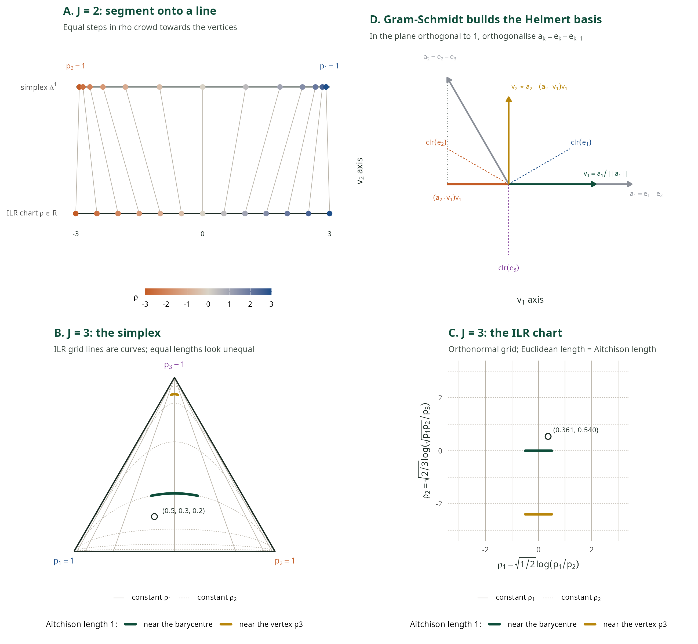
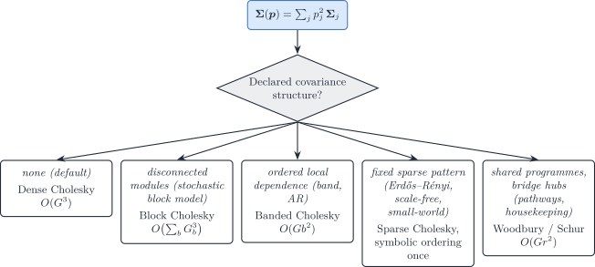

# 1.1 Population-level DeCovarT: generative model, derivatives and optimisation on the simplex

DeCovarT maximises a Gaussian-convolution log-likelihood for cellular
ratios \boldsymbol{p}\in\Delta^{J-1} when each reference column is a
random population profile, such as a sorted population or the pseudobulk
of one donor. This vignette covers the generative model and its
optimisation. [Sec. 1](#sec-naive-model) states the model and its
parametrisation. [Sec. 3](#sec-unconstrained) derives the analytic
first- and second-order derivatives with respect to the ambient
proportions \boldsymbol{p}, and [Sec. 4](#sec-constrained) maps them to
the isometric log-ratio (ILR) chart that the Newton–Raphson solver uses.
That section also compares the softmax, additive, centred and isometric
log-ratio charts and explains why the solver uses ILR.
[Sec. 5](#sec-closure-box) describes the second solver, L-BFGS-B on the
closure of the non-negative orthant, which reaches the faces of the
simplex exactly. Package entry points are
[`gradient_loglik_unconstrained()`](https://bastienchassagnol.github.io/DeCovarT/reference/gradient_loglik_unconstrained.md),
[`hessian_loglik_unconstrained()`](https://bastienchassagnol.github.io/DeCovarT/reference/hessian_loglik_unconstrained.md),
[`gradient_loglik_constrained()`](https://bastienchassagnol.github.io/DeCovarT/reference/gradient_loglik_constrained.md),
[`hessian_loglik_constrained()`](https://bastienchassagnol.github.io/DeCovarT/reference/hessian_loglik_constrained.md)
and
[`fit_decovart()`](https://bastienchassagnol.github.io/DeCovarT/reference/fit_decovart.md).

Inference has its own vignette. The expected Fisher information, the ILR
delta-method covariance behind
[`vcov.decovart_fit()`](https://bastienchassagnol.github.io/DeCovarT/reference/fit_decovart.md),
and the Wald, profile, Firth and bootstrap intervals are in the
[population inference
vignette](https://bastienchassagnol.github.io/DeCovarT/articles/01-2-population-inference.md).
Single-cell references follow the same split: [generative model and
optimisation](https://bastienchassagnol.github.io/DeCovarT/articles/02-1-single-cell-generative-optimisation.md)
and
[inference](https://bastienchassagnol.github.io/DeCovarT/articles/02-2-single-cell-inference.md).

> **Notation (shared by all vignettes; aligned with the article)**
>
> Gene g=1,\ldots,G; cell type j=1,\ldots,J (a second type is \ell);
> bulk sample i=1,\ldots,N; reference donor (replicate) r=1,\ldots,R;
> cell c, with C_j reference cells of type j. The index i is dropped
> inside a derivation and restored in the model statements.
>
> | Symbol | Meaning |
> |----|----|
> | y\_{gi}, \boldsymbol{y}\_{\cdot i} | Bulk expression on a linear scale |
> | m\_{ji}, n_i=\sum_jm\_{ji} | Cells of type j in bulk sample i, and their total |
> | \tilde{\boldsymbol{y}}\_{\cdot i}=\boldsymbol{y}\_{\cdot i}/n_i | Bulk expression per cell |
> | \boldsymbol{p}\_{\cdot i}\in\Delta^{J-1} | Cell fractions, p\_{ji}=m\_{ji}/n_i |
> | \boldsymbol{\rho}\_{i}\in\mathbb{R}^{J-1} | Isometric log-ratio (ILR) coordinates of \boldsymbol{p}\_{\cdot i}, \boldsymbol{p}\_{\cdot i}=\operatorname{softmax}(\mathbf{V}\boldsymbol{\rho}\_i) with a Helmert basis \mathbf{V} |
> | \boldsymbol{q}\_{\cdot i} | Transcript fractions, q\_{ji}=p\_{ji}S_j/\sum\_\ell p\_{\ell i}S\_\ell |
> | \boldsymbol{\mu}\_{\cdot j}, \boldsymbol{\Sigma}\_j | Mean and G\times G gene–gene covariance of a type-j population profile |
> | \boldsymbol{\Omega}\_j=\boldsymbol{\Sigma}\_j^{-1} | Precision matrix of type j |
> | \boldsymbol{\Gamma}\_g | J\times J covariance across cell types for gene g (`bMIND`, `EPIC-unmix`, `Unico`) |
> | \boldsymbol{x}\_{\cdot j,i} | Purified profile of type j in sample i |
> | x\_{gc}, \boldsymbol{x}\_{\cdot c}, s_c | Raw UMI count of gene g in reference cell c, and the size factor of cell c |
> | \boldsymbol{\lambda}\_{\cdot c}, \boldsymbol{z}\_{\cdot c} | Size-free expression of cell c; its latent log-expression in the Poisson log-normal (PLN) model |
> | \tilde{\boldsymbol{\mu}}\_{\cdot j}=C_j^{-1}\sum\_{c\in j}\boldsymbol{x}\_{\cdot c}=S_j\boldsymbol{\theta}\_{\cdot j} | Per-cell mean of the raw UMI counts of the C_j reference cells of type j |
> | \boldsymbol{\theta}\_{\cdot j}, S_j=\mathbf{1}^{\top}\tilde{\boldsymbol{\mu}}\_{\cdot j} | Relative abundance (\mathbf{1}^{\top}\boldsymbol{\theta}\_{\cdot j}=1) and mean transcriptome size of a type-j cell |
> | \boldsymbol{\Sigma}\_{W,j}, \boldsymbol{\Sigma}\_{B,j} | Within-donor cell-to-cell covariance of type j (one single-cell sample); between-donor covariance of type j (needs R\ge2 donors) |
> | \boldsymbol{S}\_W(\boldsymbol{v})=\sum_jv_j\boldsymbol{\Sigma}\_{W,j}, \boldsymbol{S}\_B(\boldsymbol{v})=\sum_jv_j^2\boldsymbol{\Sigma}\_{B,j} | Linear and quadratic covariance mixtures with weights \boldsymbol{v} |
> | \boldsymbol{V}\_j | Empirical covariance of type j, computed from its reference profiles or cells |
> | \boldsymbol{R}\_j | Empirical correlation matrix of type j (bold; the scalar R is the number of donors) |
> | \boldsymbol{\Delta}\_j=\operatorname{diag}(\boldsymbol{V}\_j) | Diagonal matrix of the empirical variances of type j |
> | \lambda | Penalty of a regularised covariance or precision estimator |
> | \psi_g, \mathcal{D}\_g | Negative binomial dispersion of gene g; deviance of gene g in a count model |
> | \delta\_{gj} | Detection rate of gene g in type j (fraction of cells with a non-zero count) |
> | \varpi\_{\ell\mid j}, \varpi\_{j\ell}, \bar\varpi | MixSim overlap: probability of misclassifying a draw of j into \ell, pairwise overlap \varpi\_{j\ell}=\varpi\_{\ell\mid j}+\varpi\_{j\mid\ell}, and its average over pairs (`BarOmega`) |
> | \boldsymbol{T}\_{ji}=\sum\_{c=1}^{m\_{ji}}\boldsymbol{X}\_{jic} | Total expression contributed by type j to sample i |
> | a_i | Sample-wide scale between the reference and the bulk library |
> | c_i=a_in_i, \phi_i=a_i^2n_i | Mean scale and variance scale of the single-cell model |
> | b_g, \tilde b_g=b_g^{\mathrm{bulk}}/b_g^{\mathrm{ref}} | Capture efficiency of gene g in one protocol, and the gene-wise platform ratio; \tilde{\boldsymbol{B}}=\operatorname{diag}(\tilde{\boldsymbol{b}}) |
> | \boldsymbol{D}\_i | Diagonal, heteroscedastic bulk measurement noise |
>
> A tilde marks a quantity rescaled to a reference unit: per cell
> (\tilde{\boldsymbol{y}}, \tilde{\boldsymbol{\mu}}) or relative to the
> reference protocol (\tilde{\boldsymbol{b}}). \boldsymbol{\Sigma}\_j
> couples **genes** within one cell type; \boldsymbol{\Gamma}\_g couples
> **cell types** within one gene. A symbol absent from this table is
> defined in the vignette that uses it, with one meaning there.

> **Note 1: Notation specific to this vignette**
>
> - One bulk sample is fixed, so the sample index i is dropped; a,b
>   index ILR coordinates.
> - \boldsymbol{\mu}\in\mathbb{R}^{G\times J}: mean signature, with
>   columns \boldsymbol{\mu}\_{\cdot j}.
> - \boldsymbol{\Sigma}(\boldsymbol{p})=\sum_j
>   p_j^{2}\boldsymbol{\Sigma}\_j and
>   \boldsymbol{\Omega}(\boldsymbol{p})=\boldsymbol{\Sigma}(\boldsymbol{p})^{-1}.
> - \boldsymbol{p}: proportions on the open simplex (ambient score
>   equations treat them as free coordinates in (0,1)^{J}).
> - \boldsymbol{\rho}\in\mathbb{R}^{J-1}: ILR coordinates (Helmert chart
>   \mathbf{V}),
>   \boldsymbol{p}=\operatorname{softmax}(\mathbf{V}\boldsymbol{\rho}).
>   The manuscript DAG uses the same letter for the ALR chart; here
>   \boldsymbol{\rho} denotes the ILR coordinates used by the solvers,
>   and \boldsymbol{\rho}^{\mathrm{alr}} the ALR coordinates
>   ([Sec. 4.1](#sec-simplex-notation)).

## The naive model and its parametrisation

The released model treats the reference moments
\boldsymbol{\zeta}=(\boldsymbol{\mu},\\\boldsymbol{\Sigma}\_j\\) as
known and ignores every technical scale of single-cell data (the
[single-cell generative and optimisation
vignette](https://bastienchassagnol.github.io/DeCovarT/articles/02-1-single-cell-generative-optimisation.md)
adds them). The simplex is handled by a chart, not by constraints:

\boldsymbol{p}=\boldsymbol{\psi}(\boldsymbol{\rho})=\operatorname{softmax}(\mathbf{V}\boldsymbol{\rho}),
\qquad
\boldsymbol{\rho}=\mathbf{V}^{\top}\log\boldsymbol{p}\in\mathbb{R}^{J-1},
\tag{1}

with \mathbf{V} a Helmert basis ([Sec. 4.5](#sec-ilr)). Two readings of
[Eq. 1](#eq-ilr-chart) are useful later.

- **An inverse link on the composition.** \boldsymbol{\psi} maps a free
  linear predictor to the simplex, as the inverse multinomial-logit link
  does in a GLM for categorical responses. Here it acts on a parameter,
  not on the response: the bulk mean \boldsymbol{\mu}\boldsymbol{p}
  stays linear in \boldsymbol{p}.
- **The exponential version of `MEAD`’s device.** `MEAD` estimates
  unconstrained weights \boldsymbol{\beta}\_i=\gamma_i\boldsymbol{p}\_i,
  then sets
  \hat{\boldsymbol{p}}\_i=\hat{\boldsymbol{\beta}}\_i^{\star}/\lVert\hat{\boldsymbol{\beta}}\_i^{\star}\rVert_1,
  with either truncation \hat{\boldsymbol{\beta}}\_i\vee 0 or, near
  zero, the softplus h_a(\beta)=a^{-1}\log(1+e^{a\beta}) ([Xie et al.
  2026](#ref-xieStatisticalInferenceCell2026)). The softplus makes the
  delta method usable at the boundary, but for any finite a the
  estimator is not consistent; the authors take a=10 and report slightly
  lower coverage. Writing the weights as \beta_j=e^{z_j} instead and
  normalising gives the softmax: positivity is exact, no tuning constant
  is needed, and [Eq. 1](#eq-ilr-chart) is a reparametrisation, so the
  MLE in \boldsymbol{\rho} is the MLE in \boldsymbol{p}. The price is
  the same as for the softplus near zero: a proportion that is truly
  zero sits at \lVert\boldsymbol{\rho}\rVert=\infty ([boundary
  inference](https://bastienchassagnol.github.io/DeCovarT/articles/01-2-population-inference.html#sec-boundary)).

## Matrix calculus reminders

The score and Hessian of the convolution log-likelihood follow from a
handful of matrix-derivative identities. The statements below mirror the
matrix-calculus remarks in the manuscript Methods appendix.

*Remark 1* (First-order matrix calculus). Let
\boldsymbol{A}=\boldsymbol{A}(p) and \boldsymbol{B}=\boldsymbol{B}(p) be
invertible matrix-valued functions of a scalar p, and let
\boldsymbol{U}, \boldsymbol{V} be constant matrices of compatible size.
Then

\begin{aligned} \frac{\partial\det(\boldsymbol{A})}{\partial p} &=
\det(\boldsymbol{A})\\ \mathrm{tr}\\\left( \boldsymbol{A}^{-1}
\frac{\partial\boldsymbol{A}}{\partial p} \right), \\
\frac{\partial(\boldsymbol{U}\boldsymbol{A}\boldsymbol{V})}{\partial p}
&= \boldsymbol{U} \frac{\partial\boldsymbol{A}}{\partial p}
\boldsymbol{V}, \\ \frac{\partial\boldsymbol{A}^{-1}}{\partial p} &= -
\boldsymbol{A}^{-1} \frac{\partial\boldsymbol{A}}{\partial p}
\boldsymbol{A}^{-1}. \end{aligned} \tag{2}

The chain rule on \log\det yields

\frac{\partial\log\det(\boldsymbol{A})}{\partial p} =
\mathrm{tr}\\\left( \boldsymbol{A}^{-1}
\frac{\partial\boldsymbol{A}}{\partial p} \right), \qquad
\frac{\partial\log\det(\boldsymbol{A}^{-1})}{\partial p} = -
\mathrm{tr}\\\left( \boldsymbol{A}^{-1}
\frac{\partial\boldsymbol{A}}{\partial p} \right). \tag{3}

For a residual quadratic form with symmetric precision
\boldsymbol{\Omega} and mean map linear in p,

\frac{\partial}{\partial p} \bigl(
(\boldsymbol{y}-\boldsymbol{x}p)^{\top} \boldsymbol{\Omega}
(\boldsymbol{y}-\boldsymbol{x}p) \bigr) = -2\\ \boldsymbol{x}^{\top}
\boldsymbol{\Omega} (\boldsymbol{y}-\boldsymbol{x}p). \tag{4}

*Remark 2* (Second-order matrix calculus). Differentiating the inverse
once more gives

\frac{\partial^{2}\boldsymbol{A}^{-1}}{\partial p\_{j}\partial
p\_{\ell}} = \boldsymbol{A}^{-1} \Biggl(
\frac{\partial\boldsymbol{A}}{\partial p\_{j}} \boldsymbol{A}^{-1}
\frac{\partial\boldsymbol{A}}{\partial p\_{\ell}} -
\frac{\partial^{2}\boldsymbol{A}}{\partial p\_{j}\partial p\_{\ell}} +
\frac{\partial\boldsymbol{A}}{\partial p\_{\ell}} \boldsymbol{A}^{-1}
\frac{\partial\boldsymbol{A}}{\partial p\_{j}} \Biggr)
\boldsymbol{A}^{-1}, \tag{5}

and the trace is linear, \partial\mathrm{tr}(\boldsymbol{A})/\partial
p\_{j} =\mathrm{tr}(\partial\boldsymbol{A}/\partial p\_{j}). Combining
[Eq. 2](#eq-matrix-first-order) with that linearity yields

\frac{\partial^{2}\log\det(\boldsymbol{A}^{-1})}{\partial p\_{j}\partial
p\_{\ell}} = - \mathrm{tr}\\\left\[ \boldsymbol{A}^{-1}
\frac{\partial^{2}\boldsymbol{A}}{\partial p\_{j}\partial p\_{\ell}}
\right\] + \mathrm{tr}\\\left\[ \left( \boldsymbol{A}^{-1}
\frac{\partial\boldsymbol{A}}{\partial p\_{j}} \right) \left(
\boldsymbol{A}^{-1} \frac{\partial\boldsymbol{A}}{\partial p\_{\ell}}
\right) \right\]. \tag{6}

> **Tip 2: Inner products in the score**
>
> Several terms are \boldsymbol{\Omega}-inner products of signature
> columns, \boldsymbol{\mu}\_{\cdot
> j}^{\top}\boldsymbol{\Omega}\boldsymbol{\mu}\_{\cdot \ell}. The
> package evaluates them in one matrix product,
> \boldsymbol{\mu}^{\top}\boldsymbol{\Omega}\boldsymbol{\mu}, shared by
> the Hessian and the expected Fisher information.

## Unconstrained score and Hessian

Conditional on the reference moments
\boldsymbol{\zeta}=(\boldsymbol{\mu},\\\boldsymbol{\Sigma}\_{j}\\), the
bulk follows \boldsymbol{y}\mid\boldsymbol{\zeta},\boldsymbol{p}
\sim\mathcal{N}\_{G}\bigl(\boldsymbol{\mu}\boldsymbol{p},
\boldsymbol{\Sigma}(\boldsymbol{p})\bigr). Up to an additive constant
independent of \boldsymbol{p},

\ell\_{\boldsymbol{y}\mid\boldsymbol{\zeta}}(\boldsymbol{p}) =
\tfrac{1}{2}\log\det\boldsymbol{\Omega}(\boldsymbol{p}) - \tfrac{1}{2}
(\boldsymbol{y}-\boldsymbol{\mu}\boldsymbol{p})^{\top}
\boldsymbol{\Omega}(\boldsymbol{p})
(\boldsymbol{y}-\boldsymbol{\mu}\boldsymbol{p}). \tag{7}

> **Important 3: The determinant term carries a factor \tfrac{1}{2}**
>
> Both terms of [Eq. 7](#eq-loglik) are halved, because
> \log\det\boldsymbol{\Omega}=-\log\det\boldsymbol{\Sigma} enters the
> Gaussian log-density as
> -\tfrac{1}{2}\log\det\boldsymbol{\Sigma}(\boldsymbol{p}). DeCovarT
> releases before 2.3.0 implemented
> -\log\det\boldsymbol{\Sigma}(\boldsymbol{p}), which doubled the
> determinant contribution. The objective was then *not* the stated
> Gaussian model, and it disagreed with the [expected Fisher
> information](https://bastienchassagnol.github.io/DeCovarT/articles/01-2-population-inference.html#sec-fisher-wald),
> which had always been the one implied by the correct density. With the
> factor restored,
> [`loglik_multivariate()`](https://bastienchassagnol.github.io/DeCovarT/reference/loglik_multivariate.md)
> matches `mvtnorm::dmvnorm(..., log = TRUE)` up to the constant
> \tfrac{G}{2}\log(2\pi), and
> \mathbb{E}\[-\mathbf{H}\]=I(\boldsymbol{p}) holds exactly (see
> [observed versus expected
> information](https://bastienchassagnol.github.io/DeCovarT/articles/01-2-population-inference.html#nte-obs-vs-exp)).
> Point estimates move only slightly, because the two terms trade off
> differently, but likelihood **values**, AIC, likelihood-ratio
> statistics, and any curvature-based standard error do change.

> **Warning 4: What “unconstrained” means here**
>
> [Sec. 3](#sec-unconstrained) treats each p\_{j} as an ambient
> coordinate in (0,1) and ignores \sum\_{j}p\_{j}=1. The resulting
> gradient and Hessian are the building blocks of the ILR chain rule in
> [Sec. 4](#sec-constrained). They are **not** the coordinates used by
> Marquardt–Levenberg or Newton–Raphson in the package (those optimise
> in \boldsymbol{\rho}-space). The box-constrained L-BFGS-B path is the
> exception: it works directly in \boldsymbol{p} with \[0,1\]^{J} boxes
> and does not enforce the simplex exactly.

Applying [Eq. 3](#eq-logdet) and [Eq. 4](#eq-quad-form-deriv) with
\partial\boldsymbol{\Sigma}/\partial
p\_{j}=2p\_{j}\boldsymbol{\Sigma}\_{j} gives the ambient score.

> **Theorem 1 (Unconstrained gradient)**
>
> \begin{aligned} \frac{\partial\ell}{\partial p\_{j}} &=
> \underbrace{-p\_{j}\\\mathrm{tr}\bigl(
> \boldsymbol{\Omega}\boldsymbol{\Sigma}\_{j} \bigr)}\_{\text{purple}} +
> \underbrace{ (\boldsymbol{y}-\boldsymbol{\mu}\boldsymbol{p})^{\top}
> \boldsymbol{\Omega} \boldsymbol{\mu}\_{\cdot j} }\_{\text{blue}} \\
> &\quad+ \underbrace{ p\_{j}\\
> (\boldsymbol{y}-\boldsymbol{\mu}\boldsymbol{p})^{\top}
> \boldsymbol{\Omega} \boldsymbol{\Sigma}\_{j} \boldsymbol{\Omega}
> (\boldsymbol{y}-\boldsymbol{\mu}\boldsymbol{p}) }\_{\text{orange}}.
> \end{aligned} \tag{8}

Differentiating [Eq. 8](#eq-grad-unconstrained) once more yields the
ambient Hessian \mathbf{H}\in\mathcal{M}\_{J\times J}. Diagonal and
off-diagonal blocks keep the same colour pairing.

> **Theorem 2 (Unconstrained Hessian)**
>
> For j\in\\1,\ldots,J\\,
>
> \begin{aligned} \mathbf{H}\_{jj} &= \frac{\partial^{2}\ell}{\partial
> p\_{j}^{2}} = \underbrace{
> -\\\mathrm{tr}(\boldsymbol{\Omega}\boldsymbol{\Sigma}\_{j}) +
> 2p\_{j}^{2}\\\mathrm{tr}\bigl(
> (\boldsymbol{\Omega}\boldsymbol{\Sigma}\_{j})^{2} \bigr)
> }\_{\text{purple}} \\ &\quad \underbrace{ -2p\_{j}
> (\boldsymbol{y}-\boldsymbol{\mu}\boldsymbol{p})^{\top}
> \boldsymbol{\Omega} \boldsymbol{\Sigma}\_{j} \boldsymbol{\Omega}
> \boldsymbol{\mu}\_{\cdot j} - \boldsymbol{\mu}\_{\cdot j}^{\top}
> \boldsymbol{\Omega} \boldsymbol{\mu}\_{\cdot j} }\_{\text{blue}} \\
> &\quad \underbrace{ -2p\_{j}
> (\boldsymbol{y}-\boldsymbol{\mu}\boldsymbol{p})^{\top}
> \boldsymbol{\Omega} \boldsymbol{\Sigma}\_{j} \boldsymbol{\Omega}
> \boldsymbol{\mu}\_{\cdot j} -
> (\boldsymbol{y}-\boldsymbol{\mu}\boldsymbol{p})^{\top}
> \boldsymbol{\Omega} \bigl(
> 4p\_{j}^{2}\boldsymbol{\Sigma}\_{j}\boldsymbol{\Omega}\boldsymbol{\Sigma}\_{j} -
> \boldsymbol{\Sigma}\_{j} \bigr) \boldsymbol{\Omega}
> (\boldsymbol{y}-\boldsymbol{\mu}\boldsymbol{p}) }\_{\text{orange}},
> \end{aligned} \tag{9}
>
> and for j\neq\ell,
>
> \begin{aligned} \mathbf{H}\_{j\ell} &=
> \frac{\partial^{2}\ell}{\partial p\_{j}\partial p\_{\ell}} =
> \underbrace{ 2p\_{j}p\_{\ell}\\ \mathrm{tr}\bigl(
> \boldsymbol{\Omega}\boldsymbol{\Sigma}\_{\ell}
> \boldsymbol{\Omega}\boldsymbol{\Sigma}\_{j} \bigr) }\_{\text{purple}}
> \\ &\quad \underbrace{ -2p\_{j}
> (\boldsymbol{y}-\boldsymbol{\mu}\boldsymbol{p})^{\top}
> \boldsymbol{\Omega} \boldsymbol{\Sigma}\_{j} \boldsymbol{\Omega}
> \boldsymbol{\mu}\_{\cdot \ell} - \boldsymbol{\mu}\_{\cdot j}^{\top}
> \boldsymbol{\Omega} \boldsymbol{\mu}\_{\cdot \ell} }\_{\text{blue}} \\
> &\quad \underbrace{ -2p\_{\ell}
> (\boldsymbol{y}-\boldsymbol{\mu}\boldsymbol{p})^{\top}
> \boldsymbol{\Omega} \boldsymbol{\Sigma}\_{\ell} \boldsymbol{\Omega}
> \boldsymbol{\mu}\_{\cdot j} - 4p\_{j}p\_{\ell}
> (\boldsymbol{y}-\boldsymbol{\mu}\boldsymbol{p})^{\top}
> \boldsymbol{\Omega} \boldsymbol{\Sigma}\_{j} \boldsymbol{\Omega}
> \boldsymbol{\Sigma}\_{\ell} \boldsymbol{\Omega}
> (\boldsymbol{y}-\boldsymbol{\mu}\boldsymbol{p}) }\_{\text{orange}}.
> \end{aligned} \tag{10}

The stationary equation \nabla\ell(\boldsymbol{p})=\boldsymbol{0} has no
closed root, so DeCovarT uses iterative solvers. Analytic gradients and
Hessians are checked against Richardson extrapolation in `numDeriv`
([Gilbert and Varadhan 2019](#ref-R-numDeriv)).

## Constrained optimisation on the simplex

The cellular ratios satisfy p\_{j}\ge 0 and \sum\_{j}p\_{j}=1, the
*compositional* or unit-simplex constraint. An optimiser can handle it
in three ways: eliminate it with a reparametrisation, enforce it softly
with penalties or barriers, or enforce it exactly with projections and
Karush–Kuhn–Tucker (KKT) conditions. DeCovarT uses the first route: a
C^{2} diffeomorphism from free Euclidean coordinates onto the open
simplex, so every Newton step stays feasible by construction. Four such
charts are common: the softmax, the additive log-ratio (ALR), the
centred log-ratio (CLR) and the isometric log-ratio (ILR). This section
defines the notation they share ([Sec. 4.1](#sec-simplex-notation)),
presents each chart ([Sec. 4.2](#sec-lse)–[Sec. 4.5](#sec-ilr)),
explains why DeCovarT uses ILR ([Sec. 4.6](#sec-chart-choice)) and
compares the four side by side ([Sec. 4.7](#sec-chart-comparison)). The
derivatives of the ILR chart ([Sec. 4.8](#sec-ilr-deriv),
[Sec. 4.9](#sec-chain-rule)), their link to the Lagrangian
([Sec. 4.10](#sec-kkt)) and perspectives on Bayesian charts and exact
zeros ([Sec. 4.11](#sec-structural-zeros)) follow.

The compositional background is chapter 4 of *Modelling and Analysis of
Compositional Data* ([Pawlowsky-Glahn et al.
2015](#ref-CoordinateRepresentation2015)), cited below by page.

### Notation for compositions and charts

| Symbol | Meaning |
|:---|:---|
| \Delta^{J-1}=\\\boldsymbol{p}\in\mathbb{R}^{J}:p\_{j}\ge 0,\\ \mathbf{1}\_{J}^{\mathsf{T}}\boldsymbol{p}=1\\ | closed unit simplex of J cell types; its interior \mathring{\Delta}^{J-1} has p\_{j}\>0 for all j |
| \mathbf{1}\_{J}, \mathbf{I}\_{J} | vector of ones, identity matrix |
| \mathbf{H}\_{J}=\mathbf{I}\_{J}-\tfrac{1}{J}\mathbf{1}\_{J}\mathbf{1}\_{J}^{\mathsf{T}} | centring matrix: orthogonal projector onto \mathbf{1}\_{J}^{\perp}=\\\boldsymbol{w}:\mathbf{1}\_{J}^{\mathsf{T}}\boldsymbol{w}=0\\ |
| \mathcal{C}(\boldsymbol{x})=\boldsymbol{x}/(\mathbf{1}\_{J}^{\mathsf{T}}\boldsymbol{x}) | closure of a positive vector \boldsymbol{x}\in(0,\infty)^{J} |
| \log\boldsymbol{p}, \exp\boldsymbol{z} | applied component by component |
| g(\boldsymbol{p})=\bigl(\prod\_{j}p\_{j}\bigr)^{1/J} | geometric mean |
| \operatorname{softmax}(\boldsymbol{z})=\mathcal{C}(\exp\boldsymbol{z}) | closure of exponentiated scores \boldsymbol{z}\in\mathbb{R}^{J} |
| \boldsymbol{\psi} | a chart: a smooth bijection from free coordinates onto \mathring{\Delta}^{J-1} |
| \boldsymbol{z}\in\mathbb{R}^{J}, \boldsymbol{\rho}^{\mathrm{alr}}\in\mathbb{R}^{J-1}, \boldsymbol{\xi}\in\mathbf{1}\_{J}^{\perp}, \boldsymbol{\rho}\in\mathbb{R}^{J-1} | softmax scores, ALR coordinates (reference J unless a superscript names it), CLR and ILR coordinates |
| \mathbf{V}\in\mathbb{R}^{J\times(J-1)} | Helmert basis of the ILR chart ([Sec. 4.5.1](#sec-helmert)) |
| \mathbf{D}\_{r}\in\mathbb{R}^{(J-1)\times J} | ALR contrast with reference r: rows \boldsymbol{e}\_{j}^{\mathsf{T}}-\boldsymbol{e}\_{r}^{\mathsf{T}}, j\neq r |
| \mathbf{S}(\boldsymbol{p})=\operatorname{diag}(\boldsymbol{p})-\boldsymbol{p}\boldsymbol{p}^{\mathsf{T}} | Jacobian of the softmax at \boldsymbol{p} |

Table 1: Notation for compositions and their charts.

**The closure operator.** \mathcal{C} rescales any positive vector to
unit sum. It discards the total and keeps the relative sizes:
\mathcal{C}(c\boldsymbol{x})=\mathcal{C}(\boldsymbol{x}) for every c\>0.
A composition is therefore an equivalence class of proportional positive
vectors, and \mathcal{C} picks its representative on the simplex
([Pawlowsky-Glahn et al. 2015,
33–35](#ref-CoordinateRepresentation2015)). Two consequences matter
here.

- Only scale-free functions of \boldsymbol{p} are meaningful, and the
  log-ratios \log(p\_{j}/p\_{\ell}) are the simplest. A constant added
  to \log\boldsymbol{p} does not change the composition, so every
  log-ratio chart must cancel the direction \mathbf{1}\_{J}.
- Closure creates dependence. Library-size normalisation of counts is a
  closure, and it induces negative covariances between parts that need
  not exist in the absolute abundances.

Closure also gives the simplex a Euclidean vector-space structure, the
*Aitchison geometry*: perturbation
\boldsymbol{x}\oplus\boldsymbol{y}=\mathcal{C}(\boldsymbol{x}\circ\boldsymbol{y})
plays the role of addition, powering
\alpha\odot\boldsymbol{x}=\mathcal{C}(\boldsymbol{x}^{\alpha}) the role
of scalar multiplication, and the inner product is
\langle\boldsymbol{x},\boldsymbol{y}\rangle\_{a}
=\operatorname{clr}(\boldsymbol{x})^{\mathsf{T}}\operatorname{clr}(\boldsymbol{y})
([Pawlowsky-Glahn et al. 2015](#ref-CoordinateRepresentation2015),
Property 4.2, p. 35). The log-ratio charts below are linear maps for
this structure; they differ in whether they also preserve its inner
product.

### Softmax and log-sum-exp

The softmax of scores \boldsymbol{z}\in\mathbb{R}^{J} is evaluated
through the log-sum-exp (LSE) to avoid overflow,

s\_{j} = \frac{e^{z\_{j}}}{\sum\_{\ell}e^{z\_{\ell}}} =
e^{z\_{j}-\operatorname{LSE}(\boldsymbol{z})}, \qquad
\operatorname{LSE}(\boldsymbol{z}) =
z\_{\max}+\log\sum\_{\ell}e^{z\_{\ell}-z\_{\max}}, \quad
z\_{\max}=\max\_{\ell}z\_{\ell}. \tag{11}

Its Jacobian is
\mathbf{J}\_{\mathrm{softmax}}=\mathbf{S}(\boldsymbol{s})
=\operatorname{diag}(\boldsymbol{s})-\boldsymbol{s}\boldsymbol{s}^{\mathsf{T}},
which is also \nabla^{2}\operatorname{LSE}(\boldsymbol{z}). The second
derivative is the third-order tensor

H\_{j\ell m} = s\_{j}\bigl\[
(\delta\_{j\ell}-s\_{\ell})(\delta\_{jm}-s\_{m}) -
s\_{\ell}(\delta\_{\ell m}-s\_{m}) \bigr\]. \tag{12}

The softmax with J free scores is over-parametrised:
\operatorname{softmax}(\boldsymbol{z}+c\mathbf{1}\_{J})
=\operatorname{softmax}(\boldsymbol{z}), because closure removes the
common factor e^{c}. Accordingly
\mathbf{S}(\boldsymbol{s})\mathbf{1}\_{J}=\boldsymbol{0}, the Jacobian
has rank J-1, and the Hessian of
\ell(\operatorname{softmax}(\boldsymbol{z})) has a zero eigenvalue along
\mathbf{1}\_{J}: a Newton system in \boldsymbol{z} is singular. The
three log-ratio charts are three ways to remove this redundant
direction. Each writes
\boldsymbol{p}=\operatorname{softmax}(\mathbf{B}\boldsymbol{\theta})
with \boldsymbol{\theta}\in\mathbb{R}^{J-1} and a matrix
\mathbf{B}\in\mathbb{R}^{J\times(J-1)} whose columns, together with
\mathbf{1}\_{J}, span \mathbb{R}^{J}. ALR pins one score to zero, CLR
constrains the scores to sum to zero, and ILR spans
\mathbf{1}\_{J}^{\perp} with an orthonormal basis.

### Additive log-ratio chart

Pin a reference cell type r, by default the last one (r=J). The ALR
coordinates and their inverse, the *additive logistic* transform, are
([Aitchison 1982](#ref-aitchisonStatisticalAnalysisCompositional1982))

\rho^{\mathrm{alr}}\_{j} = \log\\\left(\frac{p\_{j}}{p\_{J}}\right),
\qquad p\_{j} =
\frac{e^{\rho^{\mathrm{alr}}\_{j}}}{1+\sum\_{\ell\<J}e^{\rho^{\mathrm{alr}}\_{\ell}}}\\
(j\<J), \qquad p\_{J} =
\frac{1}{1+\sum\_{\ell\<J}e^{\rho^{\mathrm{alr}}\_{\ell}}}. \tag{13}

Equivalently
\boldsymbol{p}=\operatorname{softmax}(\rho^{\mathrm{alr}}\_{1},\ldots,\rho^{\mathrm{alr}}\_{J-1},0)
and \boldsymbol{\rho}^{\mathrm{alr}}=\mathbf{D}\_{J}\log\boldsymbol{p}.
The “1” in the denominator is the reference part; the word *additive*
refers to the sum of exponentials in that denominator, not to the
Aitchison perturbation ([Pawlowsky-Glahn et al. 2015,
47](#ref-CoordinateRepresentation2015)). The package solvers use the
isometric chart below, not this additive one. The Jacobian of
[Eq. 13](#eq-alr-maps) is the softmax Jacobian with the reference column
dropped, \partial
p\_{j}/\partial\rho^{\mathrm{alr}}\_{a}=p\_{j}(\delta\_{ja}-p\_{a}) for
a=1,\ldots,J-1.

> **Example 1 (ALR in both directions for
> \boldsymbol{p}=(0.5,0.3,0.2))**
>
> Colours track each cell type: \textcolor{#1d4e89}{p\_{1}},
> \textcolor{#c45c26}{p\_{2}} and the reference
> \textcolor{#7b3294}{p\_{3}}.
>
> *Forward.* Each coordinate compares one cell type with the reference,
> so the reference enters both coordinates:
>
> \left\\ \begin{aligned} \rho^{\mathrm{alr}}\_{1}
> &=\log\frac{\textcolor{#1d4e89}{p\_{1}}}{\textcolor{#7b3294}{p\_{3}}}
> =\log\frac{\textcolor{#1d4e89}{0.5}}{\textcolor{#7b3294}{0.2}} =\log
> 2.5\approx 0.916\\ \rho^{\mathrm{alr}}\_{2}
> &=\log\frac{\textcolor{#c45c26}{p\_{2}}}{\textcolor{#7b3294}{p\_{3}}}
> =\log\frac{\textcolor{#c45c26}{0.3}}{\textcolor{#7b3294}{0.2}} =\log
> 1.5\approx 0.405 \end{aligned} \right.
>
> *Backward.* Exponentiate each coordinate, give the reference the
> weight e^{0}=1, then close; the common denominator is
> 1+e^{\rho^{\mathrm{alr}}\_{1}}+e^{\rho^{\mathrm{alr}}\_{2}}=1+2.5+1.5=5:
>
> \left\\ \begin{aligned} \textcolor{#1d4e89}{p\_{1}}
> &=\frac{e^{\rho^{\mathrm{alr}}\_{1}}}{1+e^{\rho^{\mathrm{alr}}\_{1}}+e^{\rho^{\mathrm{alr}}\_{2}}}
> =\frac{\textcolor{#1d4e89}{2.5}}{5} =\textcolor{#1d4e89}{0.5}\\
> \textcolor{#c45c26}{p\_{2}}
> &=\frac{e^{\rho^{\mathrm{alr}}\_{2}}}{1+e^{\rho^{\mathrm{alr}}\_{1}}+e^{\rho^{\mathrm{alr}}\_{2}}}
> =\frac{\textcolor{#c45c26}{1.5}}{5} =\textcolor{#c45c26}{0.3}\\
> \textcolor{#7b3294}{p\_{3}}
> &=\frac{1}{1+e^{\rho^{\mathrm{alr}}\_{1}}+e^{\rho^{\mathrm{alr}}\_{2}}}
> =\frac{\textcolor{#7b3294}{1}}{5} =\textcolor{#7b3294}{0.2}
> \end{aligned} \right.
>
> *Changing the reference.* With \textcolor{#1d4e89}{p\_{1}} as
> reference (superscript 1),
> \rho^{\mathrm{alr},1}\_{1}=\log(\textcolor{#c45c26}{p\_{2}}/\textcolor{#1d4e89}{p\_{1}})\approx-0.511
> and
> \rho^{\mathrm{alr},1}\_{2}=\log(\textcolor{#7b3294}{p\_{3}}/\textcolor{#1d4e89}{p\_{1}})\approx-0.916,
> that is
> \rho^{\mathrm{alr},1}\_{1}=\rho^{\mathrm{alr}}\_{2}-\rho^{\mathrm{alr}}\_{1}
> and \rho^{\mathrm{alr},1}\_{2}=-\rho^{\mathrm{alr}}\_{1}. The two
> charts are related by the matrix
> \bigl(\begin{smallmatrix}-1&1\\-1&0\end{smallmatrix}\bigr), which is
> invertible but not orthogonal: its singular values are 1.618 and
> 0.618, so it stretches some directions 2.6 times more than others.

**What the reference changes, and what it does not.** All ALR charts
describe the same family of compositions; only the coordinates differ.
[Sec. 4.6](#sec-chart-choice) shows that the estimate
\hat{\boldsymbol{p}}, the maximised log-likelihood and the delta-method
covariance of \hat{\boldsymbol{p}} do not depend on the reference. The
numerical geometry does: ALR coordinates refer to an oblique,
non-orthogonal basis of the simplex ([Pawlowsky-Glahn et al. 2015,
47](#ref-CoordinateRepresentation2015)), so Euclidean lengths, angles
and Hessian condition numbers in \boldsymbol{\rho}^{\mathrm{alr}} change
with the reference.

### Centred log-ratio coefficients

The CLR transform divides each part by the geometric mean ([Aitchison
1982](#ref-aitchisonStatisticalAnalysisCompositional1982)):

\boldsymbol{\xi} = \operatorname{clr}(\boldsymbol{p}) =
\log\frac{\boldsymbol{p}}{g(\boldsymbol{p})} =
\mathbf{H}\_{J}\log\boldsymbol{p}, \qquad \boldsymbol{p} =
\mathcal{C}(\exp\boldsymbol{\xi}) =
\operatorname{softmax}(\boldsymbol{\xi}). \tag{14}

CLR treats every cell type symmetrically and preserves the Aitchison
geometry: distances and inner products between compositions equal
Euclidean ones between their CLR vectors ([Pawlowsky-Glahn et al.
2015](#ref-CoordinateRepresentation2015), Property 4.2, p. 35). Pairwise
log-ratios are differences, \log(p\_{j}/p\_{\ell})=\xi\_{j}-\xi\_{\ell}.
The price is a constraint on the coefficients:
\mathbf{1}\_{J}^{\mathsf{T}}\boldsymbol{\xi}=0. CLR gives J coefficients
for J-1 degrees of freedom, so they are not coordinates in a basis, a
random CLR vector has a singular covariance matrix, and the coefficients
change when a subcomposition is analysed ([Pawlowsky-Glahn et al. 2015,
34–35](#ref-CoordinateRepresentation2015)). Optimising over a free
\boldsymbol{\xi}\in\mathbb{R}^{J} is the over-parametrised softmax of
[Sec. 4.2](#sec-lse) again.

CLR is nevertheless the hub between the other charts. Since
\mathbf{D}\_{r}\mathbf{1}\_{J}=\boldsymbol{0} and
\mathbf{V}^{\mathsf{T}}\mathbf{1}\_{J}=\boldsymbol{0}, both ALR and ILR
are linear images of CLR:
\boldsymbol{\rho}^{\mathrm{alr}}=\mathbf{D}\_{r}\boldsymbol{\xi} and
\boldsymbol{\rho}=\mathbf{V}^{\mathsf{T}}\boldsymbol{\xi}.

### Isometric log-ratio chart

ILR expresses \boldsymbol{\xi} in an orthonormal basis of the hyperplane
\mathbf{1}\_{J}^{\perp} ([Egozcue et al.
2003](#ref-egozcueIsometricLogratioTransformations2003)). Choose
\mathbf{V}\in\mathbb{R}^{J\times(J-1)} with

\mathbf{V}^{\mathsf{T}}\mathbf{V}=\mathbf{I}\_{J-1}, \qquad
\mathbf{V}^{\mathsf{T}}\mathbf{1}\_{J}=\mathbf{0}, \qquad
\mathbf{V}\mathbf{V}^{\mathsf{T}}=\mathbf{H}\_{J}. \tag{15}

ILR coordinates and their inverse are ([Pawlowsky-Glahn and Buccianti
2011](#ref-pawlowsky-glahnCompositionalDataAnalysis2011))

\boldsymbol{\rho} = \mathbf{V}^{\mathsf{T}}\log\boldsymbol{p} =
\mathbf{V}^{\mathsf{T}}\operatorname{clr}(\boldsymbol{p}), \qquad
\boldsymbol{p} = \operatorname{softmax}(\mathbf{V}\boldsymbol{\rho}) =
\mathcal{C}\bigl\\\exp(\mathbf{V}\boldsymbol{\rho})\bigr\\. \tag{16}

In the book’s notation the contrast matrix is
\boldsymbol{\Psi}=\mathbf{V}^{\mathsf{T}}, and [Eq. 15](#eq-helmert) is
its Eq. (4.5); [Eq. 16](#eq-ilr-maps) is Eqs. (4.7)–(4.8)
([Pawlowsky-Glahn et al. 2015,
36–37](#ref-CoordinateRepresentation2015)). ILR keeps the strengths of
both previous charts: like ALR it gives J-1 unconstrained coordinates,
and like CLR it preserves the Aitchison geometry, now with
d\_{a}(\boldsymbol{x},\boldsymbol{y})
=\lVert\operatorname{ilr}(\boldsymbol{x})-\operatorname{ilr}(\boldsymbol{y})\rVert
(Property 4.5, p. 37). No cell type is a reference. Package helpers
[`helmert_basis()`](https://bastienchassagnol.github.io/DeCovarT/reference/helmert_basis.md),
[`isometric_logistic()`](https://bastienchassagnol.github.io/DeCovarT/reference/isometric_logistic.md)
and
[`isometric_log_ratio()`](https://bastienchassagnol.github.io/DeCovarT/reference/isometric_log_ratio.md)
implement [Eq. 15](#eq-helmert)–[Eq. 16](#eq-ilr-maps) with a
log-sum-exp softmax, matching the
[`compositions::ilr()`](https://rdrr.io/pkg/compositions/man/ilr.html) /
`ilrInv()` convention on a Helmert basis ([van den Boogaart et al.
2025](#ref-R-compositions)).

#### The Helmert basis: definition, role and use

**Definition.** The ILR chart needs one orthonormal basis of
\mathbf{1}\_{J}^{\perp}; there are infinitely many. The Helmert basis is
the one with a closed form. Column k=1,\ldots,J-1 of
[`helmert_basis()`](https://bastienchassagnol.github.io/DeCovarT/reference/helmert_basis.md)
is

\boldsymbol{v}\_{k} = \frac{1}{\sqrt{k(k+1)}}
\bigl(\underbrace{1,\ldots,1}\_{k},\\-k,\\\underbrace{0,\ldots,0}\_{J-k-1}\bigr)^{\mathsf{T}}.
\tag{17}

Each column sums to zero and has unit norm, and two columns are
orthogonal because the later one is constant on the support of the
earlier one. The basis is the Gram–Schmidt orthonormalisation of the
generating system of the simplex ([Egozcue et al.
2003](#ref-egozcueIsometricLogratioTransformations2003)), and its
contrast matrix is a Helmert matrix without the constant row
([Pawlowsky-Glahn et al. 2015](#ref-CoordinateRepresentation2015),
Example 4.6, p. 40). The book lists the same basis in reverse order,
with the first coordinate contrasting the first J-1 parts with the last
one.

**Role: every coordinate is a balance.** Inserting
[Eq. 17](#eq-helmert-columns) into [Eq. 16](#eq-ilr-maps) gives

\rho\_{k} = \boldsymbol{v}\_{k}^{\mathsf{T}}\log\boldsymbol{p} =
\sqrt{\frac{k}{k+1}}\\ \log\frac{g(p\_{1},\ldots,p\_{k})}{p\_{k+1}},
\tag{18}

the normalised log-ratio between the geometric mean of the first k cell
types and type k+1. This is the *balance* of a sequential binary
partition: level k splits \\1,\ldots,k+1\\ into \\1,\ldots,k\\ (sign +)
and \\k+1\\ (sign -) ([Pawlowsky-Glahn et al.
2015](#ref-CoordinateRepresentation2015), Eq. (4.9), pp. 38–39). For J=4
the sign matrix is

| Level     | p\_{1} | p\_{2} | p\_{3} | p\_{4} |
|:----------|:------:|:------:|:------:|:------:|
| \rho\_{1} |   +    |   -    |   0    |   0    |
| \rho\_{2} |   +    |   +    |   -    |   0    |
| \rho\_{3} |   +    |   +    |   +    |   -    |

Table 2: Sequential binary partition encoded by the Helmert basis for
J=4.

The factor \sqrt{k/(k+1)} makes balances comparable across levels.
Balances are geometrically orthogonal, so each carries information the
others do not; geometric orthogonality does not imply that their
estimates are uncorrelated ([Pawlowsky-Glahn et al. 2015,
41](#ref-CoordinateRepresentation2015)). The Helmert basis thus does
three jobs at once:

- it cancels the closure direction, because every column sums to zero:
  adding a constant to \log\boldsymbol{p} leaves \boldsymbol{\rho}
  unchanged;
- it removes the redundant softmax direction while keeping Euclidean
  geometry, because the columns are orthonormal;
- it is explicit and sparse, so \mathbf{V}\boldsymbol{\rho} costs O(J)
  operations per column and needs no QR or Gram–Schmidt step at run
  time.

**Use in practice.** DeCovarT builds \mathbf{V} once from J and proceeds
as follows.

1.  Map a starting composition to coordinates with
    `isometric_log_ratio(p)`, which computes
    \mathbf{V}^{\mathsf{T}}\log\boldsymbol{p}.
2.  Iterate on \boldsymbol{\rho}\in\mathbb{R}^{J-1} with the score and
    Hessian of [Theorem 3](#thm-chain-rule); no step can leave the
    simplex.
3.  Map back with `isometric_logistic(rho)`, a log-sum-exp softmax of
    \mathbf{V}\boldsymbol{\rho}.
4.  Push the covariance of \hat{\boldsymbol{\rho}} to
    \hat{\boldsymbol{p}} with the Jacobian
    \mathbf{S}(\boldsymbol{p})\mathbf{V} ([ILR delta
    method](https://bastienchassagnol.github.io/DeCovarT/articles/01-2-population-inference.html#sec-fisher-rho)).

The order of the cell types fixes which balances are reported, not the
estimate. Both helpers accept another basis through their `V` argument:
for instance, a partition that first contrasts immune with stromal types
gives coordinates with a biological reading. Any such basis is
\mathbf{V}Q for an orthogonal Q ([Proposition 2](#prp-ilr-rotation)).



Figure 1: The ILR chart is an isometry from the simplex to Euclidean
space. **A** (J=2): the simplex is a segment and the ILR chart a line;
equally spaced values of \rho (colour) map to compositions that crowd
towards the vertices. **B** (J=3): lines of constant \rho\_{1} (solid)
and \rho\_{2} (dotted) on the ternary triangle, the composition
(0.5,0.3,0.2) and two segments of Aitchison length 1, one near the
barycentre (green) and one near the vertex p\_{3}=1 (gold). **C**: the
same objects in ILR coordinates, where the grid is orthonormal and both
segments have Euclidean length 1. **D**: in the plane orthogonal to
\mathbf{1}\_{3}, Gram–Schmidt applied to
\boldsymbol{a}\_{1}=\boldsymbol{e}\_{1}-\boldsymbol{e}\_{2} and
\boldsymbol{a}\_{2}=\boldsymbol{e}\_{2}-\boldsymbol{e}\_{3} normalises
\boldsymbol{a}\_{1} into \boldsymbol{v}\_{1}, removes from
\boldsymbol{a}\_{2} its projection on \boldsymbol{v}\_{1} (orange), and
normalises the residual into \boldsymbol{v}\_{2}: the two Helmert
columns of [Eq. 17](#eq-helmert-columns). Dashed lines are the CLR
images of the canonical vectors. Script:
`vignettes/scripts/generate_ilr_isometry_figure.R`.

[Figure 1](#fig-ilr-isometry) summarises the construction. Gram–Schmidt
applied to the successive differences
\boldsymbol{e}\_{k}-\boldsymbol{e}\_{k+1}, which span
\mathbf{1}\_{J}^{\perp}, returns exactly the columns of
[Eq. 17](#eq-helmert-columns) for every J (panel D); the resulting chart
is isometric, so equal Aitchison lengths become equal Euclidean lengths
(panels B–C).

> **Example 2 (ILR in both directions for
> \boldsymbol{p}=(0.5,0.3,0.2))**
>
> For J=3 the Helmert columns are
> \boldsymbol{v}\_{1}=(1,-1,0)^{\mathsf{T}}/\sqrt{2} and
> \boldsymbol{v}\_{2}=(1,1,-2)^{\mathsf{T}}/\sqrt{6}. The entries of
> \mathbf{V} are the weights each coordinate gives to each
> \log\textcolor{#1d4e89}{p\_{1}}, \log\textcolor{#c45c26}{p\_{2}} and
> \log\textcolor{#7b3294}{p\_{3}}; in each coordinate the weights sum to
> zero.
>
> *Forward*,
> \boldsymbol{\rho}=\mathbf{V}^{\mathsf{T}}\log\boldsymbol{p}:
>
> \left\\ \begin{aligned} \rho\_{1}
> &=\tfrac{1}{\sqrt{2}}\log\textcolor{#1d4e89}{p\_{1}}
> -\tfrac{1}{\sqrt{2}}\log\textcolor{#c45c26}{p\_{2}}
> +0\cdot\log\textcolor{#7b3294}{p\_{3}}
> =\tfrac{1}{\sqrt{2}}\log\frac{\textcolor{#1d4e89}{0.5}}{\textcolor{#c45c26}{0.3}}
> \approx 0.361\\ \rho\_{2}
> &=\tfrac{1}{\sqrt{6}}\log\textcolor{#1d4e89}{p\_{1}}
> +\tfrac{1}{\sqrt{6}}\log\textcolor{#c45c26}{p\_{2}}
> -\tfrac{2}{\sqrt{6}}\log\textcolor{#7b3294}{p\_{3}}
> =\sqrt{\tfrac{2}{3}}\log\frac{\sqrt{\textcolor{#1d4e89}{0.5}\times\textcolor{#c45c26}{0.3}}}{\textcolor{#7b3294}{0.2}}
> \approx 0.540 \end{aligned} \right.
>
> \rho\_{1} balances type 1 against type 2; \rho\_{2} balances their
> geometric mean against type 3.
>
> *Backward*, in two steps. First
> \boldsymbol{\xi}=\mathbf{V}\boldsymbol{\rho}, read row by row, so row
> j of \mathbf{V} rebuilds the CLR coefficient of cell type j:
>
> \left\\ \begin{aligned} \textcolor{#1d4e89}{\xi\_{1}}
> &=\tfrac{1}{\sqrt{2}}\rho\_{1}+\tfrac{1}{\sqrt{6}}\rho\_{2} \approx
> 0.255+0.220=0.476\\ \textcolor{#c45c26}{\xi\_{2}}
> &=-\tfrac{1}{\sqrt{2}}\rho\_{1}+\tfrac{1}{\sqrt{6}}\rho\_{2} \approx
> -0.255+0.220=-0.035\\ \textcolor{#7b3294}{\xi\_{3}}
> &=0\cdot\rho\_{1}-\tfrac{2}{\sqrt{6}}\rho\_{2} \approx -0.441
> \end{aligned} \right.
>
> Then exponentiate and close; the common denominator is
> e^{\xi\_{1}}+e^{\xi\_{2}}+e^{\xi\_{3}}\approx 1.609+0.966+0.644=3.218:
>
> \left\\ \begin{aligned} \textcolor{#1d4e89}{p\_{1}}
> &=\frac{e^{\xi\_{1}}}{e^{\xi\_{1}}+e^{\xi\_{2}}+e^{\xi\_{3}}}
> \approx\frac{\textcolor{#1d4e89}{1.609}}{3.218}
> =\textcolor{#1d4e89}{0.5}\\ \textcolor{#c45c26}{p\_{2}}
> &=\frac{e^{\xi\_{2}}}{e^{\xi\_{1}}+e^{\xi\_{2}}+e^{\xi\_{3}}}
> \approx\frac{\textcolor{#c45c26}{0.966}}{3.218}
> =\textcolor{#c45c26}{0.3}\\ \textcolor{#7b3294}{p\_{3}}
> &=\frac{e^{\xi\_{3}}}{e^{\xi\_{1}}+e^{\xi\_{2}}+e^{\xi\_{3}}}
> \approx\frac{\textcolor{#7b3294}{0.644}}{3.218}
> =\textcolor{#7b3294}{0.2} \end{aligned} \right.
>
> The intermediate \boldsymbol{\xi} is exactly
> \operatorname{clr}(\boldsymbol{p}).
>
> *Link with ALR.* Since \rho^{\mathrm{alr}}\_{j}=\xi\_{j}-\xi\_{3},
>
> \left\\ \begin{aligned}
> \rho^{\mathrm{alr}}\_{1}&=\tfrac{1}{\sqrt{2}}\rho\_{1}+\tfrac{3}{\sqrt{6}}\rho\_{2}\approx
> 0.255+0.661=0.916\\
> \rho^{\mathrm{alr}}\_{2}&=-\tfrac{1}{\sqrt{2}}\rho\_{1}+\tfrac{3}{\sqrt{6}}\rho\_{2}\approx
> -0.255+0.661=0.405 \end{aligned} \right.
>
> which recovers [Example 1](#exm-alr-numeric). The matrix
> \mathbf{A}\_{3}=\mathbf{D}\_{3}\mathbf{V} of this map has orthogonal
> columns of lengths 1 and \sqrt{3}: ALR keeps \rho\_{1} at unit scale
> and stretches \rho\_{2}, the balance of the reference
> \textcolor{#7b3294}{p\_{3}} against the rest, by \sqrt{3}.

> **Proposition 1 (ILR is a C^{2} diffeomorphism)**
>
> \boldsymbol{\psi}:\mathbb{R}^{J-1}\to\mathring{\Delta}^{J-1},
> \boldsymbol{\rho}\mapsto\operatorname{softmax}(\mathbf{V}\boldsymbol{\rho}),
> is bijective and infinitely differentiable, with inverse
> \mathbf{V}^{\mathsf{T}}\log\boldsymbol{p}. Every critical point in
> \boldsymbol{\rho}-space maps to a unique composition in the open
> simplex, and conversely.

### Why DeCovarT uses the ILR chart

The question is which chart to optimise in, given that all of them
describe the same model. Two kinds of invariance answer it: statistical
invariance, which every chart has, and numerical invariance, which only
ILR has under a change of convention.

**Statistical invariance holds for every chart.** Let
\boldsymbol{\theta}'=\mathbf{A}\boldsymbol{\theta} be any invertible
linear change of coordinates, for instance between ILR and ALR
(\boldsymbol{\rho}^{\mathrm{alr}}=\mathbf{A}\_{r}\boldsymbol{\rho} with
\mathbf{A}\_{r}=\mathbf{D}\_{r}\mathbf{V}) or between two ALR
references. The likelihood is a function of \boldsymbol{p} alone, so the
maximiser is equivariant and \hat{\boldsymbol{p}} and
\ell(\hat{\boldsymbol{p}}) are the same in every chart. The delta method
is invariant too: the Jacobian becomes
\mathbf{J}\_{\boldsymbol{\psi}}\mathbf{A}^{-1} and the information
\mathbf{A}^{-\mathsf{T}}\mathcal{I}\mathbf{A}^{-1}, so

\bigl(\mathbf{J}\_{\boldsymbol{\psi}}\mathbf{A}^{-1}\bigr)
\bigl(\mathbf{A}^{-\mathsf{T}}\mathcal{I}\mathbf{A}^{-1}\bigr)^{-1}
\bigl(\mathbf{J}\_{\boldsymbol{\psi}}\mathbf{A}^{-1}\bigr)^{\mathsf{T}}
=
\mathbf{J}\_{\boldsymbol{\psi}}\mathcal{I}^{-1}\mathbf{J}\_{\boldsymbol{\psi}}^{\mathsf{T}}.
\tag{19}

In this sense ALR is reference-invariant: whichever cell type is the
denominator, a correct implementation returns the same
\hat{\boldsymbol{p}} and the same Wald covariance for
\hat{\boldsymbol{p}}. A material change in \hat{\boldsymbol{p}} when the
reference is permuted signals a numerical or convergence problem, not a
statistical dependence on the reference. Pure Newton steps share this
invariance, because the Newton step is invariant under affine changes of
coordinates ([Boyd et al. 2004](#ref-boydConvexOptimization2004),
sec. 9.5).

**Numerical invariance differs.** What changes with the chart is the
Euclidean geometry the solver sees: gradient norms, damping, stopping
rules and the condition number of the Hessian, which controls the
floating-point accuracy of every linear solve and of \mathcal{I}^{-1}.

> **Proposition 2 (Conditioning under a change of chart)**
>
> 1.  *ILR.* Any two orthonormal bases of \mathbf{1}\_{J}^{\perp}
>     satisfy \mathbf{V}^{\star}=\mathbf{V}Q with
>     Q^{\mathsf{T}}Q=\mathbf{I}\_{J-1}. Then
>     \boldsymbol{\rho}^{\star}=Q^{\mathsf{T}}\boldsymbol{\rho},
>     \nabla\_{\boldsymbol{\rho}^{\star}}\ell=Q^{\mathsf{T}}\nabla\_{\boldsymbol{\rho}}\ell
>     and
>     \mathbf{H}\_{\boldsymbol{\rho}^{\star}}=Q^{\mathsf{T}}\mathbf{H}\_{\boldsymbol{\rho}}Q.
>     Gradient norms, Hessian eigenvalues and condition numbers are
>     identical in every orthonormal basis.
>
> 2.  *ALR.* For every reference r,
>     \mathbf{A}\_{r}=\mathbf{D}\_{r}\mathbf{V} has J-2 singular values
>     equal to 1 and one equal to \sqrt{J}, so
>     \kappa(\mathbf{A}\_{r})=\sqrt{J}. The stretched direction is
>     \mathbf{V}^{\mathsf{T}}\boldsymbol{e}\_{r}, the log-abundance of
>     the reference against all other types. Since
>     \mathbf{H}\_{\boldsymbol{\rho}^{\mathrm{alr}}}=\mathbf{A}\_{r}^{-\mathsf{T}}\mathbf{H}\_{\boldsymbol{\rho}}\mathbf{A}\_{r}^{-1},
>
> \frac{\kappa(\mathbf{H}\_{\boldsymbol{\rho}})}{J} \le
> \kappa(\mathbf{H}\_{\boldsymbol{\rho}^{\mathrm{alr}}}) \le
> J\\\kappa(\mathbf{H}\_{\boldsymbol{\rho}}), \tag{20}
>
> and the curvature along the reference’s own direction is divided by J.

*Proof sketch.* (i) is a similarity by an orthogonal matrix. For (ii),
the rows of \mathbf{D}\_{r} are \boldsymbol{e}\_{j}-\boldsymbol{e}\_{r},
so
\mathbf{D}\_{r}\mathbf{D}\_{r}^{\mathsf{T}}=\mathbf{I}\_{J-1}+\mathbf{1}\_{J-1}\mathbf{1}\_{J-1}^{\mathsf{T}},
with eigenvalues 1 (multiplicity J-2) and J. Because
\mathbf{D}\_{r}\mathbf{1}\_{J}=\boldsymbol{0} and \mathbf{V} is an
orthonormal basis of \mathbf{1}\_{J}^{\perp}, \mathbf{A}\_{r} has the
same singular values as \mathbf{D}\_{r}. The right singular vector for
\sqrt{J} is proportional to
\mathbf{V}^{\mathsf{T}}\mathbf{D}\_{r}^{\mathsf{T}}\mathbf{1}\_{J-1}
=\mathbf{V}^{\mathsf{T}}(\mathbf{1}\_{J}-J\boldsymbol{e}\_{r})
=-J\\\mathbf{V}^{\mathsf{T}}\boldsymbol{e}\_{r}. The bounds follow from
\kappa(\mathbf{A}^{-\mathsf{T}}\mathbf{H}\mathbf{A}^{-1})
\le\kappa(\mathbf{A})^{2}\kappa(\mathbf{H}) applied in both directions.
\square

The constant \kappa(\mathbf{A}\_{r})=\sqrt{J} does not depend on r, but
the direction it distorts does, so the condition number of the ALR
Hessian depends on the reference. Even a perfectly conditioned problem,
\mathbf{H}\_{\boldsymbol{\rho}}=-\mathbf{I}, has
\kappa(\mathbf{H}\_{\boldsymbol{\rho}^{\mathrm{alr}}})=J in ALR
coordinates. For an illustrative random negative-definite Hessian with
J=6 (not a DeCovarT fit), \kappa=171 in every orthonormal basis, but
between 164 and 420 across the six ALR references. A rare cell type, or
one whose signature is nearly collinear with others, already has weak
curvature along its own direction; choosing it as the ALR reference
divides that curvature by J and makes the problem harder.

These differences affect the solver, not the target:

| Solver ingredient | ILR basis change (Q orthogonal) | ALR reference change (\mathbf{A} oblique) |
|:---|:---|:---|
| Maximiser \hat{\boldsymbol{p}}, \ell(\hat{\boldsymbol{p}}), delta-method \operatorname{Var}(\hat{\boldsymbol{p}}) | invariant | invariant |
| Pure Newton step | invariant | invariant |
| Gradient norm, steepest-ascent and BFGS steps from an identity start | invariant | changed |
| Spherical trust region, isotropic damping \mathbf{H}-\mu\mathbf{I} | invariant | changed |
| Hessian condition number, accuracy of \mathcal{I}^{-1} | invariant | changed by a factor up to J |

Table 3: Which parts of the optimisation depend on the chart convention.

The default solver is Newton–Raphson on \boldsymbol{\rho}
([`deconvolute_ratios_Newton_Raphson()`](https://bastienchassagnol.github.io/DeCovarT/reference/deconvolute_ratios_Marquardt_Levenberg.md)),
a second-order ascent that uses the analytic ILR score and Hessian of
[Theorem 3](#thm-chain-rule). Its pure Newton direction is the same in
every chart; its safeguards, a spherical trust region and Euclidean
step-length tolerances in
[`stats::nlminb()`](https://rdrr.io/r/stats/nlminb.html), are unchanged
by a rotation of the ILR basis but not by a change of ALR reference.

> **Note 5: Decision: DeCovarT optimises in ILR coordinates**
>
> ILR is the only chart of the four that is minimal (J-1 free
> coordinates), free of a privileged cell type and isometric for the
> Aitchison geometry. A change of its convention, the order of cell
> types or a different balance basis, is an orthogonal rotation, which
> leaves gradient norms and Hessian condition numbers unchanged. A
> change of ALR reference is an oblique map whose effect on conditioning
> depends on the reference. The solvers,
> [`vcov.decovart_fit()`](https://bastienchassagnol.github.io/DeCovarT/reference/fit_decovart.md)
> and the boundary diagnostics therefore work in ILR coordinates. ALR is
> kept for comparison with multinomial-logit models, which use a
> reference category.

### Side-by-side comparison of the four charts

| Property | Softmax | ALR | CLR | ILR |
|:---|:---|:---|:---|:---|
| Coordinates | \boldsymbol{z}\in\mathbb{R}^{J} | \boldsymbol{\rho}^{\mathrm{alr}}=\mathbf{D}\_{r}\log\boldsymbol{p}\in\mathbb{R}^{J-1} | \boldsymbol{\xi}=\mathbf{H}\_{J}\log\boldsymbol{p}, with \mathbf{1}^{\mathsf{T}}\boldsymbol{\xi}=0 | \boldsymbol{\rho}=\mathbf{V}^{\mathsf{T}}\log\boldsymbol{p}\in\mathbb{R}^{J-1} |
| Inverse map | \operatorname{softmax}(\boldsymbol{z}) | \operatorname{softmax}(\boldsymbol{\rho}^{\mathrm{alr}},0) | \operatorname{softmax}(\boldsymbol{\xi}) | \operatorname{softmax}(\mathbf{V}\boldsymbol{\rho}) |
| Feasible after inverse map | yes | yes | yes | yes |
| Free and minimal (J-1 coordinates) | no: one redundant direction | yes | no: J coordinates on a hyperplane | yes |
| Jacobian of the inverse map | rank J-1 out of J | full rank | full rank on \mathbf{1}^{\perp} only | full rank |
| Privileged cell type | none | the reference r | none | none (order fixes the balances) |
| Isometry with Aitchison geometry | no | no (oblique basis) | yes | yes |
| Change of convention | not applicable | oblique, \kappa(\mathbf{A}\_{r})=\sqrt{J} | not applicable | orthogonal rotation |
| Hessian conditioning across conventions | singular | depends on the reference | singular | invariant |
| Exact zeros at finite coordinates | no | no | no | no |
| Reading of a coordinate | none (shift-invariant) | log-ratio to the reference | log-ratio to the geometric mean | balance between groups |
| Typical use | neural networks, mixture weights | reference-category regression | exploration, visualisation | likelihood inference, optimisation |

Table 4: Four charts for the unit-simplex constraint.

All four charts guarantee feasibility, and none reaches a face of the
simplex at finite coordinates. For likelihood inference ILR is usually
the best suited: it is the only chart that is at once minimal, symmetric
in the cell types and isometric, which is why Egozcue et al. introduced
it to avoid the drawbacks of both ALR and CLR ([Egozcue et al.
2003](#ref-egozcueIsometricLogratioTransformations2003);
[Pawlowsky-Glahn et al. 2015, 33](#ref-CoordinateRepresentation2015)).
Its cost is interpretation: a balance is less direct than a ratio to one
reference, and the Helmert balances depend on the order of cell types
unless a partition with a biological meaning is chosen.

### Efficient derivatives of \boldsymbol{\psi}

Write \mathbf{S}(\boldsymbol{p})=\operatorname{diag}(\boldsymbol{p})
-\boldsymbol{p}\boldsymbol{p}^{\mathsf{T}}. The Jacobian is

\mathbf{J}\_{\boldsymbol{\psi}}(\boldsymbol{\rho}) =
\frac{\partial\boldsymbol{p}}{\partial\boldsymbol{\rho}^{\mathsf{T}}} =
\mathbf{S}(\boldsymbol{p})\mathbf{V}. \tag{21}

[`jacobian_isometric_logistic()`](https://bastienchassagnol.github.io/DeCovarT/reference/jacobian_isometric_logistic.md)
returns this J\times(J-1) matrix. Let
\bar{\boldsymbol{v}}=\mathbf{V}^{\mathsf{T}}\boldsymbol{p},
\boldsymbol{h}\_{j}=\mathbf{V}\_{j\cdot}-\bar{\boldsymbol{v}} and
\mathbf{C}\_{V}=\mathbf{V}^{\mathsf{T}}\mathbf{S}(\boldsymbol{p})
\mathbf{V}. Slice j of the map Hessian is

\mathbf{H}\_{\psi\_{j}} = p\_{j}\bigl(
\boldsymbol{h}\_{j}\boldsymbol{h}\_{j}^{\mathsf{T}} -\mathbf{C}\_{V}
\bigr). \tag{22}

[`hessian_isometric_logistic()`](https://bastienchassagnol.github.io/DeCovarT/reference/hessian_isometric_logistic.md)
stores the tensor of shape (J-1)\times(J-1)\times J.

### Change of variables: ambient \boldsymbol{p} to ILR \boldsymbol{\rho}

Let \ell\_{\boldsymbol{\rho}}(\boldsymbol{\rho})
=\ell\_{\boldsymbol{y}\mid\boldsymbol{\zeta}}
\bigl(\boldsymbol{\psi}(\boldsymbol{\rho})\bigr). The chain rule maps
the unconstrained derivatives of [Sec. 3](#sec-unconstrained) into free
Euclidean coordinates.

> **Theorem 3 (Constrained score and Hessian)**
>
> \nabla\_{\boldsymbol{\rho}}\ell =
> \mathbf{J}\_{\boldsymbol{\psi}}^{\mathsf{T}}\nabla\_{\boldsymbol{p}}\ell
> =
> \mathbf{V}^{\mathsf{T}}\mathbf{S}(\boldsymbol{p})\nabla\_{\boldsymbol{p}}\ell,
> \tag{23}
>
> \mathbf{H}\_{\boldsymbol{\rho}} =
> \mathbf{J}\_{\boldsymbol{\psi}}^{\mathsf{T}}
> \mathbf{H}\_{\boldsymbol{p}} \mathbf{J}\_{\boldsymbol{\psi}} +
> \sum\_{j=1}^{J} \frac{\partial\ell}{\partial p\_{j}}
> \mathbf{H}\_{\psi\_{j}}. \tag{24}

> **Important 6: Implementation map**
>
> | Object | Package function |
> |:---|:---|
> | Ambient score / Hessian | [`gradient_loglik_unconstrained()`](https://bastienchassagnol.github.io/DeCovarT/reference/gradient_loglik_unconstrained.md), [`hessian_loglik_unconstrained()`](https://bastienchassagnol.github.io/DeCovarT/reference/hessian_loglik_unconstrained.md) |
> | Map Jacobian / Hessian | [`jacobian_isometric_logistic()`](https://bastienchassagnol.github.io/DeCovarT/reference/jacobian_isometric_logistic.md), [`hessian_isometric_logistic()`](https://bastienchassagnol.github.io/DeCovarT/reference/hessian_isometric_logistic.md) |
> | ILR score / Hessian | [`gradient_loglik_constrained()`](https://bastienchassagnol.github.io/DeCovarT/reference/gradient_loglik_constrained.md), [`hessian_loglik_constrained()`](https://bastienchassagnol.github.io/DeCovarT/reference/hessian_loglik_constrained.md) |
>
> [Eq. 24](#eq-chain-second) is the sum of a covariant pull-back of
> \mathbf{H} and a contraction of the ambient score against the map
> Hessian. Omitting the second summand is a common bug when porting
> first-order code to Newton methods.

### Lagrangian, KKT conditions and what the ILR chart removes

Without a chart, the estimation problem is

\max\_{\boldsymbol{p}\in\mathbb{R}^{J}}\\ \ell(\boldsymbol{p})
\quad\text{subject to}\quad
\mathbf{1}\_{J}^{\mathsf{T}}\boldsymbol{p}=1, \qquad
\boldsymbol{p}\ge\boldsymbol{0},

with Lagrangian

\mathcal{L}(\boldsymbol{p},\lambda,\boldsymbol{\nu}) =
\ell(\boldsymbol{p})
-\lambda\bigl(\mathbf{1}\_{J}^{\mathsf{T}}\boldsymbol{p}-1\bigr)
+\boldsymbol{\nu}^{\mathsf{T}}\boldsymbol{p}. \tag{25}

The constraints are linear, so a constraint qualification holds and
every local maximiser satisfies the KKT conditions ([Boyd et al.
2004](#ref-boydConvexOptimization2004), sec. 5.5.3):

\nabla\_{\boldsymbol{p}}\ell(\hat{\boldsymbol{p}})
-\lambda\mathbf{1}\_{J} +\boldsymbol{\nu} =\boldsymbol{0}, \qquad
\mathbf{1}\_{J}^{\mathsf{T}}\hat{\boldsymbol{p}}=1, \qquad
\boldsymbol{\nu}\ge\boldsymbol{0}, \qquad \nu\_{j}\hat{p}\_{j}=0.
\tag{26}

- *Interior point* (\hat{p}\_{j}\>0 for all j): complementary slackness
  gives \boldsymbol{\nu}=\boldsymbol{0}, hence \partial\ell/\partial
  p\_{j}=\lambda for every j. Every cell type has the same marginal
  gain, so moving mass from one type to another does not change \ell to
  first order. Multiplying by \hat{\boldsymbol{p}}^{\mathsf{T}} gives
  the multiplier,
  \lambda=\hat{\boldsymbol{p}}^{\mathsf{T}}\nabla\_{\boldsymbol{p}}\ell(\hat{\boldsymbol{p}}).
- *Boundary point* (\hat{p}\_{j}=0): \partial\ell/\partial p\_{j}
  =\lambda-\nu\_{j}\le\lambda. Adding some of type j would not increase
  the likelihood.

**The chart removes the multiplier.** Because
\mathbf{S}(\boldsymbol{p})\mathbf{1}\_{J}=\boldsymbol{p}-\boldsymbol{p}(\mathbf{1}\_{J}^{\mathsf{T}}\boldsymbol{p})=\boldsymbol{0},
the ILR score of [Eq. 23](#eq-chain-first) ignores any multiple of
\mathbf{1}\_{J} added to the ambient score:

\nabla\_{\boldsymbol{\rho}}\ell =
\mathbf{V}^{\mathsf{T}}\mathbf{S}(\boldsymbol{p})
\bigl(\nabla\_{\boldsymbol{p}}\ell-c\\\mathbf{1}\_{J}\bigr)
\quad\text{for every }c, \qquad
\mathbf{S}(\boldsymbol{p})\nabla\_{\boldsymbol{p}}\ell =
\operatorname{diag}(\boldsymbol{p})
\bigl(\nabla\_{\boldsymbol{p}}\ell-\lambda(\boldsymbol{p})\mathbf{1}\_{J}\bigr),
\tag{27}

with
\lambda(\boldsymbol{p})=\boldsymbol{p}^{\mathsf{T}}\nabla\_{\boldsymbol{p}}\ell.
The ILR score is therefore the KKT stationarity residual of
[Eq. 26](#eq-kkt), weighted by \boldsymbol{p}, with the multiplier set
to its current value. The vector
\mathbf{S}(\boldsymbol{p})\nabla\_{\boldsymbol{p}}\ell lies in
\mathbf{1}\_{J}^{\perp}, on which \mathbf{V}^{\mathsf{T}} is an
isometry, so

\bigl\lVert\nabla\_{\boldsymbol{\rho}}\ell\bigr\rVert =
\bigl\lVert\mathbf{S}(\boldsymbol{p})\nabla\_{\boldsymbol{p}}\ell\bigr\rVert,
\qquad \nabla\_{\boldsymbol{\rho}}\ell=\boldsymbol{0} \iff
\nabla\_{\boldsymbol{p}}\ell=\lambda\mathbf{1}\_{J}.

Stationary points in \boldsymbol{\rho} are exactly the interior KKT
points, the multiplier is recovered afterwards as
\hat{\lambda}=\hat{\boldsymbol{p}}^{\mathsf{T}}\nabla\_{\boldsymbol{p}}\ell(\hat{\boldsymbol{p}}),
and the score norm that
[`boundary_diagnostics()`](https://bastienchassagnol.github.io/DeCovarT/reference/boundary_diagnostics.md)
reports does not depend on the basis. Under ALR the same equivalence
holds, but the score norm changes with the reference.

**Second order: the Hessian of the Lagrangian.** Since
\sum\_{j}\psi\_{j}(\boldsymbol{\rho})=1 for every \boldsymbol{\rho},
\sum\_{j}\mathbf{H}\_{\psi\_{j}}=\mathbf{0}, and the curvature term of
[Eq. 24](#eq-chain-second) also ignores the multiplier:

\sum\_{j=1}^{J}\frac{\partial\ell}{\partial
p\_{j}}\mathbf{H}\_{\psi\_{j}} =
\sum\_{j=1}^{J}\Bigl(\frac{\partial\ell}{\partial p\_{j}}-\lambda\Bigr)
\mathbf{H}\_{\psi\_{j}}.

At an interior KKT point every bracket vanishes, so

\mathbf{H}\_{\boldsymbol{\rho}} =
\mathbf{J}\_{\boldsymbol{\psi}}^{\mathsf{T}}
\nabla^{2}\_{\boldsymbol{p}\boldsymbol{p}}\mathcal{L}\\
\mathbf{J}\_{\boldsymbol{\psi}}, \qquad
\nabla^{2}\_{\boldsymbol{p}\boldsymbol{p}}\mathcal{L}=\mathbf{H}\_{\boldsymbol{p}},
\tag{28}

because linear constraints add no curvature to the Lagrangian. The
columns of
\mathbf{J}\_{\boldsymbol{\psi}}=\mathbf{S}(\boldsymbol{p})\mathbf{V}
span \mathbf{1}\_{J}^{\perp}, the directions \boldsymbol{d} with
\mathbf{1}\_{J}^{\mathsf{T}}\boldsymbol{d}=0 that keep the sum equal to
one. [Eq. 28](#eq-reduced-hessian) is thus the Hessian of the Lagrangian
reduced to the tangent space of the constraint, and
\mathbf{H}\_{\boldsymbol{\rho}}\prec 0 is the classical second-order
sufficient condition
\boldsymbol{d}^{\mathsf{T}}\mathbf{H}\_{\boldsymbol{p}}\boldsymbol{d}\<0
for all \boldsymbol{d}\neq\boldsymbol{0} with
\mathbf{1}\_{J}^{\mathsf{T}}\boldsymbol{d}=0. Away from stationarity the
curvature term must be kept: it is the price of a curved chart.

**What the chart cannot do.** For finite \boldsymbol{\rho} every p\_{j}
is strictly positive, so the inequality multipliers \boldsymbol{\nu}
never become active. A maximiser on a face of the simplex lies at
infinity in \boldsymbol{\rho}: the iterates drift,
\lVert\nabla\_{\boldsymbol{\rho}}\ell\rVert decays only through the
factor \operatorname{diag}(\boldsymbol{p}) in
[Eq. 27](#eq-ilr-score-kkt), and the Hessian becomes singular. The
boundary is handled separately ([Sec. 4.11](#sec-structural-zeros)). The
benchmark reports the projected-gradient residual
\lVert\Pi\_{\Delta}(\hat{\boldsymbol{p}}+\nabla\_{\boldsymbol{p}}\ell)-\hat{\boldsymbol{p}}\rVert,
which is zero exactly at a KKT point, interior or not.

### Perspectives: Bayesian charts and the simplex boundary

> **Note 7: Going further: priors on log-ratio coordinates and estimates
> on a face**
>
> **What DeCovarT does today.** No chart above represents an exact zero
> at finite coordinates, because each contains a logarithm. For a true
> simplex face the package does **not** send \log 0 through the chart:
> it fixes the inactive set, optimises ILR coordinates on the remaining
> active face
> ([`restricted_mle_decovart()`](https://bastienchassagnol.github.io/DeCovarT/reference/restricted_mle_decovart.md)),
> and checks the KKT inequalities \partial\ell/\partial p\_{j}\le\lambda
> of [Sec. 4.10](#sec-kkt) for the zero coordinates
> ([`boundary_diagnostics()`](https://bastienchassagnol.github.io/DeCovarT/reference/boundary_diagnostics.md);
> see also the MLE-properties vignette).
>
> **Bayesian versions of the same charts.** A log-ratio chart turns a
> prior on the simplex into a prior on Euclidean coordinates, and the
> Gaussian bulk likelihood then combines with standard tools
> ([Pawlowsky-Glahn and Buccianti
> 2011](#ref-pawlowsky-glahnCompositionalDataAnalysis2011)).
>
> - *Logistic-normal prior.* A Gaussian prior
>   \boldsymbol{\rho}\sim\mathcal{N}\_{J-1}(\boldsymbol{m},\boldsymbol{\Lambda})
>   is a logistic-normal law on \boldsymbol{p}. Its log-density adds a
>   quadratic penalty to \ell(\boldsymbol{\rho}), so the posterior mode
>   is a ridge-penalised Newton problem in the same coordinates.
> - *Dirichlet prior.* The density of \boldsymbol{p} written in ILR
>   coordinates gains the Jacobian factor
>   \lvert\det\partial(p\_{1},\ldots,p\_{J-1})/\partial\boldsymbol{\rho}\rvert
>   =\sqrt{J}\prod\_{j}p\_{j}. A Dirichlet(\boldsymbol{\alpha}) prior
>   therefore becomes \sum\_{j}\alpha\_{j}\log p\_{j} in
>   \boldsymbol{\rho}, a concave function that pushes the mode away from
>   the boundary. Even the uniform prior
>   (\boldsymbol{\alpha}=\mathbf{1}) is not flat in \boldsymbol{\rho},
>   so a posterior mode depends on the chart in which it is computed;
>   posterior means and intervals for \boldsymbol{p} do not.
> - *CLR or ILR regression.* Covariates enter linearly on the log-ratio
>   scale,
>   \boldsymbol{\rho}\_{i}=\mathbf{B}\boldsymbol{z}\_{i}+\boldsymbol{u}\_{i},
>   which is the compositional analogue of a multinomial-logit model and
>   gives the marginal effect of a covariate on the composition.
> - The experimental MAP `CTS` path
>   (`scripts/experimental/03_04_DeCovarT_estimate_CTS_MAP_Bayesian.R`,
>   derived in the
>   [perspectives](https://bastienchassagnol.github.io/DeCovarT/articles/05-2-bayesian-wiener.html#sec-map-blup)
>   vignette) is one starting point.
>
> **Estimates on the boundary.** Several routes go beyond the active-set
> approach; none is implemented.
>
> - *Projection methods* work in \boldsymbol{p} itself: a projected
>   Newton or projected-gradient step onto \Delta^{J-1} reaches a face
>   in finitely many iterations, and its residual is the KKT residual
>   the benchmark already reports.
> - *Spike-and-slab or hurdle priors* put positive mass on p\_{j}=0, so
>   the posterior probability that a cell type is absent becomes an
>   output, alongside the boundary likelihood-ratio tests of the
>   MLE-properties vignette.
> - *Charts without a logarithm* reach the boundary at finite
>   coordinates, for instance the folded \alpha-transformation ([Tsagris
>   and Stewart 2020](#ref-tsagrisFoldedModelCompositional2020)) or
>   nonparametric regressions that admit exact zeros ([Tsagris et al.
>   2023](#ref-tsagrisFlexibleNonparametricRegression2023)). They are
>   data-side constructions and lose the isometry of ILR.
>
> Rounded zeros (detection limits) remain an imputation problem. True
> structural zeros belong on a face and should be fitted as an
> active-set or KKT problem, not by substituting a small positive
> constant into [Eq. 16](#eq-ilr-maps).

## L-BFGS-B on the closure of the non-negative orthant

The ILR chart maps the open simplex onto \mathbb{R}^{J-1}, so a
proportion that is exactly zero sits at infinity: a Newton step in
\boldsymbol{\rho} can approach a face but never reach it
([Sec. 4.11](#sec-structural-zeros)). The second solver,
[`deconvolute_ratios_L_BFGS_B()`](https://bastienchassagnol.github.io/DeCovarT/reference/deconvolute_ratios_Marquardt_Levenberg.md),
uses a chart in which the faces are ordinary points of a box, so the
bound handling of L-BFGS-B ([Byrd et al.
1995](#ref-byrdLimitedMemoryAlgorithm1995); [Zhu et al.
1997](#ref-zhuAlgorithm778LBFGSB1997)) can place a proportion exactly at
zero.

### The closure chart

Aitchison’s closure sends a non-negative weight vector to the simplex,

\boldsymbol{p}=\mathcal{C}(\boldsymbol{w})=\frac{\boldsymbol{w}}{\mathbf{1}^{\top}\boldsymbol{w}},
\qquad \boldsymbol{w}\in\[0,\infty)^{J}\setminus\\\boldsymbol{0}\\,
\tag{29}

([Aitchison 1982](#ref-aitchisonStatisticalAnalysisCompositional1982)).
L-BFGS-B works on \boldsymbol{w} with lower bound 0 and no upper bound,
starting from \boldsymbol{w}^{(0)}=\boldsymbol{p}^{(0)}. Every feasible
\boldsymbol{w} is mapped onto the closed simplex, and w_j=0 gives p_j=0
exactly, with no floor and no penalty.

The objective \ell(\mathcal{C}(\boldsymbol{w})) does not change when
\boldsymbol{w} is multiplied by a positive constant. The chart therefore
has one flat direction, the ray through \boldsymbol{w}. That direction
is harmless for a quasi-Newton method: the gradient is orthogonal to it
(below), so no step moves along it and the curvature pairs of L-BFGS-B
never see it.

### Gradient

Write \boldsymbol{g}=\nabla\_{\boldsymbol{p}}\ell for the ambient score
of [Sec. 3](#sec-unconstrained) and
s=\mathbf{1}^{\top}\boldsymbol{w}\>0. The Jacobian of
[Eq. 29](#eq-closure-chart) is
\partial\boldsymbol{p}/\partial\boldsymbol{w}^{\top}=s^{-1}(\mathbf{I}\_{J}-\boldsymbol{p}\mathbf{1}^{\top}),
so

\nabla\_{\boldsymbol{w}}\ell
=\frac{1}{s}\bigl(\boldsymbol{g}-(\boldsymbol{p}^{\top}\boldsymbol{g})\mathbf{1}\bigr)
=\frac{\boldsymbol{r}}{s}, \qquad
\boldsymbol{r}=\boldsymbol{g}-(\boldsymbol{p}^{\top}\boldsymbol{g})\mathbf{1}.
\tag{30}

Two properties follow. First,
\boldsymbol{w}^{\top}\nabla\_{\boldsymbol{w}}\ell=\boldsymbol{p}^{\top}\boldsymbol{g}-\boldsymbol{p}^{\top}\boldsymbol{g}=0:
the gradient is orthogonal to the flat ray. Second, \boldsymbol{r} is
the score centred at its \boldsymbol{p}-weighted mean, the quantity
whose components the KKT conditions of the simplex constrain.

### No spurious stationary points

A maximiser of \ell over the closed simplex satisfies the KKT conditions
of [Sec. 4.10](#sec-kkt): with a multiplier \lambda, g_j=\lambda when
p_j\>0 and g_j\le\lambda when p_j=0. Summing p_jg_j gives
\lambda=\boldsymbol{p}^{\top}\boldsymbol{g}, so the conditions read
r_j=0 for p_j\>0 and r_j\le0 for p_j=0.

L-BFGS-B stops at a KKT point of the box problem in \boldsymbol{w}:
\partial\ell/\partial w_j=0 when w_j\>0 and \partial\ell/\partial
w_j\le0 when w_j=0. Since \partial\ell/\partial w_j=r_j/s with s\>0, and
w_j\>0 exactly when p_j\>0, the two sets of conditions coincide. Every
stationary point of the solver is a stationary point of the simplex
problem, interior or on a face. No weaker certificate is involved: the
reported first-order residual ([Sec. 4.10](#sec-kkt)) is computed on
\boldsymbol{r} directly.

### Why not a stick-breaking box

A stick-breaking chart, p_1=v_1, p_k=v_k\prod\_{l\<k}(1-v_l) and
p_J=\prod\_{l\<J}(1-v_l) with \boldsymbol{v}\in\[0,1\]^{J-1}, also maps
a box onto the closed simplex. It was tried and rejected. Once a stick
is exhausted, the later coordinates no longer move \boldsymbol{p}: v_1=1
gives \partial\boldsymbol{p}/\partial v_k=\boldsymbol{0} for every k\>1.
These dead directions create box-KKT points in \boldsymbol{v} that are
not KKT points in \boldsymbol{p}, and L-BFGS-B stopped at such spurious
vertices. On a covariance-driven design (G=20, J=3, 60 bulk samples per
composition), stick-breaking fell short of the best attainable
log-likelihood by up to 2.19, with at least one unbalanced run in ten
stuck at a vertex. Newton–Raphson on the ILR chart fell short by up to
7.4 when the maximum lay on a face, because it can only approach that
face. The closure chart fell short by at most 8\times10^{-4}.

### What it replaces

The earlier implementation placed the box \[0,1\]^{J} on \boldsymbol{p}
itself and evaluated \ell at unnormalised \boldsymbol{p}, then divided
the result by its total. With \boldsymbol{p}=c\\\boldsymbol{p}^{\star}
off the simplex, the mean \boldsymbol{\mu}\boldsymbol{p} and the
covariance \boldsymbol{\Sigma}(\boldsymbol{p}) both carry a free scale
c, so that solver fitted a different model, a free-scale fit
renormalised afterwards, much as non-negative least squares followed by
renormalisation is a free-scale least-squares fit. Its estimate was not
a stationary point of the simplex problem. The closure chart evaluates
\ell at \mathcal{C}(\boldsymbol{w}) only, so the likelihood is the
stated one at every iterate.

> **Numerical speed-ups and solver safeguards**
>
> The analytic maps above are only half of a usable optimiser. Practical
> bottlenecks that showed up on the hybrid scenario in
> [Covariance-driven hybrid
> scenario](https://bastienchassagnol.github.io/DeCovarT/articles/R2-covariance-driven.html#sec-hybrid-deconvolution)
> live in `R/02_02_population_decovart_estimate_ratios.R`.
>
> ------------------------------------------------------------------------
>
> #### Cache a Cholesky factorisation of \boldsymbol{\Sigma}(\boldsymbol{p})
>
> Within one iteration, objective / gradient / Hessian callbacks hit the
> same trial \boldsymbol{p}. The helper
> [`.sigma_p_factorisation()`](https://bastienchassagnol.github.io/DeCovarT/reference/dot-sigma_p_factorisation.md)
> caches a single lower-triangular Cholesky factor \boldsymbol{L} with
> \boldsymbol{\Sigma}(\boldsymbol{p})=\boldsymbol{L}\boldsymbol{L}^{\mathsf{T}}
> and returns \log\det\boldsymbol{\Sigma}(\boldsymbol{p})=2\sum_g\log
> L\_{gg} together with the precision
> \boldsymbol{\Omega}(\boldsymbol{p})=\boldsymbol{L}^{-\mathsf{T}}\boldsymbol{L}^{-1}
> (via `chol2inv`) without repeating an O(G^{3}) factorisation.
>
> [`loglik_multivariate()`](https://bastienchassagnol.github.io/DeCovarT/reference/loglik_multivariate.md)
> then evaluates the Mahalanobis term exactly as
> [`mvtnorm::dmvnorm`](https://rdrr.io/pkg/mvtnorm/man/Mvnorm.html)
> ([Genz et al. 2026](#ref-R-mvtnorm)): it solves
> \boldsymbol{L}\boldsymbol{z}
> =\boldsymbol{y}-\boldsymbol{\mu}\boldsymbol{p} by
> `backsolve(..., transpose = TRUE)` and takes
> \lVert\boldsymbol{z}\rVert^{2}, rather than forming
> \boldsymbol{\Omega}(\boldsymbol{p}) and a dense quadratic form. The
> two routes agree to machine precision; the backsolve path is the one
> used for the objective, while the cached inverse is retained for the
> analytic score and Hessian, which need
> \boldsymbol{\Omega}(\boldsymbol{p}) in several trace and inner-product
> terms. A QR factorisation of the covariance itself would recover the
> same log-determinant and quadratic form at a larger O(G^{3}) constant
> and is not used: Cholesky is the natural factorisation of a symmetric
> positive-definite matrix.
>
> The implemented log-density omits the additive -\tfrac{G}{2}\log(2\pi)
> of the full Gaussian, which does not depend on \boldsymbol{p} and
> therefore cannot change the MLE, the score, or the Hessian. Tests
> check that subtracting that constant recovers
> `dmvnorm(..., log = TRUE)` exactly.
>
> ------------------------------------------------------------------------
>
> #### Keep L-BFGS-B on the simplex
>
> [`deconvolute_ratios_L_BFGS_B()`](https://bastienchassagnol.github.io/DeCovarT/reference/deconvolute_ratios_Marquardt_Levenberg.md)
> optimises the weights \boldsymbol{w} of the closure chart, not
> \boldsymbol{p} itself ([Sec. 5](#sec-closure-box)). The likelihood is
> only ever evaluated at \mathcal{C}(\boldsymbol{w})\in\Delta^{J-1}, so
> the mixture covariance \boldsymbol{\Sigma}(\boldsymbol{p}) is that of
> a composition at every iterate, and an exact zero is a lower bound of
> the box.
>
> ------------------------------------------------------------------------
>
> #### `marqLevAlg` Hessian sign under `minimize = FALSE`
>
> The optional Marquardt–Levenberg solver
> (`fit_decovart(method = "Marquardt-Levenberg")`) calls
> [`marqLevAlg`](https://cran.r-project.org/package=marqLevAlg)
> ([Philipps et al. 2023](#ref-R-marqLevAlg)), which implements
> Marquardt–Levenberg with the relative-distance-to-minimum (RDM) rule
> of Commenges et al. ([Commenges et al.
> 2006](#ref-commengesNewtonLikeAlgorithmLikelihood2006)). With
> `minimize = FALSE`, the package negates only `fn` and `gr`; the
> analytic `hess` is passed through unchanged while internal Cholesky
> routines assume a **positive-definite** matrix at the optimum. When
> maximising a log-likelihood, pass
> `hess = function(...) -hessian_loglik_constrained(...)`. Reported
> upstream as
> [VivianePhilipps/marqLevAlgParallel#3](https://github.com/VivianePhilipps/marqLevAlgParallel/issues/3).

## Model objects and S3 accessors

[`fit_decovart()`](https://bastienchassagnol.github.io/DeCovarT/reference/fit_decovart.md)
returns a `decovart_fit` object with standard S3 methods for
coefficients, fitted values, residuals, and (under regularity) a
delta-method covariance. The chunk below mirrors the appendix
equivariance setup:

``` r

library(DeCovarT)
genes <- paste0("g", 1:3)
cts <- paste0("ct", 1:2)
mu <- matrix(
  c(20, 40, 25, 35, 30, 22),
  nrow = 3,
  dimnames = list(genes, cts)
)
Sigma <- array(0, dim = c(3, 3, 2), dimnames = list(genes, genes, cts))
Sigma[, , 1] <- diag(c(1.0, 1.2, 0.8))
Sigma[, , 2] <- diag(c(1.5, 0.9, 1.1))
p_true <- c(0.65, 0.35)
y <- matrix(
  drop(mu %*% p_true + rnorm(3, sd = 0.05)),
  ncol = 1L,
  dimnames = list(genes, "s1")
)

fit <- fit_decovart(
  mu,
  y,
  Sigma = Sigma,
  itmax = 80
)
coef(fit)
nobs(fit)
c(
  n_genes = attr(nobs(fit), "n_genes"),
  n_celltypes = attr(nobs(fit), "n_celltypes")
)
fitted(fit)
residuals(fit)
vcov(fit)
```

[`formula()`](https://rdrr.io/r/stats/formula.html) and
[`predict()`](https://rdrr.io/r/stats/predict.html) are not implemented:
DeCovarT does not forecast bulk expression.

## Numerical consistency of the likelihood and its derivatives

Analytic formulae can be differentiated correctly *and* still implement
the wrong objective. The checks below separate those two questions. They
are the same identities that
`tests/testthat/test-02_02_population_decovart_estimate_ratios.R` and
`tests/testthat/test-03_0*_*.R` enforce on every package build; the
chunks here are a readable, small-(G) illustration.

### Density against `mvtnorm`

The first check is against an independent implementation of the
multivariate Gaussian log-density, not against our own inverse. With the
\tfrac{1}{2}\log\det factor restored, DeCovarT and
[`mvtnorm::dmvnorm`](https://rdrr.io/pkg/mvtnorm/man/Mvnorm.html) ([Genz
et al. 2026](#ref-R-mvtnorm)) differ by exactly \tfrac{G}{2}\log(2\pi)
(DeCovarT omits the negative constant):

``` r

n_genes <- length(y_chk)
ours <- loglik_multivariate(p_chk, y_chk, mu_chk, Sigma_chk)
reference <- if (requireNamespace("mvtnorm", quietly = TRUE)) {
  as.numeric(mvtnorm::dmvnorm(
    y_chk,
    mean = drop(mu_chk %*% p_chk),
    sigma = cov_chk,
    log = TRUE
  ))
} else {
  residual <- y_chk - drop(mu_chk %*% p_chk)
  as.numeric(
    -0.5 * determinant(cov_chk, logarithm = TRUE)$modulus -
      0.5 * drop(crossprod(residual, solve(cov_chk, residual))) -
      0.5 * n_genes * log(2 * pi)
  )
}
c(
  loglik_multivariate = ours,
  dmvnorm = reference,
  difference = ours - 0.5 * n_genes * log(2 * pi) - reference
)
```

A finite-difference check of the *same* objective cannot detect a shared
factor-of-two error in the log-likelihood and its derivatives. That is
why this density comparison is independent of `numDeriv`.

### Richardson extrapolation of the score and Hessian

Once the objective is the intended Gaussian, the analytic score and
Hessian are checked against Richardson extrapolation in `numDeriv`
([Gilbert and Varadhan 2019](#ref-R-numDeriv)). Richardson’s tableau
extrapolates central differences to cancel successive even powers of the
step size, which is more accurate than a single two-point stencil at the
same O(\varepsilon^{-1}) cost in function evaluations.

``` r

if (!requireNamespace("numDeriv", quietly = TRUE)) {
  numderiv_report <- c(gradient_rel = NA_real_, hessian_rel = NA_real_)
} else {
  grad_n <- numDeriv::grad(
    loglik_multivariate,
    p_chk,
    method = "Richardson",
    method.args = list(eps = 1e-4, r = 6),
    y = y_chk,
    mean_signature_matrix = mu_chk,
    Sigma = Sigma_chk
  )
  hess_n <- numDeriv::hessian(
    loglik_multivariate,
    p_chk,
    method = "Richardson",
    method.args = list(eps = 1e-4, r = 4),
    y = y_chk,
    mean_signature_matrix = mu_chk,
    Sigma = Sigma_chk
  )
  grad_a <- gradient_loglik_unconstrained(
    p_chk, y_chk, mu_chk, Sigma_chk
  )
  hess_a <- hessian_loglik_unconstrained(
    p_chk, y_chk, mu_chk, Sigma_chk
  )
  numderiv_report <- c(
    gradient_rel = max(abs(grad_a - grad_n)) / max(abs(grad_n)),
    hessian_rel = max(abs(hess_a - hess_n)) / max(abs(hess_n))
  )
}
numderiv_report
```

Relative discrepancies of order (10^{-8}) are typical on this three-gene
toy; that is the same tolerance used in the test suite.

### Expected information versus Monte Carlo (\[-\])

Matching `numDeriv` shows that the derivatives belong to the implemented
objective. Matching the *expected* Fisher information [the expected
information](https://bastienchassagnol.github.io/DeCovarT/articles/01-2-population-inference.html#eq-fisher-p)
to a Monte Carlo average of (-(; )) shows that the objective is the
Gaussian whose information matrix we use for Wald intervals. Draw
(^{(b)}\_G(, ())) at the *true* () (the parametric bootstrap of
[`bootstrap_decovart()`](https://bastienchassagnol.github.io/DeCovarT/reference/bootstrap_decovart.md),
used here as a diagnostic rather than as an inferential procedure):

``` r

set.seed(2)
n_mc <- 40L
info <- expected_fisher_unconstrained(p_chk, mu_chk, Sigma_chk)
neg_hess <- array(NA_real_, c(3L, 3L, n_mc))
for (b in seq_len(n_mc)) {
  y_b <- MASS::mvrnorm(
    n = 1L,
    mu = drop(mu_chk %*% p_chk),
    Sigma = cov_chk
  )
  neg_hess[, , b] <- -hessian_loglik_unconstrained(
    p_chk, y_b, mu_chk, Sigma_chk
  )
}
mc_info <- apply(neg_hess, c(1L, 2L), mean)
c(
  rel_frobenius = sqrt(sum((mc_info - info)^2)) / sqrt(sum(info^2))
)
```

The same identity is what closed the factor-of-two inconsistency: with
the old (-) objective, (\[-\]) could not equal (I()). A few dozen draws
already bring the relative Frobenius gap below (10^{-2}) on this toy;
the test suite uses a tighter Monte Carlo.

A related, weaker check compares the empirical covariance of
parametric-bootstrap MLEs to the Cramér–Rao map
[`vcov_ilr_delta()`](https://bastienchassagnol.github.io/DeCovarT/reference/vcov_ilr_delta.md).
That comparison is noisy at small replication (see [MLE
properties](https://bastienchassagnol.github.io/DeCovarT/articles/01-2-population-inference.html#sec-replication)
for why one bulk column is not an asymptotic sample) and is therefore
left to the inference vignette and to
[`bootstrap_decovart()`](https://bastienchassagnol.github.io/DeCovarT/reference/bootstrap_decovart.md).

## Structure-aware covariance backends

Every solver call factorises \boldsymbol{\Sigma}(\boldsymbol{p})=\sum_j
p_j^{2}\boldsymbol{\Sigma}\_j. The dense Cholesky in
[`.sigma_p_factorisation()`](https://bastienchassagnol.github.io/DeCovarT/reference/dot-sigma_p_factorisation.md)
is the universal default and the only method that needs no assumptions.
When the covariance inherits structure from the underlying gene network,
the same log-determinant and solves can be obtained far more cheaply.
Exploiting band, sparse and diagonal-plus-low-rank structure in a
Newton-type solver is standard practice ([Boyd et al. 2004, sect.
9.7](#ref-boydConvexOptimization2004)); the backends below make that
structure explicit for DeCovarT.

These backends are **experimental** and are not exported by the package:
they live in `scripts/experimental/covariance_backends.R`, sourced by
the [S2
appendix](https://bastienchassagnol.github.io/DeCovarT/articles/S2-covariance-inversion.md)
after `devtools::load_all()`. The package fit keeps the dense Cholesky,
because more cell types bring more gene–gene correlations and a declared
sparsity pattern then rarely survives in
\boldsymbol{\Sigma}(\boldsymbol{p}). In that script,
`new_decovart_covariance()` wraps the covariance array with a declared
`structure`, and the operators `sigma_logdet()`, `sigma_solve()`,
`sigma_quadform()` and `sigma_trace_precision_times()` return exactly
the quantities the objective, score and Hessian need. They expose
*operations*, never a materialised dense precision: a sparse or Woodbury
solve must not be silently undone by a dense `chol2inv`.

### Decision tree

Structure is supplied explicitly, never inferred from floating-point
near-zeros, so a numerical near-zero is never mistaken for an exact
conditional independence. `covariance_structure_from_graph_model()` maps
a network topology to the recommended backend. A sparse *precision*
\boldsymbol{\Omega}\_j does not imply a sparse *covariance*
\boldsymbol{\Sigma}\_j; only structure that survives in
\boldsymbol{\Sigma}(\boldsymbol{p}) itself accelerates the likelihood.



Figure 2: Choosing a covariance backend; dense Cholesky is the default
and structured backends are exact refinements.

Each refinement is exact, not approximate:

- **Block** (disconnected gene modules, e.g. a stochastic block model
  with no between-block edges ([Holland et al.
  1983](#ref-hollandStochasticBlockmodelsFirst1983))).
  \boldsymbol{\Sigma}(\boldsymbol{p}) is block-diagonal, so the
  log-likelihood separates over blocks and one Cholesky per block
  replaces one dense Cholesky.
- **Band / AR.** Only genes within bandwidth b covary; a banded Cholesky
  costs O(G b^{2}) ([Golub and Van Loan
  2013](#ref-golubMatrixComputations2013)).
- **Sparse** (Erdős–Rényi, scale-free ([Barabási and Albert
  1999](#ref-barabasiEmergenceScalingRandom1999)), small-world ([Watts
  and Strogatz 1998](#ref-wattsCollectiveDynamicsSmallworld1998))). The
  fill-reducing ordering is a *symbolic factorisation* computed once and
  reused for every numeric refactor as \boldsymbol{p} changes; only the
  numerical Cholesky repeats ([Chen et al.
  2008](#ref-chenAlgorithm887CHOLMOD2008)).
- **Diagonal + low rank.** Genes interact through r\ll G shared
  regulatory programs,
  \boldsymbol{\Sigma}\_j=\mathbf{D}\_j+\mathbf{U}\mathbf{C}\_j
  \mathbf{U}^{\mathsf{T}} — the factor-analysis form
  \boldsymbol{\Sigma}=\mathbf{W}\mathbf{W}^{\mathsf{T}}+\boldsymbol{\Psi}.
  The Woodbury identity and the matrix-determinant lemma ([Hager
  1989](#ref-hagerUpdatingInverseMatrix1989)) move the O(G^{3}) cost to
  the low rank r. A few bridge / housekeeping hub genes give the
  arrow-matrix special case handled by the same Schur-complement
  algebra.

``` r

# Experimental: source the backends after loading the package.
source("scripts/experimental/covariance_backends.R")
# Declare structure explicitly, then use the operator interface.
cov <- new_decovart_covariance(Sigma, structure = "diag_lowrank",
  diagonal = D, loadings = U, core = C)
ld <- sigma_logdet(cov, p)            # log det Sigma(p)
z  <- sigma_solve(cov, p, residual)   # Sigma(p)^{-1} r, no dense inverse
q  <- sigma_quadform(cov, p, residual)
```

### Computational complexity

For a dense symmetric positive-definite G\times G matrix the Cholesky
factorisation costs about G^{3}/3 flops before the cheaper triangular
solves ([Golub and Van Loan 2013](#ref-golubMatrixComputations2013)).
The structured backends reduce that leading term:

| Structure | When it applies | Factorisation cost | Backend argument |
|:---|:---|:---|:---|
| Dense | universal default | O(G^{3}) | (default) |
| Block | disconnected modules (SBM) | O(\sum_b G_b^{3}); \approx B^{2} saving for B equal blocks | `structure = "block"` |
| Band / AR | bandwidth b | O(G b^{2}) | `structure = "band"` |
| Sparse | fixed sparse pattern | pattern-dependent; symbolic ordering reused across \boldsymbol{p} | `structure = "sparse"` |
| Diagonal + low rank | r shared programs | O(G r^{2}) solve, O(r^{3}) core | `structure = "diag_lowrank"` |

Table 5: Leading factorisation cost per backend. G genes, J cell types,
B blocks of size G_b, bandwidth b, rank r\ll G.

These are worst-case flop counts and only rough predictors of wall-clock
time on cache-based hardware with tuned BLAS; the block and low-rank
savings (\approx B^{2} and O(G^{2})\\\to\\O(Gr^{2}) respectively) are
the most robust. The `"band"` and `"sparse"` backends use the imported
`Matrix` package (supernodal sparse Cholesky in CHOLMOD, ([Chen et al.
2008](#ref-chenAlgorithm887CHOLMOD2008))).
`scripts/supp_S2_covariance_inversion.R` verifies each backend against
the dense path to machine precision. Approximate sparse Cholesky of
otherwise dense kernel covariances is a separate research line ([Schäfer
et al. 2020](#ref-sch%C3%A4ferCompressionInversionApproximate2020)); the
`"sparse"` backend here is exact for a declared sparse pattern, not that
approximation.

## References

Aitchison, J. 1982. ‘The Statistical Analysis of Compositional Data’.
*Journal of the Royal Statistical Society: Series B (Methodological)* 44
(2): 139–60. <https://doi.org/10.1111/j.2517-6161.1982.tb01195.x>.

Barabási, Albert-László, and Réka Albert. 1999. ‘Emergence of Scaling in
Random Networks’. *Science* 286.
<https://doi.org/10.1126/science.286.5439.509>.

Boyd, Stephen, Stephen P. Boyd, and Lieven Vandenberghe. 2004. *Convex
Optimization*. 1st edn. Cambridge University Press; Cambridge University
Press. <https://doi.org/10.1017/cbo9780511804441>.

Byrd, Richard H., Peihuang Lu, Jorge Nocedal, and Ciyou Zhu. 1995. ‘A
Limited Memory Algorithm for Bound Constrained Optimization’. *SIAM
Journal on Scientific Computing* 16 (5): 1190–208.
<https://doi.org/10.1137/0916069>.

Chen, Yanqing, Timothy A. Davis, William W. Hager, and Sivasankaran
Rajamanickam. 2008. ‘Algorithm 887: CHOLMOD, Supernodal Sparse Cholesky
Factorization and Update/Downdate’. *ACM Transactions on Mathematical
Software* 35 (3): 22:1–14. <https://doi.org/10.1145/1391989.1391995>.

Commenges, Daniel, Helene Jacqmin-Gadda, Cecile Proust, and Jeremie
Guedj. 2006. *A Newton-Like Algorithm for Likelihood Maximization: The
Robust-Variance Scoring Algorithm*. arXiv.
<https://doi.org/10.48550/arxiv.math/0610402>.

Egozcue, J. J., V. Pawlowsky-Glahn, G. Mateu-Figueras, and C.
Barceló-Vidal. 2003. ‘Isometric Logratio Transformations for
Compositional Data Analysis’. *Mathematical Geology* 35 (3): 279–300.
<https://doi.org/10.1023/a:1023818214614>.

Genz, Alan, Frank Bretz, Tetsuhisa Miwa, Xuefei Mi, and Torsten Hothorn.
2026. *Mvtnorm: Multivariate Normal and t Distributions*.
<https://codeberg.org/thothorn/mvtnorm>.

Gilbert, Paul, and Ravi Varadhan. 2019. *numDeriv: Accurate Numerical
Derivatives*. <http://optimizer.r-forge.r-project.org/>.

Golub, Gene H., and Charles F. Van Loan. 2013. *Matrix Computations*.
JHU Press.

Hager, William W. 1989. ‘Updating the Inverse of a Matrix’. *SIAM
Review* 31 (2): 221–39. <https://doi.org/10.1137/1031049>.

Holland, Paul W., Kathryn Blackmond Laskey, and Samuel Leinhardt. 1983.
‘Stochastic Blockmodels: First Steps’. *Social Networks* 5.
<https://doi.org/10.1016/0378-8733(83)90021-7>.

Pawlowsky-Glahn, Vera, and Antonella Buccianti, eds. 2011.
*Compositional Data Analysis: Theory and Applications*. Wiley.

Pawlowsky-Glahn, Vera, Juan Jose Egozcue, and Raimon Tolosana-Delgado.
2015. ‘Coordinate Representation’. In *Modelling and Analysis of
Compositional Data*. John Wiley & Sons, Ltd.
<https://doi.org/10.1002/9781119003144.ch4>.

Philipps, Viviane, Cecile Proust-Lima, Melanie Prague, Boris Hejblum,
Daniel Commenges, and Amadou Diakite. 2023. *marqLevAlg: A Parallelized
General-Purpose Optimization Based on Marquardt-Levenberg Algorithm*.

Schäfer, Florian, T. J. Sullivan, and Houman Owhadi. 2020. *Compression,
Inversion, and Approximate PCA of Dense Kernel Matrices at Near-Linear
Computational Complexity*. arXiv.
<https://doi.org/10.48550/arxiv.1706.02205>.

Tsagris, Michail, Abdulaziz Alenazi, and Connie Stewart. 2023. ‘Flexible
Non-Parametric Regression Models for Compositional Response Data with
Zeros’. *Statistics and Computing* 33 (5): 106.
<https://doi.org/10.1007/s11222-023-10277-5>.

Tsagris, Michail, and Connie Stewart. 2020. ‘A Folded Model for
Compositional Data Analysis’. *Australian & New Zealand Journal of
Statistics* 62 (2): 249–77. <https://doi.org/10.1111/anzs.12289>.

van den Boogaart, K. Gerald, Raimon Tolosana-Delgado, and Matevz Bren.
2025. *Compositions: Compositional Data Analysis*.
<http://www.stat.boogaart.de/compositions/>.

Watts, Duncan J., and Steven H. Strogatz. 1998. ‘Collective Dynamics of
“Small-World” Networks’. *Nature* 393 (6684): 440–42.
<https://doi.org/10.1038/30918>.

Xie, Dongyue, Lin Gui, and Jingshu Wang. 2026. ‘Statistical Inference
for Cell Type Deconvolution’. *Journal of the Royal Statistical Society
Series B: Statistical Methodology* 88 (4): 1449–68.
<https://doi.org/10.1093/jrsssb/qkag054>.

Zhu, Ciyou, Richard H. Byrd, Peihuang Lu, and Jorge Nocedal. 1997.
‘Algorithm 778: L-BFGS-B: Fortran Subroutines for Large-Scale
Bound-Constrained Optimization’. *ACM Transactions on Mathematical
Software* 23 (4): 550–60. <https://doi.org/10.1145/279232.279236>.
