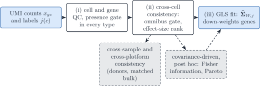
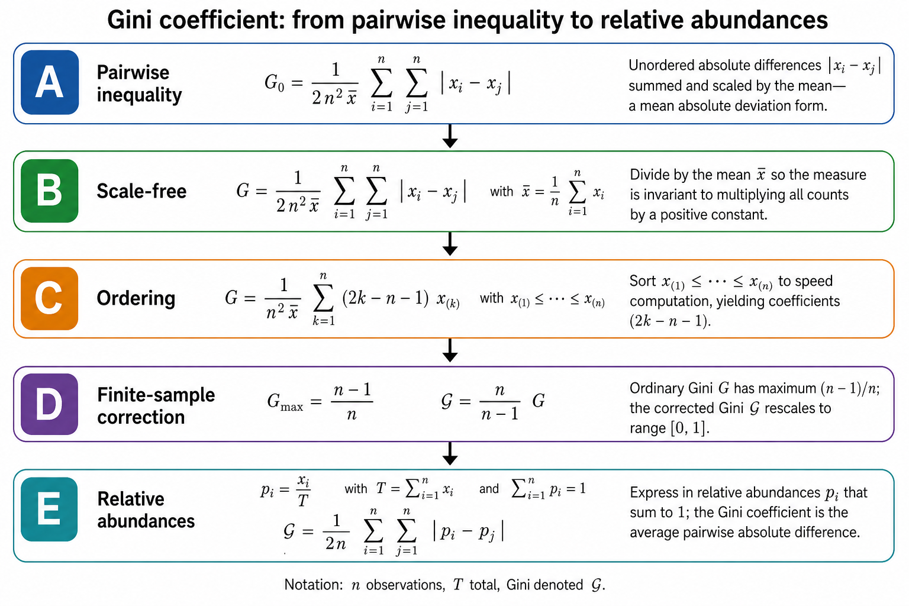
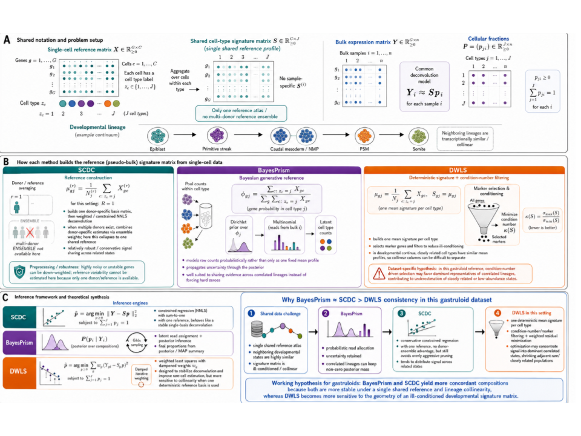
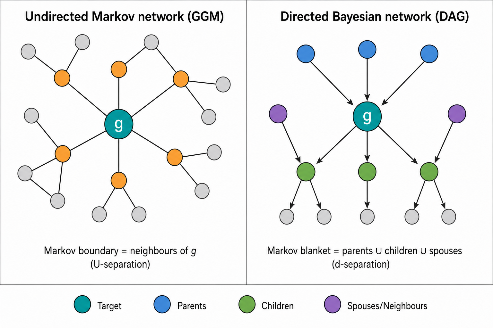

# 3.1 Gene selection for the reference

> **Notation (shared by all vignettes; aligned with the article)**
>
> Gene g=1,\ldots,G; cell type j=1,\ldots,J (a second type is \ell);
> bulk sample i=1,\ldots,N; reference donor (replicate) r=1,\ldots,R;
> cell c, with C_j reference cells of type j. The index i is dropped
> inside a derivation and restored in the model statements.
>
> | Symbol | Meaning |
> |----|----|
> | y\_{gi}, \boldsymbol{y}\_{\cdot i} | Bulk expression on a linear scale |
> | m\_{ji}, n_i=\sum_jm\_{ji} | Cells of type j in bulk sample i, and their total |
> | \tilde{\boldsymbol{y}}\_{\cdot i}=\boldsymbol{y}\_{\cdot i}/n_i | Bulk expression per cell |
> | \boldsymbol{p}\_{\cdot i}\in\Delta^{J-1} | Cell fractions, p\_{ji}=m\_{ji}/n_i |
> | \boldsymbol{\rho}\_{i}\in\mathbb{R}^{J-1} | Isometric log-ratio (ILR) coordinates of \boldsymbol{p}\_{\cdot i}, \boldsymbol{p}\_{\cdot i}=\operatorname{softmax}(\mathbf{V}\boldsymbol{\rho}\_i) with a Helmert basis \mathbf{V} |
> | \boldsymbol{q}\_{\cdot i} | Transcript fractions, q\_{ji}=p\_{ji}S_j/\sum\_\ell p\_{\ell i}S\_\ell |
> | \boldsymbol{\mu}\_{\cdot j}, \boldsymbol{\Sigma}\_j | Mean and G\times G gene–gene covariance of a type-j population profile |
> | \boldsymbol{\Omega}\_j=\boldsymbol{\Sigma}\_j^{-1} | Precision matrix of type j |
> | \boldsymbol{\Gamma}\_g | J\times J covariance across cell types for gene g (`bMIND`, `EPIC-unmix`, `Unico`) |
> | \boldsymbol{x}\_{\cdot j,i} | Purified profile of type j in sample i |
> | x\_{gc}, \boldsymbol{x}\_{\cdot c}, s_c | Raw UMI count of gene g in reference cell c, and the size factor of cell c |
> | \boldsymbol{\lambda}\_{\cdot c}, \boldsymbol{z}\_{\cdot c} | Size-free expression of cell c; its latent log-expression in the Poisson log-normal (PLN) model |
> | \tilde{\boldsymbol{\mu}}\_{\cdot j}=C_j^{-1}\sum\_{c\in j}\boldsymbol{x}\_{\cdot c}=S_j\boldsymbol{\theta}\_{\cdot j} | Per-cell mean of the raw UMI counts of the C_j reference cells of type j |
> | \boldsymbol{\theta}\_{\cdot j}, S_j=\mathbf{1}^{\top}\tilde{\boldsymbol{\mu}}\_{\cdot j} | Relative abundance (\mathbf{1}^{\top}\boldsymbol{\theta}\_{\cdot j}=1) and mean transcriptome size of a type-j cell |
> | \boldsymbol{\Sigma}\_{W,j}, \boldsymbol{\Sigma}\_{B,j} | Within-donor cell-to-cell covariance of type j (one single-cell sample); between-donor covariance of type j (needs R\ge2 donors) |
> | \boldsymbol{S}\_W(\boldsymbol{v})=\sum_jv_j\boldsymbol{\Sigma}\_{W,j}, \boldsymbol{S}\_B(\boldsymbol{v})=\sum_jv_j^2\boldsymbol{\Sigma}\_{B,j} | Linear and quadratic covariance mixtures with weights \boldsymbol{v} |
> | \boldsymbol{V}\_j | Empirical covariance of type j, computed from its reference profiles or cells |
> | \boldsymbol{R}\_j | Empirical correlation matrix of type j (bold; the scalar R is the number of donors) |
> | \boldsymbol{\Delta}\_j=\operatorname{diag}(\boldsymbol{V}\_j) | Diagonal matrix of the empirical variances of type j |
> | \lambda | Penalty of a regularised covariance or precision estimator |
> | \psi_g, \mathcal{D}\_g | Negative binomial dispersion of gene g; deviance of gene g in a count model |
> | \delta\_{gj} | Detection rate of gene g in type j (fraction of cells with a non-zero count) |
> | \varpi\_{\ell\mid j}, \varpi\_{j\ell}, \bar\varpi | MixSim overlap: probability of misclassifying a draw of j into \ell, pairwise overlap \varpi\_{j\ell}=\varpi\_{\ell\mid j}+\varpi\_{j\mid\ell}, and its average over pairs (`BarOmega`) |
> | \boldsymbol{T}\_{ji}=\sum\_{c=1}^{m\_{ji}}\boldsymbol{X}\_{jic} | Total expression contributed by type j to sample i |
> | a_i | Sample-wide scale between the reference and the bulk library |
> | c_i=a_in_i, \phi_i=a_i^2n_i | Mean scale and variance scale of the single-cell model |
> | b_g, \tilde b_g=b_g^{\mathrm{bulk}}/b_g^{\mathrm{ref}} | Capture efficiency of gene g in one protocol, and the gene-wise platform ratio; \tilde{\boldsymbol{B}}=\operatorname{diag}(\tilde{\boldsymbol{b}}) |
> | \boldsymbol{D}\_i | Diagonal, heteroscedastic bulk measurement noise |
>
> A tilde marks a quantity rescaled to a reference unit: per cell
> (\tilde{\boldsymbol{y}}, \tilde{\boldsymbol{\mu}}) or relative to the
> reference protocol (\tilde{\boldsymbol{b}}). \boldsymbol{\Sigma}\_j
> couples **genes** within one cell type; \boldsymbol{\Gamma}\_g couples
> **cell types** within one gene. A symbol absent from this table is
> defined in the vignette that uses it, with one meaning there.

> **Scope**
>
> This chapter states which genes should enter a DeCovarT reference
> built from single-cell data, and why. It holds the theory: what the
> genes are for, the selection strategies of the literature, three tiers
> of selection, and the statistical tests behind them ([Gaspard-Boulinc
> et al. 2025](#ref-gaspard-boulincCelltypeDeconvolutionMethods2025);
> [Avila Cobos et al.
> 2018](#ref-avilacobosComputationalDeconvolutionTranscriptomics2018)).
> The reference considered here is a single-cell experiment on one
> specimen, so only cross-cell consistency can be assessed
> ([Section 3](#sec-fs-consistency)); cross-sample consistency and
> covariance-driven selection are perspectives
> ([Section 6](#sec-perspectives)). The application to a real reference
> (filters as applied, settings, rank tables, code) is in the
> feature-selection chapter of the reproducibility book. Strategies
> compared on simulated references are in [Appendix
> S6](https://bastienchassagnol.github.io/DeCovarT/articles/S6-feature-screening-scenario.md).
> Marker-based abundance scores (enrichment modules) are out of scope
> ([Aran et al. 2017](#ref-aranXCellDigitallyPortraying2017)).

**Local symbols.** C=\sum_jC_j is the number of reference cells in one
time slot; j(c) is the label of cell c.
\delta\_{gj}=C_j^{-1}\sum\_{c:j(c)=j}\mathbb{1}(x\_{gc}\>0) is the
detection rate of gene g in type j, and v\_{gj} is the g-th diagonal
entry of \boldsymbol{V}\_j. In a negative-binomial (NB) model \psi_g is
the dispersion, so that
\operatorname{Var}(x\_{gc})=m\_{gc}+m\_{gc}^2/\psi_g with
m\_{gc}=\operatorname{E}(x\_{gc}); \mathcal{D}\_g(M) is the deviance of
model M for gene g; r\_{gc} is a Pearson residual. A gene panel is
written \mathcal{G}\subseteq\\1,\ldots,G\\.

Figure 1: “Three tiers of gene selection for a DeCovarT reference from
one specimen. Tiers (i) and (ii) remove genes; tier (iii) keeps the
remaining genes and lets the fitted covariance down-weight them. Dashed
boxes are perspectives: cross-sample consistency needs several specimens
or a matched bulk, and covariance-driven selection needs the estimated
within-type covariances.”

> **Warning 1: What the genes are for**
>
> The target is a set of genes that makes the reference moments
> (\boldsymbol{\mu}\_{\cdot j},\boldsymbol{\Sigma}\_{W,j}) estimable and
> informative about \boldsymbol{p}. This is not population-level
> differential expression, for two reasons.
>
> - **One specimen.** The reference is one technical scRNA-seq
>   experiment. Its cells are draws from one specimen, not biological
>   replicates, so every p-value below calibrates a *screen inside that
>   specimen*. Treating cells as replicates of a population contrast
>   inflates the false discoveries ([Zimmerman et al.
>   2021](#ref-zimmermanPracticalSolutionPseudoreplication2021); [Squair
>   et al. 2021](#ref-squairConfrontingFalseDiscoveries2021); [Crowell
>   et al. 2020](#ref-crowellMuscatDetectsSubpopulationspecific2020)).
>   Only the within-donor covariance \boldsymbol{\Sigma}\_{W,j} is
>   estimable; the between-donor part needs R\ge2 donors
>   ([2.1](https://bastienchassagnol.github.io/DeCovarT/articles/02-1-single-cell-generative-optimisation.html#sec-one-replicate)).
> - **Labels are given.** A test of the type effect is valid only if the
>   labels were fixed before the statistic is computed. Labels obtained
>   by clustering the same matrix make the test anti-conservative
>   (post-clustering inference, González-Delgado et al. 2025) .
>
> Selection proceeds in three tiers ([Figure 1](#fig-fs-tiers)): (i)
> quality control and a presence gate; (ii) cross-cell consistency, an
> omnibus test used as a gate and an effect-size rank; (iii)
> down-weighting by the model instead of removal. Tiers (i) and (ii) are
> filters; tier (iii) is part of the likelihood. Feature selection as a
> pre-modelling filter has the usual caveats ([Guyon and Elisseeff
> 2003](#ref-guyonIntroductionVariableFeature2003)): it is a proposal,
> to be checked by out-of-sample deconvolution error
> ([S6](https://bastienchassagnol.github.io/DeCovarT/articles/S6-feature-screening-scenario.html#sec-cv-selection)).

## 1 Gene-selection strategies in the literature

Deconvolution methods choose genes in three ways: univariate
one-versus-others screens, searches over the whole signature, or no
selection at all, with gene weights doing the work. This section reviews
them, states where they depart from the count model used here, and
compares second-generation methods in [Table 1](#tbl-fs-review). Each
method’s likelihood is reviewed in
[5.1](https://bastienchassagnol.github.io/DeCovarT/articles/05-1-review-distribution-aware.html#sec-methods).

### 1.1 Univariate screens, one versus others

Classical signature pipelines score gene g for type j against the
remaining types, then concatenate the per-type shortlists ([Abbas et al.
2009](#ref-abbasDeconvolutionBloodMicroarray2009); [Newman et al.
2015](#ref-newmanRobustEnumerationCell2015); [Finotello et al.
2019](#ref-finotello_etal19)).

- **Differential expression and fold-change ranks.** `limma`–voom,
  `edgeR` and `DESeq2` are the usual tools for one-versus-rest contrasts
  ([Ritchie et al. 2015](#ref-ritchieLimmaPowersDifferential2015a);
  [Robinson et al. 2010](#ref-robinsonEdgeRBioconductorPackage2010);
  [Love et al. 2014](#ref-loveModeratedEstimationFold2014a)). CIBERSORT
  keeps genes with adjusted p\le0.3, orders them by fold change and
  prunes the panel by its condition number ([Newman et al.
  2015](#ref-newmanRobustEnumerationCell2015)); Abbas et al. keep genes
  whose expression in the target type exceeds that of the second- and
  third-ranked types, then choose the panel with the smallest condition
  number ([Abbas et al.
  2009](#ref-abbasDeconvolutionBloodMicroarray2009)). On cells of one
  specimen these tests treat cells as replicates
  ([Warning 1](#wrn-fs-estimand)); their pseudo-bulk versions need
  donors ([Section 6.1](#sec-fs-cross-sample)).
- **ANOVA F test.** Wang et al. rank genes by the F statistic of a type
  factor against an intercept-only model ([Wang et al.
  2010](#ref-wangSilicoEstimatesTissue2010)). Its count-model version,
  with its calibration, is the omnibus test of tier (ii)
  ([Section 3.2](#sec-fs-omnibus)).

#### 1.1.1 Specificity scores

Long one-versus-rest lists are often compacted with the entropy or the
Gini coefficient of the type shares
u\_{gj}=\mu\_{gj}/\sum\_{\ell}\mu\_{g\ell}, as in `BioQC` ([Zhang et al.
2017](#ref-zhang_etal17)):

H_g=-\sum\_{j=1}^{J}u\_{gj}\log u\_{gj}, \qquad \mathrm{Gini}\_g =
\frac{1}{2J}\sum\_{j=1}^{J}\sum\_{\ell=1}^{J}\lvert
u\_{gj}-u\_{g\ell}\rvert = \frac1J\sum\_{k=1}^{J}(2k-J-1)\\u\_{g(k)},
\tag{1}

with 0\log0=0 and u\_{g(1)}\le\cdots\le u\_{g(J)}. H_g/\log J and
J\\\mathrm{Gini}\_g/(J-1) lie in \[0,1\]; low entropy and high Gini mean
that few types carry the mass. Both scores reward exclusive expression,
which the presence gate ([Section 2.1](#sec-fs-presence)) excludes, and
neither sees redundancy between genes.

Figure 2: Derivation of the Gini coefficient: pairwise absolute
differences, scale-free normalisation by the mean, sorted-data formula,
finite-sample correction to \[0,1\].

Concatenation does not control that redundancy. Two specific markers of
different types can still be nearly collinear rows of \boldsymbol{\mu}
when the types share a programme (a lineage, an activation axis), so the
union of per-type lists inflates \|\mathcal{G}\| while
\kappa_2(\boldsymbol{\mu}\_{\mathcal{G}}) stays large and NNLS or GLS
fits stay unstable ([Newman et al.
2015](#ref-newmanRobustEnumerationCell2015); [Avila Cobos et al.
2018](#ref-avilacobosComputationalDeconvolutionTranscriptomics2018)). A
criterion on the whole signature is then needed.

### 1.2 Searches over the whole signature

- **Condition number.** CIBERSORT and DWLS keep the candidate signature
  with the smallest \kappa_2(\boldsymbol{\mu}\_{\mathcal{G}}) ([Newman
  et al. 2015](#ref-newmanRobustEnumerationCell2015); [Tsoucas et al.
  2019, 7](#ref-tsoucasAccurateEstimationCelltype2019); [Gong and
  Szustakowski 2013](#ref-gongDeconRNASeqStatisticalFramework2013)); its
  limits are in
  1.  
- **Multi-objective genetic search.** `AutoGeneS` searches gene subsets
  with a genetic algorithm that minimises the correlation between type
  centroids and maximises their distance ([Aliee and Theis
  2021](#ref-alieeAutoGeneSAutomaticGene2021)); MOGAMUN applies the same
  kind of search to network modules ([Novoa-del-Toro et al.
  2021](#ref-novoa-del-toroMultiobjectiveGeneticAlgorithm2021)). The
  loss is defined on the full J-column signature, not on one-versus-rest
  lists.

Both criteria see the means only. Criteria that also use the within-type
covariance need \widehat{\boldsymbol{\Sigma}}\_{W,j}, so they come after
the omnibus gate ([Section 6.2](#sec-fs-multivariate)).

### 1.3 Critiques of current marker rules

The reviewed marker rules ([Table 1](#tbl-fs-review)) depart from the
count model of tier (ii) in five ways.

- **Hurdle models on droplet counts.** DWLS defines markers with the
  `MAST` hurdle model ([Tsoucas et al. 2019,
  7](#ref-tsoucasAccurateEstimationCelltype2019)). Droplet UMI counts
  show no zero inflation beyond what the NB predicts (Svensson 2020) ,
  and current data do not support zero-inflated *measurement* models
  ([Sarkar and Stephens 2021,
  5](#ref-sarkarSeparatingMeasurementExpression2021)). The hurdle splits
  one count into a detection and a magnitude test (Finak et al. 2015)
  where one NB test of [Equation 6](#eq-fs-nb-main) suffices.
- **Gaussian t-tests on counts.** ReDeconv uses a two-sample t-test
  between cells ([Lu et al. 2025,
  14](#ref-luTranscriptomeSizeMatters2025)); deMixSC uses a paired
  t-test of bulk against matched pseudo-bulk ([Guo et al. 2023,
  12](#ref-guoDeMixSCDeconvolutionFramework2023)).
- **Cells as independent replicates.** Every test above that runs on
  cells (DWLS, ReDeconv, BayesPrism’s marker option) treats them as
  replicates of a population contrast ([Warning 1](#wrn-fs-estimand)).
  Pseudo-bulk `DESeq2`, `edgeR` or `limma`–voom avoid this only with
  biological replicates at the level of the contrast
  ([Section 6.1](#sec-fs-cross-sample)).
- **No multiplicity control.** ReDeconv keeps genes with p\<0.05 in each
  comparison against every other type, with no FDR correction ([Lu et
  al. 2025, 14](#ref-luTranscriptomeSizeMatters2025)).
- **Graph-based screens before the graph is estimated.**
  Differential-network screens (`INDEED`, D-trace) and Markov-boundary
  growth of marker seeds need fitted graphs; here they are post hoc
  ([Section 6.2.7](#sec-markov-seeds)).

### 1.4 Comparison of second-generation methods

[Table 1](#tbl-fs-review) summarises, method by method, the facts found
in the papers, in the order of the tiers. Page numbers refer to the PDF
pages of the local extractions (“supp.” marks a supplement). A dash
means that the item was not found in the extracted text; it does not
mean that the method has no such step. The same table, with the same
facts, is Appendix C of the CardamomOT comparison note.

| Method | Cell QC (tier i) | Gene filter (tier i) | Marker rule (tier ii) | Weighting (tier iii) | Cross-platform (perspective) |
|----|----|----|----|----|----|
| RNA-Sieve ([Erdmann-Pham et al. 2021](#ref-erdmann-phamLikelihoodbasedDeconvolutionBulk2021)) | optional: library size or pairwise distance ≥ 3 MAD from the type median (supp. p. 3) | non-zero in ≥ 20 % of the cells of ≥ 1 type (supp. p. 3) | none | Gaussian composite likelihood from the CLT (Eq. 10, p. 10) | range bound and MAD outliers on four statistics (Eqs 12–13, p. 11) |
| DECALS ([Cai et al. 2024](#ref-caiStatisticalInferenceCelltype2024)) | — | CIBERSORTx S-mode candidate genes (p. 13) | ∩ markers of Mathys et al. ([2019](#ref-mathysSinglecellTranscriptomicAnalysis2019)) (Fisher’s exact test, FDR): 159 genes (p. 13; supp. pp. 18–19) | constrained OLS; GLS biased in practice (pp. 6, 9) | S-mode batch correction (p. 13) |
| MEAD ([Xie et al. 2026](#ref-xieStatisticalInferenceCell2026)) | — | — | none; removing genes gains nothing unless noise differs (p. 17) | WLS from the reference variance (pp. 17–18); sandwich (p. 13) | gene-wise ratios with mean 1 (pp. 5, 8) |
| ReDeconv ([Lu et al. 2025](#ref-luTranscriptomeSizeMatters2025)) | — | — | t-test p\<0.05 against every other type, no FDR; fold change ≥ 2; smallest SD/mean, about 100 per type (p. 14) | Gaussian, composition-dependent variance (Eq. 5, p. 14) | length normalisation of the bulk only (p. 2) |
| MuSiC ([Wang et al. 2019](#ref-wangBulkTissueCell2019)) | — | all shared genes (p. 7) | none; small within-cluster variance in the tree-guided stage (pp. 3, 8) | W-NNLS, weights from cross-subject variance (Eq. 10, p. 7) | optional gene- and subject-specific intercept (p. 7) |
| deMixSC ([Guo et al. 2023](#ref-guoDeMixSCDeconvolutionFramework2023)) | \< 500 UMI, \< 200 genes, \> 50 % mitochondrial (p. 11) | detected in \< 5 % of cells removed (p. 11) | none | W-NNLS, iterated weights (p. 12) | paired t-test bulk vs pseudo-bulk, BH; 5,000 genes down-weighted by a=1000 (p. 12) |
| BayesPrism ([Chu et al. 2022](#ref-chuCellTypeGeneExpression2022)) | types with \< 20 cells excluded in one benchmark (supp. p. 15) | ribosomal, mitochondrial, X and Y genes (supp. pp. 14, 19) | optional scran markers, t-tests, up-regulated only (supp. pp. 14–15) | Bayesian multinomial (supp. pp. 3–6) | bulk-specific profiles; log-normal fold-change prior (supp. pp. 5–6) |
| DWLS ([Tsoucas et al. 2019](#ref-tsoucasAccurateEstimationCelltype2019)) | — | — | `MAST` hurdle, FDR \< 0.01, \log_2FC \> 0.5; 50–200 per type; smallest \kappa (p. 7) | dampened WLS (pp. 2, 7) | none |
| SCDC ([Dong et al. 2021](#ref-dongSCDCBulkGene2021)) | cells with a questionable type or low quality removed (p. 9) | genes with zero counts in every sample (p. 9) | none | W-NNLS, maximal-variance weights clipped at the 15th/85th percentiles (p. 10) | ENSEMBLE over references (p. 3) |
| RCTD ([Cable et al. 2022](#ref-cableRobustDecompositionCell2022a)) | spots ≥ 100 UMI (p. 9) | mean above 0.0625 counts per 500 (p. 7) | log-fold change ≥ 0.5 against the other types, no test (p. 7) | Poisson–lognormal GLMM (p. 6) | gene-wise platform random effect (pp. 3, 6) |
| CardamomOT 2.0.0 (Maugé & Ventre 2026) | paper: —; code: per-cell depth factor, no cell removed | paper: gene sets of earlier studies (p. 32); code: no mitochondrial, ribosomal or non-coding genes | code: W_1 and entropy terminals, round robin of per-type Wilcoxon tests, NB separability, Steiner closure | NB-mixture likelihood, \ell_1 towards a prior network (Eq. 10, p. 9) | not applicable (no bulk) |
| DeCovarT (this chapter) | authors’ QC; MAD rules optional | presence gate in every type ([Equation 2](#eq-fs-presence)) | omnibus NB / QL F test as an FDR gate, effect-size rank | GLS with \widehat{\boldsymbol{\Sigma}}\_{W,j} | none: one reference specimen ([Section 6.1.1](#sec-fs-cross-platform)) |

Table 1: Gene selection in second-generation deconvolution methods, by
tier. CardamomOT is a network-inference method, included for its gene
selection; its code facts are from release 2.0.0
(<https://github.com/eliasventre/CardamomOT>).

DeCovarT builds on these methods in three ways.

- **Covariance in the criterion.** Only DeCovarT puts gene–gene
  covariance into the criterion that estimates \boldsymbol{p}; DECALS
  and MEAD use it only for the variance of their estimators. The other
  methods treat genes as independent, the setting in which a univariate
  screen is also the objective
  ([Section 6.2.1](#sec-fs-screen-objective)). DeCovarT keeps the
  univariate screen as a gate (tier ii) and leaves the weighting to the
  covariance (tier iii).
- **One count test per gene.** The tests that select genes run on cells,
  mostly with Gaussian or hurdle models, and only DWLS (markers) and
  deMixSC (platform discrepancy) report a multiplicity correction.
  DeCovarT uses one NB omnibus test per gene, a Benjamini–Hochberg gate
  and a permutation calibration ([Section 3.2](#sec-fs-omnibus)).
- **No perfect markers.** MuSiC and MEAD argue against marker
  pre-selection when the genes are weighted, and MEAD shows that perfect
  markers break identifiability under gene-wise platform ratios
  ([Section 6.1.1](#sec-fs-cross-platform)); DWLS and DECALS still build
  marker-only signatures. DeCovarT removes perfect markers with the
  presence gate and weights the remaining genes.

## 2 Tier (i): quality control

QC removes cells and genes that lie outside the support of any
expression model. The thresholds below are examples from the reviewed
methods ([Table 1](#tbl-fs-review)), not defaults of DeCovarT.

- **Cells.** Library size more than 3 median absolute deviations (MAD)
  from the median of its type, and cells more than 3 MAD from the median
  pairwise distance within their type (RNA-Sieve, optional; Erdmann-Pham
  et al.
  ([2021](#ref-erdmann-phamLikelihoodbasedDeconvolutionBulk2021)),
  supplement p. 3). Fewer than 500 UMIs, fewer than 200 detected genes,
  or more than 50 % mitochondrial UMIs (deMixSC; Guo et al.
  ([2023](#ref-guoDeMixSCDeconvolutionFramework2023)), p. 11).
- **Genes.** Ribosomal, mitochondrial and sex-chromosome genes, which
  reflect cell survival and donor sex rather than type (BayesPrism; Chu
  et al. ([2022](#ref-chuCellTypeGeneExpression2022)), supplement
  pp. 14, 19). Genes detected in fewer than 20 % of the cells of every
  type (RNA-Sieve, supplement p. 3).

### 2.1 Presence gate in every type

> **Necessary, not sufficient**
>
> A gene enters tier (ii) only if
>
> \min\_{j}\delta\_{gj}\ge\delta\_{\min} \quad\text{and}\quad
> \min\_{j}v\_{gj}\>0, \tag{2}
>
> with \delta\_{\min} a few per cent (for example 0.05), fixed before
> the ranks are seen. These are necessary conditions for a non-singular
> within-type covariance and for an identifiable \boldsymbol{p}; they
> are not sufficient. Two cases show what the gate excludes.
>
> - **Zero in every cell of type j.** Then v\_{gj}=0 and the whole row
>   and column g of \boldsymbol{V}\_j are zero: \boldsymbol{V}\_j is
>   singular (\det\boldsymbol{V}\_j=0), the correlation
>   v\_{gh}/\sqrt{v\_{gg}v\_{hh}} is 0/0 and so undefined, and the
>   fitted type-j Gaussian is degenerate, a point mass in coordinate g.
>   Its likelihood is unbounded, so no maximum-likelihood estimate
>   exists.
> - **Detected in a single cell c.** With count a in that cell, the
>   centred counts of g are a(\boldsymbol{e}\_c-\mathbf{1}/C_j), and its
>   correlation with any gene h is r\_{gh}=\tilde
>   h_c/(\sqrt{1-1/C_j}\\\lVert\tilde{\boldsymbol h}\rVert),
>   \tilde{\boldsymbol h} the centred counts of h: one cell sets it. Two
>   genes detected only in cell c have r=1 whatever their counts, a
>   perfect and degenerate correlation, and \boldsymbol{V}\_j is again
>   singular.
>
> With \delta\_{\min}C_j\ge2 the gate keeps only genes with at least two
> non-zero cells in every type, which excludes both cases. It does not
> make \boldsymbol{V}\_j invertible:
> \operatorname{rank}\boldsymbol{V}\_j\le \min(C_j-1,G), so
> \boldsymbol{V}\_j is singular whenever G\ge C_j or genes satisfy an
> exact linear relation, and shrinkage is still needed
> ([3.2](https://bastienchassagnol.github.io/DeCovarT/articles/03-2-covariance-network-estimation.md)).
> Nor does it make \boldsymbol{p} identifiable, which requires a
> non-singular Fisher information for \boldsymbol{p}
> ([1.2](https://bastienchassagnol.github.io/DeCovarT/articles/01-2-population-inference.html#sec-identifiability)).
> The gate also removes perfect markers, whose effect under gene-wise
> platform ratios is in [Section 6.1.1](#sec-fs-cross-platform).

## 3 Tier (ii): cross-cell consistency

MuSiC introduced “marker gene consistency” with two parts ([Wang et al.
2019, 2](#ref-wangBulkTissueCell2019)). Cross-cell consistency asks
whether a gene is stable across the cells of one type, so that biased
cell capture does not drive its selection; cross-cell consistent genes
have a low within-cluster variance ([Wang et al. 2019,
3](#ref-wangBulkTissueCell2019)). Cross-sample consistency asks whether
a gene’s type mean is stable across specimens (MuSiC’s cross-subject
consistency), and needs at least two of them. With a reference from one
specimen only cross-cell consistency can be assessed; cross-sample
consistency is a perspective ([Section 6.1](#sec-fs-cross-sample)). The
natural statistic for cross-cell consistency is the split of a gene’s
variation into between-type and within-type parts.

### 3.1 Pearson residuals and the between/within split

The technical null fits each gene with library size as the only
covariate,

M\_{0}:\\ \log m\_{gc}=\beta\_{0g}+\log s\_{c}, \qquad
x\_{gc}\sim\mathrm{NB}(m\_{gc},\psi\_{g}), \tag{3}

which is the model of `SCTransform` with `vst.flavor = "v2"`, where the
depth slope is fixed and library size is an offset ([Hafemeister and
Satija 2019](#ref-hafemeisterNormalizationVarianceStabilization2019);
[Lause et al. 2021](#ref-lauseAnalyticPearsonResiduals2021)). Cell type
is deliberately absent: putting j in the null would remove the signal to
be ranked. The Pearson residuals r\_{gc}=(x\_{gc}-\hat
m\_{gc})/\sqrt{\hat m\_{gc}+\hat m\_{gc}^{2}/\hat\psi\_{g}} split as

\mathrm{SS}\_{\mathrm{B},g} = \sum\_{j=1}^{J}C\_{j}\bigl(\bar
r\_{gj}-\bar r\_{g}\bigr)^{2}, \qquad \mathrm{SS}\_{\mathrm{W},g} =
\sum\_{j=1}^{J}\sum\_{c:j(c)=j}\bigl(r\_{gc}-\bar r\_{gj}\bigr)^{2},
\tag{4}

with \bar r\_{gj} the mean residual in type j and \bar r\_{g} the
overall mean (\approx0). A lineage marker has a large between-type and a
small within-type part; a stress-response gene can have a large total
residual variance and still a small between-type part.
[Figure 3](#fig-sc-transform) shows the four steps on simulated counts.

![Four scatter panels joined by arrows and labelled with formulas. Panel
a: gene variance against gene mean on log scales, points above the
Poisson line and close to the negative-binomial curve. Panel b: counts
of one gene against the size factor for two cell types, with the fitted
mean rising in proportion to the size factor. Panel c: per-gene
dispersion estimates against the mean, scattered around an increasing
smooth curve. Panel d: Pearson residuals of the same gene against the
size factor, centred on zero with no depth trend, the two cell types at
different levels.](figures/fig_03_1_sctransform.svg)

Figure 3: `SCTransform` (v2) workflow on simulated counts (2,000 genes,
2,000 cells of two types, seed 20261101). (a) Gene variance against gene
mean: NB variance with the smoothed dispersion (solid) and the Poisson
line (dashed). (b) Counts of one marker gene against the size factor,
with the fitted mean of M_0 (library size as offset, no cell type). (c)
Per-gene dispersion estimates against the gene mean, and their smooth
across genes, the empirical-Bayes regularisation. (d) Pearson residuals
of the same gene: no trend with depth, the type difference kept. Code:
`scripts/figures/fig_03_1_sctransform.R`.

The sums in [Equation 4](#eq-fs-ss) weight every cell equally, so the
most abundant type dominates them. The equal-type version gives each
type weight 1/J:

\mathrm{MS}^{\mathrm{eq}}\_{\mathrm{B},g} =
\frac1J\sum\_{j=1}^{J}\Bigl(\bar r\_{gj}-\frac1J\sum\_{\ell=1}^{J}\bar
r\_{g\ell}\Bigr)^{2}, \qquad \mathrm{MS}^{\mathrm{eq}}\_{\mathrm{W},g} =
\frac1J\sum\_{j=1}^{J}\operatorname{var}\_{c:j(c)=j}(r\_{gc}). \tag{5}

### 3.2 Omnibus test: deviance and quasi-likelihood F

Add the type main effect to [Equation 3](#eq-fs-nb-null):

M\_{1}:\\ \log m\_{gc}=\beta\_{0g}+\beta\_{g,j(c)}+\log s\_{c}, \qquad
\beta\_{g1}=0, \qquad H\_{0g}:\beta\_{g2}=\cdots=\beta\_{gJ}=0 . \tag{6}

The joint null has J-1 degrees of freedom ([Agresti
2015](#ref-agrestiFoundationsLinearGeneralized2015)). One omnibus test
per gene replaces \binom{J}{2} pairwise or J one-versus-rest tests, and
a single Benjamini–Hochberg correction across genes follows.

- **Likelihood ratio (analysis of deviance).**
  \Lambda_g=\mathcal{D}\_g(M_0)-\mathcal{D}\_g(M_1), referred to
  \chi^2\_{J-1} when \psi_g is known. It needs one M_1 fit per gene, a
  one-way GLM with J coefficients.
- **Wald.** It needs M_1 only and fails near the boundary: with an
  all-zero type the NB estimate \hat\beta\_{gj}\to-\infty, its standard
  error grows faster, and the statistic shrinks as the effect grows
  (Hauck–Donner effect) ([Yee 2022](#ref-yeeHauckDonnerEffectWald2022)).
  The presence gate removes that case.

The score (Rao) test needs only the M_0 fit that `SCTransform` already
computes. Up to the variation of the IRLS weights within a type, its
statistic for the type effect is the between-type sum of squares of the
Pearson residuals,

T_g\approx\sum\_{j=1}^{J}C_j\\\bar
r\_{gj}^{2}\approx\mathrm{SS}\_{\mathrm{B},g}, \tag{7}

exactly Pearson’s \chi^2 on the type totals under a Poisson null. This
identity is what makes the ratio below a test computed from
`SCTransform` output without refitting. As a separate test the score
adds nothing here: the boundary case, where it and the likelihood ratio
stay finite while the Wald test fails, is removed by the presence gate,
and the M_1 fit it saves is a small one-way GLM.

**Quasi-likelihood F.** Dividing T_g/(J-1) by the within-type Pearson
dispersion \hat\phi_g=\mathrm{SS}\_{\mathrm{W},g}/(C-J) gives

F\_{g} =
\frac{\mathrm{SS}\_{\mathrm{B},g}/(J-1)}{\mathrm{SS}\_{\mathrm{W},g}/(C-J)},
\tag{8}

the one-way ANOVA ratio ([Wang et al.
2010](#ref-wangSilicoEstimatesTissue2010)). In GLM terms it is a
quasi-likelihood F test: the mean model [Equation 6](#eq-fs-nb-main) and
the variance function V(m)=m+m^2/\psi_g are kept, and a scalar \phi_g
absorbs a variance larger or smaller than V predicts. The reference
F\_{J-1,C-J} accounts for estimating \phi_g, as in the edgeR
quasi-likelihood pipeline and in `glmGamPoi::test_de()`, which use the
deviance in the numerator ([Lund et al.
2012](#ref-lundDetectingDifferentialExpression2012); [Ahlmann-Eltze and
Huber 2020](#ref-glmGamPoi2020)). Three consequences follow.

- **Keep overdispersed genes.** Within-type overdispersion is the
  within-type scatter that the denominator already penalises, and the
  covariance that DeCovarT models. Removing such genes before the test
  removes that signal.
- **A scalar \phi_g cannot absorb a wrong variance function.** Under a
  Poisson null it cannot absorb the quadratic NB term, whose share grows
  with the type mean; the pooled \hat\phi_g is then wrong for every
  type. Use the NB variance, so that \phi_g\approx1 in every type; if
  between-type heteroscedasticity remains, use a Welch-type statistic or
  the equal-type mean squares of [Equation 5](#eq-fs-equal-type).
- **Gate, then rank by effect size.** J and C are shared by all genes of
  a slot, so F_g is a monotone function of
  \mathrm{SS}\_{\mathrm{B},g}/\mathrm{SS}\_{\mathrm{W},g}; the analytic
  F adds a threshold, not a new ranking. Genes that pass the FDR gate
  are ranked by that ratio, or by its equal-type version, not by
  p-value.

When the NB variance function itself fails, quasi-likelihood with an
empirical variance function is the fallback ([Agresti
2015](#ref-agrestiFoundationsLinearGeneralized2015)). When the *shape*
differs between types (types that share a mean but differ in
dispersion), a location–scale model with type-specific \psi\_{gj} tests
both, on 2(J-1) degrees of freedom; this is the GAMLSS margin used by
scDesign3 ([Song et al.
2024](#ref-songScDesign3GeneratesRealistic2024)), Stasinopoulos & Rigby
(2007) .

#### 3.2.1 Calibration: permutation, Freedman–Lane, bootstrap

The nominal F\_{J-1,C-J} tail is optimistic on `SCTransform` output for
three reasons: residuals are clipped at \pm\sqrt{C/30}, \psi_g is
regularised across genes and so is misspecified for any one gene, and
residuals at low means are discrete and skewed ([Hafemeister and Satija
2019](#ref-hafemeisterNormalizationVarianceStabilization2019); [Lause et
al. 2021](#ref-lauseAnalyticPearsonResiduals2021)). A permutation null
keeps F_g and replaces its reference distribution.

- **Permute labels, not genes.** One permutation of the cell labels is
  applied to all genes at once. Each gene keeps its marginal
  distribution and its dependence on the other genes; only the link with
  the label is broken. Shuffling genes, or shuffling within cells, does
  not produce that null.
- **Nuisance covariates.** With covariates (batch, cell line, cell
  cycle), a global label shuffle creates impossible combinations. The
  Freedman–Lane scheme fits the reduced model without type, permutes its
  residuals with one row permutation shared by all genes, adds them back
  to the reduced fit, refits the full model and recomputes F_g
  ([Freedman and Lane
  1983](#ref-freedmanNonstochasticInterpretation1983)).

### 3.3 Leverage is not influence

Residual size, leverage and influence are three different quantities
([Agresti 2015](#ref-agrestiFoundationsLinearGeneralized2015)). In a
gene-wise GLM, leverage belongs to the *observations* (cells, or
pseudo-bulk samples), not to the gene. For the one-way design of
[Equation 6](#eq-fs-nb-main) the hat value of cell c is
h\_{gc}=w\_{gc}/\sum\_{c':j(c')=j(c)}w\_{gc'}, with IRLS weight
w\_{gc}=\hat m\_{gc}^2/V(\hat m\_{gc}): every cell of a rare type, and
every cell with a large fitted mean, has high leverage. Influence
combines the two; Cook’s distance is

\mathrm{Cook}\_{gc} =
\frac{r\_{gc}^{2}\\h\_{gc}}{J\\\hat\phi_g\\(1-h\_{gc})^{2}} .

A high-expression marker in a small type sits at an extreme fitted mean
and has high leverage, yet it agrees with the type effect: it is
informative, not an outlier. Rules that clip by size alone, such as
residual clipping or SCDC’s clipping of variance weights at the 15th and
85th percentiles ([Dong et al. 2021, 10](#ref-dongSCDCBulkGene2021)),
shrink these observations with the harmful ones. An observation is a
candidate outlier only when both its leverage and its standardised
residual are large.

## 4 Tier (iii): down-weighting by the model

Filters remove genes; a weighted likelihood keeps them and lets their
variance decide their influence. The reviewed methods sit on a ladder of
noise models ([Table 2](#tbl-fs-ladder); full ladder in
[5.1](https://bastienchassagnol.github.io/DeCovarT/articles/05-1-review-distribution-aware.md)).

| Rung | Variance of the bulk residual | Methods (anchors) |
|----|----|----|
| Weighted least squares | diagonal, gene-wise weights | MuSiC: bulk noise plus cross-subject variance, Eq. 10, p. 7; DWLS: fitted values, capped by a dampening constant, pp. 2, 7; SCDC: maximal-variance weights, clipped, pp. 5, 10; deMixSC: \hat y^2 plus squared residual plus a constant, p. 12; MEAD: reference variance with empirical-Bayes shrinkage, pp. 17–18 |
| Generalised least squares | full gene–gene covariance, depends on \boldsymbol{p} | DeCovarT: \sum_jp_j^2\boldsymbol{\Sigma}\_j (population) or \sum_jp_j\boldsymbol{\Sigma}\_{W,j} (single cell); DECALS: \sum_k\pi\_{ik}^2\boldsymbol{\Sigma}\_k for inference, pp. 7, 9 |
| Feasible GLS | covariance estimated, then iterated with \hat{\boldsymbol{p}} | DECALS Algorithm 1, p. 9; DeCovarT plug-in \widehat{\boldsymbol{\Sigma}}\_{W,j} |
| Sandwich / GEE | working covariance, robust variance | MEAD: sandwich over a dependence set, pp. 13, 18 |

Table 2: Down-weighting classes in the reviewed methods. Page anchors
refer to the PDFs extracted for this review.

Two observations follow.

- DECALS computes its point estimate by constrained *ordinary* least
  squares and uses the covariance only for inference, because a GLS fit
  with an estimated covariance per sample was biased in their
  experiments ([Cai et al. 2024,
  6](#ref-caiStatisticalInferenceCelltype2024)). The same risk applies
  to any feasible GLS whose covariance is estimated on few cells;
  shrinkage of \widehat{\boldsymbol{\Sigma}}\_{W,j} addresses it
  ([3.2](https://bastienchassagnol.github.io/DeCovarT/articles/03-2-covariance-network-estimation.md)).
- MEAD notes that removing genes brings no efficiency gain unless their
  noise levels differ ([Xie et al. 2026,
  17](#ref-xieStatisticalInferenceCell2026)). Once the covariance is in
  the model, hard filtering is needed only for genes outside the model’s
  support: the presence gate ([Section 2.1](#sec-fs-presence)) and, when
  a matched bulk exists, cross-platform outliers
  ([Section 6.1.1](#sec-fs-cross-platform)).

## 5 Selection effect on the covariance

Selecting genes changes the covariance that is then estimated on them.

- **Small within-type variance by construction.** A ratio such as
  [Equation 8](#eq-fs-qlf) rewards a small within-type part. ReDeconv
  goes further and keeps the genes with the smallest coefficient of
  variation ([Lu et al. 2025, 14](#ref-luTranscriptomeSizeMatters2025));
  MuSiC’s tree-guided stage keeps genes with small intra-cluster
  variance ([Wang et al. 2019, 8](#ref-wangBulkTissueCell2019)). A panel
  chosen this way removes much of the within-type covariance that
  DeCovarT models, and the estimated \boldsymbol{\Sigma}\_{W,j} on that
  panel is close to diagonal for that reason, not because genes are
  conditionally independent
  ([3.2](https://bastienchassagnol.github.io/DeCovarT/articles/03-2-covariance-network-estimation.md)).
- **Weak marginal effects hide interactions.** Genes with weak marginal
  effects are dropped by every univariate screen, and gene pairs whose
  signal lies in their covariance, not in their means, are then never
  examined. Covariance-aware criteria
  ([Section 6.2.5](#sec-optimal-design),
  2.  can recover them only from a shortlist that still contains them.

A practical check is to compare the distribution of v\_{gj}, and of the
off-diagonal entries of \boldsymbol{V}\_j, between the selected panel
and the genes that pass the presence gate.

## 6 Perspectives

### 6.1 Cross-sample consistency

Cross-sample consistency compares a gene across specimens: subjects or
donors of the reference, or the reference and the bulk. It needs at
least two specimens, or a reference and a matched bulk, so a
one-specimen reference cannot assess it.

- **Cross-subject variance (MuSiC).** MuSiC’s cross-subject consistency
  guards against the choice of subjects ([Wang et al. 2019,
  2](#ref-wangBulkTissueCell2019)). Its weights down-weight genes with a
  large cross-subject variance (Eq. 10, p. 7), and an optional gene- and
  subject-specific intercept absorbs subject effects (p. 7). With R\ge2
  donors this variance is the between-donor covariance
  \boldsymbol{\Sigma}\_{B,j} of
  [2.1](https://bastienchassagnol.github.io/DeCovarT/articles/02-1-single-cell-generative-optimisation.html#sec-one-replicate).
- **Pseudo-bulk differential expression.** `DESeq2`, `edgeR` or
  `limma`–voom on donor-level pseudo-bulks test a population contrast
  with donors as replicates ([Love et al.
  2014](#ref-loveModeratedEstimationFold2014a); [Crowell et al.
  2020](#ref-crowellMuscatDetectsSubpopulationspecific2020)). Appendix
  S6 uses them only for multi-donor references
  ([S6](https://bastienchassagnol.github.io/DeCovarT/articles/S6-feature-screening-scenario.html#sec-four-scores)).

#### 6.1.1 Cross-platform consistency

A gene can be a perfect cross-cell marker and still be measured
differently by the reference and the bulk protocol. Cross-platform
consistency is cross-sample consistency between the reference and the
bulk, and needs a bulk that matches the reference. The reviewed methods
handle it in four ways.

- **Range bound (RNA-Sieve).** Per cell, the bulk is a convex
  combination of the type means, so on a common scale

  \min\_{j}\tilde\mu\_{gj}\\\le\\\tilde
  y\_{g}\\\le\\\max\_{j}\tilde\mu\_{gj} \tag{9}

  up to sampling error. RNA-Sieve removes genes whose bulk value falls
  outside this range by more than a sub-Gaussian tail allows
  ([Section 6.1.1.1](#sec-fs-range-tail)), and genes that are MAD
  outliers on four summary statistics (largest type mean, largest type
  standard deviation, largest coefficient of variation, and a
  bulk-to-reference ratio) ([Erdmann-Pham et al. 2021,
  11](#ref-erdmann-phamLikelihoodbasedDeconvolutionBulk2021), Eqs.
  12–13). The bound holds for any weights on the simplex, so it does not
  depend on whether \boldsymbol{p} or \boldsymbol{q} is the target. A
  gene-wise platform ratio \tilde b_g far from 1 moves the bulk outside
  the range; the filter detects that case.

- **Test against a matched benchmark (deMixSC).** A paired t-test of
  real bulk against pseudo-bulk of the same aliquots, with BH at 0.05;
  the discrepant genes are kept and down-weighted by a fixed factor
  a=1000 ([Guo et al. 2023,
  12](#ref-guoDeMixSCDeconvolutionFramework2023)).

- **Gene-wise platform ratios in the model.** MEAD lets the ratios vary
  by gene with mean 1 ([Xie et al. 2026, 5,
  8](#ref-xieStatisticalInferenceCell2026)); RCTD uses a gene-wise
  platform random effect, estimated once from a pooled pseudo-bulk and
  then fixed ([Cable et al. 2022, 3,
  6–7](#ref-cableRobustDecompositionCell2022a)); MuSiC allows a gene-
  and subject-specific intercept ([Wang et al. 2019,
  7](#ref-wangBulkTissueCell2019)).

- **Normalisation only.** ReDeconv applies gene-length normalisation to
  the bulk only ([Lu et al. 2025,
  2](#ref-luTranscriptomeSizeMatters2025)).

Gene-wise ratios have a price. MEAD shows that \boldsymbol{P} is not
identifiable when all genes are perfect markers and gene-wise ratios are
allowed: rescaling the ratios of the markers of type j by \delta_j is
absorbed by the proportions ([Xie et al. 2026,
7](#ref-xieStatisticalInferenceCell2026)). The presence gate
([Section 2.1](#sec-fs-presence)) excludes these genes. Modelling a
gene-wise or module-wise scale \tilde b_g inside DeCovarT is a
perspective of
[5.3](https://bastienchassagnol.github.io/DeCovarT/articles/05-3-extensions-roadmap.md).

##### 6.1.1.1 The tail bound behind the range filter

RNA-Sieve writes its range filter as a probability (their Eq. 12, PDF
p. 11, Genome Res. p. 1804), in their notation (K types, proportions
\boldsymbol\alpha, \hat b_g the bulk expression of gene g per cell,
\tilde m\_{g,k} the mean of the c_k reference cells of type k):

\mathbb{P}^{\boldsymbol\alpha,n,c}\_{M,S}\Bigl\[\delta\Bigl(\hat
b_g,\Bigl\[\min\_{k\in\[K\]}\tilde m\_{g,k},\\\max\_{k\in\[K\]}\tilde
m\_{g,k}\Bigr\]\Bigr)\ge t\Bigr\], \qquad \delta(p,A)=\inf\_{a\in
A}\lvert p-a\rvert . \tag{10}

The paper states only that this probability “decays in t with
sub-Gaussian tails (with constants depending on
\\\sigma\_{g,k}\\\_{k\in\[K\]})”, and that computing “the precise tail
bounds” requires the true \boldsymbol\alpha; it prints no constant. Its
likelihood rests on “the classical CLT … as long as
\operatorname{Var}(\nu\_{g,k})\<\infty, which is true because gene
expression profiles are necessarily bounded” (PDF p. 10, Genome Res.
p. 1803). A central limit theorem gives no tail bound at finite n; the
sub-Gaussian claim follows from the boundedness. With the expression of
gene g in \[0,B_g\], Hoeffding’s inequality and a union bound give (our
derivation, not the paper’s)

\mathbb{P}(\delta\ge t) \\\le\\ 2\exp\Bigl(-\frac{n\\t^2}{2B_g^2}\Bigr)
+2\sum\_{k=1}^{K}\exp\Bigl(-\frac{c_k\\t^2}{2B_g^2}\Bigr), \tag{11}

because b_g=\sum_k\alpha_km\_{g,k} lies in
\[\min_km\_{g,k},\max_km\_{g,k}\], so \delta\ge t requires \lvert\hat
b_g-b_g\rvert\ge t/2 or \lvert\tilde m\_{g,k}-m\_{g,k}\rvert\ge t/2 for
some k. Like the paper’s model, the bound treats the bulk as n
independent cells; it is conservative.

MEAD’s asymptotics are of another kind. Its central limit theorem runs
across genes (G\to\infty), not across cells, under local dependence: the
noise of most genes forms a dependency graph of bounded degree
(Assumption 4, PDF p. 11). The normal approximation is “Theorem 2.7 of
Chen and Shao” (Lemma S4, supplement pp. S16–S17, PDF pp. 46–47),
printed as \sum_z\lVert\mathbb{P}(W\le
z)-\Phi(z)\rVert\le75D^{5(p-1)}\lvert V\rvert\theta^p for W=\sum\_{i\in
V}X_i with \operatorname{E}W^2=1, \operatorname{E}X_i=0,
\operatorname{E}\lvert X_i\rvert^p\le\theta^p and D the maximal degree.
As printed, the range of p is not stated, and a supremum over z is
presumably meant (Chen & Shao 2004) . Assumption 5b (PDF p. 11) asks for
uniformly bounded moments of order 4+\delta of the bulk data, the
reference data and the platform ratios. Fourth moments are more than a
central limit theorem for a mean needs: MEAD’s estimator and its
sandwich variance contain products of noise terms, and the proof bounds
their covariances (PDF p. 40), which takes fourth moments. Bounded
fourth moments control the variance of the quadratic terms, not only
their mean. RNA-Sieve, by contrast, needs a finite per-cell variance for
its CLT across cells, and boundedness for its tail.

###### 6.1.1.1.1 Unbounded counts: sub-exponential tails and Bernstein’s inequality

Hoeffding’s inequality in [Equation 11](#eq-fs-range-tail) needs a bound
B_g on the expression of gene g in one cell. Counts under the negative
binomial (NB) model of [Equation 3](#eq-fs-nb-null) have no such bound.
Write X\sim\mathrm{NB}(r,\pi) for the number of failures before the r-th
success, \mathbb{P}(X=x)=\binom{x+r-1}{x}\pi^{x}(1-\pi)^{r} for
x\in\\0,1,\dots\\, with size r\>0 and \pi\in(0,1). Its mean is
\mu=r\pi/(1-\pi) and its variance \mu+\mu^{2}/r. In the mean–dispersion
form of [Equation 3](#eq-fs-nb-null), \mu=m\_{gc}, r=\psi_g and
\pi=\mu/(\mu+r). The moment generating function is (our derivation)

M(\lambda) =\operatorname{E}e^{\lambda X} =\Bigl(\frac{1-\pi}{1-\pi
e^{\lambda}}\Bigr)^{r}, \qquad \lambda\<-\log\pi , \tag{12}

and it is infinite for \lambda\ge-\log\pi. The domain contains an open
interval around 0. Hence \operatorname{E}\exp(\lvert X-\mu\rvert/K)\le
e^{-\mu/K}M(1/K)+e^{\mu/K}M(-1/K) is finite for every K\>1/(-\log\pi).
By dominated convergence it decreases to 1 as K\to\infty, so it drops
below 2 at some finite K. The centred NB therefore satisfies property
(iii) below and is sub-exponential (our derivation). It is not
sub-Gaussian: a sub-Gaussian variable has a finite moment generating
function at every \lambda, and [Equation 12](#eq-fs-nb-mgf) diverges at
-\log\pi. Equivalently, the tail \mathbb{P}(X\ge x) decays like \pi^{x}
up to a polynomial factor, which is linear in x on the log scale, not
quadratic. Vershynin’s list of sub-exponential laws contains the Poisson
and the geometric but not the NB (Example 2.8.7, p. 46) . For an integer
r the NB is a sum of r geometric variables; [Equation 12](#eq-fs-nb-mgf)
covers every r\>0.

**Sub-exponential properties.** Vershynin’s Proposition 2.8.1 (2nd ed.,
p. 44) reads: “Let X be a random variable. The following properties are
equivalent, with the parameters K_i\>0 differing by at most an absolute
constant factor.” (K_1,\dots,K_4 are his constants, not numbers of
types; p is a moment order.)

- **(i) Tails.** \mathbb{P}\\\lvert X\rvert\ge t\\\le2\exp(-t/K_1) for
  all t\ge0.
- **(ii) Moments.** \lVert X\rVert\_{L^p}=(\operatorname{E}\lvert
  X\rvert^{p})^{1/p}\le K_2\\p for all p\ge1.
- **(iii) MGF of \lvert X\rvert.** \operatorname{E}\exp(\lvert
  X\rvert/K_3)\le2.
- **(iv) MGF.** “Moreover, if \operatorname{E}X=0 then properties
  (i)–(iii) are equivalent to the following one”:
  \operatorname{E}\exp(\lambda X)\le\exp(K_4^{2}\lambda^{2}) for all
  \lambda such that \lvert\lambda\rvert\le1/K_4.

His footnote 7 states the precise meaning: “There exists an absolute
constant C such that property i implies property j with parameter K_j\le
CK_i”. DECALS cites the same result as “Proposition 2.7.1 in Vershynin
(2018)”, the first edition. The numbering here follows the second
edition. The printed proof (pp. 44–45) leaves the equivalence of
(i)–(iii) to Exercise 2.41 and proves two implications:

- **(iii)⇒(iv).** With K_3=1 and \lvert\lambda\rvert\le1/2, the
  inequality e^{x}\le1+x+\frac{x^{2}}{2}e^{\lvert x\rvert} (Taylor’s
  theorem with the Lagrange remainder) and \operatorname{E}X=0 give
  \operatorname{E}e^{\lambda
  X}\le1+\frac{\lambda^{2}}{2}\operatorname{E}X^{2}e^{\lvert\lambda
  X\rvert} \le1+2\lambda^{2}\operatorname{E}e^{\lvert
  X\rvert}\le1+4\lambda^{2}\le e^{4\lambda^{2}}, using
  x^{2}\le4e^{\lvert x\rvert/2} and e^{\lvert\lambda x\rvert}\le
  e^{\lvert x\rvert/2}. “This yields property (iv) with K_4=2.”
- **(iv)⇒(i).** With K_4=1, Markov’s inequality at \lambda=1 gives
  \mathbb{P}\\X\ge t\\\le e^{-t}\operatorname{E}e^{X}\le e^{1-t}, and
  the same for -X. The union bound gives \mathbb{P}\\\lvert X\rvert\ge
  t\\\le2e^{1-t}\le2e^{-t/3} for t\ge3/2; for t\<3/2 the right-hand side
  exceeds 1. This “establishes property (i) with K_1=3.”

The sub-exponential norm is “the smallest K_3 in property (iii)”
(Definition 2.8.4, Eq. 2.25, p. 45):

\lVert X\rVert\_{\psi_1}=\inf\bigl\\K\>0:\\ \operatorname{E}\exp(\lvert
X\rvert/K)\le2\bigr\\. \tag{13}

Two further facts are used below. Lemma 2.8.5 (p. 45): “X is subgaussian
if and only if X^{2} is subexponential, and \lVert
X^{2}\rVert\_{\psi_1}=\lVert X\rVert\_{\psi_2}^{2}”; more generally
\lVert XY\rVert\_{\psi_1}\le\lVert X\rVert\_{\psi_2}\lVert
Y\rVert\_{\psi_2} (Lemma 2.8.6). Centring costs an absolute constant,
\lVert X-\operatorname{E}X\rVert\_{\psi_1}\le C\lVert X\rVert\_{\psi_1}
(Eq. 2.26, p. 46). Remark 2.8.8 (p. 46) orders the classes: “X is
bounded a.s. \Rightarrow X is subgaussian \Rightarrow X is
subexponential”. The bounded expression assumed by RNA-Sieve and by
[Equation 11](#eq-fs-range-tail) is therefore a special case. Sample
variances and covariances, the inputs of
[3.2](https://bastienchassagnol.github.io/DeCovarT/articles/03-2-covariance-network-estimation.md),
are averages of products of centred variables. By Lemmas 2.8.5–2.8.6
these products are sub-exponential even when the variables are
sub-Gaussian, so their concentration is a matter for Bernstein’s
inequality, not Hoeffding’s (our remark).

**DECALS.** Theorem 1 of DECALS assumes that the noise terms
“\epsilon\_{ij}’s are sub-exponential random variables” and states that
this “includes the negative binomial distribution that is often used to
model read counts from RNA-seq data” ([Cai et al.
2024](#ref-caiStatisticalInferenceCelltype2024), supplement p. 22). The
paper gives no derivation; [Equation 12](#eq-fs-nb-mgf) supplies one.
Its Lemma S3 (supplement p. 23) is property (ii): “For a mean zero
sub-exponential random variable X, its moments satisfy (\mathbb{E}\lvert
X\rvert^{p})^{1/p}\le c_1p, for all p\ge1 and some positive constant
c_1.” In their notation p is also the number of signature genes, and
w\_{kj} the reference mean of gene j in type k. Eq. S15 (supplement
p. 26) applies Lemma S3 to Z\_{kj}=w\_{kj}\epsilon\_{ij}/\sqrt{p}:
\mathbb{E}\lvert
Z\_{kj}\rvert^{2+\sigma}\le\bigl(c_1w\_{kj}(2+\sigma)/\sqrt{p}\bigr)^{2+\sigma}
for any \sigma\ge0. This moment bound feeds their central limit theorem
across genes, Lemma S4, the same theorem of Chen & Shao as MEAD’s Lemma
S4 above. DECALS’s norm in Lemma S2 is the moment form \lVert
X\rVert\_{\psi_1}=\sup\_{p\ge1}p^{-1}(\mathbb{E}\lvert
X\rvert^{p})^{1/p}, the smallest K_2 of property (ii). It equals
[Equation 13](#eq-fs-psi1) up to an absolute factor.

**Bernstein’s inequality.** Theorem 2.9.1 (p. 47): “Let X_1,\dots,X_N be
independent, mean-zero, subexponential random variables. Then, for every
t\ge0, we have”

\mathbb{P}\Bigl\\\Bigl\lvert\sum\_{i=1}^{N}X_i\Bigr\rvert\ge t\Bigr\\
\le 2\exp\Bigl\[-c\min\Bigl(\frac{t^{2}}{\sum\_{i=1}^{N}\lVert
X_i\rVert\_{\psi_1}^{2}},\\ \frac{t}{\max_i\lVert
X_i\rVert\_{\psi_1}}\Bigr)\Bigr\], \tag{14}

“where c\>0 is an absolute constant”. Unlike Hoeffding’s inequality, it
“has *two tails* – gaussian and exponential” (Remark 2.9.3, p. 48).
Apply it to X_i-\mu for the mean \bar X of N=n i.i.d. cells, with
L=\lVert X-\mu\rVert\_{\psi_1}: \mathbb{P}(\lvert\bar X-\mu\rvert\ge
u)\le2\exp\[-c\\n\min(u^{2}/L^{2},\\u/L)\]. Let L_0 be the \psi_1 norm
of the centred expression of gene g in one bulk cell, and L_k that of
one reference cell of type k. The union bound and the argument with
u=t/2 behind [Equation 11](#eq-fs-range-tail) then give (our derivation)

\mathbb{P}(\delta\ge t) \le
2\exp\Bigl\[-c\\n\min\Bigl(\frac{t^{2}}{4L_0^{2}},\frac{t}{2L_0}\Bigr)\Bigr\]
+2\sum\_{k=1}^{K}\exp\Bigl\[-c\\c_k\min\Bigl(\frac{t^{2}}{4L_k^{2}},\frac{t}{2L_k}\Bigr)\Bigr\].
\tag{15}

The bound has two regimes; L stands for L_0 or L_k and n for n or c_k.
For t\le2L the quadratic term is the minimum, and each term is a
Gaussian tail \exp(-c\\n\\t^{2}/(4L^{2})): the shape of
[Equation 11](#eq-fs-range-tail), with the range B_g replaced by the
\psi_1 norm and an unknown constant. For t\ge2L each term is an
exponential tail \exp(-c\\n\\t/(2L)), linear in t. In this
large-deviation range the tail is “driven by a single dominant term”
(Remark 2.9.4, p. 48), here one cell with a large count. Both exponents
still grow linearly in n and c_k. Under NB counts the tail of
[Equation 10](#eq-fs-rnasieve-12) is therefore sub-exponential in t, and
the sub-Gaussian decay that RNA-Sieve states holds only in the small-t
range (our remark).

The bulk cell is a mixture: with probability \alpha_k it is a cell of
type k. With uncentred norms \tilde L_k=\lVert X^{(k)}\rVert\_{\psi_1}
and \tilde L=\max_k\tilde L_k, \operatorname{E}\exp(\lvert
X\rvert/\tilde L)=\sum_k\alpha_k\operatorname{E}\exp(\lvert
X^{(k)}\rvert/\tilde L)\le2, so \lVert X\rVert\_{\psi_1}\le\max_k\tilde
L_k exactly. Centring (Eq. 2.26) then gives L_0\le C\max_k\tilde L_k,
finite for NB types whatever \boldsymbol\alpha (our remark).

**An explicit bound for NB cells.** The constant c is unspecified, so
[Equation 15](#eq-fs-range-subexp) gives the shape of the tail but no
threshold. For NB cells the exact moment generating function
[Equation 12](#eq-fs-nb-mgf) gives a bound without unknown constants.
Markov’s inequality applied to e^{\lambda n\bar X} gives the
Cramér–Chernoff bounds (our derivation)

\begin{aligned} \mathbb{P}(\bar X-\mu\ge u)
&\le\exp\Bigl\\-n\sup\_{0\<\lambda\<-\log\pi}\Bigl\[\lambda(\mu+u)-r\log\frac{1-\pi}{1-\pi
e^{\lambda}}\Bigr\]\Bigr\\ =e^{-nI(\mu+u)},\\ \mathbb{P}(\bar
X-\mu\le-u)
&\le\exp\Bigl\\-n\sup\_{\lambda\<0}\Bigl\[\lambda(\mu-u)-r\log\frac{1-\pi}{1-\pi
e^{\lambda}}\Bigr\]\Bigr\\ =e^{-nI(\mu-u)}, \end{aligned} \tag{16}

for u\>0. The supremum is attained at
e^{\lambda^{\*}}=a(\mu+r)/\\\mu(a+r)\\ and has the closed form (our
derivation)

I(a)=a\log\frac{a(\mu+r)}{\mu(a+r)}+r\log\frac{\mu+r}{a+r}, \qquad
a\ge0, \tag{17}

with 0\log0=0 and I(a)=+\infty for a\<0. I is convex, with I(\mu)=0 and
I(0)=r\log(1+\mu/r)=-\log\mathbb{P}(X=0). As r\to\infty, I(a)\to
a\log(a/\mu)-a+\mu, the Poisson rate function. The same union bound
gives

\mathbb{P}(\delta\ge t) \le e^{-nI_0(b_g+t/2)}+e^{-nI_0(b_g-t/2)}
+\sum\_{k=1}^{K}\Bigl\[e^{-c_kI_k(m\_{g,k}+t/2)}+e^{-c_kI_k(m\_{g,k}-t/2)}\Bigr\],
\tag{18}

where I_k is [Equation 17](#eq-fs-nb-rate) with the parameters of type
k. For the bulk mixture, I_0(a)=\sup\_\lambda\\\lambda
a-\log\sum_k\alpha_kM_k(\lambda)\\, with \lambda\<\min_k(-\log\pi_k). It
has no closed form and is a one-dimensional numerical maximisation (our
derivation). Like the precise tail bounds RNA-Sieve mentions,
[Equation 18](#eq-fs-range-chernoff) needs the true parameters
(\boldsymbol\alpha, means and sizes). With estimates plugged in it is
approximate.

**Dependent genes.** The bounds above are per gene. A statistic summed
over the genes of a panel, such as the score in DECALS’s central limit
theorem, needs a form for dependent terms. DECALS’s Lemma S2 (supplement
p. 23) is Theorem 1 of Zhang and Li (2022) : for N dependent mean-zero
sub-exponential Y_j with dependency network G(V,E),
E=\\(j,k):Y_j\not\perp Y_k\\, maximal degree d\_{\max} and
c_G=\min\bigl(d\_{\max}+1,\\(1+\sqrt{8\lvert E\rvert+1})/2\bigr),

\mathbb{P}\Bigl(\sum\_{j=1}^{N}Y_j\ge t\Bigr) \le
c_G\exp\Bigl\[-c\min\Bigl\\\frac{t^{2}}{c_G^{2}\sum\_{j=1}^{N}\lVert
Y_j\rVert\_{\psi_1}^{2}},\\ \frac{t}{c_G\max_j\lVert
Y_j\rVert\_{\psi_1}}\Bigr\\\Bigr\]. \tag{19}

With no edge, d\_{\max}=0, \lvert E\rvert=0 and c_G=1: the one-sided
form of [Equation 14](#eq-fs-bernstein) (our remark). A gene network of
bounded degree, as DECALS assumes (\lVert\boldsymbol G_i\rVert\_{1,0}\<c
in their Theorem 1), costs a constant factor in the prefactor and in the
exponent.

### 6.2 Covariance-driven (post hoc) feature selection

The omnibus gate of tier (ii) runs before any covariance is estimated,
gene by gene, and uses no per-type characteristic beyond the labels. The
criteria below treat the panel \mathcal{G} as a subset-selection problem
on the full J-column signature and use the within-type covariance or
precision matrices, so they can run only after
\widehat{\boldsymbol{\Sigma}}\_{W,j} (or
\widehat{\boldsymbol{\Omega}}\_j) has been estimated on a shortlist
([3.2](https://bastienchassagnol.github.io/DeCovarT/articles/03-2-covariance-network-estimation.md),
[3.3](https://bastienchassagnol.github.io/DeCovarT/articles/03-3-precision-networks.md)).
The likelihood of DeCovarT depends on \boldsymbol{\mu}\boldsymbol{p} and
on the covariance mixture, so this is the geometry of the model; it is
also why the stage is post hoc.

> **Warning 2: Circularity**
>
> A panel optimised for DeCovarT’s own information makes DeCovarT’s
> later performance on that panel uninterpretable: a gain can come from
> the panel or from the model. A comparison with other methods must use
> a panel chosen without the model, such as the tier (ii) gate, or
> report both panels, and every covariance-driven step must be repeated
> inside the training folds
> ([S6](https://bastienchassagnol.github.io/DeCovarT/articles/S6-feature-screening-scenario.html#sec-cv-selection)).

#### 6.2.1 The ANOVA ratio is a screen, not the objective

Take J=2, one gene, the population model of DeCovarT
([1.2](https://bastienchassagnol.github.io/DeCovarT/articles/01-2-population-inference.html#sec-fisher-p))
and equal within-type variances \sigma_g^2. Then
y_g\sim\mathcal{N}\bigl(p\mu\_{g1}+(1-p)\mu\_{g2},\\\sigma_g^2
s(p)\bigr) with s(p)=p^2+(1-p)^2, and the Fisher information for p is

I_g(p) = \frac{\Delta_g^{2}}{s(p)} +
\frac12\Bigl(\frac{s'(p)}{s(p)}\Bigr)^{2}, \qquad
\Delta_g=\frac{\mu\_{g1}-\mu\_{g2}}{\sigma_g}. \tag{20}

The second term is the same for every gene, so I_g(p) is affine in
\Delta_g^2 with a positive slope. Computed on the scale of the model,
the ratio [Equation 8](#eq-fs-qlf) estimates \Delta_g^2: F_g is
non-central F\_{1,C-2} with non-centrality \tilde C\Delta_g^{2}, \tilde
C=C_1C_2/C, so \operatorname{E}F_g\approx1+\tilde C\Delta_g^2 (exactly,
a factor \nu/(\nu-2) with \nu=C-2 multiplies this). Ranking genes by F_g
therefore ranks them by I_g(p) at every p, and with independent genes,
whose informations add, the top-k genes by F_g maximise the total
information \sum\_{g\in\mathcal{G}}I_g(p). The univariate ratio is a
screen; the objective for a panel is the Fisher information for
\boldsymbol{p} of the whole panel. The ratio ignores:

- **redundancy and collinearity.** Two genes that separate the same pair
  of types add little information together, and concatenated
  one-versus-rest lists inflate the condition number of
  \boldsymbol{\mu}\_{\mathcal{G}} (1);
- **the covariance DeCovarT models.** With \sigma\_{g1}\ne\sigma\_{g2}
  the information depends on p through
  p^2\sigma\_{g1}^2+(1-p)^2\sigma\_{g2}^2, and with correlated genes the
  informations add only at isolated values of the correlation;
- **the count mean–variance relation**, unless the ratio is computed on
  residuals of a model with the right variance function
  ([Section 3.2](#sec-fs-omnibus)).

#### 6.2.2 Multivariate tests

A multivariate test would replace the G gene-wise nulls by one null on
the vector \boldsymbol{x}\_{\cdot c}. Two routes are often confused.

- **Gene-wise GEE is still gene-wise.** GEE extends the quasi-score to a
  vector of correlated observations, with a working covariance (Liang &
  Zeger 1986) . Fitted once per gene, it still returns G p-values and
  still needs FDR control: correlation-aware inference does not remove
  multiplicity.
- **A joint test needs \boldsymbol{\Sigma}\_j.** A Hotelling or MANOVA
  test of equal type means on the panel uses the within-type covariance,
  which is high-dimensional when C_j is not much larger than
  \|\mathcal{G}\|, as for rare types
  ([3.2](https://bastienchassagnol.github.io/DeCovarT/articles/03-2-covariance-network-estimation.md)).
  With a regularised \widehat{\boldsymbol{\Sigma}}\_{W,j} such a test is
  possible on a shortlist, but its calibration is open.

#### 6.2.3 Condition number and its limits

The 2-norm condition number of a design matrix,

\kappa_2(\boldsymbol{X})=\frac{\sigma\_{\max}(\boldsymbol{X})}{\sigma\_{\min}(\boldsymbol{X})},
\tag{21}

is the classical panel criterion ([Section 1.2](#sec-fs-all-vs-all)).
Note that
\kappa_2(\boldsymbol{X}^{\top}\boldsymbol{X})=\kappa_2(\boldsymbol{X})^2.
The criterion sees the means only.

In a continuum (gastruloids, differentiation trajectories) neighbouring
types have nearly collinear means by construction, so \kappa_2 is large
whatever the panel, and minimising it keeps a few dominant lineages and
drops the genes that separate neighbours through their covariance
([Figure 4](#fig-kappa-gastruloid)). Use \kappa_2 as a diagnostic of the
mean geometry, next to the information criteria of
[Section 6.2.5](#sec-optimal-design). Mean-only pruning under-represents
adjacent or low-abundance states, which are the types whose rewiring
DeCovarT is meant to exploit.

Figure 4: Condition-number pruning on correlated developmental cell
types (gastruloid continuum). Mean-only \kappa filtering can concentrate
signal in dominant collinear lineages and shrink closely related states.

##### 6.2.3.1 Variance-weighted condition number

With gene-wise uncertainties \tau_g^2 (biological, sampling and optional
reference-to-bulk discrepancy), standardise the rows and evaluate the
conditioning in the (J-1)-dimensional contrast space induced by
\sum_jp_j=1:

\kappa_2\bigl(\boldsymbol{T}\_{\mathcal{G}}^{-1/2}\boldsymbol{\mu}\_{\mathcal{G}}\boldsymbol{K}\bigr),
\qquad
\boldsymbol{T}\_{\mathcal{G}}=\operatorname{diag}(\tau_g^2)\_{g\in\mathcal{G}},
\tag{22}

where the J\times(J-1) matrix \boldsymbol{K} has orthonormal columns
orthogonal to \mathbf{1}. Unweighted \kappa_2 can favour quiet but
biased genes. [Equation 22](#eq-weighted-kappa) is the square root of
the condition number of the information of
[Section 6.2.5](#sec-optimal-design) with a diagonal covariance, so it
still misses the covariance-only regime in which DeCovarT identifies
types whose means agree
([1.2](https://bastienchassagnol.github.io/DeCovarT/articles/01-2-population-inference.html#sec-identifiability)).

#### 6.2.4 Spectral entropy of a covariance (Unico)

Unico quantifies “the amount of signal coming from the covariance
structure of a given gene” by the von Neumann entropy of “the normalized
cell-type covariance matrix of the gene (i.e., a k\times k matrix of
correlations between cell types)” \[Chen et al.
([2025](#ref-chenUnicoUnifiedModelCell2025)), pp. 19–20; review in
[5.1](https://bastienchassagnol.github.io/DeCovarT/articles/05-1-review-distribution-aware.html#sec-unico)\].
Here k=J, and the covariance is taken across samples of the
cell-type-specific levels of the gene. The paper prints no formula. Let
\boldsymbol{R}\_g be that correlation matrix, with eigenvalues
\lambda_1,\dots,\lambda_k. A von Neumann entropy needs a matrix of unit
trace, and \operatorname{tr}\boldsymbol{R}\_g=k, so we read the
definition as (our reading)

H^{\mathrm{vN}}\_g =-\sum\_{h=1}^{k}\tilde\lambda_h\log\tilde\lambda_h
=\log k-\frac1k\sum\_{h=1}^{k}\lambda_h\log\lambda_h, \qquad
\tilde\lambda_h=\frac{\lambda_h}{\operatorname{tr}\boldsymbol{R}\_g}=\frac{\lambda_h}{k},
\tag{23}

with 0\log0=0. The superscript separates it from the specificity entropy
H_g of [Equation 1](#eq-gini). The \tilde\lambda_h form a probability
vector, so 0\le H^{\mathrm{vN}}\_g\le\log k. The maximum \log k is
reached if and only if every \lambda_h=1, that is
\boldsymbol{R}\_g=\boldsymbol{I}. The minimum 0 is reached if and only
if \boldsymbol{R}\_g has rank one, that is all cross-type correlations
equal \pm1. The paper scales the values “to the range \[0,1\]” because
the entropy “is bounded by a number that depends on the number of cell
types k” (p. 20); dividing by \log k does this.

Unico states that “High entropy corresponds to cases where no
substantial cell-type covariance structure exists, and low entropy
indicates strong positive or negative correlations between cell types”
(p. 20). A bound makes this precise (our remark). The Shannon entropy is
at least the Rényi entropy of order 2, -\log\sum_h\tilde\lambda_h^{2},
and
\sum_h\tilde\lambda_h^{2}=\operatorname{tr}(\boldsymbol{R}\_g^{2})/k^{2}.
With \overline{\rho^{2}}\_g the mean squared off-diagonal correlation,

H^{\mathrm{vN}}\_g\\\ge\\\log\frac{k}{1+(k-1)\\\overline{\rho^{2}}\_g}.
\tag{24}

Small correlations force a high entropy. A low entropy therefore
requires large correlations on average.

**How Unico uses it.** The entropy stratifies genes for evaluation; it
does not filter them. “Throughout our evaluation of the deconvolution
results, we grouped genes into high- and low-entropy groups”, with the
split at the median (p. 20). Fig. 1b shows the normalised entropy over
“the top 10,000 most highly expressed genes in scRNA-seq from PBMC”
(p. 2). On PBMC pseudo-bulks “the improvement of Unico is more
pronounced in genes that exhibit strong cell-type covariance structure
(low-entropy genes; average correlation improvement of 20.0%) compared
to high-entropy genes (average improvement of 14.9%)” (p. 6). Unico
keeps every gene; its benchmark gene sets are random or chosen by
variance (pp. 5, 7, 19). Reading the entropy as a gene filter would go
beyond the paper.

**The analogue for DeCovarT.** DeCovarT treats the cells of different
types as independent, so the J\times J cross-type correlation of a gene
is \boldsymbol{I}. Its entropy is the maximum \log J for every gene, and
the criterion carries no information there. Unico’s cross-type
covariance is a between-sample quantity: it is closest to the
between-donor covariance \boldsymbol{\Sigma}\_{B,j} of
[2.1](https://bastienchassagnol.github.io/DeCovarT/articles/02-1-single-cell-generative-optimisation.html#sec-one-replicate),
extended across types (our remark). The covariance DeCovarT does model
is the within-type covariance across genes. The analogue is then the
entropy [Equation 23](#eq-fs-vn-entropy) of the
\|\mathcal{G}\|\times\|\mathcal{G}\| within-type correlation
\boldsymbol{R}\_j of \widehat{\boldsymbol{\Sigma}}\_{W,j} restricted to
the panel, with k replaced by \|\mathcal{G}\| (our remark). Its
exponential \exp H^{\mathrm{vN}}(\boldsymbol{R}\_j) is the effective
rank of \boldsymbol{R}\_j : it equals \|\mathcal{G}\| for independent
genes and 1 for a single module of perfectly correlated genes. A low
entropy means a few strong shared modules, hence few effective
directions in type j.

- **Against \kappa_2.** The condition number of 1 uses the two extreme
  singular values of the mean matrix. The entropy uses the whole
  spectrum of a correlation matrix. Applied to \boldsymbol{R}\_j,
  \kappa_2 flags one near-null direction, and the entropy measures how
  evenly the variance spreads over all directions (our remark).
- **Against D-optimality.**
  \log\det\boldsymbol{R}\_j=\sum_h\log\lambda_h is also a function of
  the whole spectrum. With the trace fixed at \|\mathcal{G}\|, both
  \log\det and the entropy are largest at
  \boldsymbol{R}\_j=\boldsymbol{I} and decrease as the spectrum spreads
  (our remark). This does not make a low entropy bad for DeCovarT. The
  criteria of [Section 6.2.5](#sec-optimal-design) score the information
  for \boldsymbol{p}, not \boldsymbol{R}\_j, and in the example of
  [Figure 5](#fig-dea-design) a correlation of 0.8 raises \det I. What
  separates types is the difference between \boldsymbol{R}\_j and
  \boldsymbol{R}\_\ell, which the overlap \bar\varpi of 2 measures; a
  low entropy in each type is not enough.

The entropy uses no deconvolution fit, so the circularity of
[Warning 2](#wrn-fs-circularity) does not apply to it (our remark). It
still needs \widehat{\boldsymbol{\Sigma}}\_{W,j} on a shortlist, so it
is post hoc like the other criteria of this section.

#### 6.2.5 Fisher information for \boldsymbol{p}: D-, E- and A-optimality

For a panel \mathcal{G}, restrict the rows of \boldsymbol{\mu} and the
rows and columns of \boldsymbol{\Sigma}\_j to \mathcal{G} and compute
I\_{\mathcal{G}}(\boldsymbol{p}) from [1.2, Eq. for
I(\boldsymbol{p})](https://bastienchassagnol.github.io/DeCovarT/articles/01-2-population-inference.html#sec-fisher-p),
in J-1 free coordinates \boldsymbol\theta with
\boldsymbol{p}=\boldsymbol{p}\_0+\boldsymbol{K}\boldsymbol\theta.

For J=2 the information is a scalar. Under the single-cell model with a
common within-type covariance it is
n_i\boldsymbol\Delta^{\top}\boldsymbol{\Sigma}\_W^{-1}\boldsymbol\Delta,
\boldsymbol\Delta=\boldsymbol\mu\_{\cdot1}-\boldsymbol\mu\_{\cdot2}, the
squared Mahalanobis distance between the two type means, as in the
CardamomOT comparison note (section “DeCovarT”); every criterion below
then ranks panels by that distance. From J=3 on, I\_{\mathcal{G}} is a
matrix and the criteria differ. Because
\boldsymbol{\Sigma}(\boldsymbol{p}) depends on \boldsymbol{p}, a panel
is scored over a composition grid \mathcal{P}\subset\Delta^{J-1}
(balanced, rare-type, sparse and near-collinear compositions), and the
classical criteria ([Atkinson and Donev
1992](#ref-atkinsonOptimumExperimentalDesigns1992); [Pukelsheim
2006](#ref-pukelsheimOptimalDesignExperiments2006)) become

\max\_{\mathcal{G}}\min\_{\boldsymbol{p}\in\mathcal{P}} \log\det
I\_{\mathcal{G}}(\boldsymbol{p}) \\ \text{(robust D)}, \qquad
\max\_{\mathcal{G}}\min\_{\boldsymbol{p}\in\mathcal{P}}
\lambda\_{\min}\bigl(I\_{\mathcal{G}}(\boldsymbol{p})\bigr) \\
\text{(E)}, \qquad
\min\_{\mathcal{G}}\max\_{\boldsymbol{p}\in\mathcal{P}}
\operatorname{tr}I\_{\mathcal{G}}(\boldsymbol{p})^{-1} \\ \text{(A)}.
\tag{25}

D-optimality shrinks the volume of the confidence ellipsoid for
\hat{\boldsymbol{p}} and can leave one weak contrast; E-optimality
shortens its longest axis, the worst contrast; A-optimality minimises
the average variance.

The D-ranking does not depend on the basis \boldsymbol{K}, since \det
I\_{\boldsymbol{K}\boldsymbol{B}}=(\det\boldsymbol{B})^2\det
I\_{\boldsymbol{K}}. The E- and A-rankings do: they are basis-free only
when computed on
\operatorname{Cov}\hat{\boldsymbol{p}}=\boldsymbol{K}I\_{\boldsymbol{K}}^{-1}\boldsymbol{K}^{\top},
which amounts to an orthonormal \boldsymbol{K}. In the raw coordinates
(p_1,p_2), which drop the last type, the E-ranking of two panels can
reverse.

**Common covariance.** With
\boldsymbol{\Sigma}\_{W,j}=\boldsymbol{\Sigma}\_W for every type, the
covariance mixture
\sum_jp_j\boldsymbol{\Sigma}\_{W,j}=\boldsymbol{\Sigma}\_W does not
depend on \boldsymbol{p} and

I\_{\mathcal{G}} =
n_i\\\boldsymbol{K}^{\top}\boldsymbol{M}\_{\mathcal{G}}^{\top}\boldsymbol{\Sigma}\_W^{-1}\boldsymbol{M}\_{\mathcal{G}}\boldsymbol{K},
\tag{26}

with \boldsymbol{M}\_{\mathcal{G}} the \|\mathcal{G}\|\times J matrix of
type means. If \boldsymbol{\Sigma}\_W=\boldsymbol{I},
I\_{\mathcal{G}}=n_i\boldsymbol{A}^{\top}\boldsymbol{A} with
\boldsymbol{A}=\boldsymbol{M}\_{\mathcal{G}}\boldsymbol{K}: D-optimality
maximises the squared Gram volume of the contrasted mean columns, and
\kappa_2(I\_{\mathcal{G}})=\kappa_2(\boldsymbol{A})^2, the criterion of
[Section 6.2.3.1](#sec-weighted-kappa).

**Example.** Take J=3 types and two candidate panels of three genes with
unit variances ([Figure 5](#fig-dea-design)). In panel A the three genes
have type means (4,2,2), (4,2,0) and (2,1,4); in panel B, (2,4,2),
(0,2,4) and (0,2,3). With independent genes, panel A wins on the three
criteria (n_i=1, orthonormal \boldsymbol{K}: \det I=116/3 against 104/3,
\lambda\_{\min}=3.18 against 2.76, \operatorname{tr}I^{-1}=23/58 against
23/52). A correlation of 0.8 between genes 1 and 3 of panel A raises
\det I to 60, so D still prefers A, but lowers \lambda\_{\min} to 2.05
and raises \operatorname{tr}I^{-1} to 47/90, so E and A prefer B. The
correlation sharpens one contrast and blurs the other: the ellipse
shrinks in area and lengthens. A univariate screen sees neither change,
since the marginal law of each gene is the same in both cases.

Figure 5: D-, E- and A-optimal choice between two gene panels (J=3
types, three genes each, unit variances, n_i=25). (a) 95 % confidence
ellipses of \hat{\boldsymbol{p}} on the simplex plane at
\boldsymbol{p}=(1/3,1/3,1/3) with independent genes: panel A (blue)
against panel B (orange). (b) Correlation 0.8 between genes 1 and 3 of
panel A: its ellipse (blue) is smaller in area but longer; dashed grey,
panel A with independent genes. (c) Log advantage of panel A over panel
B for each criterion (positive favours A). Numbers: ledger V18d; code:
`scripts/figures/fig_03_1_dea_design.R`.

This objective needs \widehat{\boldsymbol{\Sigma}}\_{W,j} on the
candidate genes, hence the covariance estimation of
[3.2](https://bastienchassagnol.github.io/DeCovarT/articles/03-2-covariance-network-estimation.md)
on a shortlist that tier (ii) has already produced. The search itself
(greedy exchange, NSGA-II) and its settings are in
[S6](https://bastienchassagnol.github.io/DeCovarT/articles/S6-feature-screening-scenario.html#sec-pareto-nsga2).

#### 6.2.6 Pareto search

`AutoGeneS` optimises two mean-only objectives with a genetic algorithm
([Section 1.2](#sec-fs-all-vs-all)). For DeCovarT the objectives are
\kappa_2(\boldsymbol{\mu}\_{\mathcal{G}}) (mean geometry) and the
average pairwise overlap \bar\varpi of the type laws
\mathcal{N}(\boldsymbol{\mu}\_{\cdot j},\boldsymbol{\Sigma}\_j)
restricted to \mathcal{G} ([Melnykov et al.
2012](#ref-melnykovMixSimPackageSimulating2012), [2024](#ref-R-MixSim)).
The overlap and the other separation measures (Hellinger, Bhattacharyya,
Jeffreys, affine-invariant distance) are defined in
[4.2](https://bastienchassagnol.github.io/DeCovarT/articles/04-2-distances-overlap-metrics.html#sec-overlap-tv);
unlike the `AutoGeneS` objectives they use both means and covariances. A
Pareto front of non-dominated panels is reported instead of one weighted
score ([Mersmann 2024](#ref-R-mco)); the planned optimiser is NSGA-II
via `mco::nsga2()`, with genes encoded as a mask in
\[0,1\]^{\|\mathcal{G}\_0\|} and thresholded to a target size.

> **Note 1: A third objective specific to DeCovarT (proposal)**
>
> The robust D- or E-criterion of [Equation 25](#eq-optimal-design) is a
> third objective, best used to choose among non-dominated panels. The
> two kinds of criteria need not agree: overlap measures how well the
> type laws can be told apart, Fisher information how well
> \boldsymbol{p} can be estimated. None of the reviewed methods uses the
> information for \boldsymbol{p} to choose genes
> ([Table 1](#tbl-fs-review)).

#### 6.2.7 Seeds and Markov boundaries

A panel can also grow from a few seeds (strong markers, genes with a
large contribution to I\_{\mathcal{G}}) by their neighbours in a fitted
graphical model of one type. A Markov blanket of gene g is any set that
makes g conditionally independent of the other genes; a Markov boundary
is a minimal blanket. For a positive distribution the boundary is unique
and equals the neighbour set of g in the minimal undirected I-map
([Pearl 1988](#ref-pearlProbabilisticReasoningIntelligent1988); [Koller
and Friedman 2009](#ref-kollerProbabilisticGraphicalModels2009)). In a
Gaussian graphical model these are the genes g' with \omega\_{gg'}\ne0
in \boldsymbol{\Omega}\_j ([Bolin et al.
2026](#ref-bolinExplicitLinkGraphical2026)), *if* the fitted graph is
taken as the minimal I-map. The construction uses undirected separation;
directed d-separation, with its colliders, belongs to DAGs and is a
different operation ([Figure 6](#fig-u-vs-dsep)). Boundary expansion can
reintroduce collinear means, so the expanded set returns to the Pareto
stage.

Figure 6: Undirected Markov boundary versus directed Markov blanket:
left, neighbours of target g in a GGM; right, parents, children and
spouses in a DAG under d-separation.

Genes that change neighbourhood between types (differential networks,
`INDEED`, D-trace, cooperative penalties) are a further source of
candidates. Their theory is in [3.3, joint and differential
networks](https://bastienchassagnol.github.io/DeCovarT/articles/03-3-precision-networks.html#sec-grn-joint);
on one specimen their permutation nulls are technical nulls
([Warning 1](#wrn-fs-estimand)).

### 6.3 Continuous states

Many tissues, gastruloids included, are continua rather than discrete
types. A J-column signature is then a piecewise approximation of an
archetype geometry ([Hart et al.
2015](#ref-hartInferringBiologicalTasks2015)) or a potency axis ([Gulati
et al. 2020](#ref-gulatiSinglecellTranscriptionalDiversity2020)), and
the condition number of the means is large by construction (1). Scores
along inferred latent axes, and Fisher information evaluated on
continuous components, are open directions; hierarchical panels
(lineage, then subtype) remain the pragmatic choice ([Wang et al.
2019](#ref-wangBulkTissueCell2019)).

### 6.4 Mechanistic priors

Prior-knowledge networks can annotate a statistically chosen panel or
add soft coverage constraints. `CARNIVAL` contextualises a prior network
from expression footprints by integer programming ([Liu et al.
2019](#ref-liuFromExpressionFootprints2019)); `CORNETO` estimates a
shared backbone plus type-specific edges across samples ([Rodriguez-Mier
et al. 2025](#ref-rodriguezMierUnifyingMultisample2025)). Their outputs
depend on the prior network and are hypotheses; they do not replace the
criteria of [Section 6.2](#sec-fs-multivariate). CardamomOT makes the
same point about its own input: the selected gene set acts as prior
information (Maugé & Ventre 2026, p. 27).

Abbas, Alexander R., Kristen Wolslegel, Dhaya Seshasayee, Zora Modrusan,
and Hilary F. Clark. 2009. ‘Deconvolution of Blood Microarray Data
Identifies Cellular Activation Patterns in Systemic Lupus
Erythematosus’. *PloS One* 4.
<https://doi.org/10.1371/journal.pone.0006098>.

Agresti, Alan. 2015. *Foundations of Linear and Generalized Linear
Models*. Wiley.

Ahlmann-Eltze, Constantin, and Wolfgang Huber. 2020. ‘glmGamPoi: Fitting
Gamma-Poisson Generalized Linear Models on Single Cell Count Data’.
*Bioinformatics*, ahead of print.
<https://doi.org/10.1093/bioinformatics/btaa1009>.

Aliee, Hananeh, and Fabian J. Theis. 2021. ‘AutoGeneS: Automatic Gene
Selection Using Multi-Objective Optimization for RNA-seq Deconvolution’.
*Cell Systems* 12. <https://doi.org/10.1016/j.cels.2021.05.006>.

Aran, Dvir, Zicheng Hu, and Atul Butte. 2017. ‘xCell: Digitally
Portraying the Tissue Cellular Heterogeneity Landscape’. *Genome
Biology* 18. <https://doi.org/10.1186/s13059-017-1349-1>.

Atkinson, A C, and A N Donev. 1992. *Optimum Experimental Designs*.
Oxford University Press.
<https://doi.org/10.1093/oso/9780198522546.001.0001>.

Avila Cobos, Francisco, Jo Vandesompele, Pieter Mestdagh, and Katleen De
Preter. 2018. ‘Computational Deconvolution of Transcriptomics Data from
Mixed Cell Populations’. *Bioinformatics (Oxford, England)* 34.
<https://doi.org/10.1093/bioinformatics/bty019>.

Bolin, David, Alexandre B. Simas, and Jonas Wallin. 2026. ‘An Explicit
Link Between Graphical Models and Gaussian Markov Random Fields on
Metric Graphs’. *Stochastic Processes and Their Applications* 196:
104925. <https://doi.org/10.1016/j.spa.2026.104925>.

Cable, Dylan M., Evan Murray, Luli S. Zou, et al. 2022. ‘Robust
Decomposition of Cell Type Mixtures in Spatial Transcriptomics’. *Nature
Biotechnology* 40 (4): 517–26.
<https://doi.org/10.1038/s41587-021-00830-w>.

Cai, Biao, Emma Jingfei Zhang, Hongyu Li, Chang Su, and Hongyu Zhao.
2024. ‘Statistical Inference of Cell-Type Proportions Estimated from
Bulk Expression Data’. *Journal of the American Statistical Association*
119 (548): 2521–32. <https://doi.org/10.1080/01621459.2024.2382435>.

Chen, Zeyuan Johnson, Elior Rahmani, and Eran Halperin. 2025. ‘Unico: A
Unified Model for Cell-Type Resolution Genomics from Heterogeneous Omics
Data’. *Genome Biology* 26 (1).
<https://doi.org/10.1186/s13059-025-03776-3>.

Chu, Tinyi, Zhong Wang, Dana Pe’er, and Charles G. Danko. 2022. ‘Cell
Type and Gene Expression Deconvolution with BayesPrism Enables Bayesian
Integrative Analysis Across Bulk and Single-Cell RNA Sequencing in
Oncology’. *Nature Cancer* 3 (4): 505–17.
<https://doi.org/10.1038/s43018-022-00356-3>.

Crowell, Helena L., Charlotte Soneson, Pierre-Luc Germain, et al. 2020.
‘Muscat Detects Subpopulation-Specific State Transitions from
Multi-Sample Multi-Condition Single-Cell Transcriptomics Data’. *Nature
Communications* 11: 6077. <https://doi.org/10.1038/s41467-020-19894-4>.

Dong, Meichen, Aatish Thennavan, Eugene Urrutia, et al. 2021. ‘SCDC:
Bulk Gene Expression Deconvolution by Multiple Single-Cell RNA
Sequencing References’. *Briefings in Bioinformatics* 22.
<https://doi.org/10.1093/bib/bbz166>.

Erdmann-Pham, Dan D., Jonathan Fischer, Justin Hong, and Yun S. Song.
2021. ‘Likelihood-Based Deconvolution of Bulk Gene Expression Data Using
Single-Cell References’. *Genome Research* 31 (10): 1794–806.
<https://doi.org/10.1101/gr.272344.120>.

Finotello, Francesca, Clemens Mayer, Christina Plattner, et al. 2019.
‘Molecular and Pharmacological Modulators of the Tumor Immune Contexture
Revealed by Deconvolution of RNA-seq Data’. *Genome Medicine* 11.
<https://doi.org/10.1186/s13073-019-0638-6>.

Freedman, David, and Daryl Lane. 1983. ‘A Nonstochastic Interpretation
of Reported Significance Levels’. *Journal of Business & Economic
Statistics* 1 (4): 292–98.
<https://doi.org/10.1080/07350015.1983.10509359>.

Gaspard-Boulinc, Lucie C., Luca Gortana, Thomas Walter, Emmanuel
Barillot, and Florence M. G. Cavalli. 2025. ‘Cell-Type Deconvolution
Methods for Spatial Transcriptomics’. *Nature Reviews Genetics* 26.
<https://doi.org/10.1038/s41576-025-00845-y>.

Gong, Ting, and Joseph D. Szustakowski. 2013. ‘DeconRNASeq: A
Statistical Framework for Deconvolution of Heterogeneous Tissue Samples
Based on mRNA-Seq Data’. *Bioinformatics (Oxford, England)* 29.
<https://doi.org/10.1093/bioinformatics/btt090>.

Gulati, Gunsagar S., Shaheen S. Sikandar, Daniel J. Wesche, et al. 2020.
‘Single-Cell Transcriptional Diversity Is a Hallmark of Developmental
Potential’. *Science* 367 (6476): 405–11.
<https://doi.org/10.1126/science.aax0249>.

Guo, Shuai, Xiaoqian Liu, Xuesen Cheng, et al. 2023. ‘DeMixSC: A
Deconvolution Framework That Uses Single-Cell Sequencing Plus a Small
Benchmark Dataset for Improved Analysis of Cell-Type Ratios in Complex
Tissue Samples’. *bioRxiv*, 2023.10.10.561733.
<https://doi.org/10.1101/2023.10.10.561733>.

Guyon, Isabelle, and André Elisseeff. 2003. ‘An Introduction to Variable
and Feature Selection’. *Journal of Machine Learning Research* 3:
1157–82.

Hafemeister, Christoph, and Rahul Satija. 2019. ‘Normalization and
Variance Stabilization of Single-Cell RNA-Seq Data Using Regularized
Negative Binomial Regression’. *Genome Biology* 20 (1): 296.
<https://doi.org/10.1186/s13059-019-1874-1>.

Hart, Yuval, Hila Sheftel, Jean Hausser, et al. 2015. ‘Inferring
Biological Tasks Using Pareto Analysis of High-Dimensional Data’.
*Nature Methods* 12 (3): 233–35. <https://doi.org/10.1038/nmeth.3254>.

Koller, Daphne, and Nir Friedman. 2009. *Probabilistic Graphical Models:
Principles and Techniques*. MIT Press.

Lause, Jan, Philipp Berens, and Dmitry Kobak. 2021. ‘Analytic Pearson
Residuals for Normalization of Single-Cell RNA-seq UMI Data’. *Genome
Biology* 22 (1): 258. <https://doi.org/10.1186/s13059-021-02451-7>.

Liu, Anika, Panuwat Trairatphisan, Enio Gjerga, Athanasios Didangelos,
Jonathan Barratt, and Julio Saez-Rodriguez. 2019. ‘From Expression
Footprints to Causal Pathways: Contextualizing Large Signaling Networks
with CARNIVAL’. *Npj Systems Biology and Applications* 5.
<https://doi.org/10.1038/s41540-019-0118-z>.

Love, Michael I., Wolfgang Huber, and Simon Anders. 2014. ‘Moderated
Estimation of Fold Change and Dispersion for RNA-seq Data with DESeq2’.
*Genome Biology* 15. <https://doi.org/10.1186/s13059-014-0550-8>.

Lu, Songjian, Jiyuan Yang, Lei Yan, et al. 2025. ‘Transcriptome Size
Matters for Single-Cell RNA-seq Normalization and Bulk Deconvolution’.
*Nature Communications* 16 (1).
<https://doi.org/10.1038/s41467-025-56623-1>.

Lund, Steven P., Dan Nettleton, Davis J. McCarthy, and Gordon K. Smyth.
2012. ‘Detecting Differential Expression in RNA-Sequence Data Using
Quasi-Likelihood with Shrunken Dispersion Estimates’. *Statistical
Applications in Genetics and Molecular Biology* 11 (5).
<https://doi.org/10.1515/1544-6115.1826>.

Mathys, Hansruedi, Jose Davila-Velderrain, Zhuyu Peng, et al. 2019.
‘Single-Cell Transcriptomic Analysis of Alzheimer’s Disease’. *Nature*
570. <https://doi.org/10.1038/s41586-019-1195-2>.

Melnykov, Volodymyr, Wei-Chen Chen, and Ranjan Maitra. 2012. ‘MixSim: An
R Package for Simulating Data to Study Performance of Clustering
Algorithms’. *Journal of Statistical Software* 51.
<https://doi.org/10.18637/jss.v051.i12>.

Melnykov, Volodymyr, Wei-Chen Chen, and Ranjan Maitra. 2024. *MixSim:
Simulating Data to Study Performance of Clustering Algorithms*.

Mersmann, Olaf. 2024. *Mco: Multiple Criteria Optimization Algorithms
and Related Functions*. <https://github.com/olafmersmann/mco>.

Newman, Aaron, Chih Liu, Michael Green, et al. 2015. ‘Robust Enumeration
of Cell Subsets from Tissue Expression Profiles’. *Nature Methods* 12.
<https://doi.org/10.1038/nmeth.3337>.

Novoa-del-Toro, Elva María, Efrén Mezura-Montes, Matthieu Vignes, et al.
2021. ‘A Multi-Objective Genetic Algorithm to Find Active Modules in
Multiplex Biological Networks’. *PLOS Computational Biology* 17 (8):
e1009263. <https://doi.org/10.1371/journal.pcbi.1009263>.

Pearl, Judea. 1988. *Probabilistic Reasoning in Intelligent Systems:
Networks of Plausible Inference*. Morgan Kaufmann.

Pukelsheim, Friedrich. 2006. *Optimal Design of Experiments*. Society
for Industrial; Applied Mathematics.
<https://doi.org/10.1137/1.9780898719109>.

Ritchie, Matthew E., Belinda Phipson, Di Wu, et al. 2015. ‘Limma Powers
Differential Expression Analyses for RNA-sequencing and Microarray
Studies’. *Nucleic Acids Research* 43.
<https://doi.org/10.1093/nar/gkv007>.

Robinson, Mark D., Davis J. McCarthy, and Gordon K. Smyth. 2010. ‘edgeR:
A Bioconductor Package for Differential Expression Analysis of Digital
Gene Expression Data’. *Bioinformatics* 26.
<https://doi.org/10.1093/bioinformatics/btp616>.

Rodriguez-Mier, Pablo, Martin Garrido-Rodriguez, Attila Gabor, and Julio
Saez-Rodriguez. 2025. ‘Unifying Multi-Sample Network Inference from
Prior Knowledge and Omics Data with CORNETO’. *Nature Machine
Intelligence* 7: 1168–86. <https://doi.org/10.1038/s42256-025-01069-9>.

Sarkar, Abhishek, and Matthew Stephens. 2021. ‘Separating Measurement
and Expression Models Clarifies Confusion in Single-Cell RNA Sequencing
Analysis’. *Nature Genetics* 53 (6): 770–77.
<https://doi.org/10.1038/s41588-021-00873-4>.

Song, Dongyuan, Qingyang Wang, Guanao Yan, Tianyang Liu, Tianyi Sun, and
Jingyi Jessica Li. 2024. ‘scDesign3 Generates Realistic in Silico Data
for Multimodal Single-Cell and Spatial Omics’. *Nature Biotechnology* 42
(2): 247–52. <https://doi.org/10.1038/s41587-023-01772-1>.

Squair, Jordan W., Matthieu Gautier, Claudia Kathe, et al. 2021.
‘Confronting False Discoveries in Single-Cell Differential Expression’.
*Nature Communications* 12 (1).
<https://doi.org/10.1038/s41467-021-25960-2>.

Tsoucas, Daphne, Rui Dong, Haide Chen, Qian Zhu, Guoji Guo, and
Guo-Cheng Yuan. 2019. ‘Accurate Estimation of Cell-Type Composition from
Gene Expression Data’. *Nature Communications* 10.
<https://doi.org/10.1038/s41467-019-10802-z>.

Wang, Xuran, Jihwan Park, Katalin Susztak, Nancy R. Zhang, and Mingyao
Li. 2019. ‘Bulk Tissue Cell Type Deconvolution with Multi-Subject
Single-Cell Expression Reference’. *Nature Communications* 10.
<https://doi.org/10.1038/s41467-018-08023-x>.

Wang, Yipeng, Xiao-Qin Xia, Zhenyu Jia, et al. 2010. ‘In Silico
Estimates of Tissue Components in Surgical Samples Based on Expression
Profiling Data’. *Cancer Research* 70.
<https://doi.org/10.1158/0008-5472.can-10-0021>.

Xie, Dongyue, Lin Gui, and Jingshu Wang. 2026. ‘Statistical Inference
for Cell Type Deconvolution’. *Journal of the Royal Statistical Society
Series B: Statistical Methodology* 88 (4): 1449–68.
<https://doi.org/10.1093/jrsssb/qkag054>.

Yee, Thomas William. 2022. ‘On the Hauck-Donner Effect in Wald Tests:
Detection, Tipping Points, and Parameter Space Characterization’.
*Journal of the American Statistical Association* 117 (540): 1763–74.
<https://doi.org/10.1080/01621459.2021.1886936>.

Zhang, Jitao David, Klas Hatje, Gregor Sturm, et al. 2017. ‘Detect
Tissue Heterogeneity in Gene Expression Data with BioQC’. *BMC Genomics*
18. <https://doi.org/10.1186/s12864-017-3661-2>.

Zimmerman, Kip D., Mark A. Espeland, and Carl D. Langefeld. 2021. ‘A
Practical Solution to Pseudoreplication Bias in Single-Cell Studies’.
*Nature Communications* 12 (1): 738.
<https://doi.org/10.1038/s41467-021-21038-1>.
