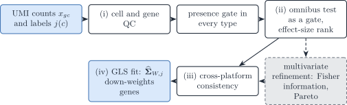
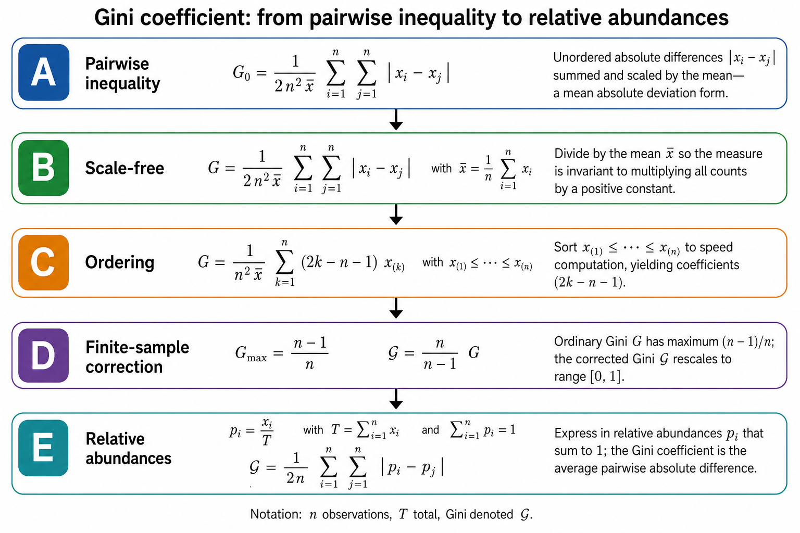
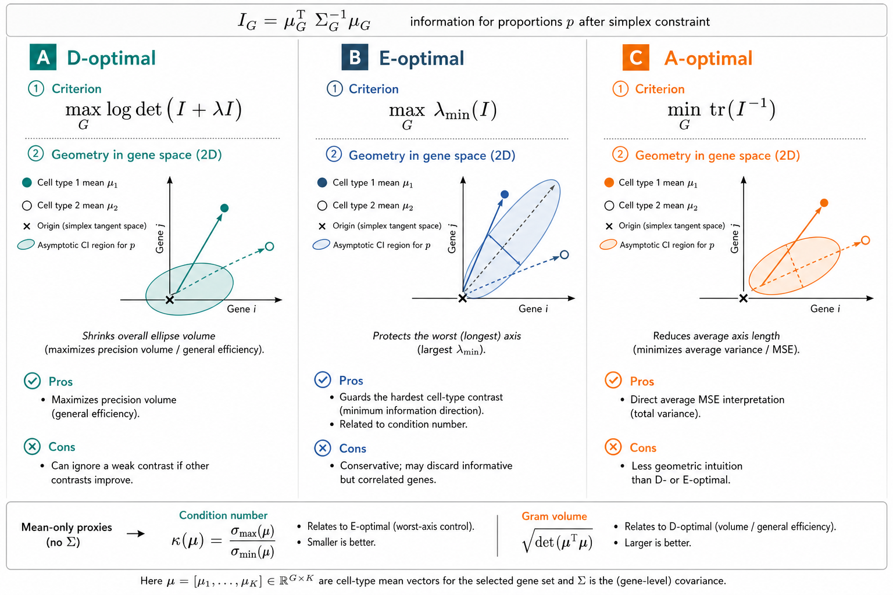
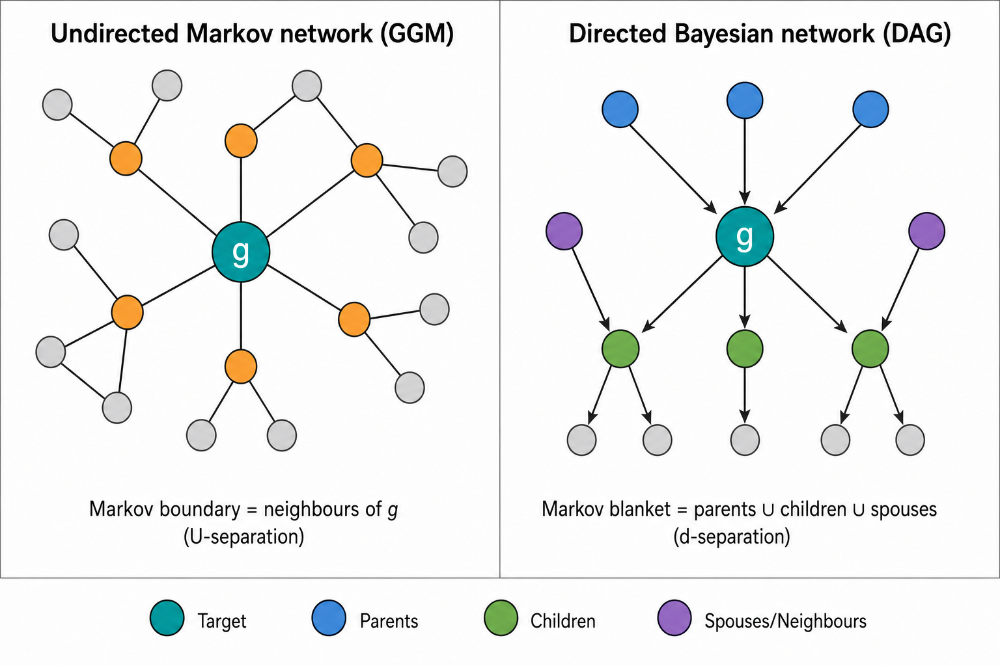

# 3.1 Gene selection for the reference

> **Notation (shared by all vignettes; aligned with the article)**
>
> Gene g=1,\ldots,G; cell type j=1,\ldots,J (a second type is \ell);
> bulk sample i=1,\ldots,N; reference donor (replicate) r=1,\ldots,R;
> cell c, with C_j reference cells of type j. The index i is dropped
> inside a derivation and restored in the model statements.
>
> | Symbol | Meaning |
> |----|----|
> | y\_{gi}, \boldsymbol{y}\_{\cdot i} | Bulk expression on a linear scale |
> | m\_{ji}, n_i=\sum_jm\_{ji} | Cells of type j in bulk sample i, and their total |
> | \tilde{\boldsymbol{y}}\_{\cdot i}=\boldsymbol{y}\_{\cdot i}/n_i | Bulk expression per cell |
> | \boldsymbol{p}\_{\cdot i}\in\Delta^{J-1} | Cell fractions, p\_{ji}=m\_{ji}/n_i |
> | \boldsymbol{\rho}\_{i}\in\mathbb{R}^{J-1} | Isometric log-ratio (ILR) coordinates of \boldsymbol{p}\_{\cdot i}, \boldsymbol{p}\_{\cdot i}=\operatorname{softmax}(\mathbf{V}\boldsymbol{\rho}\_i) with a Helmert basis \mathbf{V} |
> | \boldsymbol{q}\_{\cdot i} | Transcript fractions, q\_{ji}=p\_{ji}S_j/\sum\_\ell p\_{\ell i}S\_\ell |
> | \boldsymbol{\mu}\_{\cdot j}, \boldsymbol{\Sigma}\_j | Mean and G\times G gene–gene covariance of a type-j population profile |
> | \boldsymbol{\Omega}\_j=\boldsymbol{\Sigma}\_j^{-1} | Precision matrix of type j |
> | \boldsymbol{\Gamma}\_g | J\times J covariance across cell types for gene g (`bMIND`, `EPIC-unmix`, `Unico`) |
> | \boldsymbol{x}\_{\cdot j,i} | Purified profile of type j in sample i |
> | x\_{gc}, \boldsymbol{x}\_{\cdot c}, s_c | Raw UMI count of gene g in reference cell c, and the size factor of cell c |
> | \boldsymbol{\lambda}\_{\cdot c}, \boldsymbol{z}\_{\cdot c} | Size-free expression of cell c; its latent log-expression in the Poisson log-normal (PLN) model |
> | \tilde{\boldsymbol{\mu}}\_{\cdot j}=C_j^{-1}\sum\_{c\in j}\boldsymbol{x}\_{\cdot c}=S_j\boldsymbol{\theta}\_{\cdot j} | Per-cell mean of the raw UMI counts of the C_j reference cells of type j |
> | \boldsymbol{\theta}\_{\cdot j}, S_j=\mathbf{1}^{\top}\tilde{\boldsymbol{\mu}}\_{\cdot j} | Relative abundance (\mathbf{1}^{\top}\boldsymbol{\theta}\_{\cdot j}=1) and mean transcriptome size of a type-j cell |
> | \boldsymbol{\Sigma}\_{W,j}, \boldsymbol{\Sigma}\_{B,j} | Within-donor cell-to-cell covariance of type j (one single-cell sample); between-donor covariance of type j (needs R\ge2 donors) |
> | \boldsymbol{S}\_W(\boldsymbol{v})=\sum_jv_j\boldsymbol{\Sigma}\_{W,j}, \boldsymbol{S}\_B(\boldsymbol{v})=\sum_jv_j^2\boldsymbol{\Sigma}\_{B,j} | Linear and quadratic covariance mixtures with weights \boldsymbol{v} |
> | \boldsymbol{V}\_j | Empirical covariance of type j, computed from its reference profiles or cells |
> | \boldsymbol{R}\_j | Empirical correlation matrix of type j (bold; the scalar R is the number of donors) |
> | \boldsymbol{\Delta}\_j=\operatorname{diag}(\boldsymbol{V}\_j) | Diagonal matrix of the empirical variances of type j |
> | \lambda | Penalty of a regularised covariance or precision estimator |
> | \psi_g, \mathcal{D}\_g | Negative binomial dispersion of gene g; deviance of gene g in a count model |
> | \delta\_{gj} | Detection rate of gene g in type j (fraction of cells with a non-zero count) |
> | \varpi\_{\ell\mid j}, \varpi\_{j\ell}, \bar\varpi | MixSim overlap: probability of misclassifying a draw of j into \ell, pairwise overlap \varpi\_{j\ell}=\varpi\_{\ell\mid j}+\varpi\_{j\mid\ell}, and its average over pairs (`BarOmega`) |
> | \boldsymbol{T}\_{ji}=\sum\_{c=1}^{m\_{ji}}\boldsymbol{X}\_{jic} | Total expression contributed by type j to sample i |
> | a_i | Sample-wide scale between the reference and the bulk library |
> | c_i=a_in_i, \phi_i=a_i^2n_i | Mean scale and variance scale of the single-cell model |
> | b_g, \tilde b_g=b_g^{\mathrm{bulk}}/b_g^{\mathrm{ref}} | Capture efficiency of gene g in one protocol, and the gene-wise platform ratio; \tilde{\boldsymbol{B}}=\operatorname{diag}(\tilde{\boldsymbol{b}}) |
> | \boldsymbol{D}\_i | Diagonal, heteroscedastic bulk measurement noise |
>
> A tilde marks a quantity rescaled to a reference unit: per cell
> (\tilde{\boldsymbol{y}}, \tilde{\boldsymbol{\mu}}) or relative to the
> reference protocol (\tilde{\boldsymbol{b}}). \boldsymbol{\Sigma}\_j
> couples **genes** within one cell type; \boldsymbol{\Gamma}\_g couples
> **cell types** within one gene. A symbol absent from this table is
> defined in the vignette that uses it, with one meaning there.

> **Scope**
>
> This chapter states which genes should enter a DeCovarT reference
> built from single-cell data, and why. It holds the theory: the
> estimand, the four tiers of selection, the statistical tests behind
> them, and a review of how second-generation deconvolution methods
> choose their genes ([Gaspard-Boulinc et al.
> 2025](#ref-gaspard-boulincCelltypeDeconvolutionMethods2025); [Avila
> Cobos et al.
> 2018](#ref-avilacobosComputationalDeconvolutionTranscriptomics2018)).
> The application to the Suppinger gastruloids (filters as applied,
> settings, rank tables, code) is in the feature-selection chapter of
> the reproducibility book. Strategies compared on simulated references
> are in [Appendix
> S6](https://bastienchassagnol.github.io/DeCovarT/articles/S6-feature-screening-scenario.md).
> Marker-based abundance scores (enrichment modules) are out of scope
> ([Aran et al. 2017](#ref-aranXCellDigitallyPortraying2017)).

**Local symbols.** C=\sum_jC_j is the number of reference cells in one
time slot; j(c) is the label of cell c.
\delta\_{gj}=C_j^{-1}\sum\_{c:j(c)=j}\mathbb{1}(x\_{gc}\>0) is the
detection rate of gene g in type j, and v\_{gj} is the g-th diagonal
entry of \boldsymbol{V}\_j. In a negative-binomial (NB) model \psi_g is
the dispersion, so that
\operatorname{Var}(x\_{gc})=m\_{gc}+m\_{gc}^2/\psi_g with
m\_{gc}=\operatorname{E}(x\_{gc}); \mathcal{D}\_g(M) is the deviance of
model M for gene g; r\_{gc} is a Pearson residual. A gene panel is
written \mathcal{G}\subseteq\\1,\ldots,G\\.

Figure 1: “Four tiers of gene selection for a DeCovarT reference. Tiers
(i) to (iii) remove genes; tier (iv) keeps the remaining genes and lets
the fitted covariance down-weight them. The dashed box is the optional
multivariate refinement.”

## 1 Estimand: what the genes are for

The target is a set of genes that makes the reference moments
(\boldsymbol{\mu}\_{\cdot j},\boldsymbol{\Sigma}\_{W,j}) estimable and
informative about \boldsymbol{p}. This is not population-level
differential expression, for three reasons.

- **One specimen.** The Suppinger reference is one technical scRNA-seq
  experiment ([Suppinger et al.
  2023](#ref-suppingerMultimodalCharacterizationMurine2023)). Its cells
  are draws from one specimen, not biological replicates, so every
  p-value below calibrates a *screen inside that specimen*. Treating
  cells as replicates of a population contrast inflates the false
  discoveries ([Zimmerman et al.
  2021](#ref-zimmermanPracticalSolutionPseudoreplication2021); [Squair
  et al. 2021](#ref-squairConfrontingFalseDiscoveries2021); [Crowell et
  al. 2020](#ref-crowellMuscatDetectsSubpopulationspecific2020)). Only
  the within-donor covariance \boldsymbol{\Sigma}\_{W,j} is estimable;
  the between-donor part needs R\ge2 donors
  ([2.1](https://bastienchassagnol.github.io/DeCovarT/articles/02-1-single-cell-generative-optimisation.html#sec-one-replicate)).
- **Labels are given.** A test of the type effect is valid only if the
  labels were fixed before the statistic is computed. Labels obtained by
  clustering the same matrix make the test anti-conservative
  (post-clustering inference, González-Delgado et al. 2025) .
- **Linear scale.** Transforms (logarithms, Pearson residuals,
  nonparanormal scores) may *rank* genes; the exported moments stay on
  the linear scale on which the convolution holds
  ([2.1](https://bastienchassagnol.github.io/DeCovarT/articles/02-1-single-cell-generative-optimisation.html#sec-norm-linear);
  Sturm et al.
  ([2019](#ref-sturmComprehensiveEvaluationTranscriptomebased2019))).

Selection proceeds in four tiers ([Figure 1](#fig-fs-tiers)): (i)
quality control and a presence gate; (ii) marker-gene consistency, an
omnibus test used as a gate and an effect-size rank; (iii) consistency
between the reference and bulk platforms; (iv) down-weighting by the
model instead of removal. Tiers (i) to (iii) are filters; tier (iv) is
part of the likelihood. Feature selection as a pre-modelling filter has
the usual caveats ([Guyon and Elisseeff
2003](#ref-guyonIntroductionVariableFeature2003)): it is a proposal, to
be checked by out-of-sample deconvolution error
([S6](https://bastienchassagnol.github.io/DeCovarT/articles/S6-feature-screening-scenario.html#sec-cv-selection)).

## 2 Tier (i): quality control

QC removes cells and genes that lie outside the support of any
expression model. The thresholds below are examples from the reviewed
methods ([Section 8](#sec-fs-review)), not defaults of DeCovarT.

- **Cells.** Library size more than 3 median absolute deviations (MAD)
  from the median of its type, and cells more than 3 MAD from the median
  pairwise distance within their type (RNA-Sieve, optional; Erdmann-Pham
  et al.
  ([2021](#ref-erdmann-phamLikelihoodbasedDeconvolutionBulk2021)),
  supplement p. 3). Fewer than 500 UMIs, fewer than 200 detected genes,
  or more than 50 % mitochondrial UMIs (deMixSC; Guo et al.
  ([2023](#ref-guoDeMixSCDeconvolutionFramework2023)), p. 11).
- **Genes.** Ribosomal, mitochondrial and sex-chromosome genes, which
  reflect cell survival and donor sex rather than type (BayesPrism; Chu
  et al. ([2022](#ref-chuCellTypeGeneExpression2022)), supplement
  pp. 14, 19). Genes detected in fewer than 20 % of the cells of every
  type (RNA-Sieve, supplement p. 3).

QC differs from tier (iv): a QC rule removes an observation that no
model in the ladder would fit, whereas down-weighting keeps an
observation the model can explain with a larger variance. For the
Suppinger data the authors’ QC and the gene allow-list are reported as
applied in the book; no further cell filter is claimed here.

### 2.1 Presence gate in every type

A gene enters tier (ii) only if

\min\_{j}\delta\_{gj}\ge\delta\_{\min} \quad\text{and}\quad
\min\_{j}v\_{gj}\>0, \tag{1}

with \delta\_{\min} a few per cent (for example 0.05), fixed before the
ranks are seen. The gate is a design constraint, for three reasons.

- **Covariance.** A gene with v\_{gj}=0 gives a zero row and column in
  \boldsymbol{V}\_j. \boldsymbol{\Sigma}\_{W,j} is then singular on that
  coordinate, and the precision of type j is undefined.
- **Identifiability.** A gene expressed in one type only is the perfect
  marker of classical signatures ([Newman et al.
  2019](#ref-newmanDeterminingCellType2019)). MEAD shows that
  \boldsymbol{P} is not identifiable when all genes are perfect markers
  and gene-wise platform ratios are allowed: rescaling the ratios of the
  markers of type j by \delta_j is absorbed by the proportions ([Xie et
  al. 2026, 7](#ref-xieStatisticalInferenceCell2026)). A gate *in every
  type* excludes these genes.
- **Testing.** With an all-zero type the NB estimate
  \hat\beta\_{gj}\to-\infty, its standard error grows faster, and the
  Wald statistic shrinks as the effect grows (Hauck–Donner effect) ([Yee
  2022](#ref-yeeHauckDonnerEffectWald2022)). Likelihood-ratio and score
  statistics stay finite ([Section 3.2](#sec-fs-omnibus)).

## 3 Tier (ii): marker-gene consistency

MuSiC introduced “marker gene consistency” with two parts: cross-subject
consistency, which guards against the choice of subjects, and cross-cell
consistency, which guards against biased cell capture ([Wang et al.
2019, 2](#ref-wangBulkTissueCell2019)). Cross-cell consistent genes are
those with low within-cluster variance ([Wang et al. 2019,
3](#ref-wangBulkTissueCell2019)). With one specimen only cross-cell
consistency can be assessed. Its natural statistic is the split of a
gene’s variation into between-type and within-type parts.

### 3.1 Pearson residuals and the between/within split

The technical null fits each gene with library size as the only
covariate,

M\_{0}:\\ \log m\_{gc}=\beta\_{0g}+\log s\_{c}, \qquad
x\_{gc}\sim\mathrm{NB}(m\_{gc},\psi\_{g}), \tag{2}

which is the model of `SCTransform` with `vst.flavor = "v2"`, where the
depth slope is fixed and library size is an offset ([Hafemeister and
Satija 2019](#ref-hafemeisterNormalizationVarianceStabilization2019);
[Lause et al. 2021](#ref-lauseAnalyticPearsonResiduals2021)). Cell type
is deliberately absent: putting j in the null would remove the signal to
be ranked. The Pearson residuals r\_{gc}=(x\_{gc}-\hat
m\_{gc})/\sqrt{\hat m\_{gc}+\hat m\_{gc}^{2}/\hat\psi\_{g}} split as

\mathrm{SS}\_{\mathrm{B},g} = \sum\_{j=1}^{J}C\_{j}\bigl(\bar
r\_{gj}-\bar r\_{g}\bigr)^{2}, \qquad \mathrm{SS}\_{\mathrm{W},g} =
\sum\_{j=1}^{J}\sum\_{c:j(c)=j}\bigl(r\_{gc}-\bar r\_{gj}\bigr)^{2},
\tag{3}

with \bar r\_{gj} the mean residual in type j and \bar r\_{g} the
overall mean (\approx0). A lineage marker has a large between-type and a
small within-type part; a stress-response gene can have a large total
residual variance and still a small between-type part.

Figure 2: `SCTransform` workflow: negative-binomial mean–variance model,
depth regression, Pearson residuals, and empirical-Bayes regularisation
across genes.

The sums in [Equation 3](#eq-fs-ss) weight every cell equally, so the
most abundant type dominates them. The equal-type version gives each
type weight 1/J:

\mathrm{MS}^{\mathrm{eq}}\_{\mathrm{B},g} =
\frac1J\sum\_{j=1}^{J}\Bigl(\bar r\_{gj}-\frac1J\sum\_{\ell=1}^{J}\bar
r\_{g\ell}\Bigr)^{2}, \qquad \mathrm{MS}^{\mathrm{eq}}\_{\mathrm{W},g} =
\frac1J\sum\_{j=1}^{J}\operatorname{var}\_{c:j(c)=j}(r\_{gc}). \tag{4}

### 3.2 Omnibus test: deviance, score and quasi-likelihood F

Add the type main effect to [Equation 2](#eq-fs-nb-null):

M\_{1}:\\ \log m\_{gc}=\beta\_{0g}+\beta\_{g,j(c)}+\log s\_{c}, \qquad
\beta\_{g1}=0, \qquad H\_{0g}:\beta\_{g2}=\cdots=\beta\_{gJ}=0 . \tag{5}

The joint null has J-1 degrees of freedom, and the three classical tests
apply ([Agresti 2015](#ref-agrestiFoundationsLinearGeneralized2015)).
One omnibus test per gene replaces \binom{J}{2} pairwise or J
one-versus-rest tests, and a single Benjamini–Hochberg correction across
genes follows.

- **Likelihood ratio (analysis of deviance).**
  \Lambda_g=\mathcal{D}\_g(M_0)-\mathcal{D}\_g(M_1), referred to
  \chi^2\_{J-1} when \psi_g is known.

- **Score (Rao).** It needs only the M_0 fit, the one `SCTransform`
  already computes. With the log link the IRLS weight is w\_{gc}=\hat
  m\_{gc}^2/V(\hat m\_{gc}), V(m)=m+m^2/\psi_g, and the score of the
  type-j indicator is U\_{gj}=\sum\_{c:j(c)=j}\sqrt{w\_{gc}}\\r\_{gc}.
  With the intercept profiled out,

  T\_{g} = \sum\_{j=1}^{J}\frac{U\_{gj}^{2}}{\sum\_{c:j(c)=j}w\_{gc}}
  \\\approx\\ \sum\_{j=1}^{J}C\_{j}\\\bar r\_{gj}^{2} \approx
  \mathrm{SS}\_{\mathrm{B},g}, \tag{6}

  where the approximation holds when the weights are nearly constant
  within a type. For a Poisson null, U\_{gj} is observed minus expected
  counts in type j and T_g is Pearson’s \chi^2 on the type totals. The
  between-type sum of squares of Pearson residuals is therefore, up to
  weight heterogeneity, the score statistic of the cell-type effect.

- **Wald.** It needs M_1 only and fails near the boundary
  ([Section 2.1](#sec-fs-presence)).

**Quasi-likelihood F.** Dividing T_g/(J-1) by the within-type Pearson
dispersion \hat\phi_g=\mathrm{SS}\_{\mathrm{W},g}/(C-J) gives

F\_{g} =
\frac{\mathrm{SS}\_{\mathrm{B},g}/(J-1)}{\mathrm{SS}\_{\mathrm{W},g}/(C-J)},
\tag{7}

the one-way ANOVA ratio ([Wang et al.
2010](#ref-wangSilicoEstimatesTissue2010)). In GLM terms it is a
quasi-likelihood F test: the mean model [Equation 5](#eq-fs-nb-main) and
the variance function V are kept, and a scalar \phi_g absorbs a variance
larger or smaller than V predicts. The reference F\_{J-1,C-J} accounts
for estimating \phi_g, as in the edgeR quasi-likelihood pipeline and in
`glmGamPoi::test_de()` ([Lund et al.
2012](#ref-lundDetectingDifferentialExpression2012); [Ahlmann-Eltze and
Huber 2020](#ref-glmGamPoi2020)). Three consequences follow.

- **Keep overdispersed genes.** Within-type overdispersion is the
  within-type scatter that the denominator already penalises, and the
  covariance that DeCovarT models. Removing such genes before the test
  removes that signal.
- **A scalar \phi_g cannot absorb a wrong variance function.** Under a
  Poisson null it cannot absorb the quadratic NB term, whose share grows
  with the type mean; the pooled \hat\phi_g is then wrong for every
  type. Use the NB variance, so that \phi_g\approx1 in every type; if
  between-type heteroscedasticity remains, use a Welch-type statistic or
  the equal-type mean squares of [Equation 4](#eq-fs-equal-type).
- **Same order within a slot.** J and C are shared by all genes of a
  slot, so F_g is a monotone function of
  \mathrm{SS}\_{\mathrm{B},g}/\mathrm{SS}\_{\mathrm{W},g}; the analytic
  F adds a threshold, not a new ranking.

When the NB variance function itself fails, quasi-likelihood with an
empirical variance function is the fallback ([Agresti
2015](#ref-agrestiFoundationsLinearGeneralized2015)). When the *shape*
differs between types (types that share a mean but differ in
dispersion), a location–scale model with type-specific \psi\_{gj} tests
both, on 2(J-1) degrees of freedom; this is the GAMLSS margin used by
scDesign3 ([Song et al.
2024](#ref-songScDesign3GeneratesRealistic2024)), Stasinopoulos & Rigby
(2007) .

#### 3.2.1 Calibration: permutation, Freedman–Lane, bootstrap

The nominal F\_{J-1,C-J} tail is optimistic on `SCTransform` output for
three reasons: residuals are clipped at \pm\sqrt{C/30}, \psi_g is
regularised across genes and so is misspecified for any one gene, and
residuals at low means are discrete and skewed ([Hafemeister and Satija
2019](#ref-hafemeisterNormalizationVarianceStabilization2019); [Lause et
al. 2021](#ref-lauseAnalyticPearsonResiduals2021)). A permutation null
keeps F_g and replaces its reference distribution.

- **Permute labels, not genes.** One permutation of the cell labels is
  applied to all genes at once. Each gene keeps its marginal
  distribution and its dependence on the other genes; only the link with
  the label is broken. Shuffling genes, or shuffling within cells, does
  not produce that null.
- **Nuisance covariates.** With covariates (batch, cell line, cell
  cycle), a global label shuffle creates impossible combinations. The
  Freedman–Lane scheme fits the reduced model without type, permutes its
  residuals with one row permutation shared by all genes, adds them back
  to the reduced fit, refits the full model and recomputes F_g
  ([Freedman and Lane
  1983](#ref-freedmanNonstochasticInterpretation1983)).
- **Bootstrap answers another question.** A nonparametric bootstrap of
  cells within type resamples under the observed effects: it measures
  the stability of the ranks and the uncertainty of an effect size, in
  the spirit of stability selection ([Meinshausen and Bühlmann
  2010](#ref-meinshausenStabilitySelection2010)), not a null
  distribution. A parametric bootstrap of \Lambda_g under the fitted M_0
  checks the \chi^2\_{J-1} approximation for small types.

### 3.3 Gate, then rank by effect size

With thousands of cells nearly every expressed gene rejects H\_{0g}, and
p-values only order genes by C\times effect. The test is therefore a
**gate** (FDR on permutation or quasi-likelihood p-values, after
[Equation 1](#eq-fs-presence)), and genes are ranked by an effect size
with equal type weights:

- the between-type share
  \eta^2_g=\mathrm{SS}\_{\mathrm{B},g}/(\mathrm{SS}\_{\mathrm{B},g}+\mathrm{SS}\_{\mathrm{W},g}),
  or its equal-type analogue from [Equation 4](#eq-fs-equal-type);
- the deviance explained
  R^{2}\_{\mathcal{D},g}=1-\mathcal{D}\_g(M_1)/\mathcal{D}\_g(M_0);
- the smallest pairwise Hellinger distance between the type-specific
  laws of the gene
  ([4.2](https://bastienchassagnol.github.io/DeCovarT/articles/04-2-distances-overlap-metrics.html#sec-hellinger)),
  which also sees types that share a mean and differ in variance.

#### 3.3.1 Specificity scores for one-versus-rest lists

Long one-versus-rest lists are often compacted with the entropy or the
Gini coefficient of the type shares
u\_{gj}=\mu\_{gj}/\sum\_{\ell}\mu\_{g\ell} ([Zhang et al.
2017](#ref-zhang_etal17)):

H_g=-\sum\_{j=1}^{J}u\_{gj}\log u\_{gj}, \qquad \mathrm{Gini}\_g =
\frac{1}{2J}\sum\_{j=1}^{J}\sum\_{\ell=1}^{J}\lvert
u\_{gj}-u\_{g\ell}\rvert = \frac1J\sum\_{k=1}^{J}(2k-J-1)\\u\_{g(k)},
\tag{8}

with 0\log0=0 and u\_{g(1)}\le\cdots\le u\_{g(J)}. H_g/\log J and
J\\\mathrm{Gini}\_g/(J-1) lie in \[0,1\]; low entropy and high Gini mean
that few types carry the mass. Both scores reward exclusive expression,
which the presence gate ([Section 2.1](#sec-fs-presence)) excludes, and
neither sees redundancy between genes
([Section 4.3](#sec-kappa-limits)).

Figure 3: Derivation of the Gini coefficient: pairwise absolute
differences, scale-free normalisation by the mean, sorted-data formula,
finite-sample correction to \[0,1\].

### 3.4 Leverage is not influence

Residual size, leverage and influence are three different quantities
([Agresti 2015](#ref-agrestiFoundationsLinearGeneralized2015)). In a
gene-wise GLM, leverage belongs to the *observations* (cells, or
pseudo-bulk samples), not to the gene. For the one-way design of
[Equation 5](#eq-fs-nb-main) the hat value of cell c is
h\_{gc}=w\_{gc}/\sum\_{c':j(c')=j(c)}w\_{gc'}: every cell of a rare
type, and every cell with a large fitted mean, has high leverage.
Influence combines the two; Cook’s distance is

\mathrm{Cook}\_{gc} =
\frac{r\_{gc}^{2}\\h\_{gc}}{J\\\hat\phi_g\\(1-h\_{gc})^{2}} .

A high-expression marker in a small type sits at an extreme fitted mean
and has high leverage, yet it agrees with the type effect: it is
informative, not an outlier. Rules that clip by size alone, such as
residual clipping or SCDC’s clipping of variance weights at the 15th and
85th percentiles ([Dong et al. 2021, 10](#ref-dongSCDCBulkGene2021)),
shrink these observations with the harmful ones. An observation is a
candidate outlier only when both its leverage and its standardised
residual are large.

### 3.5 Critiques of current marker rules

The reviewed marker rules ([Table 2](#tbl-fs-review)) depart from the
model above in four ways.

- **Hurdle models on droplet counts.** DWLS defines markers with the
  `MAST` hurdle model ([Tsoucas et al. 2019,
  7](#ref-tsoucasAccurateEstimationCelltype2019)). Droplet UMI counts
  show no zero inflation beyond what the NB predicts (Svensson 2020) ,
  and current data do not support zero-inflated *measurement* models
  ([Sarkar and Stephens 2021,
  5](#ref-sarkarSeparatingMeasurementExpression2021)). The hurdle splits
  one count into a detection and a magnitude test (Finak et al. 2015)
  where one NB test of [Equation 5](#eq-fs-nb-main) suffices.
- **Gaussian t-tests on counts.** ReDeconv uses a two-sample t-test
  between cells ([Lu et al. 2025,
  14](#ref-luTranscriptomeSizeMatters2025)); deMixSC uses a paired
  t-test of bulk against matched pseudo-bulk ([Guo et al. 2023,
  12](#ref-guoDeMixSCDeconvolutionFramework2023)).
- **Cells as independent replicates.** Every test above that runs on
  cells (DWLS, ReDeconv, BayesPrism’s marker option) treats them as
  replicates of a population contrast ([Section 1](#sec-fs-estimand)).
- **No multiplicity control.** ReDeconv keeps genes with p\<0.05 in each
  comparison against every other type, with no FDR correction ([Lu et
  al. 2025, 14](#ref-luTranscriptomeSizeMatters2025)).

## 4 Screen versus objective: multivariate selection

The advanced stage treats \mathcal{G} as a **subset selection** problem
on the full J-column signature. It comes **after** GRN inference
(**?@sec-grn-top4**), because the second objective uses
\boldsymbol{\Sigma}\_{j}. The loss is defined on all types jointly. That
is the right geometry for DeCovarT: the likelihood depends on
\boldsymbol{\mu}\boldsymbol{p} **and** on
\sum\_{j}p\_{j}^{2}\boldsymbol{\Sigma}\_{j}.

### 4.1 The ANOVA ratio is the right screen, not the right objective

Take J=2, one gene, the population model of DeCovarT
([1.2](https://bastienchassagnol.github.io/DeCovarT/articles/01-2-population-inference.html#sec-fisher-p))
and equal within-type variances \sigma_g^2. Then
y_g\sim\mathcal{N}\bigl(p\mu\_{g1}+(1-p)\mu\_{g2},\\\sigma_g^2
s(p)\bigr) with s(p)=p^2+(1-p)^2, and the Fisher information for p is

I_g(p) = \frac{\Delta_g^{2}}{s(p)} +
\frac12\Bigl(\frac{s'(p)}{s(p)}\Bigr)^{2}, \qquad
\Delta_g=\frac{\mu\_{g1}-\mu\_{g2}}{\sigma_g}. \tag{9}

The second term is the same for every gene. Computed on the scale of the
model, the ratio [Equation 7](#eq-fs-qlf) estimates \Delta_g^2: F_g is
non-central F\_{1,C-2} with non-centrality \tilde C\Delta_g^{2}, \tilde
C=C_1C_2/C, so \operatorname{E}F_g\approx1+\tilde C\Delta_g^2. Under
these conditions, ranking genes by F_g ranks them by I_g(p) at every p,
and with independent genes the top-k genes by F_g maximise the total
information \sum\_{g\in\mathcal{G}}I_g(p). This identity is pending a
symbolic check (ledger V4). The agreement holds only when genes are
independent and homoscedastic across types. The ratio ignores:

- **redundancy and collinearity.** Two genes that separate the same pair
  of types add little information together, and concatenated
  one-versus-rest lists inflate the condition number of
  \boldsymbol{\mu}\_{\mathcal{G}} ([Section 4.3](#sec-kappa-limits));
- **the covariance DeCovarT models.** With \sigma\_{g1}\ne\sigma\_{g2}
  the information depends on p through
  p^2\sigma\_{g1}^2+(1-p)^2\sigma\_{g2}^2, and with correlated genes it
  is not a sum over genes;
- **the count mean–variance relation**, unless the ratio is computed on
  residuals of a model with the right variance function
  ([Section 3.2](#sec-fs-omnibus)).

The univariate ratio is therefore a screen. The objective for a panel is
the Fisher information for \boldsymbol{p} of the whole panel.

### 4.2 Fisher information for \boldsymbol{p} as the objective

For a panel \mathcal{G}, restrict the rows of \boldsymbol{\mu} and the
rows and columns of \boldsymbol{\Sigma}\_j to \mathcal{G} and compute
I\_{\mathcal{G}}(\boldsymbol{p}) from [1.2, Eq. for
I(\boldsymbol{p})](https://bastienchassagnol.github.io/DeCovarT/articles/01-2-population-inference.html#sec-fisher-p),
mapped to the J-1 free coordinates of the simplex. Because
\boldsymbol{\Sigma}(\boldsymbol{p}) depends on \boldsymbol{p}, a panel
is scored over a composition grid \mathcal{P}\subset\Delta^{J-1}
(balanced, rare-type, sparse and near-collinear compositions), and the
classical criteria ([Atkinson and Donev
1992](#ref-atkinsonOptimumExperimentalDesigns1992); [Pukelsheim
2006](#ref-pukelsheimOptimalDesignExperiments2006)) become

\max\_{\mathcal{G}}\min\_{\boldsymbol{p}\in\mathcal{P}} \log\det
I\_{\mathcal{G}}(\boldsymbol{p}) \\ \text{(robust D)}, \qquad
\max\_{\mathcal{G}}\min\_{\boldsymbol{p}\in\mathcal{P}}
\lambda\_{\min}\bigl(I\_{\mathcal{G}}(\boldsymbol{p})\bigr) \\
\text{(E)}, \qquad
\min\_{\mathcal{G}}\max\_{\boldsymbol{p}\in\mathcal{P}}
\operatorname{tr}I\_{\mathcal{G}}(\boldsymbol{p})^{-1} \\ \text{(A)}.
\tag{10}

D-optimality shrinks the volume of the confidence ellipsoid for
\boldsymbol{p} and can leave one weak contrast; E-optimality protects
the worst contrast; A-optimality minimises the average variance
([Figure 4](#fig-dea-design)). If
\boldsymbol{\Sigma}\_{\mathcal{G}}(\boldsymbol{p}) is replaced by the
identity, I\_{\mathcal{G}} reduces to the Gram matrix of the contrasted
mean columns: D-optimality maximises the Gram volume and E-optimality is
close to minimising the condition number
([Section 4.3.1](#sec-weighted-kappa);
[4.1](https://bastienchassagnol.github.io/DeCovarT/articles/04-1-synthetic-scenarios.html#nte-geometric-score)).

Figure 4: D-, E- and A-optimal design for gene-panel selection: shared
Fisher information, confidence-ellipse intuition, and links to the
condition number and Gram volume.

This objective stays **optional**: it needs
\widehat{\boldsymbol{\Sigma}}\_{W,j} on the candidate genes, hence the
covariance estimation of
[3.2](https://bastienchassagnol.github.io/DeCovarT/articles/03-2-covariance-network-estimation.md)
on a shortlist that tier (ii) has already produced. The search itself
(greedy exchange, NSGA-II) and its settings are in
[S6](https://bastienchassagnol.github.io/DeCovarT/articles/S6-feature-screening-scenario.html#sec-pareto-nsga2).

### 4.3 Condition number and its limits

The 2-norm condition number of a design matrix,

\kappa_2(\boldsymbol{X})=\frac{\sigma\_{\max}(\boldsymbol{X})}{\sigma\_{\min}(\boldsymbol{X})},
\tag{11}

is the classical panel criterion: CIBERSORT and DWLS keep the candidate
signature with the smallest \kappa_2(\boldsymbol{\mu}\_{\mathcal{G}})
([Newman et al. 2015](#ref-newmanRobustEnumerationCell2015); [Tsoucas et
al. 2019, 7](#ref-tsoucasAccurateEstimationCelltype2019); [Gong and
Szustakowski 2013](#ref-gongDeconRNASeqStatisticalFramework2013)). Note
that
\kappa_2(\boldsymbol{X}^{\top}\boldsymbol{X})=\kappa_2(\boldsymbol{X})^2.
The criterion sees the means only.

In a continuum (gastruloids, differentiation trajectories) neighbouring
types have nearly collinear means by construction, so \kappa_2 is large
whatever the panel, and minimising it keeps a few dominant lineages and
drops the genes that separate neighbours through their covariance
([Figure 5](#fig-kappa-gastruloid)). Use \kappa_2 as a diagnostic of the
mean geometry, next to the information criteria of
[Equation 10](#eq-optimal-design). Mean-only pruning then
under-represents adjacent or low-abundance states — exactly the types
whose **rewiring** DeCovarT is meant to exploit.

Figure 5: Condition-number pruning on correlated developmental cell
types (gastruloid continuum). Mean-only \kappa filtering can concentrate
signal in dominant collinear lineages and shrink closely related states.

#### 4.3.1 Variance-weighted condition number

With gene-wise uncertainties \tau_g^2 (biological, sampling and optional
reference-to-bulk discrepancy), standardise the rows and evaluate the
conditioning in the (J-1)-dimensional contrast space induced by
\sum_jp_j=1:

\kappa_2\bigl(\boldsymbol{T}\_{\mathcal{G}}^{-1/2}\boldsymbol{\mu}\_{\mathcal{G}}\boldsymbol{K}\bigr),
\qquad
\boldsymbol{T}\_{\mathcal{G}}=\operatorname{diag}(\tau_g^2)\_{g\in\mathcal{G}},
\tag{12}

where the J\times(J-1) matrix \boldsymbol{K} has orthonormal columns
orthogonal to \mathbf{1}. Unweighted \kappa_2 can favour quiet but
biased genes. [Equation 12](#eq-weighted-kappa) is the
identity-covariance special case of the information criteria above: it
uses a diagonal covariance, so it still misses the covariance-only
regime in which DeCovarT identifies types whose means agree
([1.2](https://bastienchassagnol.github.io/DeCovarT/articles/01-2-population-inference.html#sec-identifiability)).

### 4.4 Pareto search over several criteria

`AutoGeneS` searches gene subsets with a multi-objective genetic
algorithm that minimises the correlation between type centroids and
maximises their distance ([Aliee and Theis
2021](#ref-alieeAutoGeneSAutomaticGene2021)).

For DeCovarT the objectives are
\kappa_2(\boldsymbol{\mu}\_{\mathcal{G}}) (mean geometry) and the
average pairwise overlap \bar\varpi of the type laws
\mathcal{N}(\boldsymbol{\mu}\_{\cdot j},\boldsymbol{\Sigma}\_j)
restricted to \mathcal{G} ([Melnykov et al.
2012](#ref-melnykovMixSimPackageSimulating2012)). The overlap and the
other separation measures (Hellinger, Bhattacharyya, Jeffreys,
affine-invariant distance) are defined in
[4.2](https://bastienchassagnol.github.io/DeCovarT/articles/04-2-distances-overlap-metrics.html#sec-overlap-tv);
unlike the `AutoGeneS` objectives they use both means and covariances.

The robust D-criterion of [Equation 10](#eq-optimal-design) is a third,
DeCovarT-specific objective, best used to choose among non-dominated
panels. The two kinds of criteria need not agree: overlap measures how
well the type laws can be told apart, Fisher information how well
\boldsymbol{p} can be estimated. A Pareto front of non-dominated panels
is reported instead of one weighted score ([Mersmann 2024](#ref-R-mco)).

> **Note 1: ℹ️ A DeCovarT-specific third objective (proposal)**
>
> Adding Fisher identifiability of \boldsymbol{p} by maximising the
> smallest eigenvalue of the mixture information
> I\_{\mathcal{G}}(\boldsymbol{p}), or minimise its condition number is
> new in the literature corpus; it is a composition of the Fisher
> information for \boldsymbol{p} as the objective.

For this repository the planned optimiser is NSGA-II via `mco::nsga2()`
([Mersmann 2024](#ref-R-mco)). Encode genes as a mask in
\[0,1\]^{\|\mathcal{G}\_{0}\|} (thresholded to a target size). Minimise
at least

1.  \kappa\_{2}(\boldsymbol{\mu}\_{\mathcal{G}}) (mean geometry);
2.  average pairwise overlap \overline{\omega} of the J Gaussians
    \mathcal{N}(\boldsymbol{\mu}\_{\cdot j},\boldsymbol{\Sigma}\_{j})
    ([Melnykov et al. 2012](#ref-melnykovMixSimPackageSimulating2012),
    [2024](#ref-R-MixSim)).

### 4.5 Seeds and Markov boundaries

A panel can also grow from a few seeds (strong markers, genes with a
large contribution to I\_{\mathcal{G}}) by their neighbours in a fitted
graphical model of one type. A Markov blanket of gene g is any set that
makes g conditionally independent of the other genes; a Markov boundary
is a minimal blanket. For a positive distribution the boundary is unique
and equals the neighbour set of g in the minimal undirected I-map
([Pearl 1988](#ref-pearlProbabilisticReasoningIntelligent1988); [Koller
and Friedman 2009](#ref-kollerProbabilisticGraphicalModels2009)). In a
Gaussian graphical model these are the genes g' with \omega\_{gg'}\ne0
in \boldsymbol{\Omega}\_j ([Bolin et al.
2026](#ref-bolinExplicitLinkGraphical2026)), *if* the fitted graph is
taken as the minimal I-map. The construction uses undirected separation;
directed d-separation, with its colliders, belongs to DAGs and is a
different operation ([Figure 6](#fig-u-vs-dsep)). Boundary expansion can
reintroduce collinear means, so the expanded set returns to the Pareto
stage.

Figure 6: Undirected Markov boundary versus directed Markov blanket:
left, neighbours of target g in a GGM; right, parents, children and
spouses in a DAG under d-separation.

Genes that change neighbourhood between types (differential networks,
`INDEED`, D-trace, cooperative penalties) are a further source of
candidates. Their theory is in [3.3, joint and differential
networks](https://bastienchassagnol.github.io/DeCovarT/articles/03-3-precision-networks.html#sec-grn-joint);
on one specimen their permutation nulls are technical nulls
([Section 1](#sec-fs-estimand)).

### 4.6 Multivariate tests

A multivariate test would replace the G gene-wise nulls by one null on
the vector \boldsymbol{x}\_{\cdot c}. Two routes are often confused.

- **Gene-wise GEE is still gene-wise.** GEE extends the quasi-score to a
  vector of correlated observations, with a working covariance (Liang &
  Zeger 1986) . Fitted once per gene, it still returns G p-values and
  still needs FDR control: correlation-aware inference does not remove
  multiplicity.
- **A joint test needs \boldsymbol{\Sigma}\_j.** A Hotelling or MANOVA
  test of equal type means on the panel uses the within-type covariance,
  which is high-dimensional when C_j is not much larger than
  \|\mathcal{G}\|, the regime of several Suppinger types
  ([3.2](https://bastienchassagnol.github.io/DeCovarT/articles/03-2-covariance-network-estimation.md)).
  With a regularised \widehat{\boldsymbol{\Sigma}}\_{W,j} such a test is
  possible on a shortlist, but its calibration is open; it is a
  perspective, not part of the pipeline.

## 5 Tier (iii): cross-platform consistency

A gene can be a perfect cross-cell marker and still be measured
differently by the reference and the bulk protocol. The reviewed methods
handle this in four ways.

- **Range bound (RNA-Sieve).** Per cell, the bulk is a convex
  combination of the type means, so on a common scale

  \min\_{j}\tilde\mu\_{gj}\\\le\\\tilde
  y\_{g}\\\le\\\max\_{j}\tilde\mu\_{gj} \tag{13}

  up to sampling error. RNA-Sieve removes genes whose bulk value falls
  outside this range by more than a sub-Gaussian tail bound allows, and
  genes that are MAD outliers on four summary statistics (largest type
  mean, largest type standard deviation, largest coefficient of
  variation, and a bulk-to-reference ratio) ([Erdmann-Pham et al. 2021,
  10–11](#ref-erdmann-phamLikelihoodbasedDeconvolutionBulk2021), Eqs.
  12–13). The bound holds for any weights on the simplex, so it does not
  depend on whether \boldsymbol{p} or \boldsymbol{q} is the target. A
  gene-wise platform ratio \tilde b_g far from 1 moves the bulk outside
  the range; the filter detects that case.

- **Test against a matched benchmark (deMixSC).** A paired t-test of
  real bulk against pseudo-bulk of the same aliquots, with BH at 0.05;
  the discrepant genes are kept and down-weighted by a fixed factor
  a=1000 ([Guo et al. 2023,
  12](#ref-guoDeMixSCDeconvolutionFramework2023)).

- **Gene-wise platform ratios in the model.** MEAD lets the ratios vary
  by gene with mean 1 ([Xie et al. 2026,
  8](#ref-xieStatisticalInferenceCell2026)); RCTD uses a gene-wise
  platform random effect, estimated once from a pooled pseudo-bulk and
  then fixed ([Cable et al. 2022,
  6–8](#ref-cableRobustDecompositionCell2022a)); MuSiC allows a gene-
  and subject-specific intercept ([Wang et al. 2019,
  7](#ref-wangBulkTissueCell2019)).

- **Normalisation only.** ReDeconv applies gene-length normalisation to
  the bulk only ([Lu et al. 2025,
  2](#ref-luTranscriptomeSizeMatters2025)).

**Suppinger.** The single-cell reference matches only the bulk of the
standard Wnt schedule at 48 h. The early-Wnt bulk at 24 h has no
single-cell counterpart, so no bulk–reference comparison is possible
there. A consistency filter (range bound and MAD flags of
[Equation 13](#eq-fs-range)) can therefore be fitted only at 48 h.
Applying the genes it flags at every time assumes that platform effects
are properties of the gene that do not change with time; this assumption
is stated, not tested. Modelling a gene-wise or module-wise scale \tilde
b_g inside DeCovarT is a perspective of
[5.3](https://bastienchassagnol.github.io/DeCovarT/articles/05-3-extensions-roadmap.md).

## 6 Tier (iv): down-weighting by the model

Filters remove genes; a weighted likelihood keeps them and lets their
variance decide their influence. The reviewed methods sit on a ladder of
noise models ([Table 1](#tbl-fs-ladder); full ladder in
[5.1](https://bastienchassagnol.github.io/DeCovarT/articles/05-1-review-distribution-aware.md)).

| Rung | Variance of the bulk residual | Methods (anchors) |
|----|----|----|
| Weighted least squares | diagonal, gene-wise weights | MuSiC: bulk noise plus cross-subject variance, Eq. 10, p. 7; DWLS: fitted values, capped by a dampening constant, pp. 2, 7; SCDC: maximal-variance weights, clipped, pp. 5, 10; deMixSC: \hat y^2 plus squared residual plus a constant, p. 12; MEAD: reference variance with empirical-Bayes shrinkage, pp. 17–18 |
| Generalised least squares | full gene–gene covariance, depends on \boldsymbol{p} | DeCovarT: \sum_jp_j^2\boldsymbol{\Sigma}\_j (population) or \sum_jp_j\boldsymbol{\Sigma}\_{W,j} (single cell); DECALS: \sum_k\pi\_{ik}^2\boldsymbol{\Sigma}\_k for inference, pp. 7, 9 |
| Feasible GLS | covariance estimated, then iterated with \hat{\boldsymbol{p}} | DECALS Algorithm 1, p. 9; DeCovarT plug-in \widehat{\boldsymbol{\Sigma}}\_{W,j} |
| Sandwich / GEE | working covariance, robust variance | MEAD: sandwich over a dependence set, pp. 13, 18 |

Table 1: Down-weighting classes in the reviewed methods. Page anchors
refer to the PDFs extracted for this review.

Two observations follow.

- DECALS computes its point estimate by constrained *ordinary* least
  squares and uses the covariance only for inference, because a GLS fit
  with an estimated covariance per sample was biased in their
  experiments ([Cai et al. 2024,
  6](#ref-caiStatisticalInferenceCelltype2024)). The same risk applies
  to any feasible GLS whose covariance is estimated on few cells;
  shrinkage of \widehat{\boldsymbol{\Sigma}}\_{W,j} addresses it
  ([3.2](https://bastienchassagnol.github.io/DeCovarT/articles/03-2-covariance-network-estimation.md)).
- MEAD notes that removing genes brings no efficiency gain unless their
  noise levels differ ([Xie et al. 2026,
  17](#ref-xieStatisticalInferenceCell2026)). Once the covariance is in
  the model, hard filtering is needed only for genes outside the model’s
  support: the presence gate ([Section 2.1](#sec-fs-presence)) and
  cross-platform outliers ([Section 5](#sec-fs-cross-platform)).

## 7 Selection effect on the covariance

Selecting genes changes the covariance that is then estimated on them.

- **Small within-type variance by construction.** A ratio such as
  [Equation 7](#eq-fs-qlf) rewards a small within-type part. ReDeconv
  goes further and keeps the genes with the smallest coefficient of
  variation ([Lu et al. 2025, 14](#ref-luTranscriptomeSizeMatters2025));
  MuSiC’s tree-guided stage keeps genes with small intra-cluster
  variance ([Wang et al. 2019, 8](#ref-wangBulkTissueCell2019)). A panel
  chosen this way removes much of the within-type covariance that
  DeCovarT models, and the estimated \boldsymbol{\Sigma}\_{W,j} on that
  panel is close to diagonal for that reason, not because genes are
  conditionally independent
  ([3.2](https://bastienchassagnol.github.io/DeCovarT/articles/03-2-covariance-network-estimation.md)).
- **Weak marginal effects hide interactions.** Genes with weak marginal
  effects are dropped by every univariate screen, and gene pairs whose
  signal lies in their covariance, not in their means, are then never
  examined. Covariance-aware criteria
  ([Section 4.2](#sec-optimal-design),
  1.  can recover them only from a shortlist that still contains them.

A practical check is to compare the distribution of v\_{gj}, and of the
off-diagonal entries of \boldsymbol{V}\_j, between the selected panel
and the genes that pass the presence gate.

## 8 Review of gene selection in second-generation methods

[Table 2](#tbl-fs-review) summarises, method by method, the facts found
in the papers. Page numbers refer to the PDF pages of the local
extractions (RNA-Sieve: main text; “supp.” marks a supplement). A dash
means that the item was not found in the extracted text; it does not
mean that the method has no such step. Each method’s likelihood is
reviewed in
[5.1](https://bastienchassagnol.github.io/DeCovarT/articles/05-1-review-distribution-aware.html#sec-methods).

| Method | Cell QC | Gene filter | Marker rule | Cross-platform | Weighting class | Gene correlation | Perfect markers |
|----|----|----|----|----|----|----|----|
| RNA-Sieve ([Erdmann-Pham et al. 2021](#ref-erdmann-phamLikelihoodbasedDeconvolutionBulk2021)) | optional: library size or pairwise distance ≥ 3 MAD from the type median (supp. p. 3) | non-zero in ≥ 20 % of cells of ≥ 1 type (supp. p. 3) | none | range bound and MAD outliers on four statistics (pp. 10–11) | CLT Gaussian composite likelihood (Eq. 10, p. 10) | genes independent (p. 10) | — |
| DECALS ([Cai et al. 2024](#ref-caiStatisticalInferenceCelltype2024)) | — | CIBERSORTx S-mode candidate genes (p. 13) | ∩ type markers of Mathys et al. ([2019](#ref-mathysSinglecellTranscriptomicAnalysis2019)), 159 genes (p. 13) | S-mode batch correction (p. 13) | constrained OLS; GLS rejected for bias (p. 6) | \sum_k\pi\_{ik}^2\boldsymbol{\Sigma}\_k, SCAD-thresholded, for inference (pp. 7, 9) | — |
| MEAD ([Xie et al. 2026](#ref-xieStatisticalInferenceCell2026)) | — | — | none; removing genes gains nothing unless noise differs (p. 17) | gene-wise ratios, mean 1 (p. 8) | WLS from reference variance (pp. 17–18); sandwich (p. 13) | dependence set by multiple testing (pp. 13, 18) | not identifiable if all genes are perfect markers (p. 7) |
| ReDeconv ([Lu et al. 2025](#ref-luTranscriptomeSizeMatters2025)) | — | — | t-test p\<0.05 against every other type, no FDR; fold change ≥ 2; smallest SD/mean, about 100 per type (p. 14) | length normalisation of bulk only (p. 2) | Gaussian likelihood, composition-dependent variance (Eq. 5, p. 14) | genes independent (p. 14) | — |
| MuSiC ([Wang et al. 2019](#ref-wangBulkTissueCell2019)) | — | all shared genes (p. 7) | none; small intra-cluster variance in the tree-guided stage (p. 8) | optional gene- and subject-specific intercept (p. 7) | W-NNLS, weights from cross-subject variance (Eq. 10, p. 7) | diagonal | all genes beat pre-selected markers (p. 7) |
| deMixSC ([Guo et al. 2023](#ref-guoDeMixSCDeconvolutionFramework2023)) | \< 500 UMI, \< 200 genes, \> 50 % mitochondrial (p. 11) | detected in \< 5 % of cells removed (p. 11) | none | paired t-test bulk vs pseudo-bulk, BH; 5,000 genes down-weighted by a=1000 (p. 12) | W-NNLS, iterated weights (p. 12) | diagonal | — |
| BayesPrism ([Chu et al. 2022](#ref-chuCellTypeGeneExpression2022)) | types with \< 20 cells excluded in one benchmark (supp. p. 15) | ribosomal, mitochondrial, X and Y genes; ≥ 5 cells (supp. p. 14) | optional scran “all” markers, t-tests, up-regulated only (supp. pp. 14–15) | bulk-specific profiles; log-normal fold-change prior (supp. pp. 5–6) | Bayesian multinomial (supp. pp. 3–6) | not modelled | exclusive markers seen as robust (supp. pp. 12–13) |
| DWLS ([Tsoucas et al. 2019](#ref-tsoucasAccurateEstimationCelltype2019)) | — | — | `MAST` hurdle, FDR \< 0.01, \log_2FC \> 0.5; 50–200 per type; smallest \kappa of 151 candidates (p. 7) | none | dampened WLS (pp. 2, 7) | diagonal | marker-only signature (p. 7) |
| SCDC ([Dong et al. 2021](#ref-dongSCDCBulkGene2021)) | first pass removes cells with a low maximal proportion (p. 9) | bulk genes with zero counts (p. 9) | none | ensemble over references (p. 6) | W-NNLS, maximal-variance weights clipped at 15th/85th percentiles (pp. 5, 10) | not modelled | — |
| RCTD ([Cable et al. 2022](#ref-cableRobustDecompositionCell2022a)) | pixels ≥ 100 UMI (p. 9) | mean above 0.0625 counts per 500 (p. 7) | log-fold change ≥ 0.5 against the all-type mean, no test (p. 7) | gene-wise platform random effect (pp. 6–8) | Poisson–lognormal GLMM (p. 6) | genes independent (supp. p. 5) | — |
| CardamomOT (Maugé & Ventre 2026) | paper: —; code: per-cell depth factor, no cell removed, doublets flagged | paper: gene sets of earlier studies (p. 32); code: no mitochondrial, ribosomal or non-coding genes | code: round robin of per-type Wilcoxon tests, NB-basin separability, Steiner closure | not applicable (no bulk) | NB mixture likelihood, \ell_1 towards a prior network (Eq. 10, p. 9) | independent given the basin (p. 12) | — ; gene set is “prior information” (p. 27) |
| DeCovarT (this chapter) | authors’ QC; MAD rules optional | presence gate in every type ([Equation 1](#eq-fs-presence)) | omnibus NB / QL test as gate, effect-size rank | range bound at 48 h ([Section 5](#sec-fs-cross-platform)) | GLS with \widehat{\boldsymbol{\Sigma}}\_{W,j} | modelled | excluded by the gate |

Table 2: Gene selection in second-generation deconvolution methods.
CardamomOT is a network-inference method, included for its gene
selection; its code facts are from the repository at commit `4a6305c`
(<https://github.com/eliasventre/CardamomOT>).

Three patterns stand out.

- Only DeCovarT puts gene–gene covariance into the criterion that
  estimates \boldsymbol{p}; DECALS and MEAD use it only for the variance
  of their estimators. Every other method treats genes as independent,
  which is the setting in which the univariate screen of
  [Section 4.1](#sec-fs-screen-objective) is also the objective.
- The tests that select genes run on cells, mostly with Gaussian or
  hurdle models. Among the methods that test, only DWLS (markers) and
  deMixSC (platform discrepancy) report a multiplicity correction
  ([Section 3.5](#sec-fs-critiques)).
- MuSiC and MEAD argue against marker pre-selection when the genes are
  weighted, and MEAD shows that perfect markers break identifiability
  under gene-wise platform ratios; DWLS and DECALS still build
  marker-only signatures.

## 9 Perspectives

### 9.1 Continuous states

Many tissues, gastruloids included, are continua rather than discrete
types. A J-column signature is then a piecewise approximation of an
archetype geometry ([Hart et al.
2015](#ref-hartInferringBiologicalTasks2015)) or a potency axis ([Gulati
et al. 2020](#ref-gulatiSinglecellTranscriptionalDiversity2020)), and
the condition number of the means is large by construction
([Section 4.3](#sec-kappa-limits)). Scores along inferred latent axes,
and Fisher information evaluated on continuous components, are open
directions; hierarchical panels (lineage, then subtype) remain the
pragmatic choice ([Wang et al. 2019](#ref-wangBulkTissueCell2019)).

### 9.2 Mechanistic priors

Prior-knowledge networks can annotate a statistically chosen panel or
add soft coverage constraints. `CARNIVAL` contextualises a prior network
from expression footprints by integer programming ([Liu et al.
2019](#ref-liuFromExpressionFootprints2019)); `CORNETO` estimates a
shared backbone plus type-specific edges across samples ([Rodriguez-Mier
et al. 2025](#ref-rodriguezMierUnifyingMultisample2025)). Their outputs
depend on the prior network and are hypotheses; they do not replace the
criteria of [Section 4](#sec-fs-multivariate). CardamomOT makes the same
point about its own input: the selected gene set acts as prior
information (Maugé & Ventre 2026, p. 27).

Agresti, Alan. 2015. *Foundations of Linear and Generalized Linear
Models*. Wiley.

Ahlmann-Eltze, Constantin, and Wolfgang Huber. 2020. ‘glmGamPoi: Fitting
Gamma-Poisson Generalized Linear Models on Single Cell Count Data’.
*Bioinformatics*, ahead of print.
<https://doi.org/10.1093/bioinformatics/btaa1009>.

Aliee, Hananeh, and Fabian J. Theis. 2021. ‘AutoGeneS: Automatic Gene
Selection Using Multi-Objective Optimization for RNA-seq Deconvolution’.
*Cell Systems* 12. <https://doi.org/10.1016/j.cels.2021.05.006>.

Aran, Dvir, Zicheng Hu, and Atul Butte. 2017. ‘xCell: Digitally
Portraying the Tissue Cellular Heterogeneity Landscape’. *Genome
Biology* 18. <https://doi.org/10.1186/s13059-017-1349-1>.

Atkinson, A C, and A N Donev. 1992. *Optimum Experimental Designs*.
Oxford University Press.
<https://doi.org/10.1093/oso/9780198522546.001.0001>.

Avila Cobos, Francisco, Jo Vandesompele, Pieter Mestdagh, and Katleen De
Preter. 2018. ‘Computational Deconvolution of Transcriptomics Data from
Mixed Cell Populations’. *Bioinformatics (Oxford, England)* 34.
<https://doi.org/10.1093/bioinformatics/bty019>.

Bolin, David, Alexandre B. Simas, and Jonas Wallin. 2026. ‘An Explicit
Link Between Graphical Models and Gaussian Markov Random Fields on
Metric Graphs’. *Stochastic Processes and Their Applications* 196:
104925. <https://doi.org/10.1016/j.spa.2026.104925>.

Cable, Dylan M., Evan Murray, Luli S. Zou, et al. 2022. ‘Robust
Decomposition of Cell Type Mixtures in Spatial Transcriptomics’. *Nature
Biotechnology* 40 (4): 517–26.
<https://doi.org/10.1038/s41587-021-00830-w>.

Cai, Biao, Emma Jingfei Zhang, Hongyu Li, Chang Su, and Hongyu Zhao.
2024. ‘Statistical Inference of Cell-Type Proportions Estimated from
Bulk Expression Data’. *Journal of the American Statistical Association*
119 (548): 2521–32. <https://doi.org/10.1080/01621459.2024.2382435>.

Chu, Tinyi, Zhong Wang, Dana Pe’er, and Charles G. Danko. 2022. ‘Cell
Type and Gene Expression Deconvolution with BayesPrism Enables Bayesian
Integrative Analysis Across Bulk and Single-Cell RNA Sequencing in
Oncology’. *Nature Cancer* 3 (4): 505–17.
<https://doi.org/10.1038/s43018-022-00356-3>.

Crowell, Helena L., Charlotte Soneson, Pierre-Luc Germain, et al. 2020.
‘Muscat Detects Subpopulation-Specific State Transitions from
Multi-Sample Multi-Condition Single-Cell Transcriptomics Data’. *Nature
Communications* 11: 6077. <https://doi.org/10.1038/s41467-020-19894-4>.

Dong, Meichen, Aatish Thennavan, Eugene Urrutia, et al. 2021. ‘SCDC:
Bulk Gene Expression Deconvolution by Multiple Single-Cell RNA
Sequencing References’. *Briefings in Bioinformatics* 22.
<https://doi.org/10.1093/bib/bbz166>.

Erdmann-Pham, Dan D., Jonathan Fischer, Justin Hong, and Yun S. Song.
2021. ‘Likelihood-Based Deconvolution of Bulk Gene Expression Data Using
Single-Cell References’. *Genome Research* 31 (10): 1794–806.
<https://doi.org/10.1101/gr.272344.120>.

Freedman, David, and Daryl Lane. 1983. ‘A Nonstochastic Interpretation
of Reported Significance Levels’. *Journal of Business & Economic
Statistics* 1 (4): 292–98.
<https://doi.org/10.1080/07350015.1983.10509359>.

Gaspard-Boulinc, Lucie C., Luca Gortana, Thomas Walter, Emmanuel
Barillot, and Florence M. G. Cavalli. 2025. ‘Cell-Type Deconvolution
Methods for Spatial Transcriptomics’. *Nature Reviews Genetics* 26.
<https://doi.org/10.1038/s41576-025-00845-y>.

Gong, Ting, and Joseph D. Szustakowski. 2013. ‘DeconRNASeq: A
Statistical Framework for Deconvolution of Heterogeneous Tissue Samples
Based on mRNA-Seq Data’. *Bioinformatics (Oxford, England)* 29.
<https://doi.org/10.1093/bioinformatics/btt090>.

Gulati, Gunsagar S., Shaheen S. Sikandar, Daniel J. Wesche, et al. 2020.
‘Single-Cell Transcriptional Diversity Is a Hallmark of Developmental
Potential’. *Science* 367 (6476): 405–11.
<https://doi.org/10.1126/science.aax0249>.

Guo, Shuai, Xiaoqian Liu, Xuesen Cheng, et al. 2023. ‘DeMixSC: A
Deconvolution Framework That Uses Single-Cell Sequencing Plus a Small
Benchmark Dataset for Improved Analysis of Cell-Type Ratios in Complex
Tissue Samples’. *bioRxiv*, 2023.10.10.561733.
<https://doi.org/10.1101/2023.10.10.561733>.

Guyon, Isabelle, and André Elisseeff. 2003. ‘An Introduction to Variable
and Feature Selection’. *Journal of Machine Learning Research* 3:
1157–82.

Hafemeister, Christoph, and Rahul Satija. 2019. ‘Normalization and
Variance Stabilization of Single-Cell RNA-Seq Data Using Regularized
Negative Binomial Regression’. *Genome Biology* 20 (1): 296.
<https://doi.org/10.1186/s13059-019-1874-1>.

Hart, Yuval, Hila Sheftel, Jean Hausser, et al. 2015. ‘Inferring
Biological Tasks Using Pareto Analysis of High-Dimensional Data’.
*Nature Methods* 12 (3): 233–35. <https://doi.org/10.1038/nmeth.3254>.

Koller, Daphne, and Nir Friedman. 2009. *Probabilistic Graphical Models:
Principles and Techniques*. MIT Press.

Lause, Jan, Philipp Berens, and Dmitry Kobak. 2021. ‘Analytic Pearson
Residuals for Normalization of Single-Cell RNA-seq UMI Data’. *Genome
Biology* 22 (1): 258. <https://doi.org/10.1186/s13059-021-02451-7>.

Liu, Anika, Panuwat Trairatphisan, Enio Gjerga, Athanasios Didangelos,
Jonathan Barratt, and Julio Saez-Rodriguez. 2019. ‘From Expression
Footprints to Causal Pathways: Contextualizing Large Signaling Networks
with CARNIVAL’. *Npj Systems Biology and Applications* 5.
<https://doi.org/10.1038/s41540-019-0118-z>.

Lu, Songjian, Jiyuan Yang, Lei Yan, et al. 2025. ‘Transcriptome Size
Matters for Single-Cell RNA-seq Normalization and Bulk Deconvolution’.
*Nature Communications* 16 (1).
<https://doi.org/10.1038/s41467-025-56623-1>.

Lund, Steven P., Dan Nettleton, Davis J. McCarthy, and Gordon K. Smyth.
2012. ‘Detecting Differential Expression in RNA-Sequence Data Using
Quasi-Likelihood with Shrunken Dispersion Estimates’. *Statistical
Applications in Genetics and Molecular Biology* 11 (5).
<https://doi.org/10.1515/1544-6115.1826>.

Mathys, Hansruedi, Jose Davila-Velderrain, Zhuyu Peng, et al. 2019.
‘Single-Cell Transcriptomic Analysis of Alzheimer’s Disease’. *Nature*
570. <https://doi.org/10.1038/s41586-019-1195-2>.

Meinshausen, Nicolai, and Peter Bühlmann. 2010. ‘Stability Selection’.
*Journal of the Royal Statistical Society. Series B (Statistical
Methodology)* 72: 417–73.
<https://doi.org/10.1111/j.1467-9868.2010.00740.x>.

Melnykov, Volodymyr, Wei-Chen Chen, and Ranjan Maitra. 2012. ‘MixSim: An
R Package for Simulating Data to Study Performance of Clustering
Algorithms’. *Journal of Statistical Software* 51.
<https://doi.org/10.18637/jss.v051.i12>.

Melnykov, Volodymyr, Wei-Chen Chen, and Ranjan Maitra. 2024. *MixSim:
Simulating Data to Study Performance of Clustering Algorithms*.

Mersmann, Olaf. 2024. *Mco: Multiple Criteria Optimization Algorithms
and Related Functions*. <https://github.com/olafmersmann/mco>.

Newman, Aaron M., Chloé B. Steen, Chih Long Liu, et al. 2019.
‘Determining Cell Type Abundance and Expression from Bulk Tissues with
Digital Cytometry’. *Nature Biotechnology* 37.
<https://doi.org/10.1038/s41587-019-0114-2>.

Newman, Aaron, Chih Liu, Michael Green, et al. 2015. ‘Robust Enumeration
of Cell Subsets from Tissue Expression Profiles’. *Nature Methods* 12.
<https://doi.org/10.1038/nmeth.3337>.

Pearl, Judea. 1988. *Probabilistic Reasoning in Intelligent Systems:
Networks of Plausible Inference*. Morgan Kaufmann.

Pukelsheim, Friedrich. 2006. *Optimal Design of Experiments*. Society
for Industrial; Applied Mathematics.
<https://doi.org/10.1137/1.9780898719109>.

Rodriguez-Mier, Pablo, Martin Garrido-Rodriguez, Attila Gabor, and Julio
Saez-Rodriguez. 2025. ‘Unifying Multi-Sample Network Inference from
Prior Knowledge and Omics Data with CORNETO’. *Nature Machine
Intelligence* 7: 1168–86. <https://doi.org/10.1038/s42256-025-01069-9>.

Sarkar, Abhishek, and Matthew Stephens. 2021. ‘Separating Measurement
and Expression Models Clarifies Confusion in Single-Cell RNA Sequencing
Analysis’. *Nature Genetics* 53 (6): 770–77.
<https://doi.org/10.1038/s41588-021-00873-4>.

Song, Dongyuan, Qingyang Wang, Guanao Yan, Tianyang Liu, Tianyi Sun, and
Jingyi Jessica Li. 2024. ‘scDesign3 Generates Realistic in Silico Data
for Multimodal Single-Cell and Spatial Omics’. *Nature Biotechnology* 42
(2): 247–52. <https://doi.org/10.1038/s41587-023-01772-1>.

Squair, Jordan W., Matthieu Gautier, Claudia Kathe, et al. 2021.
‘Confronting False Discoveries in Single-Cell Differential Expression’.
*Nature Communications* 12 (1).
<https://doi.org/10.1038/s41467-021-25960-2>.

Sturm, Gregor, Francesca Finotello, Florent Petitprez, et al. 2019.
‘Comprehensive Evaluation of Transcriptome-Based Cell-Type
Quantification Methods for Immuno-Oncology’. *Bioinformatics (Oxford,
England)* 35. <https://doi.org/10.1093/bioinformatics/btz363>.

Suppinger, Simon, Marietta Zinner, Nadim Aizarani, et al. 2023.
‘Multimodal Characterization of Murine Gastruloid Development’. *Cell
Stem Cell* 30. <https://doi.org/10.1016/j.stem.2023.04.018>.

Tsoucas, Daphne, Rui Dong, Haide Chen, Qian Zhu, Guoji Guo, and
Guo-Cheng Yuan. 2019. ‘Accurate Estimation of Cell-Type Composition from
Gene Expression Data’. *Nature Communications* 10.
<https://doi.org/10.1038/s41467-019-10802-z>.

Wang, Xuran, Jihwan Park, Katalin Susztak, Nancy R. Zhang, and Mingyao
Li. 2019. ‘Bulk Tissue Cell Type Deconvolution with Multi-Subject
Single-Cell Expression Reference’. *Nature Communications* 10.
<https://doi.org/10.1038/s41467-018-08023-x>.

Wang, Yipeng, Xiao-Qin Xia, Zhenyu Jia, et al. 2010. ‘In Silico
Estimates of Tissue Components in Surgical Samples Based on Expression
Profiling Data’. *Cancer Research* 70.
<https://doi.org/10.1158/0008-5472.can-10-0021>.

Xie, Dongyue, Lin Gui, and Jingshu Wang. 2026. ‘Statistical Inference
for Cell Type Deconvolution’. *Journal of the Royal Statistical Society
Series B: Statistical Methodology* 88 (4): 1449–68.
<https://doi.org/10.1093/jrsssb/qkag054>.

Yee, Thomas William. 2022. ‘On the Hauck-Donner Effect in Wald Tests:
Detection, Tipping Points, and Parameter Space Characterization’.
*Journal of the American Statistical Association* 117 (540): 1763–74.
<https://doi.org/10.1080/01621459.2021.1886936>.

Zhang, Jitao David, Klas Hatje, Gregor Sturm, et al. 2017. ‘Detect
Tissue Heterogeneity in Gene Expression Data with BioQC’. *BMC Genomics*
18. <https://doi.org/10.1186/s12864-017-3661-2>.

Zimmerman, Kip D., Mark A. Espeland, and Carl D. Langefeld. 2021. ‘A
Practical Solution to Pseudoreplication Bias in Single-Cell Studies’.
*Nature Communications* 12 (1): 738.
<https://doi.org/10.1038/s41467-021-21038-1>.
