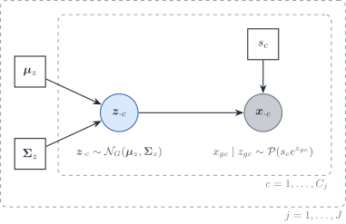
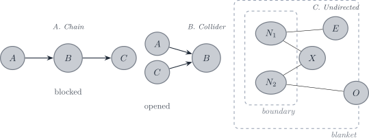

# 3.2 Cell-type covariance for the DeCovarT plug-in

> **Notation used in this vignette**
>
> A symbol absent from these groups is defined in this vignette, with
> one meaning. The full table is the [notation
> article](https://bastienchassagnol.github.io/DeCovarT/articles/notation.md).
>
> | Symbol | Meaning |
> |----|----|
> | **Indices** |  |
> | g = 1, \ldots, G | Gene. |
> | j = 1, \ldots, J; \ell | Cell type, and a second cell type. |
> | i = 1, \ldots, N | Bulk sample. The index is dropped inside a derivation and restored in the model statements. |
> | r = 1, \ldots, R | Reference donor (replicate). |
> | c; C_j | Cell, and the number of reference cells of type j. |
>
> Indices. The scalar R is the number of reference donors. {.table
> .caption-top}
>
> | Symbol | Meaning |
> |----|----|
> | **Reference means** |  |
> | \boldsymbol{x}\_{\cdot j,i} | Purified profile of type j in sample i. |
> | x\_{gc}, \boldsymbol{x}\_{\cdot c} | Raw UMI count of gene g in reference cell c, and that cell’s count vector. |
> | \tilde{\boldsymbol{\mu}}\_{\cdot j} = C_j^{-1} \sum\_{c \in j} \boldsymbol{x}\_{\cdot c}^(a) | Per-cell mean of the raw UMI counts of the C_j reference cells of type j. |
> | S_j = \mathbf{1}^{\top} \tilde{\boldsymbol{\mu}}\_{\cdot j}^(b) | Mean transcriptome size of a type-j cell. |
> | ^(a) A tilde marks a quantity rescaled to a reference unit: per cell, or relative to the reference protocol. This mean is a mean of raw counts. It is not a library-size proportion. |  |
> | ^(b)S_j summarises the raw-count mean. It is not a divisor applied to the counts. \boldsymbol{\theta} is not used for this split. |  |
>
> Purified profiles and per-cell means of raw counts. {.table
> .caption-top}
>
> | Symbol | Meaning |
> |----|----|
> | **Within one reference** |  |
> | \boldsymbol{\mu}\_{\cdot j}, \boldsymbol{\Sigma}\_j^(a) | Mean and G \times G gene–gene covariance of a type-j profile. |
> | \boldsymbol{\Omega}\_j = \boldsymbol{\Sigma}\_j^{-1} | Precision matrix of type j. |
> | \boldsymbol{\Sigma}\_{W,j} | Within-donor cell-to-cell covariance of type j (one single-cell sample). |
> | \boldsymbol{V}\_j | Empirical covariance of type j, from its reference profiles or cells. |
> | \boldsymbol{R}\_j | Empirical correlation matrix of type j. Bold: the scalar R is the number of donors. |
> | \boldsymbol{\Delta}\_j = \operatorname{diag}(\boldsymbol{V}\_j) | Diagonal matrix of the empirical variances of type j. |
> | \lambda^(b) | Penalty of a regularised covariance or precision estimator. |
> | **Across donors or types** |  |
> | \boldsymbol{\Sigma}\_{B,j} | Between-donor covariance of type j (needs R \ge 2 donors). |
> | \boldsymbol{\Gamma}\_g^(c) | J \times J covariance across cell types for gene g. |
> | \boldsymbol{S}\_W(\boldsymbol{v}) = \sum_j v_j \boldsymbol{\Sigma}\_{W,j} | Linear covariance mixture with weights \boldsymbol{v}. |
> | \boldsymbol{S}\_B(\boldsymbol{v}) = \sum_j v_j^2 \boldsymbol{\Sigma}\_{B,j} | Quadratic covariance mixture with weights \boldsymbol{v}. |
> | ^(a)\boldsymbol{\Sigma}\_j couples genes within one cell type. |  |
> | ^(b) A penalty. The size-free expression of a cell is \boldsymbol{\lambda}\_{\cdot c}, in the technical-scale table. |  |
> | ^(c)\boldsymbol{\Gamma}\_g couples cell types within one gene. The opposite orientation from \boldsymbol{\Sigma}\_j. |  |
>
> Gene–gene covariance within a type, and variation across donors or
> types. {.table .caption-top}
>
> | Symbol | Meaning |
> |----|----|
> | **Technical scales** |  |
> | s_c | Size factor of reference cell c. |
> | \boldsymbol{\lambda}\_{\cdot c} | Size-free expression of cell c. |
> | \boldsymbol{z}\_{\cdot c} | Latent log-expression of cell c in the Poisson log-normal model. |
> | a_i | Sample-wide scale between the reference and the bulk library. |
> | c_i = a_i n_i, \phi_i = a_i^2 n_i | Mean scale and variance scale of the single-cell model. |
> | b_g | Capture efficiency of gene g in one protocol. |
> | \tilde{b}\_g = b_g^{\mathrm{bulk}} / b_g^{\mathrm{ref}}^(a) | Gene-wise platform ratio. \tilde{\boldsymbol{B}} = \operatorname{diag}(\tilde{\boldsymbol{b}}). |
> | \boldsymbol{D}\_i^(b) | Diagonal, heteroscedastic bulk measurement noise. |
> | ^(a) A tilde: relative to the reference protocol, not per cell. |  |
> | ^(b) Measurement noise. Not the deviance \mathcal{D}\_g of a count model. |  |
>
> Size factors, capture efficiencies, and measurement noise. {.table
> .caption-top}
>
> | Symbol | Meaning |
> |----|----|
> | **Observation** |  |
> | y\_{gi}, \boldsymbol{y}\_{\cdot i} | Bulk expression on a linear scale. |
> | \tilde{\boldsymbol{y}}\_{\cdot i} = \boldsymbol{y}\_{\cdot i} / n_i^(a) | Bulk expression per cell. |
> | \boldsymbol{T}\_{ji} = \sum\_{c=1}^{m\_{ji}} \boldsymbol{X}\_{jic} | Total expression contributed by type j to sample i. |
> | **Single-cell signatures** |  |
> | \sum_j m_j \boldsymbol{\Sigma}\_j^(b) | Covariance when counts are fixed and cells of a type are independent. |
> | **Purified profiles** |  |
> | \sum_j p_j^2 \boldsymbol{\Sigma}\_j^(c) | Covariance when each type contributes one population profile, as in a FACS or cytometry reference. |
> | ^(a) Per cell, by the number of cells. Not a division of each gene by the library total: that division induces a spurious correlation between genes. |  |
> | ^(b) Single-cell signature paradigm: the reference is the cells. |  |
> | ^(c) Purified-profile paradigm: one profile per type. The likelihood in the package fits this covariance. It is not a preferred reference over the single-cell signatures. |  |
>
> The bulk profile and the two reference paradigms. Neither is a
> gold-standard reference. {.table .caption-top}

> Local symbols, defined once here. \omega\_{gg'} is an entry of
> \boldsymbol{\Omega}\_j; u indexes a gene removed from or added to the
> panel. s^{\mathrm{bio}}\_c and s^{\mathrm{tech}}\_c are the biological
> and technical parts of s_c; \nu, \nu^{\mathrm{bio}},
> \nu^{\mathrm{tech}} their squared coefficients of variation;
> \kappa=\nu^{\mathrm{tech}}/(1+\nu^{\mathrm{tech}}) the share removed
> by the denoised estimator. \boldsymbol{m}\_{\cdot c} is the molecule
> content of cell c, \boldsymbol{\Sigma}^{\lambda}\_j the covariance of
> \boldsymbol{\lambda}\_{\cdot c} and
> \boldsymbol{\Sigma}^{\mathrm{bio}}\_j the denoised within-type
> covariance;
> \boldsymbol{S}^{\mathrm{bio}}(\boldsymbol{p})=\sum_jp_j\boldsymbol{\Sigma}^{\mathrm{bio}}\_j.
> x\_{+c}=\mathbf{1}^{\top}\boldsymbol{x}\_{\cdot c} and
> y\_{+i}=\mathbf{1}^{\top}\boldsymbol{y}\_{\cdot i} are library sizes.
> \boldsymbol{X}\_c is the centred C_j\times G matrix of the type-j
> cells. \operatorname{cl}, \operatorname{tw} and \operatorname{mlt} are
> the clique number, treewidth and maximum-likelihood threshold of a
> graph \mathcal{G} with edge set E; d is its maximum degree. K is the
> number of cross-validation folds; \alpha an FDR level; \gamma the EBIC
> parameter. \circ is the elementwise product and e^{\boldsymbol{A}} an
> elementwise exponential.

## Introduction

This vignette states which covariance DeCovarT needs from a single-cell
reference, and how it is estimated. The target is the within-type
covariance \boldsymbol{\Sigma}\_{W,j} that enters the likelihood, not a
biologically interpretable gene regulatory network. The plug-in is the
linear shrinkage of the empirical covariance
([Sec. 2.1](#sec-cov-shrinkage)). Four alternatives are kept as
**sensitivity analyses** of that choice: three sparse-precision
estimators (graphical lasso, `SILGGM` support with a refit,
`PLNnetwork`) and a denoised version of the shrinkage
([Sec. 1.1](#sec-raw-vs-denoised)). All five are scored by the same
nested cross-validation ([Sec. 4.1](#sec-cov-cv)), and their effect on
the proportions is measured in the misspecification sweep of the
reproducibility book. The application to the Suppinger gastruloid
reference (gene panel, cell counts, solver settings, outputs) is in the
[covariance chapter of the reproducibility
book](https://github.com/bastienchassagnol/DeCovarT_reproducibility/blob/main/docs/03-covariance-estimation.qmd).

> **Note 1: Why a regularised covariance rather than a sparse
> precision**
>
> DeCovarT evaluates a Gaussian likelihood whose covariance is a sum of
> cell-type covariances. With one single-cell specimen, the identified
> object is the within-type cell-to-cell covariance
> \boldsymbol{\Sigma}\_{W,j}, which enters linearly in p\_{ji}
> ([one-replicate
> regime](https://bastienchassagnol.github.io/DeCovarT/articles/02-1-single-cell-generative-optimisation.html#sec-one-replicate)).
> With purified population profiles, \boldsymbol{\Sigma}\_j enters
> through \sum_jp\_{ji}^{2}\boldsymbol{\Sigma}\_j
> ([convolution](https://bastienchassagnol.github.io/DeCovarT/articles/05-1-review-distribution-aware.html#eq-gaussian-convolution)).
> Three arguments favour the covariance as the estimated object. They do
> not carry the same weight.
>
> - **Marginalisation (exact).** If the cells of type j have covariance
>   \boldsymbol{\Sigma}\_j over all genes, the covariance of a panel
>   \mathcal{P} is the sub-matrix
>   (\boldsymbol{\Sigma}\_j)\_{\mathcal{P}\mathcal{P}}, whatever other
>   genes are measured. The precision of the panel is
>   \\(\boldsymbol{\Sigma}\_j)\_{\mathcal{P}\mathcal{P}}\\^{-1}, a Schur
>   complement of \boldsymbol{\Omega}\_j, not the sub-matrix
>   (\boldsymbol{\Omega}\_j)\_{\mathcal{P}\mathcal{P}}. Removing one
>   gene u from the panel changes the remaining entries to
>
>   \omega'\_{gg'}=\omega\_{gg'}-\frac{\omega\_{gu}\\\omega\_{g'u}}{\omega\_{uu}}
>   , \tag{1}
>
>   so a precision entry, and the conditional variance 1/\omega\_{gg},
>   change exactly when both genes are neighbours of u; the covariance
>   entries do not change. A covariance entry is a property of a gene
>   pair; a precision entry is a property of the panel. The consequence
>   for the prior: regulators outside the panel, including genes removed
>   by the feature selection, fill in the panel precision. A few such
>   latent variables make the marginal precision sparse plus low rank
>   rather than sparse ([Chandrasekaran et al.
>   2012](#ref-chandrasekaranLatentVariableGraphical2012)), so a sparse
>   \boldsymbol{\Omega}\_j on a selected panel is a weak assumption.
>
> - **The mixture discards the zeros (generic).** Sums such as
>   \sum_jp\_{ji}\boldsymbol{\Sigma}\_{W,j} or
>   \sum_jp\_{ji}^{2}\boldsymbol{\Sigma}\_j have dense inverses even
>   when every \boldsymbol{\Omega}\_j is sparse, outside special cases
>   such as diagonal \boldsymbol{\Sigma}\_j. The likelihood uses each
>   \boldsymbol{\Sigma}\_j only through the sum, which it then inverts.
>
> - **Variance against bias (depends on the truth).** A sparse
>   \boldsymbol{\Omega}\_j has \|E_j\|+G free parameters instead of
>   G(G+1)/2. That lowers the variance when the truth is sparse in
>   \boldsymbol{\Omega}\_j and adds bias when it is not. The inverse
>   matters for DeCovarT: Stein’s loss
>   ([Proposition 1](#prp-gaussian-logscore)) weighs
>   \boldsymbol{\Sigma}^{-1} as well as \boldsymbol{\Sigma}. The
>   question is which object carries the structural assumption, not
>   whether the inverse is used.
>
> The same choice is standard for Gaussian plug-in classifiers, whose
> discriminant is a likelihood with an estimated covariance. Regularised
> discriminant analysis shrinks each class covariance towards a pooled
> or diagonal target TODO-cite: Friedman 1989, J. Am. Stat. Assoc.
> 84(405):165–175, doi:10.1080/01621459.1989.10478752; not in Zotero. In
> high dimension, the diagonal plug-in (“naive Bayes”) can beat the
> sample-covariance plug-in of Fisher’s linear discriminant TODO-cite:
> Bickel & Levina 2004, Bernoulli 10(6):989–1010,
> doi:10.3150/bj/1106314847; not in Zotero. Warton tunes a
> ridge-regularised correlation matrix by cross-validated normal
> likelihood, the criterion of [Sec. 4.1](#sec-cov-cv) TODO-cite: Warton
> 2008, J. Am. Stat. Assoc. 103(481):340–349,
> doi:10.1198/016214508000000021; not in Zotero. These results support a
> regularised covariance for prediction. None shows that it beats a
> sparse precision when the truth is sparse in \boldsymbol{\Omega}\_j;
> that is why the sparse estimators stay as sensitivity analyses. The
> zeros of \boldsymbol{\Omega}\_j and their recovery
> ([Sec. 1.2](#sec-cov-regimes), layer 3) matter for a network, not for
> the deconvolution. When the proportions are known, `CSNet` estimates
> type-level co-expression from the same convolution
> ([CSNet](https://bastienchassagnol.github.io/DeCovarT/articles/05-1-review-distribution-aware.html#sec-csnet))
> ([Su et al. 2024](#ref-suEstimatingCellTypeSpecificGene2024)).

| Estimator | Role | Data it sees | Tuning parameter | Object exported to DeCovarT | Graph |
|----|----|----|----|----|----|
| Shrinkage, target D ([Sec. 2.1](#sec-cov-shrinkage)) | plug-in | raw per-cell counts | \lambda\in\[0,1\]; closed-form \hat\lambda^{\ast} as start | dense \widehat{\boldsymbol{\Sigma}}\_j, variances kept | none |
| Denoised shrinkage ([Sec. 1.1](#sec-raw-vs-denoised)) | sensitivity | raw counts, moment-corrected | \lambda; \kappa bracketed, not tuned | dense \widehat{\boldsymbol{\Sigma}}^{\mathrm{bio}}\_j | none |
| Graphical lasso, unpenalised diagonal ([Sec. 3.1](#sec-cov-glasso)) | sensitivity | correlation \boldsymbol{R}\_j of the counts | \lambda | \boldsymbol{\Delta}\_j^{1/2}\widehat{\boldsymbol{\Sigma}}\_{R}\boldsymbol{\Delta}\_j^{1/2} | support of \widehat{\boldsymbol{\Omega}}\_j |
| `SILGGM` after the nonparanormal map ([Sec. 3.2](#sec-cov-npn)) | sensitivity | nonparanormal scores | FDR level \alpha | linear-scale refit under the zeros of the support | FDR-controlled support |
| `PLNnetwork` ([Sec. 3.3](#sec-cov-pln)) | sensitivity | raw UMIs, offset \log s_c | \lambda | linear moments of the latent (\boldsymbol{\mu}\_z,\boldsymbol{\Sigma}\_z) ([Eq. 17](#eq-pln-linear)) | support of the latent precision |

Table 1: Five estimators of the within-type covariance. The three sparse
estimators target *direct* interactions (non-zero partial correlations);
the two shrinkage estimators keep direct and indirect associations. Each
has one tuned parameter, chosen by the criterion of
[Sec. 4.1](#sec-cov-cv).

### Which covariance: raw or denoised

The empirical covariance of raw UMI counts mixes biological covariation
with two measurement terms. This section separates them, states which of
them the bulk inherits, and gives one preprocessing step for every
estimator of [Table 1](#tbl-cov-estimators).

#### Measurement model and unknown terms

A reference cell c of type j is counted as ([Poisson
measurement](https://bastienchassagnol.github.io/DeCovarT/articles/05-1-review-distribution-aware.html#eq-poisson-measurement))

x\_{gc}\mid s^{\mathrm{tech}}\_c,\boldsymbol{m}\_{\cdot c}
\sim\mathrm{Poisson}\bigl(s^{\mathrm{tech}}\_c\\b_g\\m\_{gc}\bigr),
\qquad \boldsymbol{m}\_{\cdot
c}=s^{\mathrm{bio}}\_c\\\boldsymbol{\lambda}\_{\cdot c}, \tag{2}

with s^{\mathrm{bio}}\_c, s^{\mathrm{tech}}\_c and
\boldsymbol{\lambda}\_{\cdot c} independent. The unknown terms are:

- s_c=s^{\mathrm{bio}}\_cs^{\mathrm{tech}}\_c, the size factor of cell
  c: a dimensionless, cell-wide factor. s^{\mathrm{bio}}\_c is
  biological (cell volume, cycle phase), s^{\mathrm{tech}}\_c technical
  (capture efficiency, sequencing depth of the droplet).

- \nu=\operatorname{CV}^{2}(s_c), the extrinsic noise, and its two parts
  \nu^{\mathrm{bio}} and \nu^{\mathrm{tech}}.

- \boldsymbol{\lambda}\_{\cdot c}, the size-free expression, with
  covariance \boldsymbol{\Sigma}^{\lambda}\_j within type j. It is the
  mean of the Poisson measurement once s_c and b_g are factored out,
  proportional to the molecule content \boldsymbol{m}\_{\cdot c}
  ([Sarkar and Stephens
  2021](#ref-sarkarSeparatingMeasurementExpression2021); [Fang and
  Pachter 2025](#ref-fangExtrinsicBiologicalStochasticity2025)). It is
  not a transcription rate in the sense of kinetic models of bursting,
  in which the molecule count is itself random given the rates
  TODO-cite: Gorin & Pachter, biophysical models of transcription and
  sequencing (Monod); key not in inst/REFERENCES.bib.

- b_g, the capture efficiency of gene g, with
  \boldsymbol{\mathcal{B}}=\operatorname{diag}(\boldsymbol{b}).

- \tilde{\boldsymbol{\mu}}\_{\cdot j}=\mathbb{E}\[\boldsymbol{x}\_{\cdot
  c}\mid j\] and S_j=\mathbf{1}^{\top}\tilde{\boldsymbol{\mu}}\_{\cdot
  j}, the mean and the mean transcriptome size of a type-j cell, in
  counts.

- \boldsymbol{\Sigma}^{\mathrm{bio}}\_j, the covariance of the captured
  content at unit technical factor, and its mixture
  \boldsymbol{S}^{\mathrm{bio}}(\boldsymbol{p}):

  \boldsymbol{\Sigma}^{\mathrm{bio}}\_j
  =\operatorname{Cov}\bigl(s^{\mathrm{bio}}\_c\boldsymbol{\mathcal{B}}\boldsymbol{\lambda}\_{\cdot
  c}\mid j\bigr)
  =(1+\nu^{\mathrm{bio}})\\\boldsymbol{\mathcal{B}}\boldsymbol{\Sigma}^{\lambda}\_j\boldsymbol{\mathcal{B}}
  +\nu^{\mathrm{bio}}\\\tilde{\boldsymbol{\mu}}\_{\cdot
  j}\tilde{\boldsymbol{\mu}}\_{\cdot j}^{\top}, \qquad
  \boldsymbol{S}^{\mathrm{bio}}(\boldsymbol{p})=\sum_jp_j\boldsymbol{\Sigma}^{\mathrm{bio}}\_j
  . \tag{3}

  It keeps the biological size; it is what the [denoised within-type
  covariance](https://bastienchassagnol.github.io/DeCovarT/articles/05-1-review-distribution-aware.html#eq-denoised-within)
  estimates.

- a_i, c_i=a_in_i and \phi_i=a_i^{2}n_i, the bulk scales: a_i is the
  bulk depth per cell relative to the reference, n_i the number of cells
  behind bulk sample i.

#### Size factors: what they are and how they relate

**Why \mathbb{E}\[s_c\mid j\]=1.** [Eq. 2](#eq-cov-measurement) depends
on the cell factors only through the product
s_c\boldsymbol{\lambda}\_{\cdot c}: for any k\>0, the pair
(ks_c,\boldsymbol{\lambda}\_{\cdot c}/k) gives the same law. The scale
of s_c is not identified, and one constraint per type fixes it, as in
Fang and Pachter (their equations 1–2):
\mathbb{E}\[s^{\mathrm{bio}}\_c\mid
j\]=\mathbb{E}\[s^{\mathrm{tech}}\_c\mid j\]=1. By independence,

\mathbb{E}\[s_c\mid
j\]=\mathbb{E}\[s^{\mathrm{bio}}\_c\]\\\mathbb{E}\[s^{\mathrm{tech}}\_c\]=1,
\qquad \tilde{\boldsymbol{\mu}}\_{\cdot
j}=\boldsymbol{\mathcal{B}}\\\mathbb{E}\[\boldsymbol{\lambda}\_{\cdot
c}\mid j\], \qquad \mathbb{E}\[x\_{+c}\mid s_c,j\]=s_c\\S_j , \tag{4}

so the type-level size goes into the mean, and the size factor is the
library rescaled by it. Its plug-in estimate \hat
s_c=x\_{+c}\big/\bigl(C_j^{-1}\sum\_{c'\in j}x\_{+c'}\bigr) has mean
exactly one over the cells of type j.

**Why 1+\nu=(1+\nu^{\mathrm{bio}})(1+\nu^{\mathrm{tech}}).** With
\mathbb{E}\[s_c\]=1,
\nu=\operatorname{Var}(s_c)/\mathbb{E}\[s_c\]^{2}=\mathbb{E}\[s_c^{2}\]-1,
and the same holds for each factor. Independence of the two factors
gives

1+\nu=\mathbb{E}\bigl\[(s^{\mathrm{bio}}\_c)^{2}\bigr\]\\\mathbb{E}\bigl\[(s^{\mathrm{tech}}\_c)^{2}\bigr\]
=(1+\nu^{\mathrm{bio}})(1+\nu^{\mathrm{tech}}), \qquad
\nu=\nu^{\mathrm{bio}}+\nu^{\mathrm{tech}}+\nu^{\mathrm{bio}}\nu^{\mathrm{tech}}
. \tag{5}

The identity needs s^{\mathrm{bio}}\_c independent of
s^{\mathrm{tech}}\_c. A capture efficiency that grows with cell volume
would break it.

**S_j against s_c.** The two are different objects. S_j is a type-level
mean transcriptome size, in counts; s_c is a within-type, dimensionless
fluctuation around it, and \hat s_c is the library rescaled by \hat S_j.
Both split into a technical and a biological part:

- **Technical level.** If one capture protocol, one chemistry and one
  sequencing run serve every type, the mean technical level
  S^{\mathrm{tech}} is shared, enters c_i, and drops out of the
  proportions. That sharing is an assumption: a type-specific capture
  (lysis, RNA content near saturation) would be confounded with biology.
- **Biological level.** S^{\mathrm{bio}}\_j is not shared: transcriptome
  size depends on the type and on its state ([Lu et al.
  2025](#ref-luTranscriptomeSizeMatters2025); [Fang and Pachter
  2025](#ref-fangExtrinsicBiologicalStochasticity2025)). It is what
  turns cell fractions into transcript fractions ([cell
  size](https://bastienchassagnol.github.io/DeCovarT/articles/02-1-single-cell-generative-optimisation.html#sec-cell-size-covariance),
  [RNA versus cell
  fraction](https://bastienchassagnol.github.io/DeCovarT/articles/02-1-single-cell-generative-optimisation.html#sec-uncoupling)).
- **Without spike-ins**, neither s^{\mathrm{tech}}\_c nor a
  type-specific capture can be separated from the biological size. The
  data identify only the product s_c, and only up to the constraint of
  [Eq. 4](#eq-size-factor-mean).

#### What the raw covariance contains

The law of total covariance applied to [Eq. 2](#eq-cov-measurement)
gives

\boldsymbol{\Sigma}^{\mathrm{raw}}\_j
=\operatorname{Cov}(\boldsymbol{x}\_{\cdot c}\mid j)
=\underbrace{\operatorname{diag}(\tilde{\boldsymbol{\mu}}\_{\cdot
j})}\_{\text{Poisson sampling}}
+\underbrace{(1+\nu^{\mathrm{tech}})\\\boldsymbol{\Sigma}^{\mathrm{bio}}\_j}\_{\text{biology}}
+\underbrace{\nu^{\mathrm{tech}}\\\tilde{\boldsymbol{\mu}}\_{\cdot
j}\tilde{\boldsymbol{\mu}}\_{\cdot j}^{\top}}\_{\text{technical size}} .
\tag{6}

It is the matrix form of [the count
covariance](https://bastienchassagnol.github.io/DeCovarT/articles/05-1-review-distribution-aware.html#eq-count-covariance),
grouped by what the bulk inherits. Solving for
\boldsymbol{\Sigma}^{\mathrm{bio}}\_j with
\kappa=\nu^{\mathrm{tech}}/(1+\nu^{\mathrm{tech}}) gives
\boldsymbol{\Sigma}^{\mathrm{bio}}\_j=\boldsymbol{\Sigma}^{\mathrm{raw}}\_j-\operatorname{diag}(\tilde{\boldsymbol{\mu}}\_{\cdot
j})-\kappa\\\boldsymbol{\Sigma}^{\mathrm{raw}}\_j-\operatorname{diag}(\tilde{\boldsymbol{\mu}}\_{\cdot
j})+\tilde{\boldsymbol{\mu}}\_{\cdot j}\tilde{\boldsymbol{\mu}}\_{\cdot
j}^{\top}\\, whose sample version, with a finite-sample correction, is
[the denoised within-type
covariance](https://bastienchassagnol.github.io/DeCovarT/articles/05-1-review-distribution-aware.html#eq-denoised-within).
The Poisson diagonal also attenuates every correlation of the raw
counts, most for lowly expressed genes
([Sec. 5.1.5](#sec-grn-attenuation)).

#### Which matrix enters the bulk

The bulk is counted once, at its own depth, from the pooled molecules.
On the reference capture scale, with n_i cells drawn with proportions
\boldsymbol{p}\_{\cdot i},

\boldsymbol{y}\_{\cdot i}\mid\\\boldsymbol{m}\_{\cdot c}\\
\sim\mathrm{Poisson}\Bigl(a_i\sum\_{c}\boldsymbol{\mathcal{B}}\boldsymbol{m}\_{\cdot
c}\Bigr) \quad\Longrightarrow\quad
\operatorname{Cov}\boldsymbol{y}\_{\cdot i}
=\phi_i\boldsymbol{S}^{\mathrm{bio}}(\boldsymbol{p}\_{\cdot
i})+c_i\operatorname{diag}(\tilde{\boldsymbol{\mu}}\boldsymbol{p}\_{\cdot
i}). \tag{7}

Keeping each reference-counted molecule with probability a_i\le1
(binomial thinning) gives the same law. A model that counts every cell
at the reference depth and then multiplies the counts by a_i would scale
the Poisson diagonal by \phi_i instead of c_i; no library preparation
does that, and it is not used. Two consequences follow. The sampling
noise of the reference does not enter the bulk; the bulk has its own,
once. And the technical size factor of the reference cells does not
enter either: the bulk has no droplets. In units of \phi_i,

\operatorname{Cov}\boldsymbol{y}\_{\cdot i}
=\phi_i\bigl\\\boldsymbol{S}^{\mathrm{bio}}(\boldsymbol{p}\_{\cdot i})
+a_i^{-1}\operatorname{diag}(\tilde{\boldsymbol{\mu}}\boldsymbol{p}\_{\cdot
i})\bigr\\, \qquad a_i=\phi_i/c_i, \tag{8}

so, with \nu^{\mathrm{tech}}=0, the right plug-in depends on the bulk
depth per cell a_i:

- a_i=1, the bulk counted at the per-cell depth of the reference: the
  raw covariance is exact;
- a_i\>1: the raw covariance over-weights the sampling diagonal by the
  factor a_i; the denoised covariance alone is the limit a_i\to\infty;
- a_i\<1: the raw covariance under-weights the diagonal by the factor
  a_i, and the denoised one drops it;
- in every case the off-diagonal entries are those of
  \phi_i\boldsymbol{S}^{\mathrm{bio}}; the choice moves the gene weights
  and the correlations, not the network. Gene g is dominated by sampling
  noise when
  \tilde\mu_g(\boldsymbol{p})\>a_iS^{\mathrm{bio}}\_{gg}(\boldsymbol{p}).

The plug-in that holds at every depth is the denoised covariance plus
the bulk sampling term
c_i\operatorname{diag}(\tilde{\boldsymbol{\mu}}\boldsymbol{p}\_{\cdot
i}). For UMI-like bulk counts it adds no parameter, since c_i and \phi_i
are already estimated; read counts need a dispersion \omega_i\ge1 in
front of the term, which one sample identifies weakly. The covariance is
then no longer proportional to \phi_i, so the closed form \hat\phi=Q/G
of the [closed-form
scales](https://bastienchassagnol.github.io/DeCovarT/articles/02-1-single-cell-generative-optimisation.html#eq-sc-closed-scales)
is lost and \phi_i is profiled numerically, in one dimension.

**Status.** This variant is not implemented:
[`deconvolute_single_cell()`](https://bastienchassagnol.github.io/DeCovarT/reference/deconvolute_single_cell.md)
uses one matrix, and with a raw \boldsymbol{\Sigma}\_{W,j} it assumes
a_i=1 and \nu^{\mathrm{tech}}=0. The raw plug-in stays the default; the
denoised covariance is the target and enters as a sensitivity arm
([Table 1](#tbl-cov-estimators)).

**Which regime to expect.** Taking expectations of the library sizes in
[Eq. 7](#eq-bulk-sampling),

a_i\approx\frac{y\_{+i}}{n_i\sum_jp\_{ji}S_j}, \tag{9}

the bulk counts per cell over the reference counts per cell. A bulk
library is deeper in total than one droplet, but it spreads that depth
over every cell of the sample, so a_i\<1 is the usual case. For
illustration (our numbers, not a measurement), a bulk library of
2\times10^{7} counts from 10^{5} cells against a reference with
5\times10^{3} UMIs per cell gives a_i=0.04; if those counts behave as
UMIs, a gene is then dominated by bulk sampling noise unless its
biological Fano factor S^{\mathrm{bio}}\_{gg}/\tilde\mu_g exceeds 25.
Bulk counts are reads, not molecules: amplification makes them
overdispersed (\omega_i\ge1), which lowers the effective depth to
a_i/\omega_i. The Suppinger value needs n_i, the number of cells per
bulk sample; it is computed in the [reproducibility
book](https://github.com/bastienchassagnol/DeCovarT_reproducibility/blob/main/docs/03-covariance-estimation.qmd).
The identities of this subsection are checked in the SymPy ledger of the
CardamomOT comparison note (`answer-cardamomOT/verification/`).

#### Library normalisation without spike-ins

The Suppinger reference has no spike-ins. Two treatments of the size
factor are possible:

| Option | Exported mean \widehat{\boldsymbol{\mu}}\_{\cdot j} | Exported covariance \widehat{\boldsymbol{\Sigma}}\_{j} |
|----|----|----|
| \(a\) Raw per-cell counts, at most one global constant | unbiased for \tilde{\boldsymbol{\mu}}\_{\cdot j} ([Eq. 4](#eq-size-factor-mean)); keeps S_j, so \boldsymbol{p}\_{\cdot i} stays a cell proportion | keeps the biological size (wanted); keeps the Poisson diagonal and the technical rank-one term of [Eq. 6](#eq-raw-decomposition) (unwanted; the latter inflates every correlation) |
| \(b\) Each cell divided by its total library | removes S_j: signatures become transcript fractions, and the fit returns q\_{ji}\propto p\_{ji}S_j | removes the technical size (wanted) and the biological size (unwanted); a panel total adds closure correlations, a full-library total a smaller amount |

Table 2: Raw counts against per-cell library normalisation, without
spike-ins.

**Decision.** No per-cell normalisation for the exported moments. The
mean is computed on raw per-cell counts, the default signature of
[normalisation that preserves the linear
mixture](https://bastienchassagnol.github.io/DeCovarT/articles/02-1-single-cell-generative-optimisation.html#sec-norm-linear).
The covariance is computed on the same counts, then corrected by the
moment estimator with the share \kappa bracketed:

- \kappa=0 treats all size variation as biological and removes only the
  Poisson diagonal;
- \kappa=\hat\nu/(1+\hat\nu), with \hat\nu the total extrinsic noise
  ([Fang–Pachter
  estimate](https://bastienchassagnol.github.io/DeCovarT/articles/05-1-review-distribution-aware.html#sec-extrinsic-noise),
  the mode of the normalised covariances over gene pairs), treats it all
  as technical. It returns
  \boldsymbol{\mathcal{B}}\boldsymbol{\Sigma}^{\lambda}\_j\boldsymbol{\mathcal{B}},
  approximately the covariance that option (b) estimates.

Spike-ins would reduce the bracket to one value. Ambient RNA from empty
droplets is the only possible proxy here TODO: check whether GSE229513
provides raw droplet matrices. Size factors remain the right tool inside
the gene-wise tests of the feature selection, where they are offsets for
a nuisance ([feature
selection](https://bastienchassagnol.github.io/DeCovarT/articles/03-1-feature-selection.md));
that use is different.

#### One preprocessing step for every estimator

The denoising is a moment correction of \boldsymbol{V}\_j, applied
before any regularisation:

1.  Compute \boldsymbol{V}\_j and \bar{\boldsymbol{x}}\_j on the raw
    per-cell counts of the C_j cells.
2.  Apply [the denoised within-type
    covariance](https://bastienchassagnol.github.io/DeCovarT/articles/05-1-review-distribution-aware.html#eq-denoised-within)
    at the two ends of the bracket, \kappa=0 and
    \kappa=\hat\nu/(1+\hat\nu).
3.  Project on the positive semi-definite cone. The corrected matrix is
    indefinite in general: subtracting
    \operatorname{diag}(\bar{\boldsymbol{x}}\_j) gives negative
    variances to genes whose variance is close to their mean, and with
    C_j\le G the null directions of \boldsymbol{V}\_j become negative
    eigenvalues. Clipping the eigenvalues at zero is the nearest
    positive semi-definite matrix in Frobenius norm. The corrected
    covariances of errors-in-variables regression meet the same problem:
    CoCoLasso projects on the cone, Loh and Wainwright regularise the
    indefinite matrix directly TODO-cite: Datta & Zou 2017, Ann. Stat.
    45(6):2482–2511, doi:10.1214/16-AOS1527; Loh & Wainwright 2012, Ann.
    Stat. 40(3):1637–1664, doi:10.1214/12-AOS1018; not in Zotero.
4.  Regularise as in [Table 1](#tbl-cov-estimators):
    - shrinkage: target D on the denoised variances;
    - graphical lasso: the correlation of the projected matrix;
    - `SILGGM`: ranks cannot be denoised, so the support still comes
      from the nonparanormal scores; the refit under that support uses
      the projected matrix;
    - `PLNnetwork`: no correction (below).

A gene whose denoised variance is zero contributes only through the bulk
sampling term. \boldsymbol{\Sigma}^{\mathrm{bio}}\_j needs to be
positive semi-definite, not definite, once that term is in the bulk
covariance; until it is implemented, a small eigenvalue floor keeps the
plug-in invertible. The held-out score of [Sec. 4.1](#sec-cov-cv)
compares a denoised fit with the others only after the measurement terms
of [Eq. 6](#eq-raw-decomposition) are added back, because the held-out
cells are raw counts.

**`PLNnetwork` needs no moment correction, but needs a choice at
export.** Its latent covariance \boldsymbol{\Sigma}\_z excludes the
Poisson noise by construction. Its offset, the full library s_c, removes
all cell-level size variation, biological size included, as scVI’s
library factor does
([scVI](https://bastienchassagnol.github.io/DeCovarT/articles/05-1-review-distribution-aware.html#sec-batch-methods)).
The linear-moment map decides what is put back.
[Eq. 18](#eq-pln-linear-avg) without its Poisson term \bar
s\operatorname{diag}(\boldsymbol{m}) is the \kappa=0 end; holding s_c at
\bar s is the other end. The correspondence is approximate, because the
offset is the observed library, which carries Poisson noise and the
variation of \mathbf{1}^{\top}\boldsymbol{\lambda}\_{\cdot c}.

### Sample-size regimes

Three requirements are often conflated. They are ordered here by the
number of cells they need; the mean is estimated throughout, and
\boldsymbol{X}\_c is the centred C_j\times G matrix of the type-j cells.

#### Layer 1: a regularised estimate exists (C_j\ge2)

DeCovarT’s plug-in needs an estimate that is finite, positive definite
and unique. It does not need the zeros of \boldsymbol{\Omega}\_j. The
penalty, the constraint or the structure, not the data, makes such an
estimate exist when C_j\le G ([Table 3](#tbl-cov-existence)).

| Estimator | Formula | Unique positive-definite estimate when |
|----|----|----|
| Unconstrained MLE | \boldsymbol{V}\_j=\boldsymbol{X}\_c^{\top}\boldsymbol{X}\_c/C_j | C_j\ge G+1 and \operatorname{rank}\boldsymbol{X}\_c=G |
| Linear shrinkage | (1-\lambda)\boldsymbol{V}\_j+\lambda\boldsymbol{T}, \lambda\in(0,1\]; Ledoit–Wolf \boldsymbol{T}=(\operatorname{tr}\boldsymbol{V}\_j/G)\mathbf{I}, Schäfer–Strimmer \boldsymbol{T}=\boldsymbol{\Delta}\_j | C_j\ge2, \boldsymbol{T}\succ0 and \lambda\>0 |
| Condition-number constraint | maximum likelihood subject to \operatorname{cond}(\boldsymbol{\Sigma})\le a bound; the eigenvalues of \boldsymbol{V}\_j are clipped to an interval with that ratio | C_j\ge2, \boldsymbol{V}\_j\neq\boldsymbol{0} (our reading for an estimated mean) |
| Structured \boldsymbol{\Sigma} | factor plus diagonal, banded, or linear in known matrices | \operatorname{rank}\boldsymbol{V}\_j=G in the result we read; below that, per structure |
| Graphical lasso | [Eq. 13](#eq-glasso) | C_j\ge2, V\_{gg}\>0, \lambda\>0, unpenalised diagonal |

Table 3: When each covariance estimator of type j is well defined.

- **Shrinkage** ([Schäfer and Strimmer
  2005](#ref-sch%C3%A4ferShrinkageApproachLargescale2005)) TODO-cite:
  Ledoit & Wolf 2004, J. Multivar. Anal. 88(2):365–411,
  doi:10.1016/S0047-259X(03)00096-4: the smallest eigenvalue of
  (1-\lambda)\boldsymbol{V}\_j+\lambda\boldsymbol{T} is at least \lambda
  times that of \boldsymbol{T}, whatever the rank of \boldsymbol{V}\_j.
  The diagonal target needs every V\_{gg}\>0, hence the presence gate
  ([presence](https://bastienchassagnol.github.io/DeCovarT/articles/03-1-feature-selection.html#sec-fs-presence));
  the scaled identity needs only \boldsymbol{V}\_j\neq\boldsymbol{0}.
- **Condition number**: Won and co-authors keep the eigenvectors of
  \boldsymbol{V}\_j, clip its eigenvalues in closed form, and choose the
  bound by predictive likelihood; the estimate is well conditioned “even
  when n\<p” (p. 5). Their model has a known zero mean. TODO-cite: Won,
  Lim, Kim & Rajaratnam 2013, J. R. Stat. Soc. B 75(3):427–450,
  doi:10.1111/j.1467-9868.2012.01049.x; key in
  answer-cardamomOT/references.bib only
- **Structure on \boldsymbol{\Sigma}**: for linear covariance models the
  likelihood is strictly concave on
  \\\boldsymbol{0}\prec\boldsymbol{\Sigma}\prec2\boldsymbol{V}\_j\\, but
  existence is shown for a full-rank \boldsymbol{V}\_j, so it does not
  relax C_j\ge G+1; a factor model can have an unbounded likelihood when
  a specific variance tends to zero (our reading). TODO-cite: Zwiernik,
  Uhler & Richards 2017, J. R. Stat. Soc. B 79(4):1269–1292,
  doi:10.1111/rssb.12217; key in answer-cardamomOT/references.bib only
- **Graphical lasso**: with \lambda\>0, positive V\_{gg} and an
  unpenalised diagonal, it has a unique positive definite solution for
  any C_j\ge2, even when C_j\<G ([Carter
  2025](#ref-carterExistencePenalisedLikelihood2025)).

None of these estimators needs a sparse truth. Layer 1 is all the
plug-in needs.

#### Layer 2: the unconstrained maximum-likelihood estimate exists (C_j\ge G+1)

The rank of \boldsymbol{V}\_j is that of \boldsymbol{X}\_c, at most
\min(C_j-1,G), with equality almost surely for Gaussian cells, since
C_j\boldsymbol{V}\_j\sim W_G(C_j-1,\boldsymbol{\Sigma}\_{W,j})
TODO-cite: Muirhead 1982, Aspects of Multivariate Statistical Theory,
ch. 3; key in answer-cardamomOT/references.bib only. \boldsymbol{V}\_j
is positive definite if and only if
\operatorname{rank}\boldsymbol{X}\_c=G: this needs C_j\ge G+1 and no
exact linear relation between genes. With C_j\le G the centred profiles
always satisfy one; a gene constant within the type is the simplest,
which the presence gate removes, but the gate is necessary, not
sufficient. When \boldsymbol{V}\_j is singular, the Gaussian
log-likelihood is unbounded above along its null directions and the
maximum-likelihood estimate does not exist.

**The precision has the same existence threshold, and a worse
accuracy.** \widehat{\boldsymbol{\Omega}}\_j=\boldsymbol{V}\_j^{-1}
exists exactly when \boldsymbol{V}\_j does. Its mean, from the inverse
Wishart law, is

\mathbb{E}\bigl\[\boldsymbol{V}\_j^{-1}\bigr\]
=\frac{C_j}{C_j-G-2}\\\boldsymbol{\Omega}\_j, \qquad C_j\ge G+3,
\tag{10}

so with C_j=2G the precision is inflated by a factor close to two. The
spectrum explains why: when \boldsymbol{\Sigma}\_{W,j}=\mathbf{I} and
G/C_j\to\eta\<1, the eigenvalues of \boldsymbol{V}\_j spread over
\[(1-\sqrt{\eta})^{2},(1+\sqrt{\eta})^{2}\] (Marchenko–Pastur), and the
smallest ones drive \boldsymbol{V}\_j^{-1}. TODO-cite: Marchenko &
Pastur 1967, Math. USSR Sb. 1(4):457–483,
doi:10.1070/SM1967v001n04ABEH001994 A consistent estimate of a dense
\boldsymbol{\Omega}\_j in operator norm needs G/C_j\to0, that is C_j\gg
G, not only C_j\>G.

**Between layers 1 and 2: the MLE on a fixed graph.** Dempster’s refit
under the zeros of a graph \mathcal{G} with edge set E,

\widehat{\boldsymbol{\Omega}}\_{E}
=\arg\max\_{\boldsymbol{\Omega}\succ0}
\log\det\boldsymbol{\Omega}-\operatorname{tr}(\boldsymbol{V}\_j\boldsymbol{\Omega})
\quad\text{s.t.}\quad \omega\_{gg'}=0\\ \\ \forall\\(g,g')\notin E,
\tag{11}

exists for almost every sample once
C_j-1\ge\operatorname{mlt}(\mathcal{G}), the maximum-likelihood
threshold of the graph (with an estimated mean; the published statements
assume a known zero mean). On that graph:

- a *clique* is a set of genes pairwise joined by edges, and
  \operatorname{cl}(\mathcal{G}) the size of the largest;
- a graph is *chordal* if every cycle through four or more genes has a
  chord; \operatorname{tw}(\mathcal{G})+1 is the smallest clique number
  of a chordal graph containing \mathcal{G};
- \operatorname{cl}(\mathcal{G})\le\operatorname{mlt}(\mathcal{G})\le\operatorname{tw}(\mathcal{G})+1\le
  G, with equality on the left for chordal graphs, and the smallest k
  with an empty k-core also bounds \operatorname{mlt} from above, so
  sparse graphs have small thresholds TODO-cite: Uhler 2012, Ann. Stat.
  40(1):238–261, doi:10.1214/11-AOS957; Gross & Sullivant 2018,
  Bernoulli 24(1):386–407, doi:10.3150/16-BEJ881; Bernstein & Outlaw
  2023, arXiv:2312.03145; keys in answer-cardamomOT/references.bib only.

Bernstein and Outlaw simulate graphs selected by the graphical lasso
from independent Gaussian data (G\le9): the probability that the
selected graph has \operatorname{mlt}\le C_j rises with \lambda and with
C_j; with one observation the graphical lasso never returned the empty
graph, the only graph whose estimate then exists (pp. 4–5). This
intermediate threshold governs the refit of `SILGGM`
([Sec. 3.2](#sec-cov-npn)).

#### Layer 3: the support is recovered

Support recovery by the graphical lasso needs C_j\gtrsim d^{2}\log G, an
irrepresentability condition, bounded eigenvalues and a minimum
\|\omega\_{gg'}\| TODO-cite: Ravikumar, Wainwright, Raskutti & Yu 2011,
Electron. J. Stat. 5:935–980, doi:10.1214/11-EJS631. Neighbourhood
selection needs d\log G ([Chiquet 2015,
41](#ref-chiquetContributionsSparseMethods2015)), under its own
neighbourhood stability condition TODO-cite: Meinshausen & Bühlmann
2006, Ann. Stat. 34(3):1436–1462, doi:10.1214/009053606000000281. These
are orders without constants. With G=1{,}417 and d=10, d^{2}\log
G\approx726 and d\log G\approx73 (natural logarithm); hubs raise d. For
a sparse graph, d^{2}\log G\<G and the threshold lies between layers 1
and 2: far above two cells, below the G+1 that the unconstrained
estimate needs. For a dense graph, d is of order G and the threshold
exceeds layer 2. On models derived from gene expression the
irrepresentability conditions never held ([Heinävaara et al.
2016](#ref-hein%C3%A4vaaraInconsistency%E2%84%931penalisedSparse2016)),
and they involve the unknown \boldsymbol{\Sigma}\_j: “we can never
verify them on real data” ([Chiquet 2015,
77](#ref-chiquetContributionsSparseMethods2015)).

**Consequence for DeCovarT.** The plug-in needs layer 1 only. The refit
of `SILGGM` needs the intermediate threshold of layer 2. Any biological
reading of the zeros needs layer 3, which is out of scope here; it can
be probed by simulating precisions at the observed C_j with
[`simulate_hierarchical_grn_moments()`](https://bastienchassagnol.github.io/DeCovarT/reference/simulate_hierarchical_grn_moments.md)
and measuring recovery. The reproducibility book tabulates the three
thresholds for the eleven Suppinger units.

## Covariance estimator

### Schäfer and Strimmer’s linear shrinkage

Schäfer and Strimmer shrink the sample covariance towards a target
\boldsymbol{T},
\widehat{\boldsymbol{\Sigma}}=\lambda\boldsymbol{T}+(1-\lambda)\boldsymbol{V}\_j
([Schäfer and Strimmer
2005](#ref-sch%C3%A4ferShrinkageApproachLargescale2005), eq. 3). Their
target D (“diagonal, unequal variance”) keeps the variances and shrinks
the correlations towards zero (Table 1, eq. 10):

\hat\Sigma\_{gg}=V\_{gg}, \qquad
\hat\Sigma\_{gg'}=(1-\lambda)\\R\_{j,gg'}\sqrt{V\_{gg}V\_{g'g'}}, \qquad
\hat\lambda^{\ast} =\frac{\sum\_{g\neq
g'}\widehat{\operatorname{Var}}(R\_{j,gg'})} {\sum\_{g\neq
g'}R\_{j,gg'}^{2}}, \tag{12}

with \hat\lambda^{\ast} truncated to \[0,1\]. The closed form minimises
the Frobenius risk (the Ledoit–Wolf lemma). The estimate is positive
definite for any C_j and G once every V\_{gg}\>0, invariant to the scale
of each gene, and costs about two sample covariances. Its precision is
dense; partial correlations and a local-FDR graph can be read from it if
wanted (eqs. 11–15).

The Frobenius risk is not the Gaussian likelihood that DeCovarT
evaluates. \hat\lambda^{\ast} is therefore only the starting point of
the cross-validated search of [Sec. 4.1](#sec-cov-cv). In
`corpcor::cov.shrink()`, `lambda.var = 0` reproduces target D; the
default also shrinks the variances towards their median. The plug-in
uses raw per-cell counts ([Sec. 1.1.5](#sec-cov-normalisation)); the
denoised arm applies the same target to the projected denoised matrix
([Sec. 1.1.6](#sec-cov-preprocessing)).

## Sparse precision estimators: sensitivity analyses

The three estimators below test the plug-in against the assumption that
\boldsymbol{\Omega}\_j is sparse. Each exports a covariance on the
linear scale, so all are scored by the same criterion
([Sec. 4.1](#sec-cov-cv)).

### Graphical lasso with an unpenalised diagonal

On the correlation \boldsymbol{R}\_j, with
\boldsymbol{\Delta}\_j=\operatorname{diag}(\boldsymbol{V}\_j),

\widehat{\boldsymbol{\Omega}}\_{R}
=\arg\min\_{\boldsymbol{\Omega}\succ0}
\Bigl\[-\log\det\boldsymbol{\Omega}
+\operatorname{tr}(\boldsymbol{R}\_j\boldsymbol{\Omega})
+\lambda\sum\_{g\neq g'}\|\omega\_{gg'}\|\Bigr\], \qquad
\widehat{\boldsymbol{\Omega}}\_j=\boldsymbol{\Delta}\_j^{-1/2}\widehat{\boldsymbol{\Omega}}\_{R}\boldsymbol{\Delta}\_j^{-1/2}
\tag{13}

([Friedman et al. 2008](#ref-friedmanSparseInverseCovariance2008);
[Mazumder and Hastie 2011](#ref-mazumderGraphicalLassoNew2011)). Working
on \boldsymbol{R}\_j puts every gene on one scale for one \lambda;
rescaling leaves the zeros and the partial correlations unchanged. With
the diagonal unpenalised, the fitted covariance
\widehat{\boldsymbol{\Sigma}}\_{R}=\widehat{\boldsymbol{\Omega}}\_{R}^{-1}
has unit diagonal, so the exported
\widehat{\boldsymbol{\Sigma}}\_j=\boldsymbol{\Delta}\_j^{1/2}\widehat{\boldsymbol{\Sigma}}\_{R}\boldsymbol{\Delta}\_j^{1/2}
keeps the sample variances exactly. On the selected edges,
\hat\Sigma\_{R,gg'}=R\_{j,gg'}+\lambda\operatorname{sign}(\hat\omega\_{gg'})
in the sign convention of [Eq. 13](#eq-glasso); off them,
\|\hat\Sigma\_{R,gg'}-R\_{j,gg'}\|\le\lambda.

**Why `glasso` rather than `huge`:** `huge.glasso()` always penalises
the diagonal, which inflates every variance by \lambda
([Sec. 5.1](#sec-cov-diagonal)), whereas
`glasso::glasso(penalize.diagonal = FALSE)` leaves it free ([Zhao et al.
2012](#ref-zhaoHugePackageHighdimensional)). `glasso` 1.11 penalises the
diagonal by default, so the argument must be set.

### `SILGGM` after the nonparanormal map

`SILGGM` tests the entries of a Gaussian precision with a global FDR
guarantee ([Zhang et al. 2018](#ref-zhangSILGGMExtensivePackage2018)).
Its input must be close to Gaussian, so the counts are first mapped to
nonparanormal scores.

**The map.** A nonparanormal vector has monotone f_g with
f_g(x_g)\sim\mathcal{N} jointly ([Liu et al.
2009](#ref-liuNonparanormalSemiparametricEstimation2009)). By Sklar’s
theorem (appendix, [Sec. 7](#sec-cov-perspectives)) the latent Gaussian
copula carries the graph; the margins carry the scale. With r\_{cg} the
rank of x\_{gc} among the C_j cells, two regularisations keep \Phi^{-1}
finite:

\begin{aligned} \text{shrinkage:}&\quad \tilde
z\_{gc}=\Phi^{-1}\\\Bigl(\frac{r\_{cg}}{C_j+1}\Bigr),\\
\text{truncation:}&\quad \tilde
z\_{gc}=\Phi^{-1}\\\Bigl\[\min\bigl\\1-\delta\_{C_j},\max(\delta\_{C_j},r\_{cg}/C_j)\bigr\\\Bigr\],
\qquad \delta\_{n}=\frac{1}{4n^{1/4}\sqrt{\pi\log n}} . \end{aligned}
\tag{14}

Shrinkage is preferred. It moves each probability by at most 1/(C_j+1)
and keeps every rank distinct. Truncation gives all ranks beyond
\delta\_{C_j} the same score; \delta\_{C_j} is of order C_j^{-1/4},
fixed by the sample size rather than by the data, so it clips exactly
the heavy upper tails that single-cell profiles have. Neither map helps
with ties: all the zeros of a sparse gene share one score, so a gene
detected in few cells carries few distinct values
([Sec. 5.1](#sec-cov-diagonal), cause (ii)).

**De-sparsified edges and the FDR support.** The graphical-lasso
estimate \widehat{\boldsymbol{\Omega}} of the scores is biased by the
\ell_1 term: its KKT condition reads
\boldsymbol{R}\_j^{\mathrm{npn}}-\widehat{\boldsymbol{\Omega}}^{-1}+\lambda\widehat{\boldsymbol{Z}}=\boldsymbol{0},
with \boldsymbol{R}\_j^{\mathrm{npn}} the correlation of the scores and
\widehat{\boldsymbol{Z}} a subgradient of the \ell_1 norm. One Newton
step on the unpenalised score removes that bias,

\check{\boldsymbol{\Omega}}
=2\widehat{\boldsymbol{\Omega}}-\widehat{\boldsymbol{\Omega}}\boldsymbol{R}\_j^{\mathrm{npn}}\widehat{\boldsymbol{\Omega}}
=\widehat{\boldsymbol{\Omega}}+\lambda\widehat{\boldsymbol{\Omega}}\widehat{\boldsymbol{Z}}\widehat{\boldsymbol{\Omega}},
\tag{15}

and \sqrt{C_j}(\check\omega\_{gg'}-\omega\_{gg'}) is asymptotically
\mathcal{N}(0,\omega\_{gg}\omega\_{g'g'}+\omega\_{gg'}^{2}) under
sparsity and rate conditions ([Jankova and Geer
2015](#ref-jankovaConfidenceIntervalsHighdimensional2015)). `SILGGM`
(`D-S_GL`, `global = TRUE`) thresholds the resulting z-statistics by the
global FDR rule of Liu ([2013](#ref-liuGaussianGraphicalModel2013)).
\check{\boldsymbol{\Omega}} is dense and is not exported. Its role is
the support.

**What DeCovarT receives.** The covariance on the linear scale is refit
under the zeros of the support ([Eq. 11](#eq-hard-cov-selection)), on
\boldsymbol{V}\_j or on the projected denoised matrix
([Sec. 1.1.6](#sec-cov-preprocessing)). Two caveats follow. The refit
exists only for C_j-1\ge\operatorname{mlt} of the support
([Sec. 1.2](#sec-cov-regimes), layer 2); below it a penalty is needed
again and the arm loses its advantage over [Sec. 3.1](#sec-cov-glasso).
And a zero partial correlation of the latent copula need not be a zero
partial correlation of the linear counts, so imposing the support on the
linear scale is an approximation. The held-out score of
[Sec. 4.1](#sec-cov-cv) measures what that approximation costs. The
tuning parameter is the FDR level \alpha.

### Poisson–lognormal network

`PLNnetwork` separates the Poisson sampling layer from the latent
covariance ([Chiquet et al.
2018](#ref-chiquetVariationalInferenceSparse2018),
[2021](#ref-chiquetPoissonLognormalModelVersatile2021))
([Figure 1](#fig-grn-pln)):

\boldsymbol{z}\_{\cdot
c}\sim\mathcal{N}\_G(\boldsymbol{\mu}\_z,\boldsymbol{\Sigma}\_z), \qquad
x\_{gc}\mid\boldsymbol{z}\_{\cdot
c}\sim\mathcal{P}\bigl(s_c\\e^{z\_{gc}}\bigr), \tag{16}

with an \ell_1 penalty on the off-diagonal entries of
\boldsymbol{\Omega}\_z=\boldsymbol{\Sigma}\_z^{-1} (diagonal
unpenalised). The offset \log s_c is the library size of cell c over all
genes. A sum over the panel would depend on the panel genes and absorb
part of the type signal. The offset fixes the coefficient of \log s_c at
one, so \boldsymbol{z}\_{\cdot c} describes expression per unit of
sequencing exposure. One model is fitted per type (and time); a single
model with type dummies would share one \boldsymbol{\Sigma}\_z across
types.

The likelihood integrates \boldsymbol{z}\_{\cdot c} and has no closed
form. Variational EM maximises the evidence lower bound, \log
p(\boldsymbol{x})-\operatorname{KL}\\q\\\\\\p(\boldsymbol{z}\mid\boldsymbol{x})\\,
over a Gaussian family q; the KL gap is zero only if q is the true
posterior. The closed-form updates of q replace a Monte Carlo E-step,
which is what makes the fit practical at single-cell sizes ([Chiquet et
al. 2018](#ref-chiquetVariationalInferenceSparse2018)).

**Comparison on the linear scale.** The latent covariance is not
\boldsymbol{\Sigma}\_{W,j}. With
\boldsymbol{m}=\exp\\\boldsymbol{\mu}\_z+\tfrac12\operatorname{diag}(\boldsymbol{\Sigma}\_z)\\
(elementwise), the log-normal and Poisson moments give, for one cell,

\mathbb{E}(\boldsymbol{x}\_{\cdot c}\mid s_c)=s_c\boldsymbol{m}, \qquad
\operatorname{Cov}(\boldsymbol{x}\_{\cdot c}\mid s_c)
=s_c\operatorname{diag}(\boldsymbol{m})
+s_c^{2}\\(\boldsymbol{m}\boldsymbol{m}^{\top})\circ\bigl(e^{\boldsymbol{\Sigma}\_z}-\mathbf{1}\mathbf{1}^{\top}\bigr),
\tag{17}

and, averaged over the size factors of the scored cells, with \bar s and
\overline{s^{2}} their first two moments,

\mathbb{E}\boldsymbol{x}=\bar s\\\boldsymbol{m}, \qquad
\operatorname{Cov}\boldsymbol{x} =\bar
s\operatorname{diag}(\boldsymbol{m})
+(\boldsymbol{m}\boldsymbol{m}^{\top})\circ\bigl(\overline{s^{2}}\\e^{\boldsymbol{\Sigma}\_z}-\bar
s^{2}\\\mathbf{1}\mathbf{1}^{\top}\bigr). \tag{18}

The variance of s_c adds the rank-one term
\operatorname{Var}(s)\\\boldsymbol{m}\boldsymbol{m}^{\top}: depth
variation correlates every pair of genes. Which part of it, and whether
the Poisson term, is exported is the bracket of
[Sec. 1.1.6](#sec-cov-preprocessing). These moments are what the PLN arm
exports and what [Sec. 4.1](#sec-cov-cv) scores; the scale must match
the one used for the mean signature.



Figure 1: Poisson–lognormal model for one cell type. The latent
log-expression \boldsymbol{z}\_{\cdot c} carries the covariance
\boldsymbol{\Sigma}\_{z} and its precision; the counts add independent
Poisson noise given \boldsymbol{z}\_{\cdot c} and the size factor s_c.
Covariances between genes come only from \boldsymbol{z}\_{\cdot c} (and
from the spread of s_c); the Poisson term adds to the diagonal only.

## Hyper-parameter tuning

### Cross-validation of the Gaussian log-score

Each estimator of [Table 1](#tbl-cov-estimators) has one tuned
parameter: \lambda for both shrinkages (searched around
\hat\lambda^{\ast}), \lambda for the graphical lasso, \alpha for
`SILGGM`, \lambda for `PLNnetwork`. All five are tuned by the same
score.

**Score.** Split the C_j cells of type j into K folds. Fit
(\widehat{\boldsymbol{\mu}}^{(-k)},\widehat{\boldsymbol{\Sigma}}^{(-k)})
on the other folds, exported on the linear scale, and score the C\_{j,k}
held-out cells by their mean Gaussian log-density,

\ell^{(k)} =-\frac12\Bigl\[\log\det\widehat{\boldsymbol{\Sigma}}^{(-k)}
+\operatorname{tr}\bigl\\(\widehat{\boldsymbol{\Sigma}}^{(-k)})^{-1}\boldsymbol{V}\_{j,k}\bigr\\
+G\log2\pi\Bigr\], \tag{19}

with \boldsymbol{V}\_{j,k}=C\_{j,k}^{-1}\sum\_{c\in
k}(\boldsymbol{x}\_{\cdot
c}-\widehat{\boldsymbol{\mu}}^{(-k)})(\boldsymbol{x}\_{\cdot
c}-\widehat{\boldsymbol{\mu}}^{(-k)})^{\top}. The tuning value maximises
K^{-1}\sum_k\ell^{(k)} (or the one standard-error rule). Minus the
cross-validated score estimates the Kullback–Leibler risk of the fitted
law up to a constant ([Commenges and Jacqmin-Gadda 2015, sect.
2.4.2](#ref-commengesDynamicalBiostatisticalModels2015)). It applies to
maximum-likelihood, penalised and shrinkage fits alike, whereas AIC and
BIC are justified for the maximum-likelihood estimate. The folds split
cells of one specimen. The score therefore measures prediction of new
cells of that specimen, which is the population of
\boldsymbol{\Sigma}\_{W,j}, and says nothing about new specimens
([Zimmerman et al.
2021](#ref-zimmermanPracticalSolutionPseudoreplication2021)).

**Scoring a denoised fit.** The held-out cells are raw counts, so a
denoised fit is scored after the measurement terms of
[Eq. 6](#eq-raw-decomposition) are added back:
\widehat{\boldsymbol{\Sigma}}^{\mathrm{bio}}\_j+\operatorname{diag}(\widehat{\boldsymbol{\mu}}\_{\cdot
j})+\frac{\kappa}{1-\kappa}\bigl(\widehat{\boldsymbol{\Sigma}}^{\mathrm{bio}}\_j+\widehat{\boldsymbol{\mu}}\_{\cdot
j}\widehat{\boldsymbol{\mu}}\_{\cdot j}^{\top}\bigr). The comparison
then measures only how the biological part is regularised.
Cross-validation cannot choose \kappa, because every \kappa reconstructs
the same raw moments up to regularisation; \kappa stays a bracket.

> **Proposition 1 (The Gaussian log-score is proper for the mean and the
> covariance)**
>
> For a test cell with mean \boldsymbol{\mu}^{\ast} and covariance
> \boldsymbol{\Sigma}^{\ast}, whatever its law,
>
> \mathbb{E}\bigl\\-\log\phi_G(\boldsymbol{x};\boldsymbol{\mu},\boldsymbol{\Sigma})\bigr\\
> =\tfrac12\bigl\\\log\det\boldsymbol{\Sigma}
> +\operatorname{tr}(\boldsymbol{\Sigma}^{-1}\boldsymbol{\Sigma}^{\ast})
> +(\boldsymbol{\mu}-\boldsymbol{\mu}^{\ast})^{\top}\boldsymbol{\Sigma}^{-1}(\boldsymbol{\mu}-\boldsymbol{\mu}^{\ast})
> +G\log2\pi\bigr\\. \tag{20}
>
> It is minimised over (\boldsymbol{\mu},\boldsymbol{\Sigma}), uniquely,
> at (\boldsymbol{\mu}^{\ast},\boldsymbol{\Sigma}^{\ast}).

*Proof*. Only the first two moments of \boldsymbol{x} enter, because the
log-density is quadratic in \boldsymbol{x}. At
\boldsymbol{\mu}=\boldsymbol{\mu}^{\ast} the excess over the value at
\boldsymbol{\Sigma}^{\ast} is half of Stein’s loss,
\operatorname{tr}(\boldsymbol{\Sigma}^{-1}\boldsymbol{\Sigma}^{\ast})-\log\det(\boldsymbol{\Sigma}^{-1}\boldsymbol{\Sigma}^{\ast})-G=\sum_k(\ell_k-\log\ell_k-1)\ge0,
with \ell_k the eigenvalues of
\boldsymbol{\Sigma}^{-1}\boldsymbol{\Sigma}^{\ast}; it is zero only when
every \ell_k=1, that is \boldsymbol{\Sigma}=\boldsymbol{\Sigma}^{\ast}.
The mean term is a non-negative quadratic form, zero only at
\boldsymbol{\mu}=\boldsymbol{\mu}^{\ast}.

[Proposition 1](#prp-gaussian-logscore) is what DeCovarT’s bulk
likelihood needs: the bulk law is Gaussian by the central limit theorem
over many cells, not because single cells are Gaussian, and it uses only
the mean and the covariance.

**Comparing estimators: nested cross-validation.** Tuning needs one
loop. Comparing the five tuned estimators needs two: an inner loop that
chooses each tuning parameter on the training part of an outer fold, and
an outer loop that scores the tuned estimators on cells the tuning never
saw. Reporting the inner-loop maximum as the estimator’s performance is
optimistic, because it is the maximum over a grid. Compare estimators by
their paired outer-fold differences, with the diagonal covariance
\boldsymbol{\Delta}\_j as the baseline.

> **Theorem 1 (Universal approximate cross-validation)**
>
> Let \hat{\boldsymbol{\theta}} solve an estimating equation with mean
> estimating function \Phi, and let \Psi be a mean assessment loss (here
> minus the log-score of [Eq. 19](#eq-heldout-loglik)). Then the
> leave-one-out loss is approximated from the single fit by
>
> \mathrm{UACV}=\Psi(\hat{\boldsymbol{\theta}})+\operatorname{tr}\bigl(\boldsymbol{H}\_{\Phi}^{-1}\boldsymbol{U}\bigr),
> \tag{21}
>
> where \boldsymbol{H}\_{\Phi} is the Hessian of the estimating function
> and \boldsymbol{U} (their \boldsymbol{K}) the mean cross-product of
> the per-cell assessment and estimating scores; the error is
> O_p(C_j^{-2}). For a maximum-likelihood fit assessed by its own
> log-likelihood, UACV is the Takeuchi information criterion divided by
> 2C_j, and a smooth penalty enters \boldsymbol{H}\_{\Phi} and lowers
> the correction (Commenges et al. 2012, eqs. 6–7, pp. 7–8). TODO-cite:
> Commenges, Proust-Lima, Samieri & Liquet 2012, arXiv:1206.1753

An \ell_1 penalty is not differentiable at zero. For the graphical lasso
and `PLNnetwork` we apply [Eq. 21](#eq-uacv) on the active set, with the
support held fixed; that restriction is our reading, not the paper’s.

### Other criteria and diagnostics

The cross-validated score selects. The diagnostics below describe a
selected fit; they need no true graph.

> **Note 2: Diagnostics for regularised covariances and sparse
> precisions**
>
> Each diagnostic in the table is computed on the exported
> (\widehat{\boldsymbol{\mu}}\_{\cdot
> j},\widehat{\boldsymbol{\Sigma}}\_j) on the linear scale. It needs
> neither an edge set nor a count of degrees of freedom, so it applies
> to the shrinkage plug-in and to the three sparse arms alike.
>
> | Diagnostic | Question it answers | Computation |
> |----|----|----|
> | Held-out log-score; TIC and UACV ([Theorem 1](#thm-uacv)) | Does the fit predict new cells of the specimen? | [Eq. 19](#eq-heldout-loglik) on outer folds; [Eq. 21](#eq-uacv) from one fit |
> | Condition number and spectrum | How far does the regulariser move the extreme eigenvalues? | eigenvalues of \widehat{\boldsymbol{\Sigma}}\_j against the Marchenko–Pastur band of \boldsymbol{V}\_j ([Eq. 10](#eq-inverse-wishart-bias)) |
> | Technical stability | Is the estimate reproducible within this specimen? | within-type cell bootstrap, labels fixed: Frobenius and Bures spread of \widehat{\boldsymbol{\Sigma}}\_j, spread of the selected tuning value |
> | Separation of types | Can DeCovarT tell two types apart? | Kullback–Leibler, Jeffreys, Hellinger and `MixSim` overlap between the exported Gaussians ([Melnykov et al. 2012](#ref-melnykovMixSimPackageSimulating2012), [2024](#ref-R-MixSim)); Bures–Wasserstein ([two-scale transport](https://bastienchassagnol.github.io/DeCovarT/articles/05-1-review-distribution-aware.html#sec-bisque-ot)) |
>
> Table 4: Diagnostics that apply to every estimator of
> [Table 1](#tbl-cov-estimators).
>
> For two non-degenerate Gaussians
> P_j=\mathcal{N}(\boldsymbol{\mu}\_{\cdot j},\boldsymbol{\Sigma}\_j),
>
> D\_{\mathrm{KL}}(P\_{j}\parallel P\_{\ell}) =\tfrac12\Bigl\[
> \operatorname{tr}(\boldsymbol{\Sigma}\_{\ell}^{-1}\boldsymbol{\Sigma}\_{j})
> +(\boldsymbol{\mu}\_{\cdot\ell}-\boldsymbol{\mu}\_{\cdot j})^{\top}
> \boldsymbol{\Sigma}\_{\ell}^{-1}
> (\boldsymbol{\mu}\_{\cdot\ell}-\boldsymbol{\mu}\_{\cdot j}) -G
> +\ln\frac{\det\boldsymbol{\Sigma}\_{\ell}}{\det\boldsymbol{\Sigma}\_{j}}
> \Bigr\], \tag{22}
>
> and Jeffreys’ divergence is its symmetrisation. The bootstrap interval
> is conditional on this atlas: a biological (multi-organoid) bootstrap
> is unavailable, and reporting a cell bootstrap as between-specimen
> uncertainty is pseudoreplication ([reproducibility book,
> pseudoreplication](https://github.com/bastienchassagnol/DeCovarT_reproducibility/blob/main/docs/02-feature-selection.qmd)).
>
> **Criteria that need a sparse support.** EBIC and BIC count \|E\|+G
> parameters, so they rank sparse maximum-likelihood fits but not
> shrinkage intensities, and at small C_j EBIC returns empty graphs
> ([Sec. 5.1.4](#sec-grn-screening)) ([Foygel and Drton
> 2010](#ref-foygelExtendedBayesianInformation2010)). StARS chooses the
> least regularised graph whose edge instability across subsamples stays
> below a threshold ([Liu et al.
> 2010](#ref-liuStabilityApproachRegularization2010)). Stability
> selection reports edge-inclusion frequencies under subsampling
> ([Meinshausen and Bühlmann
> 2010](#ref-meinshausenStabilitySelection2010)). Thresholded adaptive
> validation targets the support as well ([Laszkiewicz et al.
> 2021](#ref-laszkiewiczThresholdedAdaptiveValidation2021)). These are
> reported for the sparse arms only, beside the cross-validated choice.

## Discussion and conclusions

### The diagonal of the precision and near-diagonal estimates

#### A diagonal entry is a conditional variance

In a Gaussian graphical model,
\omega\_{gg}=1/\operatorname{Var}(x_g\mid\boldsymbol{x}\_{-g}): the part
of gene g’s variance that the other panel genes do not explain. On
counts it mixes transcriptional bursting and auto-regulation, regulators
outside the panel, and Poisson sampling, and \boldsymbol{V}\_j alone
cannot separate them; at droplet depths sampling is the largest share
for most genes ([Sarkar and Stephens
2021](#ref-sarkarSeparatingMeasurementExpression2021)). By
[Eq. 1](#eq-schur-update), \omega\_{gg} also changes when a neighbour of
g enters or leaves the panel. A diagonal entry is neither a self-loop
nor its sign ([Note 3](#nte-cov-lyapunov)).

#### Penalising the diagonal biases the variances

With a penalised diagonal the KKT conditions give
\hat\Sigma\_{gg}=V\_{gg}+\lambda ([Friedman et al.
2008](#ref-friedmanSparseInverseCovariance2008); [Mazumder and Hastie
2011](#ref-mazumderGraphicalLassoNew2011)). On the correlation scale
every implied correlation shrinks by about 1/(1+\lambda), in the same
direction as Poisson attenuation ([Sec. 5.1.5](#sec-grn-attenuation)).
The penalty does not move the empty-graph threshold of
[Sec. 5.1.4](#sec-grn-screening). DeCovarT’s likelihood uses the
variances directly, so this bias enters the deconvolution.

> **Decision**
>
> Never penalise the diagonal of \boldsymbol{\Omega}\_j: `glasso` with
> `penalize.diagonal = FALSE`, `PLNnetwork` with an unpenalised
> diagonal, shrinkage target D with `lambda.var = 0`. Schemes that
> re-estimate the diagonal after the off-diagonal step are compatible
> with this rule: SPACE estimates conditional variances from residuals
> ([Peng et al. 2009](#ref-pengPartialCorrelationEstimation2009)); the
> partial-correlation graphical lasso penalises only the partial
> correlations and is scale invariant, computed by alternating the two
> blocks ([Carter and Molinari
> 2025](#ref-carterExistenceOptimisationPartial2025)); the simplest
> version is a refit without penalty on a selected support
> ([Eq. 11](#eq-hard-cov-selection)).

#### Why near-diagonal precisions appear

On Suppinger, an earlier pipeline (`huge`, EBIC) returned mostly
diagonal \widehat{\boldsymbol{\Omega}}\_j. Five causes compete with “no
dependence”; the first three are checkable.

- **(i) Pipeline fallbacks.** A gene constant within a type made the
  earlier script return a diagonal covariance for the whole type; failed
  solves were replaced by a diagonal that EBIC could select; and EBIC
  mixed a correlation-scale fit with a covariance-scale likelihood.
  These are fixed in the reproducibility code, and the presence gate of
  the feature selection
  ([presence](https://bastienchassagnol.github.io/DeCovarT/articles/03-1-feature-selection.html#sec-fs-presence))
  prevents the first upstream.
- **(ii) A transformation that ignores the count law.** Rank scores give
  all zeros of a sparse gene one tied value, and standardising by the
  marginal variance treats a Poisson-dominated gene and an overdispersed
  gene alike. Both flatten correlations before any penalty acts (Wu et
  al. 2020 warn against a naive nonparanormal map on counts). TODO-cite:
  Wu et al. 2020, joint Gaussian copula graphical models (JGCGM); key
  wuJointLearningMultiple2020 is in the book bib only
- **(iii) A panel built against within-type covariance.** Genes chosen
  for a large between- to within-type ratio have small within-type
  variance, where sampling noise dominates. Such a panel removes the
  covariance DeCovarT is meant to model ([selection
  effect](https://bastienchassagnol.github.io/DeCovarT/articles/03-1-feature-selection.html#sec-fs-selection-effect)).
  If the discriminative genes are close to conditionally independent
  within each type, the covariance adds little to the mean signature,
  which is itself a result.
- **(iv) A detection threshold** ([Sec. 5.1.4](#sec-grn-screening)).
- **(v) Poisson attenuation** ([Sec. 5.1.5](#sec-grn-attenuation)),
  which the denoised covariance of [Sec. 1.1](#sec-raw-vs-denoised)
  undoes in expectation.

#### A screening threshold, not an estimated absence

For any \lambda, the graphical lasso on \boldsymbol{R}\_j returns a
diagonal \widehat{\boldsymbol{\Omega}} exactly when \max\_{g\neq
g'}\|R\_{j,gg'}\|\le\lambda, with or without a penalised diagonal
([Mazumder and Hastie 2011](#ref-mazumderGraphicalLassoNew2011)): “A
large enough penalty level produces an empty graph” ([Chiquet 2015,
39](#ref-chiquetContributionsSparseMethods2015)). Two orders of
magnitude make that likely on single-cell data.

- **Noise level.** Under independence the largest of the G(G-1)/2 sample
  correlations is about \sqrt{4\log G/C_j}, that is 0.35 for G=500 and
  C_j=200. A penalty that controls false edges sits near that level.
- **EBIC cost per edge.** With \gamma=0.5, EBIC charges \log
  C_j+4\gamma\log G\approx17.7 per edge at the same sizes. One edge of
  partial correlation \rho raises twice the log-likelihood by about
  C_j\rho^{2}, so only \|\rho\|\gtrsim0.30 survives.

Neighbourhood selection behaves the same way: its finite-sample penalty
sets every coefficient to zero when all
\|r\_{gg'}\|\le\tilde\Phi^{-1}\\\alpha/(2G^{2})\\/\sqrt{C_j}, about 0.55
for G=1000, C_j=100 and \alpha=0.05 (Meinshausen & Bühlmann 2006, eq.
9), and partial correlations below order C_j^{-(1-\xi)/2} are not
detected (assumption 5). A diagonal estimate says that no partial
correlation is large **relative to \sqrt{\log G/C_j}**, not that the
partial correlations are zero. The covariance plug-in avoids the
threshold: shrinkage keeps every correlation, damped by 1-\lambda.

#### Measurement attenuation on counts

On UMI counts the observed covariance is the latent covariance plus a
diagonal sampling term ([Eq. 6](#eq-raw-decomposition),
[Eq. 17](#eq-pln-linear)). Every correlation is attenuated, most for
lowly expressed genes ([Sarkar and Stephens
2021](#ref-sarkarSeparatingMeasurementExpression2021); [Chiquet et al.
2021](#ref-chiquetPoissonLognormalModelVersatile2021)), which pushes
\max\|R\_{j,gg'}\| under the threshold of
[Sec. 5.1.4](#sec-grn-screening). For two genes with latent log-scale
correlation 0.6, latent variances 1 and e^{\mu_z}=0.5 at s_c=1,
[Eq. 17](#eq-pln-linear) gives a mean count of 0.82 and a raw
linear-scale correlation of about 0.28. Removing the Poisson diagonal
([Sec. 1.1.6](#sec-cov-preprocessing), \kappa=0) raises it to
(e^{0.6}-1)/(e-1)\approx0.48, the correlation of the log-normal
expression itself; the remaining gap to 0.6 is the log-to-linear map,
not noise. The chunk below checks these values by simulation.

``` r

set.seed(20261015)
n_cells <- 5000
latent_cor <- 0.6
z <- MASS::mvrnorm(
  n_cells,
  mu = rep(log(0.5), 2),
  Sigma = matrix(c(1, latent_cor, latent_cor, 1), 2)
)
x <- matrix(stats::rpois(length(z), exp(z)), ncol = 2)
m <- exp(log(0.5) + 0.5)
pln_cor <- m^2 * (exp(latent_cor) - 1) / (m + m^2 * (exp(1) - 1))
v <- stats::cov(x)
v_denoised <- v - diag(colMeans(x))
round(
  c(
    latent = stats::cor(z)[1, 2],
    linear_counts = stats::cor(x)[1, 2],
    pln_moment_map = pln_cor,
    denoised = v_denoised[1, 2] / sqrt(prod(diag(v_denoised))),
    denoised_theory = (exp(latent_cor) - 1) / (exp(1) - 1),
    mean_count = mean(x)
  ),
  2
)
```

> **Note 3: Self-regulation belongs to directed dynamic models**
>
> CardamomOT estimates a directed self-interaction \theta\_{ii} for each
> gene and gives it no specific penalty beyond its common \ell_1 term
> towards a prior network; a positive auto-activation with a negative
> basal term is “the most parsimonious way to produce bistability for an
> isolated gene” (Maugé & Ventre 2026, p. 28, citing Ferrell 2002).
> TODO-cite: Maugé & Ventre 2026, doi:10.1371/journal.pcbi.1014838
> TODO-cite: Ferrell 2002, doi:10.1016/S0955-0674(02)00314-9 (journal
> line on p. 1 disagrees with the DOI; verify on Crossref) Such a
> parameter is linked to a precision only through the stationary
> covariance of a linearised model. For
> \mathrm{d}\boldsymbol{x}=\boldsymbol{A}(\boldsymbol{x}-\boldsymbol{\mu})\\\mathrm{d}t+\mathrm{d}\boldsymbol{w}
> with noise covariance \boldsymbol{Q}, the stationary covariance solves
> the Lyapunov equation
> \boldsymbol{A}\boldsymbol{\Sigma}+\boldsymbol{\Sigma}\boldsymbol{A}^{\top}+\boldsymbol{Q}=\boldsymbol{0}.
> For two genes with self-loops -\tau_1,-\tau_2, an edge 1\to2 of weight
> k and \boldsymbol{Q}=\operatorname{diag}(q_1,q_2), writing
> \chi=(\tau_1+\tau_2)^{2}q_2+k^{2}q_1,
>
> \omega\_{11}=\frac{2(\tau_1+\tau_2)\\\tau_1(\tau_1+\tau_2)q_2+k^{2}q_1\\}{q_1\\\chi},
> \qquad \omega\_{22}=\frac{2\tau_2(\tau_1+\tau_2)^{2}}{\chi}, \qquad
> \omega\_{12}=-\frac{2\tau_2(\tau_1+\tau_2)k}{\chi}. \tag{23}
>
> Each diagonal entry depends on both self-loops, the edge and both
> noise levels; only for k=0 does it reduce to 2\tau_g/q_g, which still
> mixes the self-loop with the noise. For a three-gene chain 1\to2\to3
> the stationary \omega\_{13} is non-zero for generic parameters
> although genes 1 and 3 share no edge. A GGM diagonal is therefore
> neither a self-loop nor its sign. Strong positive self-loops also
> produce bistable, hence bimodal, within-type laws, which a Gaussian
> \boldsymbol{\Sigma}\_{W,j} cannot represent; the DeCovarT counterpart
> is to split the type into subtypes.

## References

## Perspectives

### Other techniques to infer undirected networks

- **Copulas with GAMLSS margins.** `scDesign3` fits each gene by a
  generalised additive model for location, scale and shape (GAMLSS), for
  example a negative binomial whose mean and dispersion depend on the
  type with the library size as offset, and joins the genes by a copula
  ([Song et al. 2024](#ref-songScDesign3GeneratesRealistic2024)). A
  GAMLSS relaxes the exponential family and models every distribution
  parameter, but assumes independent observations (Stasinopoulos & Rigby
  2007, p. 2), so dependence needs the copula. TODO-cite: Stasinopoulos
  & Rigby 2007, J. Stat. Softw. 23(7); DOI not printed in the PDF, take
  it from JSS/Zotero By Sklar’s theorem
  F(\boldsymbol{x})=C\\F_1(x_1),\ldots,F_G(x_G)\\, with C unique when
  the margins are continuous; for counts it is unique only on the ranges
  of the margins, so `scDesign2`/`scDesign3` randomise the quantile,
  u\_{gc}=(1-v\_{gc})F\_{gc}(x\_{gc}-1)+v\_{gc}F\_{gc}(x\_{gc}) with
  v\_{gc}\sim\mathcal{U}(0,1) (Sun et al. 2021). TODO-cite: Sun et
  al. 2021, scDesign2, doi:10.1186/s13059-021-02367-2 The likelihood
  splits into a marginal and a copula part, so the two can be selected
  separately. The copula correlation is not \boldsymbol{\Sigma}\_{W,j}:
  linear-scale moments of a copula model need Monte Carlo or a moment
  map like [Eq. 17](#eq-pln-linear). The empirical Gaussian copula is
  singular when C_j\<G; a sparse precision or a vine copula is then
  needed. Appendix S5 uses this model as a calibration simulator ([S5,
  simulator](https://bastienchassagnol.github.io/DeCovarT/articles/S5-misspecification.html#sec-s5-simulator)).
- **Factor and sparse-plus-low-rank models.** A few unmeasured
  programmes make the marginal precision dense. Writing
  \boldsymbol{\Omega}\_{\mathrm{marg}}=\boldsymbol{\Omega}\_{\mathrm{sparse}}-\boldsymbol{L},
  \boldsymbol{L}\succeq0 of low rank (Chandrasekaran et al. 2012),
  TODO-cite: Chandrasekaran, Parrilo & Willsky 2012,
  doi:10.1214/11-AOS949 or a factor-plus-diagonal covariance, gives a
  dense plug-in with few parameters. Depth variation is one such
  rank-one factor ([Eq. 18](#eq-pln-linear-avg)).
- **Other estimators of the same Gaussian graph.** Neighbourhood
  selection regresses each gene on the others,
  \theta^{g}\_{g'}=-\omega\_{gg'}/\omega\_{gg}, and combines
  neighbourhoods by an AND or an OR rule; it is parallel, needs d\log G
  cells, but gives a support, not a precision. SPACE makes the
  regressions joint and recovers hubs better ([Peng et al.
  2009](#ref-pengPartialCorrelationEstimation2009)). CLIME needs no
  irrepresentability condition ([Chiquet 2015,
  42](#ref-chiquetContributionsSparseMethods2015)). The D-trace loss
  \tfrac12\langle\boldsymbol{\Omega}^{2},\boldsymbol{V}\_j\rangle-\operatorname{tr}\boldsymbol{\Omega}
  has a weaker irrepresentability condition than the graphical lasso in
  Zhang and Zou’s AR examples ([Zhang and Zou
  2014](#ref-zhangSparsePrecisionMatrix2014)). A graphical horseshoe
  replaces the penalty path by global–local shrinkage ([Li et al.
  2019](#ref-liGraphicalHorseshoeEstimator2019)). These change the bias
  and the assumptions, not the detection limit of
  [Sec. 5.1.4](#sec-grn-screening).
- **Matrix-variate models.** `GmGM` models dependence between genes and
  between cells through a Kronecker sum of two precisions; the sum
  cannot separate regulation inside a cell from dependence across cells
  (Andrew et al. 2026). TODO-cite: Andrew et al. 2026, GmGM; key
  andrewMakingMultiaxisGaussian2026 is in the book bib only
- **Algorithm unrolling.** Iterative sparse-precision solvers become
  trainable layers ([Monga et
  al. 2021](https://doi.org/10.1109/MSP.2020.3016905);
  [GLAD](https://arxiv.org/abs/1906.00271)); PLN-Tree adds a tree of
  modules to the PLN ([Chaussard et
  al. 2024](https://hal.science/hal-04622671v1)).

> **Note 4: Joint and shared-topology estimation across types**
>
> Rare types have few cells, and estimating each covariance alone wastes
> the structure they share with abundant types. A topology shared across
> types and refined per type is the natural scheme. The families differ
> in what they share.
>
> - **Shrunk covariances.** The intertwined lasso fits each type on
>   \alpha\boldsymbol{V}\_j+(1-\alpha)\bar{\boldsymbol{V}}, with
>   \bar{\boldsymbol{V}} the cell-weighted pooled covariance ([Chiquet
>   et al. 2011](#ref-chiquetInferringMultipleGraphical2011); [Chiquet
>   2015, 49–50](#ref-chiquetContributionsSparseMethods2015)).
> - **Shared support, free weights.** The group graphical lasso
>   ([Danaher et al. 2012](#ref-danaherJointGraphicalLasso2012)) and the
>   cooperative lasso ([Chiquet et al.
>   2011](#ref-chiquetInferringMultipleGraphical2011),
>   [2012](#ref-chiquetSparsitySigncoherentGroups2012)) share edges
>   across types. The cooperative lasso assumes **sign coherence**: an
>   edge may change magnitude but not sign between types, because “sign
>   swaps are very unlikely” ([Chiquet 2015,
>   51](#ref-chiquetContributionsSparseMethods2015)).
> - **Shared weights.** The fused graphical lasso penalises
>   \|\omega^{(j)}\_{gg'}-\omega^{(\ell)}\_{gg'}\| ([Danaher et al.
>   2012](#ref-danaherJointGraphicalLasso2012)); PLNFGL puts a
>   Poisson–lognormal layer under it ([Zhai et al.
>   2026](#ref-zhaiPLNFGLJointEstimation2026)).
> - **Block priors.** SIMoNe penalises edges within modules less than
>   edges between modules, with modules from a stochastic block model
>   learnt by variational EM ([Chiquet et
>   al. 2009](https://doi.org/10.1093/bioinformatics/btn637); Holland et
>   al. ([1983](#ref-hollandStochasticBlockmodelsFirst1983))).
> - **The difference itself.** A D-trace loss on
>   \boldsymbol{\Omega}\_1-\boldsymbol{\Omega}\_2 estimates the rewiring
>   without either network, and only the difference must be sparse
>   ([Yuan et al. 2017](#ref-yuanDifferentialNetworkAnalysis2017);
>   [Plaksienko et al.
>   2025](#ref-plaksienkoMethodsDifferentialNetwork2025)).
>
> ------------------------------------------------------------------------
>
> **Sign-coherent penalties are preferred.** The joint graphical lasso
> weights each type’s log-likelihood by its cell count C_j, and the
> intertwined lasso pools covariances with the same weights. With one
> dominant population, a shared or fused penalty then lets the abundant
> type erase edges that only the rare types carry, and pulls the
> rare-type weights towards the dominant network. The argument concerns
> losses weighted by C_j; the single-precision D-trace loss of Zhang and
> Zou ([2014](#ref-zhangSparsePrecisionMatrix2014)) has no such
> weighting, and its differential extension targets the difference
> rather than a shared network. DeCovarT also separates types partly
> through their covariance differences, which fusion shrinks. A shared
> support with sign coherence keeps the magnitudes free. Whatever the
> penalty, check by the nested score of [Sec. 4.1](#sec-cov-cv), per
> type, that the rare types do not lose held-out likelihood. Separate
> fits, as in the current pipeline, need one penalty per type: a common
> \lambda is sensible only for samples “of similar sizes” ([Chiquet
> 2015, 49](#ref-chiquetContributionsSparseMethods2015)).

### From undirected to directed networks aka DAGs

Gaussian Bayesian networks orient edges under Markov and faithfulness
assumptions; interventions (Perturb-seq and related CRISPR screens)
supply the environments needed for causal claims ([Peters et
al. 2016](https://doi.org/10.1111/rssb.12167); Svinin and Glaab
([2025](#ref-svininCausalNetworkAnalysis2025))). Any of them can
generate a \boldsymbol{\Sigma}\_j for DeCovarT.

> **Note 5: Graphical independence models**
>
> Glasso returns an **undirected** graph. Growing a gene panel by
> neighbours is therefore not the same operation as blocking paths on a
> DAG.
>
> On a DAG, **d-separation** uses the direction of edges. A chain is
> blocked by conditioning on the middle node; a collider is opened by
> conditioning on the collision node (or on one of its descendants). On
> an undirected graph, **u-separation** ignores direction: a path is
> blocked when it meets the conditioning set.
> [Figure 2](#fig-separation) draws both.
>
> 
>
> Figure 2: Directed d-separation (chain blocked, collider opened),
> undirected u-separation on a minimal I-map, and the nesting of a
> Markov boundary inside a Markov blanket.
>
> ------------------------------------------------------------------------
>
> ### Blanket versus boundary
>
> A **Markov blanket** of a variable X is any set S that renders X
> conditionally independent of the remaining variables ([Pearl
> 1988](#ref-pearlProbabilisticReasoningIntelligent1988)). The
> neighbours of X in *some* undirected graph that is an I-map are always
> a blanket, but that graph may contain redundant edges, so the
> neighbour set need not be minimal.
>
> A **Markov boundary** is a **minimal** Markov blanket. For a positive
> distribution, that boundary is unique and equals the neighbour set of
> X in the **minimal undirected I-map** ([Pearl
> 1988](#ref-pearlProbabilisticReasoningIntelligent1988); [Koller and
> Friedman 2009](#ref-kollerProbabilisticGraphicalModels2009)). The
> boundary is therefore the lower bound on the size of a blanket: every
> blanket contains a boundary, and the boundary is the smallest one
> ([Figure 2](#fig-separation), panel C).

> **Note 6: From a linear Gaussian Bayesian network to a joint normal**
>
> Order the G genes along a DAG. A linear Gaussian Bayesian network
> writes
>
> x_g=\mu_g+\sum\_{g'\in\mathrm{Pa}(g)}\Lambda\_{gg'}x\_{g'}+\varepsilon_g,
> \qquad \varepsilon_g\sim\mathcal{N}(0,q_g), \tag{24}
>
> with \Lambda\_{gg'}=0 unless g' is a parent of g. In matrix form
> (\mathbf{I}\_G-\boldsymbol{\Lambda})\boldsymbol{x}=\boldsymbol{\mu}+\boldsymbol{\varepsilon}
> with \boldsymbol{\Lambda} strictly triangular and
> \boldsymbol{Q}=\operatorname{diag}(q_1,\ldots,q_G), so
>
> \boldsymbol{\Sigma}=(\mathbf{I}\_G-\boldsymbol{\Lambda})^{-1}\boldsymbol{Q}(\mathbf{I}\_G-\boldsymbol{\Lambda})^{-\top},
> \qquad
> \boldsymbol{\Omega}=(\mathbf{I}\_G-\boldsymbol{\Lambda})^{\top}\boldsymbol{Q}^{-1}(\mathbf{I}\_G-\boldsymbol{\Lambda}).
> \tag{25}
>
> The precision has an edge between two parents of a common child
> (moralisation), so a sparse DAG can give a denser \boldsymbol{\Omega}.
> `bnlearn::gbn2mvnorm()` returns (\boldsymbol{\mu},\boldsymbol{\Sigma})
> from a fitted network ([Scutari 2026](#ref-R-bnlearn)). A DAG ground
> truth can therefore populate type-specific \boldsymbol{\Sigma}\_j in
> simulations before the bulk convolution. The dynamic counterpart is
> the Lyapunov covariance of [Note 3](#nte-cov-lyapunov), whose
> precision need not follow the edges of \boldsymbol{A}.

### Other strategies to benchmark GRNs inference algorithms

Propsoed methods to benchmark GRNs inference algorithms are **inspired
by** GRETA ([Badia-i-Mompel et al.
2025](#ref-badia-i-mompelComparisonEvaluationMethods2025)) and BEELINE
([Pratapa et al. 2020](#ref-pratapaBenchmarkingAlgorithmsGene2020)).

``` {mermaid}
%%| echo: false
%%| label: fig-metrics-families
%%| fig-cap: "Three core evaluation families for undirected cell-type GGMs. Perspectives that need a true skeleton, a DAG, extra assays, or perturbations are collected in this appendix."
%%{init: {"theme": "sandstone"}}%%
flowchart TD
  A["Estimated Omega_j"] --> B["Statistical robustness"]
  A --> C["Topology (undirected)"]
  A --> D["Knowledge-driven"]
  B --> B1["Technical bootstrap"]
  B --> B2["StARS-style instability"]
  B --> B3["KL, Hellinger, eBIC"]
  C --> C2["Degree, hubs, modules"]
  C --> C3["Concordance among estimators"]
  D --> D3["TF–target priors"]
  D --> D4["Pathway overlap"]
```

#### Topological comparison

These describe **shape and concordance**, not correctness against a true
DAG. The core object is the undirected adjacency
A\_{gg'}=\mathbf{1}\\\hat\omega\_{gg'}\neq 0\\.

- degree distribution and a power-law diagnostic (many biological
  networks are not strictly scale-free);
- hub overlap across types (rewiring of hubs is a DeCovarT-relevant
  summary);
- clustering coefficient, number of connected components, modularity;
- overlap coefficients of edge **sets** between the three methods
  (intersection over the smaller set), which avoids punishing a method
  for returning a larger graph.

**Structural distances between two estimated undirected graphs** (no
true skeleton required) follow the `bnlearn` comparison helpers
([Comparing network
structures](https://www.bnlearn.com/examples/compare-dags/)):

- `hamming()` — Hamming distance: the number of edge additions and
  deletions needed to turn one skeleton into the other (no orientation
  term, because our graphs are undirected);
- `shd()` — structural Hamming distance (SHD). For DAGs it also counts
  reversals; on undirected skeletons it reduces to the same add/delete
  count. Report both the raw distance and a version normalised by
  G(G-1)/2.

> **Note 7: Visualisations**
>
> The aim is to **compare structure and inference**, not to decorate a
> methods section. Each display should answer one question. Penalty-path
> and `funkyheatmap` scoreboards live in the displays section of the
> reproducibility book; this section is about **supports, signs, and
> modules**.
>
> **Supports and concordance (one type, one time)**
>
> - Binary adjacency heatmaps, genes ordered by a **common**
>   hierarchical clustering (from a consensus distance d\_{ab}=1-\bar
>   r\_{ab} of methods, or from a biological ordering). Side-by-side
>   heatmaps of \widehat{\boldsymbol{\Omega}}\_{j} for two types make
>   rewiring visible; a third panel of
>   \|\hat\omega^{(j)}\_{gg'}-\hat\omega^{(\ell)}\_{gg'}\| is the
>   differential-network view.
> - **Upset plots of edge presence** across `huge`, `SILGGM` and
>   `PLNnetwork` at a fixed type \times time: how many edges are unique
>   to one estimator, shared by two, or shared by all three.
> - **Upset plots of edge sign**, which is stricter. An edge is a signed
>   pair \bigl(\\g,g'\\,\operatorname{sign}(\hat\omega\_{gg'})\bigr).
>   Two methods can share the support and still disagree on the sign of
>   the partial correlation; that disagreement is visible only in the
>   signed Upset.
> - On-diagonal degree bars or a simple graph drawing **only** for a
>   tiny TF subgraph; whole-transcriptome hairballs are not figures.
>
> ------------------------------------------------------------------------
>
> **Leiden modules from the precision weights**
>
> Treat \widehat{\boldsymbol{\Omega}}\_{j} as a weighted undirected
> graph with edge weights \|\hat\omega\_{gg'}\| (or the partial
> correlation
> \|\rho\_{gg'\mid\mathrm{rest}}\|=\|\omega\_{gg'}\|/\sqrt{\omega\_{gg}\omega\_{g'g'}})
> on the selected support. Cluster genes with Leiden
> ([`igraph::cluster_leiden()`](https://igraph.org/r/html/1.3.4/cluster_leiden.html)):
> the weights enter the quality function directly, so modules reflect
> **strength of conditional dependence**, not just binary adjacency.
> Compare partitions across the three estimators (adjusted Rand index)
> and across types (rewiring of modules). Do not feed the dense
> \check{\boldsymbol{\Omega}} into Leiden.
>
> ------------------------------------------------------------------------
>
> **Stability**
>
> - Edge-inclusion frequencies from the technical bootstrap as a heatmap
>   or as a reliability curve (precision among edges with inclusion \>t,
>   as t varies).

**Literature / knowledge (observational, undirected)**

- **Marker TFs**: is a known type marker present as a hub, or as a
  high-degree node in \widehat{\boldsymbol{\Omega}}\_{j} for that type?
- **TF–target edges**: if g is a TF and g' a curated target, does the
  undirected edge \\g,g'\\ appear? Resources: CollecTRI, DoRothEA, and
  mouse TF catalogues — all incomplete.
- **TF–TF via shared targets**: two TFs that share many neighbours may
  reflect a complex or an artefact of co-expression; report overlap with
  PPI / IntAct only as a soft score.

**Orthogonal multi-modal multi-omic assays**:

ChIP-seq, CUT&RUN, and ATAC-seq (or multiome) networks are closer to
**physical interaction** than a partial correlation. They are
orthogonal, complementary modalities; they are **not** measured in the
core Suppinger scRNA-seq table we use for \boldsymbol{\Omega}\_{j}. If a
later gastruloid multiome appears, GRETA is a possible evaluation
harness; SCENIC+ / CellOracle / Dictys remain out of the DeCovarT
**input**, because they return directed regulons, not SPD precisions.
The honest use is: project our undirected skeleton onto TF–CRE–gene
triples and score literature overlap; do not replace
\boldsymbol{\Omega}\_{j} with a regulon adjacency.

**Perturbation and interventional datasets**:

**CORNETO** ([Rodriguez-Mier et al.
2025](#ref-rodriguezMierUnifyingMultisample2025)) reformulates
knowledge-driven network inference as a joint constrained optimisation
problem (LP / MILP) over prior knowledge networks. It is **not** a GGM.
As a perspective scorer, it can take our data-driven support and ask
whether a sparse subnetwork of a PKN explains the omics under flow /
Steiner / CARNIVAL constraints. That tests **mechanistic plausibility**,
not Gaussian fit.

Badia-i-Mompel, Pau, Roger Casals-Franch, Lorna Wessels, et al. 2025.
*Comparison and Evaluation of Methods to Infer Gene Regulatory Networks
from Multimodal Single-Cell Data*. bioRxiv.
<https://doi.org/10.1101/2024.12.20.629764>.

Carter, Jack Storror. 2025. ‘Existence of Penalised Likelihood Estimates
and Posterior Propriety of Separable Prior Distributions for Gaussian
Precision Matrices’. In *arXiv.org*. Https://arxiv.org/abs/2505.20005v2.

Carter, Jack Storror, and Cesare Molinari. 2025. *Existence and
Optimisation of the Partial Correlation Graphical Lasso*.
arXiv:2510.25712. arXiv. <https://doi.org/10.48550/arxiv.2510.25712>.

Chandrasekaran, Venkat, Pablo A. Parrilo, and Alan S. Willsky. 2012.
‘Latent Variable Graphical Model Selection via Convex Optimization’.
*The Annals of Statistics* 40 (4). <https://doi.org/10.1214/11-AOS949>.

Chiquet, Julien. 2015. ‘Contributions to Sparse Methods for Complex Data
Analysis’. PhD thesis, Université Paris-Saclay / AgroParisTech.

Chiquet, Julien, Yves Grandvalet, and Christophe Ambroise. 2011.
‘Inferring Multiple Graphical Structures’. *Statistics and Computing* 21
(4): 537. <https://doi.org/10.1007/s11222-010-9191-2>.

Chiquet, Julien, Yves Grandvalet, and Camille Charbonnier. 2012.
‘Sparsity with Sign-Coherent Groups of Variables via the
Cooperative-Lasso’. *The Annals of Applied Statistics* 6.
<https://doi.org/10.1214/11-aoas520>.

Chiquet, Julien, Mahendra Mariadassou, and Stéphane Robin. 2018.
*Variational Inference for Sparse Network Reconstruction from Count
Data*. arXiv. <https://doi.org/10.48550/arxiv.1806.03120>.

Chiquet, Julien, Mahendra Mariadassou, and Stéphane Robin. 2021. ‘The
Poisson-Lognormal Model as a Versatile Framework for the Joint Analysis
of Species Abundances’. *Frontiers in Ecology and Evolution* 9.
<https://doi.org/10.3389/fevo.2021.588292>.

Commenges, Daniel, and Helene Jacqmin-Gadda. 2015. *Dynamical
Biostatistical Models*. Chapman; Hall/CRC.
<https://doi.org/10.1201/b19109>.

Danaher, Patrick, Pei Wang, and Daniela M. Witten. 2012. *The Joint
Graphical Lasso for Inverse Covariance Estimation Across Multiple
Classes*. arXiv:1111.0324. arXiv.
<https://doi.org/10.48550/arxiv.1111.0324>.

Fang, Meichen, and Lior Pachter. 2025. *Extrinsic Biological
Stochasticity and Technical Noise Normalization of Single-Cell RNA
Sequencing Data*. bioRxiv preprint; bioRxiv.
<https://doi.org/10.1101/2025.05.11.653373>.

Foygel, Rina, and Mathias Drton. 2010. *Extended Bayesian Information
Criteria for Gaussian Graphical Models*. arXiv:1011.6640. arXiv.
<https://doi.org/10.48550/arxiv.1011.6640>.

Friedman, Jerome, Trevor Hastie, and Robert Tibshirani. 2008. ‘Sparse
Inverse Covariance Estimation with the Graphical Lasso’. *Biostatistics
(Oxford, England)* 9. <https://doi.org/10.1093/biostatistics/kxm045>.

Heinävaara, Otte, Janne Leppä-aho, Jukka Corander, and Antti Honkela.
2016. ‘On the Inconsistency of \ell1-Penalised Sparse Precision Matrix
Estimation’. *BMC Bioinformatics* 17 (Suppl 16): 448.
<https://doi.org/10.1186/s12859-016-1309-x>.

Holland, Paul W., Kathryn Blackmond Laskey, and Samuel Leinhardt. 1983.
‘Stochastic Blockmodels: First Steps’. *Social Networks* 5.
<https://doi.org/10.1016/0378-8733(83)90021-7>.

Jankova, Jana, and Sara van de Geer. 2015. ‘Confidence Intervals for
High-Dimensional Inverse Covariance Estimation’. *Electronic Journal of
Statistics* 9 (1). <https://doi.org/10.1214/15-ejs1031>.

Koller, Daphne, and Nir Friedman. 2009. *Probabilistic Graphical Models:
Principles and Techniques*. MIT Press.

Laszkiewicz, Mike, Asja Fischer, and Johannes Lederer. 2021.
‘Thresholded Adaptive Validation: Tuning the Graphical Lasso for Graph
Recovery’. *Proceedings of The 24th International Conference on
Artificial Intelligence and Statistics*, 1864–72.

Li, Yunfan, Bruce A. Craig, and Anindya Bhadra. 2019. *The Graphical
Horseshoe Estimator for Inverse Covariance Matrices*. arXiv:1707.06661.
arXiv. <https://doi.org/10.48550/arxiv.1707.06661>.

Liu, Han, John Lafferty, and Larry Wasserman. 2009. ‘The Nonparanormal:
Semiparametric Estimation of High Dimensional Undirected Graphs’.
*Journal of Machine Learning Research* 10 (80): 2295–328.

Liu, Han, Kathryn Roeder, and Larry Wasserman. 2010. ‘Stability Approach
to Regularization Selection (StARS) for High Dimensional Graphical
Models’. *Advances in Neural Information Processing Systems* 24 (2):
1432–40.

Liu, Weidong. 2013. *Gaussian Graphical Model Estimation with False
Discovery Rate Control*. arXiv:1306.0976. arXiv.
<https://doi.org/10.48550/arxiv.1306.0976>.

Lu, Songjian, Jiyuan Yang, Lei Yan, et al. 2025. ‘Transcriptome Size
Matters for Single-Cell RNA-seq Normalization and Bulk Deconvolution’.
*Nature Communications* 16 (1).
<https://doi.org/10.1038/s41467-025-56623-1>.

Mazumder, Rahul, and Trevor Hastie. 2011. ‘The Graphical Lasso: New
Insights and Alternatives’. *Electronic Journal of Statistics* 6.
<https://doi.org/10.1214/12-ejs740>.

Meinshausen, Nicolai, and Peter Bühlmann. 2010. ‘Stability Selection’.
*Journal of the Royal Statistical Society. Series B (Statistical
Methodology)* 72: 417–73.
<https://doi.org/10.1111/j.1467-9868.2010.00740.x>.

Melnykov, Volodymyr, Wei-Chen Chen, and Ranjan Maitra. 2012. ‘MixSim: An
R Package for Simulating Data to Study Performance of Clustering
Algorithms’. *Journal of Statistical Software* 51.
<https://doi.org/10.18637/jss.v051.i12>.

Melnykov, Volodymyr, Wei-Chen Chen, and Ranjan Maitra. 2024. *MixSim:
Simulating Data to Study Performance of Clustering Algorithms*.

Pearl, Judea. 1988. *Probabilistic Reasoning in Intelligent Systems:
Networks of Plausible Inference*. Morgan Kaufmann.

Peng, Jie, Pei Wang, Nengfeng Zhou, and Ji Zhu. 2009. ‘Partial
Correlation Estimation by Joint Sparse Regression Models’. *Journal of
the American Statistical Association* 104 (486): 735–46.
<https://doi.org/10.1198/jasa.2009.0126>.

Plaksienko, Anna, Magne Thoresen, and Vera Djordjilović. 2025. *Methods
for Differential Network Estimation: An Empirical Comparison*.
arXiv:2412.17922. arXiv. <https://doi.org/10.48550/arxiv.2412.17922>.

Pratapa, Aditya, Amogh P. Jalihal, Jeffrey N. Law, Aditya Bharadwaj, and
T. M. Murali. 2020. ‘Benchmarking Algorithms for Gene Regulatory Network
Inference from Single-Cell Transcriptomic Data’. *Nature Methods* 17
(2): 147–54. <https://doi.org/10.1038/s41592-019-0690-6>.

Rodriguez-Mier, Pablo, Martin Garrido-Rodriguez, Attila Gabor, and Julio
Saez-Rodriguez. 2025. ‘Unifying Multi-Sample Network Inference from
Prior Knowledge and Omics Data with CORNETO’. *Nature Machine
Intelligence* 7: 1168–86. <https://doi.org/10.1038/s42256-025-01069-9>.

Sarkar, Abhishek, and Matthew Stephens. 2021. ‘Separating Measurement
and Expression Models Clarifies Confusion in Single-Cell RNA Sequencing
Analysis’. *Nature Genetics* 53 (6): 770–77.
<https://doi.org/10.1038/s41588-021-00873-4>.

Schäfer, Juliane, and Korbinian Strimmer. 2005. ‘A Shrinkage Approach to
Large-Scale Covariance Matrix Estimation and Implications for Functional
Genomics’. *Statistical Applications in Genetics and Molecular Biology*
4: Article32. <https://doi.org/10.2202/1544-6115.1175>.

Scutari, Marco. 2026. *Bnlearn: Bayesian Network Structure Learning,
Parameter Learning and Inference*. <https://www.bnlearn.com/>.

Song, Dongyuan, Qingyang Wang, Guanao Yan, Tianyang Liu, Tianyi Sun, and
Jingyi Jessica Li. 2024. ‘scDesign3 Generates Realistic in Silico Data
for Multimodal Single-Cell and Spatial Omics’. *Nature Biotechnology* 42
(2): 247–52. <https://doi.org/10.1038/s41587-023-01772-1>.

Su, Chang, Jingfei Zhang, and Hongyu Zhao. 2024. ‘Estimating
Cell-Type-Specific Gene Co-Expression Networks from Bulk Gene Expression
Data with an Application to Alzheimer’s Disease’. *Journal of the
American Statistical Association* 119 (546): 811–24.
<https://doi.org/10.1080/01621459.2023.2297467>.

Svinin, Gleb, and Enrico Glaab. 2025. ‘Causal Network Analysis of Omics
Data Using Prior Knowledge Databases’. *Briefings in Bioinformatics* 26.
<https://doi.org/10.1093/bib/bbaf654>.

Yuan, Huili, Ruibin Xi, Chong Chen, and Minghua Deng. 2017.
*Differential Network Analysis via the Lasso Penalized D-Trace Loss*.
arXiv:1511.09188. arXiv. <https://doi.org/10.48550/arxiv.1511.09188>.

Zhai, Wenli, Dan Zhou, Zhongshang Yuan, and Jiadong Ji. 2026. ‘PLNFGL:
Joint Estimation of Multi-Condition Gene Networks from Single-Cell
RNA-seq Data’. *Bioinformatics* 42 (7): btag485.
<https://doi.org/10.1093/bioinformatics/btag485>.

Zhang, Rong, Zhao Ren, and Wei Chen. 2018. ‘SILGGM: An Extensive R
Package for Efficient Statistical Inference in Large-Scale Gene
Networks’. *PLOS Computational Biology* 14.
<https://doi.org/10.1371/journal.pcbi.1006369>.

Zhang, Teng, and Hui Zou. 2014. ‘Sparse Precision Matrix Estimation via
Lasso Penalized D-trace Loss’. *Biometrika* 101 (1): 103–20.

Zhao, Tuo, Han Liu, Kathryn Roeder, John Lafferty, and Larry Wasserman.
2012. ‘The Huge Package for High-dimensional Undirected Graph Estimation
in R’. *Journal of Machine Learning Research* 13 (37): 1059–62.
<https://jmlr.org/papers/v13/zhao12a.html>.

Zimmerman, Kip D., Mark A. Espeland, and Carl D. Langefeld. 2021. ‘A
Practical Solution to Pseudoreplication Bias in Single-Cell Studies’.
*Nature Communications* 12 (1): 738.
<https://doi.org/10.1038/s41467-021-21038-1>.
