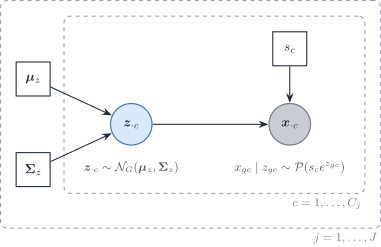
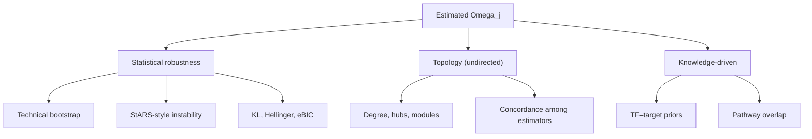
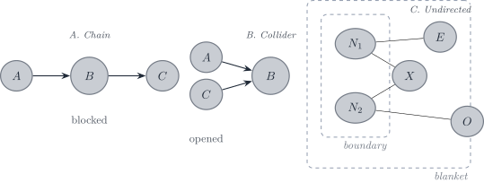

# 3.3 Precision networks: alternatives to the covariance plug-in

> **Notation (shared by all vignettes; aligned with the article)**
>
> Gene g=1,\ldots,G; cell type j=1,\ldots,J (a second type is \ell);
> bulk sample i=1,\ldots,N; reference donor (replicate) r=1,\ldots,R;
> cell c, with C_j reference cells of type j. The index i is dropped
> inside a derivation and restored in the model statements.
>
> | Symbol | Meaning |
> |----|----|
> | y\_{gi}, \boldsymbol{y}\_{\cdot i} | Bulk expression on a linear scale |
> | m\_{ji}, n_i=\sum_jm\_{ji} | Cells of type j in bulk sample i, and their total |
> | \tilde{\boldsymbol{y}}\_{\cdot i}=\boldsymbol{y}\_{\cdot i}/n_i | Bulk expression per cell |
> | \boldsymbol{p}\_{\cdot i}\in\Delta^{J-1} | Cell fractions, p\_{ji}=m\_{ji}/n_i |
> | \boldsymbol{\rho}\_{i}\in\mathbb{R}^{J-1} | Isometric log-ratio (ILR) coordinates of \boldsymbol{p}\_{\cdot i}, \boldsymbol{p}\_{\cdot i}=\operatorname{softmax}(\mathbf{V}\boldsymbol{\rho}\_i) with a Helmert basis \mathbf{V} |
> | \boldsymbol{q}\_{\cdot i} | Transcript fractions, q\_{ji}=p\_{ji}S_j/\sum\_\ell p\_{\ell i}S\_\ell |
> | \boldsymbol{\mu}\_{\cdot j}, \boldsymbol{\Sigma}\_j | Mean and G\times G gene–gene covariance of a type-j population profile |
> | \boldsymbol{\Omega}\_j=\boldsymbol{\Sigma}\_j^{-1} | Precision matrix of type j |
> | \boldsymbol{\Gamma}\_g | J\times J covariance across cell types for gene g (`bMIND`, `EPIC-unmix`, `Unico`) |
> | \boldsymbol{x}\_{\cdot j,i} | Purified profile of type j in sample i |
> | x\_{gc}, \boldsymbol{x}\_{\cdot c}, s_c | Raw UMI count of gene g in reference cell c, and the size factor of cell c |
> | \boldsymbol{\lambda}\_{\cdot c}, \boldsymbol{z}\_{\cdot c} | Size-free expression of cell c; its latent log-expression in the Poisson log-normal (PLN) model |
> | \tilde{\boldsymbol{\mu}}\_{\cdot j}=C_j^{-1}\sum\_{c\in j}\boldsymbol{x}\_{\cdot c}=S_j\boldsymbol{\theta}\_{\cdot j} | Per-cell mean of the raw UMI counts of the C_j reference cells of type j |
> | \boldsymbol{\theta}\_{\cdot j}, S_j=\mathbf{1}^{\top}\tilde{\boldsymbol{\mu}}\_{\cdot j} | Relative abundance (\mathbf{1}^{\top}\boldsymbol{\theta}\_{\cdot j}=1) and mean transcriptome size of a type-j cell |
> | \boldsymbol{\Sigma}\_{W,j}, \boldsymbol{\Sigma}\_{B,j} | Within-donor cell-to-cell covariance of type j (one single-cell sample); between-donor covariance of type j (needs R\ge2 donors) |
> | \boldsymbol{S}\_W(\boldsymbol{v})=\sum_jv_j\boldsymbol{\Sigma}\_{W,j}, \boldsymbol{S}\_B(\boldsymbol{v})=\sum_jv_j^2\boldsymbol{\Sigma}\_{B,j} | Linear and quadratic covariance mixtures with weights \boldsymbol{v} |
> | \boldsymbol{V}\_j | Empirical covariance of type j, computed from its reference profiles or cells |
> | \boldsymbol{R}\_j | Empirical correlation matrix of type j (bold; the scalar R is the number of donors) |
> | \boldsymbol{\Delta}\_j=\operatorname{diag}(\boldsymbol{V}\_j) | Diagonal matrix of the empirical variances of type j |
> | \lambda | Penalty of a regularised covariance or precision estimator |
> | \psi_g, \mathcal{D}\_g | Negative binomial dispersion of gene g; deviance of gene g in a count model |
> | \delta\_{gj} | Detection rate of gene g in type j (fraction of cells with a non-zero count) |
> | \varpi\_{\ell\mid j}, \varpi\_{j\ell}, \bar\varpi | MixSim overlap: probability of misclassifying a draw of j into \ell, pairwise overlap \varpi\_{j\ell}=\varpi\_{\ell\mid j}+\varpi\_{j\mid\ell}, and its average over pairs (`BarOmega`) |
> | \boldsymbol{T}\_{ji}=\sum\_{c=1}^{m\_{ji}}\boldsymbol{X}\_{jic} | Total expression contributed by type j to sample i |
> | a_i | Sample-wide scale between the reference and the bulk library |
> | c_i=a_in_i, \phi_i=a_i^2n_i | Mean scale and variance scale of the single-cell model |
> | b_g, \tilde b_g=b_g^{\mathrm{bulk}}/b_g^{\mathrm{ref}} | Capture efficiency of gene g in one protocol, and the gene-wise platform ratio; \tilde{\boldsymbol{B}}=\operatorname{diag}(\tilde{\boldsymbol{b}}) |
> | \boldsymbol{D}\_i | Diagonal, heteroscedastic bulk measurement noise |
>
> A tilde marks a quantity rescaled to a reference unit: per cell
> (\tilde{\boldsymbol{y}}, \tilde{\boldsymbol{\mu}}) or relative to the
> reference protocol (\tilde{\boldsymbol{b}}). \boldsymbol{\Sigma}\_j
> couples **genes** within one cell type; \boldsymbol{\Gamma}\_g couples
> **cell types** within one gene. A symbol absent from this table is
> defined in the vignette that uses it, with one meaning there.

> **Scope**
>
> This vignette collects the precision-network estimators and the
> readings of their zeros. None of them is the DeCovarT plug-in. The
> plug-in is the within-type covariance \boldsymbol{\Sigma}\_{W,j}, and
> the default estimator is linear shrinkage
> ([3.2](https://bastienchassagnol.github.io/DeCovarT/articles/03-2-covariance-network-estimation.html#sec-cov-shrinkage)).
> A sparse precision is an alternative only when the held-out Gaussian
> log-score of
> [3.2](https://bastienchassagnol.github.io/DeCovarT/articles/03-2-covariance-network-estimation.html#sec-cov-cv)
> prefers the covariance it exports. Graph scores are not used for that
> choice.

## Sparse precision estimators

### Graphical lasso with an unpenalised diagonal

On the correlation \boldsymbol{R}\_j, with
\boldsymbol{\Delta}\_j=\operatorname{diag}(\boldsymbol{V}\_j),

\widehat{\boldsymbol{\Omega}}\_{R}
=\arg\min\_{\boldsymbol{\Omega}\succ0}
\Bigl\[-\log\det\boldsymbol{\Omega}
+\operatorname{tr}(\boldsymbol{R}\_j\boldsymbol{\Omega})
+\lambda\sum\_{g\neq g'}\|\omega\_{gg'}\|\Bigr\], \qquad
\widehat{\boldsymbol{\Omega}}\_j=\boldsymbol{\Delta}\_j^{-1/2}\widehat{\boldsymbol{\Omega}}\_{R}\boldsymbol{\Delta}\_j^{-1/2}
\tag{1}

([Friedman et al. 2008](#ref-friedmanSparseInverseCovariance2008);
[Mazumder and Hastie 2011](#ref-mazumderGraphicalLassoNew2011)). Working
on \boldsymbol{R}\_j puts every gene on one scale for one \lambda;
rescaling leaves the zeros and the partial correlations unchanged. With
the diagonal unpenalised, the fitted covariance
\widehat{\boldsymbol{\Sigma}}\_{R}=\widehat{\boldsymbol{\Omega}}\_{R}^{-1}
has unit diagonal, so the exported
\widehat{\boldsymbol{\Sigma}}\_j=\boldsymbol{\Delta}\_j^{1/2}\widehat{\boldsymbol{\Sigma}}\_{R}\boldsymbol{\Delta}\_j^{1/2}
keeps the sample variances exactly. On the selected edges,
\hat\Sigma\_{R,gg'}=R\_{j,gg'}+\lambda\operatorname{sign}(\hat\omega\_{gg'})
in the sign convention of [Eq. 1](#eq-glasso); off them,
\|\hat\Sigma\_{R,gg'}-R\_{j,gg'}\|\le\lambda.

**Why `glasso` rather than `huge`:** `huge.glasso()` always penalises
the diagonal, which inflates every variance by \lambda
([diagonal](https://bastienchassagnol.github.io/DeCovarT/articles/03-2-covariance-network-estimation.html#sec-cov-diagonal)),
whereas `glasso::glasso(penalize.diagonal = FALSE)` leaves it free
([Zhao et al. 2012](#ref-zhaoHugePackageHighdimensional)). `glasso` 1.11
penalises the diagonal by default, so the argument must be set.

### `SILGGM` after the nonparanormal map

`SILGGM` tests the entries of a Gaussian precision with a global FDR
guarantee ([Zhang et al. 2018](#ref-zhangSILGGMExtensivePackage2018)).
Its input must be close to Gaussian, so the counts are first mapped to
nonparanormal scores.

**The map.** A nonparanormal vector has monotone f_g with
f_g(x_g)\sim\mathcal{N} jointly ([Liu et al.
2009](#ref-liuNonparanormalSemiparametricEstimation2009)). By Sklar’s
theorem ([Sec. 3.3](#sec-cov-persp-models)) the latent Gaussian copula
carries the graph; the margins carry the scale. With r\_{cg} the rank of
x\_{gc} among the C_j cells, two regularisations keep \Phi^{-1} finite:

\begin{aligned} \text{shrinkage:}&\quad \tilde
z\_{gc}=\Phi^{-1}\\\Bigl(\frac{r\_{cg}}{C_j+1}\Bigr),\\
\text{truncation:}&\quad \tilde
z\_{gc}=\Phi^{-1}\\\Bigl\[\min\bigl\\1-\delta\_{C_j},\max(\delta\_{C_j},r\_{cg}/C_j)\bigr\\\Bigr\],
\qquad \delta\_{n}=\frac{1}{4n^{1/4}\sqrt{\pi\log n}} . \end{aligned}
\tag{2}

Shrinkage is preferred. It moves each probability by at most 1/(C_j+1)
and keeps every rank distinct. Truncation gives all ranks beyond
\delta\_{C_j} the same score; \delta\_{C_j} is of order C_j^{-1/4},
fixed by the sample size rather than by the data, so it clips exactly
the heavy upper tails that single-cell profiles have. Neither map helps
with ties: all the zeros of a sparse gene share one score, so a gene
detected in few cells carries few distinct values
([Sec. 2](#sec-grn-diagonal), cause (ii)).

**De-sparsified edges and the FDR support.** The graphical-lasso
estimate \widehat{\boldsymbol{\Omega}} of the scores is biased by the
\ell_1 term: its KKT condition reads
\boldsymbol{R}\_j^{\mathrm{npn}}-\widehat{\boldsymbol{\Omega}}^{-1}+\lambda\widehat{\boldsymbol{Z}}=\boldsymbol{0},
with \boldsymbol{R}\_j^{\mathrm{npn}} the correlation of the scores and
\widehat{\boldsymbol{Z}} a subgradient of the \ell_1 norm. One Newton
step on the unpenalised score removes that bias,

\check{\boldsymbol{\Omega}}
=2\widehat{\boldsymbol{\Omega}}-\widehat{\boldsymbol{\Omega}}\boldsymbol{R}\_j^{\mathrm{npn}}\widehat{\boldsymbol{\Omega}}
=\widehat{\boldsymbol{\Omega}}+\lambda\widehat{\boldsymbol{\Omega}}\widehat{\boldsymbol{Z}}\widehat{\boldsymbol{\Omega}},
\tag{3}

and \sqrt{C_j}(\check\omega\_{gg'}-\omega\_{gg'}) is asymptotically
\mathcal{N}(0,\omega\_{gg}\omega\_{g'g'}+\omega\_{gg'}^{2}) under
sparsity and rate conditions ([Jankova and Geer
2015](#ref-jankovaConfidenceIntervalsHighdimensional2015)). `SILGGM`
(`D-S_GL`, `global = TRUE`) thresholds the resulting z-statistics by the
global FDR rule of Liu ([2013](#ref-liuGaussianGraphicalModel2013)).
\check{\boldsymbol{\Omega}} is dense and is not exported. Its role is
the support.

**What DeCovarT receives.** The covariance on the linear scale is refit
under the zeros of the support ([hard
selection](https://bastienchassagnol.github.io/DeCovarT/articles/03-2-covariance-network-estimation.html#eq-hard-cov-selection)).
Two caveats follow. The refit exists only for C_j\ge\operatorname{mlt}
of the support ([sample-size
regimes](https://bastienchassagnol.github.io/DeCovarT/articles/03-2-covariance-network-estimation.html#sec-cov-regimes));
below it a penalty is needed again and the arm loses its advantage over
[Sec. 1.1](#sec-cov-glasso). And a zero partial correlation of the
latent copula need not be a zero partial correlation of the linear
counts, so imposing the support on the linear scale is an approximation.
The held-out score of [held-out
score](https://bastienchassagnol.github.io/DeCovarT/articles/03-2-covariance-network-estimation.html#sec-cov-cv)
measures what that approximation costs. The tuning parameter is the FDR
level \alpha.

### Poisson–lognormal network

`PLNnetwork` separates the Poisson sampling layer from the latent
covariance ([Chiquet et al.
2018](#ref-chiquetVariationalInferenceSparse2018),
[2021](#ref-chiquetPoissonLognormalModelVersatile2021))
([Figure 1](#fig-grn-pln)):

\boldsymbol{z}\_{\cdot
c}\sim\mathcal{N}\_G(\boldsymbol{\mu}\_z,\boldsymbol{\Sigma}\_z), \qquad
x\_{gc}\mid\boldsymbol{z}\_{\cdot
c}\sim\mathcal{P}\bigl(s_c\\e^{z\_{gc}}\bigr), \tag{4}

with an \ell_1 penalty on the off-diagonal entries of
\boldsymbol{\Omega}\_z=\boldsymbol{\Sigma}\_z^{-1} (diagonal
unpenalised). The offset \log s_c is the library size of cell c over all
genes. A sum over the panel would depend on the panel genes and absorb
part of the type signal. The offset fixes the coefficient of \log s_c at
one, so \boldsymbol{z}\_{\cdot c} describes expression per unit of
sequencing exposure. One model is fitted per type (and time); a single
model with type dummies would share one \boldsymbol{\Sigma}\_z across
types.

The likelihood integrates \boldsymbol{z}\_{\cdot c} and has no closed
form. Variational EM maximises the evidence lower bound, \log
p(\boldsymbol{x})-\operatorname{KL}\\q\\\\\\p(\boldsymbol{z}\mid\boldsymbol{x})\\,
over a Gaussian family q; the KL gap is zero only if q is the true
posterior. The closed-form updates of q replace a Monte Carlo E-step,
which is what makes the fit practical at single-cell sizes ([Chiquet et
al. 2018](#ref-chiquetVariationalInferenceSparse2018)).

**Comparison on the linear scale.** The latent covariance is not
\boldsymbol{\Sigma}\_{W,j}. With
\boldsymbol{m}=\exp\\\boldsymbol{\mu}\_z+\tfrac12\operatorname{diag}(\boldsymbol{\Sigma}\_z)\\
(elementwise), the log-normal and Poisson moments give, for one cell,

\mathbb{E}(\boldsymbol{x}\_{\cdot c}\mid s_c)=s_c\boldsymbol{m}, \qquad
\operatorname{Cov}(\boldsymbol{x}\_{\cdot c}\mid s_c)
=s_c\operatorname{diag}(\boldsymbol{m})
+s_c^{2}\\(\boldsymbol{m}\boldsymbol{m}^{\top})\circ\bigl(e^{\boldsymbol{\Sigma}\_z}-\mathbf{1}\mathbf{1}^{\top}\bigr),
\tag{5}

and, averaged over the size factors of the scored cells, with \bar s and
\overline{s^{2}} their first two moments,

\mathbb{E}\boldsymbol{x}=\bar s\\\boldsymbol{m}, \qquad
\operatorname{Cov}\boldsymbol{x} =\bar
s\operatorname{diag}(\boldsymbol{m})
+(\boldsymbol{m}\boldsymbol{m}^{\top})\circ\bigl(\overline{s^{2}}\\e^{\boldsymbol{\Sigma}\_z}-\bar
s^{2}\\\mathbf{1}\mathbf{1}^{\top}\bigr). \tag{6}

The variance of s_c adds the rank-one term
\operatorname{Var}(s)\\\boldsymbol{m}\boldsymbol{m}^{\top}: depth
variation correlates every pair of genes. For counts divided by their
size factor, the moments are \boldsymbol{m} and
\overline{s^{-1}}\operatorname{diag}(\boldsymbol{m})+(\boldsymbol{m}\boldsymbol{m}^{\top})\circ(e^{\boldsymbol{\Sigma}\_z}-\mathbf{1}\mathbf{1}^{\top}).
The scale must match the one used for the mean signature. These moments
are what the PLN arm exports and what [held-out
score](https://bastienchassagnol.github.io/DeCovarT/articles/03-2-covariance-network-estimation.html#sec-cov-cv)
scores.



Figure 1: Poisson–lognormal model for one cell type. The latent
log-expression \boldsymbol{z}\_{\cdot c} carries the covariance
\boldsymbol{\Sigma}\_{z} and its precision; the counts add independent
Poisson noise given \boldsymbol{z}\_{\cdot c} and the size factor s_c.
Covariances between genes come only from \boldsymbol{z}\_{\cdot c} (and
from the spread of s_c); the Poisson term adds to the diagonal only.

### Benchmark GRN inference strategies

The score families and stability scenarios below are **inspired by**
GRETA
([**badia-i-mompelComparisonEvaluationMethods2025?**](#ref-badia-i-mompelComparisonEvaluationMethods2025))
and BEELINE
([**pratapaBenchmarkingAlgorithmsGene2020?**](#ref-pratapaBenchmarkingAlgorithmsGene2020)).
We do not import those pipelines. We keep three **undirected**,
observational families:

1.  **Statistical robustness and distributional alignment** — does the
    fitted Gaussian (or its graph) stay put under resampling, and does
    it match the type-level law that DeCovarT needs?
2.  **Topological comparison** — skeleton similarity among the three
    core estimators, without a true DAG.
3.  **Knowledge-driven scoring** — TFs connected to plausible targets
    and pathway overlap, always as overlap with an incomplete prior.

Directed DAGs, multimodal ATAC/ChIP recovery, perturbation forecasting,
and any metric that needs a **known true skeleton** are **perspectives**
(**?@sec-metrics-perspectives**). They judge a different estimand than
**?@eq-grn-estimand**.



Figure 2: Three core evaluation families for undirected cell-type GGMs.
Perspectives that need a true skeleton, a DAG, extra assays, or
perturbations are collected in **?@sec-metrics-perspectives**.

#### Statistical robustness and alignment

These scores do not need a true graph. They ask whether
(\widehat{\boldsymbol{\mu}}\_{\cdot
j},\widehat{\boldsymbol{\Sigma}}\_{j}) is a stable, distinguishable
plug-in for **?@eq-grn-convolution**.

##### Resampling

With one experiment, the honest uncertainty is **conditional on this
atlas**:

- **Technical cell bootstrap** within type, labels fixed
  (**?@sec-align-bootstrap**). Re-estimate \boldsymbol{\Omega}\_{j};
  record edge inclusion frequencies (stability selection in the sense of
  Meinshausen and Bühlmann ([Meinshausen and Bühlmann
  2010](#ref-meinshausenStabilitySelection2010))) and the Frobenius /
  Bures spread of \widehat{\boldsymbol{\Sigma}}\_{j}.
- **Gene or cell downsampling** as a coverage check. GRETA found that TF
  and gene *sets* can look stable while **edges** collapse under
  downsampling — a warning we should expect for glasso supports as well.

Biological (multi-organoid) bootstrap is **unavailable**. Reporting a
bootstrap interval as if it were between-experiment uncertainty would
repeat the pseudoreplication error of **?@nte-pseudoreplication**.

Observation-model **contamination** (wrong sampling layer, spillover,
missing types) is not a GRN-stability experiment. It belongs to the
misspecification sweep of **?@sec-sensitivity**.

> **Note 1: ℹ️ StARS selects \lambda from edge instability**
>
> In `huge`, StARS (stability approach to regularisation selection)
> ([Liu et al. 2010](#ref-liuStabilityApproachRegularization2010)) does
> **not** score likelihood or the numerical accuracy of
> \widehat{\boldsymbol{\Omega}}. Liu, Roeder and Wasserman choose the
> **least amount of regularisation** that still makes the graph sparse
> and replicable under random sampling. For each penalty \lambda, the
> data are subsampled, the graph is re-estimated, and
> \hat\pi\_{gg'}(\lambda) is the fraction of subsamples in which edge
> \\g,g'\\ appears. Edge instability is of the form
>
> 2\hat\pi\_{gg'}(\lambda)\bigl(1-\hat\pi\_{gg'}(\lambda)\bigr),
>
> which is near zero when the edge is almost always absent or almost
> always present, and largest when it appears about half the time. These
> terms are averaged over possible edges. StARS then takes the **least
> sparse** graph whose overall instability stays below `stars.thresh`
> ([`huge.stars`](https://www.rdocumentation.org/packages/huge/topics/huge.stars);
> [`huge.select`](https://www.rdocumentation.org/packages/huge/topics/huge.select)).

##### Likelihood and information criteria

On the Gaussian scale actually used by the estimator,

- **eBIC** (extended BIC) is the usual glasso selection criterion when
  FDR methods are not used;
- held-out log-likelihood on cells left out within type (still
  technical, not biological).

These scores compare **nested Gaussian models**. They do not validate a
PLN latent graph against a glasso graph on NPN data: the observation
models differ. Cross-family comparison must move to a common object —
the exported (\boldsymbol{\mu}\_{\cdot j},\boldsymbol{\Sigma}\_{j}) on
the **linear** DeCovarT scale — and use distributional distances.

##### Distances between type-level Gaussians

Closed forms, for non-degenerate
P\_{j}=\mathcal{N}(\boldsymbol{\mu}\_{\cdot
j},\boldsymbol{\Sigma}\_{j}):

**Kullback–Leibler**

\begin{aligned} D\_{\mathrm{KL}}(P\_{j}\parallel P\_{\ell}) &=
\tfrac12\Bigl\[
\operatorname{tr}(\boldsymbol{\Sigma}\_{\ell}^{-1}\boldsymbol{\Sigma}\_{j})
+(\boldsymbol{\mu}\_{\cdot\ell}-\boldsymbol{\mu}\_{\cdot j})^{\top}
\boldsymbol{\Sigma}\_{\ell}^{-1}
(\boldsymbol{\mu}\_{\cdot\ell}-\boldsymbol{\mu}\_{\cdot j}) -G
+\ln\frac{\det\boldsymbol{\Sigma}\_{\ell}}{\det\boldsymbol{\Sigma}\_{j}}
\Bigr\]. \end{aligned} \tag{7}

**Jeffreys** J(P\_{j},P\_{\ell})=D\_{\mathrm{KL}}(P\_{j}\parallel
P\_{\ell})+D\_{\mathrm{KL}}(P\_{\ell}\parallel P\_{j}) is the symmetric
version used as a separation monitor in the feature chapter.

**Hellinger** via Gaussian affinity, and **MixSim overlap**
\omega\_{j\ell}^{\mathrm{MS}} as the sum of misclassification
probabilities ([Melnykov et al.
2012](#ref-melnykovMixSimPackageSimulating2012), [2024](#ref-R-MixSim)),
are the right “can DeCovarT tell these types apart?” scores. They are
**not** graph metrics; they are metrics on the generative object. (The
superscript \mathrm{MS} avoids clashing with precision entries
\omega\_{gg'}.)

**Bures–Wasserstein** (**?@sec-align-ot**) is a perspective metric. It
splits mean displacement from covariance geometry when an external
population Gaussian is available.

> **Warning 2: ℹ️ Compare laws on the DeCovarT scale**
>
> KL between NPN-space Gaussians is not KL between count-scale
> pseudo-bulks. After each estimator has exported **?@eq-grn-export**,
> compute KL / Hellinger / W\_{2} / MixSim on **that** Gaussian, the one
> that enters the convolution. Otherwise a “better” SILGGM graph can win
> on NPN likelihood and lose as a deconvolution prior.

#### Topological comparison

These describe **shape and concordance**, not correctness against a true
DAG. The core object is the undirected adjacency
A\_{gg'}=\mathbf{1}\\\hat\omega\_{gg'}\neq 0\\.

- degree distribution and a power-law diagnostic (many biological
  networks are not strictly scale-free);
- hub overlap across types (rewiring of hubs is a DeCovarT-relevant
  summary);
- clustering coefficient, number of connected components, modularity;
- overlap coefficients of edge **sets** between the three methods
  (intersection over the smaller set), which avoids punishing a method
  for returning a larger graph.

**Structural distances between two estimated undirected graphs** (no
true skeleton required) follow the `bnlearn` comparison helpers
([Comparing network
structures](https://www.bnlearn.com/examples/compare-dags/)):

- `hamming()` — Hamming distance: the number of edge additions and
  deletions needed to turn one skeleton into the other (no orientation
  term, because our graphs are undirected);
- `shd()` — structural Hamming distance (SHD). For DAGs it also counts
  reversals; on undirected skeletons it reduces to the same add/delete
  count. Report both the raw distance and a version normalised by
  G(G-1)/2.

> **Note 3: Visualisations**
>
> The aim is to **compare structure and inference**, not to decorate a
> methods section. Each display should answer one question. Penalty-path
> and `funkyheatmap` scoreboards live in **?@sec-grn-penalty-path**;
> this section is about **supports, signs, and modules**.
>
> **Supports and concordance (one type, one time)**
>
> - Binary adjacency heatmaps, genes ordered by a **common**
>   hierarchical clustering (from a consensus distance d\_{ab}=1-\bar
>   r\_{ab} of methods, or from a biological ordering). Side-by-side
>   heatmaps of \widehat{\boldsymbol{\Omega}}\_{j} for two types make
>   rewiring visible; a third panel of
>   \|\hat\omega^{(j)}\_{gg'}-\hat\omega^{(\ell)}\_{gg'}\| is the
>   differential-network view.
> - **Upset plots of edge presence** across `huge`, `SILGGM` and
>   `PLNnetwork` at a fixed type \times time: how many edges are unique
>   to one estimator, shared by two, or shared by all three.
> - **Upset plots of edge sign**, which is stricter. An edge is a signed
>   pair \bigl(\\g,g'\\,\operatorname{sign}(\hat\omega\_{gg'})\bigr).
>   Two methods can share the support and still disagree on the sign of
>   the partial correlation; that disagreement is visible only in the
>   signed Upset.
> - On-diagonal degree bars or a simple graph drawing **only** for a
>   tiny TF subgraph; whole-transcriptome hairballs are not figures.
>
> ------------------------------------------------------------------------
>
> **Leiden modules from the precision weights**
>
> Treat \widehat{\boldsymbol{\Omega}}\_{j} as a weighted undirected
> graph with edge weights \|\hat\omega\_{gg'}\| (or
> \|\rho\_{gg'\mid\mathrm{rest}}\| from **?@eq-partial**) on the
> selected support. Cluster genes with Leiden
> ([`igraph::cluster_leiden()`](https://igraph.org/r/html/1.3.4/cluster_leiden.html)):
> the weights enter the quality function directly, so modules reflect
> **strength of conditional dependence**, not just binary adjacency.
> Compare partitions across the three estimators (adjusted Rand index)
> and across types (rewiring of modules). Do not feed the dense
> \check{\boldsymbol{\Omega}} into Leiden.
>
> ------------------------------------------------------------------------
>
> **Stability**
>
> - Edge-inclusion frequencies from the technical bootstrap as a heatmap
>   or as a reliability curve (precision among edges with inclusion \>t,
>   as t varies).

> **Note 4: ℹ️ When a ground truth skeleton is available**
>
> On a simulator whose GRN we supplied (**?@sec-align-mc**), or on a
> curated Boolean skeleton used only as a **reference**, the usual
> ranking scores apply to the **undirected** adjacency:
>
> | Score | Definition on skeletons | Caveat |
> |----|----|----|
> | Precision / recall / F\_{1} or F\_{0.1} | TP, FP, FN against the reference skeleton | Needs a true or curated support; GRETA weights precision 10\times recall because inferred GRNs are sparse |
> | Early precision | Precision among the top-k edges | Robust when k is the expected degree \times G/2 |
> | AUPRC / AUROC | Ranking of edges | AUROC is too optimistic on sparse graphs; prefer AUPRC |
> | Structural Hamming distance | Hamming / SHD against the true skeleton | Scale with G; report also normalised SHD |
>
> Using a Boolean model (BEELINE curated networks; BoolODE) *as the
> prior* and a GGM *as the data-driven proposal* is a legitimate
> consistency check; using the Boolean model *as*
> \boldsymbol{\Omega}\_{j} would abandon the Gaussian convolution.

#### Knowledge-driven scoring

**Literature / knowledge (observational, undirected)**

- **Marker TFs**: is a known type marker present as a hub, or as a
  high-degree node in \widehat{\boldsymbol{\Omega}}\_{j} for that type?
- **TF–target edges**: if g is a TF and g' a curated target, does the
  undirected edge \\g,g'\\ appear? Resources: CollecTRI, DoRothEA, and
  mouse TF catalogues — all incomplete.
- **TF–TF via shared targets**: two TFs that share many neighbours may
  reflect a complex or an artefact of co-expression; report overlap with
  PPI / IntAct only as a soft score.

**Predictive (observational)**

- How well does the graph **topology** predict held-out expression (gene
  \sim neighbours)? For a GGM this is almost circular (the model *is* a
  prediction of each node given the rest), but a **held-out cell**
  nodewise R^{2} is still a useful calibration: a graph that does not
  predict expression of its own nodes is a bad Gaussian.
- Gene-set enrichment of Leiden or other modules (Hallmark, KEGG,
  Reactome) is a sanity check, not a causal test.

#### Orthogonal multi-modal multi-omic assays

ChIP-seq, CUT&RUN, and ATAC-seq (or multiome) networks are closer to
**physical interaction** than a partial correlation. They are
orthogonal, complementary modalities; they are **not** measured in the
core Suppinger scRNA-seq table we use for \boldsymbol{\Omega}\_{j}. If a
later gastruloid multiome appears, GRETA is a possible evaluation
harness; SCENIC+ / CellOracle / Dictys remain out of the DeCovarT
**input**, because they return directed regulons, not SPD precisions.
The honest use is: project our undirected skeleton onto TF–CRE–gene
triples and score literature overlap; do not replace
\boldsymbol{\Omega}\_{j} with a regulon adjacency.

#### Perturbation and interventional datasets

**CORNETO**
([**rodriguez-mierUnifyingMultisampleNetwork2025?**](#ref-rodriguez-mierUnifyingMultisampleNetwork2025))
reformulates knowledge-driven network inference as a joint constrained
optimisation problem (LP / MILP) over prior knowledge networks. It is
**not** a GGM. As a perspective scorer, it can take our data-driven
support and ask whether a sparse subnetwork of a PKN explains the omics
under flow / Steiner / CARNIVAL constraints. That tests **mechanistic
plausibility**, not Gaussian fit.

## Why near-diagonal precisions appear

On Suppinger, an earlier pipeline (`huge`, EBIC) returned mostly
diagonal \widehat{\boldsymbol{\Omega}}\_j. Five causes compete with “no
dependence”, and the first three are checkable.

- **(i) Pipeline fallbacks.** A gene constant within a type made the
  earlier script return a diagonal covariance for the whole type; failed
  solves were replaced by a diagonal that EBIC could select; and EBIC
  mixed a correlation-scale fit with a covariance-scale likelihood.
  These are fixed in the reproducibility code, and the presence gate of
  the feature-selection chapter
  ([presence](https://bastienchassagnol.github.io/DeCovarT/articles/03-1-feature-selection.html#sec-fs-presence))
  prevents the first upstream.
- **(ii) A transformation that ignores the count law.** Rank scores give
  all zeros of a sparse gene one tied value, and standardising by the
  marginal variance treats a Poisson-dominated gene and an overdispersed
  gene alike. Both flatten correlations before any penalty acts (Wu et
  al. 2020 warn against a naive nonparanormal map on counts).
- **(iii) A panel built against within-type covariance.** Genes chosen
  for a large between- to within-type ratio have small within-type
  variance, where sampling noise dominates. Such a panel removes the
  covariance DeCovarT is meant to model ([selection
  effect](https://bastienchassagnol.github.io/DeCovarT/articles/03-1-feature-selection.html#sec-fs-selection-effect)).
  If the discriminative genes are close to conditionally independent
  within each type, the covariance adds little to the mean signature,
  which is itself a result.
- **(iv) A detection threshold** ([Sec. 2.1](#sec-grn-screening)).
- **(v) Poisson attenuation** ([Sec. 2.2](#sec-grn-attenuation)).

### A screening threshold, not an estimated absence

For any \lambda, the graphical lasso on \boldsymbol{R}\_j returns a
diagonal \widehat{\boldsymbol{\Omega}} exactly when \max\_{g\neq
g'}\|R\_{j,gg'}\|\le\lambda, with or without a penalised diagonal
([Mazumder and Hastie 2011](#ref-mazumderGraphicalLassoNew2011)): “A
large enough penalty level produces an empty graph” ([Chiquet 2015,
39](#ref-chiquetContributionsSparseMethods2015)). Two orders of
magnitude make that likely on single-cell data.

- **Noise level.** Under independence the largest of the G(G-1)/2 sample
  correlations is about \sqrt{4\log G/C_j}, that is 0.35 for G=500 and
  C_j=200. A penalty that controls false edges sits near that level.
- **EBIC cost per edge.** With \gamma=0.5, EBIC charges \log
  C_j+4\gamma\log G\approx17.7 per edge at the same sizes. One edge of
  partial correlation \rho raises twice the log-likelihood by about
  C_j\rho^{2}, so only \|\rho\|\gtrsim0.30 survives.

Neighbourhood selection behaves the same way: its finite-sample penalty
sets every coefficient to zero when all
\|r\_{gg'}\|\le\tilde\Phi^{-1}\\\alpha/(2G^{2})\\/\sqrt{C_j}, about 0.55
for G=1000, C_j=100 and \alpha=0.05 (Meinshausen & Bühlmann 2006, eq.
9), and partial correlations below order C_j^{-(1-\xi)/2} are not
detected (assumption 5). A diagonal estimate says that no partial
correlation is large **relative to \sqrt{\log G/C_j}**, not that the
partial correlations are zero. The covariance plug-in avoids the
threshold: shrinkage keeps every correlation, damped by 1-\lambda.

### Measurement attenuation on counts

On UMI counts the observed covariance is the latent covariance plus a
diagonal sampling term ([Eq. 5](#eq-pln-linear)). Every correlation is
attenuated, most for lowly expressed genes ([Sarkar and Stephens
2021](#ref-sarkarSeparatingMeasurementExpression2021); [Chiquet et al.
2021](#ref-chiquetPoissonLognormalModelVersatile2021)), which pushes
\max\|R\_{j,gg'}\| under the threshold of
[Sec. 2.1](#sec-grn-screening). For two genes with latent correlation
0.6, latent variances 1 and e^{\mu_z}=0.5 at s_c=1,
[Eq. 5](#eq-pln-linear) gives a mean count of 0.82 and a linear-scale
correlation of about 0.28. The chunk below checks that value by
simulation.

``` r

set.seed(20261015)
n_cells <- 5000
latent_cor <- 0.6
z <- MASS::mvrnorm(
  n_cells,
  mu = rep(log(0.5), 2),
  Sigma = matrix(c(1, latent_cor, latent_cor, 1), 2)
)
x <- matrix(stats::rpois(length(z), exp(z)), ncol = 2)
m <- exp(log(0.5) + 0.5)
pln_cor <- m^2 * (exp(latent_cor) - 1) / (m + m^2 * (exp(1) - 1))
round(
  c(
    latent = stats::cor(z)[1, 2],
    linear_counts = stats::cor(x)[1, 2],
    pln_moment_map = pln_cor,
    mean_count = mean(x)
  ),
  2
)
```

The Poisson term is a property of the measurement, not of the cells.
Modelling it (`PLNnetwork`, [Sec. 1.3](#sec-cov-pln)) is the principled
correction; a smaller penalty is not.

## Perspectives

> **Note 5: Graphical independence models**
>
> ### Directed and undirected separation
>
> Glasso returns an **undirected** graph. Growing a gene panel by
> neighbours is therefore not the same operation as blocking paths on a
> DAG.
>
> On a DAG, **d-separation** uses the direction of edges. A chain is
> blocked by conditioning on the middle node; a collider is opened by
> conditioning on the collision node (or on one of its descendants). On
> an undirected graph, **u-separation** ignores direction: a path is
> blocked when it meets the conditioning set.
> [Figure 3](#fig-separation) draws both.
>
> 
>
> Figure 3: Directed d-separation (chain blocked, collider opened),
> undirected u-separation on a minimal I-map, and the nesting of a
> Markov boundary inside a Markov blanket.
>
> ### Blanket versus boundary
>
> A **Markov blanket** of a variable X is any set S that renders X
> conditionally independent of the remaining variables ([Pearl
> 1988](#ref-pearlProbabilisticReasoningIntelligent1988)). The
> neighbours of X in *some* undirected graph that is an I-map are always
> a blanket, but that graph may contain redundant edges, so the
> neighbour set need not be minimal.
>
> A **Markov boundary** is a **minimal** Markov blanket. For a positive
> distribution, that boundary is unique and equals the neighbour set of
> X in the **minimal undirected I-map** ([Pearl
> 1988](#ref-pearlProbabilisticReasoningIntelligent1988); [Koller and
> Friedman 2009](#ref-kollerProbabilisticGraphicalModels2009)). The
> boundary is therefore the lower bound on the size of a blanket: every
> blanket contains a boundary, and the boundary is the smallest one
> ([Figure 3](#fig-separation), panel C).

### Other generative and inferential models

- **Copulas with GAMLSS margins.** `scDesign3` fits each gene by a
  generalised additive model for location, scale and shape (GAMLSS), for
  example a negative binomial whose mean and dispersion depend on the
  type with the library size as offset, and joins the genes by a copula
  ([Song et al. 2024](#ref-songScDesign3GeneratesRealistic2024)). A
  GAMLSS relaxes the exponential family and models every distribution
  parameter, but assumes independent observations (Stasinopoulos & Rigby
  2007, p. 2), so dependence needs the copula. By Sklar’s theorem
  F(\boldsymbol{x})=C\\F_1(x_1),\ldots,F_G(x_G)\\, with C unique when
  the margins are continuous; for counts it is unique only on the ranges
  of the margins, so `scDesign2`/`scDesign3` randomise the quantile,
  u\_{gc}=(1-v\_{gc})F\_{gc}(x\_{gc}-1)+v\_{gc}F\_{gc}(x\_{gc}) with
  v\_{gc}\sim\mathcal{U}(0,1) (Sun et al. 2021). The likelihood splits
  into a marginal and a copula part, so the two can be selected
  separately. The copula correlation is not \boldsymbol{\Sigma}\_{W,j}:
  linear-scale moments of a copula model need Monte Carlo or a moment
  map like [Eq. 5](#eq-pln-linear). The empirical Gaussian copula is
  singular when C_j\<G; a sparse precision or a vine copula is then
  needed.
- **Factor and sparse-plus-low-rank models.** A few unmeasured
  programmes make the marginal precision dense. Writing
  \boldsymbol{\Omega}\_{\mathrm{marg}}=\boldsymbol{\Omega}\_{\mathrm{sparse}}-\boldsymbol{L},
  \boldsymbol{L}\succeq0 of low rank (Chandrasekaran et al. 2012), or a
  factor-plus-diagonal covariance, gives a dense plug-in with few
  parameters. Depth variation is one such rank-one factor
  ([Eq. 6](#eq-pln-linear-avg)).
- **Other estimators of the same Gaussian graph.** Neighbourhood
  selection regresses each gene on the others,
  \theta^{g}\_{g'}=-\omega\_{gg'}/\omega\_{gg}, and combines
  neighbourhoods by an AND or an OR rule; it is parallel, needs d\log G
  cells, but gives a support, not a precision. SPACE makes the
  regressions joint and recovers hubs better ([Peng et al.
  2009](#ref-pengPartialCorrelationEstimation2009)). CLIME needs no
  irrepresentability condition ([Chiquet 2015,
  42](#ref-chiquetContributionsSparseMethods2015)). The D-trace loss
  \tfrac12\langle\boldsymbol{\Omega}^{2},\boldsymbol{V}\_j\rangle-\operatorname{tr}\boldsymbol{\Omega}
  has a weaker irrepresentability condition than the graphical lasso in
  Zhang and Zou’s AR examples ([Zhang and Zou
  2014](#ref-zhangSparsePrecisionMatrix2014)). A graphical horseshoe
  replaces the penalty path by global–local shrinkage ([Li et al.
  2019](#ref-liGraphicalHorseshoeEstimator2019)). These change the bias
  and the assumptions, not the detection limit of
  [Sec. 2.1](#sec-grn-screening).
- **Matrix-variate models.** `GmGM` models dependence between genes and
  between cells through a Kronecker sum of two precisions; the sum
  cannot separate regulation inside a cell from dependence across cells
  (Andrew et al. 2026).
- **Algorithm unrolling.** Iterative sparse-precision solvers become
  trainable layers ([Monga et
  al. 2021](https://doi.org/10.1109/MSP.2020.3016905);
  [GLAD](https://arxiv.org/abs/1906.00271)); PLN-Tree adds a tree of
  modules to the PLN ([Chaussard et
  al. 2024](https://hal.science/hal-04622671v1)).

#### Directed Gaussian networks

Gaussian Bayesian networks orient edges under Markov and faithfulness
assumptions; interventions (Perturb-seq and related CRISPR screens)
supply the environments needed for causal claims ([Peters et
al. 2016](https://doi.org/10.1111/rssb.12167); Svinin and Glaab
([2025](#ref-svininCausalNetworkAnalysis2025))). Any of them can
generate a \boldsymbol{\Sigma}\_j for DeCovarT.

> **Note 6: From a linear Gaussian Bayesian network to a joint normal**
>
> Order the G genes along a DAG. A linear Gaussian Bayesian network
> writes
>
> x_g=\mu_g+\sum\_{g'\in\mathrm{Pa}(g)}\Lambda\_{gg'}x\_{g'}+\varepsilon_g,
> \qquad \varepsilon_g\sim\mathcal{N}(0,q_g), \tag{8}
>
> with \Lambda\_{gg'}=0 unless g' is a parent of g. In matrix form
> (\mathbf{I}\_G-\boldsymbol{\Lambda})\boldsymbol{x}=\boldsymbol{\mu}+\boldsymbol{\varepsilon}
> with \boldsymbol{\Lambda} strictly triangular and
> \boldsymbol{Q}=\operatorname{diag}(q_1,\ldots,q_G), so
>
> \boldsymbol{\Sigma}=(\mathbf{I}\_G-\boldsymbol{\Lambda})^{-1}\boldsymbol{Q}(\mathbf{I}\_G-\boldsymbol{\Lambda})^{-\top},
> \qquad
> \boldsymbol{\Omega}=(\mathbf{I}\_G-\boldsymbol{\Lambda})^{\top}\boldsymbol{Q}^{-1}(\mathbf{I}\_G-\boldsymbol{\Lambda}).
> \tag{9}
>
> The precision has an edge between two parents of a common child
> (moralisation), so a sparse DAG can give a denser \boldsymbol{\Omega}.
> `bnlearn::gbn2mvnorm()` returns (\boldsymbol{\mu},\boldsymbol{\Sigma})
> from a fitted network ([Scutari 2026](#ref-R-bnlearn)). A DAG ground
> truth can therefore populate type-specific \boldsymbol{\Sigma}\_j in
> simulations before the bulk convolution. The dynamic counterpart is
> the Lyapunov covariance of
> [diagonal](https://bastienchassagnol.github.io/DeCovarT/articles/03-2-covariance-network-estimation.html#sec-cov-diagonal),
> whose precision need not follow the edges of \boldsymbol{A}.

### Joint and shared-topology estimation across types

Rare types have few cells, and estimating each covariance alone wastes
the structure they share with abundant types. A topology shared across
types and refined per type is the natural scheme. The families differ in
what they share.

- **Shrunk covariances.** The intertwined lasso fits each type on
  \alpha\boldsymbol{V}\_j+(1-\alpha)\bar{\boldsymbol{V}}, with
  \bar{\boldsymbol{V}} the cell-weighted pooled covariance ([Chiquet et
  al. 2011](#ref-chiquetInferringMultipleGraphical2011); [Chiquet 2015,
  49–50](#ref-chiquetContributionsSparseMethods2015)).
- **Shared support, free weights.** The group graphical lasso ([Danaher
  et al. 2012](#ref-danaherJointGraphicalLasso2012)) and the cooperative
  lasso ([Chiquet et al.
  2011](#ref-chiquetInferringMultipleGraphical2011),
  [2012](#ref-chiquetSparsitySigncoherentGroups2012)) share edges across
  types. The cooperative lasso assumes **sign coherence**: an edge may
  change magnitude but not sign between types, because “sign swaps are
  very unlikely” ([Chiquet 2015,
  51](#ref-chiquetContributionsSparseMethods2015)).
- **Shared weights.** The fused graphical lasso penalises
  \|\omega^{(j)}\_{gg'}-\omega^{(\ell)}\_{gg'}\| ([Danaher et al.
  2012](#ref-danaherJointGraphicalLasso2012)); PLNFGL puts a
  Poisson–lognormal layer under it ([Zhai et al.
  2026](#ref-zhaiPLNFGLJointEstimation2026)).
- **Block priors.** SIMoNe penalises edges within modules less than
  edges between modules, with modules from a stochastic block model
  learnt by variational EM ([Chiquet et
  al. 2009](https://doi.org/10.1093/bioinformatics/btn637); Holland et
  al. ([1983](#ref-hollandStochasticBlockmodelsFirst1983))).
- **The difference itself.** A D-trace loss on
  \boldsymbol{\Omega}\_1-\boldsymbol{\Omega}\_2 estimates the rewiring
  without either network, and only the difference must be sparse ([Yuan
  et al. 2017](#ref-yuanDifferentialNetworkAnalysis2017); [Plaksienko et
  al. 2025](#ref-plaksienkoMethodsDifferentialNetwork2025)).

**Sign-coherent penalties are preferred.** The joint graphical lasso
weights each type’s log-likelihood by its cell count C_j, and the
intertwined lasso pools covariances with the same weights. With one
dominant population, a shared or fused penalty then lets the abundant
type erase edges that only the rare types carry, and pulls the rare-type
weights towards the dominant network. The argument concerns losses
weighted by C_j; the single-precision D-trace loss of Zhang and Zou
([2014](#ref-zhangSparsePrecisionMatrix2014)) has no such weighting, and
its differential extension targets the difference rather than a shared
network. DeCovarT also separates types partly through their covariance
differences, which fusion shrinks. A shared support with sign coherence
keeps the magnitudes free. Whatever the penalty, check by the nested
score of [held-out
score](https://bastienchassagnol.github.io/DeCovarT/articles/03-2-covariance-network-estimation.html#sec-cov-cv),
per type, that the rare types do not lose held-out likelihood. Separate
fits, as in the current pipeline, need one penalty per type: a common
\lambda is sensible only for samples “of similar sizes” ([Chiquet 2015,
49](#ref-chiquetContributionsSparseMethods2015)).

## References

Chiquet, Julien. 2015. ‘Contributions to Sparse Methods for Complex Data
Analysis’. PhD thesis, Université Paris-Saclay / AgroParisTech.

Chiquet, Julien, Yves Grandvalet, and Christophe Ambroise. 2011.
‘Inferring Multiple Graphical Structures’. *Statistics and Computing* 21
(4): 537. <https://doi.org/10.1007/s11222-010-9191-2>.

Chiquet, Julien, Yves Grandvalet, and Camille Charbonnier. 2012.
‘Sparsity with Sign-Coherent Groups of Variables via the
Cooperative-Lasso’. *The Annals of Applied Statistics* 6.
<https://doi.org/10.1214/11-aoas520>.

Chiquet, Julien, Mahendra Mariadassou, and Stéphane Robin. 2018.
*Variational Inference for Sparse Network Reconstruction from Count
Data*. arXiv. <https://doi.org/10.48550/arxiv.1806.03120>.

Chiquet, Julien, Mahendra Mariadassou, and Stéphane Robin. 2021. ‘The
Poisson-Lognormal Model as a Versatile Framework for the Joint Analysis
of Species Abundances’. *Frontiers in Ecology and Evolution* 9.
<https://doi.org/10.3389/fevo.2021.588292>.

Danaher, Patrick, Pei Wang, and Daniela M. Witten. 2012. *The Joint
Graphical Lasso for Inverse Covariance Estimation Across Multiple
Classes*. arXiv:1111.0324. arXiv.
<https://doi.org/10.48550/arxiv.1111.0324>.

Friedman, Jerome, Trevor Hastie, and Robert Tibshirani. 2008. ‘Sparse
Inverse Covariance Estimation with the Graphical Lasso’. *Biostatistics
(Oxford, England)* 9. <https://doi.org/10.1093/biostatistics/kxm045>.

Holland, Paul W., Kathryn Blackmond Laskey, and Samuel Leinhardt. 1983.
‘Stochastic Blockmodels: First Steps’. *Social Networks* 5.
<https://doi.org/10.1016/0378-8733(83)90021-7>.

Jankova, Jana, and Sara van de Geer. 2015. ‘Confidence Intervals for
High-Dimensional Inverse Covariance Estimation’. *Electronic Journal of
Statistics* 9 (1). <https://doi.org/10.1214/15-ejs1031>.

Koller, Daphne, and Nir Friedman. 2009. *Probabilistic Graphical Models:
Principles and Techniques*. MIT Press.

Li, Yunfan, Bruce A. Craig, and Anindya Bhadra. 2019. *The Graphical
Horseshoe Estimator for Inverse Covariance Matrices*. arXiv:1707.06661.
arXiv. <https://doi.org/10.48550/arxiv.1707.06661>.

Liu, Han, John Lafferty, and Larry Wasserman. 2009. ‘The Nonparanormal:
Semiparametric Estimation of High Dimensional Undirected Graphs’.
*Journal of Machine Learning Research* 10 (80): 2295–328.

Liu, Han, Kathryn Roeder, and Larry Wasserman. 2010. ‘Stability Approach
to Regularization Selection (StARS) for High Dimensional Graphical
Models’. *Advances in Neural Information Processing Systems* 24 (2):
1432–40.

Liu, Weidong. 2013. *Gaussian Graphical Model Estimation with False
Discovery Rate Control*. arXiv:1306.0976. arXiv.
<https://doi.org/10.48550/arxiv.1306.0976>.

Mazumder, Rahul, and Trevor Hastie. 2011. ‘The Graphical Lasso: New
Insights and Alternatives’. *Electronic Journal of Statistics* 6.
<https://doi.org/10.1214/12-ejs740>.

Meinshausen, Nicolai, and Peter Bühlmann. 2010. ‘Stability Selection’.
*Journal of the Royal Statistical Society. Series B (Statistical
Methodology)* 72: 417–73.
<https://doi.org/10.1111/j.1467-9868.2010.00740.x>.

Melnykov, Volodymyr, Wei-Chen Chen, and Ranjan Maitra. 2012. ‘MixSim: An
R Package for Simulating Data to Study Performance of Clustering
Algorithms’. *Journal of Statistical Software* 51.
<https://doi.org/10.18637/jss.v051.i12>.

Melnykov, Volodymyr, Wei-Chen Chen, and Ranjan Maitra. 2024. *MixSim:
Simulating Data to Study Performance of Clustering Algorithms*.

Pearl, Judea. 1988. *Probabilistic Reasoning in Intelligent Systems:
Networks of Plausible Inference*. Morgan Kaufmann.

Peng, Jie, Pei Wang, Nengfeng Zhou, and Ji Zhu. 2009. ‘Partial
Correlation Estimation by Joint Sparse Regression Models’. *Journal of
the American Statistical Association* 104 (486): 735–46.
<https://doi.org/10.1198/jasa.2009.0126>.

Plaksienko, Anna, Magne Thoresen, and Vera Djordjilović. 2025. *Methods
for Differential Network Estimation: An Empirical Comparison*.
arXiv:2412.17922. arXiv. <https://doi.org/10.48550/arxiv.2412.17922>.

Sarkar, Abhishek, and Matthew Stephens. 2021. ‘Separating Measurement
and Expression Models Clarifies Confusion in Single-Cell RNA Sequencing
Analysis’. *Nature Genetics* 53 (6): 770–77.
<https://doi.org/10.1038/s41588-021-00873-4>.

Scutari, Marco. 2026. *Bnlearn: Bayesian Network Structure Learning,
Parameter Learning and Inference*. <https://www.bnlearn.com/>.

Song, Dongyuan, Qingyang Wang, Guanao Yan, Tianyang Liu, Tianyi Sun, and
Jingyi Jessica Li. 2024. ‘scDesign3 Generates Realistic in Silico Data
for Multimodal Single-Cell and Spatial Omics’. *Nature Biotechnology* 42
(2): 247–52. <https://doi.org/10.1038/s41587-023-01772-1>.

Svinin, Gleb, and Enrico Glaab. 2025. ‘Causal Network Analysis of Omics
Data Using Prior Knowledge Databases’. *Briefings in Bioinformatics* 26.
<https://doi.org/10.1093/bib/bbaf654>.

Yuan, Huili, Ruibin Xi, Chong Chen, and Minghua Deng. 2017.
*Differential Network Analysis via the Lasso Penalized D-Trace Loss*.
arXiv:1511.09188. arXiv. <https://doi.org/10.48550/arxiv.1511.09188>.

Zhai, Wenli, Dan Zhou, Zhongshang Yuan, and Jiadong Ji. 2026. ‘PLNFGL:
Joint Estimation of Multi-Condition Gene Networks from Single-Cell
RNA-seq Data’. *Bioinformatics* 42 (7): btag485.
<https://doi.org/10.1093/bioinformatics/btag485>.

Zhang, Rong, Zhao Ren, and Wei Chen. 2018. ‘SILGGM: An Extensive R
Package for Efficient Statistical Inference in Large-Scale Gene
Networks’. *PLOS Computational Biology* 14.
<https://doi.org/10.1371/journal.pcbi.1006369>.

Zhang, Teng, and Hui Zou. 2014. ‘Sparse Precision Matrix Estimation via
Lasso Penalized D-trace Loss’. *Biometrika* 101 (1): 103–20.

Zhao, Tuo, Han Liu, Kathryn Roeder, John Lafferty, and Larry Wasserman.
2012. ‘The Huge Package for High-dimensional Undirected Graph Estimation
in R’. *Journal of Machine Learning Research* 13 (37): 1059–62.
<https://jmlr.org/papers/v13/zhao12a.html>.
