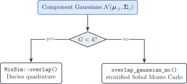

# 4.2 Distances, overlap, and covariance information

``` r

library(DeCovarT)
```

This note collects the **component-separation** scores used in
[synthetic scenario
descriptors](https://bastienchassagnol.github.io/DeCovarT/articles/04-1-synthetic-scenarios.html#sec-scenario-descriptors)
and the **covariance-driven** factorial
([§2.3](https://bastienchassagnol.github.io/DeCovarT/articles/R2-covariance-driven.md)).
The scores describe the J purified Gaussians
\mathcal{N}(\boldsymbol{\mu}\_{\cdot j},\boldsymbol{\Sigma}\_j) that
enter the convolution, not the deconvolution estimator.

> **Notation (shared by all vignettes; aligned with the article)**
>
> Gene g=1,\ldots,G; cell type j=1,\ldots,J (a second type is \ell);
> bulk sample i=1,\ldots,N; reference donor (replicate) r=1,\ldots,R;
> cell c, with C_j reference cells of type j. The index i is dropped
> inside a derivation and restored in the model statements.
>
> | Symbol | Meaning |
> |----|----|
> | y\_{gi}, \boldsymbol{y}\_{\cdot i} | Bulk expression on a linear scale |
> | m\_{ji}, n_i=\sum_jm\_{ji} | Cells of type j in bulk sample i, and their total |
> | \tilde{\boldsymbol{y}}\_{\cdot i}=\boldsymbol{y}\_{\cdot i}/n_i | Bulk expression per cell |
> | \boldsymbol{p}\_{\cdot i}\in\Delta^{J-1} | Cell fractions, p\_{ji}=m\_{ji}/n_i |
> | \boldsymbol{\rho}\_{i}\in\mathbb{R}^{J-1} | Isometric log-ratio (ILR) coordinates of \boldsymbol{p}\_{\cdot i}, \boldsymbol{p}\_{\cdot i}=\operatorname{softmax}(\mathbf{V}\boldsymbol{\rho}\_i) with a Helmert basis \mathbf{V} |
> | \boldsymbol{q}\_{\cdot i} | Transcript fractions, q\_{ji}=p\_{ji}S_j/\sum\_\ell p\_{\ell i}S\_\ell |
> | \boldsymbol{\mu}\_{\cdot j}, \boldsymbol{\Sigma}\_j | Mean and G\times G gene–gene covariance of a type-j population profile |
> | \boldsymbol{\Omega}\_j=\boldsymbol{\Sigma}\_j^{-1} | Precision matrix of type j |
> | \boldsymbol{\Gamma}\_g | J\times J covariance across cell types for gene g (`bMIND`, `EPIC-unmix`, `Unico`) |
> | \boldsymbol{x}\_{\cdot j,i} | Purified profile of type j in sample i |
> | x\_{gc}, \boldsymbol{x}\_{\cdot c}, s_c | Raw UMI count of gene g in reference cell c, and the size factor of cell c |
> | \boldsymbol{\lambda}\_{\cdot c}, \boldsymbol{z}\_{\cdot c} | Size-free expression of cell c; its latent log-expression in the Poisson log-normal (PLN) model |
> | \tilde{\boldsymbol{\mu}}\_{\cdot j}=C_j^{-1}\sum\_{c\in j}\boldsymbol{x}\_{\cdot c}=S_j\boldsymbol{\theta}\_{\cdot j} | Per-cell mean of the raw UMI counts of the C_j reference cells of type j |
> | \boldsymbol{\theta}\_{\cdot j}, S_j=\mathbf{1}^{\top}\tilde{\boldsymbol{\mu}}\_{\cdot j} | Relative abundance (\mathbf{1}^{\top}\boldsymbol{\theta}\_{\cdot j}=1) and mean transcriptome size of a type-j cell |
> | \boldsymbol{\Sigma}\_{W,j}, \boldsymbol{\Sigma}\_{B,j} | Within-donor cell-to-cell covariance of type j (one single-cell sample); between-donor covariance of type j (needs R\ge2 donors) |
> | \boldsymbol{S}\_W(\boldsymbol{v})=\sum_jv_j\boldsymbol{\Sigma}\_{W,j}, \boldsymbol{S}\_B(\boldsymbol{v})=\sum_jv_j^2\boldsymbol{\Sigma}\_{B,j} | Linear and quadratic covariance mixtures with weights \boldsymbol{v} |
> | \boldsymbol{V}\_j | Empirical covariance of type j, computed from its reference profiles or cells |
> | \boldsymbol{R}\_j | Empirical correlation matrix of type j (bold; the scalar R is the number of donors) |
> | \boldsymbol{\Delta}\_j=\operatorname{diag}(\boldsymbol{V}\_j) | Diagonal matrix of the empirical variances of type j |
> | \lambda | Penalty of a regularised covariance or precision estimator |
> | \psi_g, \mathcal{D}\_g | Negative binomial dispersion of gene g; deviance of gene g in a count model |
> | \delta\_{gj} | Detection rate of gene g in type j (fraction of cells with a non-zero count) |
> | \varpi\_{\ell\mid j}, \varpi\_{j\ell}, \bar\varpi | MixSim overlap: probability of misclassifying a draw of j into \ell, pairwise overlap \varpi\_{j\ell}=\varpi\_{\ell\mid j}+\varpi\_{j\mid\ell}, and its average over pairs (`BarOmega`) |
> | \boldsymbol{T}\_{ji}=\sum\_{c=1}^{m\_{ji}}\boldsymbol{X}\_{jic} | Total expression contributed by type j to sample i |
> | a_i | Sample-wide scale between the reference and the bulk library |
> | c_i=a_in_i, \phi_i=a_i^2n_i | Mean scale and variance scale of the single-cell model |
> | b_g, \tilde b_g=b_g^{\mathrm{bulk}}/b_g^{\mathrm{ref}} | Capture efficiency of gene g in one protocol, and the gene-wise platform ratio; \tilde{\boldsymbol{B}}=\operatorname{diag}(\tilde{\boldsymbol{b}}) |
> | \boldsymbol{D}\_i | Diagonal, heteroscedastic bulk measurement noise |
>
> A tilde marks a quantity rescaled to a reference unit: per cell
> (\tilde{\boldsymbol{y}}, \tilde{\boldsymbol{\mu}}) or relative to the
> reference protocol (\tilde{\boldsymbol{b}}). \boldsymbol{\Sigma}\_j
> couples **genes** within one cell type; \boldsymbol{\Gamma}\_g couples
> **cell types** within one gene. A symbol absent from this table is
> defined in the vignette that uses it, with one meaning there.

## Overlap, total variation, and MixSim

Pairwise MixSim overlap is the sum of two Bayes misclassification
probabilities ([Maitra and Melnykov
2010](#ref-maitraSimulatingDataStudy2010); [Melnykov et al.
2012](#ref-melnykovMixSimPackageSimulating2012)). For components
j\neq\ell with weights \pi_j,\pi\_\ell and densities f_j,f\_\ell,

\varpi\_{\ell\mid j} = \Pr\_{X\sim f_j}\bigl(\pi\_\ell f\_\ell(X)\>\pi_j
f_j(X)\bigr), \qquad \varpi\_{j\ell} = \varpi\_{\ell\mid
j}+\varpi\_{j\mid\ell}. \tag{1}

`BarOmega`, written \bar\varpi, is the unweighted mean of
\varpi\_{j\ell} over j\<\ell. The FSDA implementation of the same
construction ([MixSim help](https://rosa.unipr.it/FSDA/MixSim.html);
[source
pointer](https://github.com/UniprJRC/FSDA/blob/ccc82f8ee453b4cd9e3818512e8ea220b94564b3/toolbox/helpfiles/pointersHTML/MixSim.html);
([Riani et al. 2015](#ref-rianiSimulatingMixturesMultivariate2015)))
targets **average** overlap, not the maximum. DeCovarT follows that
choice.

The **histogram similarity** (density overlap) of two laws P,Q is

\operatorname{OVL}(P,Q) = \int \min\\f_P,f_Q\\\\\mathrm{d}\nu =
1-\operatorname{TV}(P,Q), \tag{2}

with total variation \operatorname{TV}=\tfrac12\int\lvert
f_P-f_Q\rvert\\\mathrm{d}\nu ([Nielsen and Sun
2018](#ref-nielsenGuaranteedDeterministicBounds2018)). For **two
equal-weight** Gaussians the MixSim pairwise overlap \varpi\_{j\ell}
equals \operatorname{OVL} and therefore 1-\operatorname{TV}. Unequal
\boldsymbol{\pi} replace f_j by \pi_j f_j in the MAP rule, so the
identity is then approximate.

Bayes error in the equal-prior two-class problem is
P_e=\tfrac12(1-\operatorname{TV})=\tfrac12\operatorname{OVL}.

## Hellinger, Bhattacharyya, and Fisher–Rao

Hellinger distance H_2(f,g)=H_2(g,f) is a **metric** on densities. For
Gaussians it has a closed form through the Bhattacharyya coefficient
\mathrm{BC}=\int\sqrt{fg} ([Hellinger
distance](https://en.wikipedia.org/wiki/Hellinger_distance);
[Bhattacharyya
properties](https://en.wikipedia.org/wiki/Bhattacharyya_distance#Properties)).
The package stores the unweighted pairwise mean as `hellinger`;
`hellinger_weighted` reweights by p_j p_k (a prevalence weight, not a
directed divergence).

On the unit interval H\in\[0,1\] with H^2=1-\mathrm{BC}, Hellinger and
total variation satisfy ([connection with
TV](https://en.wikipedia.org/wiki/Hellinger_distance#Connection_with_total_variation_distance))

H^2 \le \operatorname{TV} \le H\sqrt{2-H^2}. \tag{3}

Because \operatorname{OVL}=1-\operatorname{TV}, those inequalities
reverse for overlap. Locally, Hellinger is equivalent to the Fisher–Rao
metric on parametric families. For univariate normals the Fisher
information metric is
\mathrm{d}s^2=\mathrm{d}\mu^2/\sigma^2+2(\mathrm{d}\sigma/\sigma)^2
([normal
distribution](https://en.wikipedia.org/wiki/Fisher_information_metric#Normal_distribution)).
For covariances at equal means that geodesic coincides (up to scale)
with the affine-invariant Riemannian metric of [Sec. 3](#sec-airm).

Jeffreys (symmetrised KL) remains a supplementary descriptor
([`compute_average_jeffreys()`](https://bastienchassagnol.github.io/DeCovarT/reference/compute_average_jeffreys.md)):
it is not bounded and is not a metric.

## Affine-invariant Riemannian distance

The space of symmetric positive-definite (SPD) matrices is a curved
cone. The **affine-invariant Riemannian metric** (AIRM) distance

d_R(A,B) = \bigl\lVert \log\bigl(A^{-1/2}BA^{-1/2}\bigr) \bigr\rVert_F =
\Bigl(\sum_g \log^2\lambda_g(A^{-1}B)\Bigr)^{1/2} \tag{4}

is congruence-invariant
(d_R(XAX^{\mathsf{T}},XBX^{\mathsf{T}})=d_R(A,B)) and
inversion-invariant (d_R(A^{-1},B^{-1})=d_R(A,B)). The geodesic stays
inside the SPD cone; the distance to a singular matrix is infinite.

We **do not** use the Frobenius chord \lVert A-B\rVert_F. That Euclidean
metric treats SPD matrices as a flat vector space, is not
inversion-invariant, can interpolate off the cone (negative
eigenvalues), and produces the swelling effect (determinants of
midpoints larger than both endpoints).
[`compute_average_riemannian()`](https://bastienchassagnol.github.io/DeCovarT/reference/compute_average_riemannian.md)
implements only AIRM. The descriptor column `riemannian_sigma` is the
unweighted mean of d_R(\Sigma_j,\Sigma\_\ell) over j\<\ell. The distance
is *scale-invariant*: d_R(sA,sB)=d_R(A,B). In fig03 it therefore tracks
the **shape** of the completed graphs, not the overlap knob s.

## Computing overlap in moderate dimension

[`MixSim::overlap()`](https://rdrr.io/pkg/MixSim/man/overlap.html)
evaluates the exact pairwise misclassification integrals by Davies’
algorithm for linear combinations of chi-squares ([Maitra and Melnykov
2010](#ref-maitraSimulatingDataStudy2010)). That quadrature scales
poorly with the gene dimension G.
[`compute_average_overlap()`](https://bastienchassagnol.github.io/DeCovarT/reference/compute_average_overlap.md)
therefore uses Davies for G\<4 and stratified Sobol Monte Carlo
otherwise.

### MixSim / FSDA (exact, G\<4)

For G\in\\1,2,3\\ DeCovarT calls
[`MixSim::overlap()`](https://rdrr.io/pkg/MixSim/man/overlap.html) and
returns `BarOmega` (the unweighted mean of the J(J-1)/2 pairwise
overlaps \varpi\_{j\ell}). The MixSim **generator** `MixSim()` can
simulate mixtures with a prescribed *average* overlap ([CRAN
MixSim](https://cran.r-project.org/web/packages/MixSim/refman/MixSim.html#MixSim))
but it draws unconstrained means and covariances. It cannot keep the
structural zeros of a graph-constrained precision. Fig03 therefore does
**not** call `MixSim()` as a generator; it only matches `BarOmega` after
the graph is fixed ([Sec. 5](#sec-fig03-scale)).

### Stratified Sobol Monte Carlo (G\ge 4)

[`overlap_gaussian_mc()`](https://bastienchassagnol.github.io/DeCovarT/reference/overlap_gaussian_mc.md)
estimates \varpi\_{\ell\mid j} by drawing B points **from each
component** (default B=10\\000), then comparing log-densities under the
two-class MAP rule. Two devices are stacked, and they do different jobs:

- **Sobol** fills the unit cube (0,1)^G more evenly than i.i.d. uniforms
  (low-discrepancy / quasi-Monte Carlo). It is still a sample in the
  *uniform* cube, not a Gaussian sample.
- **Inverse-transform sampling** then maps each coordinate
  u_g\mapsto\Phi^{-1}(u_g) and left-multiplies by the Cholesky factor of
  \Sigma_j, so the image is exactly \mathcal{N}(\boldsymbol{\mu}\_{\cdot
  j},\boldsymbol{\Sigma}\_j). Without that map, Sobol points would not
  have the right Gaussian law.

The remaining implementation details are precomputed Cholesky factors,
log-density evaluation, and stratification by component (not draws from
the mixture). When G\ge 4,
[`compute_average_overlap()`](https://bastienchassagnol.github.io/DeCovarT/reference/compute_average_overlap.md)
emits a `cli` note and uses this estimator. Hellinger of the purified
Gaussians remains a cheap closed-form *descriptor*, not a MixSim
`BarOmega` substitute.



Figure 1: Routes to MixSim-style average overlap. Exact Davies
quadrature is used only for G \< 4; otherwise stratified Sobol Monte
Carlo.

## Fig03: topology fixed, overlap as the knob

The covariance-driven script
`scripts/fig03_variance_covariance_driven.R` still draws one sparse
graph per cell type (scale-free or cluster SBM on the mean-collinear
types; type 3 held at scale-free). After SPD completion, each \Sigma_j
is replaced by s\Sigma_j. Then \Omega_j(s)=\Omega_j/s: **every
structural zero is preserved**. Larger s inflates the Gaussians, raises
MixSim `BarOmega`, and raises the covariance-information fraction
f\_{\mathrm{cov}} (mean Fisher scales as 1/s; the whitened Frobenius
covariance block is scale-invariant). See the tangent-Fisher callout in
[scenario
descriptors](https://bastienchassagnol.github.io/DeCovarT/articles/04-1-synthetic-scenarios.html#nte-desc-fisher).

[`scale_covariances_to_overlap()`](https://bastienchassagnol.github.io/DeCovarT/reference/scale_covariances_to_overlap.md)
binary-searches s so that `BarOmega` at the balanced composition matches
a target in \\\text{low},\text{moderate},\text{high}\\. That is the
graph-constrained analogue of MixSim / FSDA average-overlap simulation:
topology is an experimental factor; overlap is a second, stronger
predictor of deconvolution error when means are collinear.

### See also

- Scenario descriptors: [How to build synthetic
  scenarios](https://bastienchassagnol.github.io/DeCovarT/articles/04-1-synthetic-scenarios.html#sec-scenario-descriptors)
- Covariance-driven factorial:
  [§2.3](https://bastienchassagnol.github.io/DeCovarT/articles/R2-covariance-driven.md)
- Feature-selection overlap monitors: [Appendix
  S6](https://bastienchassagnol.github.io/DeCovarT/articles/03-1-feature-selection.md)

### References

Maitra, Ranjan, and Volodymyr Melnykov. 2010. ‘Simulating Data to Study
Performance of Finite Mixture Modeling and Clustering Algorithms’.
*Journal of Computational and Graphical Statistics* 19 (2): 354–76.
<https://doi.org/10.1198/jcgs.2009.08054>.

Melnykov, Volodymyr, Wei-Chen Chen, and Ranjan Maitra. 2012. ‘MixSim: An
R Package for Simulating Data to Study Performance of Clustering
Algorithms’. *Journal of Statistical Software* 51.
<https://doi.org/10.18637/jss.v051.i12>.

Nielsen, Frank, and Ke Sun. 2018. *Guaranteed Deterministic Bounds on
the Total Variation Distance Between Univariate Mixtures*.
arXiv:1806.11311. <https://doi.org/10.48550/arxiv.1806.11311>.

Riani, Marco, Andrea Cerioli, Domenico Perrotta, and Francesca Torti.
2015. ‘Simulating Mixtures of Multivariate Data with Fixed Cluster
Overlap in FSDA Library’. *Advances in Data Analysis and Classification*
9 (4): 461–81. <https://doi.org/10.1007/s11634-015-0223-9>.
