# 5.1 Deconvolution with reference distributions: a review of methods that use more than the mean

> **Scope**
>
> First-generation deconvolution fits a bulk profile with the **mean**
> expression of each purified population. This review covers the methods
> that also use the **distribution** of the purified profiles: at least
> their variance, and in some cases a covariance between genes or
> between cell types. DeCovarT belongs to that family: it plugs in a
> gene–gene covariance per cell type and maximises a
> Gaussian-convolution likelihood ([population generative
> vignette](https://bastienchassagnol.github.io/DeCovarT/articles/01-1-population-generative-optimisation.html#sec-unconstrained)).
>
> Every method is read through the same lens: what its observation law
> implies about the measurement process, most often UMI counts from
> single cells. [Sec. 1](#sec-measurement) states the measurement and
> expression models that lens relies on. [Sec. 2.2](#sec-eiv) states the
> errors-in-variables problem that every method solves,
> [Sec. 2.3](#sec-ladder) orders the methods on a ladder of noise
> models, and [Sec. 2.4](#sec-multivariate-families) separates marginal
> from conditional multivariate models. The methods follow, grouped by
> what they estimate and what they assume known:
>
> 1.  reference-based estimation of the composition, split by whether
>     genes are treated as independent ([Sec. 2](#sec-methods));
> 2.  cell-type-specific moments when the composition is known
>     ([Sec. 3](#sec-cts-given-p));
> 3.  Bayesian reference-based methods, for profiles or for proportions
>     ([Sec. 4](#sec-bayesian));
> 4.  semi-reference methods that infer one unknown component
>     ([Sec. 5](#sec-semi-reference-methods));
> 5.  reference-free methods that use co-expression structure
>     ([Sec. 6](#sec-reference-free)).
>
> [Sec. 7](#sec-synthesis) compares them and lists their caveats. The
> DeCovarT model rebuilt for single-cell references is in the
> [single-cell generative
> vignette](https://bastienchassagnol.github.io/DeCovarT/articles/02-1-single-cell-generative-optimisation.md).

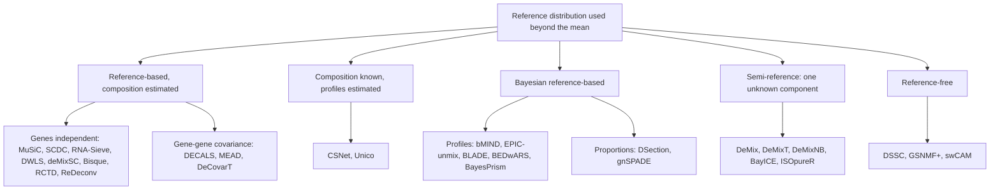

Figure 1: Deconvolution methods that use more than the reference mean,
grouped by what is known and what is estimated. Colours are not used;
the grouping is the one of the sections of this review.

> **Notation (shared by all vignettes; aligned with the article)**
>
> Gene g=1,\ldots,G; cell type j=1,\ldots,J (a second type is \ell);
> bulk sample i=1,\ldots,N; reference donor (replicate) r=1,\ldots,R;
> cell c, with C_j reference cells of type j. The index i is dropped
> inside a derivation and restored in the model statements.
>
> | Symbol | Meaning |
> |----|----|
> | y\_{gi}, \boldsymbol{y}\_{\cdot i} | Bulk expression on a linear scale |
> | m\_{ji}, n_i=\sum_jm\_{ji} | Cells of type j in bulk sample i, and their total |
> | \tilde{\boldsymbol{y}}\_{\cdot i}=\boldsymbol{y}\_{\cdot i}/n_i | Bulk expression per cell |
> | \boldsymbol{p}\_{\cdot i}\in\Delta^{J-1} | Cell fractions, p\_{ji}=m\_{ji}/n_i |
> | \boldsymbol{\rho}\_{i}\in\mathbb{R}^{J-1} | Isometric log-ratio (ILR) coordinates of \boldsymbol{p}\_{\cdot i}, \boldsymbol{p}\_{\cdot i}=\operatorname{softmax}(\mathbf{V}\boldsymbol{\rho}\_i) with a Helmert basis \mathbf{V} |
> | \boldsymbol{q}\_{\cdot i} | Transcript fractions, q\_{ji}=p\_{ji}S_j/\sum\_\ell p\_{\ell i}S\_\ell |
> | \boldsymbol{\mu}\_{\cdot j}, \boldsymbol{\Sigma}\_j | Mean and G\times G gene–gene covariance of a type-j population profile |
> | \boldsymbol{\Omega}\_j=\boldsymbol{\Sigma}\_j^{-1} | Precision matrix of type j |
> | \boldsymbol{\Gamma}\_g | J\times J covariance across cell types for gene g (`bMIND`, `EPIC-unmix`, `Unico`) |
> | \boldsymbol{x}\_{\cdot j,i} | Purified profile of type j in sample i |
> | x\_{gc}, \boldsymbol{x}\_{\cdot c}, s_c | Raw UMI count of gene g in reference cell c, and the size factor of cell c |
> | \boldsymbol{\lambda}\_{\cdot c}, \boldsymbol{z}\_{\cdot c} | Size-free expression of cell c; its latent log-expression in the Poisson log-normal (PLN) model |
> | \tilde{\boldsymbol{\mu}}\_{\cdot j}=C_j^{-1}\sum\_{c\in j}\boldsymbol{x}\_{\cdot c}=S_j\boldsymbol{\theta}\_{\cdot j} | Per-cell mean of the raw UMI counts of the C_j reference cells of type j |
> | \boldsymbol{\theta}\_{\cdot j}, S_j=\mathbf{1}^{\top}\tilde{\boldsymbol{\mu}}\_{\cdot j} | Relative abundance (\mathbf{1}^{\top}\boldsymbol{\theta}\_{\cdot j}=1) and mean transcriptome size of a type-j cell |
> | \boldsymbol{\Sigma}\_{W,j}, \boldsymbol{\Sigma}\_{B,j} | Within-donor cell-to-cell covariance of type j (one single-cell sample); between-donor covariance of type j (needs R\ge2 donors) |
> | \boldsymbol{S}\_W(\boldsymbol{v})=\sum_jv_j\boldsymbol{\Sigma}\_{W,j}, \boldsymbol{S}\_B(\boldsymbol{v})=\sum_jv_j^2\boldsymbol{\Sigma}\_{B,j} | Linear and quadratic covariance mixtures with weights \boldsymbol{v} |
> | \boldsymbol{V}\_j | Empirical covariance of type j, computed from its reference profiles or cells |
> | \boldsymbol{R}\_j | Empirical correlation matrix of type j (bold; the scalar R is the number of donors) |
> | \boldsymbol{\Delta}\_j=\operatorname{diag}(\boldsymbol{V}\_j) | Diagonal matrix of the empirical variances of type j |
> | \lambda | Penalty of a regularised covariance or precision estimator |
> | \psi_g, \mathcal{D}\_g | Negative binomial dispersion of gene g; deviance of gene g in a count model |
> | \delta\_{gj} | Detection rate of gene g in type j (fraction of cells with a non-zero count) |
> | \varpi\_{\ell\mid j}, \varpi\_{j\ell}, \bar\varpi | MixSim overlap: probability of misclassifying a draw of j into \ell, pairwise overlap \varpi\_{j\ell}=\varpi\_{\ell\mid j}+\varpi\_{j\mid\ell}, and its average over pairs (`BarOmega`) |
> | \boldsymbol{T}\_{ji}=\sum\_{c=1}^{m\_{ji}}\boldsymbol{X}\_{jic} | Total expression contributed by type j to sample i |
> | a_i | Sample-wide scale between the reference and the bulk library |
> | c_i=a_in_i, \phi_i=a_i^2n_i | Mean scale and variance scale of the single-cell model |
> | b_g, \tilde b_g=b_g^{\mathrm{bulk}}/b_g^{\mathrm{ref}} | Capture efficiency of gene g in one protocol, and the gene-wise platform ratio; \tilde{\boldsymbol{B}}=\operatorname{diag}(\tilde{\boldsymbol{b}}) |
> | \boldsymbol{D}\_i | Diagonal, heteroscedastic bulk measurement noise |
>
> A tilde marks a quantity rescaled to a reference unit: per cell
> (\tilde{\boldsymbol{y}}, \tilde{\boldsymbol{\mu}}) or relative to the
> reference protocol (\tilde{\boldsymbol{b}}). \boldsymbol{\Sigma}\_j
> couples **genes** within one cell type; \boldsymbol{\Gamma}\_g couples
> **cell types** within one gene. A symbol absent from this table is
> defined in the vignette that uses it, with one meaning there.

Equations quoted from a paper are translated into these indices; only
[Table 2](#tbl-notation-map) keeps each paper’s own symbols.

## Measurement and expression models for single-cell counts

A reference profile is a moment of a latent biological quantity, but it
is estimated from counts produced by a sampling protocol. Sarkar and
Stephens separate the two: a **measurement model**
p(\boldsymbol{x}\mid\boldsymbol{\lambda}) describes the protocol given
the true expression, an **expression model** p(\boldsymbol{\lambda})
describes the biology, and the observation model p(\boldsymbol{x}) is
their composition ([Sarkar and Stephens
2021](#ref-sarkarSeparatingMeasurementExpression2021)). Fang and Pachter
add that the cell-level scale factor is itself a product of a biological
and a technical term ([Fang and Pachter
2025](#ref-fangExtrinsicBiologicalStochasticity2025)). Both papers index
genes by j and cells by i; below, gene is g and cell is c, so that j
remains the cell type.

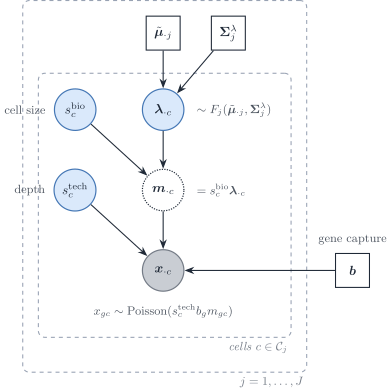

Figure 2: Measurement and expression model of a single-cell reference,
in the notation of this vignette. Inside cell type j, the size-free
expression \boldsymbol{\lambda}\_{\cdot c} follows an expression model
F_j with mean \tilde{\boldsymbol{\mu}}\_{\cdot j} and covariance
\boldsymbol{\Sigma}^{\lambda}\_j; the biological size factor turns it
into a molecule content; the technical size factor and the gene capture
efficiency \boldsymbol{b} act through a Poisson measurement.

### Poisson measurement of UMI counts

If each molecule of cell c is captured independently with a small
probability, the multivariate hypergeometric sampling of molecules is
close to a multinomial and each gene count is Poisson given the true
content (Supplementary Note 1 of ([Sarkar and Stephens
2021](#ref-sarkarSeparatingMeasurementExpression2021))):

x\_{gc}\mid s^{\mathrm{tech}}\_c,m\_{gc}
\sim\mathrm{Poisson}\bigl(s^{\mathrm{tech}}\_c\\b_g\\m\_{gc}\bigr),
\qquad \boldsymbol{m}\_{\cdot
c}=s^{\mathrm{bio}}\_c\\\boldsymbol{\lambda}\_{\cdot c}. \tag{1}

Fang and Pachter write the same law as binomial thinning with capture
rate b_gs^{\mathrm{tech}}\_c, of which the Poisson is the low-capture
limit, and normalise
\mathbb{E}\[s^{\mathrm{bio}}\]=\mathbb{E}\[s^{\mathrm{tech}}\]=1 (their
equations 1–2). Sarkar and Stephens instead take the observed library
size x\_{+c} as the size factor and a relative expression
\lambda\_{gc}=m\_{gc}/m\_{+c}; in that convention s^{\mathrm{bio}}\_c
cancels by construction, which is the removal of biological extrinsic
noise that Fang and Pachter warn about. The two conventions are the two
directions of the same rank-one Poisson fit: the point-mass MLE
\hat\mu_g=\sum_cx\_{gc}/\sum_cx\_{+c} and the size-factor MLE of
[Eq. 3](#eq-poisson-size-factor) below.

Three remarks connect the protocol to deconvolution.

- **UMIs remove most gene-specific distortion.** Unique molecular
  identifiers collapse PCR duplicates, which “substantially reduce
  unwanted variation, including differences in gene lengths and PCR
  amplification efficiencies” ([Sarkar and Stephens
  2021](#ref-sarkarSeparatingMeasurementExpression2021)). What remains
  is a capture efficiency b_g that is constant across cells of one
  protocol. It is not identified separately from \boldsymbol{\lambda},
  and it cancels from every within-protocol contrast, so it is absorbed
  into \tilde{\boldsymbol{\mu}}\_{\cdot j} and
  \boldsymbol{\Sigma}\_{W,j}. It does **not** cancel between a
  single-cell reference and a bulk library: the ratio \tilde
  b_g=b_g^{\mathrm{bulk}}/b_g^{\mathrm{ref}} is the gene-wise platform
  factor of [plug-in scales (Strategy
  4)](https://bastienchassagnol.github.io/DeCovarT/articles/02-1-single-cell-generative-optimisation.html#sec-strategy-plugin).
  Read-count protocols without UMIs and hybridisation microarrays carry
  larger gene- and probe-specific factors (amplification, length,
  affinity), which is why earlier deconvolution methods had to model
  gene-wise scales explicitly; with UMI references, the gene-wise factor
  reduces to one cross-platform ratio per gene.
- **Random capture biases make the measurement overdispersed; constant
  ones do not.** If b\_{gc} varied from cell to cell, the measurement
  model would be negative binomial rather than Poisson (Box 1 and
  Supplementary Note 1.2 of Sarkar and Stephens). On spike-in controls
  the measurement dispersion was below 5\times10^{-3}, which adds about
  5% to the variance of a gene with ten observed molecules.
  Overdispersion seen in single-cell data is therefore an **expression**
  property, \boldsymbol{\Sigma}^{\lambda}\_j, plus extrinsic noise, not
  a protocol property.
- **Zero inflation belongs to the expression model, if anywhere.**
  Spike-in controls show no zero-generating measurement component, and a
  point-Gamma expression model beats a Gamma model for only 0.6–8.6% of
  genes across the datasets tested ([Sarkar and Stephens
  2021](#ref-sarkarSeparatingMeasurementExpression2021)). Zeros are
  imperfect measurements of small \lambda\_{gc} at low depth, “with no
  need for special terminology or special treatment”. For DeCovarT,
  which uses only the first two moments of the reference, a
  zero-inflated observation model is unnecessary: the moments of the
  counts already contain the zeros. The argument is made for UMI data;
  the authors note that it may not hold for read counts amplified by PCR
  without UMIs.

### Expression models and the observation models they induce

Integrating the expression model against
[Eq. 1](#eq-poisson-measurement) gives the observation model gene by
gene (Table 1 of ([Sarkar and Stephens
2021](#ref-sarkarSeparatingMeasurementExpression2021))).

| Expression model for \lambda\_{gc} | Observation model for x\_{gc} | Examples |
|----|----|----|
| Point mass \lambda\_{gc}=\mu_g | Poisson | analytic |
| Gamma, mean \mu_g, variance \mu_g^{2}\phi_g | Negative binomial | `edgeR`, `DESeq2`, `SAVER` |
| Point-Gamma | Zero-inflated negative binomial | `ZINB-WaVE` (multigene) |
| Unimodal or fully nonparametric | Flexible | `ashr`, `DESCEND` |
| Low rank, \lambda\_{gc}=\mu\_{gc}u\_{gc}, \mu=h^{-1}(\boldsymbol{L}\boldsymbol{F}^{\top}) | Flexible | GLM-PCA, `scVI` |

Table 1: Expression and observation models for UMI counts, after Sarkar
and Stephens (Tables 1–2). The measurement model is Poisson throughout.

A gene whose expression model is a point mass inside a homogeneous
population is a **Poisson gene**: its count has no variability beyond
sampling and the extrinsic size factor. Overdispersion relative to a
Poisson, the hallmark of the negative binomial, then measures either
biological variability of \lambda\_{gc} or variability of s_c.

### Extrinsic noise, size factors and Poisson genes

Fang and Pachter show that a cell-wide factor explains the baseline
overdispersion of single-cell counts. Under
[Eq. 1](#eq-poisson-measurement) with
s_c=s^{\mathrm{bio}}\_cs^{\mathrm{tech}}\_c independent of
\boldsymbol{\lambda}\_{\cdot c}, \mathbb{E}\[s_c\]=1 and
\nu=\operatorname{CV}^{2}(s_c), their equation (3) reads, in our
notation and inside one cell type,

\frac{\operatorname{Cov}(x\_{gc},x\_{hc})}{\mathbb{E}\[x\_{gc}\]\mathbb{E}\[x\_{hc}\]}
=\nu+(1+\nu)\frac{\Sigma^{\lambda}\_{j,gh}}{\tilde\mu\_{gj}\tilde\mu\_{hj}}
+\frac{\delta\_{gh}}{\mathbb{E}\[x\_{gc}\]}, \qquad
1+\nu=(1+\nu^{\mathrm{bio}})(1+\nu^{\mathrm{tech}}). \tag{2}

For two genes that are intrinsically uncorrelated, or for one gene that
is intrinsically Poisson, the normalised covariance equals \nu (their
equation 5). That identity gives an estimator of \nu (the mode of the
normalised covariances over gene pairs) and a selection rule for Poisson
genes (those whose normalised variance minus the Poisson term has a
bootstrap interval containing \hat\nu). On those genes \mathcal{P}, the
size factor has the closed-form MLE

\hat
s_c=\frac{\sum\_{g\in\mathcal{P}}x\_{gc}}{\sum\_{g\in\mathcal{P}}\tilde\mu\_{gj}}.
\tag{3}

Two findings matter here. Normalising each cell by its total removes
s^{\mathrm{bio}}\_c together with s^{\mathrm{tech}}\_c, and with it the
biological extrinsic variability, including cell size ([Fang and Pachter
2025](#ref-fangExtrinsicBiologicalStochasticity2025)). In peripheral
blood, sums over Poisson genes no longer track total UMI counts and
differ between cell types, so the choice of size factor changes
downstream comparisons. Separating s^{\mathrm{tech}}\_c from
s^{\mathrm{bio}}\_c needs external controls (spike-ins, ambient RNA,
pooled RNA); the nascent-mRNA counts did not fit the binomial sampling
model in their pooled-RNA experiment.

### What the measurement model implies for the reference covariance

Write the same identity in matrix form (a direct consequence of
[Eq. 1](#eq-poisson-measurement) and the law of total covariance; the
derivation is ours). With
\boldsymbol{\mathcal{B}}=\operatorname{diag}(\boldsymbol{b}),

\operatorname{Cov}(\boldsymbol{x}\_{\cdot c}\mid c\in j)
=\underbrace{\operatorname{diag}\bigl(\boldsymbol{\mathcal{B}}\tilde{\boldsymbol{\mu}}\_{\cdot
j}\bigr)}\_{\text{Poisson measurement}} +\boldsymbol{\mathcal{B}}\Bigl\[
\underbrace{(1+\nu)\boldsymbol{\Sigma}^{\lambda}\_j}\_{\text{biology}}
+\underbrace{\nu\\\tilde{\boldsymbol{\mu}}\_{\cdot
j}\tilde{\boldsymbol{\mu}}\_{\cdot j}^{\top}}\_{\text{size factor}}
\Bigr\]\boldsymbol{\mathcal{B}}. \tag{4}

The sample covariance of raw UMI counts, which is what a single-cell
reference returns as \hat{\boldsymbol{\Sigma}}\_{W,j}, mixes three
objects. Only part of it belongs in the bulk law.

1.  **The Poisson diagonal is single-cell measurement noise.** It is
    produced at single-cell depth and is not part of the tissue. A bulk
    library has its own sampling noise, on its own depth, which a
    diagonal bulk term would carry. Plugging raw-count covariances into
    \boldsymbol{S}\_W imports the reference sampling noise into the bulk
    covariance; subtracting \operatorname{diag}(\bar{\boldsymbol{x}}\_j)
    first removes it.
2.  **The technical size-factor term is not biology either.** The
    rank-one term \nu^{\mathrm{tech}}\tilde{\boldsymbol{\mu}}\_{\cdot
    j}\tilde{\boldsymbol{\mu}}\_{\cdot j}^{\top} induces a positive
    correlation between all genes. It inflates the apparent network and
    is a protocol artefact.
3.  **The biological size factor is part of the bulk.** Cells of one
    type differ in volume and cycle phase; a tissue sums those cells as
    they are. The term
    \nu^{\mathrm{bio}}\tilde{\boldsymbol{\mu}}\_{\cdot
    j}\tilde{\boldsymbol{\mu}}\_{\cdot j}^{\top} belongs in
    \boldsymbol{\Sigma}\_{W,j}, and library-size normalisation that
    removes it understates the within-type variance that the bulk
    accumulates.

The corresponding moment estimator, with \hat\nu^{\mathrm{tech}} from
spike-ins or Poisson genes, is

\hat{\boldsymbol{\Sigma}}\_{W,j}
=\boldsymbol{V}\_j-\operatorname{diag}(\bar{\boldsymbol{x}}\_j)
-\frac{\hat\nu^{\mathrm{tech}}}{1+\hat\nu^{\mathrm{tech}}}\\
\bigl\[\boldsymbol{V}\_j-\operatorname{diag}(\bar{\boldsymbol{x}}\_j)+\bar{\boldsymbol{x}}\_j\bar{\boldsymbol{x}}\_j^{\top}\bigr\],
\tag{5}

where \boldsymbol{V}\_j is the sample covariance of the type-j counts
and \bar{\boldsymbol{x}}\_j their mean. It is the s^{\mathrm{tech}}-free
covariance of \boldsymbol{\mathcal{B}}\boldsymbol{m}\_{\cdot c} obtained
by solving [Eq. 4](#eq-count-covariance) with
1+\nu=(1+\nu^{\mathrm{bio}})(1+\nu^{\mathrm{tech}}) (our derivation, to
be checked by simulation before use). Estimating \nu^{\mathrm{tech}}
before the deconvolution is the first plug-in of Strategy 4 ([plug-in
scales (Strategy
4)](https://bastienchassagnol.github.io/DeCovarT/articles/02-1-single-cell-generative-optimisation.html#sec-strategy-plugin)).

### Before single cells: measurement models for sorted population profiles

Before droplet single-cell sequencing, a reference column was a bulk
measurement of a physically sorted population: FACS or magnetic sorting,
then a microarray or a bulk RNA-seq library. The measurement model was
the one of the platform, applied to a pool of many cells.

- **Microarrays.** A probe intensity is a background plus a
  probe-specific affinity times the abundance, with errors that are
  roughly additive at low intensity and multiplicative at high
  intensity. Analyses of differential expression worked on \log_2
  intensities, where the multiplicative error becomes additive.
  Deconvolution could not: mixing is additive in the abundance, so the
  first reference-based methods fitted linear models on **unlogged**
  intensities ([Abbas et al.
  2009](#ref-abbasDeconvolutionBloodMicroarray2009); [Shen-Orr et al.
  2010](#ref-shen-orrCellTypeSpecific2010); [Lähdesmäki et al.
  2005](#ref-lahdesmakiSilicoMicrodissectionMicroarray2005)). The probe
  affinity is a gene-wise factor of the platform. It cancels within one
  platform and does not cancel between platforms, which is the origin of
  the gene-wise platform ratio \tilde{\boldsymbol{b}} of later methods.
- **Bulk RNA-seq of sorted populations.** Reads are counts with a
  library size and a gene-length factor (for full-length protocols).
  Replicate libraries of one sorted population vary by a negative
  binomial dispersion that mixes biological and technical variation.
  Normalised counts on a linear scale (CPM, TPM) became the default
  input, with the same warning against logarithms.
- **What the reference variance meant.** With a handful of sorted
  replicates per population, the only second-order quantity available
  was a between-replicate variance of the population mean. That is the
  quadratic layer \sum_jp_j^{2}\boldsymbol{\Sigma}\_{B,j} of the
  [single-cell generative
  vignette](https://bastienchassagnol.github.io/DeCovarT/articles/02-1-single-cell-generative-optimisation.html#sec-facs),
  and the object released DeCovarT was designed for. A within-type,
  cell-to-cell covariance did not exist in that design.

Two biases of sorted references have no single-cell analogue: sorting
selects cells on a few surface markers, so a “pure” population can
contain contaminating types; and the sorting itself can change
expression before lysis. Single-cell references remove the first by
labelling cells after the fact, and replace the platform model by the
Poisson measurement of [Sec. 1.1](#sec-poisson-measurement).

### From measurement models to bulk observation laws

A deconvolution method chooses a law for the bulk. Read with the split
of [Sec. 1](#sec-measurement), that law is a measurement model
(multinomial, Poisson) composed with an expression model for the
purified profiles (Gaussian, log-normal, Gamma). The support of
\boldsymbol{y} is the first split: count laws for integer reads,
continuous laws for normalised intensities. [Table 3](#tbl-ladder)
places every reviewed method on a ladder of noise models that crosses
that split; the count laws are detailed here because they sit closest to
the measurement model.

#### Discrete counts

A multinomial (or Dirichlet–multinomial) model treats
\boldsymbol{y}\_{\cdot i} as integer reads that sum to a library size.
`ISOpureR` implements a hierarchical multinomial–Dirichlet purification
of mixed tumour profiles ([Anghel et al.
2015](#ref-anghelISOpureRImplementationComputational2015)). `BayesPrism`
is the multinomial model with a single-cell prior
([Sec. 4.1](#sec-bayes-cts)). `DeconV` instead uses Poisson aggregation
from single-cell to bulk (sums of independent Poissons remain Poisson)
and returns interval estimates of \boldsymbol{p}\_{\cdot i} ([Gynter et
al. 2023](#ref-gynterDeconvProbabilisticCellType2023)). `RCTD` is a
Poisson–log-normal **mixture** of reads ([Sec. 2.5.7](#sec-rctd)).

Over-dispersed, correlated counts are the domain of the multivariate
**Poisson–log-normal (PLN)** family: a latent Gaussian vector induces
dependence, and a Poisson observation layer yields integer reads
([Chiquet et al. 2021](#ref-chiquetPoissonLognormalModelVersatile2021),
[2018](#ref-chiquetVariationalInferenceSparse2018)). **ZIPLN** adds a
Bernoulli zero-inflation layer for dropout ([Batardière et al.
2025](#ref-batardiereZeroInflationMultivariatePoisson2025)). A
DeCovarT-style extension would replace
[Eq. 18](#eq-gaussian-convolution) by a PLN (or ZIPLN) convolution on
the latent log-abundance scale, keeping the ILR chart on \boldsymbol{p}.
A multinomial **logit-normal** on the *gene* simplex is a different
discrete model: it is compositional association, not a cell-type
convolution ([two simplices without
convolution](https://bastienchassagnol.github.io/DeCovarT/articles/05-3-extensions-roadmap.html#sec-logit-normal-compositional)).

## Second-generation deconvolution: univariate versus multivariate

Second-generation methods use a single-cell reference and model, in some
form, the variability of the cell-type profiles. The usual split into
regression and probabilistic engines hides the property that matters for
DeCovarT: whether the bulk model treats **genes as independent** (a
diagonal variance per gene) or keeps a **gene–gene covariance**.
[Figure 3](#fig-method-taxonomy) uses that split.

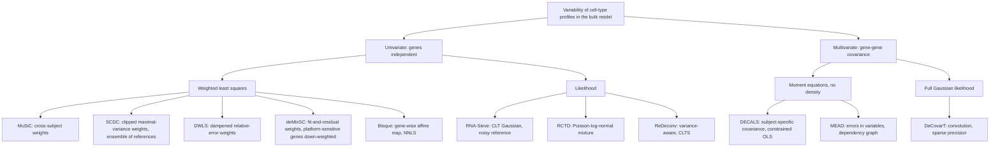

Figure 3: Deconvolution methods that model cell-type variability, split
by their treatment of gene-gene dependence and then by estimator. All
univariate methods assume independent genes; the multivariate ones
differ by whether they commit to a density.

### A common notation

Each paper uses its own indices; several use j for the gene or the
subject. [Table 2](#tbl-notation-map) maps them to this vignette. The
scale columns show how one model is reparametrised into another by
arithmetic alone.

|  | This vignette | `MuSiC` | `RNA-Sieve` | `DWLS` | `deMixSC` | `Bisque` | `RCTD` | `DECALS` | `MEAD` | `Unico` |
|----|----|----|----|----|----|----|----|----|----|----|
| gene, type, sample | g, j, i | g, k, j | g, k, b | i, j, – | g, k, j | j, k, i | j, k, i | j, k, i | g, k, i | j, h, i |
| reference unit | replicate r | subject j | cell i | cell | subject j | individual i' | cell | – | individual j | – |
| target | \boldsymbol{p}\_{\cdot i} | \mathbf{p}\_j | \boldsymbol{\alpha} | \mathbf{x}/\mathbf{1}^{\top}\mathbf{x} | \mathbf{p}\_j | \mathbf{p}\_i | \boldsymbol{\beta}\_i normalised | \boldsymbol{\pi}\_i | \mathbf{p}\_i | \mathbf{Z}\_{ij} (\mathbf{w}\_i given) |
| cell counts | m\_{ji}, n_i | m_j^{k}, m_j | –, n | \mathbf{x} | n^{k}\_j, n_j | – | – | – | – | – |
| per-cell mean | \tilde{\boldsymbol{\mu}}\_{\cdot j}=S_j\boldsymbol{\theta}\_{\cdot j} | S^{k}\boldsymbol{\theta}^{k} | \mathbf{M}\_{\cdot k} | \mathbf{S}\_{\cdot j} | r^{k}\_{jg}=\theta^{k}\_{jg}s^{k}\_j | \mathbf{Z}\_{\cdot k}\approx\boldsymbol{\theta}\_{\cdot j} | normalised mean | \mathbf{w}\_k (FPKM) | \mathbf{U}\_{\cdot k} | \boldsymbol{\mu}\_j |
| cell size | S_j | S^{k} (mean library size) | \mathbf{1}^{\top}\mathbf{M}\_{\cdot k} | assumed equal | s^{k}\_j | removed by CPM | removed | removed by FPKM | kept in \mathbf{U} | – |
| sample scale | a_i | C_j^{-1} | n | \mathbf{1}^{\top}\mathbf{x} | n_j | – | N_ie^{\alpha_i} | absorbed | \gamma_i | – |
| gene platform | \tilde{\boldsymbol{b}} | intercept \alpha\_{jg} | none | none | set G_2 down-weighted by a | (\beta\_{0g},\beta_g) | e^{\gamma_j} | none | \lambda_g=\alpha_g/\alpha^{r}\_g | none |
| type variability | \boldsymbol{\Sigma}\_{W,j}, \boldsymbol{\Sigma}\_{B,j}, \boldsymbol{\Gamma}\_g | \sigma^{2}\_{gk} (between, diagonal) | s\_{g,k} (within, diagonal) | – | – | – | – | \boldsymbol{\Sigma}^{(k)} (between, full) | \mathbf{V}\_g (reference noise) | \boldsymbol{\Sigma}\_j (J\times J) |

Table 2: Notation of the reviewed methods mapped to this vignette.
“Removed” means the normalisation divides each cell or column by its
total, so that S_j no longer enters the mean.

Three reparametrisations recur.

- **Counts to fractions.** A model in cell counts,
  \boldsymbol{y}\_{\cdot
  i}=\tilde{\boldsymbol{\mu}}\boldsymbol{m}\_{\cdot i}, becomes a model
  in fractions after division by the number of cells,
  \tilde{\boldsymbol{y}}\_{\cdot
  i}=\tilde{\boldsymbol{\mu}}\boldsymbol{p}\_{\cdot i}. `RNA-Sieve`
  keeps n_i as a parameter; `DWLS` estimates \boldsymbol{m}\_{\cdot i}
  (its “cell-type numbers”) and normalises at the end.
- **Total molecules to average cell size.** `MuSiC` equation (2) gives
  \sum_gX\_{gi}=n_i\sum_jp\_{ji}S_j. Dividing by n_i gives the average
  cell size of the sample, \bar S_i=\sum_jp\_{ji}S_j, and `MuSiC`’s
  normalising constant is its inverse, \kappa_i=\bar S_i^{-1}.
  Library-size normalisation therefore returns transcript fractions
  q\_{ji}=p\_{ji}S_j/\bar S_i, not cell fractions.
- **Scale times composition.** `MEAD` estimates
  \boldsymbol{\beta}\_i=a_i\boldsymbol{p}\_{\cdot i} and `RCTD`
  p\_{ji}e^{\alpha_i}; both normalise at the end. The total of the
  unnormalised weights identifies the sample scale ([the sample-wide
  capture
  scale](https://bastienchassagnol.github.io/DeCovarT/articles/02-1-single-cell-generative-optimisation.html#sec-cc-scale)).

### The common problem: errors in variables

Every method of this review estimates a composition from two noisy views
of one latent truth: the purified profile \boldsymbol{x}\_{\cdot j,i} of
each type in each sample. The bulk mixes these profiles; the reference
supplies only an estimate of their mean:

\boldsymbol{y}\_{\cdot i}=\sum_jp\_{ji}\boldsymbol{x}\_{\cdot
j,i}+\boldsymbol{\epsilon}\_i, \qquad \boldsymbol{x}\_{\cdot
j,i}=\boldsymbol{\mu}\_{\cdot j}+\boldsymbol{u}\_{\cdot j,i}, \qquad
\hat{\boldsymbol{\mu}}\_{\cdot j}=\boldsymbol{\mu}\_{\cdot
j}+\boldsymbol{v}\_{\cdot j}, \tag{6}

with three mean-zero errors: the biological deviation
\boldsymbol{u}\_{\cdot j,i} of sample i from the type mean, the
measurement noise \boldsymbol{\epsilon}\_i of the bulk library, and the
estimation error \boldsymbol{v}\_{\cdot j} of a reference built from
finitely many cells or donors. Substituting the reference gives the
regression that every method fits, \boldsymbol{y}\_{\cdot
i}=\hat{\boldsymbol{\mu}}\boldsymbol{p}\_{\cdot i}+\boldsymbol{e}\_i
with \boldsymbol{e}\_i=\sum_jp\_{ji}(\boldsymbol{u}\_{\cdot
j,i}-\boldsymbol{v}\_{\cdot j})+\boldsymbol{\epsilon}\_i: an
[errors-in-variables
model](https://en.wikipedia.org/wiki/Errors-in-variables_model#Specification)
whose regressor is the reference. The methods differ by two choices.

- **Where the error is modelled.** \boldsymbol{v} is an error in the
  regressor, the classical errors-in-variables layer; ignoring it biases
  \hat{\boldsymbol{p}} (attenuation, in the linear case) and understates
  its variance. `RNA-Sieve` models it in a joint likelihood and `MEAD`
  removes it with a bias-corrected estimating equation; every other
  method plugs \hat{\boldsymbol{\mu}} in as exact and models the
  response error \sum_jp\_{ji}\boldsymbol{u}\_{\cdot
  j,i}+\boldsymbol{\epsilon}\_i only.
- **How the error is specified.** By a parametric law (Gaussian in
  DeCovarT, Poisson–log-normal in `RCTD`, Poisson in `DeconV`), by an
  asymptotic law (the central limit over the n_i cells of a sample in
  `RNA-Sieve` and `ReDeconv`; over genes, G\to\infty, in `MEAD` and
  `DECALS`), or by its first two conditional moments only,
  \mathbb{E}(\boldsymbol{e}\_i\mid\boldsymbol{p}\_{\cdot
  i})=\boldsymbol{0} and a working
  \operatorname{Cov}(\boldsymbol{e}\_i\mid\boldsymbol{p}\_{\cdot i}),
  the route by which least squares is justified without a Gaussian
  assumption ([Agresti 2015, ch.
  2](#ref-agrestiFoundationsLinearGeneralized2015)).
  [Sec. 2.3](#sec-ladder) orders these choices.

The textbook assumptions do not hold here. The classical model takes the
errors independent of the true regressor and of each other, with a
constant variance ([terminology and
assumptions](https://en.wikipedia.org/wiki/Errors-in-variables_model#Terminology_and_assumptions)).
In DeCovarT the response error has covariance
\sum_jp\_{ji}^{2}\boldsymbol{\Sigma}\_j, a function of the parameter; in
Poisson models (`RCTD`, `DeconV`) the variance equals the mean, again a
function of \boldsymbol{p}. Our reading: once the type mean is assigned
and the sample profile scatters around it independently of that mean,
the \boldsymbol{u} layer is a [Berkson
error](https://en.wikipedia.org/wiki/Errors-in-variables_model#Berkson_errors),
which does not bias a linear estimator but enters weighted by the
coefficients p\_{ji}, hence heteroscedastically. The \boldsymbol{v}
layer is classical, and DeCovarT ignores it by plugging in
\hat{\boldsymbol{\mu}}, which is defensible only when every type has
many reference cells.

### A ladder of noise models

All the methods share a mean linear in \boldsymbol{p}\_{\cdot i}. They
differ in what they assume about the response error \boldsymbol{e}\_i of
[Eq. 6](#eq-eiv). Ordered by how much of
\operatorname{Cov}(\boldsymbol{e}\_i\mid\boldsymbol{p}\_{\cdot i}) they
model, the assumptions form a ladder. Each rung keeps the mean and
changes the variance model, the estimator, or the source of the interval
([Agresti 2015, chs 2, 4,
8](#ref-agrestiFoundationsLinearGeneralized2015) and 9).

1.  **Ordinary or non-negative least squares.**
    \operatorname{Cov}(\boldsymbol{e}\_i)=\sigma^{2}\mathbf{I}\_G: one
    variance for all genes, no correlation.
2.  **Weighted least squares.**
    \operatorname{Cov}(\boldsymbol{e}\_i)=\operatorname{diag}(\sigma^{2}\_{gi}),
    with the marginal variances taken from the reference, from the
    fitted mean or from residuals. Genes stay uncorrelated.
3.  **Mean–variance generalised linear model.** The law is an
    exponential family (Poisson, negative binomial, multinomial) whose
    variance is a known function of the mean,
    \operatorname{Var}(y\_{gi})=\varphi\\V\bigl((\boldsymbol{\mu}\boldsymbol{p}\_{\cdot
    i})\_g\bigr) ([Nelder and Wedderburn
    1972](#ref-nelderGeneralizedLinearModels1972)); DeCovarT read as a
    GLM is in the [population inference
    vignette](https://bastienchassagnol.github.io/DeCovarT/articles/01-2-population-inference.html#sec-glm).
4.  **Quasi-likelihood or asymptotic Gaussian.** Only the first two
    moments are specified, and the variance may depend on
    \boldsymbol{p}\_{\cdot i} through more than the mean, for instance
    \sum_jp\_{ji}\operatorname{Var}(x\_{gc}\mid c\in j). Over the n_i
    cells of a bulk sample the central limit theorem turns these moments
    into a Gaussian working likelihood. When genes are still treated as
    independent, the product over genes is a composite likelihood, and
    its intervals need the Godambe sandwich ([Godambe
    1960](#ref-godambeOptimumPropertyRegular1960)).
5.  **Generalised least squares with a dense covariance.**
    \operatorname{Cov}(\boldsymbol{e}\_i)=\boldsymbol{\Sigma}\_i is a
    full G\times G matrix, known or plugged in. When
    \boldsymbol{\Sigma}\_i does not depend on \boldsymbol{p}\_{\cdot i},
    GLS is the Gaussian maximum-likelihood estimate of
    \boldsymbol{p}\_{\cdot i}. When it does, as in
    \boldsymbol{\Sigma}\_i=\sum_jp\_{ji}^{2}\boldsymbol{\Sigma}\_j, the
    Gaussian likelihood adds a log-determinant term and is no longer a
    weighted least-squares criterion ([GLS
    competitor](https://bastienchassagnol.github.io/DeCovarT/articles/05-3-extensions-roadmap.html#sec-robust-gls)).
6.  **Sandwich and generalised estimating equations (GEE).** The mean is
    fitted under a working covariance (identity or diagonal), and the
    dependence the working model omits enters only the sandwich variance
    (Liang and Zeger 1986 ). The point estimate stays consistent when
    the mean is right; the interval is valid only when the units summed
    in the “meat” of the sandwich are numerous and nearly independent.
    Classical GEE takes those units to be independent clusters; `DECALS`
    and `MEAD` take them to be the genes of one sample, with G\to\infty
    and a sparse dependency graph, which is why dense gene correlation
    breaks their coverage ([Sec. 2.6.1](#sec-decals)).
7.  **Generalised linear mixed model (GLMM).** Latent random effects,
    gene-wise or sample-wise, generate the overdispersion and the
    correlation, and the law of \boldsymbol{y}\_{\cdot i} is obtained by
    integrating them out ([Agresti 2015, ch.
    9](#ref-agrestiFoundationsLinearGeneralized2015)).

Errors in variables cuts across the ladder: the regressor error
\boldsymbol{v} of [Eq. 6](#eq-eiv) can be added on any rung, as a joint
likelihood (`RNA-Sieve`, rung 4), a bias-corrected estimating equation
(`MEAD`, rung 6) or a prior on the signature (`BEDwARS`, rung 1).

| Rung | \operatorname{Cov}(\boldsymbol{e}\_i\mid\boldsymbol{p}\_{\cdot i}) | Reviewed methods | Interval for \boldsymbol{p}\_{\cdot i} |
|----|----|----|----|
| 1\. OLS / NNLS | \sigma^{2}\mathbf{I}\_G | `Bisque` (after its gene-wise map), `CSNet` (both moment regressions), `BEDwARS`, `DSSC`, `GSNMF+`, `swCAM` | none, or posterior (`BEDwARS`) |
| 2\. WLS | diagonal | `MuSiC`, `SCDC`, `DWLS`, `deMixSC`, `MEAD` (weights), `DSection`, `BayICE` | none when the weights are re-estimated from residuals |
| 3\. Mean–variance GLM | \varphi V(\text{mean}), diagonal | `DeconV` (Poisson), `DeMixNB` (negative binomial), `ISOpureR`, `gnSPADE` (multinomial) | Fisher information or posterior |
| 4\. QL / asymptotic Gaussian | linear in \boldsymbol{p}\_{\cdot i} | `RNA-Sieve` (composite), `ReDeconv`, `Unico` (moments), DeCovarT single-cell (dense, linear in \boldsymbol{p}\_{\cdot i}) | Fisher or Godambe |
| 5\. GLS, dense | full G\times G | `DECALS` (GLS variant, set aside by its authors), DeCovarT (\sum_jp\_{ji}^{2}\boldsymbol{\Sigma}\_j, Gaussian likelihood) | Wald from the Fisher information, bootstrap |
| 6\. Sandwich / GEE | working, plus sandwich | `DECALS` (OLS + sandwich), `MEAD` | sandwich, G\to\infty |
| 7\. GLMM | induced by random effects | `RCTD`, `BayesPrism`, `bMIND`, `EPIC-unmix`, `BLADE`, `DeMixT`; DeCovarT read as a linear mixed model ([LMM reading](https://bastienchassagnol.github.io/DeCovarT/articles/05-2-bayesian-wiener.html#sec-bw-lmm)) | likelihood or posterior |

Table 3: A ladder of noise models for the bulk error, from the least to
the most structured covariance. A method appears on more than one rung
when its point estimate and its interval use different covariance
models.

**Moment estimators give point estimates.** Weighted non-negative least
squares (`MuSiC`, `SCDC`, `DWLS`, `deMixSC`) solves the normal equations
\hat{\boldsymbol{\mu}}^{\top}\boldsymbol{W}(\boldsymbol{y}\_{\cdot
i}-\hat{\boldsymbol{\mu}}\boldsymbol{p}\_{\cdot i})=\boldsymbol{0}, and
`Unico` matches first and second sample moments explicitly. All are
[generalised method of
moments](https://en.wikipedia.org/wiki/Generalized_method_of_moments)
estimators: consistent under correct moment conditions, but they return
a point estimate only. An interval needs a higher rung: a sandwich
(`DECALS`, `MEAD`), a likelihood (`RNA-Sieve`, DeCovarT) or a resampling
unit (genes, cells or donors). When the weights are re-estimated from
the residuals of the same fit (`MuSiC`, `deMixSC`), the nominal
weighted-least-squares covariance is not valid either (our remark).

### Families of multivariate models

Here *multivariate* means several correlated responses per unit, the G
genes of one bulk sample; it is not *multivariable*, which refers to
several explanatory variables. Rungs 5 to 7 need a joint law, or at
least a joint covariance, for those G responses. Two families supply one
([Agresti 2015](#ref-agrestiFoundationsLinearGeneralized2015),
sec. 9.1).

- **Marginal models** specify \mathbb{E}(\boldsymbol{y}\_{\cdot
  i}\mid\boldsymbol{p}\_{\cdot i}) and the dependence between genes
  directly. An explicit joint law that accepts any positive-definite
  covariance and stays in its family under marginalisation and
  conditioning is essentially the Gaussian, with its scale mixtures such
  as the multivariate t, where a zero in the precision no longer means
  conditional independence (our summary). For counts, many joint laws
  share the same margins, none is canonical, and the number of
  parameters grows quickly: a trivariate Poisson built from sums of
  independent Poisson variables already needs seven of them (Olkin 1994,
  pp. 37 and 42–43 ). A marginal model of bulk expression therefore
  takes one of three routes: an asymptotic Gaussian (`RNA-Sieve`,
  `ReDeconv`, DeCovarT single-cell); moments only, through
  quasi-likelihood or GEE (`DECALS`, `MEAD`); or a copula, which couples
  chosen univariate margins into a full likelihood (none of the reviewed
  deconvolution methods).
- **Conditional models** specify the law given latent effects and let
  shared effects induce the correlation: the GLMMs of rung 7 (`RCTD`,
  `BayesPrism`) and the Poisson–log-normal family of
  1.  The integrated margins leave the conditional family (a
      Poisson–log-normal count is not Poisson), and a zero in the latent
      precision is a conditional independence between latent
      log-expressions, not between counts.

For Gaussian responses with an identity link the two families meet. A
linear mixed model
\boldsymbol{y}=\mathbf{X}\boldsymbol{\beta}+\mathbf{Z}\boldsymbol{u}+\boldsymbol{\epsilon},
with \boldsymbol{u}\sim\mathcal{N}(\boldsymbol{0},\mathbf{G}\_u) and
\boldsymbol{\epsilon}\sim\mathcal{N}(\boldsymbol{0},\mathbf{R}), implies
the marginal model
\mathcal{N}(\mathbf{X}\boldsymbol{\beta},\mathbf{Z}\mathbf{G}\_u\mathbf{Z}^{\top}+\mathbf{R}),
whose fixed effects GLS estimates ([Agresti
2015](#ref-agrestiFoundationsLinearGeneralized2015), sec. 9.2–9.3).
DeCovarT sits at that point: its Gaussian convolution is a marginal
model and, read conditionally, a linear mixed model whose random-effect
design depends on \boldsymbol{p}\_{\cdot i} ([LMM
reading](https://bastienchassagnol.github.io/DeCovarT/articles/05-2-bayesian-wiener.html#sec-bw-lmm)).
With a non-identity link the conditional and the population-averaged
coefficients differ, so a count-scale DeCovarT would have to choose
between the two families.

### Univariate methods: genes independent

#### MuSiC

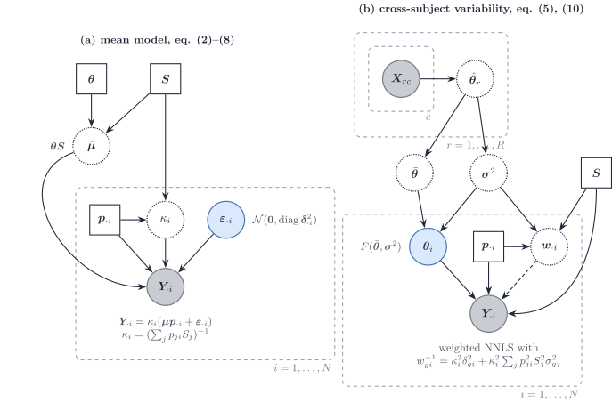

Figure 4: `MuSiC` ([Wang et al. 2019](#ref-wangBulkTissueCell2019)) in
this vignette’s notation. (a) The mean model: bulk relative abundance is
a cell-size-weighted mixture of relative profiles \boldsymbol{\theta},
rescaled by \kappa_i. (b) The multi-subject reference: subject-level
relative profiles \boldsymbol{\theta}\_i vary around the cross-subject
mean with variance \boldsymbol{\sigma}^{2}, and the inverse of the
resulting gene variance weights a non-negative least squares fit.

`MuSiC` starts from molecules: the bulk of subject i holds
X\_{gi}=\sum_jm\_{ji}S_j\theta\_{gj}=\sum_jm\_{ji}\tilde\mu\_{gj}, with
S_j the mean total molecules per cell of type j (equation 2). It works
on relative abundance Y\_{gi}=X\_{gi}/\sum\_{g'}X\_{g'i}, so that, with
the reparametrisation above,

Y\_{gi}=\kappa_i\Bigl(\sum_jp\_{ji}S_j\theta\_{gj}+\varepsilon\_{gi}\Bigr),
\qquad \operatorname{Var}(Y\_{gi}\mid\boldsymbol{p}\_{\cdot i})
=\kappa_i^{2}\delta\_{gi}^{2}+\kappa_i^{2}\sum_jp\_{ji}^{2}S_j^{2}\sigma^{2}\_{gj}
=w\_{gi}^{-1} \tag{7}

(equations 8–10). The second term comes from subject-level relative
profiles \theta\_{gj,i}\sim F(\theta\_{gj},\sigma^{2}\_{gj}) (assumption
A1): it is the **diagonal** of the between-replicate layer
\boldsymbol{S}\_B(\boldsymbol{p}), quadratic in p\_{ji}, and it requires
a multi-subject reference. Cross terms between types are dropped, which
implicitly assumes independence across types. \delta^{2}\_{gi} is the
residual variance of the bulk. The within-type cell scatter
\boldsymbol{\Sigma}\_{W,j} has no term in [Eq. 7](#eq-music-variance);
it is used only to select genes with small within-cluster variance in
the tree-guided recursion; the cross-subject weights and the cross-cell
selection are the two halves of what the paper calls marker-gene
consistency (p. 2). Estimation is weighted non-negative least squares,
with the weights updated from an initial fit because \delta^{2}\_{gi} is
unknown, followed by rescaling to the simplex.

**Scales and identifiability.** S_j is plugged in as the mean library
size of type j in the reference. That substitution returns cell
fractions only under assumption A3', a capture efficiency (observed
library size over molecule content) common to all types ([the `MuSiC`
assumptions](https://bastienchassagnol.github.io/DeCovarT/articles/02-1-single-cell-generative-optimisation.html#fig-music-assumptions));
otherwise `MuSiC` estimates the RNA-weighted product p\_{ji}S_j. Under
A1–A3 alone the paper claims only the trend of proportions across
subjects. Absolute S_j is not needed: it cancels into \kappa_i. A gene-
and subject-specific intercept \alpha\_{gi} absorbs protocol bias.
`MuSiC2` keeps the weights and removes genes that are differentially
expressed between the reference and bulk conditions ([Fan et al.
2022](#ref-fanMusic2CellTypeDeconvolution2022)).

*Ladder and errors in variables ([Sec. 2.3](#sec-ladder),
[Sec. 2.2](#sec-eiv)):* rung 2; response error only, with a diagonal
variance quadratic in \boldsymbol{p}\_{\cdot i}; \hat{\boldsymbol{\mu}}
is plugged in, and the estimator is a weighted moment estimator.

#### SCDC

`SCDC` keeps the weighted non-negative least squares of `MuSiC` and
changes the weights and the reference ([Dong et al.
2021](#ref-dongSCDCBulkGene2021)). Each gene receives a maximal variance
weight, “so that residuals from genes with larger weights have smaller
impact” (p. 5): as we read the formula (garbled in our copy, p. 9), the
largest cross-cell variance of the gene over the cell types of one
reference subject, divided by its median over genes. Weights below the
15th percentile are raised to it and weights above the 85th percentile
are lowered to it (p. 10), so the clipping is a percentile rule, not an
influence diagnostic. With several single-cell references, `SCDC` fits
each one separately and combines the estimates with data-set weights
chosen to fit the bulk (its ENSEMBLE step). No interval for
\boldsymbol{p}\_{\cdot i} is reported.

*Ladder and errors in variables ([Sec. 2.3](#sec-ladder),
[Sec. 2.2](#sec-eiv)):* rung 2; response error only; a weighted moment
estimator with no interval.

#### RNA-Sieve

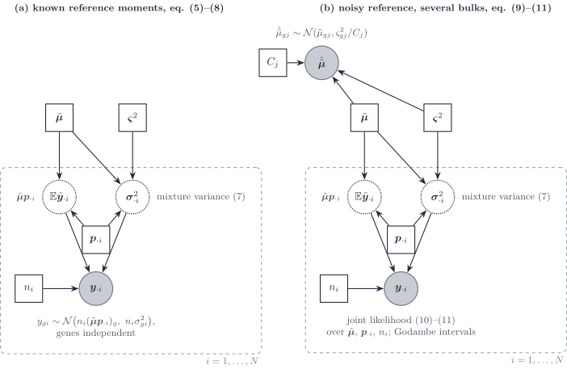

Figure 5: `RNA-Sieve` ([Erdmann-Pham et al.
2021](#ref-erdmann-phamLikelihoodbasedDeconvolutionBulk2021)). (a) With
known per-cell moments
(\tilde{\boldsymbol{\mu}},\boldsymbol{\varsigma}^{2}), the bulk is the
sum of n_i cells drawn from the cell mixture, with a central-limit
Gaussian per gene whose variance is the mixture variance. (b) The
reference means are themselves noisy averages of C_j cells; the joint
likelihood over bulks and reference means is maximised, with Godambe
sandwich intervals.

`RNA-Sieve` writes the bulk as a sum of n cells, each a draw from the
cell mixture [the mixture-of-cells
covariance](https://bastienchassagnol.github.io/DeCovarT/articles/02-1-single-cell-generative-optimisation.html#eq-mixture-cell)
restricted to one gene. By the central limit theorem,

y\_{gi}\sim\mathcal{N}\bigl(n_i(\tilde{\boldsymbol{\mu}}\boldsymbol{p}\_{\cdot
i})\_g,\\ n_i\sigma^{2}\_{gi}\bigr), \qquad
\sigma^{2}\_{gi}=\sum_jp\_{ji}\bigl(\varsigma^{2}\_{gj}+\tilde\mu\_{gj}^{2}\bigr)-(\tilde{\boldsymbol{\mu}}\boldsymbol{p}\_{\cdot
i})\_g^{2}, \tag{8}

with genes independent (equations 5–8). The variance is **linear** in
n_i and in \boldsymbol{p}, minus the square of the mixture mean: the
within-type variance \sum_jp\_{ji}\varsigma^{2}\_{gj} plus the spread of
the type means, the diagonal of [the mixture-of-cells
covariance](https://bastienchassagnol.github.io/DeCovarT/articles/02-1-single-cell-generative-optimisation.html#eq-mixture-cell).
The reference means are noisy,
\hat{\tilde\mu}\_{gj}\sim\mathcal{N}(\tilde\mu\_{gj},\varsigma^{2}\_{gj}/C_j)
(equation 9), and the true means are estimated jointly with
(\boldsymbol{p}\_{\cdot i},n_i) from all bulks (equations 10–11).
Marginalising them instead would add
n_i^{2}\sum_jp\_{ji}^{2}\varsigma^{2}\_{gj}/C_j to the variance, a
quadratic term that vanishes as the reference grows (our remark).

Here \varsigma^{2}\_{gj} is the per-cell variance of gene g in type j,
the diagonal of \boldsymbol{\Sigma}\_{W,j}.

**Scales.** Raw counts keep S_j inside \tilde{\boldsymbol{\mu}}, so the
weights are cell fractions; the optional rescaling of every cell to the
median library size removes S_j and turns them into RNA fractions. Any
global protocol difference is absorbed into n_i, which then “loses
interpretability” as a cell number across protocols (Supplementary
S1.4). The optional cell QC drops cells whose library size lies 3 median
absolute deviations or more from the median of their type; the gene
filters are compared in the [feature-selection
review](https://bastienchassagnol.github.io/DeCovarT/articles/03-1-feature-selection.html#sec-fs-review).

**Intervals.** When the model holds, the inverse Fisher information of
(\hat{\boldsymbol{p}}\_{\cdot i},\hat n_i), after a reparametrisation of
the simplex, gives \chi^{2}\_{J-1} ellipsoids. Under protocol shift the
data law leaves the model family, and the default Godambe sandwich
describes the fluctuations around the Kullback–Leibler projection onto
that family; without misspecification the two matrices coincide
([Godambe 1960](#ref-godambeOptimumPropertyRegular1960)). Near-collinear
cell types make the information nearly singular. The paper notes that
gene correlation “may be incorporated” once it is known, but does not
implement it: the product over genes is a composite likelihood.

**Against DeCovarT.** DeCovarT draws one latent profile per type and
keeps a full gene–gene covariance,
\sum_jp\_{ji}^{2}\boldsymbol{\Sigma}\_j, where `RNA-Sieve` sums n_i
cells gene by gene. DeCovarT already has the Fisher analogue, the
expected information mapped through the ILR chart ([interior
intervals](https://bastienchassagnol.github.io/DeCovarT/articles/01-2-population-inference.html#sec-interior)),
undefined on a face of the simplex. A Godambe correction matters only if
the Gaussian convolution is misspecified (counts, protocol shift,
omitted types); its one-column construction is a proposal, not
implemented ([sandwich for a misspecified
convolution](https://bastienchassagnol.github.io/DeCovarT/articles/01-2-population-inference.html#sec-sandwich)).
It replaces neither the boundary tests nor
[`reference_bootstrap_decovart()`](https://bastienchassagnol.github.io/DeCovarT/reference/reference_bootstrap_decovart.md),
the resampling counterpart of the noisy-reference term.

*Ladder and errors in variables ([Sec. 2.3](#sec-ladder),
[Sec. 2.2](#sec-eiv)):* rung 4, a composite asymptotic Gaussian; both
layers, the response error with a central-limit law over cells and the
regressor error in a joint likelihood.

#### DWLS

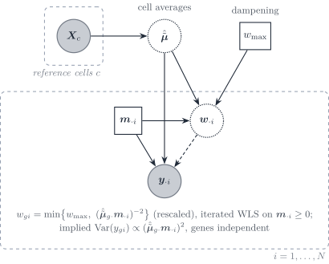

Figure 6: `DWLS` ([Tsoucas et al.
2019](#ref-tsoucasAccurateEstimationCelltype2019)). The signature is the
average of reference cells; the bulk is fitted in cell-type numbers
\boldsymbol{m}\_{\cdot i} by iterated weighted least squares, with
weights equal to the inverse squared fitted mean, capped by a dampening
constant w\_{\max}.

`DWLS` fits the cell-type numbers \mathbf{x}=\boldsymbol{m}\_{\cdot i}
by

\hat{\boldsymbol{m}}\_{\cdot i}
=\arg\min\_{\boldsymbol{m}\ge\boldsymbol{0}}\sum_g\bar
w\_{gi}\bigl(y\_{gi}-\hat{\tilde{\boldsymbol{\mu}}}\_{g\cdot}\boldsymbol{m}\bigr)^{2},
\qquad \bar w\_{gi}=\min\Bigl\\w\_{\max},\\
\frac{(\hat{\tilde{\boldsymbol{\mu}}}\_{g\cdot}\hat{\boldsymbol{m}}\_{\cdot
i})^{-2}}{\min\_{g'}(\hat{\tilde{\boldsymbol{\mu}}}\_{g'\cdot}\hat{\boldsymbol{m}}\_{\cdot
i})^{-2}}\Bigr\\, \tag{9}

iterated from an ordinary least squares start, with w\_{\max}=2^{q}
chosen to minimise the variance of estimates over random half-gene
subsets (equations 6–15). The purpose is stated on p. 7: with weights
1/(\text{fitted expression})^{2} the loss becomes a function of the
relative error of each cell type, “because we would like all cell types
to be estimated with equal accuracy”; highly expressed genes, which
dominate an unweighted fit and favour abundant types, are down-weighted.
Read as a variance model, the weights imply
\operatorname{Var}(y\_{gi})\propto(\hat{\tilde{\boldsymbol{\mu}}}\_{g\cdot}\boldsymbol{m}\_{\cdot
i})^{2}, a constant coefficient of variation, which the paper does not
state. There is no \boldsymbol{\Sigma}\_{W,j} term and genes are
independent. \mathbf{x} are cell numbers only under equal RNA per cell;
otherwise they are RNA-weighted.

*Ladder and errors in variables ([Sec. 2.3](#sec-ladder),
[Sec. 2.2](#sec-eiv)):* rung 2, with a variance proportional to the
squared mean (the variance function of a gamma GLM, our reading);
response error only; a weighted moment estimator with no interval.

#### deMixSC

`deMixSC` keeps the weighted non-negative least squares of `MuSiC` and
`DWLS` and adds a small **benchmark** data set: bulk and single-nucleus
libraries prepared from the same nucleus aliquot, so that the real bulk
and the pseudo-bulk share the composition (Guo et al. 2025, p. 149 ;
preprint Guo et al.
([2023](#ref-guoDeMixSCDeconvolutionFramework2023))). In the 24
benchmark retinas, more than 5000 genes differ between the two platforms
in each batch, and TPM normalisation does not remove the difference. In
our notation the working model is (supplementary note, equations
S.1–S.5, pp. 1–2)

y\_{gi}=n_i\sum_jp\_{ji}\tilde\mu\_{gj}+\epsilon\_{gi}, \qquad
\tilde\mu\_{gj}=S_j\theta\_{gj}, \qquad
\hat{\tilde\mu}\_{gj}=\tilde\mu\_{gj}+\bar\xi\_{gj}, \tag{10}

with mean-zero bulk noise \epsilon\_{gi} and an averaged single-cell
measurement error \bar\xi\_{gj}. The residual of a fit with
\hat{\tilde{\boldsymbol{\mu}}} is the estimation error plus a
“technological discrepancy” between platforms (note, p. 3). Two changes
to weighted NNLS follow.

- **Partitioned loss** (equation S.7, note p. 3). Genes differentially
  expressed between real bulk and pseudo-bulk in the benchmark (paired
  t-test, Benjamini–Hochberg adjusted P\<0.05, the 5000 most expressed
  of them by default) form a set G_2. They are kept, not removed: their
  bulk value and reference are divided by a constant a (1000 by
  default), which scales their squared residuals by a^{-2}:

  \hat{\boldsymbol{p}}\_{\cdot
  i}=\arg\min\_{\boldsymbol{p}\ge\boldsymbol{0}} \sum\_{g\in
  G_1}w\_{gi}\\r\_{gi}(\boldsymbol{p})^{2} +\frac{1}{a^{2}}\sum\_{g\in
  G_2}w\_{gi}\\r\_{gi}(\boldsymbol{p})^{2}, \qquad
  r\_{gi}(\boldsymbol{p})=y\_{gi}-n_i\sum_jp\_{ji}\hat{\tilde\mu}\_{gj}.
  \tag{11}

- **Weights** (equation S.9, note p. 3; main text p. 150):
  w\_{gi}^{-1}=\hat y\_{gi}^{2}+(y\_{gi}-\hat y\_{gi})^{2}+c, with \hat
  y\_{gi}=n_i\sum_j\hat p\_{ji}\hat{\tilde\mu}\_{gj} and c=2. Earlier
  methods, the authors note, use “either the squared fitted value”
  (`DWLS`, [Eq. 9](#eq-dwls)) “or the variance” (`MuSiC`’s iteratively
  estimated \delta^{2}\_{gi}, [Eq. 7](#eq-music-variance)), “but never
  both” (p. 157). The fit is iterated from an NNLS start (note, p. 4).

The target cohort is first aligned to the benchmark bulk by quantile
normalisation and `ComBat` (p. 150). The platform effect is treated as
noise to down-weight, not as a gene-wise ratio \tilde b_g to estimate:
with a=1000 the genes of G_2 receive a weight 10^{-6} times smaller,
which nearly discards them. The squared residual in the weight uses one
residual per gene as its own variance, an outlier-damping device in the
spirit of robust M-estimation rather than a variance model (our
reading). Cell size enters through \tilde\mu\_{gj}=S_j\theta\_{gj}, as
in `MuSiC`, so \hat{\boldsymbol{p}} are cell fractions under the same
equal-efficiency assumption. No interval is reported.

*Ladder and errors in variables ([Sec. 2.3](#sec-ladder),
[Sec. 2.2](#sec-eiv)):* rung 2; both layers are written down but enter
only through the weights; a weighted moment estimator with no interval.

#### Bisque

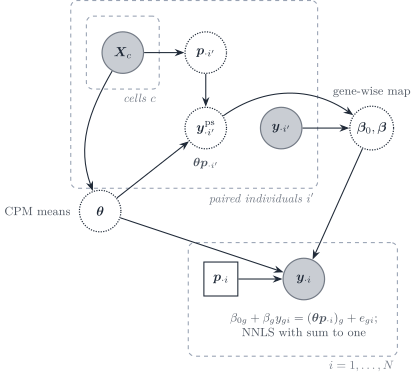

Figure 7: `Bisque` ([Jew et al.
2020](#ref-jewAccurateEstimationCell2020)), paired mode. For individuals
with both assays, the single-cell counts give a CPM signature
\boldsymbol{\theta} and counted proportions, hence a pseudo-bulk; a
gene-wise linear map from observed bulk to pseudo-bulk is learned on
those pairs and applied to the remaining bulks before non-negative least
squares.

`Bisque` learns the platform shift instead of modelling it. In paired
mode it fits
y^{\mathrm{ps}}\_{gi'}=\beta\_{0g}+\beta_gy\_{gi'}+\epsilon\_{gi'} per
gene, with \boldsymbol{y}^{\mathrm{ps}}\_{\cdot
i'}=\boldsymbol{\theta}\boldsymbol{p}\_{\cdot i'} the pseudo-bulk of
individual i' (equation 1); in unpaired mode it matches the first two
moments of each gene across samples (equations 2–3). The transformed
bulk is then fitted by non-negative least squares with a sum-to-one
constraint. The fitting step has homoscedastic residuals; the
variability of the reference enters only through the between-sample
moments used in the map. Because \boldsymbol{\theta} is built from CPM,
cell size is removed from the signature; the gene-wise affine map
absorbs the platform ratio \tilde b_g (as 1/\beta_g) and an intercept,
not a type-specific S_j. In unpaired mode the cohort mean composition is
assumed equal to the mean composition of the single-cell individuals.

*Ladder and errors in variables ([Sec. 2.3](#sec-ladder),
[Sec. 2.2](#sec-eiv)):* rung 1; the platform error is removed by a
learned map, then a homoscedastic moment estimator; no interval.

#### RCTD

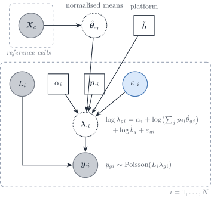

Figure 8: `RCTD` ([Cable et al.
2022](#ref-cableRobustDecompositionCell2022a)) in this vignette’s
notation. The reference is collapsed to fixed normalised means
\hat{\boldsymbol{\theta}}\_{\cdot j}. Sample i carries an observed depth
L_i, a leftover scale \alpha_i, a composition and a gene-wise
overdispersion; the platform ratio \tilde{\boldsymbol{b}} is shared
across samples and is not estimated inside the per-sample fit.

`RCTD` works one layer below DeCovarT. Each UMI first picks a type with
probability p\_{ji}, then a gene from that type’s relative profile: a
read-level **mixture**, not a convolution of random population profiles
([Cable et al. 2022](#ref-cableRobustDecompositionCell2022a)). Given the
rate, gene counts are Poisson; the rate is log-normal around a linear
mixture of the **fixed** normalised means \theta\_{gj} (supplementary
equations 3, 22):

y\_{gi}\mid\lambda\_{gi}\sim\mathrm{Poisson}(L_i\lambda\_{gi}), \qquad
\log\lambda\_{gi}=\alpha_i+\log\Bigl(\sum_jp\_{ji}\theta\_{gj}\Bigr)+\gamma_g+\varepsilon\_{gi},
\tag{12}

with L_i the observed depth, \alpha_i a leftover sample scale,
\gamma_g\sim\mathcal{N}(0,\sigma\_\gamma^{2}) a gene-specific platform
random effect and
\varepsilon\_{gi}\sim\mathcal{N}(0,\sigma\_\varepsilon^{2}) an
observation-level random effect, with heavier tails in practice (p. 6).
The model is a Poisson–log-normal GLMM. The Poisson mean is

\mathbb{E}\[y\_{gi}\mid\varepsilon\_{gi}\]
=\underbrace{L_ie^{\alpha_i}}\_{a_i}\\\tilde
b_g\\e^{\varepsilon\_{gi}}\sum_jp\_{ji}\theta\_{gj}, \qquad \tilde
b_g=e^{\gamma_g}, \tag{13}

so the platform effect is exactly the gene-wise ratio \tilde b_g of
[Sec. 1.1](#sec-poisson-measurement), and \varepsilon\_{gi} is the
count-scale analogue of a diagonal bulk residual. Genes are independent
given \varepsilon. In the language of the measurement model, the rate of
gene g is a type-weighted sum of per-type rates scaled by one
sample-wide factor; the same holds in DeCovarT’s single-cell mean
a_in_i\tilde{\boldsymbol{\mu}}\boldsymbol{p}\_{\cdot i}, whose per-type
contribution is n_ip\_{ji}S_j molecules of profile
\boldsymbol{\theta}\_{\cdot j} (our reading). A mixture is the right
story at the UMI; a convolution of random profiles
([Eq. 18](#eq-gaussian-convolution)) is the right story for population
profiles.

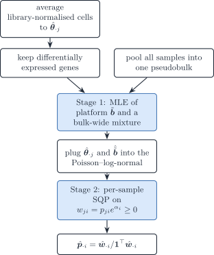

Figure 9: `RCTD` estimation. Stage 1 identifies the gene-wise platform
ratio from a pseudobulk of all samples; stage 2 fits each sample by
sequential quadratic programming on the unnormalised weights
w\_{ji}=p\_{ji}e^{\alpha_i}.

The fit is two-stage because \tilde{\boldsymbol{b}} cannot be free
inside one sample ([alignment
scales](https://bastienchassagnol.github.io/DeCovarT/articles/02-1-single-cell-generative-optimisation.html#sec-alignment)):
stage 1 estimates \sigma\_\gamma and predicts \gamma_g from one
pseudobulk of all spots (supplementary equations 14–19), stage 2 holds
it fixed. That is Strategy 4 in its purest form ([plug-in
scales](https://bastienchassagnol.github.io/DeCovarT/articles/02-1-single-cell-generative-optimisation.html#sec-strategy-plugin)).
Stage 2 maximises a non-convex Poisson–log-normal likelihood in
w\_{ji}=p\_{ji}e^{\alpha_i}\ge0 by sequential quadratic programming: the
Hessian is replaced by its positive-semidefinite part and each step is a
constrained quadratic programme with step size 0.3. Zeros on the orthant
boundary are native to that formulation, which suits spots with few
types. DeCovarT instead maps \boldsymbol{p} to the ILR chart and takes
Newton–Raphson steps with the analytic score and Hessian of a Gaussian
law.

*Ladder and errors in variables ([Sec. 2.3](#sec-ladder),
[Sec. 2.2](#sec-eiv)):* rung 7, a Poisson–log-normal GLMM; response
error only; the reference means are plugged in and the platform effect
is predicted in stage 1, then held fixed.

#### ReDeconv

`ReDeconv` names three ways a single-cell reference distorts
deconvolution: rescaling every cell to a common total (CP10K), which
erases transcriptome size; the gene-length mismatch between UMI
single-cell counts and full-length bulk libraries; and ignoring the
within-type variance ([Lu et al.
2025](#ref-luTranscriptomeSizeMatters2025)).

**Model.** The bulk is a sum of m\_{ji} independent cells of each type.
By the central limit theorem, after a rescaling of the bulk by a
constant c and with weights f\_{ji}=cm\_{ji},

y\_{gi}\sim\mathcal{N}\Bigl(\sum_jf\_{ji}\tilde\mu\_{gj},\\
c\sum_jf\_{ji}\sigma^{2}\_{gj}\Bigr), \tag{14}

with genes independent, and the composition is estimated by maximising
the product of these densities over genes. The variance is **linear** in
the weights, the diagonal of the within-type layer
n_i^{-1}\sum_jp\_{ji}\boldsymbol{\Sigma}\_{W,j} ([one
replicate](https://bastienchassagnol.github.io/DeCovarT/articles/02-1-single-cell-generative-optimisation.html#sec-one-replicate)),
as in `RNA-Sieve` without the spread of type means. The optimiser, the
estimation of c and the final simplex step are not stated.

**Transcriptome size.** CLTS normalisation fits, for each single-cell
sample r, a line S\_{jr}=\alpha_rS\_{j1}+\beta_r between its mean
transcriptome sizes per type and those of a baseline sample, then
rescales every count of sample r as x\_{gc}\leftarrow
x\_{gc}/\alpha_r+(v\_{\max}-\beta_r/\alpha_r)/G with
v\_{\max}=\max_r\beta_r/\alpha_r. Differences of transcriptome size
between types within a sample are kept; differences between samples are
removed. CLTS therefore keeps S_j in \tilde{\boldsymbol{\mu}}\_{\cdot
j}=S_j\boldsymbol{\theta}\_{\cdot j}, so the fitted weights are cell
fractions rather than transcript fractions.

**Caveats.** About 100 signature genes per type are chosen by a t-test
against every other type (P\<0.05, no multiplicity correction), a fold
change of at least 2 and the smallest coefficient of variation
([feature-selection
review](https://bastienchassagnol.github.io/DeCovarT/articles/03-1-feature-selection.html#sec-fs-review));
the synthetic benchmarks draw bulk and reference from the same
single-cell source, as the authors acknowledge.

*Ladder and errors in variables ([Sec. 2.3](#sec-ladder),
[Sec. 2.2](#sec-eiv)):* rung 4; response error only, with a
central-limit law over cells; the reference is plugged in.

### Multivariate methods: gene–gene covariance

#### DECALS

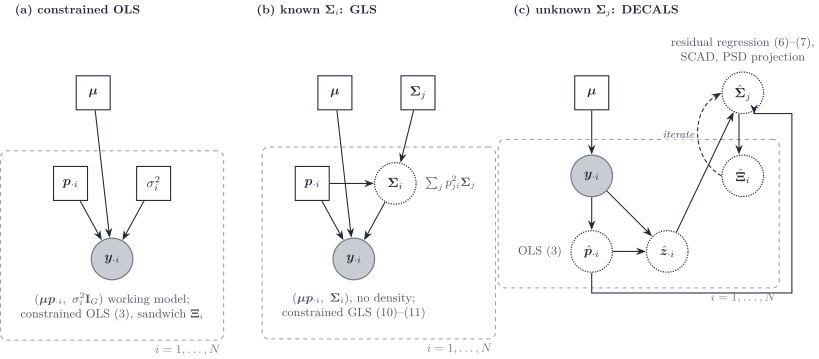

Figure 10: `DECALS` ([Cai et al.
2024](#ref-caiStatisticalInferenceCelltype2024)) as three increasingly
informed working models. (a) Constrained ordinary least squares with an
implicit identity covariance; the subject-specific covariance enters
only the sandwich variance. (b) Constrained generalised least squares
when \boldsymbol{\Sigma}\_i=\sum_jp\_{ji}^{2}\boldsymbol{\Sigma}\_j is
known. (c) `DECALS` proper: the type covariances are unknown and are
estimated from bulk residuals across samples, with a bias correction
iterated with the variance of \hat{\boldsymbol{p}}\_{\cdot i}; the point
estimate stays the OLS one.

`DECALS` makes no distributional assumption on the bulk. Its model
(equations 1–2, 5) is

\boldsymbol{y}\_{\cdot i}=\sum_jp\_{ji}\boldsymbol{x}^{(j)}\_i
=\boldsymbol{\mu}\boldsymbol{p}\_{\cdot i}+\boldsymbol{\epsilon}\_i,
\qquad
\operatorname{Cov}(\boldsymbol{\epsilon}\_i)=\boldsymbol{\Sigma}\_i=\sum_jp\_{ji}^{2}\boldsymbol{\Sigma}\_j,
\tag{15}

with subject-level type profiles \boldsymbol{x}^{(j)}\_i independent
across types: exactly the quadratic layer
\boldsymbol{S}\_B(\boldsymbol{p}) and released DeCovarT’s covariance,
without a density. The three panels of [Figure 10](#fig-dag-decals) are
the paper’s three estimators.

1.  **Constrained OLS** (equation 3) is the point estimator. For a large
    number of genes the inequality constraints are inactive and the
    estimator is the equality-constrained projection
    \hat{\boldsymbol{p}}=\mathbf{U}\tilde{\boldsymbol{p}} of the OLS
    solution (Lemma S1). Its asymptotic covariance is the sandwich
    \boldsymbol{\Xi}\_i=\mathbf{U}\mathbf{D}\mathbf{U}^{\top} with
    \mathbf{D}=(\tfrac1G\boldsymbol{\mu}^{\top}\boldsymbol{\mu})^{-1}\tfrac1G\boldsymbol{\mu}^{\top}\boldsymbol{\Sigma}\_i\boldsymbol{\mu}(\tfrac1G\boldsymbol{\mu}^{\top}\boldsymbol{\mu})^{-1}.
2.  **Constrained GLS** with known \boldsymbol{\Sigma}\_i (equations
    10–11) is more efficient. The authors reject it once
    \boldsymbol{\Sigma}\_i is estimated: the per-sample inverse square
    root is too noisy, and the coverage of GLS with an estimated
    covariance falls to about 0.65–0.8 in their simulations.
3.  **Unknown \boldsymbol{\Sigma}\_j.** Because
    \mathbb{E}\[z\_{gi}z\_{hi}\]=\sum_jp\_{ji}^{2}\Sigma\_{j,gh}, the
    residual outer products are regressed on the squared proportions
    across the N samples,
    \hat{\boldsymbol{c}}\_{gh}=(\hat{\mathbf{H}}^{\top}\hat{\mathbf{H}})^{-1}\hat{\mathbf{H}}^{\top}(\hat{\boldsymbol{z}}\_g\circ\hat{\boldsymbol{z}}\_h)
    with \hat{\mathbf{H}}=\[\hat p\_{ji}^{2}\] (equation 6), a
    regression first proposed for known proportions by CSNet. Replacing
    \mathbf{H} by \hat{\mathbf{H}} deflates the estimate; Proposition 1
    gives the bias terms \mathbf{B}\_1,\mathbf{B}\_2 under a Gaussian
    approximation of \hat{\boldsymbol{p}}, and the corrected estimator
    (equation 7) is iterated with \boldsymbol{\Xi}\_i, then thresholded
    by SCAD and projected onto the positive semidefinite cone.

**Asymptotics.** Genes are the statistical units: Theorem 1 gives
\sqrt{G}(\hat{\boldsymbol{p}}\_{\cdot i}-\boldsymbol{p}\_{\cdot
i})\to\mathcal{N}(\boldsymbol{0},\boldsymbol{\Xi}\_i) as G\to\infty for
one sample, under sub-exponential errors, a dependency graph of bounded
degree among genes, and p\_{ji}\>0 for all types. On a face of the
simplex the limit law is not derived. With dense gene correlation the
authors report that coverage collapses to about 0.65: the central limit
theorem over genes fails when dependence is not sparse. The paper gives
no consistency theorem for \hat{\boldsymbol{\Sigma}}\_j.

*Ladder and errors in variables ([Sec. 2.3](#sec-ladder),
[Sec. 2.2](#sec-eiv)):* rung 6 for the estimate and its interval, with
rung 5 as the efficient variant set aside; response error only, with the
composition-dependent covariance of DeCovarT; an asymptotic law over
genes yields the sandwich interval.

#### MEAD

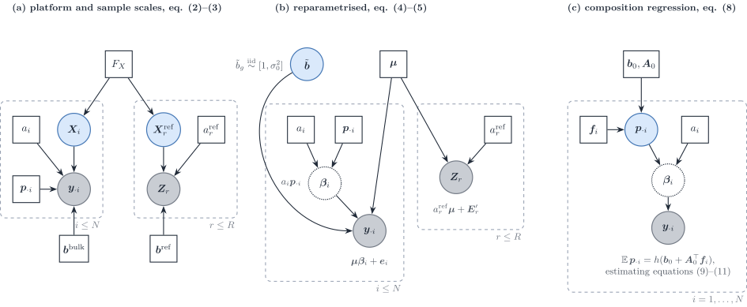

Figure 11: `MEAD` ([Xie et al.
2026](#ref-xieStatisticalInferenceCell2026)) in this vignette’s notation
(a_i=\gamma_i, \boldsymbol{b}^{\mathrm{bulk}}=\boldsymbol{\alpha},
\boldsymbol{b}^{\mathrm{ref}}=\boldsymbol{\alpha}^{r},
\boldsymbol{\mu}=\mathbf{U}, replicate r = reference individual j of the
paper). (a) Bulk and reference share the population law F_X of the type
profiles but have their own sample scales and gene-wise capture factors.
(b) After reparametrisation only the ratio \tilde
b_g=\alpha_g/\alpha^{r}\_g remains, treated as random noise around one,
and the bulk mean is \boldsymbol{\mu}\boldsymbol{\beta}\_i with
\boldsymbol{\beta}\_i=a_i\boldsymbol{p}\_{\cdot i}. (c) Across
individuals, the composition is regressed on covariates.

`MEAD` is the multivariate errors-in-variables method. Its successive
models ([Figure 11](#fig-dag-mead)), translated into our indices, are:

- **Scales** (equations 2–3). The bulk is \boldsymbol{y}\_{\cdot
  i}=a_i\operatorname{diag}(\boldsymbol{b}^{\mathrm{bulk}})\mathbf{X}\_i\boldsymbol{p}\_{\cdot
  i}+\boldsymbol{\epsilon}\_i and reference individual r is
  \mathbf{Z}\_r=a^{\mathrm{ref}}\_r\operatorname{diag}(\boldsymbol{b}^{\mathrm{ref}})\mathbf{X}^{\mathrm{ref}}\_r+\mathbf{E}\_r,
  with \mathbf{X}\_i and \mathbf{X}^{\mathrm{ref}}\_r drawn from one
  population law (assumption 1). a_i captures depth and tissue amount,
  \boldsymbol{b} gene length and GC content. The reference scale is one
  scalar per reference individual, shared by its cell types
  (Supplementary S2.1); the authors avoid per-cell library-size
  normalisation to keep cell size in \boldsymbol{\mu}.

- **Reparametrisation** (equations 4–5). Only the ratio \tilde
  b_g=b^{\mathrm{bulk}}\_g/b^{\mathrm{ref}}\_g is identified, and
  assumption 3 treats it as noise, \tilde
  b_g\overset{\text{iid}}{\sim}\[1,\sigma_0^{2}\], independent of
  \boldsymbol{\mu}. The model becomes \boldsymbol{y}\_{\cdot
  i}=\boldsymbol{\mu}\boldsymbol{\beta}\_i+\boldsymbol{e}\_i with
  \boldsymbol{\beta}\_i=a_i\boldsymbol{p}\_{\cdot i} and
  \boldsymbol{e}\_i=(\tilde{\boldsymbol{B}}-\mathbf{I})\boldsymbol{\mu}\boldsymbol{\beta}\_i+\boldsymbol{\epsilon}'\_i:
  the platform ratio is not estimated, inflates the variance and makes
  \boldsymbol{e}\_i dependent across samples.

- **One sample.** With \hat a^{\mathrm{ref}}\_r=\sum\_{j,g}z\_{rgj}/(JG)
  (a plug-in from the reference alone), \hat{\boldsymbol{\mu}}\_{g\cdot}
  the average of \boldsymbol{z}\_{rg\cdot}/\hat a^{\mathrm{ref}}\_r and
  \hat{\mathbf{K}}\_g its covariance across reference individuals, the
  bias-corrected estimating equation

  \hat{\boldsymbol{\mu}}^{\top}\mathbf{W}\boldsymbol{y}\_{\cdot
  i}-\bigl(\hat{\boldsymbol{\mu}}^{\top}\mathbf{W}\hat{\boldsymbol{\mu}}-\hat{\mathbf{K}}\bigr)\boldsymbol{\beta}\_i=\boldsymbol{0},
  \qquad \hat{\mathbf{K}}=\sum_gw_g\hat{\mathbf{K}}\_g, \tag{16}

  removes the attenuation caused by a noisy regressor (equation 6).
  Non-negativity is imposed by truncation or constrained optimisation,
  and \hat{\boldsymbol{p}}\_{\cdot
  i}=\hat{\boldsymbol{\beta}}\_i/\\\hat{\boldsymbol{\beta}}\_i\\\_1.

- **Several samples** (section 5). The composition is regressed on
  covariates, \mathbb{E}\[\boldsymbol{p}\_{\cdot
  i}\]=h(\boldsymbol{b}\_0+\mathbf{A}\_0^{\top}\boldsymbol{f}\_i), with
  \hat{\boldsymbol{p}}\_{\cdot i} plugged into an estimating equation
  (11).

- **Dependence and weights.** Gene–gene dependence is global, not type
  specific: a dependency graph over genes, estimated from the bulk
  correlation by a multiple test, enters only the sandwich covariance.
  The weights w_g=1/\tilde s_g^{2}, with
  s_g^{2}=\mathbf{1}^{\top}\hat{\mathbf{K}}\_g\mathbf{1} shrunk across
  genes, come from the reference only; `MuSiC`’s residual-based weights
  “can severely bias” the estimating equation.

**Identifiability** (Theorem 1). With a composition matrix of rank J,
the proportions are identifiable if and only if \boldsymbol{\mu} has
full rank and, for every partition of the genes into t\ge2 blocks, the
ranks of the blocks of \boldsymbol{\mu} add to more than J. **Perfect
marker genes** violate the condition: rescaling the platform ratios of
the type-j markers by 1/\delta_j, the proportions to \tilde
p\_{ji}=\delta_jp\_{ji}/\sum\_\ell\delta\_\ell p\_{\ell i} and the scale
to a_i\sum\_\ell\delta\_\ell p\_{\ell i} leaves the bulk mean unchanged,
for any \boldsymbol{\delta}. A gene-wise platform ratio can then mimic a
type-specific size factor (Supplementary Remark S1), the \boldsymbol{q}
versus \boldsymbol{p} ambiguity of [alignment
scales](https://bastienchassagnol.github.io/DeCovarT/articles/02-1-single-cell-generative-optimisation.html#sec-alignment);
assumption 3 restores identification because a ratio that depends on the
type of its marker is no longer independent of \boldsymbol{\mu} (our
reading).

**Asymptotics.** With G\to\infty and the number of reference individuals
fixed, Theorems 2–3 give \sqrt{G}(\hat{\boldsymbol{p}}\_{\cdot
i}-\boldsymbol{p}\_{\cdot i})\to\mathcal{N}\bigl(\boldsymbol{0},\nabla
g\\\boldsymbol{\Upsilon}^{-1}\boldsymbol{\Sigma}\_i\boldsymbol{\Upsilon}^{-1}\nabla
g^{\top}\bigr), with the Gram limit \boldsymbol{\Upsilon}=\lim
G^{-1}\boldsymbol{\mu}^{\top}\mathbf{W}\boldsymbol{\mu}, when every
p\_{ji}\>0 and the dependency graph is “almost sparse”. The regime is
fragile when the reference-noise term does not shrink (fixed number of
reference individuals), when types are collinear, at the boundary (the
softplus device is inconsistent for finite tuning), and for the
composition regression unless N=o(G) (Theorem 4, Remark S3). `DECALS`
reports that `MEAD` underestimates variances.

*Ladder and errors in variables ([Sec. 2.3](#sec-ladder),
[Sec. 2.2](#sec-eiv)):* rung 2 weights inside a rung 6 estimating
equation; both layers, the regressor error removed by a bias-corrected
estimating equation and the platform ratio a multiplicative response
error; the law is asymptotic in G.

### Where DeCovarT sits

Released DeCovarT plugs in the mean and gene–gene covariance of each
type and fits the Gaussian convolution of
[Eq. 18](#eq-gaussian-convolution), one bulk sample at a time: rung 5 of
[Table 3](#tbl-ladder), with a covariance that depends on
\boldsymbol{p}\_{\cdot i} and a full Gaussian likelihood. Against the
methods above:

- `RNA-Sieve` and `ReDeconv` sum independent **cells**, so a type’s
  variance enters linearly in p\_{ji}, gene by gene; DeCovarT convolves
  random **population profiles**, so it enters quadratically and keeps
  the gene–gene covariance.
- `DECALS` assumes the same covariance,
  \sum_jp\_{ji}^{2}\boldsymbol{\Sigma}\_j, without a density; its point
  estimate is least squares and its efficiency depends on how well the
  covariance is estimated across bulks. `MEAD` keeps a global gene
  dependence and adds the platform ratio, but models the reference noise
  that DeCovarT ignores.
- `RCTD` is a read-level mixture with gene-wise random effects (rung 7),
  not a type-level covariance.

For a single-cell reference the bulk is a physical sum of cells, and the
variance becomes linear in p\_{ji}, as in `RNA-Sieve`: rung 4 with a
dense covariance. The strategies that rebuild DeCovarT for that
reference, and the three-layer law that combines within- and
between-donor covariances, are in the [single-cell generative
vignette](https://bastienchassagnol.github.io/DeCovarT/articles/02-1-single-cell-generative-optimisation.html#sec-strategies);
the model retained for real data is in the [MLE
vignette](https://bastienchassagnol.github.io/DeCovarT/articles/01-2-population-inference.html#sec-final-choice).

## Cell-type-specific moments when the composition is known

The methods of [Sec. 2](#sec-methods) estimate the composition from
known reference moments. The reverse problem takes the composition
\\\boldsymbol{p}\_{\cdot i}\\ as known, from any of those methods, and
estimates what DeCovarT plugs in: type-level means and covariances, or
the purified profile of each type in each sample. Write the convolution
with explicit latent profiles,

\boldsymbol{x}\_{\cdot j,i}\sim(\boldsymbol{\mu}\_{\cdot
j},\boldsymbol{\Sigma}\_j)\\ \text{independent across }j, \qquad
\boldsymbol{y}\_{\cdot i}=\sum_jp\_{ji}\\\boldsymbol{x}\_{\cdot j,i},
\tag{17}

so that

\mathbb{E}\[\boldsymbol{y}\_{\cdot
i}\]=\boldsymbol{\mu}\boldsymbol{p}\_{\cdot i}, \qquad
\operatorname{Cov}(\boldsymbol{y}\_{\cdot
i})=\sum_jp\_{ji}^{2}\boldsymbol{\Sigma}\_j , \tag{18}

which is the released DeCovarT law when the profiles are Gaussian. Three
families use these identities.

- **Type-level gene networks across a cohort.** `CSNet` regresses the
  outer products of bulk residuals on the squared proportions to
  estimate each \boldsymbol{\Sigma}\_j, then thresholds the correlation
  ([Sec. 3.1](#sec-csnet)).
- **Sample-level profiles with a covariance across cell types.** `Unico`
  ([Sec. 3.2](#sec-unico)), and the Bayesian `bMIND` and `EPIC-unmix`
  ([Sec. 4.1](#sec-bayes-cts)), place a J\times J covariance
  \boldsymbol{\Gamma}\_g across cell types for each gene, independent
  across genes. Their covariance is the transpose of DeCovarT’s: it
  couples types within a gene, not genes within a type.
- **Sample-level profiles with a gene–gene covariance.** With Gaussian
  profiles and known moments, the posterior mean of each
  \boldsymbol{x}\_{\cdot j,i} is a Wiener filter, which is also the best
  linear unbiased predictor of the random effects when
  [Eq. 18](#eq-gaussian-convolution) is read as a linear mixed model;
  both are derived in the [Wiener-filter
  vignette](https://bastienchassagnol.github.io/DeCovarT/articles/05-2-bayesian-wiener.html#sec-map-blup).

On the measurement side, these methods need the bulk on a linear scale
(FPKM for `CSNet`). When the bulk is normalised by its own library size,
the known weights act as RNA fractions \boldsymbol{q}\_{\cdot i}, not as
cell fractions ([Sec. 1](#sec-measurement)).

### Type-level moments given known proportions

`CSNet` inverts the DeCovarT arrow ([Su et al.
2024](#ref-suEstimatingCellTypeSpecificGene2024)). DeCovarT takes
(\boldsymbol{\mu},\\\boldsymbol{\Sigma}\_j\\) as plug-in and returns
\boldsymbol{p}\_{\cdot i}. `CSNet` takes \\\boldsymbol{p}\_{\cdot
i}\\\_{i=1}^{N} as known (from CIBERSORT, MuSiC, or DeCovarT itself) and
returns type-level means and a **sparse correlation network**. The
generative identities are the same convolution as
[Eq. 17](#eq-latent-convolution) and [Eq. 18](#eq-gaussian-convolution),
written across a cohort rather than one sample:

\mathbb{E}\[\boldsymbol{y}\_{\cdot i}\mid\boldsymbol{p}\_{\cdot i}\] =
\sum_j p\_{ji}\\\boldsymbol{\mu}\_{\cdot j}, \qquad
\operatorname{Cov}(\boldsymbol{y}\_{\cdot i}\mid\boldsymbol{p}\_{\cdot
i}) = \sum_j p\_{ji}^{2}\\\boldsymbol{\Sigma}\_j. \tag{19}

No Gaussian law is required for the moments. Let P\in\mathbb{R}^{N\times
J} have entries P\_{ij}=p\_{ji} and H\in\mathbb{R}^{N\times J} have
entries H\_{ij}=p\_{ji}^{2}. Gene-wise ordinary least squares on the
linear mean recovers

\hat{\boldsymbol{\mu}}\_{g\cdot} =
(P^{\top}P)^{-1}P^{\top}\boldsymbol{y}\_{g\cdot}, \tag{20}

the bulk analogue of a reference average, now identified from
**compositional contrast across samples** rather than from purified
cells. Centred residuals z\_{gi}=y\_{gi}-\sum_j p\_{ji}\hat{\mu}\_{gj}
then satisfy the pairwise identity z\_{gi}z\_{g'i}=\sum_j
p\_{ji}^{2}\Sigma\_{gg',j}+\varepsilon\_{gg'i}. Least squares of the
Hadamard products on H estimates each covariance entry,

\hat{\Sigma}\_{gg',j} =
\bigl\[(H^{\top}H)^{-1}H^{\top}(\boldsymbol{z}\_{g\cdot}\odot\boldsymbol{z}\_{g'\cdot})\bigr\]\_{j}.
\tag{21}

`CSNet` converts \hat{\boldsymbol{\Sigma}}\_j to a correlation
\hat{R}\_j and applies an element-wise SCAD threshold. That is a
**marginal co-expression** graph, not a Gaussian Markov precision. The
Gaussian convolution log-likelihood in \\\boldsymbol{\Sigma}\_j\\, which
is the natural DeCovarT loss for the same parameters, is neither convex
nor biconvex in those matrices; pairwise least squares is how `CSNet`
avoids that optimisation ([Su et al.
2024](#ref-suEstimatingCellTypeSpecificGene2024)).

A DeCovarT-native sequel would keep
[Eq. 20](#eq-csnet-mean)–[Eq. 21](#eq-csnet-cov) as the moment step and
map \hat{\boldsymbol{\Sigma}}\_j to a sparse precision
\boldsymbol{\Omega}\_j ([network
inference](https://bastienchassagnol.github.io/DeCovarT/articles/03-2-covariance-network-estimation.md)),
run **after** \boldsymbol{p} has been estimated
([Figure 12](#fig-csnet-two-arrows)). A `CSNet` correlation graph is not
a DeCovarT precision.

Figure 12: Two inverse problems on the same convolution. DeCovarT
estimates p given mu and Sigma. Given p, the MAP / BLUP recovers
sample-level purified profiles, and CSNet recovers type-level means and
a sparse co-expression network. A precision Omega_j estimated there can
be fed back as the DeCovarT plug-in.

P and H must have full column rank, so \boldsymbol{p}\_{\cdot i} has to
**vary** across the N bulks. One sample identifies \boldsymbol{p} given
(\boldsymbol{\mu},\\\boldsymbol{\Sigma}\_j\\); it does not identify J
covariance matrices. Rare types with almost constant p\_{ji} leave the
corresponding column of H weak, which is why `CSNet` recovers
abundant-type co-expression more easily than microglia-scale weights.
The method is a moment estimator: modest errors in the supplied
\boldsymbol{p} are averaged over N, whereas DeCovarT’s likelihood for a
single column is concentrated in \boldsymbol{p}\_{\cdot i}.

|  | DeCovarT | MAP / BLUP ([the Wiener filter](https://bastienchassagnol.github.io/DeCovarT/articles/05-2-bayesian-wiener.html#eq-map-blup)) | `CSNet` |
|----|----|----|----|
| Known | \boldsymbol{\mu}\_{\cdot j}, \boldsymbol{\Sigma}\_j (reference) | \boldsymbol{\mu}\_{\cdot j}, \boldsymbol{\Sigma}\_j, \boldsymbol{p}\_{\cdot i} | \boldsymbol{p}\_{\cdot i} (external or DeCovarT) |
| Unknown | \boldsymbol{p}\_{\cdot i} | \boldsymbol{x}\_{\cdot j,i} (one sample) | \boldsymbol{\mu}\_{\cdot j}, sparse R_j (cohort) |
| Law | Multivariate Gaussian convolution | Same, posterior of the latents | Moments only; Gaussian optional |
| Second moment | Sparse **precision** \boldsymbol{\Omega}\_j as input | Uses \boldsymbol{\Sigma}\_j, does not re-estimate it | Sparse **correlation** R_j as output |
| Replication | One bulk column is enough | One bulk column | N\gg J bulks with varying \boldsymbol{p} |
| Estimator | Constrained MLE on the ILR chart | Posterior mean / Wiener gain | Gene-wise OLS, then pairwise LS, then SCAD |

*Ladder and errors in variables ([Sec. 2.3](#sec-ladder),
[Sec. 2.2](#sec-eiv)):* the reverse problem, with the composition known
and the latent profiles’ moments as the target; rung 1 regressions for
both moments.

### Sample-level profiles with a covariance across cell types

`Unico` ([Chen et al. 2025](#ref-chenUnicoUnifiedModelCell2025)) takes
the proportions as given, estimated beforehand by a reference-based
method, and estimates for each gene the moments of the latent
sample-level profiles, then the profiles themselves (a samples \times
genes \times types tensor). Its model (equations 3–6, p. 11), in our
notation, makes no distributional assumption:

y\_{gi}=\boldsymbol{p}\_{\cdot
i}^{\top}\boldsymbol{x}\_{g\cdot,i}+e\_{gi}, \qquad
\mathbb{E}\\\boldsymbol{x}\_{g\cdot,i}=\boldsymbol{\mu}\_{g\cdot}, \quad
\operatorname{Cov}\boldsymbol{x}\_{g\cdot,i}=\boldsymbol{\Gamma}\_g,
\qquad \mathbb{E}\\e\_{gi}=0, \quad
\operatorname{Var}e\_{gi}=\tau_g^{2}, \tag{22}

so that \operatorname{Var}(y\_{gi})=\boldsymbol{p}\_{\cdot
i}^{\top}\boldsymbol{\Gamma}\_g\boldsymbol{p}\_{\cdot i}+\tau_g^{2}.

- **Estimator.** A generalised method of moments per gene (equations
  9–12, pp. 13–14): one first-moment condition,
  y\_{gi}-\boldsymbol{p}\_{\cdot i}^{\top}\boldsymbol{\mu}\_{g\cdot},
  and one second-moment condition, (y\_{gi}-\boldsymbol{p}\_{\cdot
  i}^{\top}\boldsymbol{\mu}\_{g\cdot})^{2}-\boldsymbol{p}\_{\cdot
  i}^{\top}\boldsymbol{\Gamma}\_g\boldsymbol{p}\_{\cdot i}-\tau_g^{2},
  per sample, combined with a diagonal weight matrix; that is iterated
  weighted least squares, with non-negative means, a small ridge on
  \boldsymbol{\Gamma}\_g and samples beyond two standard deviations
  dropped (p. 14).
- **Profiles.** The conditional expectation under a Gaussian working law
  (Theorem 1, p. 12),
  \hat{\boldsymbol{x}}\_{g\cdot,i}=\boldsymbol{\mu}\_{g\cdot}+\boldsymbol{\Gamma}\_g\boldsymbol{p}\_{\cdot
  i}(y\_{gi}-\boldsymbol{p}\_{\cdot
  i}^{\top}\boldsymbol{\mu}\_{g\cdot})/(\boldsymbol{p}\_{\cdot
  i}^{\top}\boldsymbol{\Gamma}\_g\boldsymbol{p}\_{\cdot i}+\tau_g^{2}),
  the gene-wise, J\times J analogue of DeCovarT’s [Wiener
  filter](https://bastienchassagnol.github.io/DeCovarT/articles/05-2-bayesian-wiener.html#sec-map-blup);
  `TCA` is the case \boldsymbol{\Gamma}\_g=\mathbf{I}. Distribution-free
  asymptotic tests of covariate effects at the cell-type level are
  offered (Fig. 3b, p. 8).

Critical remarks. \boldsymbol{\Gamma}\_g is identified only from many
bulk samples of varying composition, and the plugged-in proportions are
treated as exact. The bulk variance
\boldsymbol{p}^{\top}\boldsymbol{\Gamma}\_g\boldsymbol{p} is quadratic
in \boldsymbol{p}, like DeCovarT’s: with
\boldsymbol{\Gamma}\_g=\operatorname{diag}\\(\boldsymbol{\Sigma}\_j)\_{gg}\\\_j
it is the variance of gene g under DeCovarT. The off-diagonal of
\boldsymbol{\Gamma}\_g is what DeCovarT drops by assuming independent
types; the gene–gene couplings are what `Unico` drops (our remark).

*Ladder and errors in variables ([Sec. 2.3](#sec-ladder),
[Sec. 2.2](#sec-eiv)):* the reverse problem again, rung 4, with
two-moment conditions solved by a generalised method of moments.

## Bayesian reference-based deconvolution

Bayesian methods put priors on the purified profiles, on the
proportions, or on both, and report posterior summaries. They split by
target: sample-level profiles ([Sec. 4.1](#sec-bayes-cts)) or
proportions ([Sec. 4.2](#sec-bayes-prop)). A latent-profile Bayesian
version of DeCovarT is derived in the [Bayesian Wiener-filter
vignette](https://bastienchassagnol.github.io/DeCovarT/articles/05-2-bayesian-wiener.md).

### Cell-type-specific profiles

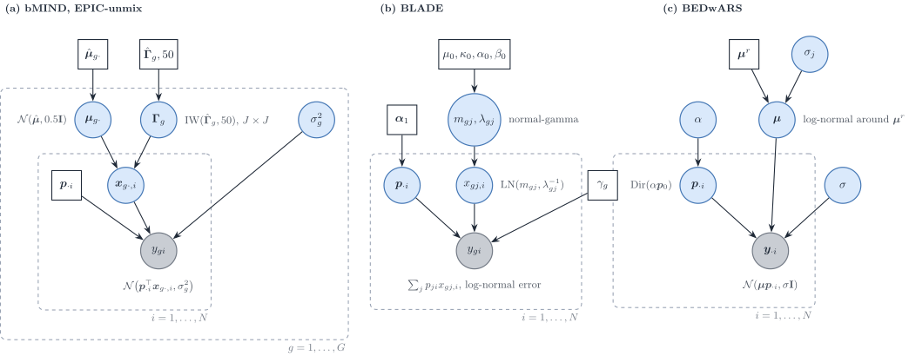

Figure 13: Bayesian models for cell-type-specific profiles, in this
review’s notation. (a) `bMIND` and `EPIC-unmix`: for each gene, the
sample-level profile across cell types is Gaussian with a J\times J
covariance \boldsymbol{\Gamma}\_g under an inverse-Wishart prior centred
on single-cell estimates; proportions are fixed. (b) `BLADE`: log-normal
profiles with a normal-gamma prior, Dirichlet proportions, linear
mixing. (c) `BEDwARS`: a cohort-level signature drawn around a noisy
reference, Dirichlet proportions, Gaussian residuals.

**`bMIND`** estimates sample-level profiles for proportions estimated
beforehand (by NNLS or `Bisque`) ([Wang et al.
2020](#ref-wangBayesianEstimationCelltypespecific2020)). For gene g and
subject i,

y\_{gi}=\boldsymbol{p}\_{\cdot
i}^{\top}\boldsymbol{x}\_{g\cdot,i}+e\_{gi}, \qquad
\boldsymbol{x}\_{g\cdot,i}\sim\mathcal{N}\_J(\boldsymbol{\mu}\_{g\cdot},\boldsymbol{\Gamma}\_g),
\qquad e\_{gi}\sim\mathcal{N}(0,\sigma_g^{2}), \tag{23}

with
\boldsymbol{\mu}\_{g\cdot}\sim\mathcal{N}(\hat{\boldsymbol{\mu}}\_{g\cdot},0.5\mathbf{I}),
\boldsymbol{\Gamma}\_g\sim\mathrm{IW}(\hat{\boldsymbol{\Gamma}}\_g,50)
and a non-informative prior on \sigma_g^{2}; the hyperparameters come
from single-cell or single-nucleus summary statistics. Sampling is by
MCMC (`MCMCglmm`), gene by gene. Condition-specific means
\boldsymbol{\mu}\_g^{f} give tests of cell-type-specific differential
expression. The authors note that the uncertainty of the estimated
proportions is not propagated.

**`EPIC-unmix`** ([Tang et al.
2025](#ref-tangCellTypespecificInference2025)) keeps the `bMIND` model
and adds a second, empirical-Bayes step: the prior is re-centred on the
step-one posterior means and on their covariance across the target
samples, with an increased number of degrees of freedom The target
samples are therefore used twice. The bulk enters on the \log_2 scale,
so the linear mixing of [Eq. 23](#eq-bmind) is a mixing of logarithms,
which is not the physical sum of cells
(\log\sum_jp_jx_j\neq\sum_jp_j\log x_j).

**`BLADE`** estimates proportions and sample-level profiles jointly
([Andrade Barbosa et al.
2021](#ref-andrade-barbosaBayesianLogNormalDeconvolution2021)):
y\_{gi}=\sum_jp\_{ji}x\_{gj,i} plus a log-normal error, with
x\_{gj,i}\sim\mathrm{LN}(m\_{gj},\lambda\_{gj}^{-1}), a normal-gamma
prior on (m\_{gj},\lambda\_{gj}) centred on the log-scale mean and
variance of single-cell data, and \boldsymbol{p}\_{\cdot
i}\sim\mathrm{Dir}(\boldsymbol{\alpha}\_1). The mixing is on the linear
scale (TPM). Inference is collapsed variational, with hyperparameters
chosen on a grid by likelihood. The model is diagonal: no covariance
across genes or across types.

**`BEDwARS`** treats the reference itself as noisy ([Ghaffari et al.
2023](#ref-ghaffariBEDwARSRobustBayesian2023)):
y\_{gi}=\sum_j\mu\_{gj}p\_{ji}+E\_{gi},
\log\mu\_{gj}\sim\log\mu^{r}\_{gj}+\mathcal{N}(0,\sigma_j^{2}\log\mu^{r}\_{gj}),
\boldsymbol{p}\_{\cdot i}\sim\mathrm{Dir}(\alpha\boldsymbol{p}\_0), with
half-Cauchy hyperpriors and Metropolis–Hastings chains. The signature is
cohort-level: there is no sample-level profile. As written, the prior
variance \sigma_j^{2}\log\mu^{r}\_{gj} is not positive for reference
values at or below one RPKM (our remark).

**`BayesPrism`** places a multinomial likelihood on bulk counts with a
patient-derived single-cell prior and infers proportions and
sample-level profiles jointly by Gibbs sampling ([Chu et al.
2022](#ref-chuCellTypeGeneExpression2022)). The multinomial is the
Poisson measurement model conditioned on the library size
([Sec. 1.1](#sec-poisson-measurement)), so `BayesPrism` is the
count-scale member of this family. When the reference is updated, the
non-malignant profiles pooled across bulks deviate from the single-cell
profiles by gene-wise fold changes with a weak, zero-mean log-normal
prior (\sigma=2, pp. 5–6): a gene-wise random effect that absorbs
platform factors, as \gamma_g does in `RCTD` (our reading). The read
model has no overdispersion, and genes are coupled only through the
multinomial total.

| Method | Bulk scale | Profile prior | Covariance | Proportions | Inference | Output |
|----|----|----|----|----|----|----|
| `bMIND` | linear (not stated) | \mathcal{N}(\boldsymbol{\mu}\_g,\boldsymbol{\Gamma}\_g) | IW on J\times J \boldsymbol{\Gamma}\_g | fixed | MCMC | sample-level profiles |
| `EPIC-unmix` | \log_2 | as `bMIND`, re-centred | IW on J\times J, empirical Bayes | fixed | MCMC, two steps | sample-level profiles |
| `BLADE` | linear (TPM) | log-normal, normal-gamma | none | Dirichlet | collapsed VI | proportions, sample-level profiles |
| `BEDwARS` | linear (RPKM) | log-normal around the reference | none | Dirichlet | MH chains | proportions, cohort signature |
| `BayesPrism` | counts | from single cells | none | Dirichlet | Gibbs | proportions, sample-level profiles |

Table 4: Bayesian methods for cell-type-specific profiles. None models a
G\times G gene–gene covariance.

The contrast with DeCovarT is the dimension of the covariance. `bMIND`
and `EPIC-unmix` model how **cell types** covary for one gene across
subjects; DeCovarT models how **genes** covary within one cell type. A
separable covariance
\operatorname{Cov}(\operatorname{vec}\boldsymbol{X}\_i)=\boldsymbol{\Gamma}\otimes\boldsymbol{\Sigma}
for the G\times J matrix of purified profiles would contain both as
special cases (our remark); no reviewed method fits it.

### Proportions

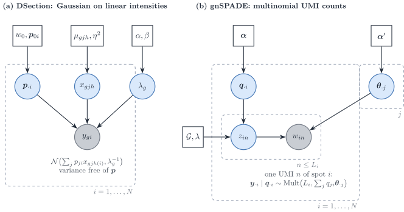

Figure 14: Bayesian estimation of proportions from continuous
intensities or from counts. (a) `DSection`: Gaussian bulk on linear
intensities with condition-specific type profiles, a gene-wise precision
and an informative Dirichlet prior on the proportions. (b) `gnSPADE`:
each UMI of a spot draws a type label and then a gene, so the spot
counts are multinomial with a probability vector that mixes the type
profiles; a gene network enters as a Markov random field on the labels.

**`DSection`** is the continuous, Gaussian route ([Erkkilä et al.
2010](#ref-erkkilaProbabilisticAnalysisGene2010)):
y\_{gi}\sim\mathcal{N}\bigl(\sum_jp\_{ji}x\_{gjh(i)},\lambda_g^{-1}\bigr),
with type profiles specific to the condition h(i) of sample i,
x\_{gjh}\sim\mathcal{N}(\mu\_{gjh},\eta^{2}),
\lambda_g\sim\mathrm{Gamma}(\alpha,\beta) and \boldsymbol{p}\_{\cdot
i}\sim\mathrm{Dir}(w_0\boldsymbol{p}\_{0i}) centred on a prior guess of
the proportions, which is needed for identifiability. Sampling is Gibbs
for the profiles and the precision and Metropolis–Hastings with
Dirichlet proposals for the proportions. The paper offers no log-normal
option and recommends linear data. The variance depends on the gene but
not on the proportions.

**`gnSPADE`** ([Xie and Cui 2026](#ref-xieGnSPADEIncorporatingGene2026))
is the count route, and it is reference-free. Each UMI of spot i draws a
label z\sim\mathrm{Mult}(\boldsymbol{q}\_{\cdot i}) and then a gene from
the profile of that label, so \boldsymbol{y}\_{\cdot
i}\mid\boldsymbol{q}\_{\cdot
i}\sim\mathrm{Mult}(L_i,\sum_jq\_{ji}\boldsymbol{\theta}\_{\cdot j}),
with L_i the number of UMIs: latent Dirichlet allocation with a Markov
random field over the labels built from a protein interaction network.
Inference is collapsed Gibbs.

The two differ where the measurement model of [Sec. 1](#sec-measurement)
bites.

- **Variance.** In `gnSPADE` the variance is fixed by the mean (the
  multinomial is a Poisson measurement conditioned on the total). In
  `DSection` it is a free gene-wise constant that does not grow with the
  mean, which a UMI measurement contradicts.
- **What the weights are.** `gnSPADE` shares UMIs, so the label
  probabilities are transcript fractions \boldsymbol{q}\_{\cdot i};
  converting them to cell fractions needs S_j. `DSection` estimates
  whatever its reference scale encodes.
- **Profile variability.** Neither model has a type-level variability of
  profiles across samples beyond the prior of `DSection`; neither has a
  gene–gene covariance. The gene network of `gnSPADE` acts on labels,
  not on expression.

## Semi-reference deconvolution: one unknown component

Semi-reference methods have references for J-1 types and estimate an
unknown component, usually tumour, together with the proportions. With
one component unknown, the convolution of univariate laws has to be
written explicitly, and its tractability drives the choice of law.

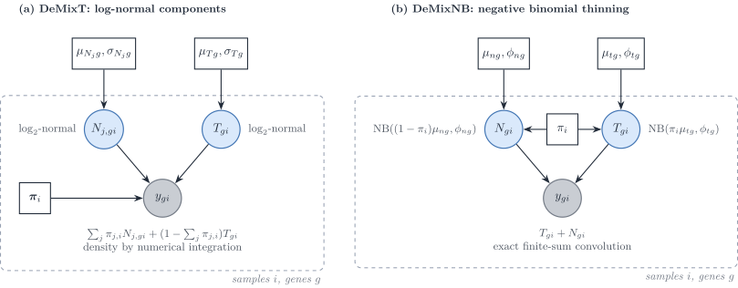

Figure 15: Two semi-reference convolutions of univariate components. (a)
`DeMixT`: log-normal components mixed linearly on the raw scale; the
density of the sum has no closed form and is integrated numerically. (b)
`DeMixNB`: each component is a negative binomial whose mean is already
scaled by its proportion; the density of the sum is an exact finite sum.

**`DeMix` and `DeMixT`.** `DeMix` mixes a tumour and one normal
component; `DeMixT` adds a second normal component ([Ahn et al.
2013](#ref-ahnDeMixDeconvolutionMixed2013); [Wang et al.
2018](#ref-wangTranscriptomeDeconvolutionHeterogeneous2018)):

y\_{gi}=\pi\_{1,i}N\_{1,gi}+\pi\_{2,i}N\_{2,gi}+(1-\pi\_{1,i}-\pi\_{2,i})T\_{gi},
\qquad N\_{j,gi},T\_{gi}\sim\log_2\text{-normal}. \tag{24}

The mixing is linear on the raw scale, and the density of a sum of
log-normals has no closed form, so `DeMixT` integrates numerically (a
double integral for three components). The normal-component parameters
are plugged in from unmatched normal samples; the proportions and the
tumour parameters are maximised by iterated conditional modes, gene and
sample blocks in parallel. When the two normal means are close, the
likelihood is flat in (\pi_1,\pi_2); a gene-set component-merging step
first estimates the tumour proportion on genes where they agree. Genes
are independent.

**`DeMixNB`** replaces the log-normal by a negative binomial for sparse
counts (miRNA, spatial spots) ([Montierth et al.
2025](#ref-montierthDeconvolutionSparsecountRNA2025)):
T\_{gi}\sim\mathrm{NB}(\pi_i\mu\_{tg},\phi\_{tg}),
N\_{gi}\sim\mathrm{NB}((1-\pi_i)\mu\_{ng},\phi\_{ng}) and
y\_{gi}=T\_{gi}+N\_{gi}, whose density is the finite sum
\sum\_{z=0}^{y}f_T(z)f_N(y-z). The proportions scale the means, not the
dispersions. Read with [Sec. 1](#sec-measurement),
\mathrm{NB}(\pi\mu,\phi) is the binomial thinning of
\mathrm{NB}(\mu,\phi): a Poisson measurement of a Gamma-distributed
rate, with the rates mixed linearly (our remark). That makes `DeMixNB`
the semi-reference model closest to a UMI measurement. Its \pi_i is a
transcript fraction. The method is a preprint.

**`BayICE`** models \log(\text{count}+1) as Gaussian with mean
\alpha_g+\sum_jw\_{ji}\beta\_{gj}+w\_{0i}\beta\_{g0}, a convex
combination of type effects plus an unknown-class effect, with
spike-and-slab priors on the type effects (marker selection with a
Bayesian false discovery rate) and a Dirichlet prior on the weights
([Tai et al. 2021](#ref-taiBayiceBayesianHierarchicalModel2021)).
Inference is Gibbs with Metropolis–Hastings steps. The mixing is on the
log scale, so it is a mean regression rather than a convolution, and the
variances are gene-wise, not type-specific.

**`ISOpureR`** places a multinomial on the discretised tumour profile,
with probability vector
\alpha_i\boldsymbol{c}\_i+\sum_r\omega\_{ri}\boldsymbol{x}^{\mathrm{ref}}\_r:
the normal part is a convex combination of individual reference
**samples**, the cancer profile \boldsymbol{c}\_i is shrunk towards a
cohort mean by a Dirichlet prior, and the estimate is a MAP by block
coordinate descent ([Anghel et al.
2015](#ref-anghelISOpureRImplementationComputational2015)). Genes are
coupled through the multinomial simplex; there is no overdispersion. Its
\alpha_i is a fraction of transcripts.

|  | `DeMix`, `DeMixT` | `DeMixNB` | `BayICE` | `ISOpureR` |
|----|----|----|----|----|
| Component law | \log_2-normal | negative binomial | Gaussian on \log(y+1) | multinomial, Dirichlet profiles |
| Mixing scale | raw | counts | log | probabilities |
| Convolution | numerical integration | exact finite sum | none (mean regression) | none (closed by thinning) |
| Inference | ICM, plug-in reference | ICM, L-BFGS-B, restarts | Gibbs and MH | MAP, coordinate descent |
| Genes | independent | independent | conditionally independent | coupled by the simplex |
| Proportion | mixing weight on raw scale | transcript fraction | weight on log scale | transcript fraction |

Table 5: Semi-reference methods. The extension of DeCovarT to one
unknown component is outlined in the [extensions
roadmap](https://bastienchassagnol.github.io/DeCovarT/articles/05-3-extensions-roadmap.html#sec-semi-reference).

## Reference-free deconvolution with co-expression structure

Without a reference, deconvolution is a non-negative matrix
factorisation \boldsymbol{Y}\approx\boldsymbol{\mu}\boldsymbol{P} with
the columns of \boldsymbol{P} on the simplex. Three recent methods add
gene–gene structure to that factorisation, in three different ways.

**`DSSC`** ([Wang et al. 2024](#ref-wangDeconvolutionBulkGene2024)) fits
the bulk and, in addition, the Gram matrices of genes and of samples :

\min\_{\boldsymbol{\mu},\boldsymbol{P}\ge 0}
\lVert\boldsymbol{Y}-\boldsymbol{\mu}\boldsymbol{P}\rVert_F^{2}
+\lambda_1\lVert\boldsymbol{K}\_N-\boldsymbol{P}^{\top}\boldsymbol{P}\rVert_F^{2}
+\lambda_2\lVert\boldsymbol{K}\_G-\boldsymbol{\mu}\boldsymbol{\mu}^{\top}\rVert_F^{2}
+\lambda_c\lVert\boldsymbol{\mu}-\mathcal{T}(\boldsymbol{Y}\_{\mathrm{sc}})\rVert_F^{2},
\tag{25}

where \boldsymbol{K}\_G and \boldsymbol{K}\_N are similarity kernels
1/(1+d) built from Pearson distances of the **same** bulk, and the last
term optionally pulls the signature towards a transform \mathcal{T} of a
single-cell reference. Multiplicative updates are run without the
sum-to-one constraint and the proportions are normalised afterwards. The
gene term matches \boldsymbol{\mu}\boldsymbol{\mu}^{\top} to a data
similarity; expanded, it keeps the affinity part of a graph-Laplacian
penalty and replaces its degree term by a quartic term, so it
corresponds to no Gaussian Markov random field (our remark).

**`GSNMF+`** ([Li et al. 2025](#ref-liAugmentedGSNMFModel2025))
regularises the rows of the signature with a kernel co-expression graph
built on the bulk augmented by single-cell pseudo-bulks, and pulls
marker rows towards the simplex vertices It states identifiability
conditions (separability, or sufficiently scattered factors) and that
the Frobenius loss is the Gaussian maximum-likelihood estimate. With a
Euclidean distance its graph term would be
\operatorname{tr}(\boldsymbol{\mu}^{\top}\boldsymbol{L}\_G\boldsymbol{\mu}),
the log-density of an intrinsic Gaussian Markov random field prior on
the signature; with the cosine distance it uses, the term is quartic.

Figure 16: `swCAM` read as a probabilistic model (our reading, not the
paper’s). The nuclear-norm penalty on the sample-specific deviations of
type j is the MAP of a Gaussian factor model with loadings
\boldsymbol{L}\_j and sample scores \boldsymbol{u}\_{ij}, which implies
a low-rank gene–gene covariance within each cell type.

**`swCAM`** estimates sample-specific signatures ([Chen et al.
2022](#ref-chenSwCAMEstimationSubtypespecific2022)). After convex
analysis of mixtures has fixed \boldsymbol{\mu} and \boldsymbol{P}, it
solves

\min\_{\\\boldsymbol{\Delta}\_i\\}
\tfrac12\sum_i\lVert\boldsymbol{y}\_{\cdot
i}-(\boldsymbol{\mu}+\boldsymbol{\Delta}\_i)\boldsymbol{p}\_{\cdot
i}\rVert_2^{2} +\lambda\sum_j\lVert\boldsymbol{T}\_j\rVert\_{\*},
\tag{26}

where \boldsymbol{T}\_j stacks the deviations of type j over samples and
\lVert\cdot\rVert\_\* is the nuclear norm. The problem is convex for
fixed \boldsymbol{\mu} and \boldsymbol{P} and is solved by ADMM. There
is no co-expression graph. Because
\lVert\boldsymbol{T}\rVert\_\*=\min\_{\boldsymbol{A}\boldsymbol{B}^{\top}=\boldsymbol{T}}\tfrac12(\lVert\boldsymbol{A}\rVert_F^{2}+\lVert\boldsymbol{B}\rVert_F^{2}),
the penalty is the MAP of a Gaussian factor model
([Figure 16](#fig-dag-swcam)), which implies a low-rank gene–gene
covariance within each type.

### Three ways gene covariance enters deconvolution

1.  **Graph regularisation of a factorisation.** A co-expression graph
    smooths the signature (`GSNMF+`). Its probabilistic reading is a
    Gaussian Markov random field prior on the signature, exact only for
    a Euclidean, quadratic penalty.
2.  **Similarity matching to the bulk itself.** The Gram matrices of the
    factors are fitted to similarities computed from the same data
    (`DSSC`). The data are used twice, and no likelihood is implied.
3.  **Covariance in a likelihood, a moment equation or a prior.** The
    gene–gene covariance of each type enters the bulk law: as a plug-in
    in DeCovarT, as moment equations in `DECALS` and `MEAD`, as the
    estimand in `CSNet`, and implicitly as a low-rank factor structure
    in `swCAM`. `bMIND` and `EPIC-unmix` belong here with the transposed
    object, a covariance across cell types.

All three reference-free methods use a squared Frobenius loss, that is a
homoscedastic Gaussian likelihood, and therefore ignore the
mean–variance relationship of counts
([Sec. 1.1](#sec-poisson-measurement)).

## Synthesis

| Method | Bulk scale | Bulk variance as a function of \boldsymbol{p} | Gene–gene covariance | Type–type covariance | Reference uncertainty | Rung ([Table 3](#tbl-ladder)) | Estimator |
|----|----|----|----|----|----|----|----|
| `MuSiC` | relative abundance | quadratic, diagonal | no | no | weights | 2 | weighted NNLS |
| `SCDC` | relative abundance | diagonal, clipped weights | no | no | no | 2 | weighted NNLS, ensemble |
| `RNA-Sieve` | counts / linear | linear, diagonal | no | no | noisy means | 4 (composite) | MLE, Godambe |
| `ReDeconv` | linear (CLTS) | linear, diagonal | no | no | no | 4 | MLE |
| `DWLS` | linear | implied quadratic in the mean | no | no | no | 2 | weighted LS |
| `deMixSC` | relative abundance | fitted mean squared plus residual squared | no | no | no | 2 | iterated weighted NNLS |
| `RCTD` | counts | Poisson–log-normal | no | no | no | 7 | two-stage MLE |
| `DECALS` | FPKM | quadratic | yes (moments) | no | no | 6 (5 set aside) | OLS + sandwich |
| `MEAD` | linear | sandwich over dependent genes | yes (global) | no | yes | 2 inside 6 | estimating equations |
| DeCovarT | linear | quadratic | yes (plug-in, sparse) | no | bootstrap | 5 | MLE |
| `CSNet` | FPKM | quadratic | yes (estimand) | no | no | 1 (reverse problem) | moments + thresholding |
| `Unico` | linear | \boldsymbol{p}^{\top}\boldsymbol{\Gamma}\_g\boldsymbol{p}+\tau_g^{2} | no | yes (J\times J) | no | 4 (reverse problem) | generalised method of moments |
| `bMIND`, `EPIC-unmix` | linear / \log_2 | \boldsymbol{p}^{\top}\boldsymbol{\Gamma}\_g\boldsymbol{p}+\sigma_g^{2} | no | yes (J\times J) | prior | 7 | MCMC |
| `BLADE` | linear | quadratic, log-normal profiles | no | no | prior | 7 | collapsed VI |
| `BayesPrism` | counts | multinomial given latent profiles | no | no | prior | 7 | Gibbs |
| `BEDwARS` | linear | constant | no | no | noisy reference prior | 1 | MH |
| `DSection` | linear | gene-wise, free of \boldsymbol{p} | no | no | prior | 2 | Gibbs–MH |
| `DeMixT` | raw | quadratic, log-normal components | no | no | plug-in | 7 | ICM |
| `DeMixNB` | counts | negative binomial | no | no | plug-in | 3 | ICM |
| `swCAM` | linear | constant | low rank (implicit) | no | no | 1 | ADMM |

Table 6: Where second-order information enters each method. “Quadratic”
and “linear” refer to the weight of a type’s variance in the bulk
variance (p\_{ji}^{2} for a random population profile, p\_{ji} for
independent cells).

### Caveats and defaults

1.  **Scale.** Mixing is additive only on a linear scale. Methods that
    mix logarithms (`BayICE`, `EPIC-unmix`) estimate weights of a
    different, non-physical sum.
2.  **Cell versus RNA fractions.** Count and topic models (`ISOpureR`,
    `gnSPADE`, `DeMixNB`, `BayesPrism`) and any fit on
    library-normalised bulk return transcript fractions; cell fractions
    need the cell sizes S_j ([RNA-to-cell
    conversion](https://bastienchassagnol.github.io/DeCovarT/articles/02-1-single-cell-generative-optimisation.html#sec-uncoupling)).
3.  **Mean–variance relationship.** A residual variance that does not
    grow with the mean (`DSection`, `BEDwARS`, NMF with a Frobenius
    loss, on rungs 1 and 2) contradicts the Poisson measurement of UMI
    counts, whose variance grows with the mean. Count likelihoods or
    explicit variance functions respect it ([GLM
    view](https://bastienchassagnol.github.io/DeCovarT/articles/01-2-population-inference.html#sec-glm)).
4.  **Linear or quadratic weights.** Independent cells give a variance
    linear in the proportions (`RNA-Sieve`, `ReDeconv`); a random
    population profile gives a quadratic weight (`MuSiC`, `DECALS`,
    `CSNet`, DeCovarT). Single-cell references with one donor identify
    only the first ([single-cell generative
    vignette](https://bastienchassagnol.github.io/DeCovarT/articles/02-1-single-cell-generative-optimisation.html#sec-three-regimes)).
5.  **Which covariance.** G\times G within a type (DeCovarT, `DECALS`,
    `CSNet`) and J\times J within a gene (`bMIND`, `EPIC-unmix`,
    `Unico`) answer different questions; neither family fits both.
6.  **Data reuse.** Empirical-Bayes re-centring on the target samples
    (`EPIC-unmix`), similarity graphs built from the bulk being
    factorised (`DSSC`, `GSNMF+`) and priors built from the same
    single-cell source as the benchmark bulk (`BLADE` group mode)
    inflate apparent accuracy.
7.  **Propagated uncertainty.** Weighted moment estimators (`MuSiC`,
    `SCDC`, `DWLS`, `deMixSC`) return point estimates only
    ([Sec. 2.3](#sec-ladder)). Few methods propagate the uncertainty of
    the reference (`RNA-Sieve`, `MEAD`, DeCovarT’s reference bootstrap)
    or of the proportions into downstream profiles (`bMIND` and `Unico`
    do not).
8.  **Identifiability.** Gene-wise scales with perfect markers (`MEAD`),
    collinear reference means (`DeMixT`), and reference-free
    factorisations without separability (`GSNMF+`) all leave the
    proportions unidentified, whatever the sample size.

### Methods to add to this review

Already in the bibliography and worth a section: `BLEND`, probabilistic
deconvolution with automated reference selection ([Huang et al.
2024](#ref-huangBLENDProbabilisticCellular2024)); `DeconV`, a Poisson
model aggregated from single cells ([Gynter et al.
2023](#ref-gynterDeconvProbabilisticCellType2023)); `Imply`,
personalised reference profiles ([Meng et al.
2024](#ref-mengImplyImprovingCelltype2024)); and `DecOT`, an optimal
transport loss ([Liu et al.
2022](#ref-liuDecotBulkDeconvolutionOptimal2022)). CIBERSORTx ([Newman
et al. 2019](#ref-newmanDeterminingCellType2019)) extends the signature
approach to high-resolution, sample-level profiles.

## References

Abbas, Alexander R., Kristen Wolslegel, Dhaya Seshasayee, Zora Modrusan,
and Hilary F. Clark. 2009. ‘Deconvolution of Blood Microarray Data
Identifies Cellular Activation Patterns in Systemic Lupus
Erythematosus’. *PloS One* 4.
<https://doi.org/10.1371/journal.pone.0006098>.

Agresti, Alan. 2015. *Foundations of Linear and Generalized Linear
Models*. Wiley.

Ahn, Jaeil, Ying Yuan, Giovanni Parmigiani, et al. 2013. ‘DeMix:
Deconvolution for Mixed Cancer Transcriptomes Using Raw Measured Data’.
*Bioinformatics (Oxford, England)* 29.
<https://doi.org/10.1093/bioinformatics/btt301>.

Andrade Barbosa, Bárbara, Saskia D. van Asten, Ji Won Oh, et al. 2021.
‘Bayesian Log-Normal Deconvolution for Enhanced in Silico
Microdissection of Bulk Gene Expression Data’. *Nature Communications*
12 (1). <https://doi.org/10.1038/s41467-021-26328-2>.

Anghel, Catalina V, Gerald Quon, Syed Haider, et al. 2015. ‘ISOpureR: An
R Implementation of a Computational Purification Algorithm of Mixed
Tumour Profiles’. *BMC Bioinformatics* 16.
<https://doi.org/10.1186/s12859-015-0597-x>.

Batardière, Bastien, Julien Chiquet, François Gindraud, and Mahendra
Mariadassou. 2025. ‘Zero-Inflation in the Multivariate Poisson Lognormal
Family’. *Statistics and Computing* 35 (6).
<https://doi.org/10.1007/s11222-025-10729-0>.

Cable, Dylan M., Evan Murray, Luli S. Zou, et al. 2022. ‘Robust
Decomposition of Cell Type Mixtures in Spatial Transcriptomics’. *Nature
Biotechnology* 40 (4): 517–26.
<https://doi.org/10.1038/s41587-021-00830-w>.

Cai, Biao, Emma Jingfei Zhang, Hongyu Li, Chang Su, and Hongyu Zhao.
2024. ‘Statistical Inference of Cell-Type Proportions Estimated from
Bulk Expression Data’. *Journal of the American Statistical Association*
119 (548): 2521–32. <https://doi.org/10.1080/01621459.2024.2382435>.

Chen, Lulu, Chiung-Ting Wu, Chia-Hsiang Lin, et al. 2022. ‘swCAM:
Estimation of Subtype-Specific Expressions in Individual Samples with
Unsupervised Sample-Wise Deconvolution’. *Bioinformatics* 38 (5):
1403–10. <https://doi.org/10.1093/bioinformatics/btab839>.

Chen, Zeyuan Johnson, Elior Rahmani, and Eran Halperin. 2025. ‘Unico: A
Unified Model for Cell-Type Resolution Genomics from Heterogeneous Omics
Data’. *Genome Biology* 26 (1).
<https://doi.org/10.1186/s13059-025-03776-3>.

Chiquet, Julien, Mahendra Mariadassou, and Stéphane Robin. 2018.
*Variational Inference for Sparse Network Reconstruction from Count
Data*. arXiv. <https://doi.org/10.48550/arxiv.1806.03120>.

Chiquet, Julien, Mahendra Mariadassou, and Stéphane Robin. 2021. ‘The
Poisson-Lognormal Model as a Versatile Framework for the Joint Analysis
of Species Abundances’. *Frontiers in Ecology and Evolution* 9.
<https://doi.org/10.3389/fevo.2021.588292>.

Chu, Tinyi, Zhong Wang, Dana Pe’er, and Charles G. Danko. 2022. ‘Cell
Type and Gene Expression Deconvolution with BayesPrism Enables Bayesian
Integrative Analysis Across Bulk and Single-Cell RNA Sequencing in
Oncology’. *Nature Cancer* 3 (4): 505–17.
<https://doi.org/10.1038/s43018-022-00356-3>.

Dong, Meichen, Aatish Thennavan, Eugene Urrutia, et al. 2021. ‘SCDC:
Bulk Gene Expression Deconvolution by Multiple Single-Cell RNA
Sequencing References’. *Briefings in Bioinformatics* 22.
<https://doi.org/10.1093/bib/bbz166>.

Erdmann-Pham, Dan D., Jonathan Fischer, Justin Hong, and Yun S. Song.
2021. ‘Likelihood-Based Deconvolution of Bulk Gene Expression Data Using
Single-Cell References’. *Genome Research* 31 (10): 1794–806.
<https://doi.org/10.1101/gr.272344.120>.

Erkkilä, Timo, Saara Lehmusvaara, Pekka Ruusuvuori, Tapio Visakorpi,
Ilya Shmulevich, and Harri Lähdesmäki. 2010. ‘Probabilistic Analysis of
Gene Expression Measurements from Heterogeneous Tissues’.
*Bioinformatics* 26. <https://doi.org/10.1093/bioinformatics/btq406>.

Fan, Jiaxin, Yafei Lyu, Qihuang Zhang, Xuran Wang, Mingyao Li, and Rui
Xiao. 2022. ‘MuSiC2: Cell-Type Deconvolution for Multi-Condition Bulk
RNA-seq Data’. *Briefings in Bioinformatics* 23 (6).
<https://doi.org/10.1093/bib/bbac430>.

Fang, Meichen, and Lior Pachter. 2025. *Extrinsic Biological
Stochasticity and Technical Noise Normalization of Single-Cell RNA
Sequencing Data*. bioRxiv preprint; bioRxiv.
<https://doi.org/10.1101/2025.05.11.653373>.

Ghaffari, Saba, Kelly J. Bouchonville, Ehsan Saleh, Remington E.
Schmidt, Steven M. Offer, and Saurabh Sinha. 2023. ‘BEDwARS: A Robust
Bayesian Approach to Bulk Gene Expression Deconvolution with Noisy
Reference Signatures’. *Genome Biology* 24 (1): 178.
<https://doi.org/10.1186/s13059-023-03007-7>.

Godambe, V. P. 1960. ‘An Optimum Property of Regular Maximum Likelihood
Estimation’. *The Annals of Mathematical Statistics* 31 (4): 1208–11.
<https://doi.org/10.1214/aoms/1177705693>.

Guo, Shuai, Xiaoqian Liu, Xuesen Cheng, et al. 2023. ‘DeMixSC: A
Deconvolution Framework That Uses Single-Cell Sequencing Plus a Small
Benchmark Dataset for Improved Analysis of Cell-Type Ratios in Complex
Tissue Samples’. *bioRxiv*, 2023.10.10.561733.
<https://doi.org/10.1101/2023.10.10.561733>.

Gynter, Artur, Dimitri Meistermann, Harri Lähdesmäki, and Helena
Kilpinen. 2023. *DeconV: Probabilistic Cell Type Deconvolution from Bulk
RNA-sequencing Data*. bioRxiv.
<https://doi.org/10.1101/2023.12.07.570524>.

Huang, Penghui, Manqi Cai, Chris McKennan, and Jiebiao Wang. 2024.
*BLEND: Probabilistic Cellular Deconvolution with Automated Reference
Selection*. bioRxiv. <https://doi.org/10.1101/2024.08.02.606458>.

Jew, Brandon, Marcus Alvarez, Elior Rahmani, et al. 2020. ‘Accurate
Estimation of Cell Composition in Bulk Expression Through Robust
Integration of Single-Cell Information’. *Nature Communications* 11.
<https://doi.org/10.1038/s41467-020-15816-6>.

Lähdesmäki, Harri, llya Shmulevich, Valerie Dunmire, Olli Yli-Harja, and
Wei Zhang. 2005. ‘In Silico Microdissection of Microarray Data from
Heterogeneous Cell Populations’. *BMC Bioinformatics* 6.
<https://doi.org/10.1186/1471-2105-6-54>.

Li, Shaoyu, Su Xu, Xue Wang, Nilüfer Ertekin-Taner, and Duan Chen. 2025.
‘An Augmented GSNMF Model for Complete Deconvolution of Bulk RNA-Seq
Data’. *Mathematical Biosciences and Engineering : MBE* 22 (4):
988–1018. <https://doi.org/10.3934/mbe.2025036>.

Liu, Gan, Xiuqin Liu, and Liang Ma. 2022. ‘DecOT: Bulk Deconvolution
with Optimal Transport Loss Using a Single-Cell Reference’. *Frontiers
in Genetics* 13. <https://doi.org/10.3389/fgene.2022.825896>.

Lu, Songjian, Jiyuan Yang, Lei Yan, et al. 2025. ‘Transcriptome Size
Matters for Single-Cell RNA-seq Normalization and Bulk Deconvolution’.
*Nature Communications* 16 (1).
<https://doi.org/10.1038/s41467-025-56623-1>.

Meng, Guanqun, Yue Pan, Wen Tang, et al. 2024. ‘Imply: Improving
Cell-Type Deconvolution Accuracy Using Personalized Reference Profiles’.
*Genome Medicine* 16 (1): 65.
<https://doi.org/10.1186/s13073-024-01338-z>.

Montierth, Matthew D., Hao Yan, Liyang Xie, et al. 2025. *Deconvolution
of Sparse-count RNA Sequencing Data for Tumor Cells Using Embedded
Negative Binomial Distributions*. bioRxiv.
<https://doi.org/10.1101/2025.11.21.689822>.

Nelder, J. A., and R. W. M. Wedderburn. 1972. ‘Generalized Linear
Models’. *Journal of the Royal Statistical Society. Series A (General)*
135 (3): 370–84. <https://doi.org/10.2307/2344614>.

Newman, Aaron M., Chloé B. Steen, Chih Long Liu, et al. 2019.
‘Determining Cell Type Abundance and Expression from Bulk Tissues with
Digital Cytometry’. *Nature Biotechnology* 37.
<https://doi.org/10.1038/s41587-019-0114-2>.

Sarkar, Abhishek, and Matthew Stephens. 2021. ‘Separating Measurement
and Expression Models Clarifies Confusion in Single-Cell RNA Sequencing
Analysis’. *Nature Genetics* 53 (6): 770–77.
<https://doi.org/10.1038/s41588-021-00873-4>.

Shen-Orr, Shai S., Robert Tibshirani, Purvesh Khatri, et al. 2010. ‘Cell
Type–Specific Gene Expression Differences in Complex Tissues’. *Nature
Methods* 7. <https://doi.org/10.1038/nmeth.1439>.

Su, Chang, Jingfei Zhang, and Hongyu Zhao. 2024. ‘Estimating
Cell-Type-Specific Gene Co-Expression Networks from Bulk Gene Expression
Data with an Application to Alzheimer’s Disease’. *Journal of the
American Statistical Association* 119 (546): 811–24.
<https://doi.org/10.1080/01621459.2023.2297467>.

Tai, An-Shun, George C. Tseng, and Wen-Ping Hsieh. 2021. ‘BayICE: A
Bayesian Hierarchical Model for Semireference-Based Deconvolution of
Bulk Transcriptomic Data’. *The Annals of Applied Statistics* 15 (1).
<https://doi.org/10.1214/20-aoas1376>.

Tang, Chenwei, Quan Sun, Xinyue Zeng, et al. 2025. ‘Cell Type-Specific
Inference from Bulk RNA-Sequencing Data by Integrating Single-Cell
Reference Profiles via EPIC-Unmix’. *Genome Biology* 26 (1): 395.
<https://doi.org/10.1186/s13059-025-03847-5>.

Tsoucas, Daphne, Rui Dong, Haide Chen, Qian Zhu, Guoji Guo, and
Guo-Cheng Yuan. 2019. ‘Accurate Estimation of Cell-Type Composition from
Gene Expression Data’. *Nature Communications* 10.
<https://doi.org/10.1038/s41467-019-10802-z>.

Wang, Chenqi, Yifan Lin, Shuchao Li, and Jinting Guan. 2024.
‘Deconvolution from Bulk Gene Expression by Leveraging Sample-Wise and
Gene-Wise Similarities and Single-Cell RNA-Seq Data’. *BMC Genomics* 25
(1): 875. <https://doi.org/10.1186/s12864-024-10728-x>.

Wang, Jiebiao, Kathryn Roeder, and Bernie Devlin. 2020. *Bayesian
Estimation of Cell-Type-Specific Gene Expression Per Bulk Sample with
Prior Derived from Single-Cell Data*. openRxiv; openRxiv.
<https://doi.org/10.1101/2020.08.05.238949>.

Wang, Xuran, Jihwan Park, Katalin Susztak, Nancy R. Zhang, and Mingyao
Li. 2019. ‘Bulk Tissue Cell Type Deconvolution with Multi-Subject
Single-Cell Expression Reference’. *Nature Communications* 10.
<https://doi.org/10.1038/s41467-018-08023-x>.

Wang, Zeya, Shaolong Cao, Jeffrey S. Morris, et al. 2018. ‘Transcriptome
Deconvolution of Heterogeneous Tumor Samples with Immune Infiltration’.
*iScience* 9. <https://doi.org/10.1016/j.isci.2018.10.028>.

Xie, Aoqi, and Yuehua Cui. 2026. ‘gnSPADE: Incorporating Gene Network
Structures Enhances Reference-Free Deconvolution in Spatial
Transcriptomics’. *Advanced Intelligent Systems* 8 (4): e202500639.
<https://doi.org/10.1002/aisy.202500639>.

Xie, Dongyue, Lin Gui, and Jingshu Wang. 2026. ‘Statistical Inference
for Cell Type Deconvolution’. *Journal of the Royal Statistical Society
Series B: Statistical Methodology* 88 (4): 1449–68.
<https://doi.org/10.1093/jrsssb/qkag054>.
