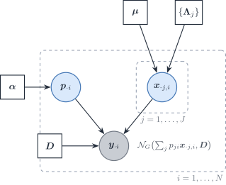

# 5.2 A Bayesian DeCovarT: latent purified profiles, the Wiener filter and variational EM

> **Scope**
>
> Released DeCovarT integrates the purified profiles out and maximises
> the marginal likelihood of the bulk in the proportions ([population
> generative
> vignette](https://bastienchassagnol.github.io/DeCovarT/articles/01-1-population-generative-optimisation.html#sec-unconstrained)).
> This vignette keeps the profiles as latent variables. That gives three
> things the marginal likelihood hides: a closed-form estimate of each
> sample’s purified profiles once the proportions are known (the Wiener
> filter), an EM algorithm for the same maximum-likelihood estimate, and
> a Bayesian version with a prior on the proportions. The Bayesian
> methods already published for this task are reviewed in the
> [distribution-aware deconvolution
> review](https://bastienchassagnol.github.io/DeCovarT/articles/05-1-review-distribution-aware.html#sec-bayesian).
> Nothing here is implemented in
> [`fit_decovart()`](https://bastienchassagnol.github.io/DeCovarT/reference/fit_decovart.md).

## Generative model with latent profiles

For bulk sample i and cell type j, let \boldsymbol{x}\_{\cdot
j,i}\in\mathbb{R}^{G} be the purified profile of type j in that sample,
and \boldsymbol{\Lambda}\_j=\boldsymbol{\Sigma}\_j^{-1} the sparse
precision exported by the gene-network step. The model is

\boldsymbol{p}\_{\cdot i}\sim\mathrm{Dirichlet}(\boldsymbol{\alpha}),
\qquad \boldsymbol{x}\_{\cdot
j,i}\overset{\text{ind}}{\sim}\mathcal{N}\_G\bigl(\boldsymbol{\mu}\_{\cdot
j},\boldsymbol{\Lambda}\_j^{-1}\bigr), \qquad \boldsymbol{y}\_{\cdot
i}\mid\boldsymbol{p}\_{\cdot i},\\\boldsymbol{x}\_{\cdot j,i}\\
\sim\mathcal{N}\_G\Bigl(\sum_jp\_{ji}\boldsymbol{x}\_{\cdot j,i},\\
\boldsymbol{D}\Bigr), \tag{1}

with \boldsymbol{D} a diagonal measurement covariance
(\sigma^{2}\mathbf{I}\_G in the simplest case). Integrating the profiles
out gives

\boldsymbol{y}\_{\cdot i}\mid\boldsymbol{p}\_{\cdot i}\sim
\mathcal{N}\_G\bigl(\boldsymbol{\mu}\boldsymbol{p}\_{\cdot i},\\
\boldsymbol{\Sigma}(\boldsymbol{p}\_{\cdot i})+\boldsymbol{D}\bigr),
\qquad
\boldsymbol{\Sigma}(\boldsymbol{p})=\sum_jp_j^{2}\boldsymbol{\Sigma}\_j,
\tag{2}

which is the DeCovarT likelihood plus a diagonal residual. The residual
matters for the latent formulation: with \boldsymbol{D}=\boldsymbol{0}
the bulk is an exact linear function of the profiles, and their
conditional law is degenerate.

Figure 1: The latent-profile form of DeCovarT. A Dirichlet prior
generates the proportions of sample i; each cell type contributes one
latent purified profile drawn from its reference Gaussian; the bulk is
their proportion-weighted sum plus a diagonal measurement noise.
Integrating the profiles out returns the released DeCovarT likelihood.

## Profiles given the composition: MAP, BLUP and the Wiener filter

Released DeCovarT estimates \boldsymbol{p}\_{\cdot i} after plugging
\boldsymbol{x}\_{\cdot j,i} by \boldsymbol{\mu}\_{\cdot j}. The latent
profiles themselves remain recoverable once \boldsymbol{p}\_{\cdot i} is
treated as known. Write the convolution explicitly,

\boldsymbol{x}\_{\cdot j,i} \sim \mathcal{N}(\boldsymbol{\mu}\_{\cdot
j},\boldsymbol{\Sigma}\_j), \qquad \boldsymbol{y}\_{\cdot i} = \sum_j
p\_{ji}\\\boldsymbol{x}\_{\cdot j,i}, \tag{3}

independent across j given \boldsymbol{p}\_{\cdot i}. Then
\boldsymbol{y}\_{\cdot
i}\sim\mathcal{N}(\boldsymbol{\mu}\boldsymbol{p}\_{\cdot
i},\boldsymbol{\Sigma}(\boldsymbol{p}\_{\cdot i})) with
\boldsymbol{\Sigma}(\boldsymbol{p})=\sum_j
p\_{ji}^{2}\boldsymbol{\Sigma}\_j as in
[Eq. 2](#eq-gaussian-convolution). The joint law of
(\boldsymbol{x}\_{\cdot j,i},\boldsymbol{y}\_{\cdot i}) is Gaussian, so
three classical criteria coincide:

- the **maximum a posteriori** \arg\max\_{\boldsymbol{x}\_j}
  p(\boldsymbol{x}\_j\mid\boldsymbol{y}\_{\cdot
  i},\boldsymbol{p}\_{\cdot i});
- the **best linear unbiased predictor** (Henderson) of the random
  effect \boldsymbol{x}\_{\cdot j,i} in a linear mixed model whose
  variance components \boldsymbol{\mu}\_{\cdot j} and
  \boldsymbol{\Sigma}\_j are known;
- the **Wiener filter**, the linear minimum mean-square estimator of
  \boldsymbol{x}\_{\cdot j,i} from \boldsymbol{y}\_{\cdot i}.

### Linear mixed-model reading

The same convolution is a linear mixed model with known variance
components. The random effect is the purified profile
\boldsymbol{x}\_{\cdot j,i}; the fixed design is the composition
\boldsymbol{p}\_{\cdot i}. Henderson’s BLUP, the Wiener filter and the
conditional mean E(\boldsymbol{x}\_{\cdot j,i}\mid\boldsymbol{y}\_{\cdot
i},\boldsymbol{p}\_{\cdot i}) are the same vector. This is rung 7 of the
[noise-model
ladder](https://bastienchassagnol.github.io/DeCovarT/articles/05-1-review-distribution-aware.html#sec-ladder).

All three equal the posterior mean

\hat{\boldsymbol{x}}\_{\cdot j,i} = \boldsymbol{\mu}\_{\cdot j} +
p\_{ji}\\\boldsymbol{\Sigma}\_j\\
\boldsymbol{\Sigma}(\boldsymbol{p}\_{\cdot i})^{-1}
(\boldsymbol{y}\_{\cdot i}-\boldsymbol{\mu}\boldsymbol{p}\_{\cdot i}).
\tag{4}

With the diagonal residual of [Eq. 1](#eq-bw-model), replace
\boldsymbol{\Sigma}(\boldsymbol{p}\_{\cdot i}) by
\boldsymbol{\Sigma}(\boldsymbol{p}\_{\cdot i})+\boldsymbol{D}. The gain
p\_{ji}\boldsymbol{\Sigma}\_j\boldsymbol{\Sigma}(\boldsymbol{p})^{-1}
shrinks the bulk residual back onto type j in proportion to that type’s
weight and covariance. The experimental helper
[`scripts/experimental/03_04_DeCovarT_estimate_CTS_MAP_Bayesian.R`](https://github.com/bastienchassagnol/DeCovarT/blob/main/scripts/experimental/03_04_DeCovarT_estimate_CTS_MAP_Bayesian.R)
is this update with \boldsymbol{\Sigma}(\boldsymbol{p}) assembled by
[`.compute_global_variance()`](https://bastienchassagnol.github.io/DeCovarT/reference/dot-compute_global_variance.md).
A production path must pass the fitted \boldsymbol{p}\_{\cdot i}, not a
vector of ones.

`bMIND` is the same BLUP with an scRNA-seq prior on
(\boldsymbol{\mu}\_{\cdot j},\boldsymbol{\Sigma}\_j) and a posterior
mean per sample ([Wang et al.
2020](#ref-wangBayesianEstimationCelltypespecific2020)). `BLADE`
replaces the Gaussian by a gene-wise log-normal and infers the latents
variationally ([Andrade Barbosa et al.
2021](#ref-andrade-barbosaBayesianLogNormalDeconvolution2021)). Neither
estimates a sparse \boldsymbol{\Omega}\_j. [Eq. 4](#eq-map-blup)
purifies **one** bulk column. It does not, by itself, re-estimate the
type-level moments (\boldsymbol{\mu}\_{\cdot j},\boldsymbol{\Sigma}\_j)
from a cohort.

The posterior covariance completes [Eq. 4](#eq-map-blup). With
\boldsymbol{W}=(\boldsymbol{\Sigma}(\boldsymbol{p})+\boldsymbol{D})^{-1},

\operatorname{Cov}(\boldsymbol{x}\_{\cdot j,i},\boldsymbol{x}\_{\cdot
k,i}\mid\boldsymbol{y}\_{\cdot i},\boldsymbol{p}\_{\cdot i})
=\delta\_{jk}\boldsymbol{\Sigma}\_j-p\_{ji}p\_{ki}\\\boldsymbol{\Sigma}\_j\boldsymbol{W}\boldsymbol{\Sigma}\_k
. \tag{5}

The cross-type blocks (j\neq k) are negative definite contributions: two
types compete to explain the same residual, so overestimating one
profile forces the other down. Any approximation that drops those blocks
will be overconfident about each profile.

## Expectation–maximisation for the DeCovarT estimate

The latent form gives an EM algorithm for the maximum of the marginal
likelihood [Eq. 2](#eq-gaussian-convolution), with or without a prior on
\boldsymbol{p}.

**E-step.** At the current \boldsymbol{p}^{(t)}, compute the posterior
means \boldsymbol{m}\_j of [Eq. 4](#eq-map-blup) and the covariances
\boldsymbol{C}\_{jk} of [Eq. 5](#eq-bw-postcov). Both need one Cholesky
factor of \boldsymbol{\Sigma}(\boldsymbol{p}^{(t)})+\boldsymbol{D}, the
same cost as one iteration of the released solver.

**M-step.** The prior on the profiles does not depend on \boldsymbol{p},
so only the observation term is maximised:

Q(\boldsymbol{p}) =-\tfrac12\Bigl\[
(\boldsymbol{y}-\boldsymbol{M}\boldsymbol{p})^{\top}\boldsymbol{D}^{-1}(\boldsymbol{y}-\boldsymbol{M}\boldsymbol{p})
+\boldsymbol{p}^{\top}\boldsymbol{T}\boldsymbol{p}\Bigr\]
+\sum_j(\alpha_j-1)\log p_j, \qquad
T\_{jk}=\operatorname{tr}\bigl(\boldsymbol{D}^{-1}\boldsymbol{C}\_{jk}\bigr),
\tag{6}

with \boldsymbol{M}=\[\boldsymbol{m}\_1,\ldots,\boldsymbol{m}\_J\]. The
quadratic part is concave (\boldsymbol{T} is positive semidefinite,
being the expected value of a quadratic form), so the M-step is a
concave program on the simplex when every \alpha_j\ge 1; \alpha_j=1
gives plain maximum likelihood. A scalar
\boldsymbol{D}=\sigma^{2}\mathbf{I}\_G can be updated in the same step,
\sigma^{2}=\\\lVert\boldsymbol{y}-\boldsymbol{M}\boldsymbol{p}\rVert^{2}+\boldsymbol{p}^{\top}\operatorname{tr}(\boldsymbol{C})\boldsymbol{p}\\/G,
where \operatorname{tr}(\boldsymbol{C}) is the J\times J matrix of block
traces.

Each EM iteration increases the marginal log-likelihood (or the
log-posterior), which the Newton-type solvers do not guarantee. Two
limits apply.

- EM converges to a stationary point, not to the global maximum: the
  non-concavity of the DeCovarT likelihood ([MLE
  properties](https://bastienchassagnol.github.io/DeCovarT/articles/01-2-population-inference.html#sec-uniqueness))
  is unchanged by the algorithm.
- EM converges slowly when the latent profiles carry most of the
  uncertainty, that is when \boldsymbol{D} is small relative to
  \boldsymbol{\Sigma}(\boldsymbol{p}). As
  \boldsymbol{D}\to\boldsymbol{0} the fraction of missing information
  tends to one and EM stalls. The analytic score and Hessian of the
  derivatives vignette are then the faster route.

## Mean-field variational EM with sparse precisions

The E-step above inverts a dense G\times G matrix even when every
\boldsymbol{\Lambda}\_j is sparse, because
\boldsymbol{\Sigma}(\boldsymbol{p})=\sum_jp_j^{2}\boldsymbol{\Lambda}\_j^{-1}
is dense. A mean-field approximation q(\boldsymbol{p}\_{\cdot
i},\\\boldsymbol{x}\_{\cdot j,i}\\) =q(\boldsymbol{p}\_{\cdot
i})\prod_jq(\boldsymbol{x}\_{\cdot j,i}) avoids that inverse. Coordinate
ascent on the evidence lower bound gives Gaussian factors
q(\boldsymbol{x}\_{\cdot
j,i})=\mathcal{N}(\boldsymbol{m}\_j,\boldsymbol{S}\_j) with

\boldsymbol{S}\_j^{-1}=\boldsymbol{\Lambda}\_j+\mathbb{E}\_q\[p_j^{2}\]\\\boldsymbol{D}^{-1},
\qquad
\boldsymbol{m}\_j=\boldsymbol{S}\_j\Bigl(\boldsymbol{\Lambda}\_j\boldsymbol{\mu}\_{\cdot
j}
+\mathbb{E}\_q\[p_j\]\\\boldsymbol{D}^{-1}\bigl(\boldsymbol{y}-\textstyle\sum\_{k\neq
j}\mathbb{E}\_q\[p_k\]\\\boldsymbol{m}\_k\bigr)\Bigr). \tag{7}

\boldsymbol{S}\_j^{-1} is the sparse precision plus a diagonal, so a
sparse Cholesky factor per type replaces the dense factor of the exact
E-step. With a point mass
q(\boldsymbol{p})=\delta\_{\hat{\boldsymbol{p}}} (variational EM), the
update for \boldsymbol{p} maximises

\mathcal{L}(\boldsymbol{p})
=-\tfrac12\Bigl\[(\boldsymbol{y}-\boldsymbol{M}\boldsymbol{p})^{\top}\boldsymbol{D}^{-1}(\boldsymbol{y}-\boldsymbol{M}\boldsymbol{p})
+\textstyle\sum_jp_j^{2}\operatorname{tr}(\boldsymbol{D}^{-1}\boldsymbol{S}\_j)\Bigr\]
+\sum_j(\alpha_j-1)\log p_j , \tag{8}

a quadratic program with a logarithmic barrier and no closed form.
Compared with [Eq. 6](#eq-bw-mstep), the cross-type terms T\_{jk}, j\neq
k, are gone, because the mean-field factors are independent. The
variational fixed point is therefore **not** the maximum-likelihood
estimate: it inherits the overconfidence of a factorisation that ignores
the negative posterior correlation between types
([Eq. 5](#eq-bw-postcov)). It is a fast approximation for large sparse
networks, to be checked against the exact EM on a subset of genes.

## Priors on the composition

The prior can be written on the simplex or on the ILR chart used by the
solvers ([population generative
vignette](https://bastienchassagnol.github.io/DeCovarT/articles/01-1-population-generative-optimisation.html#sec-ilr)),
and the two give different maximum a posteriori estimates.

- **Dirichlet on \boldsymbol{p}.** In \boldsymbol{p}, the log-prior
  \sum_j(\alpha_j-1)\log p_j is concave only when every \alpha_j\ge 1.
  Values below one encourage sparse compositions but make the MAP
  problem non-concave. After the change of variables to
  \boldsymbol{\rho}, the density picks up the Jacobian \prod_jp_j (up to
  a constant), and the log-prior becomes \sum_j\alpha_j\log
  p_j(\boldsymbol{\rho}). Each \log
  p_j(\boldsymbol{\rho})=(\mathbf{V}\boldsymbol{\rho})\_j-\operatorname{LSE}(\mathbf{V}\boldsymbol{\rho})
  is concave, so the log-prior is concave in \boldsymbol{\rho} for every
  \alpha_j\>0 and its MAP stays in the interior.
- **Logistic-normal on \boldsymbol{\rho}.** A Gaussian prior
  \boldsymbol{\rho}\sim\mathcal{N}(\boldsymbol{m},\boldsymbol{V}\_{\rho})
  adds -\boldsymbol{V}\_{\rho}^{-1} to the Hessian of the released
  solver and leaves its Newton–Raphson machinery unchanged. It is the
  natural prior when compositions of related samples are expected to be
  correlated, which a Dirichlet cannot express.

Either prior regularises the boundary: where the Wald interval of a
proportion near zero degenerates, the posterior stays proper. A credible
interval is not a frequentist confidence interval, and the prior has to
be defended on biological grounds ([population inference
vignette](https://bastienchassagnol.github.io/DeCovarT/articles/01-2-population-inference.html#sec-intervals)).

## Full posterior

Three routes go beyond the MAP, in increasing cost.

1.  **Laplace approximation in \boldsymbol{\rho}.** Use the analytic
    Hessian of the ILR log-likelihood plus the Hessian of the log-prior
    at the MAP, then push draws of \boldsymbol{\rho} through the
    softmax. Every draw stays inside the simplex.
2.  **Hamiltonian Monte Carlo on \boldsymbol{\rho}.** The marginal
    likelihood [Eq. 2](#eq-gaussian-convolution) and its gradient are
    available in closed form, so a sampler such as Stan can target
    p(\boldsymbol{\rho}\mid\boldsymbol{y}) directly, without the latent
    profiles. The profiles are then drawn from their Gaussian
    conditional [Eq. 4](#eq-map-blup), [Eq. 5](#eq-bw-postcov) given
    each draw.
3.  **Stochastic variational inference.** A Gaussian
    q(\boldsymbol{\rho}) is reparametrisable,
    \boldsymbol{\rho}=\boldsymbol{m}+\boldsymbol{L}\boldsymbol{\varepsilon},
    so low-variance gradients of the ELBO are available. The
    score-function (REINFORCE) estimator is the fallback for factors
    that cannot be reparametrised, at a higher variance.

The Bayesian methods that already use this latent structure, `bMIND`,
`BLADE`, `BayesPrism` and others, differ in the likelihood scale, the
prior on the covariance and the inference algorithm; they are compared
in the
[review](https://bastienchassagnol.github.io/DeCovarT/articles/05-1-review-distribution-aware.html#sec-bayesian).

## References

Andrade Barbosa, Bárbara, Saskia D. van Asten, Ji Won Oh, et al. 2021.
‘Bayesian Log-Normal Deconvolution for Enhanced in Silico
Microdissection of Bulk Gene Expression Data’. *Nature Communications*
12 (1). <https://doi.org/10.1038/s41467-021-26328-2>.

Wang, Jiebiao, Kathryn Roeder, and Bernie Devlin. 2020. *Bayesian
Estimation of Cell-Type-Specific Gene Expression Per Bulk Sample with
Prior Derived from Single-Cell Data*. openRxiv; openRxiv.
<https://doi.org/10.1101/2020.08.05.238949>.
