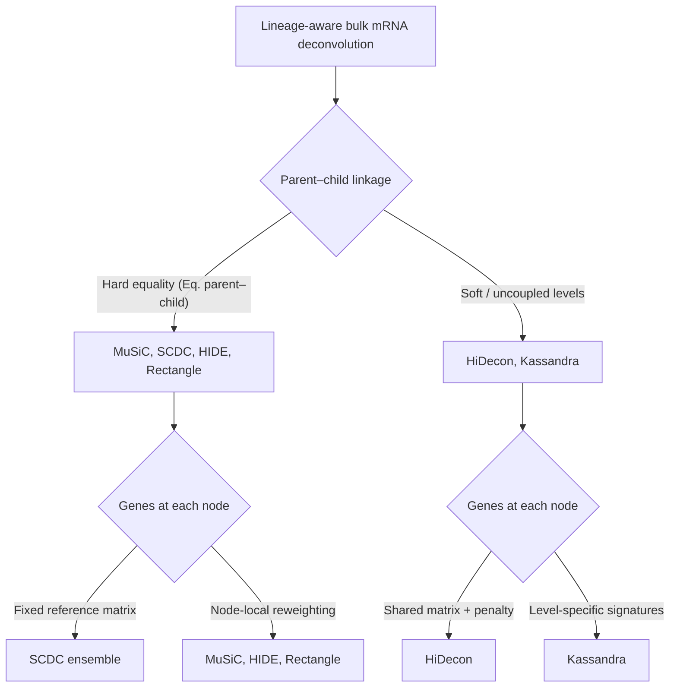
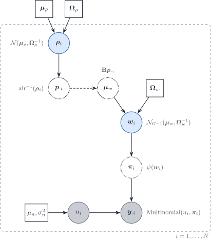

# 5.3 DeCovarT extensions roadmap: lineages, covariates, modalities and beyond

> **Scope**
>
> Extensions that are not implemented but fit the DeCovarT likelihood
> without changing its core: the convolution \boldsymbol{y}\_{\cdot
> i}\mid\boldsymbol{p}\_{\cdot i}\sim
> \mathcal{N}\_G(\boldsymbol{\mu}\boldsymbol{p}\_{\cdot i},
> \boldsymbol{\Sigma}(\boldsymbol{p}\_{\cdot i})) with
> \boldsymbol{\Sigma}(\boldsymbol{p})=\sum_jp_j^{2}\boldsymbol{\Sigma}\_j
> ([population generative
> vignette](https://bastienchassagnol.github.io/DeCovarT/articles/01-1-population-generative-optimisation.html#sec-unconstrained)).
> The same catalogue is tracked in [GitHub issue
> 5](https://github.com/bastienchassagnol/DeCovarT/issues/5). The
> single-cell-specific model (scales, within- and between-replicate
> covariance) is in the [single-cell generative
> vignette](https://bastienchassagnol.github.io/DeCovarT/articles/02-1-single-cell-generative-optimisation.md);
> the Bayesian purification of sample-level profiles is in the [Bayesian
> Wiener-filter
> vignette](https://bastienchassagnol.github.io/DeCovarT/articles/05-2-bayesian-wiener.md);
> inference is in the [population inference
> vignette](https://bastienchassagnol.github.io/DeCovarT/articles/01-2-population-inference.md).

| Extension | What changes in DeCovarT | Section |
|----|----|----|
| Lineage hierarchy | parent–child equality or penalty on \boldsymbol{p} | [Sec. 2](#sec-hierarchical-deconvolution) |
| Sample covariates | \boldsymbol{p}\_{\cdot i} or \boldsymbol{\mu} depend on covariates | [Sec. 3](#sec-covariates) |
| Incomplete reference | one unknown component | [Sec. 4](#sec-semi-reference) |
| Isoforms, proteins, other modalities | stacked features, block covariance | [Sec. 5](#sec-isoforms), [Sec. 6](#sec-multiomics) |
| Spatial spots | neighbouring spots share information | [Sec. 7](#sec-spatial) |
| Time-resolved composition | \boldsymbol{p} evolves along time | [Sec. 8](#sec-dynamics) |
| Continuous states | archetypes instead of discrete types | [Sec. 9](#sec-archetypes) |
| Ensembles | combine several estimators | [Sec. 10](#sec-ensembles) |
| Three covariance layers | within-donor, between-donor, measurement noise | [Sec. 1](#sec-tracks) |
| Gene-wise platform scale | \tilde b_g fitted off the sample being deconvolved | [Sec. 1.1](#sec-platform-scale) |
| Weights and robust losses | GLS, gene weights, robust regression | [Sec. 11](#sec-robust-gls) |
| Gene compositions | a second simplex for genes | [Sec. 12](#sec-logit-normal-compositional) |

Table 1: Extensions and the part of the model each one changes.

## Three covariance layers

With R\ge 2 reference donors the single-cell model separates three
covariance layers that one donor cannot ([reference
moments](https://bastienchassagnol.github.io/DeCovarT/articles/02-1-single-cell-generative-optimisation.html#sec-reference)).
Independent cells add, so the within-donor covariance is linear in
\boldsymbol{p}. One population profile per type is shared by its cells,
so the between-donor covariance is quadratic in \boldsymbol{p}. A third
term is the diagonal measurement noise \boldsymbol{D}\_i. The population
plug-in keeps the quadratic layer. The released single-cell fit keeps
the linear layer. Mean-only and weighted least-squares engines share the
linear mean and the simplex, not this covariance.

### Gene-wise platform scale

A protocol shift can be gene-specific, y\_{gi}\approx\tilde b_g\\ a_i
n_i\sum_j p\_{ji}\tilde\mu\_{gj}. Fitting \tilde{\boldsymbol{b}} on the
bulk sample being deconvolved lets the scale absorb the residual, and
\boldsymbol{p}\_{\cdot i} is then unidentified. The ratio is estimated
on an external paired cohort, or it is not estimated. The argument is in
the [single-cell generative
vignette](https://bastienchassagnol.github.io/DeCovarT/articles/02-1-single-cell-generative-optimisation.md)
(gene-wise platform ratio).

Notation: gene g, cell type j, bulk sample i; \boldsymbol{y}\_{\cdot i}
the bulk profile; \boldsymbol{p}\_{\cdot i} the cell fractions;
\boldsymbol{\mu}\_{\cdot j} and \boldsymbol{\Sigma}\_j the reference
moments; \boldsymbol{x}\_{\cdot j,i} the purified profile of type j in
sample i.

## Lineage-aware hierarchical deconvolution

Flat deconvolution treats every cell type as a sibling on one simplex.
**Hierarchical** methods instead estimate proportions at several
granularities linked by a cell-type tree: broad compartments first, then
closely related subtypes whose mean signatures are collinear at the leaf
level.

We reuse the DeCovarT set-up from the
[article](https://bastienchassagnol.github.io/DeCovarT/article/main.pdf):
gene g=1,\ldots,G; cell type or tree node j; sample i=1,\ldots,N
(independence across i). Slices follow the usual dot notation
(\boldsymbol{\mu}\_{\cdot j}, \boldsymbol{y}\_{\cdot i}).

- \boldsymbol{y}=(y\_{gi})\in\mathbb{R}\_{+}^{G\times N}: bulk
  expression; \boldsymbol{y}\_{\cdot i}\in\mathbb{R}\_{+}^{G} is sample
  i.
- \boldsymbol{\mu}=(\mu\_{gj})\in\mathbb{R}^{G\times J}: mean signature;
  \boldsymbol{\mu}\_{\cdot j}\in\mathbb{R}^{G} is the cross-sample mean
  profile of type j (as in `MuSiC` ([Wang et al.
  2019](#ref-wangBulkTissueCell2019))).
- \boldsymbol{p}=(p\_{ji})\in\\\]0,1\[^{J\times N}: unknown relative
  proportions; \boldsymbol{p}\_{\cdot i}\in\\\]0,1\[^{J} is the
  composition of sample i.

\boldsymbol{y}\_{\cdot i}=\boldsymbol{\mu}\\\boldsymbol{p}\_{\cdot i},
\tag{1}

\sum\_{j=1}^{J} p\_{ji}=1, \qquad p\_{ji}\ge 0 \qquad (i=1,\ldots,N).
\tag{2}

p\_{j,i}=\sum\_{c\in\mathcal{C}(j)} p\_{c,i} \qquad (i=1,\ldots,N).
\tag{3}

At each tree level the bulk mixture satisfies
[Eq. 1](#eq-hierarchical-linear) with each composition on the unit
simplex ([Eq. 2](#eq-simplex-constraint)). For a parent node j with
child set \mathcal{C}(j), coherent hierarchical estimates require
[Eq. 3](#eq-parent-child).

### Hard versus soft lineage constraints

Despite diverse implementations, hierarchical bulk mRNA deconvolution
methods fall into **two constraint regimes**:

- **Hard constraints** — child lineage ratios are forced to sum exactly
  to the parent estimate ([Eq. 3](#eq-parent-child)). `MuSiC` and `SCDC`
  (tree-guided mode) first fix a parent total \hat{p}\_{j,i}, then fit
  children q\_{c,i} on the within-parent simplex so that
  \hat{p}\_{c,i}=q\_{c,i}\\\hat{p}\_{j,i} ([Wang et al.
  2019](#ref-wangBulkTissueCell2019); [Dong et al.
  2021](#ref-dongSCDCBulkGene2021)). `HIDE` applies the same equality by
  renormalising child estimates after each top-down split ([Völkl et al.
  2025](#ref-voelklHIDEHierarchicalCelltype2025)); `Rectangle`
  propagates coarse cluster fractions as hard bounds on fine-grained
  estimates ([Eder et al. 2026](#ref-ederRectangleRobustScalable2026)).
- **Soft constraints** — parent–child coherence is encouraged but not
  enforced exactly. `HiDecon` adds a squared mismatch penalty to the
  deconvolution loss ([Huang, Cai, Lu, et al.
  2024](#ref-huangAccurateEstimationRare2024)); `Kassandra` trains
  separate predictors at predefined hierarchy levels without an explicit
  parent–child equality ([Zaitsev et al.
  2022](#ref-zaitsevPreciseReconstructionTME2022)).

Hard splitting after fixing the parent ([Eq. 4](#eq-hard-child-split)):

\hat{p}\_{c,i}=q\_{c,i}\\\hat{p}\_{j,i}, \quad q\_{c,i}\ge 0,\\
\sum\_{c\in\mathcal{C}(j)} q\_{c,i}=1. \tag{4}

`HIDE` renormalisation ([Eq. 5](#eq-hide-renorm)):

\hat{p}\_{c,i}\leftarrow \hat{p}\_{c,i}\\
\frac{\hat{p}\_{j,i}}{\sum\_{c'\in\mathcal{C}(j)}\hat{p}\_{c',i}}.
\tag{5}

`HiDecon` soft penalty ([Eq. 6](#eq-soft-penalty)):

\mathcal{L}\_{\mathrm{tot}} = \mathcal{L}\_{\mathrm{deconv}} +
\lambda\sum\_{j}\sum\_{i=1}^{N} \Bigl(
p\_{j,i}-\sum\_{c\in\mathcal{C}(j)} p\_{c,i} \Bigr)^{2}. \tag{6}

Within each regime, methods further differ by whether they reuse a
**single reference signature** at every granularity or **reselect /
reweight genes** locally at each internal node
([Figure 1](#fig-hierarchical-taxonomy)).

Figure 1: Taxonomy of lineage-aware bulk mRNA deconvolution:
parent–child constraint (hard vs soft) and reference-gene strategy
(fixed matrix vs node-local weights).

`xCell` 2.0 ([Angel et al. 2025](#ref-angelXCell20Robust2025)) uses Cell
Ontology ancestry to build signatures and control spillover between
related labels, but its outputs are enrichment scores rather than a
compositional tree; it sits outside the hard/soft fraction taxonomy
above.

| method | constraint | lineage constraint | gene strategy |
|----|----|----|----|
| MuSiC | Hard | Fix \\\hat{p}\_{j,i}\\; \\\hat{p}\_{c,i}=q\_{c,i}\hat{p}\_{j,i}\\, \\\sum_c q\_{c,i}=1\\ | Node-local consistent genes |
| SCDC | Hard (tree-guided) | MuSiC step; \\\hat{p}\_{c,i}=q\_{c,i}\hat{p}\_{j,i}\\ | Full reference; optional node split |
| HIDE | Hard | Fit then renormalise: \\\hat{p}\_{c,i}\leftarrow\hat{p}\_{c,i}\hat{p}\_{j,i}/\sum\_{c'}\hat{p}\_{c',i}\\ | Parent-specific learned weights |
| Rectangle | Hard (multiscale) | Coarse \\\boldsymbol{p}^{(\mathrm{coarse})}\\ bounds fine estimates | Clustered + direct signatures |
| HiDecon | Soft | \\\mathcal{L}\_{\mathrm{tot}}=\mathcal{L}\_{\mathrm{deconv}}+\lambda\sum\_{j,i}(p\_{j,i}-\sum_c p\_{c,i})^2\\ | Shared \$\boldsymbol{\mu}\$; joint penalised fit |
| Kassandra | Soft / uncoupled | Separate models; no parent–child equality | Level-specific trained signatures |
| xCell 2.0 | None (scores) | Ontology spillover control only | Ontology-aware signature generation |

Table 2: Lineage-aware bulk mRNA deconvolution: constraint regime,
enforcing equation, and gene strategy (2019–2026 census).

[Table 2](#tbl-hierarchical-methods) and
[Figure 1](#fig-hierarchical-taxonomy) summarise the landscape aligned
with [Eq. 1](#eq-hierarchical-linear)–[Eq. 3](#eq-parent-child).
**Hard** methods (`MuSiC`, `HIDE`, `Rectangle`) are easier to audit node
by node but inherit upstream bias; **soft** coupling (`HiDecon`) can
stabilise rare subtypes when the tree is credible. **Node-local gene
reweighting** (`MuSiC`, `HIDE`, `Rectangle`) targets collinear siblings;
**fixed or level-specific signatures** (`SCDC`, `Kassandra`) trade
flexibility for simpler reference construction.

A natural DeCovarT extension would combine [the Gaussian
convolution](https://bastienchassagnol.github.io/DeCovarT/articles/05-4-mixture-experiments.html#eq-gaussian-convolution)
with either [Eq. 4](#eq-hard-child-split) or [Eq. 6](#eq-soft-penalty),
node-local marker panels, and [ALR
optimisation](https://bastienchassagnol.github.io/DeCovarT/articles/01-1-population-generative-optimisation.html#sec-alr)
when a curated lineage tree is supplied—benchmarked at broad,
intermediate, and terminal resolutions against `HiDecon`, `HIDE`,
tree-guided `MuSiC`, and `Rectangle`. Spatial `HIDF` applies the same
tree idea to spots with an `RCTD` back-end ([Zou et al.
2026](#ref-zouHidfIntegratingTreeStructured2026)); `scDETECT` uses a
lineage prior for differential expression rather than for \boldsymbol{p}
([Xu et al. 2025](#ref-xuScdetectNovelStatisticalModel2025)). Archetypes
and cell states (type versus shared gene-expression programmes) are
taken up in [Sec. 9](#sec-archetypes).

## Sample-level covariates

A condition, tissue, batch, sex or age vector \boldsymbol{z}\_{i} is
indexed by sample i, whereas \boldsymbol{\mu} has genes in rows and cell
types in columns. Covariates therefore cannot be appended as extra
columns of the signature. Two generative extensions are distinct ([Fan
et al. 2022](#ref-fanMusic2CellTypeDeconvolution2022)).

**State model.** Condition alters the reference distribution,

\boldsymbol{x}\_{\cdot j,i}\mid\boldsymbol{z}\_{i} \sim\mathcal{N}\_G
\bigl(\boldsymbol{\mu}\_{j}(\boldsymbol{z}\_{i}),\boldsymbol{\Sigma}\_{j}(\boldsymbol{z}\_{i})\bigr),
\tag{7}

for example
\boldsymbol{\mu}\_{j}(\boldsymbol{z}\_{i})=\boldsymbol{\mu}\_{j}+B\_{j}\boldsymbol{z}\_{i}.
The bulk law is then [the Gaussian
convolution](https://bastienchassagnol.github.io/DeCovarT/articles/05-4-mixture-experiments.html#eq-gaussian-convolution)
with those condition-dependent moments. `MuSiC2` addresses the same
mismatch by iteratively dropping cell-type-specific DE genes between the
bulk condition and the scRNA-seq reference; it remains closed-reference
and cannot invent novel types ([Fan et al.
2022](#ref-fanMusic2CellTypeDeconvolution2022)).

**Composition model.** Condition alters \boldsymbol{p}\_{\cdot i}
through the existing ALR coordinates \boldsymbol{\rho}\_{i},

\boldsymbol{\rho}\_{i}=B\boldsymbol{z}\_{i}+\boldsymbol{u}\_{i}, \qquad
\boldsymbol{p}\_{\cdot i}=\psi(\boldsymbol{\rho}\_{i}), \tag{8}

with \psi the [additive logistic
map](https://bastienchassagnol.github.io/DeCovarT/articles/01-1-population-generative-optimisation.html#eq-alr-maps).
This is the setting in which a future
[`predict()`](https://rdrr.io/r/stats/predict.html) method on new
\boldsymbol{z} would be meaningful.

A known sequencing exposure s\_{i} is a **multiplicative** scale,
\boldsymbol{y}\_{\cdot
i}\sim\mathcal{N}\_G(s\_{i}\boldsymbol{\mu}\boldsymbol{p}\_{\cdot
i},s\_{i}^{2}\Sigma(\boldsymbol{p}\_{\cdot i})), not an additive `lm`
offset. Cell-type transcriptome size r\_{j} is a different parameter
([RNA versus cell
fractions](https://bastienchassagnol.github.io/DeCovarT/articles/02-1-single-cell-generative-optimisation.html#sec-uncoupling)).
A gene-wise affine standardisation applied identically to
\boldsymbol{y}, \boldsymbol{\mu} and every \boldsymbol{\Sigma}\_{j}
leaves \hat{\boldsymbol{p}} unchanged in exact arithmetic; column-wise
[`scale()`](https://rdrr.io/r/base/scale.html) on \boldsymbol{\mu} does
not.

## Incomplete references

Closed-reference DeCovarT assumes every abundant type appears as a
column of \boldsymbol{\mu}. An unrepresented population contributes a
structured gene vector \boldsymbol{u}\_{i}, not a scalar intercept:

\boldsymbol{y}\_{\cdot i} =\boldsymbol{\mu}\\\boldsymbol{p}\_{\cdot
i}^{\mathrm{known}}
+p\_{u,i}\boldsymbol{u}\_{i}+\boldsymbol{\varepsilon}\_{i}, \qquad
\sum\_{j}p\_{ji}+p\_{u,i}=1. \tag{9}

`DICEPro` shows that supervised engines remain stable while most types
are present and then collapse as \boldsymbol{\mu} becomes incomplete,
especially when the missing type is abundant; it wraps existing methods
by adjusting reference signatures ([Ba et al.
2026](#ref-baWhenLessNot2026)). `BayICE` is a univariate-Gaussian
Bayesian semi-reference model that estimates known types **and one
unknown type**, with spike-and-slab selection of genes and columns of
\boldsymbol{\mu} ([Tai et al.
2021](#ref-taiBayiceBayesianHierarchicalModel2021)). Montierth et al.
convolve negative binomials for known components plus an unknown tumour
component, assuming proportions shift means but not dispersions
([Montierth et al.
2025](#ref-montierthDeconvolutionSparsecountRNA2025)). `CDState`
reconstructs malignant **states** rather than a single tumour column
([Kraft et al. 2026](#ref-kraftCdstateResolvesMalignantCell2026)).
`EPIC` already includes an uncharacterised compartment in its signature
([Racle et al. 2017](#ref-racleSimultaneousEnumerationCancer2017)).
Semi-CAM uses partial marker information ([Dong et al.
2020](#ref-dongSemiCAMSemisupervisedDeconvolution2020)); `BLEND`
automates reference-panel selection ([Huang, Cai, McKennan, et al.
2024](#ref-huangBLENDProbabilisticCellular2024)).

## Isoform-level observations

Gene-level \boldsymbol{y}\in\mathbb{R}\_{+}^{G} discards differential
isoform usage. Expanding the observation to transcripts t=1,\ldots,T
(short-read quantification or long-read) yields a taller signature
\boldsymbol{\mu}^{\mathrm{iso}}\in\mathbb{R}^{T\times J}. `IsoDeconvMM`
estimates \boldsymbol{p} from isoform-level expression, even from a
single gene, by exploiting differential isoform usage rather than
gene-level DE; full-length long-read or spatial RNA-seq are the natural
sources of cell-type- and isoform-specific references when droplet
scRNA-seq misses isoforms ([Heiling et al.
2023](#ref-heilingEstimatingCellTypeComposition2023)).

## Multi-modal and multi-omics

Bulk deconvolution is one arm of a multi-scale tumour-immune map that
also includes scRNA-seq and spatial assays ([Sun et al.
2026](#ref-sunMultiScaleTranscriptomicsRedefining2026)). `DECODE` trains
a shared deconvolution architecture across omics ([Zhao et al.
2026](#ref-zhaoDecodeDeepLearningBased2026)). Yao et al. reconstruct
cell-type-specific regulatory processes from paired ATAC-seq and bulk
RNA-seq, benchmarking against CIBERSORTx ([Yao et al.
2026](#ref-yaoHighResolutionReconstructionCell2026)).
Proteomics-constrained deconvolution uses protein abundance as a
regulariser on transcriptomic \boldsymbol{p} / CTS ([Işık et al.
2026](#ref-isikProteomicsConstrainedDeconvolutionReveals2026)). `Unico`
already treats expression and DNA methylation under one tensor model
([Chen et al. 2025](#ref-chenUnicoUnifiedModelCell2025)). The HADACA3
community benchmark stresses the limits of naive multimodal
concatenation ([Barbot and Richard
2026](#ref-barbotPromisesLimitsMultimodal2026)).

## Spatial transcriptomics

Each spot (or pixel) s is a local mixture \boldsymbol{y}(s) with its own
\boldsymbol{p}(s)\in\Delta^{J-1}. The Gaussian convolution still applies
per location; space enters as dependence among neighbouring
\boldsymbol{p}(s). `RCTD` does **not** use that dependence: each pixel
is an independent count mixture ([the `RCTD` Poisson–log-normal
law](https://bastienchassagnol.github.io/DeCovarT/articles/05-1-review-distribution-aware.html#eq-rctd-pln)),
so the statistical comparison belongs in [the `RCTD`
comparison](https://bastienchassagnol.github.io/DeCovarT/articles/05-1-review-distribution-aware.html#sec-rctd)
([Cable et al. 2022](#ref-cableRobustDecompositionCell2022a)).
Sequencing-based surveys classify probabilistic assumptions and provide
practical benchmarks ([Saqib and Kim
2025](#ref-saqibPixelsCellTypes2025); [Gaspard-Boulinc et al.
2025](#ref-gaspard-boulincCelltypeDeconvolutionMethods2025); [Li et al.
2023](#ref-liComprehensiveBenchmarkingPractical2023)). Imaging-based
reconstruction goes the other way: `HistoMap` generates single-cell-like
profiles from bulk with a variational autoencoder and maps them onto
histological coordinates with an H-ViT ([He et al.
2026](#ref-heHistomapReconstructingSpatiallyResolved2026)); `HEDeST`
pairs H&E with spot-level \hat{\boldsymbol{p}}(s) ([Gortana et al.
2026](#ref-gortanaHedestIntegrativeApproachEnhance2026)). `SpaDecoder`
aligns slices, infers neighbourhoods, and uses 3-D Gaussian kernels,
with an explicit simplex constraint and a penalty on the number of types
per spot ([Lobo et al.
2026](#ref-loboSpatiotemporalCellTypeDeconvolution2026)). Under
**cell-type mismatch**, missing types are mostly absorbed by the most
similar column of \boldsymbol{\mu} ([Mahamune et al.
2025](#ref-mahamuneSystematicEvaluationRobustnessDeconvolution2025)) —
the spatial counterpart of [Sec. 4](#sec-semi-reference).

## Time-resolved composition

When J\>G the linear map is under-determined. Elastic-net methods such
as `DCQ` (`glmnet`) select the **support of cell types that change**
between biological states, rather than recovering a full simplex
snapshot ([Altboum et al.
2014](#ref-altboumDigitalCellQuantification2014); [Friedman et al.
2026](#ref-R-glmnet)). Static benchmarks that score these methods as
poor deconvolution miss that target ([Jin and Liu
2021](#ref-jinBenchmarkRNAseqDeconvolution2021)). `DCQ` tracked 213
immune subtypes across ten influenza time points and reported changes in
about 70 types; `ImmQuant` packages a similar pipeline ([Frishberg et
al. 2016](#ref-frishbergImmQuantUserfriendlyTool2016)).

A DeCovarT trajectory would put a temporal prior on ALR coordinates,
e.g. \boldsymbol{\rho}\_{i}(t)=\boldsymbol{\rho}\_{i}(t-1)+\boldsymbol{\eta}\_{t},
as in `ChronoStrain`’s Bayesian strain trajectories ([Kim et al.
2025](#ref-kimLongitudinalProfilingLowAbundance2025)). `scTREND`
supplies an annotation-free single-cell hazard clock for organoid /
gastruloid time courses ([Yuki et al.
2026](#ref-yukiSctrendAnnotationFreeSingle2026)). `SpaDecoder` adds
space–time kernels on spots ([Lobo et al.
2026](#ref-loboSpatiotemporalCellTypeDeconvolution2026)).

## Archetypes, states, and potency

A finite J-column signature is a piecewise approximation of within-type
continua. **Archetypal analysis** places cells on a simplicial polytope
whose vertices are extreme programmes, avoiding NMF/ICA rotational
ambiguity ([Hart et al. 2015](#ref-hartInferringBiologicalTasks2015);
[Crowley et al. 2026](#ref-crowleyParetoOptimalityRevealsAtlas2026)).
`ACTION` separates transcriptional identity (cell type) from activity
states (shared gene-expression programmes) and chooses k automatically
([Mohammadi et al.
2020](#ref-mohammadiAMultiresolutionFrameworkCharacterize2020));
`scAAnet` extends that construction with a VAE and a zero-inflated
negative-binomial reconstruction ([Wang and Zhao
2022](#ref-wangNonLinearArchetypalAnalysis2022)). `tissueResolver`
builds a virtual tissue without predefined labels, aiming at fine states
within types ([Simeth et al.
2024](#ref-simethVirtualTissueExpressionAnalysis2024)). Potency and
differentiation scores, as in hypothalamic–pituitary organoids, replace
discrete labels by a continuous axis ([Asano et al.
2024](#ref-asanoADeepLearningApproach2024)). Macrophage M1/M2
polarisation is the standard biological example of a
microenvironment-dependent continuum rather than two extra columns of
\boldsymbol{\mu}.

## Ensembles

Two operations are easily confused. **Several references, one
algorithm:** `MuSiC` weights subjects and `SCDC` weights scRNA-seq
studies ([Wang et al. 2019](#ref-wangBulkTissueCell2019); [Dong et al.
2021](#ref-dongSCDCBulkGene2021)). **Several algorithms, one consensus
\hat{\boldsymbol{p}}:** `EnsDeconv` fuses 11 bulk engines plus variation
in references, markers and normalisation by cell-type-specific robust
regression, on 4,937 samples with measured fractions ([Cai et al.
2022](#ref-caiRobustAccurateEstimation2022)). `EnDecon` runs 14 spatial
(and bulk) methods and forms a weighted-median consensus, down-weighting
discordant engines ([Tu et al.
2023](#ref-tuEndeconCellTypeDeconvolution2023)). The DREAM community
assessment found that a mean-rank ensemble beat every individual method
([White et al.
2024](#ref-whiteCommunityAssessmentMethodsDeconvolve2024)).

## Robust regression, GLS, and gene weights

Let W=\mathrm{diag}(w\_{1},\ldots,w\_{G}) be gene-specific precision
weights (DWLS dampening, voom mean–variance weights, or inverse
leverage). Weighted least squares minimises (\boldsymbol{y}\_{\cdot
i}-\boldsymbol{\mu}\boldsymbol{p}\_{\cdot i})^{\top}
W(\boldsymbol{y}\_{\cdot i}-\boldsymbol{\mu}\boldsymbol{p}\_{\cdot i})
([Tsoucas et al. 2019](#ref-tsoucasAccurateEstimationCelltype2019); [Law
et al. 2014](#ref-lawVoomPrecisionWeights2014)). CIBERSORT’s \nu-SVR
replaces squared error by a robust hinge ([Newman et al.
2015](#ref-newmanRobustEnumerationCell2015)).

**Generalised least squares** uses a single residual covariance W that
does **not** depend on \boldsymbol{p}. With \boldsymbol{\Sigma}\_j
known, the gold-standard competitor is mean-only GLS with a G\times G
covariance W held fixed (the local helper of
`scripts/supp_S4_covariance_modeling.R`), typically
\operatorname{diag}\\\sum_j \bar p_j^2\boldsymbol{\Sigma}\_j\\ at \bar
p_j=1/J (or at a known design p^{\star}). Then

\hat{\boldsymbol{p}}^{\mathrm{GLS}}
=(\boldsymbol{\mu}^{\top}W^{-1}\boldsymbol{\mu})^{-1}\boldsymbol{\mu}^{\top}W^{-1}\boldsymbol{y}\_{\cdot
i}, \tag{10}

after which the simplex is imposed by projection. Do **not** copy W into
every DeCovarT tensor slice: \sum_j p_j^2 W=\\p\\\_2^2 W still depends
on p. WLS is the diagonal special case. DeCovarT is strictly richer:
\Sigma(\boldsymbol{p})=\sum\_{j}p\_{ji}^{2}\boldsymbol{\Sigma}\_{j}
depends on the unknown coefficients.
[`nlme::gls()`](https://rdrr.io/pkg/nlme/man/gls.html) is for
*estimating* a structured \Sigma (AR(1), compound symmetry); it is the
wrong tool when W is already known.

A direct extension, following the BayesPrism–DWLS construction ([Zhang
et al. 2026](#ref-zhangIntegratedInferenceCellularCompositions2026)), is
to ingest W into the convolution: transform
\boldsymbol{y}^{\star}=W^{1/2}\boldsymbol{y}\_{\cdot i},
\boldsymbol{\mu}^{\star}=W^{1/2}\boldsymbol{\mu},
\boldsymbol{\Sigma}\_{j}^{\star}=W^{1/2}\boldsymbol{\Sigma}\_{j}W^{1/2}
and run the existing solver — weighted GLS with cell-type-specific
networks retained.

`cellGeometry` estimates uncertainty from gene-wise heteroscedasticity
and the cross-sample variance of each gene, i.e. a **global**
gene/sample covariance rather than \boldsymbol{\Sigma}\_{j} ([Lau et al.
2026](#ref-lauCellGeometryUltrafastSinglecell2026)). `Unico` deconvolves
a 2-D bulk matrix into a 3-D sample \times feature \times cell-type
tensor and explicitly models cell-type-level covariances, including on
methylation ([Chen et al. 2025](#ref-chenUnicoUnifiedModelCell2025)).
Interaction monomials p\_{j}p\_{k} in the mean ([the interaction
mean](https://bastienchassagnol.github.io/DeCovarT/articles/05-4-mixture-experiments.html#eq-interaction-mean))
are the Scheffé / general-linear-model route; `DecOT` instead changes
the discrepancy to an optimal-transport loss ([Liu et al.
2022](#ref-liuDecotBulkDeconvolutionOptimal2022)).

## Two simplices without convolution

McGregor et al. model a count vector of D features as **compositional**,
not as a mixture of cell-type Gaussians ([McGregor et al.
2026](#ref-mcgregorProportionalitybasedAssociationMetrics2026)). In
DeCovarT notation the features are the G genes. Sample i has library
size n_i and gene composition \boldsymbol{\pi}\_i\in\Delta^{G-1}. The
observation is multinomial,

\boldsymbol{y}\_{\cdot i}\mid n_i,\boldsymbol{\pi}\_i
\sim\mathrm{Multinomial}(n_i,\boldsymbol{\pi}\_i), \qquad
n_i\sim\mathrm{LogNormal}(\mu_n,\sigma_n^2), \tag{11}

with n_i\perp\boldsymbol{\pi}\_i (read depth is treated as a technical
scale). The composition is logit-normal on the ALR chart that uses gene
G as the reference,

\boldsymbol{w}\_i =\mathrm{alr}(\boldsymbol{\pi}\_i)
=\log(\pi\_{1,i}/\pi\_{G,i},\ldots,\pi\_{G-1,i}/\pi\_{G,i}), \qquad
\boldsymbol{w}\_i\sim\mathcal{N}\_{G-1}(\boldsymbol{\mu}\_w,\boldsymbol{\Sigma}\_w),
\qquad \boldsymbol{\pi}\_i=\psi(\boldsymbol{w}\_i), \tag{12}

where \psi is the additive logistic map of the ALR chart. When G is
large relative to the number of bulk samples, McGregor et al. penalise
the Gaussian log-likelihood of the \boldsymbol{w}\_i with a graphical
lasso on the ALR precision
\boldsymbol{\Omega}\_w=\boldsymbol{\Sigma}\_w^{-1} ([Friedman et al.
2008](#ref-friedmanSparseInverseCovariance2008)), or the same \ell_1
penalty on the CLR precision
(\mathbf{G}^{\mathsf{T}}\boldsymbol{\Sigma}\_w\mathbf{G})^{-1}. That
shrinks spurious gene–gene partial correlations. Their target is
proportionality (\phi, \rho, log-ratio variances) on the latent
\boldsymbol{\pi}\_i, because empirical log-ratios of raw counts are
biased by variation in n_i.

This is **not** DeCovarT’s convolution ([the Gaussian
convolution](https://bastienchassagnol.github.io/DeCovarT/articles/05-4-mixture-experiments.html#eq-gaussian-convolution)).
There is no mixing \sum_j p_j\boldsymbol{\mu}\_j of purified profiles,
and no \boldsymbol{\Sigma}(\boldsymbol{p})=\sum_j
p_j^2\boldsymbol{\Sigma}\_j. Current DeCovarT treats
\boldsymbol{y}\_{\cdot i} as an unbounded continuous intensity. Library
size is omitted: the counts are not constrained to sum to n_i.

A fully compositional deconvolution would keep **two** simplices. Cell
ratios \boldsymbol{p}\_i\in\Delta^{J-1} stay on the existing ALR chart
\boldsymbol{\rho}\_i=\mathrm{alr}(\boldsymbol{p}\_i). Gene composition
stays on [Eq. 12](#eq-mln-alr). The two can be coupled by a regression
of the gene-ALR mean on \boldsymbol{p}\_i, for example
\boldsymbol{\mu}\_w(\boldsymbol{p}\_i)=\mathbf{B}\boldsymbol{p}\_i,
still without forming a Gaussian convolution of cell-type covariances.
[Figure 2](#fig-mln-dag) is that joint directed graph, drawn with the
symbol key of the other plate diagrams: grey circles observed, blue
circles latent, dotted circles deterministic, squares fixed.

Figure 2: Directed graph for a logit-normal multinomial gene composition
(McGregor et al.) extended with a second simplex for cell-type ratios.
Grey circles are observed, blue circles are latent, dotted circles are
deterministic and squares are fixed parameters. The dashed arrow from
\boldsymbol{p}\_{\cdot i} into \boldsymbol{\mu}\_w is the optional
deconvolution link; it is not a Gaussian convolution of
\boldsymbol{\Sigma}\_j.

## References

Altboum, Zeev, Yael Steuerman, Eyal David, et al. 2014. ‘Digital Cell
Quantification Identifies Global Immune Cell Dynamics During Influenza
Infection’. *Molecular Systems Biology* 10.
<https://doi.org/10.1002/msb.134947>.

Angel, Almog, Loai Naom, Shir Nabet-Levy, and Dvir Aran. 2025. ‘xCell
2.0: Robust Algorithm for Cell Type Proportion Estimation Predicts
Response to Immune Checkpoint Blockade’. *Genome Biology* 26 (1): 335.
<https://doi.org/10.1186/s13059-025-03784-3>.

Asano, Tomoyoshi, Hidetaka Suga, Hirohiko Niioka, et al. 2024. ‘A Deep
Learning Approach to Predict Differentiation Outcomes in
Hypothalamic-Pituitary Organoids’. *Communications Biology* 7 (1).
<https://doi.org/10.1038/s42003-024-07109-1>.

Ba, Kalidou, Rodolphe Thiébaut, Xavier Hinaut, and Boris Hejblum. 2026.
*When Less Is Not More: DICEPro Mitigates the Impact of Incomplete
Reference Matrices on Cellular Frequency Deconvolution*. bioRxiv.
<https://doi.org/10.64898/2026.06.17.732876>.

Barbot, Hugo, and Magali Richard. 2026. ‘On the Promises and Limits of
Multimodal Integration for Deconvolution: The HADACA3 Benchmark’.
*NeurIPS*.

Cable, Dylan M., Evan Murray, Luli S. Zou, et al. 2022. ‘Robust
Decomposition of Cell Type Mixtures in Spatial Transcriptomics’. *Nature
Biotechnology* 40 (4): 517–26.
<https://doi.org/10.1038/s41587-021-00830-w>.

Cai, Manqi, Molin Yue, Tianmeng Chen, et al. 2022. ‘Robust and Accurate
Estimation of Cellular Fraction from Tissue Omics Data via Ensemble
Deconvolution’. *Bioinformatics* 38.
<https://doi.org/10.1093/bioinformatics/btac279>.

Chen, Zeyuan Johnson, Elior Rahmani, and Eran Halperin. 2025. ‘Unico: A
Unified Model for Cell-Type Resolution Genomics from Heterogeneous Omics
Data’. *Genome Biology* 26 (1).
<https://doi.org/10.1186/s13059-025-03776-3>.

Crowley, George, Uri Alon, and Stephen R. Quake. 2026. ‘Pareto
Optimality Reveals an Atlas of Cellular Archetypes’. *Proceedings of the
National Academy of Sciences* 123 (11).
<https://doi.org/10.1073/pnas.2530194123>.

Dong, Li, Avinash Kollipara, Toni Darville, Fei Zou, and Xiaojing Zheng.
2020. ‘Semi-CAM: A Semi-Supervised Deconvolution Method for Bulk
Transcriptomic Data with Partial Marker Gene Information’. *Scientific
Reports* 10. <https://doi.org/10.1038/s41598-020-62330-2>.

Dong, Meichen, Aatish Thennavan, Eugene Urrutia, et al. 2021. ‘SCDC:
Bulk Gene Expression Deconvolution by Multiple Single-Cell RNA
Sequencing References’. *Briefings in Bioinformatics* 22.
<https://doi.org/10.1093/bib/bbz166>.

Eder, Bernhard, Irene Rigato, Alexander Dietrich, et al. 2026.
*Rectangle: Robust and Scalable Multiscale Deconvolution Informed by
Single-Cell RNA Sequencing Data*. bioRxiv.
<https://doi.org/10.64898/2026.07.07.736950>.

Fan, Jiaxin, Yafei Lyu, Qihuang Zhang, Xuran Wang, Mingyao Li, and Rui
Xiao. 2022. ‘MuSiC2: Cell-Type Deconvolution for Multi-Condition Bulk
RNA-seq Data’. *Briefings in Bioinformatics* 23 (6).
<https://doi.org/10.1093/bib/bbac430>.

Friedman, Jerome, Trevor Hastie, Rob Tibshirani, et al. 2026. *Glmnet:
Lasso and Elastic-Net Regularized Generalized Linear Models*.
<https://glmnet.stanford.edu>.

Friedman, Jerome, Trevor Hastie, and Robert Tibshirani. 2008. ‘Sparse
Inverse Covariance Estimation with the Graphical Lasso’. *Biostatistics
(Oxford, England)* 9. <https://doi.org/10.1093/biostatistics/kxm045>.

Frishberg, Amit, Avital Brodt, Yael Steuerman, and Irit Gat-Viks. 2016.
‘ImmQuant: A User-Friendly Tool for Inferring Immune Cell-Type
Composition from Gene-Expression Data’. *Bioinformatics* 32.
<https://doi.org/10.1093/bioinformatics/btw535>.

Gaspard-Boulinc, Lucie C., Luca Gortana, Thomas Walter, Emmanuel
Barillot, and Florence M. G. Cavalli. 2025. ‘Cell-Type Deconvolution
Methods for Spatial Transcriptomics’. *Nature Reviews Genetics* 26.
<https://doi.org/10.1038/s41576-025-00845-y>.

Gortana, Luca, Loïc Chadoutaud, Raphaël Bourgade, Emmanuel Barillot, and
Thomas Walter. 2026. *HEDeST: An Integrative Approach to Enhance Spatial
Transcriptomic Deconvolution with Histology*. bioRxiv.
<https://doi.org/10.64898/2026.01.06.697922>.

Hart, Yuval, Hila Sheftel, Jean Hausser, et al. 2015. ‘Inferring
Biological Tasks Using Pareto Analysis of High-Dimensional Data’.
*Nature Methods* 12 (3): 233–35. <https://doi.org/10.1038/nmeth.3254>.

He, Jia, Yong Cao, Yan Liu, et al. 2026. ‘HistoMap: Reconstructing
Spatially Resolved Single-Cell Profiles from Bulk RNA-Seq to Decipher
the Immune-Excluded Microenvironment in Colon Cancer’. *International
Journal of Molecular Sciences* 27 (12): 5259.
<https://doi.org/10.3390/ijms27125259>.

Heiling, Hillary M., Douglas R. Wilson, Naim U. Rashid, Wei Sun, and
Joseph G. Ibrahim. 2023. ‘Estimating Cell Type Composition Using Isoform
Expression One Gene at a Time’. *Biometrics* 79 (2): 854–65.
<https://doi.org/10.1111/biom.13614>.

Huang, Penghui, Manqi Cai, Xinghua Lu, Chris McKennan, and Jiebiao Wang.
2024. ‘Accurate Estimation of Rare Cell-Type Fractions from Tissue Omics
Data via Hierarchical Deconvolution’. *The Annals of Applied Statistics*
18. <https://doi.org/10.1214/23-aoas1829>.

Huang, Penghui, Manqi Cai, Chris McKennan, and Jiebiao Wang. 2024.
*BLEND: Probabilistic Cellular Deconvolution with Automated Reference
Selection*. bioRxiv. <https://doi.org/10.1101/2024.08.02.606458>.

Işık, Esra Büşra, Michael J. Haley, Ali Hussein Al-Anbaki, et al. 2026.
*Proteomics-Constrained Deconvolution Reveals Spatial Cell-Type Programs
in Tumours*. bioRxiv. <https://doi.org/10.64898/2026.06.01.729268>.

Jin, Haijing, and Zhandong Liu. 2021. ‘A Benchmark for RNA-seq
Deconvolution Analysis Under Dynamic Testing Environments’. *Genome
Biology* 22. <https://doi.org/10.1186/s13059-021-02290-6>.

Kim, Younhun, Colin J. Worby, Sawal Acharya, et al. 2025. ‘Longitudinal
Profiling of Low-Abundance Strains in Microbiomes with ChronoStrain’.
*Nature Microbiology* 10 (5): 1184–97.
<https://doi.org/10.1038/s41564-025-01983-z>.

Kraft, Agnieszka, Josephine Yates, Florian Barkmann, and Valentina
Boeva. 2026. ‘CDState Resolves Malignant Cell Heterogeneity from Bulk
Tumor RNA-Sequencing Data’. *Cancer Research*, ahead of print.
<https://doi.org/10.1158/0008-5472.can-25-4102>.

Lau, Rachel, Cankut Çubuk, Athina Spiliopoulou, et al. 2026.
*cellGeometry: Ultra-Fast Single-Cell Deconvolution of Bulk RNA-Seq
Using a Geometric Solution*. bioRxiv.
<https://doi.org/10.64898/2026.01.24.701240>.

Law, Charity W., Yunshun Chen, Wei Shi, and Gordon K. Smyth. 2014.
‘Voom: Precision Weights Unlock Linear Model Analysis Tools for RNA-seq
Read Counts’. *Genome Biology* 15.
<https://doi.org/10.1186/gb-2014-15-2-r29>.

Li, Haoyang, Juexiao Zhou, Zhongxiao Li, et al. 2023. ‘A Comprehensive
Benchmarking with Practical Guidelines for Cellular Deconvolution of
Spatial Transcriptomics’. *Nature Communications* 14.
<https://doi.org/10.1038/s41467-023-37168-7>.

Liu, Gan, Xiuqin Liu, and Liang Ma. 2022. ‘DecOT: Bulk Deconvolution
with Optimal Transport Loss Using a Single-Cell Reference’. *Frontiers
in Genetics* 13. <https://doi.org/10.3389/fgene.2022.825896>.

Lobo, Macrina Maria, Ziqi Zhang, and Xiuwei Zhang. 2026. *Spatiotemporal
Cell Type Deconvolution Leveraging Tissue Structure*. bioRxiv.
<https://doi.org/10.64898/2026.02.10.705204>.

Mahamune, Utkarsh M., Aldo Jongejan, Antoine H. C. van Kampen, Lisa G.
M. van Baarsen, and Perry D. Moerland. 2025. *Systematic Evaluation of
Robustness of Deconvolution Methods for Spatial Transcriptomics Data in
Case of Cell Type Mismatch*. bioRxiv.
<https://doi.org/10.1101/2025.08.12.669903>.

McGregor, Kevin, Nneka Okaeme, Reihane Khorasaniha, et al. 2026.
‘Proportionality-Based Association Metrics in Count Compositional Data’.
*NAR Genomics and Bioinformatics* 8 (3): lqag102.
<https://doi.org/10.1093/nargab/lqag102>.

Mohammadi, Shahin, Jose Davila-Velderrain, and Manolis Kellis. 2020. ‘A
Multiresolution Framework to Characterize Single-Cell State Landscapes’.
*Nature Communications* 11 (1).
<https://doi.org/10.1038/s41467-020-18416-6>.

Montierth, Matthew D., Hao Yan, Liyang Xie, et al. 2025. *Deconvolution
of Sparse-count RNA Sequencing Data for Tumor Cells Using Embedded
Negative Binomial Distributions*. bioRxiv.
<https://doi.org/10.1101/2025.11.21.689822>.

Newman, Aaron, Chih Liu, Michael Green, et al. 2015. ‘Robust Enumeration
of Cell Subsets from Tissue Expression Profiles’. *Nature Methods* 12.
<https://doi.org/10.1038/nmeth.3337>.

Racle, Julien, Kaat de Jonge, Petra Baumgaertner, Daniel E Speiser, and
David Gfeller. 2017. ‘Simultaneous Enumeration of Cancer and Immune Cell
Types from Bulk Tumor Gene Expression Data’. *eLife* 6.
<https://doi.org/10.7554/elife.26476>.

Saqib, Jahanzeb, and Junil Kim. 2025. ‘From Pixels to Cell Types: A
Comprehensive Review of Computational Methods for Spatial
Transcriptomics Deconvolution’. *Genomics & Informatics* 23.
<https://doi.org/10.1186/s44342-025-00055-2>.

Simeth, Jakob, Paul Hüttl, Marian Schön, et al. 2024. ‘Virtual Tissue
Expression Analysis’. *Bioinformatics* 40 (12).
<https://doi.org/10.1093/bioinformatics/btae709>.

Sun, Jing, Yingxue Xiao, Lingling Xie, et al. 2026. ‘Multi-Scale
Transcriptomics Redefining the Tumor Immune Microenvironment’. *BioTech*
15 (1): 7. <https://doi.org/10.3390/biotech15010007>.

Tai, An-Shun, George C. Tseng, and Wen-Ping Hsieh. 2021. ‘BayICE: A
Bayesian Hierarchical Model for Semireference-Based Deconvolution of
Bulk Transcriptomic Data’. *The Annals of Applied Statistics* 15 (1).
<https://doi.org/10.1214/20-aoas1376>.

Tsoucas, Daphne, Rui Dong, Haide Chen, Qian Zhu, Guoji Guo, and
Guo-Cheng Yuan. 2019. ‘Accurate Estimation of Cell-Type Composition from
Gene Expression Data’. *Nature Communications* 10.
<https://doi.org/10.1038/s41467-019-10802-z>.

Tu, Jia-Juan, Hui-Sheng Li, Hong Yan, and Xiao-Fei Zhang. 2023.
‘EnDecon: Cell Type Deconvolution of Spatially Resolved Transcriptomics
Data via Ensemble Learning’. *Bioinformatics* 39 (1).
<https://doi.org/10.1093/bioinformatics/btac825>.

Völkl, Dennis, Malte Mensching-Buhr, Thomas Sterr, et al. 2025. ‘HIDE:
Hierarchical Cell-Type Deconvolution’. *Bioinformatics* 41
(Supplement_1): i207–16.
<https://doi.org/10.1093/bioinformatics/btaf179>.

Wang, Xuran, Jihwan Park, Katalin Susztak, Nancy R. Zhang, and Mingyao
Li. 2019. ‘Bulk Tissue Cell Type Deconvolution with Multi-Subject
Single-Cell Expression Reference’. *Nature Communications* 10.
<https://doi.org/10.1038/s41467-018-08023-x>.

Wang, Yuge, and Hongyu Zhao. 2022. ‘Non-Linear Archetypal Analysis of
Single-Cell RNA-seq Data by Deep Autoencoders’. *PLOS Computational
Biology* 18 (4): e1010025.
<https://doi.org/10.1371/journal.pcbi.1010025>.

White, Brian S., Aurélien de Reyniès, Aaron M. Newman, et al. 2024.
‘Community Assessment of Methods to Deconvolve Cellular Composition from
Bulk Gene Expression’. *Nature Communications* 15 (1).
<https://doi.org/10.1038/s41467-024-50618-0>.

Xu, Yuhan, Weiwei Zhang, and Hao Wu. 2025. ‘scDETECT: A Novel
Statistical Model Accounting for Cell Type Correlation in Single-Cell
RNA-seq Differential Expression Analysis’. *Briefings in Bioinformatics*
26 (5). <https://doi.org/10.1093/bib/bbaf556>.

Yao, Li, Sagar R. Shah, Abdullah Ozer, et al. 2026. ‘High-Resolution
Reconstruction of Cell-Type-Specific Transcriptional Regulatory
Processes from Bulk Sequencing Samples’. *Nature Biotechnology*, ahead
of print. <https://doi.org/10.1038/s41587-026-03218-w>.

Yuki, Shintaro, Chikara Mizukoshi, Ko Abe, and Teppei Shimamura. 2026.
*scTREND: An Annotation-Free Single-Cell Time-Resolved and
Condition-Dependent Hazard Model*. bioRxiv.
<https://doi.org/10.64898/2026.01.26.701686>.

Zaitsev, Aleksandr, Maksim Chelushkin, Daniiar Dyikanov, et al. 2022.
‘Precise Reconstruction of the TME Using Bulk RNA-seq and a Machine
Learning Algorithm Trained on Artificial Transcriptomes’. *Cancer Cell*
40. <https://doi.org/10.1016/j.ccell.2022.07.006>.

Zhang, Ze, Xu Wang, Fan Hong, Pei Yu, Shengbao Suo, and Ye-Guang Chen.
2026. ‘Integrated Inference of Cellular Compositions and Gene Expression
Programs by Deconvolution’. *Cell Regeneration* 15 (1).
<https://doi.org/10.1186/s13619-026-00299-5>.

Zhao, Tianyi, Renjie Liu, Yuzhi Sun, et al. 2026. ‘DECODE: Deep
Learning-Based Common Deconvolution Framework for Various Omics Data’.
*Nature Methods* 23 (3): 596–608.
<https://doi.org/10.1038/s41592-026-03007-y>.

Zou, Zhiyi, Yuting Bai, Bo Wang, Wanwan Shi, Xiao Liang, and Jiawei Luo.
2026. ‘HIDF: Integrating Tree‐structured scRNA‐seq Heterogeneity for
Hierarchical Deconvolution of Spatial Transcriptomics’. *Advanced
Science* 13 (12). <https://doi.org/10.1002/advs.202514073>.
