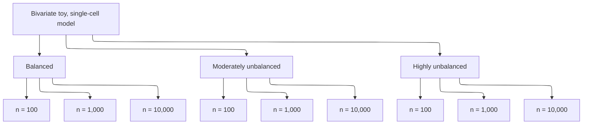

# §2.4 Bivariate toy, single-cell model (G = 2, J = 2)

Show the code

``` r

library(DeCovarT)
```

The [bivariate
toy](https://bastienchassagnol.github.io/DeCovarT/articles/R1-bivariate-toy.md)
fits the population convolution, whose bulk covariance is
\sum_jp_j^2\boldsymbol\Sigma_j. The model that DeCovarT fits on real
bulks is the single-cell model: a bulk is the sum of n_i cells, and its
covariance is linear in the composition ([single-cell
model](https://bastienchassagnol.github.io/DeCovarT/articles/02-1-single-cell-generative-optimisation.md)).
This scenario rebuilds the toy on that model, with the same two genes,
the same two cell types and the same small centroid gap. Three things
vary: the composition, the number of cells per bulk and the two
gene–gene correlations. The aim is to compare the optimisers
(Newton–Raphson, L-BFGS-B, Marquardt–Levenberg) and the interval
constructions on a likelihood that can be drawn in full. Construction,
benchmark and figures live in one script,
`scripts/fig05_bivariate_single_cell.R` (seed `20261125`).


Figure 1: Bivariate single-cell factorial: three compositions, three
cell counts per bulk and a 9-by-9 grid of gene-gene correlations (729
scenarios). The means, the per-cell variance and the platform scale are
fixed. Every scale-dependent method runs twice, with the true cell count
of each bulk and with the nominal one.

Show the code

``` default
---
config:
  layout: elk
  theme: sandstone
---
flowchart TB
  ROOT["Bivariate toy, single-cell model"]
  ROOT --> Ba["Balanced"]
  ROOT --> Mo["Moderately unbalanced"]
  ROOT --> Hi["Highly unbalanced"]
  Ba --> Ba2["n = 100"]
  Ba --> Ba3["n = 1,000"]
  Ba --> Ba4["n = 10,000"]
  Mo --> Mo2["n = 100"]
  Mo --> Mo3["n = 1,000"]
  Mo --> Mo4["n = 10,000"]
  Hi --> Hi2["n = 100"]
  Hi --> Hi3["n = 1,000"]
  Hi --> Hi4["n = 10,000"]
```



Figure 2: Pages of the figure books: composition, then number of cells
per bulk (3 x 3 = 9 pages). Each page crosses the 9-by-9 gene-gene
correlation grid.

## Generative model

Bulk i draws its cell counts, then the exact Gaussian sum of those cells
([`simulate_bulk_from_cells()`](https://bastienchassagnol.github.io/DeCovarT/reference/simulate_bulk_from_cells.md),
platform scale a=1):

\boldsymbol m\_{\cdot i}\sim\operatorname{Multinomial}(n_i,\boldsymbol
p^{\star}), \qquad \boldsymbol y\_{\cdot i}\mid\boldsymbol m\_{\cdot i}
\sim\mathcal N_2\bigl(n_i\tilde{\boldsymbol\mu}\boldsymbol p\_{\cdot
i},\\ n_i\boldsymbol S_W(\boldsymbol p\_{\cdot i})\bigr), \qquad
\boldsymbol p\_{\cdot i}=\boldsymbol m\_{\cdot i}/n_i, \tag{1}

with \boldsymbol S_W(\boldsymbol p)=\sum_jp_j\boldsymbol\Sigma\_{W,j}.
The mean scale c_i=a\\n_i and the variance scale \phi_i=a^2n_i both
equal n_i. The estimand is the **realised** fraction \boldsymbol
p\_{\cdot i}, as in the [two-lineage
scenario](https://bastienchassagnol.github.io/DeCovarT/articles/R4-single-cell-hierarchical.html#sec-sc-generative).

- The per-cell means are \tilde{\boldsymbol\mu}\_{\cdot1}=(20,22) and
  \tilde{\boldsymbol\mu}\_{\cdot2}=(22,20) counts per cell: the small
  centroid gap of the population toy.
- The per-cell covariances are \boldsymbol\Sigma\_{W,j}=500\\\boldsymbol
  R_j, with \boldsymbol R_j the exchangeable correlation matrix of
  \varrho_j. A per-cell variance of 500 at a mean of about 21 counts is
  a coefficient of variation of 1.06, the variance of a negative
  binomial with dispersion \theta\approx0.92.
- The number of cells per bulk is drawn around a nominal value
  n\in\\10^2,10^3,10^4\\: each bulk draws
  n_i=\operatorname{round}\\n\exp(\sigma z-\sigma^2/2)\\, z\sim\mathcal
  N(0,1), \sigma^2=\log(1+0.3^2): a log-normal count of mean n and
  coefficient of variation 30\\.

Per cell, \boldsymbol y\_{\cdot i}/n_i has covariance \boldsymbol
S_W(\boldsymbol p)/n_i. At n=1000 and \boldsymbol p=(1/2,1/2) it equals
the homoscedastic bulk covariance \tfrac14(\boldsymbol R_1+\boldsymbol
R_2) of the population toy (ledger V49a), so that page of this scenario
has the same means, the same bulk covariance and the same Fisher
information as the corresponding page of §2.2. The two models part at
other compositions: at \boldsymbol p=(0.99,0.01) the population
covariance is close to \boldsymbol R_1, the single-cell one to
\tfrac12\boldsymbol R_1, because the weights are p_j^2 in one and p_j in
the other. The number of cells moves the bulk variance by a factor of
ten each way, from about five times to a twentieth of the population
toy’s.

### Why the scales are given

With G=2 genes, one bulk cannot identify c_i or \phi_i. The mean
c\\\tilde{\boldsymbol\mu}\boldsymbol p has two free parameters, c and
p_1, for two observations, so it fits any bulk inside the cone of the
two signatures exactly. The residual is then zero, the closed-form
\hat\phi=\boldsymbol r^\top\boldsymbol W\boldsymbol r/G is zero, and the
profiled log-likelihood has no maximum. The REML degrees of freedom are
\nu=G-J=0. Every scale-dependent fit therefore receives c_i and \phi_i
(`mean_scale`, `variance_scale`), and only p_1 is estimated.
[`deconvolute_single_cell()`](https://bastienchassagnol.github.io/DeCovarT/reference/deconvolute_single_cell.md)
accepts G=J only on that path.

In practice n_i is not known. Each such method therefore runs twice. The
oracle arm receives the true n_i of the bulk, the best case. The nominal
arm receives the design value n, the realistic case, whose error has a
coefficient of variation of 30%. A wrong c moves \boldsymbol y/c along
\tilde{\boldsymbol\mu}\boldsymbol p^\star, which is orthogonal to the
segment between the two signatures only for the balanced composition,
and a wrong \phi rescales the covariance.

### Information in the mean and in the covariance

At known scales, the Fisher information of p_1 at \boldsymbol p^\star
splits into a mean part and a covariance part (ledger V49c):

I(p_1)=n\\\boldsymbol d^\top\boldsymbol S_W(\boldsymbol
p^\star)^{-1}\boldsymbol d
+\tfrac12\operatorname{tr}\bigl\[\\\boldsymbol S_W(\boldsymbol
p^\star)^{-1}
(\boldsymbol\Sigma\_{W,1}-\boldsymbol\Sigma\_{W,2})\\^2\bigr\], \qquad
\boldsymbol
d=\tilde{\boldsymbol\mu}\_{\cdot1}-\tilde{\boldsymbol\mu}\_{\cdot2}.
\tag{2}

The mean part grows with n; the covariance part does not, and it is zero
when \varrho_1=\varrho_2. Its share
f\_{\mathrm{cov}}=I\_{\mathrm{cov}}/I is recorded for every scenario
(`fisher_mean`, `fisher_cov`, `f_cov` in the config).

| Composition | n | median f\_{\mathrm{cov}} | f\_{\mathrm{cov}} at (\varrho_1,\varrho_2)=(-0.8,0.8) |
|----|---:|---:|---:|
| balanced | 100 | 0.20 | 0.62 |
| balanced | 1,000 | 0.024 | 0.14 |
| balanced | 10,000 | 0.0024 | 0.016 |
| moderately unbalanced | 100 | 0.20 | 0.87 |
| moderately unbalanced | 1,000 | 0.025 | 0.41 |
| moderately unbalanced | 10,000 | 0.0025 | 0.065 |
| highly unbalanced | 100 | 0.20 | 0.97 |
| highly unbalanced | 1,000 | 0.024 | 0.76 |
| highly unbalanced | 10,000 | 0.0025 | 0.24 |

Table 1: Share of the Fisher information of p_1 carried by the
covariances, over the 81 correlation pairs of each page (median) and at
the opposite-sign corner.

With uncorrelated genes the information is 0.016\\n in every
composition: a standard error of p_1 of 0.79 at n=100, 0.25 at n=1000
and 0.079 at n=10^4. At n=100 the means alone barely locate p_1 in
(0,1); opposite correlations then carry most of what can be learnt.

### Factorial design

| Factor | Levels |
|----|----|
| Composition \boldsymbol p^\star | balanced (1/2,1/2); moderately unbalanced (17/20,3/20); highly unbalanced (99/100,1/100) |
| Cells per bulk n (nominal) | 10^2; 10^3; 10^4 |
| Gene–gene corr. CT 1 (\varrho_1) | \\-0.8,-0.6,\ldots,0.8\\, 9 levels |
| Gene–gene corr. CT 2 (\varrho_2) | \\-0.8,-0.6,\ldots,0.8\\, 9 levels |
| Fixed | means (20,22), (22,20); \boldsymbol\Sigma\_{W,j}=500\\\boldsymbol R_j; a=1; equal cell sizes |
| **Total scenarios** | 3\times3\times9\times9=\mathbf{729} |

Table 2: Bivariate single-cell factorial.

Scenario identifiers read `SB{index}_{Ba|Mo|Hi}_n{1e2|1e3|1e4}`, for
example `SB122_Ba_n1e3` (\varrho_1=\varrho_2=0, balanced, n=1000). The
heteroscedastic and large-gap levels of §2.2 are not crossed here: the
cell count already moves the bulk variance, and n_i cannot create the
gene-specific variance ratio of the heteroscedastic level.

With the highly unbalanced composition and n=100, the rare type counts
one cell on average, and 37\\ of the bulks hold none: their target sits
on a face of the simplex. Wald and ILR intervals are undefined there, so
their coverage is over interior targets; the [boundary
test](#sec-scb-boundary) uses exactly these bulks.

Show the code

``` r

source("scripts/fig05_bivariate_single_cell.R")
config <- build_bivariate_single_cell_config()
nrow(config)
dplyr::count(config, proportions, n_cells)
```

## Inference

Every method is scored on the same simulated bulks.

| Method | Function or code | Input | Intervals |
|:---|:---|:---|:---|
| `lsei` | [`deconvolute_ratios_deconrnaseq()`](https://bastienchassagnol.github.io/DeCovarT/reference/deconvolute_ratios_Marquardt_Levenberg.md) on \boldsymbol y/c | true means, plug-in c | none |
| NNLS | [`deconvolute_ratios_nnls()`](https://bastienchassagnol.github.io/DeCovarT/reference/deconvolute_ratios_Marquardt_Levenberg.md) | true means (free scale) | none |
| Newton–Raphson | `deconvolute_single_cell(optimiser = "newton")` | true moments, plug-in scales | Wald, ILR, profile, oracle; bootstrap (8 scenarios) |
| L-BFGS-B | `deconvolute_single_cell(optimiser = "lbfgsb")` | true moments, plug-in scales | Wald, ILR |
| Marquardt–Levenberg | `deconvolute_single_cell(optimiser = "marquardt")` | true moments, plug-in scales | Wald, ILR |
| Firth | [`fit_firth_single_cell()`](https://bastienchassagnol.github.io/DeCovarT/reference/fit_firth_single_cell.md) | true moments, plug-in scales | Wald, ILR |
| DeCovarT diagonal | Newton–Raphson with the off-diagonals of \boldsymbol\Sigma\_{W,j} set to zero | true variances, plug-in scales | Wald, ILR |
| RNA-Sieve | `rnasieve` 0.1.4 (Python), corrected update | reference panel, cohort of N bulks | released, Fisher, Godambe |
| ReDeconv | `redeconv` 1.2.1 (Python) | true means and standard deviations | none |

Table 3: Methods of the bivariate single-cell benchmark. Every method
with a plug-in runs in the oracle and the nominal arm.

- The three DeCovarT solvers maximise the same log-likelihood at the
  same plug-in scales. Newton–Raphson and Marquardt–Levenberg work in
  the ILR coordinate; Newton uses the PORT trust region of
  [`stats::nlminb()`](https://rdrr.io/r/stats/nlminb.html),
  Marquardt–Levenberg adds Levenberg damping and stops on the relative
  distance to the maximum ([Marquardt
  1963](#ref-marquardtAlgorithmLeastSquaresEstimation1963); [Commenges
  et al. 2006](#ref-commengesNewtonLikeAlgorithmLikelihood2006);
  [Philipps et al. 2023](#ref-R-marqLevAlg)). L-BFGS-B runs on the
  closure chart \boldsymbol p=\boldsymbol w/\mathbf1^\top\boldsymbol w,
  \boldsymbol w\ge0, and can return exact zeros ([Byrd et al.
  1995](#ref-byrdLimitedMemoryAlgorithm1995)). Firth maximises the
  Jeffreys-penalised log-likelihood ([Firth
  1993](#ref-firthBiasReductionMaximum1993)).
- DeCovarT diagonal fits the model of RNA-Sieve ([Erdmann-Pham et al.
  2021](#ref-erdmann-phamLikelihoodbasedDeconvolutionBulk2021)):
  independent genes, a variance linear in the cell counts. Run at the
  true variances and scales, it isolates what the gene–gene correlation
  adds; its intervals are those of the diagonal (working) model.
  RNA-Sieve itself estimates the reference from a panel of R individuals
  with 20 cells per type each
  ([`simulate_reference_replicates()`](https://bastienchassagnol.github.io/DeCovarT/reference/simulate_reference_replicates.md),
  own seed) and fits the cohort of N bulks jointly. The released
  `_minimize_alpha` passes its simplex constraints to `cp.Minimize()`;
  under cvxpy 1.6 that raises an error the package catches, and the
  proportions never leave their start. The runner replaces it with the
  corrected update (`scripts/benchmark_metrics/python/run_rnasieve.py`).
- `lsei` reads the bulk per cell \boldsymbol y/c with the plug-in c and
  keeps \mathbf1^\top\boldsymbol p=1 ([Gong and Szustakowski
  2013](#ref-gongDeconRNASeqStatisticalFramework2013)); NNLS fits a free
  scale and renormalises ([Dessole et al.
  2023](#ref-dessoleLawsonHansonAlgorithmDeviation2023)), so it needs no
  plug-in.
- Eight methods are not run. DWLS ([Tsoucas et al.
  2019](#ref-tsoucasAccurateEstimationCelltype2019)) chooses its
  dampening constant on random halves of the genes; at G=2 a half is one
  gene, and
  [`DWLS::solveDampenedWLS()`](https://rdrr.io/pkg/DWLS/man/solveDampenedWLS.html)
  (0.1.0) stops on every bulk. RLM and CIBERSORT regress two
  observations on two signatures; MEAD and DECALS rely on asymptotics in
  the number of genes, and DECALS’ point estimate is `lsei`. BayesPrism,
  SCDC and DeMixSC need count data or many genes.

### Interval constructions

| Interval | Construction | Methods |
|:---|:---|:---|
| `wald` | delta method on p_1, from the observed information at the plug-in scales | DeCovarT solvers, Firth |
| `ilr` | Wald in the ILR coordinate, mapped back to the simplex | DeCovarT solvers, Firth |
| `profile` | likelihood-ratio inversion at the plug-in scales (interior, \chi^2_1) | Newton–Raphson |
| `oracle` | \hat p_1 plus or minus the Wald half-width at the true composition | Newton–Raphson |
| `bootstrap` | percentile interval of B=199 parametric refits at the plug-in scales | Newton–Raphson, 8 scenarios |
| `bootstrap_nprior` | as `bootstrap`, with n redrawn from its log-normal law in every replicate | Newton–Raphson, nominal arm, 8 scenarios |

Table 4: Interval menu ([population
inference](https://bastienchassagnol.github.io/DeCovarT/articles/01-2-population-inference.html#sec-recap)).

The bootstrap runs on the eight scenarios \\balanced, moderately
unbalanced\\\times\\n=100,1000\\\times
\\(\varrho_1,\varrho_2)=(0,0),(-0.8,0.8)\\. In the nominal arm the other
intervals treat n as known, so they ignore its 30% error.
`bootstrap_nprior` draws each replicate at n\exp(\sigma z-\sigma^2/2)
and refits at the nominal n: it carries the uncertainty of the cell
count into the interval (`bootstrap_single_cell(n_cells_sdlog = )`).

A Godambe sandwich is not run: it needs independent score contributions,
and one bulk of two correlated genes has two dependent ones. Coverage is
reported with a Wilson Monte Carlo interval ([Morris et al.
2019](#ref-morrisUsingSimulationStudies2019)).

### Boundary test of an absent cell type

For every bulk, `lrt_single_cell(null_value = c(celltype_2 = 0))`
compares the fit with the vertex \boldsymbol p=(1,0), at the oracle and
at the nominal scales. The null lies on a face, so the statistic is
referred to \tfrac12\chi^2_0+\tfrac12\chi^2_1 ([Self and Liang
1987](#ref-selfAsymptoticPropertiesMaximum1987)). Bulks that hold no
type-2 cell measure its size; the others its power.

### Run size

| Constant | Meaning | Value |
|----|----|----|
| `N_REPLICATES` | Monte Carlo bulks per scenario, N | 200 |
| `N_REFERENCE` | individuals of the reference panel, R (RNA-Sieve) | 200 |
| `N_BOOT` | bootstrap replicates, B | 199 |
| `CORES` | workers for the N bulks of a scenario | a third of half the cores (14 of 88) |
| `RUN_DWLS` | run DWLS | `FALSE` (fails at G=2) |

Table 5: Run-size constants at the top of
`scripts/fig05_bivariate_single_cell.R`; `FIG05_POSTPROCESS_ONLY=1`
redraws the figures.

Show the code

``` r

benchmark <- readRDS("output/fig05/fig05_benchmark.rds")
dplyr::filter(benchmark$intervals, parameter == "celltype_1") |>
  dplyr::select(ID, algorithm, ci_method, coverage, mean_width)
```

## Results

Each figure stem is one multi-page PDF,
`output/fig05/{density,performance}_visualisations/<stem>.pdf`, with the
RDS of the data that drew it next to it (`<stem>.rds`). The RDS holds
the tables in long format and a `pages` table that names each page
(`page_id`, the page label and, for the interval forests, the scenario
`ID`). One page is redrawn from that RDS alone, as an SVG under
`<stem>/<page_id>.svg`:

Show the code

``` r

source("scripts/visualisation/load_visualisation.R")
book <- readRDS("output/fig05/performance_visualisations/heatmap_rmse.rds")
book$pages
render_figure_from_data("heatmap_rmse", book, "output/fig05", page = "balanced_n_1000")
```

| Stem | Description |
|----|----|
| `purified_density`, `bulk_density` | Laws per cell: bulks of one type, \mathcal N(\tilde{\boldsymbol\mu}\_{\cdot j},\boldsymbol\Sigma\_{W,j}/n), and the bulk, \mathcal N(\tilde{\boldsymbol\mu}\boldsymbol p,\boldsymbol S_W(\boldsymbol p)/n) |
| `loglik_surface_p`, `loglik_expected_surface_p` | Log-likelihood of one bulk, and its expectation, on (p_1,p_2) at the true scales |
| `loglik_ilr_profile`, `loglik_expected_ilr_profile` | The same along the ILR coordinate |
| `loglik_mean_shift_slice`, `loglik_correlation_slice` | Expected log-likelihood of p_1 at fixed \boldsymbol p^\star while the mean or the correlation of cell type 1 moves; Fisher information split as in [Eq. 2](#eq-scb-fisher) |
| `heatmap_rmse`, `heatmap_aitchison` | Tiles on (\varrho_1,\varrho_2), one row per arm |
| `rmse_colour_aitchison_size_dots` | Colour = mean RMSE, size = mean Aitchison distance |
| `ci_width_forest` | Mean interval, coverage \[Wilson interval\] and width, per corner scenario |
| `p_hat_monte_carlo_raincloud`, `p_hat_monte_carlo_quantile_dots` | Monte Carlo law of \hat p_1 |
| `wald_normality_qq`, `wald_mahalanobis_chi2_qq` | Whitened ILR estimate, information at the true scales |
| `estimate_agreement_hellinger_ward` | Mean Hellinger distance between paired estimates, Ward clustering |
| `kkt_residual_raincloud`, `convergence_theoretical_vs_numerical_failures` | Projected-score KKT residual; theoretical and numerical failures |
| `boundary_lrt` | Size and power of the boundary test of p_2=0 |
| `runtime`, `memory` | \log\_{10} seconds and MiB |

Table 6: Figure books of the bivariate single-cell scenario. There is no
3D surface.

### Results description

The full run used N=200 bulks per scenario (commit `9014f90`, 25
November 2026, 12,769 s on 14 workers). No method failed numerically on
any bulk. Unless stated otherwise, a number below is the median over the
81 correlation pairs of a page of the per-scenario root mean squared
error (RMSE) of \hat p_1, or the mean over those pairs of the coverage
of a nominal 95% interval. The values are printed by
`Rscript scripts/fig05_summary_numbers.R` from
`output/fig05/fig05_benchmark.rds`.

#### Point estimates

| Composition | n | `lsei` | Newton | Marquardt | Firth | Newton, nominal n | `lsei`, nominal n | NNLS | RNA-Sieve |
|----|---:|---:|---:|---:|---:|---:|---:|---:|---:|
| balanced | 100 | 0.414 | 0.429 | 0.395 | 0.390 | 0.460 | 0.409 | 0.414 | 0.410 |
| balanced | 1,000 | 0.243 | 0.249 | 0.242 | 0.187 | 0.397 | 0.238 | 0.244 | 0.249 |
| balanced | 10,000 | 0.081 | 0.082 | 0.082 | 0.076 | 0.378 | 0.078 | 0.081 | 0.106 |
| moderately unbalanced | 100 | 0.424 | 0.445 | 0.423 | 0.419 | 0.435 | 0.422 | 0.424 | 0.432 |
| moderately unbalanced | 1,000 | 0.201 | 0.200 | 0.199 | 0.215 | 0.188 | 0.195 | 0.201 | 0.207 |
| moderately unbalanced | 10,000 | 0.080 | 0.080 | 0.080 | 0.079 | 0.142 | 0.107 | 0.080 | 0.103 |
| highly unbalanced | 100 | 0.457 | 0.455 | 0.436 | 0.453 | 0.459 | 0.456 | 0.458 | 0.447 |
| highly unbalanced | 1,000 | 0.179 | 0.182 | 0.182 | 0.236 | 0.199 | 0.191 | 0.179 | 0.179 |
| highly unbalanced | 10,000 | 0.061 | 0.061 | 0.061 | 0.093 | 0.099 | 0.105 | 0.061 | 0.047 |

Table 7: RMSE of \hat p_1, median over the 81 correlation pairs. Columns
without “nominal n” use the true n_i (oracle arm) or need no cell count
(NNLS, RNA-Sieve).

With the true n_i, the three DeCovarT solvers, `lsei`, NNLS and DeCovarT
diagonal are within 0.035 of each other on every page
([Table 7](#tbl-scb-rmse)). DeCovarT diagonal returns the `lsei` RMSE to
within 0.002 everywhere; ReDeconv returns the NNLS RMSE to four. The
standard errors announced by [Table 1](#tbl-scb-fcov) for uncorrelated
genes (0.79, 0.25 and 0.079 at n=100, 1,000 and 10^4) set the scale: at
n=100 every method is close to a random guess on (0,1), and at n=10^4
every method is at or below that standard error.

Along the correlation grid, the full-covariance Newton fit differs from
`lsei` by at most 15% in median RMSE ([Fig. 3](#fig-scb-heatmap)). Its
RMSE ratio to `lsei` rises with \|\varrho_1-\varrho_2\| for the balanced
composition at n=100 (1.12 at \|\varrho_1-\varrho_2\|=1.6) and falls
with it for the highly unbalanced composition at n=1000 (0.85 at 1.6).
Over the 243 scenarios of each n, Newton beats `lsei` by more than 5% in
18%, 15% and 3% of them at n=100, 1,000 and 10^4, and loses by more than
5% in 36%, 10% and 0%.


Figure 3: RMSE of \hat p_1 on the (\varrho_1,\varrho_2) grid, balanced
composition, n=1000. Top row: oracle arm; middle row: nominal arm;
bottom row: methods without a plug-in. One \log\_{10} colour scale for
every page of the book.

The plug-in cell count matters more than the correlation. With the
nominal n, the Newton RMSE grows by a median factor of 1.06, 1.58 and
4.44 at n=100, 1,000 and 10^4 for the balanced composition, and of 1.69
and 2.20 at n=10^4 for the highly and moderately unbalanced ones (90th
percentiles up to 8.2). The loss sits off the diagonal
\varrho_1=\varrho_2 ([Fig. 3](#fig-scb-heatmap), middle row): at
(\varrho_1,\varrho_2)=(0,0) the balanced RMSE at n=10^4 is 0.081 with
the true n_i and 0.079 with the nominal n; at (-0.8,0.8) it is 0.082 and
0.330. `lsei` and DeCovarT diagonal keep their oracle RMSE for the
balanced composition (ratio 0.96 to 0.99) but lose a factor of about 1.4
(moderately unbalanced) and 1.6 to 1.8 (highly unbalanced) at n=10^4.

#### Solvers

With the true n_i, Newton–Raphson, L-BFGS-B and Marquardt–Levenberg
return the same \hat p_1 to within 10^{-5} in the median bulk at every
n. They part at n=100: \|\hat p_1^{\mathrm{NR}}-\hat
p_1^{\mathrm{ML}}\|\>0.01 in 16% to 20% of the bulks and \|\hat
p_1^{\mathrm{NR}}-\hat p_1^{\mathrm{L\text{-}BFGS\text{-}B}}\|\>0.01 in
6% to 10%. L-BFGS-B stops on a face of the simplex in 51% to 63% of the
bulks at n=100, and in 44% to 50% of the highly unbalanced bulks at
n=1000 and 10^4. The two ILR solvers never return a face. The
log-likelihood of the truth exceeds that of the estimate by more than
10^{-3} in 4.6%, 1.1% and 0.2% of the Newton fits at n=100, 1,000 and
10^4 (Marquardt–Levenberg: 4.3%, 1.0%, 0.09%; L-BFGS-B: 0.2%, 0.006%,
0%). Median times per bulk are 2 ms (L-BFGS-B), 3 ms (Newton), 4 to 9 ms
(Marquardt–Levenberg), 11 ms (Firth) and 130 ms (RNA-Sieve).

Firth’s penalty lowers the balanced RMSE at n=1000 from 0.249 to 0.187
and raises the highly unbalanced one from 0.182 to 0.236, with a median
bias of -0.16 there.

#### Intervals

| Composition | n | Wald | ILR | profile | oracle | Wald, nominal n | profile, nominal n | RNA-Sieve Godambe |
|----|---:|---:|---:|---:|---:|---:|---:|---:|
| balanced | 100 | 0.78 | 1.00 | 0.99 | 0.99 | 0.51 | 0.80 | 0.66 |
| balanced | 1,000 | 0.95 | 1.00 | 0.95 | 0.95 | 0.43 | 0.46 | 0.89 |
| balanced | 10,000 | 0.95 | 0.97 | 0.95 | 0.95 | 0.29 | 0.29 | 0.97 |
| moderately unbalanced | 100 | 0.76 | 1.00 | 0.99 | 0.99 | 0.48 | 0.85 | 0.75 |
| moderately unbalanced | 1,000 | 0.92 | 0.94 | 0.97 | 1.00 | 0.40 | 0.57 | 0.91 |
| moderately unbalanced | 10,000 | 0.96 | 0.94 | 0.95 | 0.94 | 0.28 | 0.30 | 0.94 |
| highly unbalanced | 100 | 0.83 | 0.71 | 0.98 | 0.98 | 0.57 | 0.87 | 0.80 |
| highly unbalanced | 1,000 | 0.90 | 0.57 | 0.97 | 1.00 | 0.35 | 0.80 | 0.94 |
| highly unbalanced | 10,000 | 0.93 | 0.66 | 0.97 | 1.00 | 0.21 | 0.60 | 0.99 |

Table 8: Coverage of nominal 95% intervals for p_1 around
Newton–Raphson, mean over the 81 correlation pairs (interior targets
only). Columns without “nominal n” use the true n_i.

With the true n_i, the profile interval covers at 0.95 to 0.99 on every
page ([Table 8](#tbl-scb-coverage)). The Wald interval under-covers at
n=100 (0.76 to 0.83) and reaches 0.90 to 0.96 from n=1000. The ILR
interval reaches 1.00 at n=100 for the balanced and moderately
unbalanced compositions, and for the balanced one at n=1000, because its
mean width is then 0.78 to 1.00; it covers 0.57 to 0.71 for the highly
unbalanced composition. With the nominal n, every construction falls:
Wald to 0.21–0.57, profile to 0.29–0.87, lowest at n=10^4. The Firth ILR
interval covers 0.04 for the highly unbalanced composition at n\ge1000.
RNA-Sieve’s Fisher interval is the whole of \[0,1\] on every page (width
1.00); its Godambe interval covers 0.66 to 0.80 at n=100.


Figure 4: Intervals for p_1, balanced composition, n=1000,
(\varrho_1,\varrho_2)=(-0.8,0.8) (`SB90_Ba_n1e3`). Bar: mean bounds over
the 200 bulks; point: mean estimate; dashed: mean target; left column:
coverage with its Wilson 95% interval and mean width w.

The bootstrap sub-study separates the two correlation corners. At (0,0),
every construction covers 0.94 to 1.00 in both arms, except the
nominal-arm Wald interval (0.88 balanced at n=100, 0.86 moderately
unbalanced at n=1000). At (-0.8,0.8) with the true n_i, the Wald
interval covers 0.44 to 0.85, the parametric bootstrap 0.79 to 0.92 and
the profile interval 0.93 to 0.985. With the nominal n at (-0.8,0.8),
the mean Newton estimate for the balanced composition at n=1000 moves
from 0.46 to 0.19, against a mean target of 0.50, while DeCovarT
diagonal stays at 0.49 in both arms ([Fig. 4](#fig-scb-forest)), and
coverage falls to 0.05–0.25 (Wald), 0.28–0.69 (profile) and 0.38–0.79
(bootstrap). Redrawing n from its log-normal law in each bootstrap
replicate lowers coverage in all four of these scenarios, to 0.17–0.67.

#### Boundary test

Of the 16,200 highly unbalanced bulks at n=100, 6,130 hold no type-2
cell. On them the boundary test rejects p_2=0 in 3.7% of the bulks with
the true n_i and in 16.1% with the nominal n
([Fig. 5](#fig-scb-boundary)). When type 2 is present at p_2=0.01, the
test rejects in 4.4%, 5.5% and 6.9% of the bulks at n=100, 1,000 and
10^4 with the true n_i, close to the 5% level. Power reaches 0.64 at
p_2=0.15 and 0.9994 at p_2=0.5, both at n=10^4. With the nominal n, the
rejection rate at p_2=0.01 rises to 0.15 to 0.25 and the power at
p_2=0.5, n=10^4 falls to 0.81.


Figure 5: Rejection rate of the boundary likelihood-ratio test of p_2=0
at the 5% level. Left: bulks that hold type 2 (power); right: bulks with
no type-2 cell (size). Small dots: one scenario; large point and bar:
pooled rate with its Wilson 95% interval; grey counts: bulks pooled.

#### Likelihood geometry

The expected log-likelihood keeps its maximiser at p_1^\star along both
slices ([Fig. 6](#fig-scb-slice); ledger V49d). Moving the mean of type
1 onto that of type 2 removes the mean part of the information. With
(\varrho_1,\varrho_2)=(0.8,-0.8) the covariance part, 2.56 at every n
for the balanced composition, then carries the curvature; with (0,0) it
is zero and the surface flattens as t\to1.


Figure 6: Expected log-likelihood of p_1 at the balanced composition
while the mean of type 1 moves towards that of type 2 (t=0: design
means; t\to1: equal means). Top: \log\_{10}(L/\max L) over (p_1,t),
white contour at the expected 95% likelihood-ratio region, dashed line
at p_1^\star. Bottom: Fisher information of p_1 at p_1^\star and its
mean and covariance parts ([Eq. 2](#eq-scb-fisher)), log scale.

### Discussion and interpretation of relative deconvolution performance

#### The covariance part of the information is hard to use from one bulk

[Table 1](#tbl-scb-fcov) gives the covariances up to 97% of the Fisher
information at n=100, yet the full-covariance fit is no more accurate
than `lsei` there and is worse in 36% of the scenarios. We read this as
a consequence of the design (inference, not tested separately): each
estimate rests on one bulk, and the covariance part of
[Eq. 2](#eq-scb-fisher) is the information that a single draw of two
genes carries about its own spread. The mean part averages n cells and
grows with n; the covariance part does not, and a single draw is far
from the regime where the maximum likelihood estimator attains the
Fisher bound. The Wald interval, built from the observed curvature,
under-covers at n=100 (0.76 to 0.83) and at the opposite-sign corner
(0.44 to 0.85), while the profile interval, which does not rely on the
quadratic approximation, holds its level. The full-covariance fit gains
where the mean part is already informative and the covariance share is
still large: highly unbalanced, n=1000, where f\_{\mathrm{cov}} reaches
0.76 and Newton’s RMSE is 15% below `lsei`’s at
\|\varrho_1-\varrho_2\|=1.6.

DeCovarT diagonal reproduces `lsei` by construction in this design. Both
cell types have per-cell variance 500 on both genes, so the diagonal
\boldsymbol S_W(\boldsymbol p) is 500\\\boldsymbol I for every
\boldsymbol p, and its likelihood is least squares on \boldsymbol y/c
under the sum-to-one constraint. The comparison with the full model
therefore isolates the gene–gene correlation, as intended, but says
nothing about gene-specific variances.

#### The cell count, not the correlation, limits accuracy

A 30% error in n_i costs more than the correlation gains, and the cost
grows with n. With the nominal n, the scaled bulk is \boldsymbol
y/n=(n_i/n)\\\tilde{\boldsymbol\mu}\boldsymbol p^\star plus noise of
standard deviation about \sqrt{500/n} per gene: the misfit along
\tilde{\boldsymbol\mu}\boldsymbol p^\star is about 0.3\times21\approx6
against a noise of 0.22 at n=10^4. How much of that misfit reaches \hat
p_1 depends on the geometry:

- `lsei` projects \boldsymbol y/n onto the segment between the
  signatures in the Euclidean metric. For the balanced composition,
  \tilde{\boldsymbol\mu}\boldsymbol p^\star=(21,21) is orthogonal to
  \boldsymbol d=(-2,2) and the misfit leaves \hat p_1 unchanged; for the
  unbalanced compositions it is not orthogonal, which matches the loss
  by a factor of 1.4 to 1.8 at n=10^4.
- The full-covariance fit projects in the \boldsymbol S_W(\boldsymbol
  p)^{-1} metric, and when \varrho_1\ne\varrho_2 its covariance depends
  on \boldsymbol p, so the fit also moves \hat{\boldsymbol p} to match a
  spread that a wrong \phi has rescaled. On the diagonal
  \varrho_1=\varrho_2, \boldsymbol S_W does not depend on \boldsymbol p
  and (1,1) is one of its eigenvectors, so the balanced fit stays
  unbiased there: the darker diagonal of the nominal row of
  [Fig. 3](#fig-scb-heatmap).

None of the interval constructions repairs this, because the failure is
a bias of the point estimate, not an underestimated variance. Redrawing
n in the bootstrap makes it worse: each replicate is refitted at the
nominal n around an already biased \hat p_1, so its percentiles probably
carry the bias twice (not checked).

In practice n_i is unknown, and at G=2 it cannot be estimated
([Sec. 1](#sec-scb-generative)). Two routes avoid the plug-in. A
scale-free fit (NNLS with a free scale, renormalised; ReDeconv returns
the same estimates here) matched the oracle `lsei` on every page without
any cell count. With G\>J genes, the scales enter the likelihood and can
be profiled
([§2.5](https://bastienchassagnol.github.io/DeCovarT/articles/R4-single-cell-hierarchical.md)).
The covariance-aware fit at a plugged-in n is worth its cost only when
n_i is measured, for instance from nuclei counts.

#### Choice of solver

The three DeCovarT solvers agree in the interior; they differ when the
maximum lies on, or near, a face. L-BFGS-B works on the closed simplex,
reaches the face and returns the highest log-likelihood most often
(truth above the estimate in at most 0.2% of bulks, against 4.6% for
Newton at n=100). The ILR solvers cannot reach a face, and they are the
ones whose Hessian feeds the Wald, ILR and profile intervals. A
practical sequence is L-BFGS-B for the point estimate and the face
diagnosis, then Newton–Raphson from that point for the intervals when
the estimate is interior; the benchmark did not run that sequence. At
n=100, Marquardt–Levenberg and Newton–Raphson differ by more than 0.01
in 16% to 20% of the bulks, and Marquardt–Levenberg has the lower RMSE
on all three compositions (by 0.02 to 0.03). Both stop where the
gradient vanishes, so the gap points to several local maxima, reached
from the same start by different step sequences.

Firth’s penalty pulls \hat p_1 towards 1/2: it lowers the balanced RMSE
by a quarter at n=1000 and biases the highly unbalanced estimate by
-0.16, with ILR coverage 0.04. It is not a safe default when a cell type
may be rare.

#### Detecting a rare cell type

With the true n_i, the chi-bar-square boundary test keeps its size (3.7%
at the 5% level). With these signatures, two genes and a mean gap of 2
counts per cell, it cannot detect a type at 1% even at n=10^4. With the
nominal n, it rejects p_2=0 in 16% of the bulks that hold no type-2
cell, so a wrong cell count turns into false detections.

#### RNA-Sieve

RNA-Sieve, with the corrected update, matched DeCovarT within 0.025 in
RMSE on every page; it was better for the highly unbalanced composition
at n=10^4 (0.047 against 0.061) and worse for the balanced one (0.106
against 0.081). It fits the cohort of N bulks jointly and estimates the
reference from the panel; which of the two drives these gaps is not
separated here. Its Fisher interval spans \[0,1\] and carries no
information; its Godambe interval under-covers at n=100 (0.66 to 0.80).

## Caveats

- A sum of Gaussian cells is Gaussian at any n_i, and 17% of the
  per-cell values (the reference panel of RNA-Sieve) are negative; a
  count layer would be needed to test the central-limit step itself.
- Every DeCovarT fit reads the true moments; the reference panel enters
  only through RNA-Sieve.
- Each estimate uses one bulk of two genes. The Wald and profile
  intervals are then one-observation approximations, whose calibration
  is what the coverage measures.

### See also

- Population toy:
  [§2.2](https://bastienchassagnol.github.io/DeCovarT/articles/R1-bivariate-toy.md)
- Single-cell model and its fit: [generative model and
  optimisation](https://bastienchassagnol.github.io/DeCovarT/articles/02-1-single-cell-generative-optimisation.md)
- Single-cell intervals and tests:
  [inference](https://bastienchassagnol.github.io/DeCovarT/articles/02-2-single-cell-inference.md)
- Two lineages, many genes:
  [§2.5](https://bastienchassagnol.github.io/DeCovarT/articles/R4-single-cell-hierarchical.md)

### References

Byrd, Richard H., Peihuang Lu, Jorge Nocedal, and Ciyou Zhu. 1995. ‘A
Limited Memory Algorithm for Bound Constrained Optimization’. *SIAM
Journal on Scientific Computing* 16 (5): 1190–208.
<https://doi.org/10.1137/0916069>.

Commenges, Daniel, Helene Jacqmin-Gadda, Cecile Proust, and Jeremie
Guedj. 2006. *A Newton-Like Algorithm for Likelihood Maximization: The
Robust-Variance Scoring Algorithm*. arXiv.
<https://doi.org/10.48550/arxiv.math/0610402>.

Dessole, Monica, Marco Dell’Orto, and Fabio Marcuzzi. 2023. ‘The
Lawson-Hanson Algorithm with Deviation Maximization: Finite Convergence
and Sparse Recovery’. *Numerical Linear Algebra with Applications* 30
(5): e2490. <https://doi.org/10.1002/nla.2490>.

Erdmann-Pham, Dan D., Jonathan Fischer, Justin Hong, and Yun S. Song.
2021. ‘Likelihood-Based Deconvolution of Bulk Gene Expression Data Using
Single-Cell References’. *Genome Research* 31 (10): 1794–806.
<https://doi.org/10.1101/gr.272344.120>.

Firth, David. 1993. ‘Bias Reduction of Maximum Likelihood Estimates’.
*Biometrika* 80 (1): 27–38. <https://doi.org/10.1093/biomet/80.1.27>.

Gong, Ting, and Joseph D. Szustakowski. 2013. ‘DeconRNASeq: A
Statistical Framework for Deconvolution of Heterogeneous Tissue Samples
Based on mRNA-Seq Data’. *Bioinformatics (Oxford, England)* 29.
<https://doi.org/10.1093/bioinformatics/btt090>.

Marquardt, Donald W. 1963. ‘An Algorithm for Least-Squares Estimation of
Nonlinear Parameters’. *Journal of the Society for Industrial and
Applied Mathematics* 11. <https://doi.org/10.1137/0111030>.

Morris, Tim P., Ian R. White, and Michael J. Crowther. 2019. ‘Using
Simulation Studies to Evaluate Statistical Methods’. *Statistics in
Medicine* 38 (11): 2074–102. <https://doi.org/10.1002/sim.8086>.

Philipps, Viviane, Cecile Proust-Lima, Melanie Prague, Boris Hejblum,
Daniel Commenges, and Amadou Diakite. 2023. *marqLevAlg: A Parallelized
General-Purpose Optimization Based on Marquardt-Levenberg Algorithm*.

Self, Steven G., and Kung-Yee Liang. 1987. ‘Asymptotic Properties of
Maximum Likelihood Estimators and Likelihood Ratio Tests Under
Nonstandard Conditions’. *Journal of the American Statistical
Association* 82 (398): 605–10.
<https://doi.org/10.1080/01621459.1987.10478472>.

Tsoucas, Daphne, Rui Dong, Haide Chen, Qian Zhu, Guoji Guo, and
Guo-Cheng Yuan. 2019. ‘Accurate Estimation of Cell-Type Composition from
Gene Expression Data’. *Nature Communications* 10.
<https://doi.org/10.1038/s41467-019-10802-z>.
