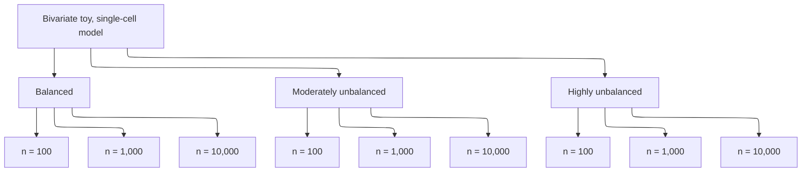

# §2.4 Bivariate toy, single-cell model (G = 2, J = 2)

Show the code

``` r

library(DeCovarT)
```

The [bivariate
toy](https://bastienchassagnol.github.io/DeCovarT/articles/R1-bivariate-toy.md)
fits the population convolution, whose bulk covariance is
\sum_jp_j^2\boldsymbol\Sigma_j. The model that DeCovarT fits on real
bulks is the single-cell model: a bulk is the sum of n_i cells, and its
covariance is linear in the composition ([single-cell
model](https://bastienchassagnol.github.io/DeCovarT/articles/02-1-single-cell-generative-optimisation.md)).
This scenario rebuilds the toy on that model, with the same two genes,
the same two cell types and the same small centroid gap. Three things
vary: the composition, the number of cells per bulk and the two
gene–gene correlations. The aim is to compare the optimisers
(Newton–Raphson, L-BFGS-B, Marquardt–Levenberg) and the interval
constructions on a likelihood that can be drawn in full. Construction,
benchmark and figures live in one script,
`scripts/fig05_bivariate_single_cell.R` (seed `20261125`).


Figure 1: Bivariate single-cell factorial: three compositions, three
cell counts per bulk and a 9-by-9 grid of gene-gene correlations (729
scenarios). The means, the per-cell variance and the platform scale are
fixed. Every scale-dependent method runs twice, with the true cell count
of each bulk and with the nominal one.

Show the code

``` default
---
config:
  layout: elk
  theme: sandstone
---
flowchart TB
  ROOT["Bivariate toy, single-cell model"]
  ROOT --> Ba["Balanced"]
  ROOT --> Mo["Moderately unbalanced"]
  ROOT --> Hi["Highly unbalanced"]
  Ba --> Ba2["n = 100"]
  Ba --> Ba3["n = 1,000"]
  Ba --> Ba4["n = 10,000"]
  Mo --> Mo2["n = 100"]
  Mo --> Mo3["n = 1,000"]
  Mo --> Mo4["n = 10,000"]
  Hi --> Hi2["n = 100"]
  Hi --> Hi3["n = 1,000"]
  Hi --> Hi4["n = 10,000"]
```



Figure 2: Pages of the figure books: composition, then number of cells
per bulk (3 x 3 = 9 pages). Each page crosses the 9-by-9 gene-gene
correlation grid.

## Generative model

Bulk i draws its cell counts, then the exact Gaussian sum of those cells
([`simulate_bulk_from_cells()`](https://bastienchassagnol.github.io/DeCovarT/reference/simulate_bulk_from_cells.md),
platform scale a=1):

\boldsymbol m\_{\cdot i}\sim\operatorname{Multinomial}(n_i,\boldsymbol
p^{\star}), \qquad \boldsymbol y\_{\cdot i}\mid\boldsymbol m\_{\cdot i}
\sim\mathcal N_2\bigl(n_i\tilde{\boldsymbol\mu}\boldsymbol p\_{\cdot
i},\\ n_i\boldsymbol S_W(\boldsymbol p\_{\cdot i})\bigr), \qquad
\boldsymbol p\_{\cdot i}=\boldsymbol m\_{\cdot i}/n_i, \tag{1}

with \boldsymbol S_W(\boldsymbol p)=\sum_jp_j\boldsymbol\Sigma\_{W,j}.
The mean scale c_i=a\\n_i and the variance scale \phi_i=a^2n_i both
equal n_i. The estimand is the **realised** fraction \boldsymbol
p\_{\cdot i}, as in the [two-lineage
scenario](https://bastienchassagnol.github.io/DeCovarT/articles/R4-single-cell-hierarchical.html#sec-sc-generative).

- The per-cell means are \tilde{\boldsymbol\mu}\_{\cdot1}=(20,22) and
  \tilde{\boldsymbol\mu}\_{\cdot2}=(22,20) counts per cell: the small
  centroid gap of the population toy.
- The per-cell covariances are \boldsymbol\Sigma\_{W,j}=500\\\boldsymbol
  R_j, with \boldsymbol R_j the exchangeable correlation matrix of
  \varrho_j. A per-cell variance of 500 at a mean of about 21 counts is
  a coefficient of variation of 1.06, the variance of a negative
  binomial with dispersion \theta\approx0.92.
- The number of cells per bulk is drawn around a nominal value
  n\in\\10^2,10^3,10^4\\: each bulk draws
  n_i=\operatorname{round}\\n\exp(\sigma z-\sigma^2/2)\\, z\sim\mathcal
  N(0,1), \sigma^2=\log(1+0.3^2): a log-normal count of mean n and
  coefficient of variation 30\\.

Per cell, \boldsymbol y\_{\cdot i}/n_i has covariance \boldsymbol
S_W(\boldsymbol p)/n_i. At n=1000 and \boldsymbol p=(1/2,1/2) it equals
the homoscedastic bulk covariance \tfrac14(\boldsymbol R_1+\boldsymbol
R_2) of the population toy (ledger V49a), so that page of this scenario
has the same means, the same bulk covariance and the same Fisher
information as the corresponding page of §2.2. The two models part at
other compositions: at \boldsymbol p=(0.99,0.01) the population
covariance is close to \boldsymbol R_1, the single-cell one to
\tfrac12\boldsymbol R_1, because the weights are p_j^2 in one and p_j in
the other. The number of cells moves the bulk variance by a factor of
ten each way, from about five times to a twentieth of the population
toy’s.

### Why the scales are given

With G=2 genes, one bulk cannot identify c_i or \phi_i. The mean
c\\\tilde{\boldsymbol\mu}\boldsymbol p has two free parameters, c and
p_1, for two observations, so it fits any bulk inside the cone of the
two signatures exactly. The residual is then zero, the closed-form
\hat\phi=\boldsymbol r^\top\boldsymbol W\boldsymbol r/G is zero, and the
profiled log-likelihood has no maximum. The REML degrees of freedom are
\nu=G-J=0. Every scale-dependent fit therefore receives c_i and \phi_i
(`mean_scale`, `variance_scale`), and only p_1 is estimated.
[`deconvolute_single_cell()`](https://bastienchassagnol.github.io/DeCovarT/reference/deconvolute_single_cell.md)
accepts G=J only on that path.

In practice n_i is not known. Each such method therefore runs twice. The
oracle arm receives the true n_i of the bulk, the best case. The nominal
arm receives the design value n, the realistic case, whose error has a
coefficient of variation of 30%. A wrong c moves \boldsymbol y/c along
(1,1), orthogonal to the segment between the two signatures, and a wrong
\phi rescales the covariance.

### Information in the mean and in the covariance

At known scales, the Fisher information of p_1 at \boldsymbol p^\star
splits into a mean part and a covariance part (ledger V49c):

I(p_1)=n\\\boldsymbol d^\top\boldsymbol S_W(\boldsymbol
p^\star)^{-1}\boldsymbol d
+\tfrac12\operatorname{tr}\bigl\[\\\boldsymbol S_W(\boldsymbol
p^\star)^{-1}
(\boldsymbol\Sigma\_{W,1}-\boldsymbol\Sigma\_{W,2})\\^2\bigr\], \qquad
\boldsymbol
d=\tilde{\boldsymbol\mu}\_{\cdot1}-\tilde{\boldsymbol\mu}\_{\cdot2}.
\tag{2}

The mean part grows with n; the covariance part does not, and it is zero
when \varrho_1=\varrho_2. Its share
f\_{\mathrm{cov}}=I\_{\mathrm{cov}}/I is recorded for every scenario
(`fisher_mean`, `fisher_cov`, `f_cov` in the config).

| Composition | n | median f\_{\mathrm{cov}} | f\_{\mathrm{cov}} at (\varrho_1,\varrho_2)=(-0.8,0.8) |
|----|---:|---:|---:|
| balanced | 100 | 0.20 | 0.62 |
| balanced | 1,000 | 0.024 | 0.14 |
| balanced | 10,000 | 0.0024 | 0.016 |
| moderately unbalanced | 100 | 0.20 | 0.87 |
| moderately unbalanced | 1,000 | 0.025 | 0.41 |
| moderately unbalanced | 10,000 | 0.0025 | 0.065 |
| highly unbalanced | 100 | 0.20 | 0.97 |
| highly unbalanced | 1,000 | 0.024 | 0.76 |
| highly unbalanced | 10,000 | 0.0025 | 0.24 |

Table 1: Share of the Fisher information of p_1 carried by the
covariances, over the 81 correlation pairs of each page (median) and at
the opposite-sign corner.

With uncorrelated genes the information is 0.016\\n in every
composition: a standard error of p_1 of 0.79 at n=100, 0.25 at n=1000
and 0.079 at n=10^4. At n=100 the means alone barely locate p_1 in
(0,1); opposite correlations then carry most of what can be learnt.

### Factorial design

| Factor | Levels |
|----|----|
| Composition \boldsymbol p^\star | balanced (1/2,1/2); moderately unbalanced (17/20,3/20); highly unbalanced (99/100,1/100) |
| Cells per bulk n (nominal) | 10^2; 10^3; 10^4 |
| Gene–gene corr. CT 1 (\varrho_1) | \\-0.8,-0.6,\ldots,0.8\\, 9 levels |
| Gene–gene corr. CT 2 (\varrho_2) | \\-0.8,-0.6,\ldots,0.8\\, 9 levels |
| Fixed | means (20,22), (22,20); \boldsymbol\Sigma\_{W,j}=500\\\boldsymbol R_j; a=1; equal cell sizes |
| **Total scenarios** | 3\times3\times9\times9=\mathbf{729} |

Table 2: Bivariate single-cell factorial.

Scenario identifiers read `SB{index}_{Ba|Mo|Hi}_n{1e2|1e3|1e4}`, for
example `SB122_Ba_n1e3` (\varrho_1=\varrho_2=0, balanced, n=1000). The
heteroscedastic and large-gap levels of §2.2 are not crossed here: the
cell count already moves the bulk variance, and n_i cannot create the
gene-specific variance ratio of the heteroscedastic level.

With the highly unbalanced composition and n=100, the rare type counts
one cell on average, and 37\\ of the bulks hold none: their target sits
on a face of the simplex. Wald and ILR intervals are undefined there, so
their coverage is over interior targets; the [boundary
test](#sec-scb-boundary) uses exactly these bulks.

Show the code

``` r

source("scripts/fig05_bivariate_single_cell.R")
config <- build_bivariate_single_cell_config()
nrow(config)
dplyr::count(config, proportions, n_cells)
```

## Inference

Every method is scored on the same simulated bulks.

| Method | Function or code | Input | Intervals |
|:---|:---|:---|:---|
| `lsei` | [`deconvolute_ratios_deconrnaseq()`](https://bastienchassagnol.github.io/DeCovarT/reference/deconvolute_ratios_Marquardt_Levenberg.md) on \boldsymbol y/c | true means, plug-in c | none |
| NNLS | [`deconvolute_ratios_nnls()`](https://bastienchassagnol.github.io/DeCovarT/reference/deconvolute_ratios_Marquardt_Levenberg.md) | true means (free scale) | none |
| Newton–Raphson | `deconvolute_single_cell(optimiser = "newton")` | true moments, plug-in scales | Wald, ILR, profile, oracle; bootstrap (8 scenarios) |
| L-BFGS-B | `deconvolute_single_cell(optimiser = "lbfgsb")` | true moments, plug-in scales | Wald, ILR |
| Marquardt–Levenberg | `deconvolute_single_cell(optimiser = "marquardt")` | true moments, plug-in scales | Wald, ILR |
| Firth | [`fit_firth_single_cell()`](https://bastienchassagnol.github.io/DeCovarT/reference/fit_firth_single_cell.md) | true moments, plug-in scales | Wald, ILR |
| DeCovarT diagonal | Newton–Raphson with the off-diagonals of \boldsymbol\Sigma\_{W,j} set to zero | true variances, plug-in scales | Wald, ILR |
| RNA-Sieve | `rnasieve` 0.1.4 (Python), corrected update | reference panel, cohort of N bulks | released, Fisher, Godambe |
| ReDeconv | `redeconv` 1.2.1 (Python) | true means and standard deviations | none |

Table 3: Methods of the bivariate single-cell benchmark. Every method
with a plug-in runs in the oracle and the nominal arm.

- The three DeCovarT solvers maximise the same log-likelihood at the
  same plug-in scales. Newton–Raphson and Marquardt–Levenberg work in
  the ILR coordinate; Newton uses the PORT trust region of
  [`stats::nlminb()`](https://rdrr.io/r/stats/nlminb.html),
  Marquardt–Levenberg adds Levenberg damping and stops on the relative
  distance to the maximum ([Marquardt
  1963](#ref-marquardtAlgorithmLeastSquaresEstimation1963); [Commenges
  et al. 2006](#ref-commengesNewtonLikeAlgorithmLikelihood2006);
  [Philipps et al. 2023](#ref-R-marqLevAlg)). L-BFGS-B runs on the
  closure chart \boldsymbol p=\boldsymbol w/\mathbf1^\top\boldsymbol w,
  \boldsymbol w\ge0, and can return exact zeros ([Byrd et al.
  1995](#ref-byrdLimitedMemoryAlgorithm1995)). Firth maximises the
  Jeffreys-penalised log-likelihood ([Firth
  1993](#ref-firthBiasReductionMaximum1993)).
- DeCovarT diagonal fits the model of RNA-Sieve ([Erdmann-Pham et al.
  2021](#ref-erdmann-phamLikelihoodbasedDeconvolutionBulk2021)):
  independent genes, a variance linear in the cell counts. Run at the
  true variances and scales, it isolates what the gene–gene correlation
  adds; its intervals are those of the diagonal (working) model.
  RNA-Sieve itself estimates the reference from a panel of R individuals
  with 20 cells per type each
  ([`simulate_reference_replicates()`](https://bastienchassagnol.github.io/DeCovarT/reference/simulate_reference_replicates.md),
  own seed) and fits the cohort of N bulks jointly. The released
  `_minimize_alpha` passes its simplex constraints to `cp.Minimize()`;
  under cvxpy 1.6 that raises an error the package catches, and the
  proportions never leave their start. The runner replaces it with the
  corrected update (`scripts/benchmark_metrics/python/run_rnasieve.py`).
- `lsei` reads the bulk per cell \boldsymbol y/c with the plug-in c and
  keeps \mathbf1^\top\boldsymbol p=1 ([Gong and Szustakowski
  2013](#ref-gongDeconRNASeqStatisticalFramework2013)); NNLS fits a free
  scale and renormalises ([Dessole et al.
  2023](#ref-dessoleLawsonHansonAlgorithmDeviation2023)), so it needs no
  plug-in.
- Eight methods are not run. DWLS ([Tsoucas et al.
  2019](#ref-tsoucasAccurateEstimationCelltype2019)) chooses its
  dampening constant on random halves of the genes; at G=2 a half is one
  gene, and
  [`DWLS::solveDampenedWLS()`](https://rdrr.io/pkg/DWLS/man/solveDampenedWLS.html)
  (0.1.0) stops on every bulk. RLM and CIBERSORT regress two
  observations on two signatures; MEAD and DECALS rely on asymptotics in
  the number of genes, and DECALS’ point estimate is `lsei`. BayesPrism,
  SCDC and DeMixSC need count data or many genes.

### Interval constructions

| Interval | Construction | Methods |
|:---|:---|:---|
| `wald` | delta method on p_1, from the observed information at the plug-in scales | DeCovarT solvers, Firth |
| `ilr` | Wald in the ILR coordinate, mapped back to the simplex | DeCovarT solvers, Firth |
| `profile` | likelihood-ratio inversion at the plug-in scales (interior, \chi^2_1) | Newton–Raphson |
| `oracle` | \hat p_1 plus or minus the Wald half-width at the true composition | Newton–Raphson |
| `bootstrap` | percentile interval of B=199 parametric refits at the plug-in scales | Newton–Raphson, 8 scenarios |
| `bootstrap_nprior` | as `bootstrap`, with n redrawn from its log-normal law in every replicate | Newton–Raphson, nominal arm, 8 scenarios |

Table 4: Interval menu ([population
inference](https://bastienchassagnol.github.io/DeCovarT/articles/01-2-population-inference.html#sec-recap)).

The bootstrap runs on the eight scenarios \\balanced, moderately
unbalanced\\\times\\n=100,1000\\\times
\\(\varrho_1,\varrho_2)=(0,0),(-0.8,0.8)\\. In the nominal arm the other
intervals treat n as known, so they ignore its 30% error.
`bootstrap_nprior` draws each replicate at n\exp(\sigma z-\sigma^2/2)
and refits at the nominal n: it carries the uncertainty of the cell
count into the interval (`bootstrap_single_cell(n_cells_sdlog = )`).

A Godambe sandwich is not run: it needs independent score contributions,
and one bulk of two correlated genes has two dependent ones. Coverage is
reported with a Wilson Monte Carlo interval ([Morris et al.
2019](#ref-morrisUsingSimulationStudies2019)).

### Boundary test of an absent cell type

For every bulk, `lrt_single_cell(null_value = c(celltype_2 = 0))`
compares the fit with the vertex \boldsymbol p=(1,0), at the oracle and
at the nominal scales. The null lies on a face, so the statistic is
referred to \tfrac12\chi^2_0+\tfrac12\chi^2_1 ([Self and Liang
1987](#ref-selfAsymptoticPropertiesMaximum1987)). Bulks that hold no
type-2 cell measure its size; the others its power.

### Run size

| Constant | Meaning | Value |
|----|----|----|
| `N_REPLICATES` | Monte Carlo bulks per scenario, N | 200 |
| `N_REFERENCE` | individuals of the reference panel, R (RNA-Sieve) | 200 |
| `N_BOOT` | bootstrap replicates, B | 199 |
| `CORES` | workers for the N bulks of a scenario | a third of half the cores (14 of 88) |
| `RUN_DWLS` | run DWLS | `FALSE` (fails at G=2) |

Table 5: Run-size constants at the top of
`scripts/fig05_bivariate_single_cell.R`; `FIG05_DRY_RUN=1` runs N=5 into
`output/fig05_dry/`, `FIG05_POSTPROCESS_ONLY=1` redraws the figures.

Show the code

``` r

benchmark <- readRDS("output/fig05/fig05_benchmark.rds")
dplyr::filter(benchmark$intervals, parameter == "celltype_1") |>
  dplyr::select(ID, algorithm, ci_method, coverage, mean_width)
```

## Results

Each figure page is one SVG with, next to it, the RDS of the data that
drew it, under `output/fig05/density_visualisations/<stem>/` and
`output/fig05/performance_visualisations/<stem>/`. A page is redrawn
from its RDS alone:

Show the code

``` r

source("scripts/visualisation/load_visualisation.R")
plot_data <- readRDS("output/fig05/fig05_plot_data.rds")
render_figure_from_data("heatmap_rmse/balanced_n_1000", plot_data, "output/fig05")
```

| Stem | Description |
|----|----|
| `purified_density`, `bulk_density` | Laws per cell: bulks of one type, \mathcal N(\tilde{\boldsymbol\mu}\_{\cdot j},\boldsymbol\Sigma\_{W,j}/n), and the bulk, \mathcal N(\tilde{\boldsymbol\mu}\boldsymbol p,\boldsymbol S_W(\boldsymbol p)/n) |
| `loglik_surface_p`, `loglik_expected_surface_p` | Log-likelihood of one bulk, and its expectation, on (p_1,p_2) at the true scales |
| `loglik_ilr_profile`, `loglik_expected_ilr_profile` | The same along the ILR coordinate |
| `loglik_mean_shift_slice`, `loglik_correlation_slice` | Expected log-likelihood of p_1 at fixed \boldsymbol p^\star while the mean or the correlation of cell type 1 moves; Fisher information split as in [Eq. 2](#eq-scb-fisher) |
| `heatmap_rmse`, `heatmap_aitchison` | Tiles on (\varrho_1,\varrho_2), one row per arm |
| `rmse_colour_aitchison_size_dots` | Colour = mean RMSE, size = mean Aitchison distance |
| `ci_width_forest` | Mean interval, coverage \[Wilson interval\] and width, per corner scenario |
| `p_hat_monte_carlo_raincloud`, `p_hat_monte_carlo_quantile_dots` | Monte Carlo law of \hat p_1 |
| `wald_normality_qq`, `wald_mahalanobis_chi2_qq` | Whitened ILR estimate, information at the true scales |
| `estimate_agreement_hellinger_ward` | Mean Hellinger distance between paired estimates, Ward clustering |
| `kkt_residual_raincloud`, `convergence_theoretical_vs_numerical_failures` | Projected-score KKT residual; theoretical and numerical failures |
| `boundary_lrt` | Size and power of the boundary test of p_2=0 |
| `runtime`, `memory` | \log\_{10} seconds and MiB |

Table 6: Figure books of the bivariate single-cell scenario. There is no
3D surface.

### Results description

\[RESULTS-PLACEHOLDER\]

### Discussion and interpretation of relative deconvolution performance

\[DISCUSSION-PLACEHOLDER\]

## Caveats

- A sum of Gaussian cells is Gaussian at any n_i, and 17% of the
  per-cell values (the reference panel of RNA-Sieve) are negative; a
  count layer would be needed to test the central-limit step itself.
- Every DeCovarT fit reads the true moments; the reference panel enters
  only through RNA-Sieve.
- Each estimate uses one bulk of two genes. The Wald and profile
  intervals are then one-observation approximations, whose calibration
  is what the coverage measures.

### See also

- Population toy:
  [§2.2](https://bastienchassagnol.github.io/DeCovarT/articles/R1-bivariate-toy.md)
- Single-cell model and its fit: [generative model and
  optimisation](https://bastienchassagnol.github.io/DeCovarT/articles/02-1-single-cell-generative-optimisation.md)
- Single-cell intervals and tests:
  [inference](https://bastienchassagnol.github.io/DeCovarT/articles/02-2-single-cell-inference.md)
- Two lineages, many genes:
  [§2.5](https://bastienchassagnol.github.io/DeCovarT/articles/R4-single-cell-hierarchical.md)

### References

Byrd, Richard H., Peihuang Lu, Jorge Nocedal, and Ciyou Zhu. 1995. ‘A
Limited Memory Algorithm for Bound Constrained Optimization’. *SIAM
Journal on Scientific Computing* 16 (5): 1190–208.
<https://doi.org/10.1137/0916069>.

Commenges, Daniel, Helene Jacqmin-Gadda, Cecile Proust, and Jeremie
Guedj. 2006. *A Newton-Like Algorithm for Likelihood Maximization: The
Robust-Variance Scoring Algorithm*. arXiv.
<https://doi.org/10.48550/arxiv.math/0610402>.

Dessole, Monica, Marco Dell’Orto, and Fabio Marcuzzi. 2023. ‘The
Lawson-Hanson Algorithm with Deviation Maximization: Finite Convergence
and Sparse Recovery’. *Numerical Linear Algebra with Applications* 30
(5): e2490. <https://doi.org/10.1002/nla.2490>.

Erdmann-Pham, Dan D., Jonathan Fischer, Justin Hong, and Yun S. Song.
2021. ‘Likelihood-Based Deconvolution of Bulk Gene Expression Data Using
Single-Cell References’. *Genome Research* 31 (10): 1794–806.
<https://doi.org/10.1101/gr.272344.120>.

Firth, David. 1993. ‘Bias Reduction of Maximum Likelihood Estimates’.
*Biometrika* 80 (1): 27–38. <https://doi.org/10.1093/biomet/80.1.27>.

Gong, Ting, and Joseph D. Szustakowski. 2013. ‘DeconRNASeq: A
Statistical Framework for Deconvolution of Heterogeneous Tissue Samples
Based on mRNA-Seq Data’. *Bioinformatics (Oxford, England)* 29.
<https://doi.org/10.1093/bioinformatics/btt090>.

Marquardt, Donald W. 1963. ‘An Algorithm for Least-Squares Estimation of
Nonlinear Parameters’. *Journal of the Society for Industrial and
Applied Mathematics* 11. <https://doi.org/10.1137/0111030>.

Morris, Tim P., Ian R. White, and Michael J. Crowther. 2019. ‘Using
Simulation Studies to Evaluate Statistical Methods’. *Statistics in
Medicine* 38 (11): 2074–102. <https://doi.org/10.1002/sim.8086>.

Philipps, Viviane, Cecile Proust-Lima, Melanie Prague, Boris Hejblum,
Daniel Commenges, and Amadou Diakite. 2023. *marqLevAlg: A Parallelized
General-Purpose Optimization Based on Marquardt-Levenberg Algorithm*.

Self, Steven G., and Kung-Yee Liang. 1987. ‘Asymptotic Properties of
Maximum Likelihood Estimators and Likelihood Ratio Tests Under
Nonstandard Conditions’. *Journal of the American Statistical
Association* 82 (398): 605–10.
<https://doi.org/10.1080/01621459.1987.10478472>.

Tsoucas, Daphne, Rui Dong, Haide Chen, Qian Zhu, Guoji Guo, and
Guo-Cheng Yuan. 2019. ‘Accurate Estimation of Cell-Type Composition from
Gene Expression Data’. *Nature Communications* 10.
<https://doi.org/10.1038/s41467-019-10802-z>.
