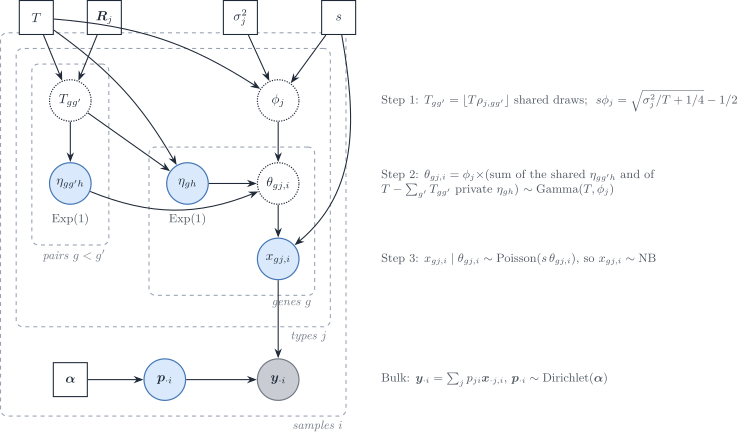

# Appendix S5 — Model Mis-specification (Description Only)

## Overview

The DeCovarT model assumes that bulk expression arises from a Gaussian
convolution: one latent profile per cell type, \boldsymbol{x}\_{\cdot
j}\sim\mathcal{N}\_G(\boldsymbol{\mu}\_{\cdot
j},\boldsymbol{\Sigma}\_j), weighted by p_j and summed, so that

\boldsymbol{y} \sim \mathcal{N}\_G\Bigl(\sum\_{j=1}^{J}
p_j\boldsymbol{\mu}\_{\cdot j},\\ \sum\_{j=1}^{J}
p_j^{2}\boldsymbol{\Sigma}\_j\Bigr).

Real bulk RNA-seq violates this assumption in at least seven ways:

1.  **Observation noise model**: counts follow a negative binomial (NB)
    or Poisson-log-normal (PLN) distribution rather than Gaussian.
2.  **Heavy-tailed or contaminated bulk**: outlier samples (technical
    artefacts, cell doublets) inflate tails.
3.  **Missing reference component**: an unmodelled cell type contributes
    to the bulk; all estimated proportions are redistributed.
4.  **Inter-sample (copula) correlations**: genes share latent batch
    structure, inducing correlation across observations.
5.  **Wrong covariance reference**: the within-cell-type covariance
    \boldsymbol{\Sigma}\_j is estimated from a different cohort or
    technology, introducing systematic bias.
6.  **Platform bias between bulk and reference**: the bulk library and
    the single-cell library measure the same gene with different
    gene-wise factors (capture, gene length, transcriptome-size
    scaling), so \tilde{\boldsymbol{\mu}} estimated from cells is not
    the mean that enters the bulk (S5f, S5g).
7.  **Normalisation of the inputs**: a log or a per-cell rescaling of
    the counts breaks the linearity of the mixture, and the size of the
    signature panel decides how many inconsistent genes enter the fit
    (S5h, S5i).

------------------------------------------------------------------------

## How published methods stress-test deconvolution

Five second-generation methods report a robustness or sensitivity
analysis: `Bisque`, `DECALS`, `deMixSC`, `DWLS` and `ReDeconv`. For
each, this section states what is simulated, which factor is varied, and
what the design cannot test for DeCovarT. Two further designs are
reviewed as generators rather than as stress tests: the multivariate
negative-binomial simulator of `CSNet`
([Section 2.6](#sec-s5-review-csnet)) and the structured bulk noise of
the `HADACA3` challenge ([Section 2.7](#sec-s5-review-hadaca)). Each
model is described in [5.1,
review](https://bastienchassagnol.github.io/DeCovarT/articles/05-1-review-distribution-aware.md);
here only the simulation design matters. Page numbers refer to the PDF
of each article. Statements marked “(our remark)” are not in the source.

### Bisque: a gene-wise affine platform map

`Bisque` ([Jew et al. 2020](#ref-jewAccurateEstimationCell2020)) builds
the base bulk of each of six individuals as the sum of all snRNA-seq
counts of that individual (p. 3; Methods, p. 10). The bias between
technologies is a gene-wise affine map applied to that bulk, with
coefficient and intercept drawn from half-normal laws (equations 5–6,
p. 10):

y'\_{gi}=\beta_g\\y\_{gi}+\alpha_g, \qquad
\beta_g\sim\mathrm{HN}(\sigma)+1, \qquad
\alpha_g\sim\mathrm{HN}(\sigma), \qquad \sigma\in\\0,5,10,20\\, \tag{1}

with 10 replicates per \sigma, scored by the global Pearson correlation
and the RMSD of the proportions. The half-normal makes both terms
positive; the authors state that the simulation “assumes expression
levels have a positive correlation across technologies” (p. 10). Four
further checks use real data (p. 7): snRNA-seq proportions biased by
down- or up-sampling microglia, an unknown cell population added by
mixing adipose into brain bulk, references of fewer than four snRNA-seq
samples, and the removal of up to 75% of the 102 microglia markers,
after which performance drops. The model is in [5.1,
Bisque](https://bastienchassagnol.github.io/DeCovarT/articles/05-1-review-distribution-aware.html#sec-bisque).

What the design cannot test for DeCovarT:

- **One bias for all types and samples.** The map is gene-wise only, the
  same for every cell type and every bulk sample. It is the map that
  `Bisque` learns and inverts; the authors note that the simulation
  applies it to true counts whereas `Bisque` learns it from averaged
  counts (p. 3).
- **Amplification only.** Since \beta_g\ge 1, the bulk is never
  attenuated relative to the reference. A gene captured less well in
  bulk than in cells, a platform ratio \tilde b_g\<1 ([5.1, Poisson
  measurement](https://bastienchassagnol.github.io/DeCovarT/articles/05-1-review-distribution-aware.html#sec-poisson-measurement)),
  is not simulated (our remark).
- **No covariance mismatch.** The bulk is the sum of the reference’s own
  nuclei, so the bulk and the reference share their within-type
  covariance; a wrong \boldsymbol{\Sigma}\_j (overview item 5) cannot
  arise (our remark).

### DECALS: Gaussian profiles with fixed block correlation

`DECALS` ([Cai et al. 2024](#ref-caiStatisticalInferenceCelltype2024))
scores the coverage of 95% intervals for \boldsymbol{p} over 100
replicates. Its main design (section 3.1, author manuscript p. 11) is
fully parametric:

- K=3 types, \boldsymbol{\pi}\_i\sim\mathrm{Dirichlet}(3,2,1), p=300
  genes, n=500 bulk samples;
- \boldsymbol{x}^{(k)}\_i\sim\mathcal{N}(\boldsymbol{w}\_k,\boldsymbol{\Sigma}\_k),
  \boldsymbol{y}\_i=\sum_k\pi\_{ik}\boldsymbol{x}^{(k)}\_i, with no
  extra noise;
- entries of \boldsymbol{w}\_k i.i.d. \mathcal{N}(0,1), and
  \boldsymbol{\Sigma}\_k=10\\\boldsymbol{R}^{(k)};
- \boldsymbol{R}^{(1)}=\operatorname{diag}(R_1,R_2,R_2),
  \boldsymbol{R}^{(2)}=\operatorname{diag}(R_2,R_1,R_2),
  \boldsymbol{R}^{(3)}=\operatorname{diag}(R_2,R_2,R_1), blocks of p/3
  genes, with R_1 exchangeable at 0.3 and
  (R_2)\_{jj'}=0.7\times0.9^{\lvert j-j'\rvert-1} for j\neq j'.

Three variations follow. Section 3.2 (p. 12) observes \tilde
w\_{kj}=w\_{kj}+e\_{kj} with e\_{kj}\sim\mathcal{N}(0,a_0^{2}), a_0 from
0.1 to 1; coverage stays near 95% up to a_0=0.6. Section 3.3 (p. 12)
takes \boldsymbol{W}, \boldsymbol{\pi}\_i and \boldsymbol{\Sigma}\_k
from the ROSMAP analysis (K=5, n=541, p=159, FPKM) and draws gamma
margins joined by a Gaussian copula (supp. A2.6, p. 7): shape
\alpha\_{kj}=0.01 and scale w\_{kj}/\alpha\_{kj}. Supplement A2.7 (p. 7)
shares one \boldsymbol{R} across types, with three, two or one blocks of
correlation 0.2; `DECALS` fails when \boldsymbol{R} is dense. The model
is in [5.1,
DECALS](https://bastienchassagnol.github.io/DeCovarT/articles/05-1-review-distribution-aware.html#sec-decals).

What the design cannot test for DeCovarT:

- **The mean geometry is left to chance.** With i.i.d. \mathcal{N}(0,1)
  entries and p=300, the three signature columns are nearly orthogonal.
  Over 2000 draws (our check, seed 1), the mean absolute pairwise cosine
  was 0.046 and the median condition number \kappa(\boldsymbol{W}) was
  1.13 (5–95% range 1.06–1.21). Scaling the entries, as supplement A2.4
  does with \mathcal{N}(0,a^{2}), changes the norms but neither the
  cosines nor \kappa. DeCovarT sets the pairwise cosines through a
  target Gram and reports \kappa(\boldsymbol{\mu}) ([4.1, mean
  signature](https://bastienchassagnol.github.io/DeCovarT/articles/04-1-synthetic-scenarios.html#sec-lr-block-mu);
  [4.1,
  descriptors](https://bastienchassagnol.github.io/DeCovarT/articles/04-1-synthetic-scenarios.html#sec-scenario-descriptors)),
  so collinear signatures, where the covariance should matter most, are
  a design factor rather than an accident (our remark).
- **Two fixed network motifs.** In graph terms every block is a clique.
  The inverse of an exchangeable block is exchangeable, hence dense.
  R_2=\tfrac29\mathbf{I}+\tfrac79K\_{0.9}, with K\_{0.9} the AR(1)
  correlation 0.9^{\lvert j-j'\rvert}; K\_{0.9}^{-1} is tridiagonal but
  the inverse of R_2 is dense (our check). The design is a stochastic
  block model with fixed blocks, within-block edge probability 1 and
  between-block probability 0, and its only network factor is the number
  of blocks (A2.7). DeCovarT draws Erdős–Rényi, scale-free,
  stochastic-block and small-world skeletons with random signs and
  controls \kappa(\boldsymbol{\Omega}) ([4.1,
  networks](https://bastienchassagnol.github.io/DeCovarT/articles/04-1-synthetic-scenarios.html#sec-ggm-networks)).
- **Gamma margins are univariate and set the variance.** A gamma law is
  the mixing law of the rate of a negative binomial (Poisson–gamma), not
  a count law; the margins of section 3.3 are continuous FPKM. Gene–gene
  dependence enters only through the Gaussian copula, on the latent
  normal scale. With shape fixed at 0.01, each marginal variance is
  w\_{kj}^{2}/0.01=100\\w\_{kj}^{2}, set by the mean and not by the
  diagonal of \boldsymbol{\Sigma}\_k (our remark, from the A2.6
  parameters). As in [Section 4.3](#sec-s5-copula), the count-scale
  covariance of such draws differs from the copula correlation; the
  paper does not report it.
- **No systematic platform bias.** The only reference error (section
  3.2) is i.i.d., symmetric and centred, not a gene-wise ratio \tilde
  b_g.

### deMixSC: matched aliquots, no synthetic stress test

`deMixSC` (preprint Guo et al.
([2023](#ref-guoDeMixSCDeconvolutionFramework2023))) reports no purely
synthetic sensitivity analysis. Its benchmark is real: 24 retinas in two
batches, with bulk and snRNA-seq libraries made from the same
single-nucleus suspension aliquot (p. 148). The pseudo-bulk is the sum
of UMI counts over nuclei. Between matched real bulk and pseudo-bulk the
mean Spearman correlation is 0.31 and 0.41 for the two batches, and more
than 5000 genes are differentially expressed in each batch
(pp. 148–149). A second benchmark of seven high-grade serous ovarian
cancer samples shows the same discrepancy (p. 149). Robustness is tested
on two factors only: the input format (RPM, RPKM, TPM and raw counts)
and the benchmark size, satisfactory at four samples and stable above
seven (p. 151). The unmatched cohorts deconvolved afterwards (453
retinas; an ovarian cancer cohort) have no ground truth. The model is
weighted non-negative least squares with additive noise ([5.1,
deMixSC](https://bastienchassagnol.github.io/DeCovarT/articles/05-1-review-distribution-aware.html#sec-demixsc)),
not a negative-binomial convolution; `DeMixNB` is the negative-binomial
convolution ([Montierth et al.
2025](#ref-montierthDeconvolutionSparsecountRNA2025)).

What the design cannot test for DeCovarT:

- **Pseudo-bulks carry no platform bias.** A pseudo-bulk is built on the
  platform of the reference, so it reproduces none of the systematic
  difference between bulk and single-cell libraries. The matched real
  bulk does carry that difference, but at the one level set by this
  tissue and these protocols. No factor varies its size or its gene
  structure, so the bias at which the method breaks is unknown (our
  remark).
- **The truth is itself a single-cell measurement.** The reference
  composition of an aliquot is counted from snRNA-seq, which the authors
  note can be biased towards retaining some cell types (p. 148).
- **The setting of interest has no truth.** In unmatched bulk the
  discrepancy adds donor and sampling differences to the platform
  effect, and nothing is known about \boldsymbol{p}.

A matched-aliquot data set is the empirical counterpart of S5f: it would
fix a realistic range for \sigma in [Equation 1](#eq-s5-bisque-map) (our
remark).

### DWLS: Splatter dropout and normalisation

The “model robustness evaluation” of `DWLS` \[Tsoucas et al.
([2019](#ref-tsoucasAccurateEstimationCelltype2019)), pp. 5–6; Methods
p. 8\] has three parts.

- **Dropout.** `splatSimulate` from `Splatter` ([Zappia et al.
  2017](#ref-zappiaSplatterSimulationSinglecell2017a)) draws 1000 cells
  and 10,000 genes in four equal groups, with `dropout.shape` in
  \\-2000,-2,-1.3,-0.8,-0.6,-0.3\\ (dropout 16% to 41%) and five seeds.
  The bulk is “simulated by aggregating all single cells”.
- **Normalisation.** Three `Splatter` data sets with library-size
  variation and group probabilities (0.9,0.1) are normalised by `Seurat`
  `LogNormalize`, `scran` and `SCnorm`, with and without the log
  (un-logged by “converting the log-transformed data back to the
  original scale”). Without the log, performance “is much improved”
  (p. 6); on the real intestinal data the difference between
  normalisations is “mainly due to log-transformation” (p. 6).
- **Signature genes.** A stricter marker cutoff (1032 to 775 genes),
  random halves of the signature (10 times), and markers from `voom` or
  `edgeR` gave similar estimates (p. 6; Methods p. 8).

The model is in [5.1,
DWLS](https://bastienchassagnol.github.io/DeCovarT/articles/05-1-review-distribution-aware.html#sec-dwls).

What the design cannot test for DeCovarT:

- **The dropout is shared by bulk and reference.** The bulk is the sum
  of the same dropped-out cells that build the signature, so the
  experiment varies the sparsity of the reference, not a contrast
  between bulk and single-cell libraries. The paper motivates the
  normalisation test by “technical differences between single-cell and
  bulk RNA-seq data” (p. 5), which this design does not create (our
  remark).
- **Zero inflation is contested for UMI data.** Spike-in controls show
  no zero-generating measurement component ([Sarkar and Stephens
  2021](#ref-sarkarSeparatingMeasurementExpression2021)), and droplet
  UMI counts show no zero inflation beyond the negative binomial
  (Svensson 2020) ; see [5.1, Poisson
  measurement](https://bastienchassagnol.github.io/DeCovarT/articles/05-1-review-distribution-aware.html#sec-poisson-measurement)
  and [5.1, measurement
  models](https://bastienchassagnol.github.io/DeCovarT/articles/05-1-review-distribution-aware.html#sec-measurement).
  The margins of [Section 4.2](#sec-s5-margins) have no zero inflation.
- **Splatter fixes every law in advance.** `Splatter` is a parametric
  gamma–Poisson hierarchy with a logistic dropout, and its genes share
  only the cell library size: there is no gene–gene correlation to
  recover. `scDesign2` and `scDesign3` instead fit one margin per gene
  and type and join the genes by a copula
  ([Section 4](#sec-s5-simulator)), so the dependence that DeCovarT
  models is part of the simulator.
- **The log result supports linear inputs.** A logarithm is concave, so
  \log(\boldsymbol{\mu}\boldsymbol{p})\neq(\log\boldsymbol{\mu})\boldsymbol{p}
  ([S1, affine
  equivariance](https://bastienchassagnol.github.io/DeCovarT/articles/S1-identifiability.html#sec-affine));
  benchmarks also recommend a linear scale ([Newman et al.
  2015](#ref-newmanRobustEnumerationCell2015); [Avila Cobos et al.
  2020](#ref-avilacobosBenchmarkingCellType2020)). DeCovarT therefore
  works on raw counts, or on Pearson residuals of a negative-binomial
  null with library size as offset, which remove the Poisson
  mean–variance relation and the library-size variation ([3.1, Pearson
  residuals](https://bastienchassagnol.github.io/DeCovarT/articles/03-1-feature-selection.html#sec-sctransform)).
  Residuals are a gene-wise affine map only when every column shares the
  fitted mean of a gene; with cell-specific depths they are not, and the
  mixture is no longer linear on that scale (our remark). `ReDeconv`
  adds that `SCTransform` on the reference rescales the cell types and
  creates its Type I issue ([Lu et al. 2025,
  9–10](#ref-luTranscriptomeSizeMatters2025)): a library-size offset
  removes transcriptome size along with depth. Pearson residuals
  therefore serve gene selection and covariance estimation; whether they
  can also be the deconvolution scale is what S5h tests.

### ReDeconv: three types of systematic bias

`ReDeconv` ([Lu et al. 2025](#ref-luTranscriptomeSizeMatters2025))
attributes the variable performance of deconvolution to the difference
between sequencing technologies, and names three issues (p. 2).

- **Type I, scaling.** CP10K rescales every cell to the same total, so
  small transcriptomes are enlarged; types with a small transcriptome
  are under-estimated and types with a large one over-estimated. The
  bias correlates with transcriptome size and is the same across
  algorithms (p. 7).
- **Type II, gene length.** Total-RNA bulk counts scale with gene
  length, UMI counts do not: the measured value is c\\r_g for 10x
  Chromium and c'\\r_gL_g for total bulk RNA-seq on Illumina HiSeq 2000
  (equation 1, p. 13). Applying the same normalisation to both inputs
  creates the issue; length normalisation of the bulk only removes it.
- **Type III, variance.** Methods use the mean of each gene in each type
  and ignore the within-type variance or set it constant. A gene that
  varies strongly within a type in the reference is also measured with
  more uncertainty in the bulk; `ReDeconv` puts that variance in its
  likelihood and selects genes with a small coefficient of variation
  (pp. 2, 14).

The synthetic design (Methods, p. 14) builds each bulk from the
raw-count cells of **one** sample: the number of cells per type is
fixed, those cells are drawn at random and summed (treated as RPK), then
multiplied by gene length for a raw-count bulk or rescaled to TPM; 100
mixtures per set. Six sets (SYN Data A–F) come from brain, glioblastoma,
blood and lung cancer cells (p. 7). Proportions are equal (A–D), random
but shared by the 100 mixtures (E), or random per mixture (F); no
Dirichlet law is named. The issues are induced by feeding different
input formats (CP10K or raw single-cell data; TPM or raw bulk) to each
method (pp. 7–9). The real-data truth is 18 mixtures of six cell lines
with cell counts and a matched scRNA-seq reference (Cobos et al. 2023) ,
plus sorted PBMC bulks whose dominant type is known (p. 7). The model is
in [5.1,
ReDeconv](https://bastienchassagnol.github.io/DeCovarT/articles/05-1-review-distribution-aware.html#sec-redeconv).

What the design cannot test for DeCovarT:

- **Type II is a known deterministic factor.** The raw-count synthetic
  bulk is the RPK sum times L_g: the case \alpha_g=0, \beta_g=L_g of
  [Equation 1](#eq-s5-bisque-map) with \beta_g known. Length
  normalisation of the bulk then removes it exactly, by construction
  (our remark).
- **Type III cannot appear in the synthetic sets.** Bulk and reference
  come from the same cells of one sample; the authors state that the
  impact of Type III is then “minimal” (p. 14), and that synthetic bulks
  built from data that also serve as the reference make Type I and II
  issues disappear (pp. 10–11). Type III is assessed only on sorted
  bulks (pp. 9–10).
- **Variance without covariance.** The `ReDeconv` variance is the
  diagonal, linear in the weights; DeCovarT adds the gene–gene
  covariance of each type ([2.1, one
  replicate](https://bastienchassagnol.github.io/DeCovarT/articles/02-1-single-cell-generative-optimisation.html#sec-one-replicate)).

Two attributions are easy to confuse. `ReDeconv` uses no Smart-seq2
data, and its real-data truth is counted cell-line mixtures. Bulk and
single-nucleus libraries from the same aliquot are the design of
`deMixSC` ([Section 2.3](#sec-s5-review-demixsc)). Flow-cytometry ground
truth is the design of `CIBERSORTx`: whole-blood RNA-seq of 12 healthy
adults, deconvolved with a 10x Chromium PBMC signature, is compared with
proportions “determined by direct cytometry and fluorescence
immunophenotyping” (p. 2), that is, flow cytometry and an automated
haematology leukocyte differential count (Fig. 2 legend, p. 3) ([Newman
et al. 2019](#ref-newmanDeterminingCellType2019)). The same comparison
shows the platform bias that S5f simulates: uncorrected estimates showed
“clear estimation biases for some cell types”, which the authors
attribute to platform-specific variation such as the use of UMIs, and
their cross-platform batch correction “substantially improved” the
agreement (p. 2; five cell types, Fig. 2b).

### CSNet: correlated negative binomials from shared gamma shocks

`CSNet` ([Su et al. 2024](#ref-suEstimatingCellTypeSpecificGene2024))
estimates cell-type-specific co-expression from bulk samples, not
proportions, but its supplement A1 gives a simulator of
negative-binomial vectors with a large and structured covariance
(Algorithm 1). Page numbers refer to the bioRxiv preprint
(doi:10.1101/2021.12.21.473558), supplement on PDF pp. 33–35. In our
notation (gene g, type j, sample i, depth s; `CSNet` writes j, k, i and
S), the margin is the Poisson–gamma mixture of bulk RNA-seq models:
\theta\sim\mathrm{Gamma}(T,\phi) (shape T, scale \phi) and
x\mid\theta\sim\mathrm{Poisson}(s\theta), so that
x\sim\mathrm{NB}\\T,1/(1+s\phi)\\ (equations S1–S2, p. 33). Algorithm 1
(p. 34) draws each purified profile in three steps
([Figure 1](#fig-s5-csnet)):

1.  **Shared shocks.** For each pair g\<g', T\_{gg'}=\lfloor
    T\rho\_{j,gg'}\rfloor draws \eta\_{gg'h}\sim\mathrm{Exp}(1) are
    shared by genes g and g', with T “a large positive integer,
    e.g. 200” and \boldsymbol{R}\_j=(\rho\_{j,gg'}) the target
    correlation.
2.  **Gamma rates.** Gene g adds T-\sum\_{g'}T\_{gg'} private
    \mathrm{Exp}(1) draws, so \theta\_{gj,i}=\phi_j(\text{sum of \$T\$
    draws})\sim\mathrm{Gamma}(T,\phi_j), and
    s\phi_j=\sqrt{\sigma_j^{2}/T+1/4}-1/2 fixes the count variance at
    \sigma_j^{2}. Correlation comes from sums of shared gamma
    components, an idea the authors credit to Ronning (1977); there is
    no copula.
3.  **Poisson sampling.**
    x\_{gj,i}\mid\theta\_{gj,i}\sim\mathrm{Poisson}(s\\\theta\_{gj,i}).

Figure 1: Algorithm 1 of `CSNet` (supplement A1) as a generative model,
in DeCovarT’s notation. Step 1 shares T\_{gg'} unit-exponential shocks
between genes g and g'; step 2 sums T shocks per gene into a gamma rate
\theta\_{gj,i} with scale \phi_j set by the target variance; step 3
samples counts at depth s. The bulk is the proportion-weighted sum of
the purified profiles. Blue: latent; grey: observed; dotted:
deterministic; squares: fixed.

The count moments follow from the law of total covariance (our
derivation; the paper states only the variance and the correlation):

\mathbb{E}x\_{gj}=sT\phi_j, \qquad
\operatorname{Var}x\_{gj}=s^{2}T\phi_j^{2}+sT\phi_j, \qquad
\operatorname{Cov}(x\_{gj},x\_{g'j})=s^{2}\phi_j^{2}T\_{gg'}, \qquad
\operatorname{Cor}(x\_{gj},x\_{g'j})=\frac{T\_{gg'}}{T}\\b_j, \quad
b_j=\frac{s\phi_j}{1+s\phi_j}. \tag{2}

The count covariance is
s^{2}\operatorname{Cov}(\boldsymbol{\theta})+\operatorname{diag}(s\\\mathbb{E}\boldsymbol{\theta}):
a latent covariance plus the Poisson diagonal of [5.1, Poisson
measurement](https://bastienchassagnol.github.io/DeCovarT/articles/05-1-review-distribution-aware.html#sec-poisson-measurement).
With s=6\times10^{7} and \sigma^{2}=e^{8} the attenuation is b=0.77
(p. 35). The main simulation (pp. 11–13) has two types,
\pi\_{i1}\sim\mathrm{Beta}(2,1), p\in\\100,200\\ genes in three equal
sets, the first co-expressed in type 1 and the second in type 2, with an
MA(1) correlation 0.5b\approx0.39 or an AR-type correlation
0.70\times0.9^{\lvert g-g'\rvert-1}, \log\sigma^{2}\_{gg}\in\\7,8\\,
n\in\\150,600\\ bulks and 200 replicates.

What the construction offers DeCovarT, and its limits (our remarks):

- **A count-scale truth in closed form.**
  [Equation 2](#eq-s5-csnet-moments) gives the covariance of the counts
  and of the rates exactly, so both the raw and the denoised within-type
  covariance ([2.1, raw or
  denoised](https://bastienchassagnol.github.io/DeCovarT/articles/02-1-single-cell-generative-optimisation.html#sec-raw-vs-denoised))
  can be scored without the Monte Carlo truth that the copula simulator
  needs ([Section 4.3](#sec-s5-copula)).
- **Non-negative correlations only, in steps of 1/T.** A sum of shared
  shocks cannot make two genes vary in opposite directions. The networks
  of
  [4.1](https://bastienchassagnol.github.io/DeCovarT/articles/04-1-synthetic-scenarios.html#sec-ggm-networks)
  carry random signs and are out of reach.
- **The mean is set by the variance.** \mathbb{E}x\_{gj}=T(s\phi_j) does
  not depend on s and equals about 678 for \log\sigma^{2}=8 and T=200:
  the signature \boldsymbol{\mu}, hence its overlap and condition
  number, cannot be chosen apart from the variances (the paper writes
  that \boldsymbol{\mu}^{(k)} “is set to be a function of”
  \boldsymbol{\Sigma}^{(k)}, p. 12).
- **Feasibility.** Step 2 needs \sum\_{g'\neq g}T\_{gg'}\le T, that is
  row sums of \boldsymbol{R}\_j at most about one. The MA(1) design
  meets it; an AR-type block of about 33 genes with lag-one correlation
  near 0.9 has row sums above ten, so Algorithm 1 as printed cannot
  produce the AR-type design (our check; the released code was not
  inspected).
- **A covariance, not a sparse precision.** The target is
  \boldsymbol{R}\_j; its inverse is generally dense.

#### How the construction compares with other multivariate laws

`CSNet` is a Poisson mixture whose mixing law is a common-shock
multivariate gamma: the bivariate case is Olkin’s example of a Poisson
pair mixed over a trivariate-reduction gamma (Olkin 1994, §6, pp. 45–46)
. The common-shock device explains its sign restriction: the same
construction applied to Poisson variables gives the multivariate
Poisson, which “only permits positive dependencies” and needs up to
2^{G}-1 parameters (Inouye et al. 2017, p. 4; Olkin 1994, p. 43) . A
mixture as such is not restricted: with a Gaussian log-rate the signs
are free ([Table 1](#tbl-s5-mvcount)).

| Construction | Dependence enters through | Signs | Count covariance | Used by |
|----|----|----|----|----|
| Common-shock multivariate Poisson | shared Poisson summands | \ge 0 | exact, = shared rate | none reviewed |
| Poisson mixture over a common-shock gamma | shared \mathrm{Exp}(1) in the rate | \ge 0, steps 1/T | exact, [Equation 2](#eq-s5-csnet-moments) | `CSNet` |
| Poisson–log-normal | Gaussian log-rate \mathcal{N}(\boldsymbol{\mu},\boldsymbol{\Sigma}) | both, attenuated | exact, \mathbb{E}x_g\mathbb{E}x\_{g'}(e^{\Sigma\_{gg'}}-1) | S5c; [5.1, discrete counts](https://bastienchassagnol.github.io/DeCovarT/articles/05-1-review-distribution-aware.html#sec-discrete-counts) |
| Gaussian copula with NB margins | latent normal \boldsymbol{R} | both, within Fréchet bounds | no closed form | `scDesign2/3`, `DECALS` 3.3, S5c |
| Correlation-calibrated NB margins | binary collapse of each margin, latent normal | both, within Fréchet–Hoeffding bounds | targets the Pearson correlation | `MultiDiscreteRNG` |
| Poisson graphical model | node-conditional Poisson | \le 0 for a proper law | not closed | none reviewed |

Table 1: Multivariate count constructions. Sources: Olkin 1994
(pp. 42–46); Inouye et al. 2017 (pp. 4, 6, 8–9, 12); Subedi and Dang
2025 (pp. 1257–1258); Cheng and Demirtas 2026 (pp. 3–6).

The Poisson–log-normal covariance is attenuated relative to the latent
one,
\lvert\operatorname{Cov}(x_g,x\_{g'})\rvert\<\lvert\operatorname{Cov}(z_g,z\_{g'})\rvert,
and less so at large means (Subedi and Dang 2025, p. 1258); `CSNet`’s
factor b_j plays the same role. Inouye et al. report Spearman
correlations of a Poisson–log-normal pair limited to \[-0.53,0.58\] at
mean 2 and \[-0.73,0.81\] at mean 10 (p. 9). The calibrated generator of
Cheng and Demirtas reaches any signed Pearson correlation inside the
Fréchet–Hoeffding bounds, at the cost of one simulation-based
calibration per gene pair, which is heavy for hundreds of genes
(pp. 5–6, 17).

Fang, Lin and Deng review the construction of multivariate laws (section
4, pp. 20–32) . The entries that could serve S5 are:

- **Discrete laws** (pp. 20–21): the multinomial, which is independent
  Poisson counts conditioned on their total, the library-size closure of
  [5.1](https://bastienchassagnol.github.io/DeCovarT/articles/05-1-review-distribution-aware.html#sec-poisson-measurement);
  the multivariate hypergeometric, the law of counts down-sampled
  without replacement; and the common-shock multivariate Poisson, “can
  only account for non-negative correlation”. The review has no
  multivariate geometric law.
- **Elliptical laws** (pp. 22–25):
  \boldsymbol{x}=\boldsymbol{\mu}+R\\\boldsymbol{A}^{\top}\boldsymbol{u},
  with \boldsymbol{u} uniform on the sphere and a radius R; the
  multivariate t and the Pearson type VII law (Table 7, p. 24) keep the
  covariance shape of \boldsymbol{\Sigma}\_j and add heavy tails, a
  graded alternative to the t\_\nu and contaminated levels of S5a. The
  Dirichlet law (p. 23), gamma variables divided by their sum, is the
  usual law of \boldsymbol{p}.
- **Sampling laws under a normal population** (section 4.5, pp. 25–26):
  (n-1)\boldsymbol{S}\sim W_p(n-1,\boldsymbol{\Sigma}), the Wishart law
  of a scatter matrix, which simulates the error of a reference
  covariance estimated from C_j cells (the “reference covariance sample
  size” factor of S5d); Hotelling’s T^{2} for tests on a mean vector;
  Wilks’ \Lambda for MANOVA. The review gives these laws no Bayesian
  role. As priors, the Wishart is conjugate for a Gaussian precision and
  the inverse-Wishart for a covariance, as in `bMIND`
  ([5.1](https://bastienchassagnol.github.io/DeCovarT/articles/05-1-review-distribution-aware.html#sec-bayes-cts));
  neither is a prior for a mean. Wilks’
  \Lambda=\lvert\boldsymbol{A}\_1\rvert/\lvert\boldsymbol{A}\_1+\boldsymbol{A}\_2\rvert
  is a product of independent beta variables, which is how it
  generalises the beta law (standard facts; the review prints \Lambda
  without determinants, p. 26). These laws matter for the Bayesian
  version of
  [5.2](https://bastienchassagnol.github.io/DeCovarT/articles/05-2-bayesian-wiener.md),
  not for the point estimate.
- **Skewed laws** (pp. 26–27): the multivariate skew-normal
  f(\boldsymbol{y})=2\phi_p(\boldsymbol{y}-\boldsymbol{\mu};\boldsymbol{\Sigma})\Phi\\\boldsymbol{\alpha}^{\top}\boldsymbol{\omega}^{-1}(\boldsymbol{y}-\boldsymbol{\mu})\\
  and the skew-elliptical family add asymmetry to a Gaussian-like
  dependence: a misspecification level between the Gaussian and the
  log-normal of S5a.
- **Copulas** (section 4.7, pp. 28–32): Sklar’s theorem, Archimedean
  families (Clayton and Ali–Mikhail–Haq as cases of a two-parameter
  family), elliptical copulas (Gaussian, t, Kotz type) and the
  meta-Gaussian law, a Gaussian copula with arbitrary margins, which is
  the construction of `scDesign2` and `DECALS` 3.3. The Marshall–Olkin
  survival copula serves survival data and is not needed here.

Several formulas of that section carry misprints: the variance of
\bar{\boldsymbol{x}} is printed \boldsymbol{\Sigma}/(n-1) instead of
\boldsymbol{\Sigma}/n (p. 25), the normal density lacks
\boldsymbol{\Sigma}^{-1} in its exponent (p. 22), and the multinomial
probability lacks \prod_kp_k^{n_k} (p. 20).

### HADACA3: structured noise added to the bulk

The `HADACA3` challenge ([Barbot and Richard
2026](#ref-barbotPromisesLimitsMultimodal2026)) scores deconvolution
methods on simulated pancreatic-tumour bulks, RNA and DNA methylation,
with the same proportions for both (Appendix B.1.2, pp. 17–18; Table 1,
p. 3). Only the RNA side is summarised.

- **Proportions.** \boldsymbol{p}\_{\cdot
  i}\sim\mathrm{Dirichlet}(\boldsymbol{\alpha}), with
  \boldsymbol{\alpha}\_{\mathrm{real}} “based on proportions found in
  the in vitro dataset” and \boldsymbol{\alpha}\_{\mathrm{rare}} making
  the immune type rare (p. 17); the values and the fitting rule are not
  reported.
- **Bulk.**
  \boldsymbol{Y}=\boldsymbol{X}\boldsymbol{P}+\boldsymbol{\varepsilon},
  60 samples, with simulation references “entirely distinct” from the
  references given to the participants (pp. 3–4). The bulk is therefore
  not a pseudo-bulk of the reference, and the noise is added after
  mixing.
- **Noise strategies** (Table 1, p. 3): `SDN5`, a heteroscedastic
  \chi^{2} noise, with no formula or parameters given; `SDN4`, one type
  removed and its proportion moved to another (a missing reference
  component, as S5b); `SDN6`, an extra type at 10% (S5b, the other way);
  `SDE5` and `SDEL`, dependent noise from a factor model; `SDC5`,
  dependent noise from an empirical copula; `SBN5`, pseudo-bulks of 100
  cells drawn from a negative binomial with gene-wise dispersions fitted
  on real scRNA-seq (p. 18).

`SDE5` and `SDC5` take the dependence from real data. The residuals of
in vitro mixtures of known composition,
\boldsymbol{\varepsilon}\_{\mathrm{vitro}}=\boldsymbol{Y}-\boldsymbol{X}\boldsymbol{P}\_{\mathrm{vitro}},
are centred and scaled (p. 17).

- **`SDE5`, low-rank factor noise.** The correlation matrix of the
  residuals is “approximated with a low-rank factor decomposition based
  on an Expectation-Maximisation procedure”, that of Friguet, Kloareg
  and Causeur (2009) . Each simulated noise row is then multiplied by
  the residual standard deviation of its gene. The factor model is
  \boldsymbol{\varepsilon}=\boldsymbol{B}\boldsymbol{z}+\boldsymbol{e},
  \qquad \boldsymbol{z}\sim\mathcal{N}(\boldsymbol{0},\mathbf{I}\_q),
  \qquad
  \boldsymbol{e}\sim\mathcal{N}(\boldsymbol{0},\boldsymbol{\Psi}),
  \qquad
  \boldsymbol{\Sigma}\_{\varepsilon}=\boldsymbol{B}\boldsymbol{B}^{\top}+\boldsymbol{\Psi},
  \tag{3} with \boldsymbol{B} a G\times q loading matrix and
  \boldsymbol{\Psi} diagonal (Friguet et al. 2009, eq. 1–2, p. 1407);
  given the q factors the genes are independent. EM alternates the
  posterior moments of \boldsymbol{z} with closed-form updates of
  \boldsymbol{B} and \boldsymbol{\Psi} (Rubin and Thayer’s algorithm,
  p. 1408), and q is chosen to remove the residual correlation among
  null genes (eq. 6, p. 1413).
- **`SDC5`, empirical copula.** “the conditional dependence structure
  with the empirical Copula on the scaled and centered residuals”, with
  the R package `copula`, then negative-binomial margins per gene
  (p. 17). No parametric family is fitted; the margin parameters are not
  reported.

What the design offers DeCovarT, and its limits (our remarks):

- **A composition-free correlated residual.** The noise is added to the
  bulk and does not depend on \boldsymbol{p}\_{\cdot i}, whereas
  DeCovarT’s residual covariance is
  \sum_jp\_{ji}^{2}\boldsymbol{\Sigma}\_j. For DeCovarT it is a dense
  version of the nugget \boldsymbol{D} of
  [5.2](https://bastienchassagnol.github.io/DeCovarT/articles/05-2-bayesian-wiener.html#sec-bw-model):
  a misspecification that S5j adopts.
- **Ordinary, not Pearson, residuals.**
  \boldsymbol{Y}-\boldsymbol{X}\boldsymbol{P} is scaled gene by gene,
  but its variance still follows the mean through the Poisson part, so
  the estimated correlation mixes technical and biological dependence.
  DeCovarT estimates dependence after removing the Poisson diagonal, on
  Pearson residuals of a negative-binomial null ([3.1, Pearson
  residuals](https://bastienchassagnol.github.io/DeCovarT/articles/03-1-feature-selection.html#sec-sctransform);
  [2.1, raw or
  denoised](https://bastienchassagnol.github.io/DeCovarT/articles/02-1-single-cell-generative-optimisation.html#sec-raw-vs-denoised)).
- **Empirical copula against `scDesign3`.** The `SDC5` copula is the
  empirical copula of a few in vitro mixtures: it resamples observed
  rank patterns and cannot produce dependence absent from them.
  `scDesign3` fits a parametric copula per cell type on many cells
  ([Section 4.3](#sec-s5-copula)), the level at which
  \boldsymbol{\Sigma}\_j lives. The two answer different questions,
  dependence of the bulk noise against dependence within a type, and can
  be combined: `scDesign3` for the purified profiles, a factor or copula
  noise on the mixed bulk.
- **Correlation in a latent space.** In [Equation 3](#eq-s5-factor) the
  dependence lives in q factors, read as pathways or modules; this is
  the linear latent space of the article (section “Deconvolution in a
  latent space”), where a fixed projection \boldsymbol{L} keeps DeCovarT
  exact on \boldsymbol{L}\boldsymbol{y}. Used for \boldsymbol{\Sigma}\_j
  rather than for the noise, a factor covariance tests the sparse
  precision of DeCovarT outside its family: by the Woodbury identity,
  \boldsymbol{\Sigma}^{-1}=\boldsymbol{\Psi}^{-1}-\boldsymbol{\Psi}^{-1}\boldsymbol{B}(\mathbf{I}\_q+\boldsymbol{B}^{\top}\boldsymbol{\Psi}^{-1}\boldsymbol{B})^{-1}\boldsymbol{B}^{\top}\boldsymbol{\Psi}^{-1},
  \tag{4} a diagonal minus a rank-q term, dense when the loadings are,
  so a graphical lasso can only approximate it.

### Summary

| Method | Profile law | Gene dependence | Platform bias | Normalisation | Ground truth |
|----|----|----|----|----|----|
| `Bisque` | Real snRNA-seq counts, summed per individual | Real, shared by bulk and reference | Gene-wise affine, \beta_g\sim\mathrm{HN}(\sigma)+1, \alpha_g\sim\mathrm{HN}(\sigma), \sigma\in\\0,5,10,20\\ | Not varied | snRNA-seq proportions per individual |
| `DECALS` | \mathcal{N}(\boldsymbol{w}\_k,10\boldsymbol{R}^{(k)}); gamma margins and Gaussian copula (3.3) | Fixed blocks: exchangeable 0.3, Toeplitz 0.7\times0.9^{d-1}; 3, 2 or 1 blocks (A2.7) | None; i.i.d. \mathcal{N}(0,a_0^{2}) error on \boldsymbol{W} (3.2) | Not varied | Simulated, \boldsymbol{\pi}\_i\sim\mathrm{Dirichlet}(3,2,1) |
| `deMixSC` | Real nuclei | Real | Real, one level, from matched aliquots | RPM, RPKM, TPM, raw counts | snRNA-seq composition of the same aliquot |
| `DWLS` | `Splatter` gamma–Poisson, logistic dropout 16–41% | None | None: bulk is the sum of the same cells | `LogNormalize`, `scran`, `SCnorm`, with and without log | Simulated group sizes |
| `ReDeconv` | Real cells of one sample | Real, shared by bulk and reference | Gene length L_g on the bulk; CP10K on the reference | Raw, CP10K, CLTS; raw or TPM bulk | Fixed cell numbers; 18 counted cell-line mixtures |
| `CSNet` (generator) | Poisson mixture over a common-shock gamma, NB margins | MA(1) 0.39 or AR-type; non-negative only | None | Not varied | Simulated, \pi\_{i1}\sim\mathrm{Beta}(2,1) |
| `HADACA3` | Distinct references, mixed then noised | Bulk noise: factor model (`SDE5`) or empirical copula (`SDC5`) of in vitro residuals | Distinct references; \chi^{2} noise (`SDN5`) | Not varied | Simulated, \mathrm{Dirichlet}(\boldsymbol{\alpha}\_{\mathrm{real}}) or rare immune type |
| DeCovarT (planned) | Gaussian, NB, PLN; `scDesign3` GAMLSS margins with a copula | Erdős–Rényi, scale-free, stochastic block, small-world; \kappa(\boldsymbol{\Omega}) | S5f, S5g | S5h | Simulated \boldsymbol{p}, entropy designs |

Table 2: How five methods stress-test deconvolution, two simulation
designs (`CSNet`, `HADACA3`), and the DeCovarT plan. Page anchors are in
the text above.

Three gaps recur (our remark). No design controls the geometry of the
mean signature; no design varies a gene–gene network beyond fixed
blocks; and every simulated platform bias is either one gene-wise factor
on the bulk (`Bisque`; `ReDeconv` Type II) or one rescaling of the
reference cells (`ReDeconv` Type I), never a factor that depends on both
gene and cell type or changes between samples. S5f to S5i below address
the platform and normalisation gaps, S5j the noise added after mixing;
the mean and network factors are already part of [4.1, synthetic
scenarios](https://bastienchassagnol.github.io/DeCovarT/articles/04-1-synthetic-scenarios.md).

------------------------------------------------------------------------

## Planned experiments

### S5a — Observation noise model

| Factor | Levels |
|----|----|
| Data-generating law | Gaussian (baseline); t\_\nu (\nu = 3); log-normal/PLN; contaminated Gaussian (\varepsilon = 0.05) |
| Algorithm | NNLS, DeconRNASeq, Marquardt–Levenberg (full \boldsymbol{\Sigma}) |
| G, J | 50 genes, 3 cell types |

**Hypothesis:** DeCovarT should retain lower bias under log-normal noise
than NNLS because the covariance captures more of the signal geometry,
but may be more sensitive than NNLS to heavy-tail contamination.

Connection to HADACA3 ([Barbot and Richard
2026](#ref-barbotPromisesLimitsMultimodal2026)): the `SDC5` dataset uses
a copula + NB noise model; `SDE5` uses an EM-based noise model. These
represent the practical domain of mis-specification most relevant to
pancreatic tumour deconvolution.

see also use of a multivariate Student t\_\nu or simple Gaussian noise.

### S5b — Missing reference component

| Factor                | Levels                                          |
|-----------------------|-------------------------------------------------|
| Missing-type fraction | None (0%); rare (2%); moderate (10%)            |
| Detection strategy    | None (ignore); re-normalise; add null cell type |
| Metric                | RMSE of remaining types; false inclusion rate   |

**Hypothesis:** closure forces the missing mass onto the J modelled cell
types; the distribution of the error across types depends on the
mean-collinearity structure. DeCovarT may exhibit a different
redistribution pattern than NNLS because the second-order term couples
the proportions estimation.

### S5c — Model complex dependencies

#### Copula-correlated NB samples

The counts come from the fitted simulator of
[Section 4](#sec-s5-simulator), or from fixed margins for a fully
synthetic design.

| Factor | Levels |
|----|----|
| Margins | NB GAMLSS fitted per gene and type ([Section 4.2](#sec-s5-margins)); NB (r = 5, \mu = \bar{\mu}\_g) |
| Copula family | Gaussian with \boldsymbol{R}\_j from the plug-in \boldsymbol{\Sigma}\_j ([Section 4.3](#sec-s5-copula)); Gaussian equicorrelated; Clayton (lower-tail dependence, outside the Gaussian family) |
| Correlation strength (equicorrelated and Clayton) | \tau_K \in \\0, 0.2, 0.5\\ |

`HADACA3`’s `SDC5` uses a copula too, but an empirical one on bulk
residuals rather than a fitted one on the purified profiles
([Section 2.7](#sec-s5-review-hadaca)).

#### Shared-gamma negative binomials (`CSNet`)

| Factor | Levels |
|----|----|
| Generator | Algorithm 1 of `CSNet` ([Figure 1](#fig-s5-csnet)), with T=200 |
| Target correlation \boldsymbol{R}\_j | MA(1); block exchangeable; any non-negative \boldsymbol{R}\_j with row sums \le1 |
| Depth s | values giving b_j\in\\0.5,0.77,0.95\\ in [Equation 2](#eq-s5-csnet-moments) |

The exact count covariance of [Equation 2](#eq-s5-csnet-moments) scores
the raw and the denoised covariance estimators without Monte Carlo;
signed networks need the copula or the Poisson–log-normal generator.

#### Low-rank factor covariance

| Factor | Levels |
|----|----|
| \boldsymbol{\Sigma}\_j | \boldsymbol{B}\_j\boldsymbol{B}\_j^{\top}+\boldsymbol{\Psi}\_j ([Equation 3](#eq-s5-factor)), loadings dense or block-sparse |
| Number of factors q | 1, 3, 10 |
| Share of variance in the factors | \operatorname{tr}(\boldsymbol{B}\boldsymbol{B}^{\top})/\operatorname{tr}\boldsymbol{\Sigma}\in\\0.2,0.5,0.8\\ |

**Hypothesis:** with dense loadings the precision is dense
([Equation 4](#eq-s5-woodbury)), so a sparse precision estimate loses
part of the covariance and DeCovarT’s gain over NNLS shrinks.

#### Poisson-log-normal samples

| Factor               | Levels                     |
|----------------------|----------------------------|
| Marginal             | PLN (\mu = \bar{\mu}\_g)   |
| Correlation strength | \tau_K \in \\0, 0.2, 0.5\\ |

------------------------------------------------------------------------

Draw the log-rates from
\mathcal{N}(\boldsymbol{\mu}\_j,\boldsymbol{\Sigma}\_j) and the counts
from a Poisson with depth offset, as in `PLNmodels` ([Chiquet et al.
2021](#ref-chiquetPoissonLognormalModelVersatile2021)); the signs of
\boldsymbol{\Sigma}\_j are free ([Table 1](#tbl-s5-mvcount)). `Splatter`
cannot serve: its genes share only the library size
([Section 2.4](#sec-s5-review-dwls)).

### S5d : Spillover effect and missing reference component

The full factorial plan (`detailled_siulation_code.md`) includes these
additional factors that touch on mis-specification and are also out of
scope:

| Factor | Planned levels | Notes |
|----|----|----|
| spillover strength | \alpha \in \\0, 0.2, 0.5\\ |  |
| Missing-reference component | None; 2%; 10% | S5b above |
| Reference covariance sample size | Oracle; 20; 50; 200 donors | See Appendix S4 |

We may also consider an alternative model using a linear mixed model to
add correlations between cell types.

### S5e : Add outlier genes to test the robustness of the estimation

| Factor           | Planned levels                           | Notes |
|------------------|------------------------------------------|-------|
| Outlier genes    | 10% of genes; 20% of genes; 30% of genes |       |
| Outlier strength | \sigma \in \\0, 0.2, 0.5\\               |       |

### S5f — Platform map on the bulk

The `Bisque` design ([Section 2.1](#sec-s5-review-bisque)) is applied to
the bulk only; the reference is untouched.

| Factor | Levels |
|----|----|
| Bulk transform | y'\_{gi}=\beta_gy\_{gi}+\alpha_g, \beta_g\sim\mathrm{HN}(\sigma)+1, \alpha_g\sim\mathrm{HN}(\sigma) ([Equation 1](#eq-s5-bisque-map)) |
| Bias scale | \sigma\in\\0,5,10,20\\, the `Bisque` grid |
| Two-sided variant | \log\beta_g\sim\mathcal{N}(0,\tau^{2}), \alpha_g=0, \tau\in\\0,0.25,0.5,1\\, so that some genes are attenuated |
| Gene structure of the bias | independent per gene; one \beta per block of the stochastic-block network, shared by its genes |
| Algorithm | NNLS; DeCovarT, profile Newton and Levenberg–Marquardt |

**Hypothesis:** a factor common to all genes is absorbed by the sample
scale that the profile-Newton fit profiles out, so only the spread of
\beta_g across genes biases \hat{\boldsymbol{p}}. DeCovarT gives the
largest weight to genes with a small within-type variance; if the bias
falls on those genes, DeCovarT may lose more than NNLS. A bias shared by
a network block moves correlated genes together and should hurt more
than the same marginal bias drawn independently.

### S5g — ReDeconv issue types

Each issue of [Section 2.5](#sec-s5-review-redeconv) becomes a factor,
induced by construction rather than by input formats.

| Factor | Levels |
|----|----|
| Type I, reference scaling | raw counts; CP10K; transcriptome size kept (CLTS-like) |
| Transcriptome size ratio \max_jS_j/\min_jS_j | 1; 2; 4 |
| Type II, gene length | none; bulk counts multiplied by L_g/\bar L only; length-normalised bulk; same length normalisation on both inputs |
| Type III, reference moments | mean only (NNLS); diagonal variance linear in \boldsymbol{p} (`ReDeconv`-type, [5.1, ReDeconv](https://bastienchassagnol.github.io/DeCovarT/articles/05-1-review-distribution-aware.html#sec-redeconv)); full \boldsymbol{\Sigma}\_j (DeCovarT) |
| Origin of bulk cells | the reference cells; disjoint cells of the same specimen; cells of another specimen |

**Hypothesis:** the Type I bias grows with the transcriptome-size ratio
and is the same for every algorithm, as `ReDeconv` reports (p. 7). The
gain of the variance-aware arms appears only when bulk and reference
cells are disjoint; with shared cells Type III cannot arise (p. 14).

### S5h — Normalisation of the inputs

| Factor | Levels |
|----|----|
| Input scale | raw counts; CPM; \log(1+\mathrm{CPM}); Pearson residuals of the negative-binomial null with library-size offset ([3.1, Pearson residuals](https://bastienchassagnol.github.io/DeCovarT/articles/03-1-feature-selection.html#sec-sctransform)) |
| Where applied | bulk and reference; reference only |
| Algorithm | NNLS; DeCovarT |

**Hypothesis:** the logarithm biases \hat{\boldsymbol{p}} for every
algorithm because the mixture is linear only on a linear scale ([S1,
affine
equivariance](https://bastienchassagnol.github.io/DeCovarT/articles/S1-identifiability.html#sec-affine)),
in line with the `DWLS` result ([Section 2.4](#sec-s5-review-dwls)).
Pearson residuals are expected to work for gene selection and to bias
the proportions when used as the deconvolution scale, because the
per-cell offset removes transcriptome size (the Type I issue of S5g).

### S5i — Signature size and selection threshold

| Factor | Levels |
|----|----|
| Panel size G | 50; 100; 200; 500; 1000; 2000 genes, top of the omnibus rank ([3.1, omnibus](https://bastienchassagnol.github.io/DeCovarT/articles/03-1-feature-selection.html#sec-fs-omnibus)) |
| Gate | Benjamini–Hochberg level of the omnibus test: 0.001; 0.01; 0.05; 0.2 |
| Platform-inconsistent genes | 0%; 10%; 30% of the panel, biased as in S5f |
| Covariance | oracle \boldsymbol{\Sigma}\_j; plug-in shrinkage estimate |
| Algorithm | NNLS; DeCovarT |

**Hypothesis (to be tested):** a bias–variance trade-off. Adding genes
first improves accuracy, then reaches a plateau, then degrades once the
new genes are uninformative or inconsistent between technologies.

Reasoning (our remark). With a correct model and known parameters, the
Fisher information for \boldsymbol{p} cannot decrease when genes are
added, since dropping genes discards information ([3.1, optimal
design](https://bastienchassagnol.github.io/DeCovarT/articles/03-1-feature-selection.html#sec-optimal-design)).
The oracle arm without inconsistent genes should therefore rise and
plateau. A decline needs one of two causes: genes that carry a platform
bias but little signal (the inconsistent-gene factor), or estimation
error, since \boldsymbol{\Sigma}\_j has G(G+1)/2 entries and its sample
estimate is singular once G exceeds the number of cells of type j. The
published checks are coarser: `Bisque` stays stable until about 75% of
102 microglia markers are removed (p. 7), `DWLS` gives similar estimates
with 1032 or 775 genes (p. 6), and MEAD finds no gain from removing
genes unless their noise differs ([Xie et al. 2026,
17](#ref-xieStatisticalInferenceCell2026)). The criterion of [3.1,
cross-platform
consistency](https://bastienchassagnol.github.io/DeCovarT/articles/03-1-feature-selection.html#sec-fs-cross-platform)
is the filter that should move the decline to larger G.

The sweep on GSE229513 is in the reproducibility book, chapter
“Sensitivity analyses”, section “Signature size and selection
threshold”.

### S5j — Correlated noise on the bulk

The `HADACA3` strategies ([Section 2.7](#sec-s5-review-hadaca)), applied
after mixing, so that the bulk residual is no longer
\sum_jp\_{ji}^{2}\boldsymbol{\Sigma}\_j.

| Factor | Levels |
|----|----|
| Noise law | none; independent, heteroscedastic (variance proportional to the mean, a Poisson-like level); factor model [Equation 3](#eq-s5-factor); Gaussian copula with NB margins |
| Source of the noise dependence | ordinary residuals of matched mixtures; Pearson residuals of a negative-binomial null |
| Noise share of the bulk variance | 5%; 20%; 50% |
| References for simulation | the deconvolution reference; distinct references, as in `HADACA3` |

**Hypothesis:** a dense noise that does not scale with
\boldsymbol{p}\_{\cdot i} biases the covariance term of DeCovarT more
than the mean term of NNLS; adding the nugget \boldsymbol{D} of
[5.2](https://bastienchassagnol.github.io/DeCovarT/articles/05-2-bayesian-wiener.html#sec-bw-model)
absorbs its diagonal only. Noise built from Pearson residuals should
carry less of the Poisson mean–variance relation than noise built from
ordinary residuals.

------------------------------------------------------------------------

## A fitted count simulator for calibration

`scDesign3` fits a joint count model to labelled cells and draws new
cells from it ([Song et al.
2024](#ref-songScDesign3GeneratesRealistic2024)). Each gene has its own
margin, a generalised additive model for location, scale and shape
(GAMLSS) in the cell covariates, and a copula joins the genes. With cell
type as the only covariate the model reduces to `scDesign2`: one margin
per gene and type, one Gaussian copula per type (Sun et al. 2021). The
trajectory, spatial and multi-omic options of `scDesign3` are not used:
the DeCovarT reference is a static set of labelled types.

### What the simulator is for

The simulator draws reference-like cells whose type-level law is
**known**. The gene panel, the covariance estimator and the
deconvolution can then be scored against that truth: interval coverage,
bias of \hat{\boldsymbol{p}}, and the change in both under each factor
of the overview. Each piece has one role:

- the GAMLSS margins ([Section 4.2](#sec-s5-margins)) keep the mean, the
  overdispersion and the depth dependence of the real cells;
- the copula ([Section 4.3](#sec-s5-copula)) sets the gene–gene
  dependence to a chosen target, so the covariance that DeCovarT should
  recover is fixed by design;
- the randomised quantile transform ([Section 4.4](#sec-s5-rqr)) makes
  the copula defined for counts and checks the margins;
- the marginal and copula AIC and BIC ([Section 4.5](#sec-s5-gof)) say
  whether the fitted simulator is close enough to the cells to calibrate
  anything.

The simulator is **not** a technical bootstrap of the reference. Cells
drawn from a model fitted to one specimen carry no between-specimen
variation, so they neither replace a biological replicate nor identify
\boldsymbol{\Sigma}\_{B,j} ([2.1, one
replicate](https://bastienchassagnol.github.io/DeCovarT/articles/02-1-single-cell-generative-optimisation.html#sec-one-replicate)).

### Margins: a negative-binomial GAMLSS per gene

For reference cell c of type j(c) with size factor s_c,

x\_{gc}\sim\mathrm{NB}(\mu\_{gc},\psi\_{gc}), \qquad
\log\mu\_{gc}=\alpha\_{g0}+\alpha\_{g\\j(c)}+\log s_c, \qquad
\log\psi\_{gc}=\beta\_{g0}+\beta\_{g\\j(c)}. \tag{5}

This is the per-type negative binomial of `scDesign2` written as a
GAMLSS, the special case of the general `scDesign3` predictor (equation
1 of Song et al. ([2024](#ref-songScDesign3GeneratesRealistic2024)))
with a categorical state covariate. Three GAMLSS terms matter even
without trajectories:

- **dispersion by type**: \log\psi depends on j, which a GAM, with a
  predictor for the mean only, cannot express;
- **depth**: \log s_c is an offset; a free slope on \log s_c tests
  whether expression scales in proportion to depth;
- **design covariates**: batch or time coefficients added to both
  predictors can be set to zero at generation, which removes that effect
  from the synthetic cells.

A GAMLSS assumes independent observations, so dependence between genes
needs the copula (Stasinopoulos and Rigby 2007). Zero-inflated margins
are not used for droplet UMI counts.

### Copula choice with fixed margins

Sklar’s theorem: a G-dimensional cdf F with margins F_1,\ldots,F_G can
be written F(x_1,\ldots,x_G)=C\\F_1(x_1),\ldots,F_G(x_G)\\ for a copula
C:\[0,1\]^G\to\[0,1\], unique when every F_g is continuous and unique
only on the product of the ranges of the F_g otherwise (Sklar 1959). The
margins are fitted first and held fixed; the copula changes only the
dependence.

| Copula | Dependence parameters per type | Likelihood when G\>C_j |
|----|----|----|
| Empirical Gaussian (`scDesign2`; option in `scDesign3`) | G(G-1)/2 correlations | Undefined: \widehat{\boldsymbol{R}}\_j is singular |
| Vine (`scDesign3`) | One bivariate copula per edge of G-1 trees | Defined; slow in high dimension |
| Gaussian with a chosen \boldsymbol{R}\_j (calibration) | None fitted | Defined whenever \boldsymbol{\Sigma}\_j\succ 0 |

Table 3: Copulas that keep the margins fixed. C_j is the number of
reference cells of type j.

For calibration the copula correlation is the correlation of the plug-in
covariance \boldsymbol{\Sigma}\_j
([3.2](https://bastienchassagnol.github.io/DeCovarT/articles/03-2-covariance-network-estimation.md)),

\boldsymbol{R}\_j=\boldsymbol{D}\_j^{-1/2}\boldsymbol{\Sigma}\_j\boldsymbol{D}\_j^{-1/2},
\qquad \boldsymbol{D}\_j=\operatorname{diag}(\boldsymbol{\Sigma}\_j).
\tag{6}

\boldsymbol{R}\_j acts on the latent normal scale. A zero of
\boldsymbol{\Sigma}\_j^{-1} is a zero of \boldsymbol{R}\_j^{-1}, but the
count-scale covariance of the simulated cells is not
\boldsymbol{\Sigma}\_j: the margins bend it. The truth against which an
estimator is scored is therefore the count-scale covariance of a large
Monte Carlo draw from the simulator, not \boldsymbol{R}\_j or
\boldsymbol{\Sigma}\_j.

### Counts: the randomised quantile transform

UMI counts are discrete, so the copula is not unique. `scDesign2` and
`scDesign3` spread each integer over its probability mass,

u\_{gc}=(1-v\_{gc})\\F\_{gc}(x\_{gc}-1)+v\_{gc}\\F\_{gc}(x\_{gc}),
\qquad v\_{gc}\overset{\text{iid}}{\sim}\mathcal{U}(0,1), \tag{7}

then take z\_{gc}=\Phi^{-1}(u\_{gc}). Under the true margin u\_{gc} is
exactly uniform, so z\_{gc} is the randomised quantile residual of Dunn
and Smyth (1996): standard normal when the margin is right. A normal QQ
plot of z\_{gc} per gene and type checks [Equation 5](#eq-s5-nb-gamlss);
the same z\_{gc} feed the copula. Generation runs the other way: draw
\boldsymbol{z}\_c\sim\mathcal{N}(\boldsymbol{0},\boldsymbol{R}\_{j(c)})
and set x\_{gc}=F\_{gc}^{-1}\\\Phi(z\_{gc})\\.

### Marginal and copula AIC and BIC

With the margins plugged in, the log-likelihood splits ([Song et al.
2024](#ref-songScDesign3GeneratesRealistic2024)):

\ell= \underbrace{\sum\_{c}\log\hat c\bigl(\hat
F\_{1c}(x\_{1c}),\ldots,\hat F\_{Gc}(x\_{Gc})\mid
j(c)\bigr)}\_{\ell^{\mathrm{copula}}}
+\underbrace{\sum\_{c}\sum\_{g}\log\hat
f\_{gc}(x\_{gc})}\_{\ell^{\mathrm{marginal}}}, \tag{8}

and \mathrm{AIC}=2k-2\ell, \mathrm{BIC}=k\log n-2\ell split the same
way, each part counting its own parameters: k^{\mathrm{marginal}}=2GJ
for [Equation 5](#eq-s5-nb-gamlss), and k^{\mathrm{copula}}=JG(G-1)/2
for the empirical Gaussian copula, the number of non-zero partial
correlations for a sparse precision, 0 for independence. For a Gaussian
copula,

\log c(\boldsymbol{u}\mid\boldsymbol{R})
=-\tfrac12\log\det\boldsymbol{R}
-\tfrac12\\\boldsymbol{z}^{\top}\bigl(\boldsymbol{R}^{-1}-\mathbf{I}\_G\bigr)\boldsymbol{z},
\qquad \boldsymbol{z}=\Phi^{-1}(\boldsymbol{u}), \tag{9}

finite whenever \boldsymbol{R}\succ 0. Three comparisons use the same
cells and genes:

1.  **Margin family, gene by gene.** Poisson, negative binomial and
    zero-inflated negative binomial by marginal AIC or BIC. The Poisson
    is the boundary \psi\to\infty of the negative binomial, where a
    likelihood-ratio test is not \chi^2_1; an information criterion
    avoids that test.
2.  **Dependence, margins fixed.** \ell^{\mathrm{marginal}} cancels, and
    the copula part compares independence, Gaussian copulas along a
    regularisation path, and a vine. For sparse precisions the extended
    BIC adds 4\gamma\lvert E_j\rvert\log G ([Foygel and Drton
    2010](#ref-foygelExtendedBayesianInformation2010)).
3.  **Cell-type partition.** `scDesign3` reports that the marginal BIC,
    not the copula BIC, tracked agreement with known labels ([Song et
    al. 2024](#ref-songScDesign3GeneratesRealistic2024)). Merging two
    close types and comparing marginal BIC asks whether the cells
    support a split that DeCovarT must resolve.

Read the scores as rankings. Cells of one specimen are not independent
units, so \log n overstates the information; the copula likelihood
depends on the draws v\_{gc} of [Equation 7](#eq-s5-rqr) (average over
draws or fix the seed); and plugged-in margins hide their own
uncertainty. A held-out log-likelihood on cells left out of the fit is a
second check.

The practical settings for GSE229513 are in the reproducibility book,
chapter “Sensitivity analyses”.

## See also

- [Appendix S1 —
  Identifiability](https://bastienchassagnol.github.io/DeCovarT/articles/S1-identifiability.html)
- [Appendix S4 — Covariance
  Modelling](https://bastienchassagnol.github.io/DeCovarT/articles/S4-covariance-modeling.html)
- [How to build synthetic
  scenarios](https://bastienchassagnol.github.io/DeCovarT/articles/04-1-synthetic-scenarios.md)

## References

Avila Cobos, Francisco, José Alquicira-Hernandez, Joseph E. Powell,
Pieter Mestdagh, and Katleen De Preter. 2020. ‘Benchmarking of Cell Type
Deconvolution Pipelines for Transcriptomics Data’. *Nature
Communications* 11 (1): 5650.
<https://doi.org/10.1038/s41467-020-19015-1>.

Barbot, Hugo, and Magali Richard. 2026. ‘On the Promises and Limits of
Multimodal Integration for Deconvolution: The HADACA3 Benchmark’.
*NeurIPS*.

Cai, Biao, Emma Jingfei Zhang, Hongyu Li, Chang Su, and Hongyu Zhao.
2024. ‘Statistical Inference of Cell-Type Proportions Estimated from
Bulk Expression Data’. *Journal of the American Statistical Association*
119 (548): 2521–32. <https://doi.org/10.1080/01621459.2024.2382435>.

Chiquet, Julien, Mahendra Mariadassou, and Stéphane Robin. 2021. ‘The
Poisson-Lognormal Model as a Versatile Framework for the Joint Analysis
of Species Abundances’. *Frontiers in Ecology and Evolution* 9.
<https://doi.org/10.3389/fevo.2021.588292>.

Foygel, Rina, and Mathias Drton. 2010. *Extended Bayesian Information
Criteria for Gaussian Graphical Models*. arXiv:1011.6640. arXiv.
<https://doi.org/10.48550/arxiv.1011.6640>.

Guo, Shuai, Xiaoqian Liu, Xuesen Cheng, et al. 2023. ‘DeMixSC: A
Deconvolution Framework That Uses Single-Cell Sequencing Plus a Small
Benchmark Dataset for Improved Analysis of Cell-Type Ratios in Complex
Tissue Samples’. *bioRxiv*, 2023.10.10.561733.
<https://doi.org/10.1101/2023.10.10.561733>.

Jew, Brandon, Marcus Alvarez, Elior Rahmani, et al. 2020. ‘Accurate
Estimation of Cell Composition in Bulk Expression Through Robust
Integration of Single-Cell Information’. *Nature Communications* 11.
<https://doi.org/10.1038/s41467-020-15816-6>.

Lu, Songjian, Jiyuan Yang, Lei Yan, et al. 2025. ‘Transcriptome Size
Matters for Single-Cell RNA-seq Normalization and Bulk Deconvolution’.
*Nature Communications* 16 (1).
<https://doi.org/10.1038/s41467-025-56623-1>.

Montierth, Matthew D., Hao Yan, Liyang Xie, et al. 2025. *Deconvolution
of Sparse-count RNA Sequencing Data for Tumor Cells Using Embedded
Negative Binomial Distributions*. bioRxiv.
<https://doi.org/10.1101/2025.11.21.689822>.

Newman, Aaron M., Chloé B. Steen, Chih Long Liu, et al. 2019.
‘Determining Cell Type Abundance and Expression from Bulk Tissues with
Digital Cytometry’. *Nature Biotechnology* 37.
<https://doi.org/10.1038/s41587-019-0114-2>.

Newman, Aaron, Chih Liu, Michael Green, et al. 2015. ‘Robust Enumeration
of Cell Subsets from Tissue Expression Profiles’. *Nature Methods* 12.
<https://doi.org/10.1038/nmeth.3337>.

Sarkar, Abhishek, and Matthew Stephens. 2021. ‘Separating Measurement
and Expression Models Clarifies Confusion in Single-Cell RNA Sequencing
Analysis’. *Nature Genetics* 53 (6): 770–77.
<https://doi.org/10.1038/s41588-021-00873-4>.

Song, Dongyuan, Qingyang Wang, Guanao Yan, Tianyang Liu, Tianyi Sun, and
Jingyi Jessica Li. 2024. ‘scDesign3 Generates Realistic in Silico Data
for Multimodal Single-Cell and Spatial Omics’. *Nature Biotechnology* 42
(2): 247–52. <https://doi.org/10.1038/s41587-023-01772-1>.

Su, Chang, Jingfei Zhang, and Hongyu Zhao. 2024. ‘Estimating
Cell-Type-Specific Gene Co-Expression Networks from Bulk Gene Expression
Data with an Application to Alzheimer’s Disease’. *Journal of the
American Statistical Association* 119 (546): 811–24.
<https://doi.org/10.1080/01621459.2023.2297467>.

Tsoucas, Daphne, Rui Dong, Haide Chen, Qian Zhu, Guoji Guo, and
Guo-Cheng Yuan. 2019. ‘Accurate Estimation of Cell-Type Composition from
Gene Expression Data’. *Nature Communications* 10.
<https://doi.org/10.1038/s41467-019-10802-z>.

Xie, Dongyue, Lin Gui, and Jingshu Wang. 2026. ‘Statistical Inference
for Cell Type Deconvolution’. *Journal of the Royal Statistical Society
Series B: Statistical Methodology* 88 (4): 1449–68.
<https://doi.org/10.1093/jrsssb/qkag054>.

Zappia, Luke, Belinda Phipson, and Alicia Oshlack. 2017. ‘Splatter:
Simulation of Single-Cell RNA Sequencing Data’. *Genome Biology* 18:
174. <https://doi.org/10.1186/s13059-017-1305-0>.
