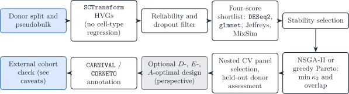

# Appendix S6 — Synthetic scenario for comparing gene-screening strategies

> **Notation (shared by all vignettes; aligned with the article)**
>
> Gene g=1,\ldots,G; cell type j=1,\ldots,J (a second type is \ell);
> bulk sample i=1,\ldots,N; reference donor (replicate) r=1,\ldots,R;
> cell c, with C_j reference cells of type j. The index i is dropped
> inside a derivation and restored in the model statements.
>
> | Symbol | Meaning |
> |----|----|
> | y\_{gi}, \boldsymbol{y}\_{\cdot i} | Bulk expression on a linear scale |
> | m\_{ji}, n_i=\sum_jm\_{ji} | Cells of type j in bulk sample i, and their total |
> | \tilde{\boldsymbol{y}}\_{\cdot i}=\boldsymbol{y}\_{\cdot i}/n_i | Bulk expression per cell |
> | \boldsymbol{p}\_{\cdot i}\in\Delta^{J-1} | Cell fractions, p\_{ji}=m\_{ji}/n_i |
> | \boldsymbol{\rho}\_{i}\in\mathbb{R}^{J-1} | Isometric log-ratio (ILR) coordinates of \boldsymbol{p}\_{\cdot i}, \boldsymbol{p}\_{\cdot i}=\operatorname{softmax}(\mathbf{V}\boldsymbol{\rho}\_i) with a Helmert basis \mathbf{V} |
> | \boldsymbol{q}\_{\cdot i} | Transcript fractions, q\_{ji}=p\_{ji}S_j/\sum\_\ell p\_{\ell i}S\_\ell |
> | \boldsymbol{\mu}\_{\cdot j}, \boldsymbol{\Sigma}\_j | Mean and G\times G gene–gene covariance of a type-j population profile |
> | \boldsymbol{\Omega}\_j=\boldsymbol{\Sigma}\_j^{-1} | Precision matrix of type j |
> | \boldsymbol{\Gamma}\_g | J\times J covariance across cell types for gene g (`bMIND`, `EPIC-unmix`, `Unico`) |
> | \boldsymbol{x}\_{\cdot j,i} | Purified profile of type j in sample i |
> | x\_{gc}, \boldsymbol{x}\_{\cdot c}, s_c | Raw UMI count of gene g in reference cell c, and the size factor of cell c |
> | \boldsymbol{\lambda}\_{\cdot c}, \boldsymbol{z}\_{\cdot c} | Size-free expression of cell c; its latent log-expression in the Poisson log-normal (PLN) model |
> | \tilde{\boldsymbol{\mu}}\_{\cdot j}=C_j^{-1}\sum\_{c\in j}\boldsymbol{x}\_{\cdot c}=S_j\boldsymbol{\theta}\_{\cdot j} | Per-cell mean of the raw UMI counts of the C_j reference cells of type j |
> | \boldsymbol{\theta}\_{\cdot j}, S_j=\mathbf{1}^{\top}\tilde{\boldsymbol{\mu}}\_{\cdot j} | Relative abundance (\mathbf{1}^{\top}\boldsymbol{\theta}\_{\cdot j}=1) and mean transcriptome size of a type-j cell |
> | \boldsymbol{\Sigma}\_{W,j}, \boldsymbol{\Sigma}\_{B,j} | Within-donor cell-to-cell covariance of type j (one single-cell sample); between-donor covariance of type j (needs R\ge2 donors) |
> | \boldsymbol{S}\_W(\boldsymbol{v})=\sum_jv_j\boldsymbol{\Sigma}\_{W,j}, \boldsymbol{S}\_B(\boldsymbol{v})=\sum_jv_j^2\boldsymbol{\Sigma}\_{B,j} | Linear and quadratic covariance mixtures with weights \boldsymbol{v} |
> | \boldsymbol{V}\_j | Empirical covariance of type j, computed from its reference profiles or cells |
> | \boldsymbol{R}\_j | Empirical correlation matrix of type j (bold; the scalar R is the number of donors) |
> | \boldsymbol{\Delta}\_j=\operatorname{diag}(\boldsymbol{V}\_j) | Diagonal matrix of the empirical variances of type j |
> | \lambda | Penalty of a regularised covariance or precision estimator |
> | \psi_g, \mathcal{D}\_g | Negative binomial dispersion of gene g; deviance of gene g in a count model |
> | \delta\_{gj} | Detection rate of gene g in type j (fraction of cells with a non-zero count) |
> | \varpi\_{\ell\mid j}, \varpi\_{j\ell}, \bar\varpi | MixSim overlap: probability of misclassifying a draw of j into \ell, pairwise overlap \varpi\_{j\ell}=\varpi\_{\ell\mid j}+\varpi\_{j\mid\ell}, and its average over pairs (`BarOmega`) |
> | \boldsymbol{T}\_{ji}=\sum\_{c=1}^{m\_{ji}}\boldsymbol{X}\_{jic} | Total expression contributed by type j to sample i |
> | a_i | Sample-wide scale between the reference and the bulk library |
> | c_i=a_in_i, \phi_i=a_i^2n_i | Mean scale and variance scale of the single-cell model |
> | b_g, \tilde b_g=b_g^{\mathrm{bulk}}/b_g^{\mathrm{ref}} | Capture efficiency of gene g in one protocol, and the gene-wise platform ratio; \tilde{\boldsymbol{B}}=\operatorname{diag}(\tilde{\boldsymbol{b}}) |
> | \boldsymbol{D}\_i | Diagonal, heteroscedastic bulk measurement noise |
>
> A tilde marks a quantity rescaled to a reference unit: per cell
> (\tilde{\boldsymbol{y}}, \tilde{\boldsymbol{\mu}}) or relative to the
> reference protocol (\tilde{\boldsymbol{b}}). \boldsymbol{\Sigma}\_j
> couples **genes** within one cell type; \boldsymbol{\Gamma}\_g couples
> **cell types** within one gene. A symbol absent from this table is
> defined in the vignette that uses it, with one meaning there.

> **Scope**
>
> This appendix describes a simulation that compares gene-screening
> strategies on references where the informative genes are known. The
> theory behind each strategy (tests, effect sizes, Fisher information,
> condition number, selection effect) is in [3.1 Gene selection for the
> reference](https://bastienchassagnol.github.io/DeCovarT/articles/03-1-feature-selection.md).
> Separation measures (overlap, Hellinger, Jeffreys) are defined in
> [4.2](https://bastienchassagnol.github.io/DeCovarT/articles/04-2-distances-overlap-metrics.md).
> No chunk is executed and no result is reported here: the page is a
> design, with code sketches.

## 1 Aim

The simulation answers three questions.

1.  Does the omnibus gate with an effect-size rank
    ([3.1](https://bastienchassagnol.github.io/DeCovarT/articles/03-1-feature-selection.html#sec-fs-effect-size))
    recover the genes that carry information about \boldsymbol{p} better
    than a top-k ratio or a concatenation of one-versus-rest markers?
2.  When two types differ in covariance only, does a covariance-aware
    objective (Fisher information, overlap) keep the genes that a
    univariate screen drops
    ([3.1](https://bastienchassagnol.github.io/DeCovarT/articles/03-1-feature-selection.html#sec-fs-selection-effect))?
3.  How much does selection change the deconvolution error of DeCovarT,
    compared with keeping every gene that passes the presence gate and
    letting the covariance weight them
    ([3.1](https://bastienchassagnol.github.io/DeCovarT/articles/03-1-feature-selection.html#sec-fs-weighting))?

## 2 Data-generating mechanism

References are simulated from the mean and covariance scenarios of
[4.1](https://bastienchassagnol.github.io/DeCovarT/articles/04-1-synthetic-scenarios.md),
with NB counts per cell and size factors s_c. Genes belong to five known
classes:

| Class | Generated as | Expected behaviour |
|----|----|----|
| mean marker | type means differ, \boldsymbol{\Sigma}\_{W,j} shared | kept by every screen |
| covariance-only gene | equal means, type-specific correlations | dropped by univariate screens |
| perfect marker | expressed in one type only | removed by the presence gate |
| platform-discordant gene | gene-wise ratio \tilde b_g\neq1 in the bulk only | flagged by the range bound |
| noise gene | no type effect | removed by the gate |

Table 1: Gene classes of the synthetic reference.

Bulk samples follow the DeCovarT convolution over a composition grid
\mathcal{P}\subset\Delta^{J-1} with balanced, rare-type, sparse and
near-collinear compositions. The factors varied are the cell numbers C_j
(including types with C_j\<G), the separation regime (mean-driven or
covariance-only) and the share of platform-discordant genes. Their
values, the number of replications and the random-number streams are
fixed before any run, following the ADEMP structure of
[4.1](https://bastienchassagnol.github.io/DeCovarT/articles/04-1-synthetic-scenarios.html#sec-ademp).

## 3 Strategies compared

| ID | Strategy | Theory |
|----|----|----|
| A | top-k genes by the between/within ratio of Pearson residuals, equal-cell or equal-type weights | [3.1](https://bastienchassagnol.github.io/DeCovarT/articles/03-1-feature-selection.html#sec-sctransform) |
| B | presence gate, omnibus quasi-likelihood F as an FDR gate, rank by effect size | [3.1](https://bastienchassagnol.github.io/DeCovarT/articles/03-1-feature-selection.html#sec-fs-omnibus) |
| C | one-versus-rest markers per type, concatenated, then the candidate with the smallest \kappa_2 (CIBERSORT, DWLS) | [3.1](https://bastienchassagnol.github.io/DeCovarT/articles/03-1-feature-selection.html#sec-kappa-limits) |
| D | union of four scores ([Section 3.1](#sec-four-scores)) | this page |
| E | shortlist of B, then NSGA-II on \kappa_2 and overlap ([Section 3.3](#sec-pareto-nsga2)) | [3.1](https://bastienchassagnol.github.io/DeCovarT/articles/03-1-feature-selection.html#sec-pareto-panel) |
| F | shortlist of B, then greedy robust D-optimal search ([Section 3.4](#sec-s6-dopt)) | [3.1](https://bastienchassagnol.github.io/DeCovarT/articles/03-1-feature-selection.html#sec-optimal-design) |
| G | no selection: every gene that passes the presence gate | [3.1](https://bastienchassagnol.github.io/DeCovarT/articles/03-1-feature-selection.html#sec-fs-weighting) |

Table 2: Screening strategies compared.

### 3.1 Four-score shortlist

Strategy D unites four screens, two label-aware and two distributional:

1.  `DESeq2` contrasts on donor-level pseudo-bulks ([Love et al.
    2014](#ref-loveModeratedEstimationFold2014a)). They need biological
    replicates, so D applies only to multi-donor references
    ([3.1](https://bastienchassagnol.github.io/DeCovarT/articles/03-1-feature-selection.html#sec-fs-estimand)).
2.  A multinomial elastic net on the type labels
    ([Section 3.2](#sec-sparse-classifiers)).
3.  The Jeffreys divergence between type laws.
4.  The MixSim overlap \varpi between type laws ([Melnykov et al.
    2012](#ref-melnykovMixSimPackageSimulating2012),
    [2024](#ref-R-MixSim)).

The top-ranked genes of each screen form the working universe
\mathcal{G}\_0.

### 3.2 Sparse classifiers as candidate generators

Multiclass models with the type as response propose genes; they are not
deconvolution solvers. Embed them in stability selection: resample at
the donor level, tune inside each resample, and keep genes selected in a
large fraction of resamples ([Meinshausen and Bühlmann
2010](#ref-meinshausenStabilitySelection2010)).

| Method | Role | Caveat |
|----|----|----|
| Multinomial elastic net ([Zou and Hastie 2005](#ref-zouRegularizationVariableSelection2005); [Friedman et al. 2026](#ref-R-glmnet)) | joint classification; \ell_1 sparsity with \ell_2 grouping of correlated genes | may keep collinear markers unless \ell_2 is strong |
| Penalised discriminant analysis ([Witten and Tibshirani 2011](#ref-wittenPenalizedClassificationUsing2011)) | between/within variance ratio with sparse loadings | needs more observations than logistic paths |
| Group or tree-guided lasso ([Yuan and Lin 2006](#ref-yuanModelSelectionEstimation2006)) | selects or drops pathways or lineages as blocks | needs predefined groups or a taxonomy |

Table 3: Sparse multiclass methods as panel candidate generators.

#### 3.2.1 Bootstrap-enhanced regularisation

The lasso keeps one gene of a correlated block and drops the others
([Zou and Hastie 2005](#ref-zouRegularizationVariableSelection2005)).
BERM fits an elastic net on bootstrap resamples, excludes a gene when
its percentile interval covers zero, and refits a weighted elastic net
on the remaining genes ([Dong et al.
2026](#ref-dongBootstrapenhancedRegularizationAddressing2026)). It can
replace plain stability selection in D when gene blocks are
near-collinear.

### 3.3 Pareto refinement with NSGA-II

Strategy E searches a gene mask on the shortlist of strategy B,
\mathcal{G}\_0. The fitness returns
\kappa_2(\boldsymbol{\mu}\_{\mathcal{G}}) and the average MixSim overlap
\bar\varpi of the type laws restricted to \mathcal{G}; `mco::nsga2()`
returns an approximation of the Pareto set ([Mersmann
2024](#ref-R-mco)). The mask is encoded in \[0,1\]^{\|\mathcal{G}\_0\|}
and thresholded. Several non-dominated panels are passed to the
validation step ([Section 4.1](#sec-cv-selection)), not one knee point.
Weighted scalar objectives in `GA` or `GenSA` remain an auditable
alternative ([Scrucca 2026](#ref-R-GA); [Gubian et al.
2025](#ref-R-GenSA)).

``` r

# Fitness of a soft gene mask: condition number of the mean signature
# and average MixSim overlap of the type laws on the selected genes.
# mu: G0 x J means; Sigma: list of J covariance matrices (G0 x G0).
panel_fitness <- function(mask, mu, Sigma, threshold = 0.5) {
  g <- which(mask > threshold)
  if (length(g) < ncol(mu)) {
    return(c(Inf, Inf))
  }
  kappa_g <- kappa(mu[g, , drop = FALSE], exact = TRUE)
  ov <- MixSim::overlap(
    Pi = rep(1 / ncol(mu), ncol(mu)),
    Mu = t(mu[g, , drop = FALSE]),
    S = simplify2array(lapply(Sigma, function(A) A[g, g, drop = FALSE]))
  )
  c(kappa_g, ov$BarOmega)
}

pareto <- mco::nsga2(
  fn = panel_fitness,
  idim = nrow(mu),
  odim = 2,
  mu = mu,
  Sigma = Sigma,
  lower.bounds = rep(0, nrow(mu)),
  upper.bounds = rep(1, nrow(mu)),
  popsize = 100,
  generations = 50
)
# pareto$value: objectives; pareto$par: masks; pareto$pareto.optimal
```

### 3.4 Information-optimal search

Strategy F maximises the robust D-criterion of
[3.1](https://bastienchassagnol.github.io/DeCovarT/articles/03-1-feature-selection.html#sec-optimal-design)
over the composition grid. Standard design packages work on a factor
grid: `skpr` (D, A, E, G, I criteria) and `AlgDesign::optFederov()`
(Fedorov exchange) ([Wheeler 2025](#ref-R-AlgDesign)). Neither
implements the composition-dependent information of DeCovarT, so F uses
a custom objective with a greedy or exchange search. The two package
calls below illustrate standard D-optimal designs only.

``` r

candidates <- expand.grid(
  x1 = seq(-1, 1, length.out = 11),
  x2 = seq(-1, 1, length.out = 11)
)
design <- skpr::gen_design(
  candidateset = candidates,
  model = ~ x1 + x2 + I(x1^2) + I(x2^2) + x1:x2,
  trials = 20,
  optimality = "D",
  repeats = 100
)
skpr::get_optimality(design, "D")
```

``` r

result <- AlgDesign::optFederov(
  formula = ~ x1 + x2 + I(x1^2) + I(x2^2) + x1:x2,
  data = candidates,
  nTrials = 20,
  criterion = "D",
  nRepeats = 100
)
result$D
```

``` r

# Robust D-score of a gene panel over composition scenarios.
# information_by_gene[[s]] is a list over genes of the (J-1) x (J-1)
# contributions to I_G(p_s); summing them assumes a diagonal covariance.
# With a full covariance, recompute I_G(p_s) on the panel instead.
d_objective <- function(selected, information_by_gene, ridge = 1e-8) {
  scores <- vapply(information_by_gene, function(info_s) {
    info <- Reduce(`+`, info_s[selected])
    info <- info + diag(ridge, nrow(info))
    as.numeric(determinant(info, logarithm = TRUE)$modulus)
  }, numeric(1))
  min(scores)
}

greedy_d <- function(candidates, information_by_gene, size) {
  selected <- integer(0)
  for (step in seq_len(size)) {
    pool <- setdiff(candidates, selected)
    gain <- vapply(pool, function(g) {
      d_objective(c(selected, g), information_by_gene)
    }, numeric(1))
    selected <- c(selected, pool[which.max(gain)])
  }
  selected
}
```

## 4 Performance measures and validation

Two estimands are reported for each strategy and scenario:

- recovery of the gene classes of [Table 1](#tbl-s6-classes) (share of
  mean markers and covariance-only genes kept; share of perfect markers,
  platform-discordant genes and noise genes removed);
- the error of \hat{\boldsymbol{p}} from DeCovarT fitted on the selected
  panel, with the metrics and Monte Carlo standard errors of
  [4.1](https://bastienchassagnol.github.io/DeCovarT/articles/04-1-synthetic-scenarios.html#sec-performance-metrics).

Three limitations of screening pipelines are built into the design.

1.  **Gaussian separation measures.** Overlap and Jeffreys are computed
    under Gaussian type laws. Count data with heavy tails bias them, so
    they rank genes; they are not calibrated probabilities.
2.  **Leakage.** Ranking genes and choosing the panel size on the cells
    that also estimate \boldsymbol{\mu} and \boldsymbol{\Sigma}\_j gives
    an optimistic error. Every data-dependent step is repeated inside
    the training folds ([Section 4.1](#sec-cv-selection)).
3.  **Internal validation.** Nested cross-validation on one study, or
    one simulated reference, is internal. Transport to another cohort,
    laboratory or platform needs an external hold-out ([Sturm et al.
    2019](#ref-sturmComprehensiveEvaluationTranscriptomebased2019); [Jin
    and Liu 2021](#ref-jinBenchmarkRNAseqDeconvolution2021)).

### 4.1 Nested cross-validation on matched bulks

When matched single-cell and bulk aliquots exist ([Zaitsev et al.
2022](#ref-zaitsevPreciseReconstructionTME2022)), or in the simulation
where the bulk is generated from the reference, candidate panels are
scored by the out-of-sample error of the intended estimator. Folds are
grouped by donor (or by simulated reference). In each outer training
fold, normalisation, screening, Pareto refinement and tuning are re-run;
the panel and its size are chosen in the inner loop (overall error,
worst-type error, rare-type recall, one-standard-error rule for smaller
panels), and the outer fold is scored once. Fold-aware feature
construction can be automated with `caret`-based pipelines such as
`pipeML` ([Hurtado and Pancaldi 2026](#ref-R-pipeML)).


Figure 1: Leakage-free signature validation for DeCovarT: donor-grouped
nested CV with in-fold HVG / DE / panel construction, four-score
shortlist and NSGA-II Pareto refinement, then external cohort assessment
of deconvolution error.

### 4.2 A pipeline for multi-donor references

With several donors per type, strategies D and E combine into the
pipeline of [Figure 2](#fig-recommended-pipeline). With one specimen, as
for the Suppinger reference, the `DESeq2` step does not apply and
strategy B replaces the shortlist
([3.1](https://bastienchassagnol.github.io/DeCovarT/articles/03-1-feature-selection.html#sec-fs-estimand)).



Figure 2: Recommended reference-based feature-selection pipeline from
donor pseudobulks to validated, mechanistically annotated panels.

> **Software**
>
> - Pearson residuals: `sctransform` / `Seurat::SCTransform`
>   ([Hafemeister and Satija
>   2019](#ref-hafemeisterNormalizationVarianceStabilization2019)); NB
>   GLM and quasi-likelihood F: `glmGamPoi` ([Ahlmann-Eltze and Huber
>   2020](#ref-glmGamPoi2020)).
> - Sparse multiclass candidates: `glmnet` ([Friedman et al.
>   2026](#ref-R-glmnet)); stability selection ([Meinshausen and
>   Bühlmann 2010](#ref-meinshausenStabilitySelection2010)); BERM ([Dong
>   et al.
>   2026](#ref-dongBootstrapenhancedRegularizationAddressing2026)).
> - Separation:
>   [`MixSim::overlap()`](https://rdrr.io/pkg/MixSim/man/overlap.html)
>   ([Melnykov et al. 2024](#ref-R-MixSim)); definitions in
>   [4.2](https://bastienchassagnol.github.io/DeCovarT/articles/04-2-distances-overlap-metrics.md).
> - Multi-objective search: `mco::nsga2()` ([Mersmann
>   2024](#ref-R-mco)); scalar refinement with `GA` / `GenSA` ([Scrucca
>   2026](#ref-R-GA); [Gubian et al. 2025](#ref-R-GenSA)).
> - Standard D-optimal designs: `skpr::gen_design()`,
>   `AlgDesign::optFederov()` ([Wheeler 2025](#ref-R-AlgDesign)).
> - Leakage-aware cross-validation: `caret` workflows, `pipeML`
>   ([Hurtado and Pancaldi 2026](#ref-R-pipeML)).
> - Annotation: `CARNIVAL` / `CORNETO` ([Liu et al.
>   2019](#ref-liuFromExpressionFootprints2019); [Rodriguez-Mier et al.
>   2025](#ref-rodriguezMierUnifyingMultisample2025)).

Ahlmann-Eltze, Constantin, and Wolfgang Huber. 2020. ‘glmGamPoi: Fitting
Gamma-Poisson Generalized Linear Models on Single Cell Count Data’.
*Bioinformatics*, ahead of print.
<https://doi.org/10.1093/bioinformatics/btaa1009>.

Dong, Xiaoru, Apoorva Goyal, Muxuan Liang, Maigan A. Brusko, Todd M.
Brusko, and Rhonda Bacher. 2026. ‘Bootstrap-Enhanced Regularization
Addressing Multicollinearity and Skewness in High-Dimensional
Immunophenotyping Data’. *BMC Bioinformatics*, ahead of print.
<https://doi.org/10.1186/s12859-026-06586-x>.

Friedman, Jerome, Trevor Hastie, Rob Tibshirani, et al. 2026. *Glmnet:
Lasso and Elastic-Net Regularized Generalized Linear Models*.
<https://glmnet.stanford.edu>.

Gubian, Sylvain, Yang Xiang, Brian Suomela, Julia Hoeng, and PMP SA.
2025. *GenSA: R Functions for Generalized Simulated Annealing*.
<https://doi.org/10.32614/CRAN.package.GenSA>.

Hafemeister, Christoph, and Rahul Satija. 2019. ‘Normalization and
Variance Stabilization of Single-Cell RNA-Seq Data Using Regularized
Negative Binomial Regression’. *Genome Biology* 20 (1): 296.
<https://doi.org/10.1186/s13059-019-1874-1>.

Hurtado, Marcelo, and Vera Pancaldi. 2026. *pipeML: A Flexible and
Modular Machine Learning Framework Designed to Support Leakage-Free
Model Training Through Custom Cross-Validation Fold Construction*.
<https://github.com/VeraPancaldiLab/pipeML>.

Jin, Haijing, and Zhandong Liu. 2021. ‘A Benchmark for RNA-seq
Deconvolution Analysis Under Dynamic Testing Environments’. *Genome
Biology* 22. <https://doi.org/10.1186/s13059-021-02290-6>.

Liu, Anika, Panuwat Trairatphisan, Enio Gjerga, Athanasios Didangelos,
Jonathan Barratt, and Julio Saez-Rodriguez. 2019. ‘From Expression
Footprints to Causal Pathways: Contextualizing Large Signaling Networks
with CARNIVAL’. *Npj Systems Biology and Applications* 5.
<https://doi.org/10.1038/s41540-019-0118-z>.

Love, Michael I., Wolfgang Huber, and Simon Anders. 2014. ‘Moderated
Estimation of Fold Change and Dispersion for RNA-seq Data with DESeq2’.
*Genome Biology* 15. <https://doi.org/10.1186/s13059-014-0550-8>.

Meinshausen, Nicolai, and Peter Bühlmann. 2010. ‘Stability Selection’.
*Journal of the Royal Statistical Society. Series B (Statistical
Methodology)* 72: 417–73.
<https://doi.org/10.1111/j.1467-9868.2010.00740.x>.

Melnykov, Volodymyr, Wei-Chen Chen, and Ranjan Maitra. 2012. ‘MixSim: An
R Package for Simulating Data to Study Performance of Clustering
Algorithms’. *Journal of Statistical Software* 51.
<https://doi.org/10.18637/jss.v051.i12>.

Melnykov, Volodymyr, Wei-Chen Chen, and Ranjan Maitra. 2024. *MixSim:
Simulating Data to Study Performance of Clustering Algorithms*.

Mersmann, Olaf. 2024. *Mco: Multiple Criteria Optimization Algorithms
and Related Functions*. <https://github.com/olafmersmann/mco>.

Rodriguez-Mier, Pablo, Martin Garrido-Rodriguez, Attila Gabor, and Julio
Saez-Rodriguez. 2025. ‘Unifying Multi-Sample Network Inference from
Prior Knowledge and Omics Data with CORNETO’. *Nature Machine
Intelligence* 7: 1168–86. <https://doi.org/10.1038/s42256-025-01069-9>.

Scrucca, Luca. 2026. *GA: Genetic Algorithms*.
<https://luca-scr.github.io/GA/>.

Sturm, Gregor, Francesca Finotello, Florent Petitprez, et al. 2019.
‘Comprehensive Evaluation of Transcriptome-Based Cell-Type
Quantification Methods for Immuno-Oncology’. *Bioinformatics (Oxford,
England)* 35. <https://doi.org/10.1093/bioinformatics/btz363>.

Wheeler, Bob. 2025. *AlgDesign: Algorithmic Experimental Design*.
<https://github.com/jvbraun/AlgDesign>.

Witten, Daniela M., and Robert Tibshirani. 2011. ‘Penalized
Classification Using Fisher’s Linear Discriminant’. *Journal of the
Royal Statistical Society. Series B (Statistical Methodology)* 73:
753–72. <https://doi.org/10.1111/j.1467-9868.2011.00783.x>.

Yuan, Ming, and Yi Lin. 2006. ‘Model Selection and Estimation in
Regression with Grouped Variables’. *Journal of the Royal Statistical
Society. Series B (Statistical Methodology)* 68: 49–67.
<https://doi.org/10.1111/j.1467-9868.2005.00532.x>.

Zaitsev, Aleksandr, Maksim Chelushkin, Daniiar Dyikanov, et al. 2022.
‘Precise Reconstruction of the TME Using Bulk RNA-seq and a Machine
Learning Algorithm Trained on Artificial Transcriptomes’. *Cancer Cell*
40. <https://doi.org/10.1016/j.ccell.2022.07.006>.

Zou, Hui, and Trevor Hastie. 2005. ‘Regularization and Variable
Selection via the Elastic Net’. *Journal of the Royal Statistical
Society. Series B (Statistical Methodology)* 67.
