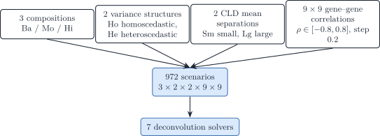
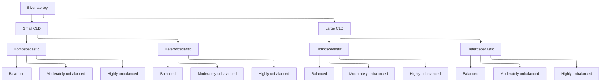
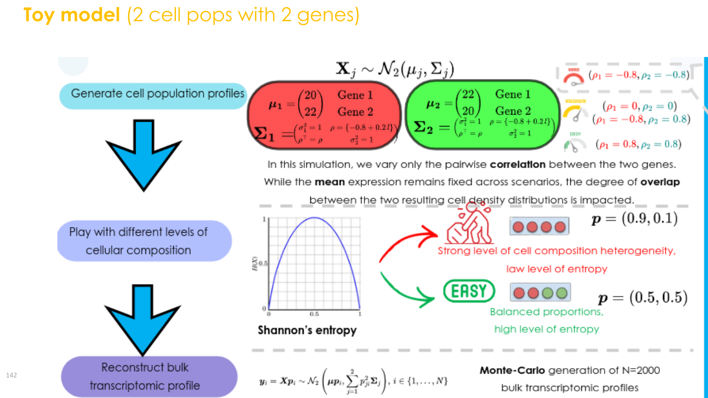
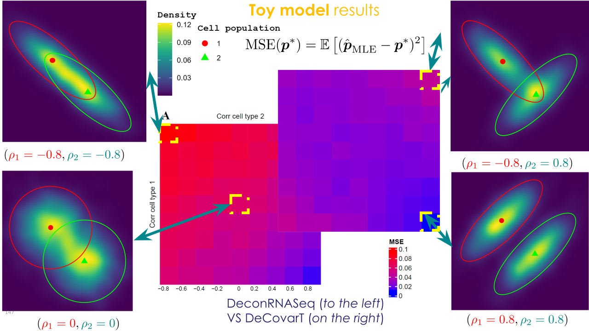

# 2.1 Bivariate toy model (G = 2 genes, J = 2 cell types)

This article is the bivariate Gaussian-convolution toy of the methods
paper (G=2, J=2). It isolates gene–gene correlation from mean
separation. The factorial grid and ADEMP pipeline live in a **single**
script, `scripts/fig02_bivariate_toy.R`. Scenario builders
(`build_bivariate_scenario_config()`,
`bivariate_toy_deconvolution_functions()`) sit at the top of that file.
Sourcing the script from a vignette or from a temp copy in tests defines
those functions without launching the 972-scenario pipeline.

[`run_simulation_benchmark()`](https://bastienchassagnol.github.io/DeCovarT/reference/run_simulation_benchmark.md)
wraps
[`simulate_bulk_mixture()`](https://bastienchassagnol.github.io/DeCovarT/reference/simulate_bulk_mixture.md),
[`deconvolute_ratios()`](https://bastienchassagnol.github.io/DeCovarT/reference/deconvolute_ratios.md),
and
[`compute_benchmark_metrics()`](https://bastienchassagnol.github.io/DeCovarT/reference/compute_benchmark_metrics.md).
Scenario rows are sequential; sample-level workers live only in
[`deconvolute_ratios()`](https://bastienchassagnol.github.io/DeCovarT/reference/deconvolute_ratios.md).
Reporting conventions (ADEMP, Nature Methods, raincloud / forest plots)
are in [how to build synthetic
scenarios](https://bastienchassagnol.github.io/DeCovarT/articles/theory-synthetic-scenarios-mean-covariance.html#sec-ademp).



Figure 1: Bivariate toy factorial design: three compositions, two
variance structures, two CLD mean separations, a 9-by-9 gene-gene
correlation grid, and seven solvers (3 x 2 x 2 x 9 x 9 = 972 scenarios).

``` default
---
config:
  layout: elk
  theme: sandstone
---
flowchart TB
  ROOT["Bivariate toy"]
  ROOT --> Sm["Small CLD"]
  ROOT --> Lg["Large CLD"]
  Sm --> SmHo["Homoscedastic"]
  Sm --> SmHe["Heteroscedastic"]
  Lg --> LgHo["Homoscedastic"]
  Lg --> LgHe["Heteroscedastic"]
  SmHo --> SmHoBa["Balanced"]
  SmHo --> SmHoMo["Moderately unbalanced"]
  SmHo --> SmHoHi["Highly unbalanced"]
  SmHe --> SmHeBa["Balanced"]
  SmHe --> SmHeMo["Moderately unbalanced"]
  SmHe --> SmHeHi["Highly unbalanced"]
  LgHo --> LgHoBa["Balanced"]
  LgHo --> LgHoMo["Moderately unbalanced"]
  LgHo --> LgHoHi["Highly unbalanced"]
  LgHe --> LgHeBa["Balanced"]
  LgHe --> LgHeMo["Moderately unbalanced"]
  LgHe --> LgHeHi["Highly unbalanced"]
```



Figure 2: Hierarchical reading of the same factorial: small versus large
CLD, then homoscedastic versus heteroscedastic variances, then balanced
/ moderately unbalanced / highly unbalanced compositions (2 x 2 x 3 = 12
meta-scenarios). Each leaf is crossed with the 9-by-9 gene-gene
correlation grid.

## Generative model

With p_1+p_2=1, only one free ILR coordinate is estimated (see
[derivatives under simplex
transforms](https://bastienchassagnol.github.io/DeCovarT/articles/theory-population-generative-optimisation.md)).
Even when mean profiles are similar, gene–gene correlation can degrade
mean-only solvers, and is partly recovered once
\boldsymbol{\Sigma}(\boldsymbol{p})=\sum_j p_j^2\boldsymbol{\Sigma}\_j
enters the likelihood.



\(a\) Hyperparameter grid used in the bivariate manuscript study: two
centroid geometries, balanced versus unbalanced \boldsymbol{p}, a
gene–gene correlation sweep, and the first-generation plus DeCovarT
solvers.



\(b\) AI-generated 2D density of the two-gene mixture while only the
pairwise correlation changes, at fixed means, marginal variances, and
composition. The ggplot panel below recomputes the same contrast and
annotates MixSim overlap.

Figure 3: Factorial design (left) and correlation-only 2D densities
(right) for the bivariate toy. {#fig-toy-design}

### Factorial design (972 scenarios)

| Factor | Levels |
|----|----|
| Composition \boldsymbol{p} | balanced (1/2,\\1/2); moderately unbalanced (17/20,\\3/20); highly unbalanced (99/100,\\1/100) |
| Mean separation (CLD) | small: \boldsymbol{\mu}\_{\cdot 1}=(20,22), \boldsymbol{\mu}\_{\cdot 2}=(22,20); large: (20,40), (40,20) |
| Gene–gene corr. CT 1 (\rho_1) | \\-0.8,\\-0.6,\\\ldots,\\0.8\\ — 9 levels |
| Gene–gene corr. CT 2 (\rho_2) | \\-0.8,\\-0.6,\\\ldots,\\0.8\\ — 9 levels |
| Variance structure | homoscedastic \sigma^2 = (1,1); heteroscedastic \sigma^2 = (1,2) |
| **Total scenarios** | 3 \times 2 \times 9 \times 9 \times 2 = \mathbf{972} |

N = 500 Monte Carlo replicates per scenario.

**CLD** is centroid (mean-profile) Euclidean separation
\lVert\boldsymbol{\mu}\_{\cdot 1}-\boldsymbol{\mu}\_{\cdot 2}\rVert_2,
not an Aitchison distance; see [the descriptor
notes](https://bastienchassagnol.github.io/DeCovarT/articles/theory-synthetic-scenarios-mean-covariance.html#nte-desc-cld).
Small CLD uses \boldsymbol{\mu}\_{\cdot 1}=(20,22),
\boldsymbol{\mu}\_{\cdot 2}=(22,20) (d=2\sqrt{2}\approx 2.83, cosine
\approx 0.995). Large CLD uses (20,40) and (40,20) (d=20\sqrt{2}\approx
28.3, cosine 0.8).

#### Scenario ID

Each row is labelled `B{index}_{variance}_{composition}_{CLD}`. The
index is the factorial row number (1–972). Example: `B1_Ho_Ba_Sm` is the
first row, homoscedastic, balanced proportions, small CLD.

| Token | Meaning |
|----|----|
| `B` | Bivariate toy (G=2, J=2) |
| `1`–`972` | Factorial row index |
| `Ho` / `He` | Homoscedastic / heteroscedastic marginal variances |
| `Ba` / `Mo` / `Hi` | Balanced / moderately unbalanced / highly unbalanced \boldsymbol{p} |
| `Sm` / `Lg` | Small / large CLD (Euclidean centroid gap) |

Every result of the run is in `output/fig02/fig02_benchmark.rds`, a list
keyed by the scenario `ID`: `meta` (seed, N, B, date, git commit,
session), `config` (the design grid without the true moments),
`theta_true` (convolution parameters per `ID`), `descriptors` (geometry,
MixSim `BarOmega`, Hellinger, Jeffreys), `regression` and `monte_carlo`
(composition and ADEMP blocks of
[`compute_benchmark_metrics()`](https://bastienchassagnol.github.io/DeCovarT/reference/compute_benchmark_metrics.md)),
`optimisation` (one row per replicate \times algorithm \times scenario,
with the estimates, convergence, KKT residual, elapsed time and memory),
`intervals` (coverage and width of every interval construction) and
`data` (the simulated bulks and their targets).

Mean-only `lsei` and NNLS do not maximise the convolution likelihood, so
no interval is computed for them.

``` r

library(DeCovarT)
source("scripts/fig02_bivariate_toy.R")

bivariate_config <- build_bivariate_scenario_config()
nrow(bivariate_config)
```

### Log-likelihood along the simplex

For J=2 the free coordinate is p_1\in(0,1). The listing below evaluates
\ell\_{\boldsymbol{y}\mid\boldsymbol{\zeta}}(p_1,1-p_1) on one bulk
draw. It is not executed during `R CMD build`: Quarto’s Windows CLI
starts a new R process that cannot see the temporary library
([quarto-r#217](https://github.com/quarto-dev/quarto-r/issues/217)). The
same likelihood path is checked in `tests/testthat/`.

``` r

set.seed(20260828)
rho <- 0.6
R <- matrix(c(1, rho, rho, 1), nrow = 2)
Sigma <- array(c(R, R), dim = c(2, 2, 2))
dimnames(Sigma) <- list(
  rownames(mu_small),
  rownames(mu_small),
  colnames(mu_small)
)
y_one <- DeCovarT::simulate_bulk_mixture(
  mu_small,
  Sigma,
  p = p_bal,
  n = 1
)$Y[, 1]
p1_grid <- seq(0.02, 0.98, by = 0.01)
ll_grid <- vapply(
  p1_grid,
  function(p1) {
    DeCovarT::loglik_multivariate(c(p1, 1 - p1), y_one, mu_small, Sigma)
  },
  numeric(1)
)
ll_df <- data.frame(p1 = p1_grid, loglik = ll_grid)
ggplot2::ggplot(ll_df, ggplot2::aes(x = p1, y = loglik)) +
  ggplot2::geom_line(colour = "#1B4F72", linewidth = 0.8) +
  ggplot2::geom_vline(
    xintercept = 0.5,
    linetype = "dashed",
    colour = "grey30"
  ) +
  ggplot2::labs(
    x = "p1 (p2 = 1 - p1)",
    y = "Log-likelihood"
  ) +
  ggplot2::theme_bw(base_size = 11)
```

## Inference

Five methods are evaluated on each scenario:

| Method | Description | Intervals |
|----|----|----|
| `lsei` | DeconRNASeq: least squares on the simplex by [`limSolve::lsei`](https://rdrr.io/pkg/limSolve/man/lsei.html) ([Gong and Szustakowski 2013](#ref-gongDeconRNASeqStatisticalFramework2013)) | none |
| `NNLS` | Lawson–Hanson non-negative least squares, renormalised ([Dessole et al. 2023](#ref-dessoleLawsonHansonAlgorithmDeviation2023)) | none |
| `Newton-Raphson` | Second-order ascent in ILR coordinates | Wald, ILR, profile, oracle |
| `L-BFGS-B` | Limited-memory quasi-Newton on the closure chart \boldsymbol p=\boldsymbol w/\mathbf 1^{\top}\boldsymbol w, \boldsymbol w\ge0 | Wald, ILR |
| `Firth` | Jeffreys-penalised likelihood ([Firth 1993](#ref-firthBiasReductionMaximum1993)) | Wald, ILR |

Table 1: Methods of the bivariate benchmark.

- **Dropped from the figure.** Marquardt–Levenberg, projected gradient
  and simulated annealing remain in the package but leave the benchmark.
  CIBERSORT is not run at G=2: its \nu-SVR regresses the G bulk values
  on the J signatures, so two genes give two observations for two
  coefficients and an intercept. The second-generation methods (MEAD,
  RNA-Sieve, ReDeconv, DECALS) are left to the covariance-driven
  scenario, since a two-gene reference cannot carry their reference
  estimation.
- **NNLS** followed by renormalisation is least squares on the simplex
  with a **free** scale (\boldsymbol\beta=c\boldsymbol p, c=\mathbf
  1^{\top}\boldsymbol\beta); `lsei` fixes c=1. The two agree only when
  \hat c=1. On 500 bulks of this design the largest coordinate
  difference has median 0.002 and 95th percentile 0.015, and the fitted
  scale has standard deviation 0.03 around 1: close, but not identical.
  Both are run: `lsei` keeps the sum-to-one equality and the bounds at
  every iteration, NNLS renormalises a free-scale fit. A robust linear
  model is not run on two genes.

The interval constructions are those of [population
inference](https://bastienchassagnol.github.io/DeCovarT/articles/theory-population-inference.md):
`wald` (delta method on \boldsymbol p), `ilr` (Wald in ILR coordinates
mapped back), `profile` (likelihood-ratio inversion) and `oracle` (\hat
p_j plus or minus the Wald half-width at \boldsymbol p^{\star}). The
parametric bootstrap
([`bootstrap_decovart()`](https://bastienchassagnol.github.io/DeCovarT/reference/bootstrap_decovart.md))
is not run here: the moments of a scenario are fixed, so coverage is
measured over its N bulks, and N\times B refits per solver dominated the
run time. Performance is summarised with the ADEMP framework ([Morris et
al. 2019](#ref-morrisUsingSimulationStudies2019)): **bias**, **RMSE**,
**coverage** of each interval construction (Wilson intervals on the
coverage *rate*), **width**, **SE/SD**, and optimiser **failure rate**.

The run size is hard-coded at the top of the script: `N_REPLICATES`
(N=200), `CORES` (workers for the N bulks of a scenario: a third of half
the cores, 14 of 88, since the three figure scripts run at the same
time; parallel workers load the installed package) and
`POSTPROCESS_ONLY` (`TRUE` redraws only).

``` r

deconvolution_functions <- bivariate_toy_deconvolution_functions(
  itmax = 200L,
  epsilon = 1e-4,
  intervals = TRUE
)
bivariate <- run_simulation_benchmark(
  scenario_config = bivariate_config,
  deconvolution_functions = deconvolution_functions,
  n = 200L,
  cores = 1L,
  return_data = TRUE
)
```

`config` on the in-memory benchmark still carries Shannon entropy of
\boldsymbol{p} and MixSim overlap for tests.

## Visualisations

Figures are drawn from `output/fig02/fig02_plot_data.rds`, a list keyed
by figure file stem that holds the data handed to each plot function, so
any figure can be redrawn without the benchmark:

``` r

source("scripts/visualisation/load_visualisation.R")
plot_data <- readRDS("output/fig02/fig02_plot_data.rds")
render_figure_from_data("heatmap_rmse", plot_data, "output/fig02")
```

Density and performance books share the four correlation corners
(\rho_1,\rho_2)\in\\(0,0),(-0.8,-0.8),(0.8,0.8),(-0.8,0.8)\\ and the
twelve meta-scenarios (CLD \times variance \times composition). Every
log-likelihood panel uses the same axes and the same fill,
\log\_{10}(L/\max L) on \[-10,0\], with one legend per page: white
diamond at \boldsymbol p^{\star}, red point at the MLE (observed
surface) or at the Monte Carlo mean of \hat{\boldsymbol p} (expected
surface, whose maximiser is \boldsymbol p^{\star} exactly by the
information inequality).

| Output | Description |
|----|----|
| `density_visualisations/purified_density.pdf` | The two cell-type Gaussians |
| `density_visualisations/bulk_density.pdf` | The convolution that DeCovarT fits |
| `density_visualisations/loglik_surface_p.pdf`, `loglik_ilr_profile.pdf` | Log-likelihood of one bulk on p_1 and on the ILR coordinate |
| `density_visualisations/loglik_expected_surface_p.pdf`, `loglik_expected_ilr_profile.pdf` | Expected log-likelihood and Monte Carlo mean of \hat{\boldsymbol p} |
| `density_visualisations/loglik_rgl.pdf` | 3D relative likelihood (`rgl`) |
| `performance_visualisations/heatmap_rmse.pdf`, `heatmap_aitchison.pdf` | Tiles on (\rho_1,\rho_2), one page per meta-scenario; grey = no finite estimate |
| `performance_visualisations/ci_width_forest.pdf` | Mean interval, coverage \[Wilson interval\] and width per method and construction |
| `performance_visualisations/p_hat_monte_carlo_raincloud.pdf` | Monte Carlo law of \hat p, including pile-up at 0 and 1 |
| `performance_visualisations/p_hat_monte_carlo_quantile_dots.pdf` | The same law as quantile dots |
| `performance_visualisations/kkt_residual_raincloud.pdf` | Projected-score KKT residual |
| `performance_visualisations/convergence_theoretical_vs_numerical_failures.pdf` | Theoretical success, numerical failure, theoretical failure |
| `performance_visualisations/wald_normality_qq.pdf` | Whitened ILR estimate against N(0,1) |
| `performance_visualisations/wald_mahalanobis_chi2_qq.pdf` | D^2 against \chi^2_1 on \log\_{10} axes, coloured by convergence |
| `performance_visualisations/estimate_agreement_hellinger_ward.pdf` | Mean Hellinger distance between paired estimates, Ward clustering; dashed line at the mean over method pairs |
| `performance_visualisations/rmse_colour_aitchison_size_dots.pdf` | Colour = mean RMSE, size = mean Aitchison distance |
| `performance_visualisations/runtime.pdf`, `memory.pdf` | \log\_{10} seconds and \log\_{10} MiB |

Table 2: Plot books of the bivariate scenario.

- The Q-Q books assess the Wald approximation only; the profile
  intervals do not rely on it. Squaring a whitened value of -30 gives
  D^2=900, so the \chi^2 book uses \log\_{10} axes.
- The Hellinger distance \lVert\sqrt{\hat{\boldsymbol
  p}\_A}-\sqrt{\hat{\boldsymbol p}\_B}\rVert_2/\sqrt2 replaces 1-r for
  the Pearson correlation: it measures agreement rather than
  co-movement, it is Euclidean in \sqrt{\boldsymbol p} as Ward’s
  criterion requires, and it is defined at exact zeros, where the
  Aitchison distance is not.
- The KS normality lollipops and the MAE heatmaps were dropped: the Q-Q
  books and the RMSE heatmaps carry the same information.

> **Tip 1: Other one-sample log-likelihood slices (not drawn)**
>
> The current `loglik_rgl.pdf` holds the two mean profiles fixed and
> varies only \boldsymbol{p} (or its ILR coordinate). White diamonds
> mark p^{\star} and red circles the numerical MLE. Expected
> log-likelihood surfaces
> \mathbb{E}\_{\boldsymbol{y}\mid\boldsymbol{p}^{\star}}\[\ell(\boldsymbol{p};\boldsymbol{y})\]
> are drawn separately as `loglik_expected_surface_p.pdf` and
> `loglik_expected_ilr_profile.pdf` (not overlaid on the one-draw
> books). Useful alternatives, left as outlook:
>
> - Hold \boldsymbol{p}^{\star} fixed and vary one column of
>   \boldsymbol{\mu} (a mean-shift slice) to show how centroid collision
>   flattens \ell.
> - Hold \boldsymbol{p}^{\star} and \boldsymbol{\mu} fixed and vary one
>   correlation \rho_j, so the surface is a covariance diagnostic rather
>   than a mixing-weight diagnostic.
> - Overlay several independent bulk draws as translucent surfaces to
>   display sampling variability of \ell(\boldsymbol{p};\boldsymbol{y}).

### Likelihood geometry and solver behaviour

> **Note**
>
> The numbers in this section come from the archived run of
> `output/archives/fig02/` (Wald intervals only), which still included
> NNLS, gradient, simulated annealing, Marquardt–Levenberg and the
> earlier L-BFGS-B that renormalised a box-constrained fit. They will be
> replaced by those of the production run; the mechanisms do not depend
> on the solver list.

The factorial heatmaps remain the right *design* summary: large CLD and
\rho_j=0 make the mean map injective, so every solver is accurate; small
CLD plus aligned correlations flatten the mean residual and raise RMSE
off the diagonal \rho_1=\rho_2. That saddle is a statement about
**identifiability of \boldsymbol{\mu}\boldsymbol{p}**, not about which
numerical method is used. The pack in `output/fig02/mle_explanation/`
(scenario descriptors, ILR profiles evaluated at
\boldsymbol{y}=\boldsymbol{\mu}\boldsymbol{p}^{\star}, expected-Fisher
Wald standard errors, and Newton versus Marquardt forests) is what
separates three mechanisms that the heatmaps mix: the shape of
\ell(\boldsymbol{p};\boldsymbol{y}), the surrogate each solver actually
minimises, and the chart / stopping rule that walks that surrogate.

#### What is being optimised

Mean-only `NNLS` and `DeconRNASeq` (`lsei` in `limSolve`) minimise a
**convex** quadratic
(\boldsymbol{y}-\boldsymbol{\mu}\boldsymbol{p})^{\top}
(\boldsymbol{y}-\boldsymbol{\mu}\boldsymbol{p}) on the simplex ([Dessole
et al. 2023](#ref-dessoleLawsonHansonAlgorithmDeviation2023); [Gong and
Szustakowski 2013](#ref-gongDeconRNASeqStatisticalFramework2013);
[Soetaert et al. 2026](#ref-R-limSolve)). For a convex objective a local
minimiser is global ([Boyd et al. 2004, ch.
4](#ref-boydConvexOptimization2004)), so those fits are unique solutions
of the *least-squares* problem. They are **not** maximisers of the
convolution log-likelihood: \boldsymbol{\Sigma}(\boldsymbol{p}) never
enters the quadratic. When \boldsymbol{\mu}\_{\cdot 1} and
\boldsymbol{\mu}\_{\cdot 2} are close, that quadratic is a ridge along
the simplex. A strictly feasible QP with bound constraints then has
vertices as KKT candidates, which is why mean-only fits pile up at (1,0)
and (0,1) whenever the residual is uninformative. Simulated annealing
explores the same non-concave \ell as DeCovarT but without curvature, so
it is a robustness check, not an MLE.

The convolution solvers maximise the Gaussian-convolution log-likelihood
of the [MLE properties
article](https://bastienchassagnol.github.io/DeCovarT/articles/theory-population-inference.html)
(that article is pkgdown-only; this vignette is the CRAN-shipped
companion). None of them inherits Boyd’s global certificate, because
that likelihood is not concave. They differ in **coordinates and
damping**:

- `L-BFGS-B` ([`stats::optim`](https://rdrr.io/r/stats/optim.html)) runs
  limited-memory BFGS on the closure chart \boldsymbol p=\boldsymbol
  w/\mathbf 1^{\top}\boldsymbol w with the box \boldsymbol w\ge0 ([Byrd
  et al. 1995](#ref-byrdLimitedMemoryAlgorithm1995); [Zhu et al.
  1997](#ref-zhuAlgorithm778LBFGSB1997)) ([closure
  chart](https://bastienchassagnol.github.io/DeCovarT/articles/theory-population-generative-optimisation.html#sec-closure-box)).
  The objective is the convolution log-likelihood itself, the box KKT
  points are exactly the simplex KKT points, and exact zeros are
  reachable. The archived version instead fitted a box-constrained
  surrogate and renormalised it, so its faces were not stationary points
  of \ell (KKT residual about 0.1).
- `Newton-Raphson`
  ([`stats::nlminb`](https://rdrr.io/r/stats/nlminb.html)) and
  `Marquardt-Levenberg` (`marqLevAlg`; ([Philipps et al.
  2023](#ref-R-marqLevAlg),
  [2021](#ref-philippsRobustEfficientOptimization2021))) work in ILR
  coordinates, so the walk stays in the relative interior until a
  coordinate diverges. Newton uses the analytic Hessian. Marquardt adds
  a Levenberg damping term so that the working matrix stays positive
  definite ([Marquardt
  1963](#ref-marquardtAlgorithmLeastSquaresEstimation1963)) even when
  the Hessian of \ell is indefinite, and stops on the
  relative-distance-to-maximum (RDM) criterion: the ratio of
  *optimisation* error to *statistical* error ([Commenges et al.
  2006](#ref-commengesNewtonLikeAlgorithmLikelihood2006)). On a plateau,
  RDM is a feature — further progress along a flat ridge does not change
  inferential accuracy — and a bias: the iterate can halt nearer the
  barycentre than the true face.

The `gradient` solver is ILR BFGS without a Hessian, so it inherits the
chart but not Newton’s local quadratic rate. Boyd’s Newton analysis
(quadratic convergence in a neighbourhood of a strict local maximiser
with positive-definite Hessian) applies to `nlminb` only when the
realised \ell is locally strongly concave. The bivariate small-CLD
profiles are not.

#### One bulk, N=1

Every Monte Carlo replicate here is a **single** G=2 bulk. The MLE is
therefore the N=1 estimator of [the finite-sample
section](https://bastienchassagnol.github.io/DeCovarT/articles/theory-population-inference.html#sec-finite-sample):
biased at O(1), with Wald SEs that describe the Monte Carlo spread of
that one-observation maximiser, not a sampling experiment with growing
N. Pooling N i.i.d. columns with a shared \boldsymbol{p}^{\star} is what
would make \hat{\boldsymbol{p}}\_N consistent. The ILR profiles in the
pack are evaluated at the *conditional mean*
\boldsymbol{y}=\boldsymbol{\mu}\boldsymbol{p}^{\star}, which isolates
the log-determinant remainder; the forests average over random
\boldsymbol{Y}.

#### Reading the twelve meta-scenarios

Numbers below are from `forest_newton_marquardt.csv`,
`theoretical_wald_se.csv`, and the range of `ilr_loglik_profiles.csv`
(max minus min of \ell(\rho) on the plotting grid).

**Large CLD, balanced, \rho_j=0 (`B567`).** The mean map is well
conditioned. The ILR profile spans about 101 nats and
\mathrm{SE}\_{\rho}=0.071. Newton and Marquardt agree to numerical
noise: bias of p_1 about 0, RMSE 0.024, coverage 0.96, and the empirical
SD matches the expected-Fisher SE (0.025). This is the textbook interior
MLE: strongly concave locally, RDM and Newton stop at the same point.

**Large CLD, balanced, \rho_j=-0.8 (`B487`).** Equal negative
correlation inflates variance along the anti-diagonal of gene space but
does not destroy the mean contrast. Profile range 56,
\mathrm{SE}\_{\rho}=0.095, RMSE 0.033 for both second-order solvers.
Covariance-aware curvature is still enough.

**Small CLD, balanced (`B1`, `B81`).** Means (20,22) versus (22,20)
almost collinear. Profile range drops to 1.2–1.7 nats;
\mathrm{SE}\_{\rho} is 0.95 (both \rho=-0.8) or 0.71 (\rho=0). RMSE of
p_1 is 0.19–0.23 and Wald coverage is conservative (0.98–1). Marquardt
is slightly *less* variable than Newton here (RMSE 0.192 versus 0.234 on
`B1`): damping and RDM cut walks along the ridge, which for a *balanced*
truth is a small bias toward 1/2 that happens to reduce RMSE. Mean-only
QPs see an even flatter residual and are the ones that snap to vertices.

**Highly unbalanced, small CLD (`B325`, `B405`,
p^{\star}=(0.99,0.01)).** The ILR chart sends the rare type to
\rho\to+\infty. Fisher curvature in \rho collapses: \mathrm{SE}\_{\rho}
is 24 (both \rho=-0.8) or 20 (\rho=0), while the profile range on a
finite grid is only 2.4–4.1 nats — a plateau, not a peak. Newton bias
for p_1 is -0.22 and -0.18; Marquardt bias is -0.40 and -0.38. Both
shrink toward the barycentre, Marquardt more so, exactly as RDM predicts
on a flat tail. Coverage stays near 0.92–0.94 because the Wald interval
is already huge. This is the geometry behind chi-bar-square calibration
on a face ([boundary
LRTs](https://bastienchassagnol.github.io/DeCovarT/articles/theory-population-inference.html#sec-boundary)):
the tangent cone is a half-line, Wilks does not apply, and a Wald SE in
ILR is not a calibrated rare-type interval.

**Highly unbalanced, large CLD (`B811`, `B891`).** The profile in \rho
is *not* flat in the raw log-likelihood (range 218–392), because a 1\\
contamination still shifts a well-separated mean. The ILR SE remains
large (3.3 and 2.5) because a small p_2 is a long way out on the chart.
Newton follows that peak: bias -0.017 and -0.010, RMSE 0.035 and 0.026,
coverage 0.97. Marquardt does **not**: bias -0.26 and -0.29, RMSE 0.35
and 0.37, coverage 0.47 and 0.40. The damping / RDM pair stops in ILR
before \|\rho\| is large enough to represent p_2=0.01. A sharp peak in p
can still look like a long walk in \rho; Marquardt’s statistical
stopping rule then under-shoots a rare type even when the convolution
likelihood is informative. That failure is an optimiser-chart
interaction, not a lack of covariance signal.

Moderately unbalanced rows sit between these extremes: small-CLD RMSE
0.23–0.31 with Marquardt again more barycentric; large-CLD RMSE about
0.03–0.04 with the two second-order solvers aligned.

#### What the heatmaps still add

The 9\times 9 (\rho_1,\rho_2) tiles, which are **not** in the twelve-row
explanation pack, remain the place to see mean-only methods lose first
as \|\rho\| grows at small CLD, and to see DeCovarT retain the diagonal
saddle. The pack’s message is narrower and sharper: with N=1, a plateau
in ILR makes every interior solver noisy; Marquardt’s RDM is the right
stop on a balanced ridge and the wrong stop on a rare type; Newton with
a full Hessian tracks p^{\star} once the means separate; convex QPs
solve a different problem and are entitled only to that problem’s unique
minimiser.

### See also

- Variance-driven hybrid (G=20, J=3):
  [§2.2](https://bastienchassagnol.github.io/DeCovarT/articles/fig03-covariance-driven.md)
- Moment generator and ADEMP reporting: [How to build synthetic
  scenarios](https://bastienchassagnol.github.io/DeCovarT/articles/theory-synthetic-scenarios-mean-covariance.md)
- Regular-case MLE checks: [Appendix
  S1](https://bastienchassagnol.github.io/DeCovarT/articles/supp-S1-identifiability.md)

### References

Boyd, Stephen, Stephen P. Boyd, and Lieven Vandenberghe. 2004. *Convex
Optimization*. 1st edn. Cambridge University Press; Cambridge University
Press. <https://doi.org/10.1017/cbo9780511804441>.

Byrd, Richard H., Peihuang Lu, Jorge Nocedal, and Ciyou Zhu. 1995. ‘A
Limited Memory Algorithm for Bound Constrained Optimization’. *SIAM
Journal on Scientific Computing* 16 (5): 1190–208.
<https://doi.org/10.1137/0916069>.

Commenges, Daniel, Helene Jacqmin-Gadda, Cecile Proust, and Jeremie
Guedj. 2006. *A Newton-Like Algorithm for Likelihood Maximization: The
Robust-Variance Scoring Algorithm*. arXiv.
<https://doi.org/10.48550/arxiv.math/0610402>.

Dessole, Monica, Marco Dell’Orto, and Fabio Marcuzzi. 2023. ‘The
Lawson-Hanson Algorithm with Deviation Maximization: Finite Convergence
and Sparse Recovery’. *Numerical Linear Algebra with Applications* 30
(5): e2490. <https://doi.org/10.1002/nla.2490>.

Firth, David. 1993. ‘Bias Reduction of Maximum Likelihood Estimates’.
*Biometrika* 80 (1): 27–38. <https://doi.org/10.1093/biomet/80.1.27>.

Gong, Ting, and Joseph D. Szustakowski. 2013. ‘DeconRNASeq: A
Statistical Framework for Deconvolution of Heterogeneous Tissue Samples
Based on mRNA-Seq Data’. *Bioinformatics (Oxford, England)* 29.
<https://doi.org/10.1093/bioinformatics/btt090>.

Marquardt, Donald W. 1963. ‘An Algorithm for Least-Squares Estimation of
Nonlinear Parameters’. *Journal of the Society for Industrial and
Applied Mathematics* 11. <https://doi.org/10.1137/0111030>.

Morris, Tim P., Ian R. White, and Michael J. Crowther. 2019. ‘Using
Simulation Studies to Evaluate Statistical Methods’. *Statistics in
Medicine* 38 (11): 2074–102. <https://doi.org/10.1002/sim.8086>.

Philipps, Viviane, Boris P. Hejblum, Mélanie Prague, Daniel Commenges,
and Cécile Proust-Lima. 2021. ‘Robust and Efficient Optimization Using a
Marquardt-Levenberg Algorithm with R Package marqLevAlg’. *The R
Journal* 13. <https://doi.org/10.32614/rj-2021-089>.

Philipps, Viviane, Cecile Proust-Lima, Melanie Prague, Boris Hejblum,
Daniel Commenges, and Amadou Diakite. 2023. *marqLevAlg: A Parallelized
General-Purpose Optimization Based on Marquardt-Levenberg Algorithm*.

Soetaert, Karline, Karel Van den Meersche, and Dick van Oevelen. 2026.
*limSolve: Solving Linear Inverse Models*.

Zhu, Ciyou, Richard H. Byrd, Peihuang Lu, and Jorge Nocedal. 1997.
‘Algorithm 778: L-BFGS-B: Fortran Subroutines for Large-Scale
Bound-Constrained Optimization’. *ACM Transactions on Mathematical
Software* 23 (4): 550–60. <https://doi.org/10.1145/279232.279236>.
