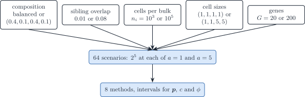
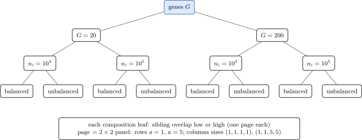

# 2.4 Single-cell scenario: four cell types in two lineages (G = 20 or 200, J = 4)

``` r

library(DeCovarT)
```

The bivariate toy and the covariance-driven scenario use a population
reference: every cell type is one purified Gaussian profile, and the
bulk is their convolution. This scenario uses a **single-cell**
reference: the bulk is the sum of n_i cells, each drawn from the law of
its type, and DeCovarT fits the single-cell model with its two scales
profiled out ([single-cell
model](https://bastienchassagnol.github.io/DeCovarT/articles/theory-single-cell-generative-optimisation.html#sec-profile-newton)).
The J=4 cell types form two lineages, types 1–2 and types 3–4, so every
type has a close sibling and a distant cousin. Construction, benchmark
and plot books live in one script,
`scripts/fig05_single_cell_hierarchical.R` (seed `20261024`).



Figure 1: Single-cell factorial. Six crossed factors with two levels
each give 64 scenarios: five design factors, crossed with the platform
scale a = 1 or 5, which tests the scale assumption of RNA-Sieve. Every
scenario is analysed by eight methods.



Figure 2: Order of the plot books. Pages nest the number of genes, the
number of cells per bulk, the composition and the sibling overlap;
inside each page, a 2-by-2 panel crosses the platform scale (rows) with
the cell sizes (columns). Every cell of the grid is simulated.

## Generative model

The generator is the single-cell model itself ([cell size in the
covariance](https://bastienchassagnol.github.io/DeCovarT/articles/theory-single-cell-generative-optimisation.html#sec-cell-size-covariance)).
For bulk i,

\boldsymbol m\_{\cdot i}\sim\operatorname{Multinomial}(n_i,\boldsymbol
p), \qquad \boldsymbol T\_{ji}\sim\mathcal
N_G\bigl(m\_{ji}S_j\boldsymbol\theta\_{\cdot j},\\
m\_{ji}S_j^{2}\boldsymbol\Sigma^{\theta}\_j\bigr), \qquad \boldsymbol
y\_{\cdot i}=a\sum_j\boldsymbol T\_{ji}, \tag{1}

where \boldsymbol\theta\_{\cdot j} is the expression profile of a cell
of unit size, S_j the cell size of type j and a the platform scale. The
estimand is the **realised** cell fraction \boldsymbol m\_{\cdot i}/n_i,
not \boldsymbol p
([`simulate_bulk_from_cells()`](https://bastienchassagnol.github.io/DeCovarT/reference/simulate_bulk_from_cells.md)
returns it as `p_realised`).

A cell S_j times larger is S_j times larger in every gene, so the size
multiplies the mean by S_j and the covariance by S_j^{2}
([`rescale_single_cell_moments()`](https://bastienchassagnol.github.io/DeCovarT/reference/rescale_single_cell_moments.md)).
Two consequences:

- the overlap between two types of equal size does not depend on that
  size, so cell size only moves the lineages apart and reweights the
  bulk;
- in transcript units the covariance of a cell is
  S_j\boldsymbol\Sigma^{\theta}\_j, which is the form of the
  `transcript_raw` reference.

DeCovarT is fitted with the `cellular_raw` reference: cell fractions,
known cell sizes and raw covariances.

### Mean signature

One mean signature per gene count G\in\\20,200\\ is built by
`generate_mean_signature_matrix(target_gram = R, nonnegative = TRUE)`
([mean signature
construction](https://bastienchassagnol.github.io/DeCovarT/articles/theory-synthetic-scenarios-mean-covariance.html#sec-lr-block-mu)),
with mean scale 10 and the target Gram

R= \begin{pmatrix} 1 & 0.8 & 0.3 & 0.3\\ 0.8 & 1 & 0.3 & 0.3\\ 0.3 & 0.3
& 1 & 0.8\\ 0.3 & 0.3 & 0.8 & 1 \end{pmatrix}. \tag{2}

The cosine between lineages is 0.3, not 0.1. With non-negative means,
the expression of a gene in the other lineage is then about 13\\ of its
main level; at a cosine of 0.1 it would be about 4\\, close to disjoint
marker blocks, and the scenario would reduce to marker-gene
deconvolution. Every gene is expressed in all four types.

### Lineage networks

Each lineage has one skeleton, shared exactly by its two siblings:

| Type       | Lineage | Skeleton                                           |
|:-----------|:--------|:---------------------------------------------------|
| celltype_1 | 1       | stochastic block model, three blocks of equal size |
| celltype_2 | 1       | the same skeleton as celltype_1                    |
| celltype_3 | 2       | scale-free (Barabási–Albert, `power = 1`)          |
| celltype_4 | 2       | the same skeleton as celltype_3                    |

Table 1: Graph of each cell type.

The blocks are contiguous in gene order (`block_sizes` of
[`generate_random_network_skeleton()`](https://bastienchassagnol.github.io/DeCovarT/reference/generate_random_network_skeleton.md)),
with p\_{\mathrm{within}}=0.25 and p\_{\mathrm{between}}=0.01. Signed
weights are drawn once per lineage by
[`assign_iid_signed_weights()`](https://bastienchassagnol.github.io/DeCovarT/reference/assign_iid_signed_weights.md)
(half inhibitory, magnitude 0.3); each sibling then flips the sign of a
random 5\\ of the edges, so the two siblings differ only by their edge
weights. With independent signs the sibling covariances differ so much
at G=200 that a sibling overlap of 0.08 cannot be reached (at most
0.013; 0.030 with 20\\ flips). Precisions are completed by
[`build_normalised_precision()`](https://bastienchassagnol.github.io/DeCovarT/reference/build_normalised_precision.md)
with a fixed spectral shift of 0.2 ([GGM
networks](https://bastienchassagnol.github.io/DeCovarT/articles/theory-synthetic-scenarios-mean-covariance.html#sec-ggm-networks)).

### Sibling overlap

One global covariance scale per gene count and overlap target is chosen
by `scale_covariances_to_overlap(pairs = rbind(c(1, 2), c(3, 4)))`, so
that the **mean overlap of the two sibling pairs** is 0.01 or 0.08 at
the balanced composition. Calibrating on all six pairs would let the
four nearly separated between-lineage pairs dilute the target. The scale
is calibrated once on equal cell sizes and reused for unequal sizes,
since the sibling overlap does not depend on a common size. In the dry
run the realised mean of the two sibling pairs is 0.009 to 0.081. The
two pairs differ (from 0.0005 to 0.149), because the block model and the
scale-free graph give the two lineages different covariances. The
overlaps are identical for equal and unequal sizes, and between-lineage
overlaps stay at or below 0.001 (Monte Carlo estimates, 10^4 draws per
type).

### Factorial design

| Factor | Levels |
|:---|:---|
| Composition \boldsymbol p | balanced (1/4,1/4,1/4,1/4); unbalanced within each lineage (0.4,0.1,0.4,0.1) |
| Sibling overlap | 0.01; 0.08 |
| Cells per bulk n_i | 10^{3}; 10^{5} |
| Cell sizes \boldsymbol S | (1,1,1,1); (1,1,5,5) |
| Genes G | 20; 200 |
| Platform scale a | 1; 5 |
| **Crossed scenarios** | 2^{6}=\mathbf{64} |

Table 2: Single-cell factorial (64 scenarios).

- **Cells per bulk.** With n_i\ge10^{3} the rarest type counts about 100
  cells, so the multinomial draw does not leave a type empty.
- **Genes.** The maximum-likelihood variance scale \hat\phi is biased
  down by about (G-J)/G, that is 0.8 at G=20 and 0.98 at G=200; the REML
  calibration corrects it
  ([REML](https://bastienchassagnol.github.io/DeCovarT/articles/theory-single-cell-inference.html#sec-sc-reml)).
- **Platform scale.** Rescaling the bulk by a rescales \hat c by a and
  \hat\phi by a^{2}, leaves \hat{\boldsymbol p} unchanged, and shifts
  the profile log-likelihood by -G\log a ([scale
  equivariance](https://bastienchassagnol.github.io/DeCovarT/articles/theory-single-cell-inference.html#sec-sc-setting)),
  so the estimates of \boldsymbol p should agree between a=1 and a=5,
  which the crossed a=1 half checks numerically. It also tests
  RNA-Sieve, whose mean and variance share one scale.

Scenario identifiers read
`S{row}_{Ba|Un}_{O1|O8}_n{1e3|1e5}_{Se|Sl}_G{20|200}_a{1|5}`, for
example `S1_Ba_O1_n1e3_Se_G20_a1`.

``` r

# The design takes about a minute (overlap calibration by Sobol Monte
# Carlo for each gene count and target).
benchmark <- readRDS("output/fig05/fig05_benchmark.rds")
benchmark$config |>
  dplyr::select(
    ID, proportions, overlap_target, sibling_overlap, n_cells,
    cell_size_label, n_genes, platform_scale
  )
```

## Inference

Every method is scored on the same simulated bulks, with all genes (no
feature selection).

| Method | Function or code | Input | Intervals |
|:---|:---|:---|:---|
| `lsei` | [`deconvolute_ratios_deconrnaseq()`](https://bastienchassagnol.github.io/DeCovarT/reference/deconvolute_ratios_Marquardt_Levenberg.md) | true means | none |
| NNLS | [`deconvolute_ratios_nnls()`](https://bastienchassagnol.github.io/DeCovarT/reference/deconvolute_ratios_Marquardt_Levenberg.md) | true means | none |
| RLM | [`deconvolute_ratios_rlm()`](https://bastienchassagnol.github.io/DeCovarT/reference/deconvolute_ratios_Marquardt_Levenberg.md) | true means | none |
| CIBERSORT | [`deconvolute_ratios_cibersort()`](https://bastienchassagnol.github.io/DeCovarT/reference/deconvolute_ratios_Marquardt_Levenberg.md) | true means | none |
| Newton–Raphson | `deconvolute_single_cell(optimiser = "newton")` | true moments, known sizes | Wald, ILR, ILR-REML, profile, profile-REML, bootstrap, oracle |
| L-BFGS-B | `deconvolute_single_cell(optimiser = "lbfgsb")` | true moments, known sizes | Wald, ILR, ILR-REML, profile, profile-REML, bootstrap |
| Firth | [`fit_firth_single_cell()`](https://bastienchassagnol.github.io/DeCovarT/reference/fit_firth_single_cell.md) | true moments, known sizes | Wald, Wald-REML, ILR, ILR-REML |
| MEAD | `MEAD::MEAD()` (GitHub, commit `d66fa10`) | reference panel, cohort of N bulks | native sandwich interval |
| RNA-Sieve | `rnasieve` 0.1.4 (Python) | reference panel, cohort of N bulks | released, Fisher and Godambe |
| ReDeconv | `redeconv` 1.2.1 (Python) | true means and standard deviations | none |

Table 3: Methods of the single-cell benchmark.

- **`lsei` and NNLS.** The scale c=a\\n_i of a single-cell bulk is
  unknown, so `lsei`, which fixes it at one, is misspecified here. NNLS
  followed by renormalisation is the same least squares with a free
  scale (\boldsymbol\beta=c\boldsymbol p); it is also the starting point
  of DeCovarT and RNA-Sieve. RLM is the robust linear model of Monaco et
  al., renormalised.
- **DeCovarT.** Newton–Raphson and L-BFGS-B maximise the same profile
  log-likelihood; L-BFGS-B works on the closure chart \boldsymbol
  p=\boldsymbol w/\mathbf1^{\top}\boldsymbol w, \boldsymbol w\ge0
  ([L-BFGS-B](https://bastienchassagnol.github.io/DeCovarT/articles/theory-single-cell-generative-optimisation.html#sec-profile-lbfgsb)).
  Bootstraps refit with the optimiser of the estimate.
- **Second-generation methods** follow the protocol of the
  [covariance-driven
  scenario](https://bastienchassagnol.github.io/DeCovarT/articles/fig03-covariance-driven.html#sec-hybrid-methods).
  MEAD and RNA-Sieve read a reference panel of R individuals and 20
  cells per type and individual, drawn by
  [`simulate_reference_replicates()`](https://bastienchassagnol.github.io/DeCovarT/reference/simulate_reference_replicates.md)
  with its own seed, independent of the bulks.
  - MEAD rescales every reference cell to a unit total, so its
    proportions are transcript fractions q_j=p_jS_j/\sum_kp_kS_k; with
    \boldsymbol S=(1,1,5,5) they differ from the cell fractions. Its
    intervals are scored against both.
  - RNA-Sieve’s released interval code returns \[0,1\] when its averaged
    Hessian is ill-conditioned (version 0.1.4, `stats.py`, lines 224 and
    234). The runner also returns the two intervals of the paper,
    recomputed on all genes: Fisher, \boldsymbol B^{-1}/G, and Godambe,
    \boldsymbol H^{-1}\boldsymbol B\boldsymbol H^{-\top}/G, with
    \alpha_K=1-\sum\_{k\<K}\alpha_k. In the dry run (N=5), averaged over
    the 132 scenario and cell-type pairs, the released interval has mean
    width 0.91 (coverage 1), the Godambe interval 0.36 (coverage 0.97)
    and the Fisher interval 0.002 (coverage 0.02). The per-gene scores
    vary far more than the Hessian predicts, since RNA-Sieve’s model is
    not the generator here, so only the sandwich is calibrated.
  - DECALS has no public implementation and is not run.

### Interval constructions

The menu is that of the [single-cell inference
article](https://bastienchassagnol.github.io/DeCovarT/articles/theory-single-cell-inference.html#sec-sc-intervals):

| Interval | Construction |
|:---|:---|
| `wald` | delta method on \boldsymbol p from the Schur-complement information |
| `ilr` | Wald in ILR coordinates mapped back to the simplex |
| `profile` | likelihood-ratio inversion with c and \phi profiled out |
| `*_reml` | REML calibration with \nu=G-J: Student quantiles and \hat\phi rescaled by G/\nu |
| `bootstrap` | percentile interval of a parametric bootstrap refitted by the same optimiser |
| `oracle` | \hat p_j plus or minus the Wald half-width at the true composition |

Table 4: Single-cell interval menu.

Wald, ILR and bootstrap intervals also cover the two scales, c=a\\n_i
and \phi=a^{2}n_i (rows `mean_scale` and `variance_scale` of the
interval table), and the platform scale a=\phi/c and the cell count
n=c^{2}/\phi (rows `platform_scale_a` and `cell_count_n`), against their
true values. The intervals of a and n are formed on the log scale, so
both bounds are positive; \hat n is a number of cells here only because
a is known to the generator. Coverage is reported with a Wilson Monte
Carlo interval ([Morris et al.
2019](#ref-morrisUsingSimulationStudies2019)).

### Run size

| Variable | Meaning | Default |
|----|----|----|
| `DECOVART_N_REPLICATES` | Monte Carlo bulks per scenario, N | 100 |
| `DECOVART_N_BOOT` | parametric-bootstrap refits per bulk, B | 200 |
| `DECOVART_N_REFERENCE` | individuals of the reference panel, R | N |
| `DECOVART_CORES` | workers of the per-sample loop | 1 |
| `DECOVART_POSTPROCESS_ONLY` | `1` redraws the figures from the saved benchmark | 0 |

Table 5: Run-size variables of
`scripts/fig05_single_cell_hierarchical.R`.

Parallel workers load the **installed** DeCovarT, so run
`devtools::install()` before setting `DECOVART_CORES` above 1.

``` r

# Dry run:
#   DECOVART_N_REPLICATES=5 DECOVART_N_BOOT=5 \
#     Rscript scripts/fig05_single_cell_hierarchical.R
benchmark <- readRDS("output/fig05/fig05_benchmark.rds")
# Coverage of the composition and of the two scales.
dplyr::select(
  benchmark$intervals,
  ID, algorithm, ci_method, parameter, coverage, coverage_lower,
  coverage_upper, mean_width
)
```

## Visualisations

`output/fig05/fig05_benchmark.rds` holds the run settings, the design,
the true moments (`theta_true`) and every metric table;
`output/fig05/fig05_plot_data.rds` holds, for each figure file stem, the
data handed to its plot function.

``` r

source("scripts/visualisation/load_visualisation.R")
plot_data <- readRDS("output/fig05/fig05_plot_data.rds")
names(plot_data)
render_figure_from_data("ci_width_forest", plot_data, "output/fig05")
```

The books follow those of the [covariance-driven
scenario](https://bastienchassagnol.github.io/DeCovarT/articles/fig03-covariance-driven.html#sec-hybrid-viz),
with these changes:

- pages follow [Fig. 2](#fig-single-cell-hierarchy): G, then n_i, the
  composition and the sibling overlap; each page is a 2\times2 panel
  with the platform scale in rows and the cell sizes in columns;
- log-likelihood surfaces are drawn on the two **within-lineage**
  balances, 1\mid2 and 3\mid4, with the between-lineage balance held at
  its true value, each panel zoomed on its own peak;
- CIBERSORT is left out of the RMSE and Aitchison heatmaps and of the
  RMSE dot book, where its large error squeezed the shared colour scale;
- the scenario descriptors add n_i, G and the cell-size ratio;
- the forests add the REML-calibrated ILR and profile intervals, and
  `performance_visualisations/ci_width_forest_nuisance.pdf` gives the
  intervals of c, \phi, a and n on \log\_{10} axes;
- `performance_visualisations/nuisance_scale_ratio.pdf` shows \hat c/c
  and \hat\phi/\phi against the number of genes and of cells, with the
  REML-rescaled \hat\phi\\G/(G-J).

## Caveats

- **Gaussian cells.** A sum of Gaussian cells is exactly Gaussian at any
  n_i, so the central-limit argument behind the bulk model is not itself
  tested; a count layer would be needed for that.
- **Negative values.** Between 21\\ and 29\\ of the simulated
  single-cell values are negative. The reference panels of MEAD and
  RNA-Sieve receive them as such.
- **Per-cell overlap and bulk precision.** The sibling overlap describes
  the reference; the precision of a bulk also grows with n_i, which the
  expected Wald standard error reported with each scenario captures.

### See also

- [Covariance-driven
  scenario](https://bastienchassagnol.github.io/DeCovarT/articles/fig03-covariance-driven.md)
- Single-cell model and its fit: [generative model and
  optimisation](https://bastienchassagnol.github.io/DeCovarT/articles/theory-single-cell-generative-optimisation.md)
- Single-cell intervals and tests:
  [inference](https://bastienchassagnol.github.io/DeCovarT/articles/theory-single-cell-inference.md)
- Moment generator: [How to build synthetic
  scenarios](https://bastienchassagnol.github.io/DeCovarT/articles/theory-synthetic-scenarios-mean-covariance.md)

### References

Morris, Tim P., Ian R. White, and Michael J. Crowther. 2019. ‘Using
Simulation Studies to Evaluate Statistical Methods’. *Statistics in
Medicine* 38 (11): 2074–102. <https://doi.org/10.1002/sim.8086>.
