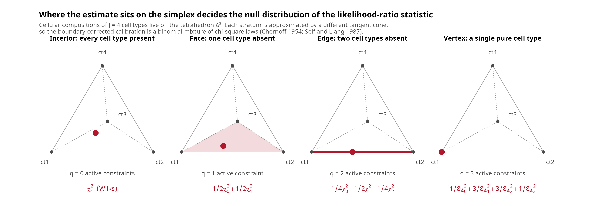

# DeCovarT inference: MLE properties, intervals for proportions and a GLM formulation

DeCovarT estimates a composition \boldsymbol{p}\in\Delta^{J-1} by
maximising the Gaussian-convolution log-likelihood

\ell\_{\boldsymbol{y}\mid\boldsymbol{\zeta}}(\boldsymbol{p}) =
-\tfrac{1}{2}\log\det\boldsymbol{\Sigma}(\boldsymbol{p}) -\tfrac{1}{2}
(\boldsymbol{y}-\boldsymbol{\mu}\boldsymbol{p})^{\top}
\boldsymbol{\Sigma}(\boldsymbol{p})^{-1}
(\boldsymbol{y}-\boldsymbol{\mu}\boldsymbol{p}) +C, \qquad
\boldsymbol{\Sigma}(\boldsymbol{p})=\sum\_{j=1}^{J}p_j^{2}\boldsymbol{\Sigma}\_j
. \tag{1}

The derivatives of [Eq. 1](#eq-loglik) are collected in the [derivatives
vignette](https://bastienchassagnol.github.io/DeCovarT/articles/theory-decovart-generative-model.md).
This vignette asks three questions.

1.  **What is the estimator entitled to claim?**
    [Sec. 1](#sec-naive-model) fixes the parametrisation;
    [Sec. 2](#sec-mle-properties) gives identifiability, existence, the
    failure of concavity and the finite-sample bias.
2.  **How should uncertainty on the proportions be reported?**
    [Sec. 3](#sec-intervals) compares the routes from the unconstrained
    coordinate \boldsymbol{\rho} to intervals for \boldsymbol{p} (delta
    method, back-transformed intervals, simulation), the finite-sample
    devices (Firth penalisation, the sandwich), and what conformal
    calibration can and cannot certify. [Sec. 4](#sec-inference) covers
    likelihood ratios on the boundary and the bootstraps.
3.  **Which model should be fitted to real data?** [Sec. 6](#sec-glm)
    argues for modelling the conditional mean through a link rather than
    transforming the data, writes DeCovarT as a multivariate
    quasi-likelihood model, and ends with the recommended model for a
    single UMI reference and few bulk samples
    ([Sec. 6.4](#sec-final-choice)).

Two facts frame everything below: the realised log-likelihood is **not**
concave and its maximiser **need not be unique**, and every Wald-type
interval is **undefined** on a simplex face. Their remedies are
implemented in
[`lrt_decovart()`](https://bastienchassagnol.github.io/DeCovarT/reference/lrt_decovart.md),
[`confint_profile_decovart()`](https://bastienchassagnol.github.io/DeCovarT/reference/confint_profile_decovart.md),
[`bootstrap_decovart()`](https://bastienchassagnol.github.io/DeCovarT/reference/bootstrap_decovart.md)
and
[`reference_bootstrap_decovart()`](https://bastienchassagnol.github.io/DeCovarT/reference/reference_bootstrap_decovart.md).

## The naive model and its parametrisation

The released model treats the reference moments
\boldsymbol{\zeta}=(\boldsymbol{\mu},\\\boldsymbol{\Sigma}\_j\\) as
known and ignores every technical scale of single-cell data (the
[tailored
vignette](https://bastienchassagnol.github.io/DeCovarT/articles/theory-decovart-single-cell-tailored.md)
adds them). The simplex is handled by a chart, not by constraints:

\boldsymbol{p}=\boldsymbol{\psi}(\boldsymbol{\rho})=\operatorname{softmax}(\mathbf{V}\boldsymbol{\rho}),
\qquad
\boldsymbol{\rho}=\mathbf{V}^{\top}\log\boldsymbol{p}\in\mathbb{R}^{J-1},
\tag{2}

with \mathbf{V} a Helmert basis ([derivatives
vignette](https://bastienchassagnol.github.io/DeCovarT/articles/theory-decovart-generative-model.html#sec-ilr)).
Two readings of [Eq. 2](#eq-ilr-chart) are useful later.

- **An inverse link on the composition.** \boldsymbol{\psi} maps a free
  linear predictor to the simplex, as the inverse multinomial-logit link
  does in a GLM for categorical responses. Here it acts on a parameter,
  not on the response: the bulk mean \boldsymbol{\mu}\boldsymbol{p}
  stays linear in \boldsymbol{p}.
- **The exponential version of `MEAD`’s device.** `MEAD` estimates
  unconstrained weights \boldsymbol{\beta}\_i=\gamma_i\boldsymbol{p}\_i,
  then sets
  \hat{\boldsymbol{p}}\_i=\hat{\boldsymbol{\beta}}\_i^{\star}/\lVert\hat{\boldsymbol{\beta}}\_i^{\star}\rVert_1,
  with either truncation \hat{\boldsymbol{\beta}}\_i\vee 0 or, near
  zero, the softplus h_a(\beta)=a^{-1}\log(1+e^{a\beta}) ([Xie et al.
  2026](#ref-xieStatisticalInferenceCell2026)). The softplus makes the
  delta method usable at the boundary, but for any finite a the
  estimator is not consistent; the authors take a=10 and report slightly
  lower coverage. Writing the weights as \beta_j=e^{z_j} instead and
  normalising gives the softmax: positivity is exact, no tuning constant
  is needed, and [Eq. 2](#eq-ilr-chart) is a reparametrisation, so the
  MLE in \boldsymbol{\rho} is the MLE in \boldsymbol{p}. The price is
  the same as for the softplus near zero: a proportion that is truly
  zero sits at \lVert\boldsymbol{\rho}\rVert=\infty
  ([Sec. 4.3](#sec-boundary)).

## Theoretical properties of the DeCovarT MLE

### Identifiability

**Proposition 1 (Identifiability of the composition)** The
parameter-to-distribution map is

\boldsymbol{p} \longmapsto \bigl( \boldsymbol{\mu}\boldsymbol{p},\\
\boldsymbol{\Sigma}(\boldsymbol{p})
=\textstyle\sum\_{j}p\_{j}^{2}\boldsymbol{\Sigma}\_{j} \bigr). \tag{3}

Two compositions induce the same law
\mathcal{N}\_G(\boldsymbol{\mu}\boldsymbol{p},
\boldsymbol{\Sigma}(\boldsymbol{p})) only if they coincide, **provided
that map is injective**. Full column rank of \boldsymbol{\mu}
(\operatorname{rank}(\boldsymbol{\mu})=J, equivalently linearly
independent contrast columns \boldsymbol{\mu}\_{\cdot
j}-\boldsymbol{\mu}\_{\cdot J}) is a convenient **sufficient**
condition, because then the mean map alone is injective on the simplex.
It is **not necessary**. Two cell types may share identical or collinear
mean profiles and remain identifiable when their covariances differ: the
second component of [Eq. 3](#eq-param-map) still separates
\boldsymbol{p}. Conversely, identical means *and* proportional
covariances (\boldsymbol{\Sigma}\_{2}=c\boldsymbol{\Sigma}\_{1}) make
the Gaussian family non-injective.

Identifiability is a property of the *reference*, not of the bulk
sample: no amount of sequencing rescues a pair of types that agree in
both mean and covariance. The mean-based condition number
\kappa(\boldsymbol{\mu}) is therefore a misleading diagnostic in the
covariance-only regime DeCovarT targets (see the [feature-selection
vignette](https://bastienchassagnol.github.io/DeCovarT/articles/supp-S6-feature-selection.html#sec-weighted-kappa)).
Near-collinear *means* are still reported as a warning by
[`fit_decovart()`](https://bastienchassagnol.github.io/DeCovarT/reference/fit_decovart.md);
that warning does not by itself imply that \boldsymbol{p} is
unidentifiable. Numerical illustrations live in the [appendix
simulations](https://bastienchassagnol.github.io/DeCovarT/articles/supp-S1-identifiability.md).

### Existence

**Proposition 2 (Existence of a maximiser)** If every
\boldsymbol{\Sigma}\_j is symmetric positive definite, then
\boldsymbol{\Sigma}(\boldsymbol{p})=\sum_j p_j^{2}\boldsymbol{\Sigma}\_j
is positive definite for every \boldsymbol{p}\in\Delta^{J-1}, since at
least one p_j\>0 on the simplex. Hence [Eq. 1](#eq-loglik) is finite and
continuous on the **compact** set \Delta^{J-1}, and attains its
supremum.

Two practical consequences. First, positive definiteness is preserved
even when some proportions are exactly zero, which is what allows the
restricted maximisation of
[`restricted_mle_decovart()`](https://bastienchassagnol.github.io/DeCovarT/reference/restricted_mle_decovart.md)
to represent a null such as p_j=0 exactly instead of pushing it through
a logarithm. Second, the maximiser may lie on the **boundary** of the
compact set, so first-order conditions \nabla\ell=\boldsymbol{0} are
necessary only at interior optima.

### Uniqueness fails for one observed sample

Existence is not uniqueness. The DeCovarT likelihood is a
*heteroscedastic* Gaussian model: the noise covariance depends on the
same parameter as the mean, so [Eq. 1](#eq-loglik) is not the concave
objective of an ordinary linear regression. Even in the isotropic case
\boldsymbol{\Sigma}\_1=\boldsymbol{\Sigma}\_2=\mathbf{I}\_G with J=2 and
without the simplex constraint,

\ell(\boldsymbol{p}) = -\frac{G}{2}\log(p_1^{2}+p_2^{2}) -
\frac{\lVert\boldsymbol{y}-\boldsymbol{\mu}\boldsymbol{p}\rVert^{2}}
{2(p_1^{2}+p_2^{2})} +C , \tag{4}

whose variance term moves with the coefficients. A single evaluation of
the analytic Hessian settles the question.

``` r

mean_signature <- matrix(c(2, 1, 1, 1, 2, 6 / 5), nrow = 3)
colnames(mean_signature) <- c("ct1", "ct2")
rownames(mean_signature) <- paste0("gene_", 1:3)
Sigma_iso <- array(c(diag(3), diag(3)), dim = c(3, 3, 2))
bulk <- drop(mean_signature %*% c(0.5, 0.5))

hessian_interior <- hessian_loglik_unconstrained(
  p = c(1 / 5, 3 / 10),
  y = bulk,
  mean_signature_matrix = mean_signature,
  Sigma = Sigma_iso
)
round(hessian_interior, 4)
#>           [,1]      [,2]
#> [1,] -208.8794 -342.2303
#> [2,] -342.2303 -391.7123
c(
  determinant = det(hessian_interior),
  eigen(hessian_interior, symmetric = TRUE)$values
)
#>  determinant                           
#> -35300.95781     53.93367   -654.52539
```

Every entry of \boldsymbol{y} and \boldsymbol{\mu} is strictly positive,
\operatorname{rank}(\boldsymbol{\mu})=2, G=3\>J=2, and both covariances
are positive definite. Yet the Hessian at the strictly interior point
\boldsymbol{p}=(1/5,3/10) has one positive and one negative eigenvalue.

> **Important 1: One indefinite Hessian disproves global concavity**
>
> A negative determinant at a single admissible point is a
> counterexample, so the unconstrained DeCovarT log-likelihood is **not
> globally concave** under the stated positivity and rank assumptions.
> The same conclusion transfers to the isometric log-ratio chart,
> because a C^{2} diffeomorphism preserves the existence of directions
> of positive curvature. Consequently:
>
> - a converged optimiser certifies a **local** maximum at best;
> - several starts may reach different modes (see
>   [Sec. 5](#sec-diagnostics));
> - convex-optimisation guarantees — a unique global optimum reachable
>   by descent, and duality certificates — do not apply ([Boyd et al.
>   2004](#ref-boydConvexOptimization2004)). The Marquardt–Levenberg
>   damping of `marqLevAlg` ([Philipps et al. 2023](#ref-R-marqLevAlg),
>   [2021](#ref-philippsRobustEfficientOptimization2021)) and the
>   relative-distance-to-minimum criterion of Commenges et al.
>   ([2006](#ref-commengesNewtonLikeAlgorithmLikelihood2006)) buy
>   robustness against saddle points, not global optimality.

### Population consistency and efficiency

The failure of concavity is a statement about *one realised* data set.
The population criterion behaves much better. Let \boldsymbol{p}\_0 be
the truth and define Q(\boldsymbol{p};\boldsymbol{p}\_0)
=\mathbb{E}\_{\boldsymbol{p}\_0}\\\ell\_{\boldsymbol{Y}}(\boldsymbol{p})\\.

**Theorem 1 (Population uniqueness through the Kullback–Leibler
divergence)**
Q(\boldsymbol{p}\_0;\boldsymbol{p}\_0)-Q(\boldsymbol{p};\boldsymbol{p}\_0)
= D\_{\mathrm{KL}}\bigl(
P\_{\boldsymbol{p}\_0}\\\Vert\\P\_{\boldsymbol{p}} \bigr) \\ \ge\\ 0 ,
\tag{5}

with equality if and only if P\_{\boldsymbol{p}}=P\_{\boldsymbol{p}\_0}.
Under [Proposition 1](#prp-identifiability) that happens only at
\boldsymbol{p}=\boldsymbol{p}\_0, so \boldsymbol{p}\_0 is the **unique**
maximiser of the expected log-likelihood.

[Eq. 5](#eq-kl) is an identifiability statement, not a curvature
statement: it survives the non-concavity of [Note 1](#nte-nonconcave).
It is also the engine of the usual asymptotics — consistency, asymptotic
normality and efficiency of the MLE ([Vaart
2000](#ref-vaartAsymptoticStatistics2000)) — because the local geometry
of the divergence *is* the Fisher information. By the [Fisher
information metric
theorem](https://en.wikipedia.org/wiki/Kullback%E2%80%93Leibler_divergence#Fisher_information_metric_theorem),

D\_{\mathrm{KL}}\bigl(
P\_{\boldsymbol{p}\_0}\\\Vert\\P\_{\boldsymbol{p}\_0+\boldsymbol{d}}
\bigr) = \tfrac{1}{2}\\
\boldsymbol{d}^{\top}I(\boldsymbol{p}\_0)\\\boldsymbol{d} +
o(\lVert\boldsymbol{d}\rVert^{2}) , \tag{6}

with I the expected information of
[`expected_fisher_unconstrained()`](https://bastienchassagnol.github.io/DeCovarT/reference/expected_fisher_unconstrained.md);
the Gaussian case is treated in information-geometric terms by Malago
and Pistone ([2015](#ref-malagoInformationGeometryGaussian2015)). The
identity is worth checking numerically, since it ties the plug-in `vcov`
of a DeCovarT fit to the divergence that makes the MLE consistent.

``` r

kl_gaussian_convolution <- function(p_ref, p_alt, mu, Sigma) {
  mean_ref <- drop(mu %*% p_ref)
  mean_alt <- drop(mu %*% p_alt)
  cov_ref <- .compute_global_variance(p_ref, Sigma)
  cov_alt <- .compute_global_variance(p_alt, Sigma)
  precision_alt <- solve(cov_alt)
  shift <- mean_alt - mean_ref
  0.5 *
    (sum(diag(precision_alt %*% cov_ref)) -
      nrow(cov_ref) +
      drop(t(shift) %*% precision_alt %*% shift) +
      as.numeric(determinant(cov_alt, logarithm = TRUE)$modulus) -
      as.numeric(determinant(cov_ref, logarithm = TRUE)$modulus))
}

p_reference <- c(0.4, 0.6)
information <- expected_fisher_unconstrained(
  p_reference,
  mean_signature,
  Sigma_iso
)
steps <- c(1e-2, 1e-3, 1e-4)
data.frame(
  step = steps,
  kullback_leibler = vapply(
    steps,
    function(h) {
      kl_gaussian_convolution(
        p_reference,
        p_reference + c(h, -h / 2),
        mean_signature,
        Sigma_iso
      )
    },
    numeric(1)
  ),
  quadratic_form = vapply(
    steps,
    function(h) {
      d <- c(h, -h / 2)
      0.5 * drop(t(d) %*% information %*% d)
    },
    numeric(1)
  )
)
#>    step kullback_leibler quadratic_form
#> 1 1e-02     2.432446e-04   2.428254e-04
#> 2 1e-03     2.428691e-06   2.428254e-06
#> 3 1e-04     2.428298e-08   2.428254e-08
```

The two columns agree to the order of \lVert\boldsymbol{d}\rVert^{3}, as
[Eq. 6](#eq-fisher-metric) predicts.

### Finite-sample bias versus asymptotic unbiasedness

[Theorem 1](#thm-population) is a statement about the *expected*
criterion Q(\boldsymbol{p};\boldsymbol{p}\_0). It does not say that the
maximiser of one realised log-likelihood equals \boldsymbol{p}\_0.
Typical bulk deconvolution observes a single G-vector
\boldsymbol{Y}\_{\cdot i}\sim\mathcal{N}\_G(\boldsymbol{\mu}
\boldsymbol{p}\_{\cdot i},\boldsymbol{\Sigma}(\boldsymbol{p}\_{\cdot
i})) and treats that column as N=1. The resulting MLE is then a
nonlinear function of one Gaussian draw, so
\mathbb{E}\_{\boldsymbol{p}\_0}(\hat{\boldsymbol{p}})\neq\boldsymbol{p}\_0
in general: the leading bias of a regular MLE is O(N^{-1}) ([Vaart 2000,
ch. 5](#ref-vaartAsymptoticStatistics2000)). The same map becomes
consistent, and \sqrt{N}-normal with variance I(\boldsymbol{p}\_0)^{-1},
once N i.i.d. bulk columns share one composition, because the averaged
criterion converges to Q and Q has a unique maximiser at
\boldsymbol{p}\_0.

Two calculations are easy to confuse and are not the same.

**Score identity.** If the convolution is correctly specified,
\mathbb{E}\_{\boldsymbol{p}\_0}\\\nabla\ell\_{\boldsymbol{Y}}(\boldsymbol{p}\_0)\\=\boldsymbol{0}.
The identity is a property of the *random* bulk. It is what the Fisher
metric of [Eq. 6](#eq-fisher-metric) linearises.

**Mean-profile remainder.** Substituting the *conditional mean*
\boldsymbol{y}=\boldsymbol{\mu}\boldsymbol{p}\_0 into the score of
[Eq. 1](#eq-loglik) kills the Mahalanobis terms and leaves only the
derivative of -\tfrac12\log\det\boldsymbol{\Sigma}(\boldsymbol{p}). In
unconstrained \boldsymbol{p}-coordinates that remainder is
-p_j\operatorname{tr}\bigl(\boldsymbol{\Omega}(\boldsymbol{p})
\boldsymbol{\Sigma}\_j\bigr) at each j, with
\boldsymbol{\Omega}=\boldsymbol{\Sigma}(\boldsymbol{p})^{-1}. Mapped
through the ILR chart it vanishes by symmetry when
\boldsymbol{p}\_0=(1/2,1/2) and
\boldsymbol{\Sigma}\_1=\boldsymbol{\Sigma}\_2, and it does **not**
vanish at an unbalanced interior point. Hence the maximiser of
\ell(\\\cdot\\;\boldsymbol{\mu}\boldsymbol{p}\_0) need not equal
\boldsymbol{p}\_0 even though that bulk sits at the centre of the model.
The bias of the *random* MLE is a different, typically larger, effect:
\hat{\boldsymbol{p}} is a nonlinear function of \boldsymbol{Y}, and near
a simplex face the ILR chart sends p_j\to 0 to \|\rho\|\to\infty so that
a plateau in \ell (see [Sec. 4.3](#sec-boundary)) inflates the O(N^{-1})
term.

Convex-optimisation guarantees do not close the gap. Boyd and
Vandenberghe emphasise that a local maximum of a non-concave objective
need not be global, and that first-order stationarity certifies
optimality only under convexity ([Boyd et al. 2004, ch.
1](#ref-boydConvexOptimization2004) and 4). [Note 1](#nte-nonconcave)
already exhibits an indefinite Hessian for one bulk, so a converged
solver certifies a *local* maximiser of that sample’s \ell, not
uniqueness and not unbiasedness. What *is* uniquely maximised is Q, and
only after N\to\infty (or after pooling genuine replicates;
[Sec. 4.4](#sec-replication)) does \hat{\boldsymbol{p}}\_N concentrate
there.

``` r

mu_cld <- matrix(c(20, 22, 22, 20), nrow = 2)
Sigma_id <- array(c(diag(2), diag(2)), dim = c(2, 2, 2))
p_balanced <- c(0.5, 0.5)
p_rare <- c(0.99, 0.01)
y_at_mean <- function(p) {
  drop(mu_cld %*% p)
}
score_at_mean <- function(p) {
  gradient_loglik_constrained(
    isometric_log_ratio(p),
    y_at_mean(p),
    mu_cld,
    Sigma_id
  )
}
set.seed(1)
cov_rare <- .compute_global_variance(p_rare, Sigma_id)
mean_score_random <- mean(replicate(200, {
  y <- MASS::mvrnorm(
    n = 1,
    mu = y_at_mean(p_rare),
    Sigma = cov_rare
  )
  gradient_loglik_constrained(
    isometric_log_ratio(p_rare),
    y,
    mu_cld,
    Sigma_id
  )
}))
data.frame(
  composition = c("balanced 50-50", "rare type 0.01"),
  ilr_score_at_conditional_mean = c(
    score_at_mean(p_balanced),
    score_at_mean(p_rare)
  ),
  mean_ilr_score_at_truth = c(NA_real_, mean_score_random)
)
#>      composition ilr_score_at_conditional_mean mean_ilr_score_at_truth
#> 1 balanced 50-50                    0.00000000                      NA
#> 2 rare type 0.01                   -0.02799572            0.0004500902
```

The ILR score at the conditional mean is zero in the balanced isotropic
case and of order 10^{-2} at p=(0.99,0.01). Averaging the same score
over random
\boldsymbol{Y}\sim\mathcal{N}\_G(\boldsymbol{\mu}\boldsymbol{p}\_0,
\boldsymbol{\Sigma}(\boldsymbol{p}\_0)) returns a number consistent with
zero, as the information identity requires. Finite-sample bias of
\hat{\boldsymbol{p}} is therefore not a failure of
\mathbb{E}(\nabla\ell)=0; it is the nonlinearity of the maximiser,
amplified when [Eq. 1](#eq-loglik) is nearly flat along a simplex face.
The bivariate and covariance-driven Monte Carlo packs in
`output/fig02/mle_explanation/` and `output/fig03/mle_explanation/`
quantify that geometry for N=1 (see [the bivariate
toy](https://bastienchassagnol.github.io/DeCovarT/articles/fig02-bivariate-toy.html#sec-bivariate-findings)
and [the covariance-driven
scenario](https://bastienchassagnol.github.io/DeCovarT/articles/fig03-covariance-driven.html#sec-hybrid-findings)).
A Jeffreys / Firth adjustment of \ell ([Firth
1993](#ref-firthBiasReductionMaximum1993)) is an outlook for shrinking
the O(N^{-1}) term when replicates are scarce
([perspectives](https://bastienchassagnol.github.io/DeCovarT/articles/theory-DeCovarT-MLE-properties.html#sec-firth)).

### Equivariance: affine yes, logarithmic no

**Proposition 3 (Gene-wise affine equivariance)** Let
D=\operatorname{diag}(s_1,\ldots,s_G) with s_g\neq 0 and
\boldsymbol{m}\in\mathbb{R}^{G}. Applying the **same** gene-wise map to
all three inputs,

\boldsymbol{y}^{\star}=D^{-1}(\boldsymbol{y}-\boldsymbol{m}), \quad
\boldsymbol{\mu}^{\star}
=D^{-1}(\boldsymbol{\mu}-\boldsymbol{m}\mathbf{1}\_J^{\top}), \quad
\boldsymbol{\Sigma}\_j^{\star}=D^{-1}\boldsymbol{\Sigma}\_j D^{-1},

leaves the MLE unchanged, because \mathbf{1}\_J^{\top}\boldsymbol{p}=1
makes the recentring cancel and the Mahalanobis residual is invariant.

A z-score computed **once per gene from \boldsymbol{\mu}** is such a
map, which is why `fit_decovart(standardise = TRUE)` is safe.
Per-cell-type or per-sample scaling is not, and neither is a logarithm:
\log is concave, so Jensen’s inequality shifts both moments and
\log(\boldsymbol{\mu}\boldsymbol{p})
\neq(\log\boldsymbol{\mu})\boldsymbol{p}. Reference-based deconvolution
therefore expects a non-log linear scale ([Newman et al.
2015](#ref-newmanRobustEnumerationCell2015)): **keep raw counts** (or a
linear normalisation such as CPM/TPM) rather than \log_2 values.
Monotonicity of \log preserves gene-wise rankings, but not the
convolution MLE. The numerical demonstration lives in the [appendix
simulations](https://bastienchassagnol.github.io/DeCovarT/articles/supp-S1-identifiability.html#sec-affine).

## Confidence intervals for the proportions

The solver returns \hat{\boldsymbol{\rho}} and an information matrix in
\boldsymbol{\rho}-coordinates,
I\_{\boldsymbol{\rho}}=\mathbf{J}\_{\boldsymbol{\psi}}^{\top}I(\boldsymbol{p})\mathbf{J}\_{\boldsymbol{\psi}}
with
\mathbf{J}\_{\boldsymbol{\psi}}=\mathbf{S}(\boldsymbol{p})\mathbf{V}
([derivatives
vignette](https://bastienchassagnol.github.io/DeCovarT/articles/theory-decovart-generative-model.html#sec-fisher-rho)).
Under regularity,
\hat{\boldsymbol{\rho}}\overset{a}{\sim}\mathcal{N}(\boldsymbol{\rho}\_0,I\_{\boldsymbol{\rho}}^{-1}).
There are several ways to turn that statement into an interval for each
p_j, and they do not behave alike.

### From \boldsymbol{\rho} to \boldsymbol{p}: four Wald-type routes

1.  **Delta method on \boldsymbol{p}.**
    \operatorname{Var}(\hat{\boldsymbol{p}})\approx\mathbf{J}\_{\boldsymbol{\psi}}I\_{\boldsymbol{\rho}}^{-1}\mathbf{J}\_{\boldsymbol{\psi}}^{\top}
    and \hat p_j\pm z\_{1-\alpha/2}\mathrm{SE}\_j. This is the default
    of
    [`confint.decovart_fit()`](https://bastienchassagnol.github.io/DeCovarT/reference/fit_decovart.md).
    It is symmetric, and nothing keeps its endpoints inside \[0,1\].
2.  **Back-transformed endpoints, J=2.** With two types,
    p_1=\operatorname{logistic}(\sqrt{2}\\\rho) is monotone in the
    single coordinate. The interval \[\hat\rho\pm
    z\\\mathrm{SE}(\hat\rho)\] maps to
    \[\psi(\hat\rho-z\\\mathrm{SE}),\psi(\hat\rho+z\\\mathrm{SE})\],
    which lies strictly inside (0,1) and is asymmetric around \hat p_1.
3.  **Component-wise logit, any J.** For J\>2, each p_j depends on all
    J-1 coordinates, so transforming the endpoints of each \rho_k
    interval does not give an interval for p_j. Apply the delta method
    to \eta_j=\operatorname{logit}(p_j) instead,
    \mathrm{SE}(\hat\eta_j)=\mathrm{SE}(\hat p_j)/\\\hat p_j(1-\hat
    p_j)\\, and back-transform \hat\eta_j\pm z\\\mathrm{SE}(\hat\eta_j).
    For J=2 this is route 2.
4.  **Simulation through the chart.** Draw
    \boldsymbol{\rho}^{(b)}\sim\mathcal{N}(\hat{\boldsymbol{\rho}},I\_{\boldsymbol{\rho}}^{-1}),
    map every draw to
    \boldsymbol{p}^{(b)}=\boldsymbol{\psi}(\boldsymbol{\rho}^{(b)}), and
    take marginal quantiles. Every draw is a composition, so the
    intervals lie inside (0,1) and respect the sum-to-one constraint
    jointly.

The transformation guarantees the **bounds**, not the **coverage**: all
four routes rest on the same normal approximation of
\hat{\boldsymbol{\rho}}. The simulation below checks both on an
unbalanced three-type mixture with a rare type (p_3=0.03), refitting
DeCovarT on independent bulk draws of one composition.

``` r

set.seed(2026)
n_genes <- 8L
n_types <- 3L
n_rep <- 300L
mu_cov <- matrix(
  rgamma(n_genes * n_types, shape = 4, rate = 0.2),
  n_genes,
  n_types,
  dimnames = list(paste0("gene_", seq_len(n_genes)), paste0("ct", seq_len(n_types)))
)
Sigma_cov <- array(
  0,
  c(n_genes, n_genes, n_types),
  dimnames = list(rownames(mu_cov), rownames(mu_cov), colnames(mu_cov))
)
for (j in seq_len(n_types)) {
  loadings <- matrix(rnorm(n_genes^2, sd = 0.3), n_genes)
  Sigma_cov[, , j] <- crossprod(loadings) + diag(n_genes)
}
p_true <- c(ct1 = 0.85, ct2 = 0.12, ct3 = 0.03)
bulk <- simulate_bulk_mixture(mu_cov, Sigma_cov, p = p_true, n = n_rep)$Y
fit_cov <- fit_decovart(mu_cov, bulk, Sigma = Sigma_cov, itmax = 200)
p_hat <- coef(fit_cov)

z_crit <- qnorm(0.975)
interval_routes <- function(p, n_draws = 2000L) {
  rho <- isometric_log_ratio(p)
  jac <- jacobian_isometric_logistic(rho)
  info_rho <- t(jac) %*%
    expected_fisher_unconstrained(p, mu_cov, Sigma_cov) %*%
    jac
  vcov_rho <- solve(info_rho)
  se_p <- sqrt(diag(jac %*% vcov_rho %*% t(jac)))
  se_logit <- se_p / (p * (1 - p))
  draws <- MASS::mvrnorm(n_draws, rho, vcov_rho)
  p_draws <- t(apply(draws, 1L, isometric_logistic))
  list(
    delta = cbind(p - z_crit * se_p, p + z_crit * se_p),
    logit = cbind(
      plogis(qlogis(p) - z_crit * se_logit),
      plogis(qlogis(p) + z_crit * se_logit)
    ),
    simulation = t(apply(p_draws, 2L, quantile, probs = c(0.025, 0.975)))
  )
}

# Wald-type routes need an interior estimate: on a face the ILR chart
# diverges and the information in rho is singular.
interior <- apply(p_hat, 2L, min) > 1e-6
routes <- lapply(which(interior), function(i) interval_routes(p_hat[, i]))

summarise_route <- function(name) {
  lower <- sapply(routes, function(r) r[[name]][, 1])
  upper <- sapply(routes, function(r) r[[name]][, 2])
  data.frame(
    route = name,
    cell_type = names(p_true),
    coverage = rowMeans(lower <= p_true & p_true <= upper),
    outside_unit_interval = rowMeans(lower < 0 | upper > 1),
    median_width = apply(upper - lower, 1L, median)
  )
}
route_summary <- do.call(
  rbind,
  lapply(c("delta", "logit", "simulation"), summarise_route)
)
rownames(route_summary) <- NULL
knitr::kable(route_summary, digits = 3)
```

| route      | cell_type | coverage | outside_unit_interval | median_width |
|:-----------|:----------|---------:|----------------------:|-------------:|
| delta      | ct1       |    0.920 |                 0.080 |        0.174 |
| delta      | ct2       |    0.945 |                 0.360 |        0.208 |
| delta      | ct3       |    0.949 |                 0.724 |        0.090 |
| logit      | ct1       |    0.920 |                 0.000 |        0.176 |
| logit      | ct2       |    0.920 |                 0.000 |        0.220 |
| logit      | ct3       |    0.895 |                 0.000 |        0.116 |
| simulation | ct1       |    0.869 |                 0.000 |        0.215 |
| simulation | ct2       |    0.938 |                 0.000 |        0.226 |
| simulation | ct3       |    0.927 |                 0.000 |        0.119 |

Out of 300 fits, 25 returned an estimate on a simplex face, where no
Wald-type route is defined; the table is computed on the 275 interior
fits. Three readings follow.

- The delta method places 72% of the intervals for the rare type partly
  below zero. Truncating them at zero would hide, not fix, the problem.
- The logit and simulation routes never leave (0,1) and are wider for
  the rare type, as an asymmetric interval should be.
- No route reaches 95% everywhere. One bulk column is a single
  observation of one composition ([Sec. 4.4](#sec-replication)): the
  normal approximation of \hat{\boldsymbol{\rho}} is itself the weak
  link, and the routes only change how its error is mapped to the
  simplex.

The delta method on \boldsymbol{p} is therefore defensible only for
balanced mixtures with few types, where every \hat p_j is far from zero.
Otherwise report the logit or simulation route, or the profile interval
of [Sec. 4.2](#sec-interior), which needs no normal approximation of
\hat{\boldsymbol{\rho}} at all.

### Firth penalisation and finite-sample corrections

Two finite-sample problems remain: the O(N^{-1}) bias of the MLE
([Sec. 2.5](#sec-finite-sample)), and estimates that run to a face
because the likelihood is flat there. Firth’s adjustment addresses both.
It maximises

\ell\_{\mathrm{F}}(\boldsymbol{\vartheta})=\ell(\boldsymbol{\vartheta})+\tfrac12\log\det
I(\boldsymbol{\vartheta}) ([Firth
1993](#ref-firthBiasReductionMaximum1993)). With [the general Fisher
information](https://bastienchassagnol.github.io/DeCovarT/articles/theory-decovart-single-cell-tailored.html#eq-fisher-general)
the adjusted score is

\frac{\partial\ell\_{\mathrm{F}}}{\partial\vartheta_q}
=\frac{\partial\ell}{\partial\vartheta_q}
+\tfrac12\\\mathrm{tr}\Bigl(I(\boldsymbol{\vartheta})^{-1}\frac{\partial
I(\boldsymbol{\vartheta})}{\partial\vartheta_q}\Bigr). \tag{7}

For the cell-count model of [independent cells, linear
covariance](https://bastienchassagnol.github.io/DeCovarT/articles/theory-decovart-single-cell-tailored.html#sec-cc-linear)
the information depends on \boldsymbol{m} only through
\boldsymbol{\Omega}, and \partial\boldsymbol{\Omega}/\partial
m_q=-\boldsymbol{\Omega}\boldsymbol{\Sigma}\_{W,q}\boldsymbol{\Omega},
so

\frac{\partial I(\boldsymbol{m})\_{kl}}{\partial m_q}
=-\boldsymbol{\mu}\_{\cdot
k}^{\top}\boldsymbol{\Omega}\boldsymbol{\Sigma}\_{W,q}\boldsymbol{\Omega}\boldsymbol{\mu}\_{\cdot
l}
-\mathrm{tr}\bigl(\boldsymbol{\Omega}\boldsymbol{\Sigma}\_{W,k}\boldsymbol{\Omega}\boldsymbol{\Sigma}\_{W,q}\boldsymbol{\Omega}\boldsymbol{\Sigma}\_{W,l}\bigr),
\tag{8}

where the two trace terms of the product rule coincide by transposition
and cyclicity. Both summands are negative semidefinite contributions:
information about counts **decreases** as counts grow, because more
cells inflate \boldsymbol{S}\_W(\boldsymbol{m}) and deflate
\boldsymbol{\Omega}. Jeffreys’ prior \sqrt{\det I} therefore favours
small totals, and the Firth penalty on the cell-count chart pulls \hat
n_i downward. That is a prior statement, not a proven bias reduction:
Firth’s exact removal of the O(N^{-1}) term holds for the canonical
parameter of a full exponential family, whereas a Gaussian whose mean
and covariance both depend on \boldsymbol{\vartheta} is a curved family,
where the Jeffreys penalty is one of several bias-reducing modified
scores and does not cancel the first-order bias exactly. On the simplex
chart of Strategy 2 the same derivative applies to the \boldsymbol{p}
block with \kappa fixed, and the collapse of \det I near faces and under
collinear signatures is the regularising effect already argued in the
perspectives vignette. A simulation under the ADEMP template of the
[synthetic-scenarios
vignette](https://bastienchassagnol.github.io/DeCovarT/articles/theory-synthetic-scenarios-mean-covariance.md)
is the only way to decide whether the pull is a correction or a bias.

`DECALS` corrects a different estimator. Its moment regression estimates
the type-level covariances from residuals computed with
\hat{\boldsymbol{\pi}}\_i instead of \boldsymbol{\pi}\_i, and the
finite-sample gap between \hat{\boldsymbol{H}}=\[\hat\pi\_{ik}^{2}\] and
\boldsymbol{H}=\[\pi\_{ik}^{2}\] deflates the estimated covariance and
the coverage of its intervals. Proposition 1 of Cai et al.
([2024](#ref-caiStatisticalInferenceCelltype2024)) quantifies
\mathbb{E}\[\hat{\boldsymbol{H}}^{\top}\hat{\boldsymbol{H}}-\boldsymbol{H}^{\top}\boldsymbol{H}\]
and \mathbb{E}\[\hat{\boldsymbol{H}}-\boldsymbol{H}\] in terms of the
asymptotic covariance V_i of \hat{\boldsymbol{\pi}}\_i and subtracts
them (their equation 7). The DeCovarT analogue is the plug-in of
estimated covariances. If \hat{\boldsymbol{\Sigma}}\_{W,j} is the sample
covariance of C_j Gaussian cells, \nu_j=C_j-1, then
\mathbb{E}\[\hat{\boldsymbol{\Sigma}}\_{W,j}^{-1}\]=\tfrac{\nu_j}{\nu_j-G-1}\boldsymbol{\Sigma}\_{W,j}^{-1}
for \nu_j\>G+1: the plug-in precision is inflated by a factor that is
far from one for rare types with few cells and many genes. The
first-order correction multiplies \hat{\boldsymbol{\Omega}}\_{W,j} by
(\nu_j-G-1)/\nu_j; the graphical-lasso shrinkage of the reproducibility
book is the regularised alternative when \nu_j\le G+1. The two
corrections are complementary: Firth acts on the likelihood geometry of
the composition, the Wishart or `DECALS` correction acts on the
covariance that the likelihood plugs in. A `DECALS`-style iteration,
alternating between \hat{\boldsymbol{p}}\_{\cdot i} and a bias-corrected
\hat{\boldsymbol{\Sigma}}\_{B,j} regressed on \hat p\_{ji}^{2} across N
bulk samples, is the route to a between-population covariance when the
reference has a single replicate.

In the \boldsymbol{\rho} chart the penalty has a further effect. The
information
I\_{\boldsymbol{\rho}}=\mathbf{J}\_{\boldsymbol{\psi}}^{\top}I(\boldsymbol{p})\mathbf{J}\_{\boldsymbol{\psi}}
inherits the factor \mathbf{S}(\boldsymbol{p}), whose determinant tends
to zero as any p_j\to 0, so \tfrac12\log\det
I\_{\boldsymbol{\rho}}\to-\infty at the faces. The penalised estimate is
therefore always finite in \boldsymbol{\rho}, and Wald-type intervals
around it are always defined (our remark; the effect on coverage has to
be checked by simulation). The penalty is the log of the Jeffreys prior,
so the penalised estimate is also a posterior mode ([Bayesian
vignette](https://bastienchassagnol.github.io/DeCovarT/articles/theory-decovart-bayesian-wiener.html#sec-bw-priors)).

### The sandwich for a misspecified convolution

If the Gaussian convolution is wrong in its variance, for example
because counts are overdispersed or the reference covariance is
mis-estimated, the inverse information understates the variance of
\hat{\boldsymbol{\rho}}. The Godambe sandwich
\boldsymbol{H}^{-1}\boldsymbol{K}\boldsymbol{H}^{-1}, with
\boldsymbol{H} the negative Hessian and \boldsymbol{K} the variance of
the score, corrects this; `RNA-Sieve` uses it by default ([Erdmann-Pham
et al. 2021](#ref-erdmann-phamLikelihoodbasedDeconvolutionBulk2021)).
Its difficulty here is \boldsymbol{K}: one bulk column gives one score
vector.

A construction that works with one column (our proposal, not
implemented) uses the sequential factorisation of the Gaussian
likelihood. With the Cholesky factor \boldsymbol{L}(\boldsymbol{p}) of
\boldsymbol{\Sigma}(\boldsymbol{p}) and
\boldsymbol{e}=\boldsymbol{L}^{-1}(\boldsymbol{y}-\boldsymbol{\mu}\boldsymbol{p}),

\ell(\boldsymbol{\rho})=\sum\_{g=1}^{G}\ell_g(\boldsymbol{\rho}), \qquad
\ell_g=-\log L\_{gg}-\tfrac12e_g^{2}, \tag{9}

where \ell_g is the log-density of y_g given y_1,\ldots,y\_{g-1}. Under
the model the scores \nabla\ell_g are martingale differences, so
\hat{\boldsymbol{K}}=\sum_g\nabla\ell_g\nabla\ell_g^{\top} estimates the
score variance without assuming independent genes. Two limits apply: the
decomposition depends on the gene order when the model is wrong, and G
contributions to a (J-1)\times(J-1) matrix are few when G is small.
Combined with Firth’s penalty, the robust variance of the penalised
estimate is
\boldsymbol{H}\_{\mathrm{F}}^{-1}\hat{\boldsymbol{K}}\boldsymbol{H}\_{\mathrm{F}}^{-1}.

### What conformal calibration can certify

Burakov’s chapter on logistic regression
([PDF](https://bastienchassagnol.github.io/DeCovarT/articles/burakov-logistic-regression.pdf))
proposes split-conformal intervals for a fitted probability, with the
Pearson residual r_i=(y_i-\hat p_i)/\sqrt{\hat p_i(1-\hat p_i)} as
nonconformity score: fit on training data, take the (1-\alpha) quantile
q of \|r_i\| on a calibration set, and report \hat p\pm q\sqrt{\hat
p(1-\hat p)}, clipped to \[0,1\] (chapter 2 of Burakov, *Logistic
Regression: From Maximum Likelihood to Machine Learning*, an external
resource, not a bibliographic entry). Split-conformal theory guarantees
marginal, finite-sample coverage of the **observed label** under
exchangeability. Here \|r\|\le q is exactly the event that y falls in
the interval, which the chapter itself calls an inappropriate target for
a probability; nothing in the construction guarantees coverage of the
true probability.

The same distinction decides what conformal calibration can do for
DeCovarT, whose target is a parameter, \boldsymbol{p}, not a prediction.

- **Gene-level Pearson residuals**
  z=\boldsymbol{L}^{-1}(\boldsymbol{y}-\boldsymbol{\mu}\hat{\boldsymbol{p}})
  calibrate predictions of expression. Genes are not exchangeable, being
  correlated by design, so no conformal guarantee follows. They remain a
  useful dispersion check:
  \hat\phi=\lVert\boldsymbol{z}\rVert^{2}/(G-J+1) well above one signals
  that the information understates the variance, and inflating
  I\_{\boldsymbol{\rho}}^{-1} by \hat\phi is the quasi-likelihood
  correction of [Sec. 6](#sec-glm).
- **Calibrating \boldsymbol{p} itself** needs calibration bulks with
  known composition, such as pseudo-bulks built from held-out cells.
  With the score
  s=(\hat{\boldsymbol{\rho}}-\boldsymbol{\rho})^{\top}\hat{\boldsymbol{V}}^{-1}(\hat{\boldsymbol{\rho}}-\boldsymbol{\rho})
  and the \lceil(n+1)(1-\alpha)\rceil-th smallest calibration score as
  threshold, the ellipsoid \\s\le q\\ mapped through \boldsymbol{\psi}
  is a region inside the simplex with finite-sample **marginal**
  coverage, averaged over the pseudo-bulk generator. It says nothing
  about one given sample, and nothing about real bulk samples that the
  generator does not mimic, which cannot be checked because real bulk
  samples have no labels.

## Likelihood-ratio, boundary and resampling inference

### Where the estimate sits decides the null distribution

The admissible set is a polytope, and a composition can sit in its
interior or on a stratum of its boundary. With J=4 cell types \Delta^{3}
is a tetrahedron whose strata are the interior, four triangular faces,
six edges and four vertices, corresponding to q=0,1,2 or 3 proportions
equal to zero ([Figure 1](#fig-simplex-strata)).



Figure 1: Strata of the tetrahedron \Delta^{3} for J=4 cell types.
Vertices are pure populations, edges and faces are compositions with two
or one absent cell types, and the interior holds compositions with every
type present. Dashed lines are the edges hidden behind the far vertex
`ct3`. Below each panel, q counts the constraints active at the estimate
and the red expression is the resulting null law of the likelihood-ratio
statistic: the ordinary \chi^2_1 of Wilks
([1938](#ref-wilksLargeSampleDistributionLikelihood1938)) in the
interior, and binomially weighted chi-square mixtures on the boundary
strata ([Chernoff 1954](#ref-hermanDistributionLikelihoodRatio1954);
[Self and Liang 1987](#ref-selfAsymptoticPropertiesMaximum1987)).

The reason the calibration changes is geometric. Self and Liang
([1987](#ref-selfAsymptoticPropertiesMaximum1987)) show that the
boundary problem is asymptotically equivalent to estimating the
**restricted mean** of a single multivariate Gaussian draw: the limiting
law of the normalised MLE is the distribution of the *projection* of a
Gaussian score onto the **tangent cone** that approximates the
admissible set at \boldsymbol{p}\_0. In the interior that cone is the
whole of \mathbb{R}^{J-1} and the projection is the identity, recovering
classical theory; at a face it is a half-space, at an edge a
two-dimensional wedge, and at a vertex a simplicial cone. A visual
introduction to tangent and normal cones is available in these [ESIEE
optimisation
notes](https://perso.esiee.fr/~chierchg/optimization/content/05/normal_cone.html).

### Interior nulls: Wald and profile likelihood

For an interior null H_0:p_j=c with 0\<c\<1, two statistics are
available.

The **Wald** statistic is the cheap one: (\hat{p}\_j-c)/\mathrm{SE}\_j
with \mathrm{SE}\_j the delta-method standard error of
[`vcov_ilr_delta()`](https://bastienchassagnol.github.io/DeCovarT/reference/vcov_ilr_delta.md),
giving the symmetric interval of
[`confint.decovart_fit()`](https://bastienchassagnol.github.io/DeCovarT/reference/fit_decovart.md).
It costs one matrix inversion, but it linearises the isometric log-ratio
chart at \hat{\boldsymbol{p}} ([Oehlert
1992](#ref-oehlertNoteDeltaMethod1992)) and is therefore *not* invariant
to reparametrisation and can place limits outside \[0,1\].

The **profile likelihood-ratio** statistic

D_j(c) = 2\bigl\\ \ell(\hat{\boldsymbol{p}}) -
\max\_{\boldsymbol{p}\in\Delta^{J-1},\\p_j=c}\ell(\boldsymbol{p})
\bigr\\ \\ \rightsquigarrow\\ \chi^{2}\_{1} \tag{10}

concentrates out the other J-2 proportions instead. Because a smooth
bijection leaves likelihood ratios unchanged, [Eq. 10](#eq-lrt) needs
**no** delta method and respects the simplex automatically. Inverting it
gives the asymmetric intervals of
[`confint_profile_decovart()`](https://bastienchassagnol.github.io/DeCovarT/reference/confint_profile_decovart.md).

``` r

signature <- matrix(
  c(20, 40, 15, 40, 20, 25, 25, 30, 35),
  nrow = 3,
  dimnames = list(paste0("gene_", 1:3), paste0("ct", 1:3))
)
Sigma <- array(
  0,
  dim = c(3, 3, 3),
  dimnames = list(
    rownames(signature),
    rownames(signature),
    colnames(signature)
  )
)
for (j in 1:3) {
  Sigma[, , j] <- diag(3) * c(1, 1.5, 1.2)[j]
}

# Eight technical replicates of ONE composition, so the asymptotics of
# Sec. 2.4 are taken in a meaningful direction.
set.seed(11)
replicates <- simulate_bulk_mixture(
  signature_matrix = signature,
  Sigma = Sigma,
  p = c(0.45, 0.35, 0.20),
  n = 8
)$Y

round(
  confint_profile_decovart(
    bulk_expression = replicates,
    mean_signature_matrix = signature,
    Sigma = Sigma
  ),
  4
)
#>     estimate  lower  upper
#> ct1   0.4546 0.4347 0.4749
#> ct2   0.3559 0.3339 0.3777
#> ct3   0.1895 0.1598 0.2182
```

``` r

lrt_decovart(
  bulk_expression = replicates,
  mean_signature_matrix = signature,
  Sigma = Sigma,
  null_value = c(ct1 = 0.30)
)
#>     statistic n_boundary df_interior      p_value loglik_full loglik_null
#> ct1  235.2243          0           1 4.325696e-53  -0.7007644   -118.3129
#>            calibration
#> ct1 chi-square (Wilks)
```

### Boundary nulls: chi-bar-square mixtures

The scientifically interesting null is usually **absence**: H_0:p_j=0
against H_1:p_j\ge 0. Here the parameter may move away from the null in
one direction only, so the local parameter space is a half-line rather
than a vector space, and Wilks’ theorem does not apply.

**Theorem 2 (Boundary calibration)** With q constraints active on the
boundary and s interior constraints tested simultaneously, and the
corresponding information block orthogonal to the nuisance block,

D \\ \rightsquigarrow\\ \bar{\chi}^{2} = \sum\_{i=0}^{q}
\binom{q}{i}2^{-q}\\ \chi^{2}\_{s+i}, \tag{11}

where \chi^{2}\_{0} denotes a point mass at zero ([Self and Liang
1987](#ref-selfAsymptoticPropertiesMaximum1987), Case 9). For a single
active constraint this is the
\tfrac{1}{2}\chi^{2}\_{0}+\tfrac{1}{2}\chi^{2}\_{1} law of Chernoff
([1954](#ref-hermanDistributionLikelihoodRatio1954)), so the correct
one-sided p-value is \tfrac{1}{2}\Pr(\chi^{2}\_{1}\>D) — **half** the
naive value.

[`chi_bar_square_pvalue()`](https://bastienchassagnol.github.io/DeCovarT/reference/chi_bar_square_pvalue.md)
evaluates [Eq. 11](#eq-chibar), and
[`lrt_decovart()`](https://bastienchassagnol.github.io/DeCovarT/reference/lrt_decovart.md)
selects it automatically when a tested value reaches 0 or 1.

``` r

set.seed(11)
replicates_absent <- simulate_bulk_mixture(
  signature_matrix = signature,
  Sigma = Sigma,
  p = c(0.5, 0.5, 0),
  n = 8
)$Y

lrt_decovart(
  bulk_expression = replicates_absent,
  mean_signature_matrix = signature,
  Sigma = Sigma,
  null_value = c(ct3 = 0)
)
#>     statistic n_boundary df_interior p_value loglik_full loglik_null
#> ct3         0          1           0     0.5   -5.922388   -5.922388
#>                     calibration
#> ct3 chi-bar-square (Self-Liang)
```

> **Warning 2: Three caveats on [Eq. 11](#eq-chibar)**
>
> 1.  **Binomial weights are conditional.** They require the active
>     block of the information matrix to be orthogonal to the nuisance
>     block. When several absent cell types share signal, the mixing
>     weights depend on the geometry of the tangent cone; Self and Liang
>     ([1987](#ref-selfAsymptoticPropertiesMaximum1987)) exhibit a
>     configuration (their Case 8, a *nuisance* parameter on the
>     boundary) whose limit is not a chi-square mixture at all. Pass
>     explicit `weights`, or calibrate by simulation
>     ([Sec. 4.5](#sec-bootstrap)).
> 2.  **Do not encode the null in ILR coordinates.** p_j=0 corresponds
>     to an infinite log-ratio, so the chart cannot represent the
>     hypothesis. The restricted fits substitute the constrained value
>     directly.
> 3.  **Wald is unusable here.** The delta-method covariance is
>     undefined on the face;
>     [`vcov_ilr_delta()`](https://bastienchassagnol.github.io/DeCovarT/reference/vcov_ilr_delta.md)
>     returns `NA` with a warning rather than a plausible-looking
>     number.

### Replication is what makes the asymptotics meaningful

[Eq. 10](#eq-lrt) and [Eq. 11](#eq-chibar) are limits as the amount of
information about **one** composition grows. That is a strong
requirement in deconvolution, and it is the same N\to\infty that turns
the O(N^{-1}) bias of [Sec. 2.5](#sec-finite-sample) into consistency.

For each bulk sample i, DeCovarT observes a single G-vector
\boldsymbol{Y}\_{\cdot i}\sim\mathcal{N}\_G(\boldsymbol{\mu}
\boldsymbol{p}\_{\cdot i},\boldsymbol{\Sigma}(\boldsymbol{p}\_{\cdot
i})) and estimates its own \boldsymbol{p}\_{\cdot i}. Increasing the
number of samples N therefore adds parameters exactly as fast as
observations, and provides **no** extra replication for any single
\boldsymbol{p}\_{\cdot i}. The G genes are not G independent
observations either: their dependence through
\boldsymbol{\Sigma}(\boldsymbol{p}) is the whole point of the model.

> **Important 3: Per-sample intervals are plug-in approximations**
>
> The default per-sample `vcov` and `confint` of a `decovart_fit` are
> one-observation plug-in quantities. Treat them as descriptive
> curvature summaries, not as calibrated frequentist intervals.
>
> Two things restore the asymptotics, and both are implemented:
>
> - **Pool genuine replicates.** Supply several bulk columns that really
>   do share one composition (technical replicates, or aliquots of one
>   tissue) through the `bulk_expression` argument of
>   [`lrt_decovart()`](https://bastienchassagnol.github.io/DeCovarT/reference/lrt_decovart.md)
>   /
>   [`confint_profile_decovart()`](https://bastienchassagnol.github.io/DeCovarT/reference/confint_profile_decovart.md).
>   Those functions maximise the *summed* log-likelihood over the
>   replicates, so the limit is taken in the number of replicates.
> - **Simulate instead of appealing to a limit**
>   ([Sec. 4.5](#sec-bootstrap)).
>
> Reference uncertainty is a third, separate gap: \boldsymbol{\mu} and
> \boldsymbol{\Sigma}\_j are plug-in estimates from purified
> populations, and none of the intervals above propagate their sampling
> variability.
> [`reference_bootstrap_decovart()`](https://bastienchassagnol.github.io/DeCovarT/reference/reference_bootstrap_decovart.md)
> resamples those profiles ([Sec. 4.6](#sec-reference-bootstrap)); see
> Vellame et al.
> ([2023](#ref-vellameUncertaintyQuantificationReferencebased2023)) for
> the analogous accuracy metric in methylation deconvolution.

### Parametric bootstrap calibration

The conditional law of the bulk profile is fully specified, so the
asymptotic mixture can be replaced by simulation.
[`bootstrap_decovart()`](https://bastienchassagnol.github.io/DeCovarT/reference/bootstrap_decovart.md)
draws
\boldsymbol{Y}^{(b)}\sim\mathcal{N}\_G(\boldsymbol{\mu}\boldsymbol{p},
\boldsymbol{\Sigma}(\boldsymbol{p})), refits, and — when `null_value` is
supplied — regenerates under the **restricted** MLE so the
likelihood-ratio statistic is recalibrated without invoking the 50{:}50
weights ([Roch 2024](#ref-rochModernDiscreteProbability2024) reviews the
concentration tools behind such Monte Carlo guarantees).

The atom at zero is directly observable: under a true boundary null,
about half of the replicates should return D=0, because the unrestricted
MLE itself falls on the face.

``` r

set.seed(5)
calibration <- bootstrap_decovart(
  bulk_expression = replicates_absent,
  mean_signature_matrix = signature,
  Sigma = Sigma,
  null_value = c(ct3 = 0),
  n_boot = 150
)
c(
  observed_statistic = calibration$statistic,
  monte_carlo_p = calibration$p_value,
  share_of_zero_statistics = mean(calibration$null_statistics < 1e-8),
  asymptotic_p = chi_bar_square_pvalue(
    calibration$statistic,
    n_boundary = 1L
  )
)
#>       observed_statistic            monte_carlo_p share_of_zero_statistics 
#>                     0.00                     1.00                     0.56 
#>             asymptotic_p 
#>                     0.50
```

The observed share of zero statistics is the empirical counterpart of
the \tfrac{1}{2}\chi^{2}\_{0} atom in [Eq. 11](#eq-chibar). A restricted
bootstrap is still only *approximate* for a composite null, because the
nuisance proportions are held at their restricted estimates rather than
profiled over; it is exact only when \boldsymbol{p}\_0 is fully
specified.

### Reference-sample bootstrap

[`bootstrap_decovart()`](https://bastienchassagnol.github.io/DeCovarT/reference/bootstrap_decovart.md)
treats \boldsymbol{\mu} and \boldsymbol{\Sigma}\_j as known. They are
not: both are estimated from purified profiles.
[`reference_bootstrap_decovart()`](https://bastienchassagnol.github.io/DeCovarT/reference/reference_bootstrap_decovart.md)
resamples the **experimental units of that labelled reference**,
rebuilds the plug-in moments, and refits, so reference uncertainty
appears in the percentile intervals ([Efron
1979](#ref-efronBootstrapMethodsAnother1979)). Cell-type names stay
attached throughout. The three `method` options are:

- **`donors`** (default). Cluster bootstrap of donors *within each cell
  type*. A donor drawn twice contributes its purified columns twice.
  This is the favoured option when donor labels exist: it captures
  biological variation in the reference population rather than treating
  cells from one individual as independent.
- **`cells`**. Column resampling within each cell type, for when donor
  labels are unavailable.
- **`dirichlet`**. Draw
  \boldsymbol{p}^{(b)}\sim\mathrm{Dirichlet}(\boldsymbol{\alpha}),
  simulate \boldsymbol{Y}^{(b)} from the Gaussian convolution at the
  original plug-in moments, and refit. This is a composition sweep, not
  a confidence interval for one observed bulk.

By default the observed bulk is held fixed for `donors` and `cells`
(reference uncertainty for a given mixture). Setting
`regenerate_bulk = TRUE` follows the fuller pipeline \text{reference
units}\to S^{(b)}\to Y^{(b)}\to\hat{\boldsymbol{p}}^{(b)}.

A related design point for **simulation studies**, not implemented as an
argument here, is to split reference-building cells from
pseudobulk-generating cells, ideally at the donor level. Using the same
cells, or cells from the same individual, in both the signature and the
artificial bulk makes a benchmark unrealistically easy ([Sturm et al.
2019](#ref-sturmComprehensiveEvaluationTranscriptomebased2019); [Avila
Cobos et al. 2020](#ref-avilacobosBenchmarkingCellType2020); [Zhao et
al. 2026](#ref-zhaoEvaluatingReferencemixtureMatching2026)). Nguyen et
al. ([2024](#ref-nguyenFourteenYearsCellular2024)) review 53 bulk
methods and stress incomplete references and missing cell types; Avila
Cobos et al. ([2020](#ref-avilacobosBenchmarkingCellType2020)) show that
omitted types and the expression scale dominate error on pseudobulk
mixtures. The simulation generator used to evaluate `imply` is a useful
reference-based template: cell-type parameters are drawn from a
multivariate Gaussian, purified-like expression is realised from a Gamma
(negative-binomial-like) law fitted to RNA-seq counts, and bulk mixtures
are then formed from those profiles with Dirichlet compositions ([Meng
et al. 2024](#ref-mengImplyImprovingCelltype2024)). That is distinct
from DeCovarT’s Gaussian convolution of the *bulk*; it is a design for
how to build a labelled S and a synthetic Y with known p.

``` r

set.seed(9)
refs <- lapply(seq_len(ncol(signature)), function(j) {
  draws <- MASS::mvrnorm(
    n = 12L,
    mu = signature[, j],
    Sigma = Sigma[, , j]
  )
  out <- t(draws)
  rownames(out) <- rownames(signature)
  out
})
names(refs) <- colnames(signature)
donor_ids <- lapply(refs, function(x) {
  rep(paste0("d", 1:3), length.out = ncol(x))
})
ref_boot <- reference_bootstrap_decovart(
  bulk_expression = replicates,
  reference_profiles = refs,
  donor_ids = donor_ids,
  method = "donors",
  n_boot = 40,
  itmax = 80
)
ref_boot$interval
#>          2.5%     97.5%
#> ct1 0.4384732 0.4621236
#> ct2 0.3369241 0.3646381
#> ct3 0.1827913 0.2184093
```

[`equivariance_check_decovart()`](https://bastienchassagnol.github.io/DeCovarT/reference/equivariance_check_decovart.md)
is a software check of label equivariance: permute the signature
columns, refit, and confirm that \hat{\boldsymbol{p}} merely relabels.
It is not the distribution used for confidence intervals.

``` r

eq_check <- equivariance_check_decovart(
  y = replicates[, 1],
  mean_signature_matrix = signature,
  Sigma = Sigma,
  perm = c(3L, 1L, 2L),
  itmax = 80
)
c(
  max_abs_diff = eq_check$max_abs_diff,
  loglik_diff = eq_check$loglik_diff
)
#>  max_abs_diff   loglik_diff 
#>  9.336033e-10 -3.108624e-15
```

### RNA-Sieve: CLT likelihood, Fisher and Godambe

Align notation with [Eq. 1](#eq-loglik). `RNA-Sieve` writes M, \alpha
and b for DeCovarT’s \boldsymbol{\mu}, \boldsymbol{p} and \boldsymbol{y}
([Erdmann-Pham et al.
2021](#ref-erdmann-phamLikelihoodbasedDeconvolutionBulk2021)). The bulk
is the sum of n independent cells. A gene-wise central-limit theorem
then supplies a Gaussian likelihood whose variance
s\_{g}^{2}(M,\alpha,S) depends on \alpha. The estimated mean matrix is
itself noisy, \varepsilon\_{M,gk}\sim\mathcal{N}(0,s\_{gk}/c\_{k}), so
the design is an errors-in-variables (total-least-squares) problem, not
a convolution of J latent type profiles. Genes are treated as
independent; coexpression is left for later work.

DeCovarT draws one latent profile per cell type, \boldsymbol{x}\_{\cdot
j}\sim\mathcal{N}\_{G}(\boldsymbol{\mu}\_{\cdot j},
\boldsymbol{\Sigma}\_{j}), and observes the weighted sum
\boldsymbol{y}=\sum\_{j}p\_{j}\boldsymbol{x}\_{\cdot j}, hence
\boldsymbol{y}\sim\mathcal{N}\_{G}(\boldsymbol{\mu}\boldsymbol{p},
\sum\_{j}p\_{j}^{2}\boldsymbol{\Sigma}\_{j}) with a *full* gene–gene
covariance. The plug-in (\boldsymbol{\mu},\\\boldsymbol{\Sigma}\_{j}\\)
is treated as known in the likelihood. RNA-Sieve’s n-cell average is a
univariate CLT on each gene; DeCovarT’s
p\_{j}^{2}\boldsymbol{\Sigma}\_{j} term is a finite-J multivariate
convolution.

The interval constructions differ in the same way. When the CLT model
holds, RNA-Sieve uses the inverse Fisher information of (\hat\alpha,\hat
n) after a simplex reparametrisation, and reports \chi^{2}\_{K-1}
ellipsoids. When protocol shift takes the truth outside the model
family, they replace Fisher by the **Godambe** sandwich, which describes
Gaussian fluctuations around the Kullback–Leibler projection onto the
fitted family. In the correctly specified case the two matrices
coincide. Near-collinear cell types make the information nearly
singular; RNA-Sieve then subsamples genes.

DeCovarT already has the Fisher analogue: the expected information of
the convolution mapped through the ILR ([Sec. 4.2](#sec-interior); the
derivatives vignette). That Wald interval is the cheap interior tool,
and it is **undefined** on a simplex face ([Sec. 4.3](#sec-boundary)).
The Godambe sandwich would be relevant *if* the multivariate Gaussian
convolution is misspecified (counts, protocol shift, omitted types). The
variational sandwich of Westling and McCormick ([Westling and McCormick
2019](#ref-westlingPredictionFrameworkInference2019)) is a different
object: it corrects an ELBO estimator, not this convolution MLE. It does
not replace the chi-bar-square LRT or the restricted parametric
bootstrap on the boundary, and it does not replace
[`reference_bootstrap_decovart()`](https://bastienchassagnol.github.io/DeCovarT/reference/reference_bootstrap_decovart.md),
which is the resampling counterpart of RNA-Sieve’s noisy-M term.
Implementing a Godambe correction for DeCovarT is an outlook item, not a
present interval.

## Convergence and boundary diagnostics

Because [Note 1](#nte-nonconcave) rules out global guarantees, a single
optimiser return code carries less information than it appears to.
[`fit_decovart()`](https://bastienchassagnol.github.io/DeCovarT/reference/fit_decovart.md)
therefore records three logically distinct claims, and refuses to
conflate them:

| Field | Established by | Does **not** establish |
|:---|:---|:---|
| `converged` (`iterations`, `criterion`, `code`, `rdm`) | numerical stopping rules met (iterative solvers; `NA` for NNLS / LSEI / CIBERSORT) | that the point is a maximum |
| `local_maximum` (small ILR score, \lambda\_{\min}(H_z)\<0 and \lambda\_{\max}(H_z)\<0) | stationarity with a negative-definite Hessian | global optimality |
| `near_boundary` (\min_j\hat{p}\_j small) | proximity to a simplex face | optimiser failure |
| `multimodal` (spread of log-likelihoods over random starts) | evidence *for* several modes | absence of further modes |

Table 1: What each DeCovarT convergence field does and does not certify.

[`boundary_diagnostics()`](https://bastienchassagnol.github.io/DeCovarT/reference/boundary_diagnostics.md)
computes the first three per sample; they are stored in
`fit$diagnostics`.

``` r

fit <- fit_decovart(
  signature_matrix = signature,
  bulk_expression = replicates[, 1:3],
  Sigma = Sigma,
  itmax = 100
)
do.call(rbind, fit$diagnostics)
#>          boundary_distance near_boundary   score_norm min_eigenvalue
#> sample_1         0.2159583         FALSE 2.383262e-09      -160.1989
#> sample_2         0.1832318         FALSE 5.026328e-05      -167.0961
#> sample_3         0.1682215         FALSE 1.765209e-08      -171.3536
#>          max_eigenvalue local_maximum
#> sample_1      -24.48051          TRUE
#> sample_2      -18.72244          TRUE
#> sample_3      -16.19907          TRUE
```

Every sample above converged and every curvature is negative, yet
`local_maximum` is not uniformly `TRUE`: one iterate stopped with an ILR
score norm just above the default `score_tol = 1e-4`. That is the
distinction of [Table 1](#tbl-diagnostics) doing its job rather than a
failure — `score_tol` bounds the *score*, whereas the solver’s `epsilon`
bounds the *objective*, so the two should be tightened together.

> **Note 4: Near-boundary is not failure**
>
> Suppose the truth is \boldsymbol{p}\_0=(0,0.3,0.7). A fit returning
> \hat{\boldsymbol{p}}=(10^{-10},0.3001,0.6999) is numerically
> *excellent*: the optimiser is correctly approaching a genuine boundary
> optimum, and an interior ILR solver cannot settle at a finite
> \boldsymbol{z} there. So \min_j\hat{p}\_j\ll 1 should not be read as
> “optimisation failed” but as
>
> > the estimate is close to a simplex face, so ILR coordinates and
> > interior Wald inference may be unreliable.
>
> `boundary_tol` is therefore a **statistical** warning threshold for
> Wald linearisation, deliberately far larger than the machine-precision
> guard that decides whether a logarithm is representable. The two serve
> different purposes and should not share a value.

Multimodality is the one property that restarts address directly.
[`multistart_decovart()`](https://bastienchassagnol.github.io/DeCovarT/reference/multistart_decovart.md)
refits from independent Dirichlet(1,\ldots,1) starts and reports the
spread of attained optima; `fit_decovart(n_starts = )` wires it into the
S3 workflow and keeps the best mode.

``` r

set.seed(3)
restarts <- multistart_decovart(
  y = replicates[, 1],
  mean_signature_matrix = signature,
  Sigma = Sigma,
  n_starts = 6L,
  itmax = 100
)
c(
  loglik_range = restarts$loglik_range,
  multimodal = restarts$multimodal
)
#> loglik_range   multimodal 
#> 6.625915e-10 0.000000e+00
```

A small range is reassuring but not a proof: a converged code, a tiny
relative-distance-to-minimum and a negative-definite local Hessian
together support a **local** maximum, and none of them rules out a
second, equally good or better mode elsewhere on the simplex.

## A generalised linear model view of DeCovarT

### Transforming the response versus modelling its mean

A generalised linear model has three parts: a distribution with a
variance function V(\mu), a linear predictor, and a link g applied to
the **conditional mean**,
g\\\mathbb{E}(y\mid\boldsymbol{x})\\=\boldsymbol{x}^{\top}\boldsymbol{\beta}.
Agresti contrasts this with transforming the response and fitting a
Gaussian linear model to f(y) ([Agresti
2015](#ref-agrestiFoundationsLinearGeneralized2015), Sec. 1.1.6). Read
for deconvolution, the contrast has five parts.

1.  **A transformation changes the estimand.** For a convex f,
    f\\\mathbb{E}(y)\\\le\mathbb{E}\\f(y)\\ (Jensen), with equality only
    when f is affine. A mean computed on \log y and exponentiated is a
    geometric mean, not \mathbb{E}(y). The link applies to the mean
    itself, so g^{-1} of the fitted predictor **is** the fitted mean on
    the original scale. Only quantiles travel back through a monotone
    transformation.
2.  **One transformation cannot do three jobs.** It would have to make
    the mean linear, the variance constant and the error Gaussian at the
    same time. A GLM gives each job its own part: the link for the mean,
    the variance function for the spread, the distribution for the
    shape.
3.  **The mean–variance relationship belongs in the model.** A
    variance-stabilising transformation removes it from the data with a
    fixed function chosen in advance. A GLM keeps it and weights each
    observation by 1/V(\hat\mu) at the current fit, updated as the fit
    changes (iteratively reweighted least squares).
4.  **Support.** A logarithm needs positive data; \log(y+c) is a third
    response whose meaning depends on c, and the zeros it was meant to
    handle are still in the data, now hidden.
5.  **Additivity.** The bulk is a physical sum of cells, so its mean is
    linear in the composition on the linear scale,
    \mathbb{E}(\boldsymbol{y})=\boldsymbol{\mu}\boldsymbol{p}. On
    logarithms,
    \log(\boldsymbol{\mu}\boldsymbol{p})\neq(\log\boldsymbol{\mu})\boldsymbol{p}:
    a model linear in \boldsymbol{p} on log data mixes logarithms, which
    no tissue does ([equivariance](#sec-equivariance)).

DeCovarT already follows the GLM pattern in one respect: the link on the
mixing scale is the identity, because the physics is additive, and the
constraint is handled by an inverse link on the **parameter**,
\boldsymbol{p}=\boldsymbol{\psi}(\boldsymbol{\rho})
([Sec. 1](#sec-naive-model)). What the released model lacks is the
variance function of the measurement ([Sec. 6.3](#sec-decovart-glm)).

### A counter-example: transforming the data to look Gaussian

`DeOPUS` estimates proportions by minimising
\sum_g\\\mathcal{T}(\boldsymbol{b})\_g-\mathcal{T}(\mathbf{C}\boldsymbol{p})\_g\\^{2}
with uniform gene weights, where \mathcal{T} is a deterministic map
applied to both the bulk \boldsymbol{b} and the reconstruction
\mathbf{C}\boldsymbol{p}: a power transformation with fixed shrinkage
factors, a rank-based quantile normalisation that maps “all expression
vectors to approximate Gaussian scores”, a blend of the two, and a soft
clipping. The authors present \mathcal{T} as variance stabilising,
providing “implicit variance stabilization without the need for explicit
gene-specific noise estimation” ([Nguyen et al.
2026](#ref-nguyenDeOPUSCellularDeconvolution2026)).

To its credit, transforming both sides keeps the mixture linear on the
raw scale; the mixture is not logged. The problems are the ones of
[Sec. 6.1](#sec-transform-vs-link), applied to the variance.

- **The variance model is fixed in advance.** For a smooth gene-wise h,
  \sum_g\\h(y_g)-h(m_g)\\^{2}\approx\sum_gh'(m_g)^{2}(y_g-m_g)^{2}, a
  weighted least-squares fit with weights h'(m)^{2} dictated by the
  chosen functional form. A model with a Poisson measurement estimates
  the weights 1/V(m)=1/m from the measurement process itself.
- **The map is not gene-wise.** Sums, ranks and maxima over the whole
  sample enter \mathcal{T}, so one gene’s contribution depends on all
  the others, and rank scores are piecewise constant in \boldsymbol{p}.
- **There is no likelihood.** Without a model for \boldsymbol{b} there
  is no information matrix and no interval; the authors list uncertainty
  quantification as future work.

The aim, data that look Gaussian with a constant variance, is the
transformation route. A variance function derived from the measurement
model reaches the same weighting, keeps the mean on its scale, and comes
with inference.

### DeCovarT as a multivariate quasi-likelihood model

Write the single-cell-tailored DeCovarT ([tailored
vignette](https://bastienchassagnol.github.io/DeCovarT/articles/theory-decovart-single-cell-tailored.html#sec-strategies))
in GLM terms, for one bulk sample:

\mathbb{E}(\boldsymbol{y}\mid\boldsymbol{\rho})=\boldsymbol{m}(\boldsymbol{\rho})=a\\\boldsymbol{\mu}\\\boldsymbol{\psi}(\boldsymbol{\rho}),
\qquad
\operatorname{Cov}(\boldsymbol{y}\mid\boldsymbol{\rho})=\boldsymbol{V}(\boldsymbol{\rho})
=a^{2}\kappa\\\boldsymbol{S}\_W(\boldsymbol{p})+a^{2}\boldsymbol{S}\_B(\boldsymbol{p})+\phi\operatorname{diag}\\\boldsymbol{m}(\boldsymbol{\rho})\\.
\tag{12}

The mean is the systematic component: identity on the mixing scale,
inverse link \boldsymbol{\psi} on the composition. The covariance is the
variance function, and each term comes from a model rather than from a
transformation: independent cells (linear weight), shared population
fluctuations (quadratic weight, needs replicates), and the Poisson
measurement of the bulk with a dispersion \phi (variance equal to the
mean when \phi=1).

Two estimators share [Eq. 12](#eq-decovart-glm).

- **Gaussian likelihood** with this mean and covariance, as released
  DeCovarT does for its own covariance. It uses the dependence of
  \boldsymbol{V} on \boldsymbol{\rho} (the determinant and covariance
  terms of the score), which adds information when the Gaussian shape
  holds.
- **Quasi-score**,
  \boldsymbol{D}^{\top}\boldsymbol{V}^{-1}\\\boldsymbol{y}-\boldsymbol{m}(\boldsymbol{\rho})\\=\boldsymbol{0}
  with
  \boldsymbol{D}=\partial\boldsymbol{m}/\partial\boldsymbol{\rho}^{\top}=a\boldsymbol{\mu}\mathbf{J}\_{\boldsymbol{\psi}}.
  It needs only the first two moments, its information is
  \boldsymbol{D}^{\top}\boldsymbol{V}^{-1}\boldsymbol{D} (the mean part
  of the Fisher information), and the sandwich of
  [Sec. 3.3](#sec-sandwich) keeps it valid when \boldsymbol{V} is
  misspecified. The dispersion is estimated after the fit from the
  Pearson statistic,
  \hat\phi=\lVert\boldsymbol{L}^{-1}(\boldsymbol{y}-\hat{\boldsymbol{m}})\rVert^{2}/(G-J+1).

**Across samples.** With several bulk samples and covariates
\boldsymbol{f}\_i, `MEAD` models the composition itself as a GLM,
\mathbb{E}(\boldsymbol{p}\_{\cdot
i})=h(\boldsymbol{b}\_0+\boldsymbol{A}\_0^{\top}\boldsymbol{f}\_i) with
h the identity or the softmax, fitted by the estimating equation
\frac1N\sum_i\\\hat{\boldsymbol{p}}\_{1:(J-1),i}-h(\boldsymbol{b}+\boldsymbol{A}^{\top}\boldsymbol{f}\_i)\_{1:(J-1)}\\\tilde{\boldsymbol{f}}\_i^{\top}=\boldsymbol{0}
with \tilde{\boldsymbol{f}}\_i=(1,\boldsymbol{f}\_i) and a sandwich
variance ([Xie et al. 2026](#ref-xieStatisticalInferenceCell2026)).
Plugging in estimated proportions is valid when N=o(G); when the number
of samples approaches the number of genes, estimation errors accumulate,
and the reported coverage of group differences falls from 0.93 with 86
samples to 0.81 with 1000. The transformation trap reappears at this
level: regressing the ILR coordinates \hat{\boldsymbol{\rho}}\_i
linearly on \boldsymbol{f}\_i targets
\mathbb{E}(\operatorname{ilr}\boldsymbol{p}), not
\operatorname{ilr}\mathbb{E}(\boldsymbol{p}).

### The final choice for real data

The constraints of the intended application are: one single-cell
reference from one donor (R=1) counted with UMIs; one or a few bulk
samples that share neither composition nor technical scale; no gene-wise
scale within the UMI platform; and cell-size normalisation applied after
the fit. Under them, the recommended model is [Eq. 12](#eq-decovart-glm)
reduced to what one donor identifies:

\boldsymbol{y}\_{\cdot i}\mid\boldsymbol{q}\_{\cdot i}
\sim\mathcal{N}\_G\Bigl( a_i\boldsymbol{\Theta}\boldsymbol{q}\_{\cdot
i},\\ a_i^{2}\kappa_i\sum_jq\_{ji}\boldsymbol{\Sigma}^{\theta}\_{W,j}
+\phi\operatorname{diag}(a_i\boldsymbol{\Theta}\boldsymbol{q}\_{\cdot
i}) \Bigr), \qquad \boldsymbol{q}\_{\cdot
i}=\boldsymbol{\psi}(\boldsymbol{\rho}\_i), \qquad
p\_{ji}=\frac{q\_{ji}/S_j}{\sum_kq\_{ki}/S_k}. \tag{13}

Each term is a choice with a reason.

1.  **Normalised reference, transcript fractions, then cell sizes.** The
    columns of \boldsymbol{\Theta} are mean relative profiles of each
    type (\mathbf{1}^{\top}\boldsymbol{\theta}\_{\cdot j}=1), so the fit
    returns transcript fractions \boldsymbol{q}\_{\cdot i}, converted
    afterwards with S_j, the mean UMI total per cell of type j ([RNA
    versus cell
    fractions](https://bastienchassagnol.github.io/DeCovarT/articles/theory-decovart-single-cell-tailored.html#sec-uncoupling)).
    Use either this route or raw per-cell means without the conversion,
    never both.
2.  **The sample scale is plugged in.** Because
    \mathbf{1}^{\top}\boldsymbol{\Theta}\boldsymbol{q}=1, the mean of
    the bulk total is a_i, and \hat
    a_i=\mathbf{1}^{\top}\boldsymbol{y}\_{\cdot i} is a moment estimator
    that costs nothing (Strategy 4 of the [tailored
    vignette](https://bastienchassagnol.github.io/DeCovarT/articles/theory-decovart-single-cell-tailored.html#sec-strategy-plugin)).
3.  **Only the within-type covariance.** One donor identifies the
    cell-to-cell covariance, not the between-donor one ([three reference
    regimes](https://bastienchassagnol.github.io/DeCovarT/articles/theory-decovart-single-cell-tailored.html#sec-three-regimes)).
    It enters with a **linear** weight. Estimate it from cells after
    removing the Poisson diagonal and the technical size-factor term
    ([denoised
    covariance](https://bastienchassagnol.github.io/DeCovarT/articles/theory-review-distribution-aware-deconvolution.html#eq-denoised-within)),
    with a sparse precision from the graphical lasso.
4.  **One scalar for the number of cells.** \kappa_i is estimated
    jointly, on a log chart, as one extra coordinate next to
    \boldsymbol{\rho}\_i; it is identified by the gene–gene structure,
    which the diagonal measurement term does not have. If its profile
    likelihood is flat, fix it on a grid and report the sensitivity.
5.  **The measurement model sets the diagonal.** \phi=1 is the Poisson
    measurement; estimate \phi afterwards from the Pearson statistic and
    inflate the variance of \hat{\boldsymbol{\rho}} when \hat\phi\>1, as
    for read counts without UMIs.
6.  **No gene-wise scale.** With UMIs it cancels within the reference
    platform; between platforms it is not identified from one sample
    ([`MEAD`](https://bastienchassagnol.github.io/DeCovarT/articles/theory-review-distribution-aware-deconvolution.html#sec-mead)),
    so it is handled by gene selection, keeping genes detected
    consistently in both assays, not by estimation.
7.  **Inference.** Report the logit or simulation route of
    [Sec. 3.1](#sec-wald-routes), or the profile interval; switch to
    Firth’s penalty when a proportion approaches zero, and to the
    boundary likelihood-ratio test when absence is the question
    ([Sec. 4.3](#sec-boundary)). With one donor, the reference
    uncertainty comes from
    `reference_bootstrap_decovart(method = "cells")`.

**Why this is the fastest valid route from the existing code.** The ILR
solver, the analytic score and the Marquardt–Levenberg optimiser are
kept. Only the covariance assembler changes, from
\sum_jp_j^{2}\boldsymbol{\Sigma}\_j to the linear form of
[Eq. 13](#eq-final-model), whose derivative in q_k is the constant
matrix a^{2}\kappa\boldsymbol{\Sigma}^{\theta}\_{W,k}+\phi
a\operatorname{diag}(\boldsymbol{\theta}\_{\cdot k}); second derivatives
of the covariance vanish, so the Hessian is simpler than the released
one ([general score and
Hessian](https://bastienchassagnol.github.io/DeCovarT/articles/theory-decovart-single-cell-tailored.html#sec-general)).
No replicate, no paired cohort and no second bulk sample is needed. The
model still has to pass a simulation study under the ADEMP template
before it is used for claims ([synthetic
scenarios](https://bastienchassagnol.github.io/DeCovarT/articles/theory-synthetic-scenarios-mean-covariance.md)).

## Recap: which interval or test to report

The procedures below all target the same composition
\boldsymbol{p}\in\Delta^{J-1}, but they rest on different
approximations. [Table 2](#tbl-inference-recap) is the practical
counterpart of the Wald warning in the derivatives vignette: use the
cheapest method that the geometry of the estimate actually supports.

| Procedure | What it returns | Calibration | Simplex faces | Replication | Function |
|:---|:---|:---|:---|:---|:---|
| Wald (delta method on \boldsymbol{p}) | per-sample CI, may leave \[0,1\] | \mathrm{N}(\boldsymbol{0},I(\hat{\boldsymbol{z}})^{-1}) mapped by \mathbf{J}\_{\boldsymbol{\psi}} | unusable (`NA`) | one bulk column is a plug-in approximation ([Note 3](#nte-replication)) | [`confint()`](https://rdrr.io/r/stats/confint.html) / [`vcov_ilr_delta()`](https://bastienchassagnol.github.io/DeCovarT/reference/vcov_ilr_delta.md) |
| Logit-scale Wald | per-sample CI inside (0,1) | delta method on \operatorname{logit}p_j, back-transformed ([Sec. 3.1](#sec-wald-routes)) | undefined on a face | as Wald | a few lines on [`vcov_ilr_delta()`](https://bastienchassagnol.github.io/DeCovarT/reference/vcov_ilr_delta.md) |
| Simulation through the chart | per-sample CI inside (0,1), jointly a composition | quantiles of \boldsymbol{\psi}(\boldsymbol{\rho}^{(b)}), \boldsymbol{\rho}^{(b)}\sim\mathcal{N}(\hat{\boldsymbol{\rho}},I\_{\boldsymbol{\rho}}^{-1}) | undefined on a face | as Wald | not implemented |
| Firth-penalised Wald | per-sample CI, estimate always interior | Jeffreys-penalised likelihood ([Sec. 3.2](#sec-firth)) | defined | reduces the O(N^{-1}) bias | not implemented |
| Sandwich (Godambe) | per-sample CI robust to a wrong variance | sequential score contributions ([Sec. 3.3](#sec-sandwich)) | interior only | few genes make it noisy | not implemented |
| Conformal region | region for \boldsymbol{p} with marginal coverage | labelled pseudo-bulk calibration ([Sec. 3.4](#sec-conformal)) | inside the simplex | needs a generator that mimics the bulk | not implemented |
| Profile likelihood | CI in \[0,1\] | Wilks \chi^2_1 on the deviance (Wilks ([1938](#ref-wilksLargeSampleDistributionLikelihood1938))) | stays inside the simplex; endpoints on a face need the next row | pooled replicates, or treat as approximate | [`confint_profile_decovart()`](https://bastienchassagnol.github.io/DeCovarT/reference/confint_profile_decovart.md) |
| Interior LRT | test of p_j=c\in(0,1) | \chi^2_1 | not for c=0 or c=1 | same as profile | [`lrt_decovart()`](https://bastienchassagnol.github.io/DeCovarT/reference/lrt_decovart.md) |
| Boundary LRT | test of p_j=0 | chi-bar-square \tfrac12\chi^2_0+\tfrac12\chi^2_1 ([Chernoff 1954](#ref-hermanDistributionLikelihoodRatio1954); [Self and Liang 1987](#ref-selfAsymptoticPropertiesMaximum1987)) | designed for this | same as profile | [`lrt_decovart()`](https://bastienchassagnol.github.io/DeCovarT/reference/lrt_decovart.md) (automatic) |
| Parametric bootstrap | percentile CI and Monte Carlo p-value | \boldsymbol{Y}^{(b)}\sim\mathcal{N}\_G(\boldsymbol{\mu}\boldsymbol{p},\boldsymbol{\Sigma}(\boldsymbol{p})) at the MLE or restricted MLE | automatic (the \tfrac12\chi^2_0 atom is visible) | known plug-in (\boldsymbol{\mu},\boldsymbol{\Sigma}\_j,\boldsymbol{p}) | [`bootstrap_decovart()`](https://bastienchassagnol.github.io/DeCovarT/reference/bootstrap_decovart.md) |
| Reference-sample bootstrap | percentile CI | resample **donors** (default) or **cells** within each labelled type, rebuild (\boldsymbol{\mu},\boldsymbol{\Sigma}\_j), refit ([Efron 1979](#ref-efronBootstrapMethodsAnother1979)) | automatic | uncertainty in the reference, not in \boldsymbol{Y} unless `regenerate_bulk` | [`reference_bootstrap_decovart()`](https://bastienchassagnol.github.io/DeCovarT/reference/reference_bootstrap_decovart.md) |
| Dirichlet composition sweep | percentile of \hat{\boldsymbol{p}} over random mixtures | \boldsymbol{p}^{(b)}\sim\mathrm{Dirichlet}(\boldsymbol{\alpha}), then simulate \boldsymbol{Y} | automatic | performance over compositions, not a CI for one bulk | `reference_bootstrap_decovart(method = "dirichlet")` |

Table 2: Inferential procedures for DeCovarT proportions. Wald is the
default of `confint.decovart_fit`; rows marked “not implemented” are
specified in this vignette.

A short decision rule, in the order the table suggests abandoning the
previous row:

1.  If \hat{\boldsymbol{p}} is interior and several bulk columns share
    one composition, a profile interval or an interior LRT is the
    reparametrisation-invariant upgrade of Wald.
2.  If the scientific null is absence (p_j=0), do not report Wald; use
    the chi-bar-square LRT or a restricted parametric bootstrap.
3.  If the dominant uncertainty is the purified reference, use
    [`reference_bootstrap_decovart()`](https://bastienchassagnol.github.io/DeCovarT/reference/reference_bootstrap_decovart.md)
    with `method = "donors"` when donor labels exist, otherwise
    `method = "cells"`. Do not permute genes or cell-type names: the
    likelihood is equivariant under relabelling, so a label shuffle is
    vacuous, and a gene shuffle is not a sampling model. Use
    [`equivariance_check_decovart()`](https://bastienchassagnol.github.io/DeCovarT/reference/equivariance_check_decovart.md)
    only as a software check.
4.  If the question is performance across mixture weights rather than a
    CI for one bulk, use
    `reference_bootstrap_decovart(method = "dirichlet")`.

## Outlook: beyond first-order asymptotics

> **Tip 5: Uncertainty quantification beyond Wald**
>
> Directions that would strengthen DeCovarT intervals, in rough order of
> implementation cost.
>
> - **Godambe sandwich for a misspecified convolution.** `RNA-Sieve`
>   replaces Fisher by the Godambe information when the CLT model is
>   wrong ([Erdmann-Pham et al.
>   2021](#ref-erdmann-phamLikelihoodbasedDeconvolutionBulk2021))
>   ([Sec. 4.7](#sec-rna-sieve); the one-column construction is
>   [Sec. 3.3](#sec-sandwich)). The same sandwich on DeCovarT’s score
>   would widen Wald intervals under protocol shift without discarding
>   the multivariate covariance. It remains a first-order *interior*
>   device: faces still need the chi-bar-square LRT or a restricted
>   bootstrap.
> - **Sandwich for a variational estimator is a different object.**
>   Westling and McCormick give the profile M-estimation sandwich for
>   variational approximations in mixture models ([Westling and
>   McCormick 2019](#ref-westlingPredictionFrameworkInference2019)).
>   Batardière, Chiquet and Mariadassou specialise that construction to
>   Poisson-log-normal *variational* parameters ([Batardière et al.
>   2024](#ref-batardiereEvaluatingParameterUncertainty2024)). That
>   estimator is not a maximum-likelihood estimator and does not inherit
>   the usual MLE consistency / \sqrt{n} theory; the sandwich is an
>   M-estimation correction for a surrogate ELBO. DeCovarT’s
>   \hat{\boldsymbol{p}} *is* the MLE of the Gaussian convolution on one
>   bulk column (when the solver reaches a local maximum), so expected
>   Fisher at p^{\star} is the regular-case asymptotic variance. Do not
>   paste their coverage plots onto DeCovarT Wald intervals.
> - **Score-test inversion.** Inverting a one-sided score test avoids
>   refitting under every candidate value, so it is cheaper than the
>   profile scan of
>   [`confint_profile_decovart()`](https://bastienchassagnol.github.io/DeCovarT/reference/confint_profile_decovart.md)
>   while keeping the one-sided boundary geometry.
> - **Higher-order likelihood corrections.** Bartlett-type adjustments
>   of the likelihood-ratio statistic, or modified profile likelihoods,
>   improve the \chi^{2} approximation in the small-replication regime
>   described in the [Note 3](#nte-replication) — precisely DeCovarT’s
>   regime.
> - **Bayesian compositional models.** A logistic-normal or Dirichlet
>   prior on \boldsymbol{p} regularises the boundary: the posterior
>   stays proper where the ILR Wald interval degenerates, and credible
>   intervals are usually more stable near a face. A credible interval
>   is not an exact frequentist interval, and the prior must be
>   defensible scientifically.

## References

Agresti, Alan. 2015. *Foundations of Linear and Generalized Linear
Models*. Wiley.

Avila Cobos, Francisco, José Alquicira-Hernandez, Joseph E. Powell,
Pieter Mestdagh, and Katleen De Preter. 2020. ‘Benchmarking of Cell Type
Deconvolution Pipelines for Transcriptomics Data’. *Nature
Communications* 11 (1): 5650.
<https://doi.org/10.1038/s41467-020-19015-1>.

Batardière, Bastien, Julien Chiquet, and Mahendra Mariadassou. 2024.
*Evaluating Parameter Uncertainty in the Poisson Lognormal Model with
Corrected Variational Estimators*. arXiv.
<https://doi.org/10.48550/arxiv.2411.08524>.

Boyd, Stephen, Stephen P. Boyd, and Lieven Vandenberghe. 2004. *Convex
Optimization*. 1st edn. Cambridge University Press; Cambridge University
Press. <https://doi.org/10.1017/cbo9780511804441>.

Cai, Biao, Emma Jingfei Zhang, Hongyu Li, Chang Su, and Hongyu Zhao.
2024. ‘Statistical Inference of Cell-Type Proportions Estimated from
Bulk Expression Data’. *Journal of the American Statistical Association*
119 (548): 2521–32. <https://doi.org/10.1080/01621459.2024.2382435>.

Chernoff, Herman. 1954. ‘On the Distribution of the Likelihood Ratio’.
*The Annals of Mathematical Statistics* 25 (3): 573–78.
<https://doi.org/10.1214/aoms/1177728725>.

Commenges, Daniel, Helene Jacqmin-Gadda, Cecile Proust, and Jeremie
Guedj. 2006. *A Newton-Like Algorithm for Likelihood Maximization: The
Robust-Variance Scoring Algorithm*. arXiv.
<https://doi.org/10.48550/arxiv.math/0610402>.

Efron, B. 1979. ‘Bootstrap Methods: Another Look at the Jackknife’. *The
Annals of Statistics* 7 (1): 1–26.
<https://doi.org/10.1214/aos/1176344552>.

Erdmann-Pham, Dan D., Jonathan Fischer, Justin Hong, and Yun S. Song.
2021. ‘Likelihood-Based Deconvolution of Bulk Gene Expression Data Using
Single-Cell References’. *Genome Research* 31 (10): 1794–806.
<https://doi.org/10.1101/gr.272344.120>.

Firth, David. 1993. ‘Bias Reduction of Maximum Likelihood Estimates’.
*Biometrika* 80 (1): 27–38. <https://doi.org/10.1093/biomet/80.1.27>.

Malago, Luigi, and Giovanni Pistone. 2015. ‘Information Geometry of the
Gaussian Distribution in View of Stochastic Optimization’. In
*Proceedings of the 2015 ACM Conference on Foundations of Genetic
Algorithms XIII*. Association for Computing Machinery.
<https://doi.org/10.1145/2725494.2725510>.

Meng, Guanqun, Yue Pan, Wen Tang, et al. 2024. ‘Imply: Improving
Cell-Type Deconvolution Accuracy Using Personalized Reference Profiles’.
*Genome Medicine* 16 (1): 65.
<https://doi.org/10.1186/s13073-024-01338-z>.

Newman, Aaron, Chih Liu, Michael Green, et al. 2015. ‘Robust Enumeration
of Cell Subsets from Tissue Expression Profiles’. *Nature Methods* 12.
<https://doi.org/10.1038/nmeth.3337>.

Nguyen, Ha, Khoi Nguyen, Phi Bya, Tarik Alafif, Tho T Quan, and Tin
Nguyen. 2026. ‘DeOPUS: Cellular Deconvolution via Optimized
Power-Transformed Unmixing with Shrinkage’. *Briefings in
Bioinformatics* 27 (5): bbag524. <https://doi.org/10.1093/bib/bbag524>.

Nguyen, Hung, Ha Nguyen, Duc Tran, Sorin Draghici, and Tin Nguyen. 2024.
‘Fourteen Years of Cellular Deconvolution: Methodology, Applications,
Technical Evaluation and Outstanding Challenges’. *Nucleic Acids
Research* 52 (9): 4761–83. <https://doi.org/10.1093/nar/gkae267>.

Oehlert, Gary W. 1992. ‘A Note on the Delta Method’. *The American
Statistician* 46 (1): 27–29.
<https://doi.org/10.1080/00031305.1992.10475842>.

Philipps, Viviane, Boris P. Hejblum, Mélanie Prague, Daniel Commenges,
and Cécile Proust-Lima. 2021. ‘Robust and Efficient Optimization Using a
Marquardt-Levenberg Algorithm with R Package marqLevAlg’. *The R
Journal* 13. <https://doi.org/10.32614/rj-2021-089>.

Philipps, Viviane, Cecile Proust-Lima, Melanie Prague, Boris Hejblum,
Daniel Commenges, and Amadou Diakite. 2023. *marqLevAlg: A Parallelized
General-Purpose Optimization Based on Marquardt-Levenberg Algorithm*.

Roch, Sebastien. 2024. *Modern Discrete Probability: An Essential
Toolkit*. 1st edn. Cambridge University Press.
<https://doi.org/10.1017/9781009305129>.

Self, Steven G., and Kung-Yee Liang. 1987. ‘Asymptotic Properties of
Maximum Likelihood Estimators and Likelihood Ratio Tests Under
Nonstandard Conditions’. *Journal of the American Statistical
Association* 82 (398): 605–10.
<https://doi.org/10.1080/01621459.1987.10478472>.

Sturm, Gregor, Francesca Finotello, Florent Petitprez, et al. 2019.
‘Comprehensive Evaluation of Transcriptome-Based Cell-Type
Quantification Methods for Immuno-Oncology’. *Bioinformatics (Oxford,
England)* 35. <https://doi.org/10.1093/bioinformatics/btz363>.

Vaart, A. W. van der. 2000. *Asymptotic Statistics*. Cambridge
University Press.

Vellame, Dorothea Seiler, Gemma Shireby, Ailsa MacCalman, et al. 2023.
‘Uncertainty Quantification of Reference-Based Cellular Deconvolution
Algorithms’. *Epigenetics* 18.
<https://doi.org/10.1080/15592294.2022.2137659>.

Westling, Ted, and Tyler H. McCormick. 2019. *Beyond Prediction: A
Framework for Inference with Variational Approximations in Mixture
Models*. arXiv. <https://doi.org/10.48550/arxiv.1510.08151>.

Wilks, S. S. 1938. ‘The Large-Sample Distribution of the Likelihood
Ratio for Testing Composite Hypotheses’. *The Annals of Mathematical
Statistics* 9 (1): 60–62. <https://doi.org/10.1214/aoms/1177732360>.

Xie, Dongyue, Lin Gui, and Jingshu Wang. 2026. ‘Statistical Inference
for Cell Type Deconvolution’. *Journal of the Royal Statistical Society
Series B: Statistical Methodology* 88 (4): 1449–68.
<https://doi.org/10.1093/jrsssb/qkag054>.

Zhao, Yifan, Brian E Vestal, and Camille M Moore. 2026. ‘Evaluating
Reference-Mixture Matching in Cell-Type Deconvolution with Single-Cell
RNA-seq References’. *Briefings in Bioinformatics* 27 (2): bbag184.
<https://doi.org/10.1093/bib/bbag184>.
