# Aligning single-cell references with bulk: measurement models, deconvolution engines and four alignment strategies

> **Scope**
>
> Released DeCovarT fits the convolution \boldsymbol{y}\_{\cdot
> i}\mid\boldsymbol{p}\_{\cdot i}
> \sim\mathcal{N}\_G(\boldsymbol{\mu}\boldsymbol{p}\_{\cdot i}, \sum_j
> p\_{ji}^{2}\boldsymbol{\Sigma}\_j) of the [derivatives
> vignette](https://bastienchassagnol.github.io/DeCovarT/articles/theory-decovart-generative-model.html#sec-unconstrained).
> That law is exact when each reference column is one random
> **population profile**. A single-cell reference supplies a different
> object: many cells per type, measured with a count protocol, with a
> within-type cell-to-cell covariance, and a bulk sample that is a
> physical sum of cells measured on another platform.
>
> The vignette proceeds in six steps.
>
> 1.  [Sec. 1](#sec-measurement) states the measurement and expression
>     models of single-cell counts and what they imply for the reference
>     moments.
> 2.  [Sec. 2](#sec-reference) builds the mean and the covariance layers
>     of a reference from cells and replicates.
> 3.  [Sec. 3](#sec-one-formula) shows that mixture, convolution and
>     correlated cells are three cases of one covariance identity.
> 4.  [Sec. 4](#sec-general) gives one score, Hessian and Fisher
>     information for any Gaussian whose mean and covariance depend on
>     parameters.
> 5.  [Sec. 5](#sec-methods) places `MuSiC`, `RNA-Sieve`, `DWLS`,
>     `Bisque`, `RCTD`, `DECALS`, `MEAD` and DeCovarT on one notation,
>     split by whether genes are treated as independent.
> 6.  [Sec. 6](#sec-strategies) derives four alignment strategies and
>     relates each to those methods: cell counts, averaged mixture,
>     compositional bulk, and plug-in scales estimated before the
>     deconvolution.
>
> The simplex charts of the derivatives vignette (ILR, or ALR in its
> appendix) apply unchanged to the proportion block of every
> formulation, so they are stated once and not repeated. Nothing here is
> implemented in
> [`fit_decovart()`](https://bastienchassagnol.github.io/DeCovarT/reference/fit_decovart.md);
> the equations are the specification for a later release.

> **Note 1: Notation**
>
> Indices: gene g=1,\ldots,G; cell type j=1,\ldots,J; bulk sample
> i=1,\ldots,N; independent biological replicate (donor) of the
> single-cell reference r=1,\ldots,R; cell c, with C\_{jr} cells of type
> j in replicate r.
>
> | Symbol | Meaning |
> |----|----|
> | x\_{gc}, \boldsymbol{x}\_{\cdot c} | Observed UMI count of gene g in cell c |
> | \boldsymbol{m}\_{\cdot c} | True molecule content of cell c |
> | s_c=s^{\mathrm{bio}}\_cs^{\mathrm{tech}}\_c | Cell size factor: biological (cell volume, cycle) times technical (capture, depth); \mathbb{E}\[s_c\]=1 |
> | \nu=\operatorname{CV}^{2}(s_c) | Extrinsic noise, 1+\nu=(1+\nu^{\mathrm{bio}})(1+\nu^{\mathrm{tech}}) |
> | b_g | Gene-specific capture efficiency of a protocol |
> | \boldsymbol{\lambda}\_{\cdot c}, \boldsymbol{\Sigma}^{\lambda}\_j | Size-free expression of cell c and its covariance inside type j |
> | \boldsymbol{y}\_{\cdot i}\in\mathbb{R}^{G} | Bulk profile of sample i |
> | m\_{ji}\in\mathbb{N}, n_i=\sum_j m\_{ji} | Cells of type j in bulk sample i, total cells (`MuSiC` writes m_j^{k}, `RNA-Sieve` n) |
> | \boldsymbol{p}\_{\cdot i}=\boldsymbol{m}\_{\cdot i}/n_i\in\Delta^{J-1} | Cell-number fractions |
> | \boldsymbol{q}\_{\cdot i}, q\_{ji}=p\_{ji}S_j/\sum_kp\_{ki}S_k | RNA fractions |
> | \kappa_i=1/n_i | Per-cell averaging factor |
> | \boldsymbol{\mu}\_{\cdot j}=S_j\boldsymbol{\theta}\_{\cdot j} | Per-cell mean of type j: cell size times relative abundance, \sum_g\theta\_{gj}=1 |
> | S_j | Mean transcriptome size (RNA content) of one cell of type j |
> | \boldsymbol{\Sigma}\_{W,j} | Within-replicate cell-to-cell covariance of type j |
> | \boldsymbol{\Sigma}\_{B,j} | Between-replicate covariance of the type-j population mean |
> | \boldsymbol{M}\_{jr}, \boldsymbol{B}\_{jr} | Replicate population mean and its deviation \boldsymbol{M}\_{jr}-\boldsymbol{\mu}\_{\cdot j} |
> | a_i\>0 | Sample-wide scale (cell number, depth, capture), shared by all genes |
> | \boldsymbol{d}\in\mathbb{R}^{G}\_{+} | Gene-wise platform ratio between bulk and reference protocols |
> | \boldsymbol{D}\_i=\boldsymbol{\Sigma}\_{\mathrm{obs},i} | Diagonal bulk measurement noise, \operatorname{diag}(\tau\_{1i}^{2},\ldots,\tau\_{Gi}^{2}) |
> | \boldsymbol{T}\_{ji}=\sum\_{c=1}^{m\_{ji}}\boldsymbol{X}\_{jic} | Total expression contributed by type j to sample i |
> | \boldsymbol{S}\_W(\boldsymbol{v})=\sum_jv_j\boldsymbol{\Sigma}\_{W,j}, \boldsymbol{S}\_B(\boldsymbol{v})=\sum_jv_j^{2}\boldsymbol{\Sigma}\_{B,j} | Linear and quadratic covariance mixtures |
> | \varrho_j | Cell-to-cell correlation inside type j; \boldsymbol{\rho} stays the ILR coordinate |
> | \boldsymbol{\vartheta}, \boldsymbol{\eta} | Generic parameter vector; nuisance scales of [Sec. 6.4](#sec-strategy-plugin) |
> | \boldsymbol{\mu}\_k,\boldsymbol{\Sigma}\_k,\boldsymbol{\mu}\_{kl},\boldsymbol{\Sigma}\_{kl} | First and second partial derivatives of the mean and covariance in \vartheta_k,\vartheta_l |
>
> When one bulk sample is fixed, the index i is dropped inside
> derivations and restored in the model statements. The single-cell
> papers use j for the gene (Sarkar and Stephens; Fang and Pachter;
> `DECALS`; `Bisque`) or for the subject (`MuSiC`);
> [Table 3](#tbl-notation-map) translates every reviewed method.
>
> All plate diagrams follow one symbol key: white squares are fixed
> quantities, blue circles latent random variables, grey circles
> observed variables, dotted circles deterministic functions of their
> parents. Text beside a node is an equation, not a variable. When a
> paper builds increasingly complex models, its panels run from left to
> right.

Figure 1: Four strategies to align a single-cell reference with a bulk
sample. Strategies 1–3 differ by the scale on which the bulk is observed
and estimate the scales jointly with the composition; Strategy 4
estimates the technical and biological scales first and plugs them into
the regression or likelihood. Italic lines name the reviewed methods
that already sit on each branch.

## Measurement and expression models for single-cell counts

A reference profile is a moment of a latent biological quantity, but it
is estimated from counts produced by a sampling protocol. Sarkar and
Stephens separate the two: a **measurement model**
p(\boldsymbol{x}\mid\boldsymbol{\lambda}) describes the protocol given
the true expression, an **expression model** p(\boldsymbol{\lambda})
describes the biology, and the observation model p(\boldsymbol{x}) is
their composition ([Sarkar and Stephens
2021](#ref-sarkarSeparatingMeasurementExpression2021)). Fang and Pachter
add that the cell-level scale factor is itself a product of a biological
and a technical term ([Fang and Pachter
2025](#ref-fangExtrinsicBiologicalStochasticity2025)). Both papers index
genes by j and cells by i; below, gene is g and cell is c, so that j
remains the cell type.

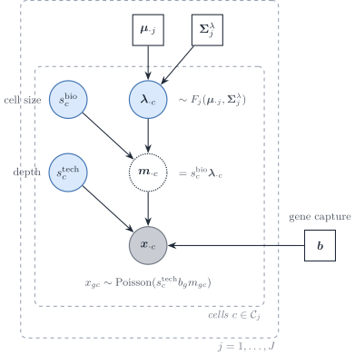

Figure 2: Measurement and expression model of a single-cell reference,
in the notation of this vignette. Inside cell type j, the size-free
expression \boldsymbol{\lambda}\_{\cdot c} follows an expression model
F_j with mean \boldsymbol{\mu}\_{\cdot j} and covariance
\boldsymbol{\Sigma}^{\lambda}\_j; the biological size factor turns it
into a molecule content; the technical size factor and the gene capture
efficiency \boldsymbol{b} act through a Poisson measurement.

### Poisson measurement of UMI counts

If each molecule of cell c is captured independently with a small
probability, the multivariate hypergeometric sampling of molecules is
close to a multinomial and each gene count is Poisson given the true
content (Supplementary Note 1 of ([Sarkar and Stephens
2021](#ref-sarkarSeparatingMeasurementExpression2021))):

x\_{gc}\mid s^{\mathrm{tech}}\_c,m\_{gc}
\sim\mathrm{Poisson}\bigl(s^{\mathrm{tech}}\_c\\b_g\\m\_{gc}\bigr),
\qquad \boldsymbol{m}\_{\cdot
c}=s^{\mathrm{bio}}\_c\\\boldsymbol{\lambda}\_{\cdot c}. \tag{1}

Fang and Pachter write the same law as binomial thinning with capture
rate b_gs^{\mathrm{tech}}\_c, of which the Poisson is the low-capture
limit, and normalise
\mathbb{E}\[s^{\mathrm{bio}}\]=\mathbb{E}\[s^{\mathrm{tech}}\]=1 (their
equations 1–2). Sarkar and Stephens instead take the observed library
size x\_{+c} as the size factor and a relative expression
\lambda\_{gc}=m\_{gc}/m\_{+c}; in that convention s^{\mathrm{bio}}\_c
cancels by construction, which is the removal of biological extrinsic
noise that Fang and Pachter warn about. The two conventions are the two
directions of the same rank-one Poisson fit: the point-mass MLE
\hat\mu_g=\sum_cx\_{gc}/\sum_cx\_{+c} and the size-factor MLE of
[Eq. 3](#eq-poisson-size-factor) below.

Three remarks connect the protocol to deconvolution.

- **UMIs remove most gene-specific distortion.** Unique molecular
  identifiers collapse PCR duplicates, which “substantially reduce
  unwanted variation, including differences in gene lengths and PCR
  amplification efficiencies” ([Sarkar and Stephens
  2021](#ref-sarkarSeparatingMeasurementExpression2021)). What remains
  is a capture efficiency b_g that is constant across cells of one
  protocol. It is not identified separately from \boldsymbol{\lambda},
  and it cancels from every within-protocol contrast, so it is absorbed
  into \boldsymbol{\mu}\_{\cdot j} and \boldsymbol{\Sigma}\_{W,j}. It
  does **not** cancel between a single-cell reference and a bulk
  library: the ratio d_g=b_g^{\mathrm{bulk}}/b_g^{\mathrm{ref}} is the
  gene-wise platform factor of [Sec. 6.4](#sec-strategy-plugin).
  Read-count protocols without UMIs and hybridisation microarrays carry
  larger gene- and probe-specific factors (amplification, length,
  affinity), which is why earlier deconvolution methods had to model
  gene-wise scales explicitly; with UMI references, the gene-wise factor
  reduces to one cross-platform ratio per gene.
- **Random capture biases make the measurement overdispersed; constant
  ones do not.** If b\_{gc} varied from cell to cell, the measurement
  model would be negative binomial rather than Poisson (Box 1 and
  Supplementary Note 1.2 of Sarkar and Stephens). On spike-in controls
  the measurement dispersion was below 5\times10^{-3}, which adds about
  5% to the variance of a gene with ten observed molecules.
  Overdispersion seen in single-cell data is therefore an **expression**
  property, \boldsymbol{\Sigma}^{\lambda}\_j, plus extrinsic noise, not
  a protocol property.
- **Zero inflation belongs to the expression model, if anywhere.**
  Spike-in controls show no zero-generating measurement component, and a
  point-Gamma expression model beats a Gamma model for only 0.6–8.6% of
  genes across the datasets tested ([Sarkar and Stephens
  2021](#ref-sarkarSeparatingMeasurementExpression2021)). Zeros are
  imperfect measurements of small \lambda\_{gc} at low depth, “with no
  need for special terminology or special treatment”. For DeCovarT,
  which uses only the first two moments of the reference, a
  zero-inflated observation model is unnecessary: the moments of the
  counts already contain the zeros. The argument is made for UMI data;
  the authors note that it may not hold for read counts amplified by PCR
  without UMIs.

### Expression models and the observation models they induce

Integrating the expression model against
[Eq. 1](#eq-poisson-measurement) gives the observation model gene by
gene (Table 1 of ([Sarkar and Stephens
2021](#ref-sarkarSeparatingMeasurementExpression2021))).

| Expression model for \lambda\_{gc} | Observation model for x\_{gc} | Examples |
|----|----|----|
| Point mass \lambda\_{gc}=\mu_g | Poisson | analytic |
| Gamma, mean \mu_g, variance \mu_g^{2}\phi_g | Negative binomial | `edgeR`, `DESeq2`, `SAVER` |
| Point-Gamma | Zero-inflated negative binomial | `ZINB-WaVE` (multigene) |
| Unimodal or fully nonparametric | Flexible | `ashr`, `DESCEND` |
| Low rank, \lambda\_{gc}=\mu\_{gc}u\_{gc}, \mu=h^{-1}(\boldsymbol{L}\boldsymbol{F}^{\top}) | Flexible | GLM-PCA, `scVI` |

Table 1: Expression and observation models for UMI counts, after Sarkar
and Stephens (Tables 1–2). The measurement model is Poisson throughout.

A gene whose expression model is a point mass inside a homogeneous
population is a **Poisson gene**: its count has no variability beyond
sampling and the extrinsic size factor. Overdispersion relative to a
Poisson, the hallmark of the negative binomial, then measures either
biological variability of \lambda\_{gc} or variability of s_c.

### Extrinsic noise, size factors and Poisson genes

Fang and Pachter show that a cell-wide factor explains the baseline
overdispersion of single-cell counts. Under
[Eq. 1](#eq-poisson-measurement) with
s_c=s^{\mathrm{bio}}\_cs^{\mathrm{tech}}\_c independent of
\boldsymbol{\lambda}\_{\cdot c}, \mathbb{E}\[s_c\]=1 and
\nu=\operatorname{CV}^{2}(s_c), their equation (3) reads, in our
notation and inside one cell type,

\frac{\operatorname{Cov}(x\_{gc},x\_{hc})}{\mathbb{E}\[x\_{gc}\]\mathbb{E}\[x\_{hc}\]}
=\nu+(1+\nu)\frac{\Sigma^{\lambda}\_{j,gh}}{\mu\_{gj}\mu\_{hj}}
+\frac{\delta\_{gh}}{\mathbb{E}\[x\_{gc}\]}, \qquad
1+\nu=(1+\nu^{\mathrm{bio}})(1+\nu^{\mathrm{tech}}). \tag{2}

For two genes that are intrinsically uncorrelated, or for one gene that
is intrinsically Poisson, the normalised covariance equals \nu (their
equation 5). That identity gives an estimator of \nu (the mode of the
normalised covariances over gene pairs) and a selection rule for Poisson
genes (those whose normalised variance minus the Poisson term has a
bootstrap interval containing \hat\nu). On those genes \mathcal{P}, the
size factor has the closed-form MLE

\hat
s_c=\frac{\sum\_{g\in\mathcal{P}}x\_{gc}}{\sum\_{g\in\mathcal{P}}\mu_g}.
\tag{3}

Two findings matter here. Normalising each cell by its total removes
s^{\mathrm{bio}}\_c together with s^{\mathrm{tech}}\_c, and with it the
biological extrinsic variability, including cell size ([Fang and Pachter
2025](#ref-fangExtrinsicBiologicalStochasticity2025)). In peripheral
blood, sums over Poisson genes no longer track total UMI counts and
differ between cell types, so the choice of size factor changes
downstream comparisons. Separating s^{\mathrm{tech}}\_c from
s^{\mathrm{bio}}\_c needs external controls (spike-ins, ambient RNA,
pooled RNA); the nascent-mRNA counts did not fit the binomial sampling
model in their pooled-RNA experiment.

### What the measurement model implies for the reference covariance

Write the same identity in matrix form (a direct consequence of
[Eq. 1](#eq-poisson-measurement) and the law of total covariance; the
derivation is ours). With
\boldsymbol{\mathcal{B}}=\operatorname{diag}(\boldsymbol{b}),

\operatorname{Cov}(\boldsymbol{x}\_{\cdot c}\mid c\in j)
=\underbrace{\operatorname{diag}\bigl(\boldsymbol{\mathcal{B}}\boldsymbol{\mu}\_{\cdot
j}\bigr)}\_{\text{Poisson measurement}} +\boldsymbol{\mathcal{B}}\Bigl\[
\underbrace{(1+\nu)\boldsymbol{\Sigma}^{\lambda}\_j}\_{\text{biology}}
+\underbrace{\nu\\\boldsymbol{\mu}\_{\cdot j}\boldsymbol{\mu}\_{\cdot
j}^{\top}}\_{\text{size factor}} \Bigr\]\boldsymbol{\mathcal{B}}.
\tag{4}

The sample covariance of raw UMI counts, which is what a single-cell
reference returns as \hat{\boldsymbol{\Sigma}}\_{W,j}, mixes three
objects. Only part of it belongs in the bulk law.

1.  **The Poisson diagonal is single-cell measurement noise.** It is
    produced at single-cell depth and is not part of the tissue. A bulk
    library has its own sampling noise, on its own depth, which the
    diagonal term \boldsymbol{D}\_i carries. Plugging raw-count
    covariances into \boldsymbol{S}\_W imports the reference sampling
    noise into the bulk covariance; subtracting
    \operatorname{diag}(\bar{\boldsymbol{x}}\_j) first removes it.
2.  **The technical size-factor term is not biology either.** The
    rank-one term \nu^{\mathrm{tech}}\boldsymbol{\mu}\_{\cdot
    j}\boldsymbol{\mu}\_{\cdot j}^{\top} induces a positive correlation
    between all genes. It inflates the apparent network and is a
    protocol artefact.
3.  **The biological size factor is part of the bulk.** Cells of one
    type differ in volume and cycle phase; a tissue sums those cells as
    they are. The term \nu^{\mathrm{bio}}\boldsymbol{\mu}\_{\cdot
    j}\boldsymbol{\mu}\_{\cdot j}^{\top} belongs in
    \boldsymbol{\Sigma}\_{W,j}, and library-size normalisation that
    removes it understates the within-type variance that the bulk
    accumulates.

The corresponding moment estimator, with \hat\nu^{\mathrm{tech}} from
spike-ins or Poisson genes, is

\hat{\boldsymbol{\Sigma}}\_{W,j}
=\hat{\boldsymbol{C}}\_j-\operatorname{diag}(\bar{\boldsymbol{x}}\_j)
-\frac{\hat\nu^{\mathrm{tech}}}{1+\hat\nu^{\mathrm{tech}}}\\
\bigl\[\hat{\boldsymbol{C}}\_j-\operatorname{diag}(\bar{\boldsymbol{x}}\_j)+\bar{\boldsymbol{x}}\_j\bar{\boldsymbol{x}}\_j^{\top}\bigr\],
\tag{5}

where \hat{\boldsymbol{C}}\_j is the sample covariance of the type-j
counts and \bar{\boldsymbol{x}}\_j their mean. It is the
s^{\mathrm{tech}}-free covariance of
\boldsymbol{\mathcal{B}}\boldsymbol{m}\_{\cdot c} obtained by solving
[Eq. 4](#eq-count-covariance) with
1+\nu=(1+\nu^{\mathrm{bio}})(1+\nu^{\mathrm{tech}}) (our derivation, to
be checked by simulation before use). Estimating \nu^{\mathrm{tech}}
before the deconvolution is the first plug-in of Strategy 4
([Sec. 6.4](#sec-strategy-plugin)).

## From cells to reference moments

The signature that enters [the released
convolution](https://bastienchassagnol.github.io/DeCovarT/articles/theory-decovart-statistical-perspectives.html#eq-gaussian-convolution)
is a **population profile**: one mean vector and one covariance per cell
type. Single-cell counts are not that object. This section states how to
build the mean and how the covariance splits, then how to place the
resulting profiles on the same scale as bulk sample i.

Figure 3: Within-sample cell noise, between-replicate biological
covariance, and residual bulk noise.

Figure 4: MuSiC assumptions for library-size normalisation: same
population, conserved cell-size ratios, conserved library-size ratios,
and the stronger A3-prime hypothesis for absolute cell-type fractions.

[Figure 3](#fig-three-variability) is the target decomposition. Panel A
is a purified population profile (quadratic in p\_{ji}). Panel B is one
single-cell reference (linear in p\_{ji}). Panel C is the hierarchical
model once R independent replicates exist.

### Mean: average cells, then average replicates

For a fixed type j, the per-cell mean does not depend on how many cells
were captured. With raw counts on an additive scale,

\bar{\boldsymbol{X}}\_{jr} =
\frac{1}{C\_{jr}}\sum\_{c=1}^{C\_{jr}}\boldsymbol{X}\_{jrc}, \qquad
\hat{\boldsymbol{\mu}}\_{\cdot j} =
\frac{1}{R}\sum\_{r=1}^{R}\bar{\boldsymbol{X}}\_{jr}. \tag{6}

Divide by the **cell count** C\_{jr}, not by the library size.
Library-size weights w_c=L_c/\sum_d L_d are functions of
\boldsymbol{X}\_c itself. Their probability limit is
\boldsymbol{\mu}+\boldsymbol{\Sigma}\mathbf{1}/(\mathbf{1}^{\top}\boldsymbol{\mu}),
so they target an RNA-weighted cell and destroy the exact Gaussian scale
that leaves the precision graph unchanged. Under i.i.d. cells the
arithmetic mean also has the largest effective sample size among
deterministic convex weights.

Pool cells across replicates only after the within-replicate mean. A
replicate with 10\\000 cells must not outweigh a replicate with 500
cells. `MuSiC` is built on that multi-subject split: cross-subject means
and variances, with genes weighted by cross-subject and cross-cell
consistency ([Wang et al. 2019](#ref-wangBulkTissueCell2019)).

When every cell is scaled to a common total, the product
S_j\boldsymbol{\theta}\_{\cdot j} collapses to the arithmetic mean of
the raw counts. `MuSiC` writes the signature as cell size times relative
abundance and then recovers that same per-cell mean. Keep S_j and
\boldsymbol{\theta}\_{\cdot j} as separate factors
([Sec. 2.3](#sec-alignment)). Do not library-weight the raw vectors and
call the result S_j.

> **Warning 2: Summing cells is the wrong signature, and the right
> pseudobulk**
>
> Summing is the correct total for a physical pool of exactly C\_{jr}
> cells, \boldsymbol{T}\_{jr}=\sum_c\boldsymbol{X}\_{jrc}, with mean
> C\_{jr}\boldsymbol{\mu}\_{\cdot j} and covariance
> C\_{jr}\boldsymbol{\Sigma}\_{W,j}. Using \boldsymbol{T}\_{jr} as a
> DeCovarT column inserts the arbitrary capture count into
> \boldsymbol{p}. A type with ten times more reference cells looks ten
> times more abundant.
>
> The same sum is the right input for a different question. Differential
> expression of one cell type across donors needs one count vector per
> donor, then a bulk count model such as `DESeq2` ([Love et al.
> 2014](#ref-loveModeratedEstimationFold2014a)). There the estimand is a
> relative fold change of averaged counts, and the donor is the
> independent unit. Cells from one donor are subsamples. Treating them
> as replicates inflates false discoveries ([Squair et al.
> 2021](#ref-squairConfrontingFalseDiscoveries2021)). That analysis does
> not estimate \boldsymbol{p}\_{\cdot i}.

### Three reference regimes

Write the cell as a sum of a replicate effect and a cell effect,

\boldsymbol{X}\_{jrc} = \boldsymbol{\mu}\_{\cdot
j}+\boldsymbol{B}\_{jr}+\boldsymbol{\varepsilon}\_{jrc}, \tag{7}

with
\boldsymbol{B}\_{jr}\sim\mathcal{N}(\boldsymbol{0},\boldsymbol{\Sigma}\_{B,j})
and
\boldsymbol{\varepsilon}\_{jrc}\sim\mathcal{N}(\boldsymbol{0},\boldsymbol{\Sigma}\_{W,j}),
independent across j given \boldsymbol{p}\_{\cdot i}. The bulk average
per cell in a tissue of N_i cells is

\boldsymbol{A}\_i = \sum_j p\_{ji}(\boldsymbol{\mu}\_{\cdot
j}+\boldsymbol{B}\_{jr(i)}) + \frac{1}{N_i}\sum_j\sum\_{c=1}^{N_i
p\_{ji}}\boldsymbol{\varepsilon}\_{ijc}. \tag{8}

#### FACS-sorted population profiles

Historically the reference was one bulk profile per purified population:
surface-marker sorting, then a pooled microarray or RNA-seq library. The
random object is the whole population vector
\boldsymbol{Z}\_{ij}\sim\mathcal{N}(\boldsymbol{\mu}\_{\cdot
j},\boldsymbol{\Sigma}\_{B,j}), and the bulk is the convolution

\boldsymbol{y}\_{\cdot i} = \sum_j p\_{ji}\boldsymbol{Z}\_{ij}, \qquad
\operatorname{Cov}(\boldsymbol{y}\_{\cdot i}\mid\boldsymbol{p}\_{\cdot
i}) = \sum_j p\_{ji}^{2}\\\boldsymbol{\Sigma}\_{B,j}. \tag{9}

The square appears because one random profile is multiplied by p\_{ji},
not because p\_{ji} cells were added. This is the covariance in [the
released
convolution](https://bastienchassagnol.github.io/DeCovarT/articles/theory-decovart-statistical-perspectives.html#eq-gaussian-convolution).
If several types are sorted from the same donors, cross-type blocks
\boldsymbol{\Sigma}\_{B,jk} add terms p\_{ji}p\_{ki}. Before droplet
scRNA-seq, those population profiles came from FACS- or MACS-purified
bulk libraries. Szaniszlo et al. showed that mixture expression reflects
composition and that a minor subset is recovered only after physical
sorting, while also stressing coexpression among genes inside a purified
type ([Szaniszlo et al. 2004](#ref-szaniszloGettingRightCells)).
Novershtern et al. profiled 38 marker-defined haematopoietic populations
and used coexpression modules plus promoter *cis*-circuits as the
gene–gene structure of each state ([Novershtern et al.
2011](#ref-novershternDenselyInterconnectedTranscriptional2011)). Those
studies are the historical FACS reference that
[Eq. 9](#eq-facs-quadratic) still describes.

#### One single-cell replicate (R=1)

R=1 identifies \boldsymbol{M}\_{j1} and \boldsymbol{\Sigma}\_{W,j}. It
does not identify \boldsymbol{\Sigma}\_{B,j}: extra cells shrink
\boldsymbol{\Sigma}\_{W,j}/C\_{j1} and leave the single draw
\boldsymbol{B}\_{j1} untouched. The coherent bulk covariance is the
**mixture / physical sum**, linear in p\_{ji}:

\operatorname{Cov}(\boldsymbol{A}\_i\mid\boldsymbol{p}\_{\cdot i}) =
\kappa_i\sum_j p\_{ji}\\\boldsymbol{\Sigma}\_{W,j} +
\boldsymbol{\Sigma}\_{\mathrm{obs},i}. \tag{10}

Here \kappa_i is an effective cells-per-bulk scale. The ideal value is
1/N_i. The number of reference cells C\_{j1} is not N_i. A finite-cell
reference mean adds a separate quadratic term \sum_j
p\_{ji}^{2}\boldsymbol{\Sigma}\_{W,j}/C\_{j1}. That term is Monte Carlo
error of \hat{\boldsymbol{\mu}}\_{\cdot j}, not biological between-donor
covariance. Do not drop \boldsymbol{\Sigma}\_{W,j} into the p\_{ji}^{2}
slot of [the released
convolution](https://bastienchassagnol.github.io/DeCovarT/articles/theory-decovart-statistical-perspectives.html#eq-gaussian-convolution).

For a rare type, p\_{ji}=0.01 makes p\_{ji}^{2} a hundred times smaller
than p\_{ji}. A within-cell covariance placed in the quadratic slot is
almost silenced.

#### Enough biological replicates

The smallest R that identifies a variance component is R\ge 2. The
replicate means satisfy

\bar{\boldsymbol{X}}\_{jr} \sim \mathcal{N}\\\left(
\boldsymbol{\mu}\_{\cdot j},\\
\boldsymbol{\Sigma}\_{B,j}+\frac{\boldsymbol{\Sigma}\_{W,j}}{C\_{jr}}
\right). \tag{11}

A method-of-moments contrast is then available. Let
\boldsymbol{S}\_{B,j} be the sample covariance of
\\\bar{\boldsymbol{X}}\_{jr}\\\_{r=1}^{R} and \bar{C}\_j a typical cell
count. Then

\mathbb{E}\[\boldsymbol{S}\_{B,j}\] = \boldsymbol{\Sigma}\_{B,j} +
\overline{\boldsymbol{\Sigma}\_{W,j}/C\_{jr}}, \tag{12}

so
\hat{\boldsymbol{\Sigma}}\_{B,j}=\boldsymbol{S}\_{B,j}-\widehat{\boldsymbol{\Sigma}}\_{W,j}/\bar{C}\_j,
projected onto the positive semidefinite cone. An unstructured G\times G
covariance has G(G+1)/2 free entries. Transcriptome-scale G makes that
matrix unestimable for the R of a normal single-cell study. What R\ge 2
buys is the **scalar separation** of the two layers, or a sparse
precision for \boldsymbol{\Sigma}\_{B,j}, not a dense G\times G matrix.
Reference cohorts in current single-cell deconvolution are small; `MEAD`
states this explicitly ([Xie et al.
2026](#ref-xieStatisticalInferenceCell2026)). Cells from one donor share
genetic and environmental background, so they are subsamples rather than
independent biological units. Zimmerman, Espeland and Langefeld document
that dependence across cell types, and they treat donor as the random
effect when contrasting conditions ([Zimmerman et al.
2021](#ref-zimmermanPracticalSolutionPseudoreplication2021)). That
within-versus-between split is the same hierarchy as
\boldsymbol{\Sigma}\_{W,j} versus \boldsymbol{\Sigma}\_{B,j} when a
single-cell reference is aligned with bulk.

With that split, the bulk law DeCovarT should use is

\boldsymbol{y}\_{\cdot i}\mid\boldsymbol{p}\_{\cdot i} \sim
\mathcal{N}\\\Big( a_i\sum_j p\_{ji}\boldsymbol{\mu}\_{\cdot j},\\
\sum_j p\_{ji}^{2}\\\boldsymbol{\Sigma}\_{B,j} + \kappa_i\sum_j
p\_{ji}\\\boldsymbol{\Sigma}\_{W,j} +
\boldsymbol{\Sigma}\_{\mathrm{obs},i} \Big). \tag{13}

\boldsymbol{\Sigma}\_{\mathrm{obs},i} is diagonal. Gene–gene correlation
is already inside \boldsymbol{\Sigma}\_{B,j} and
\boldsymbol{\Sigma}\_{W,j}. Heteroscedastic diagonal entries are
allowed. Off-diagonal residual correlation would double-count the
network.

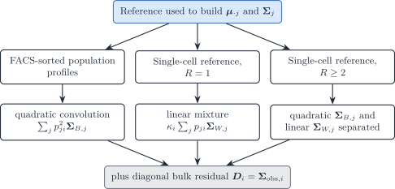

Figure 5: Which covariance terms the reference design identifies. FACS
profiles supply only the quadratic layer. One single-cell replicate
supplies only the linear layer. R\ge 2 replicates separate both, plus a
diagonal bulk residual.

### Aligning reference profiles with bulk sample i

[Eq. 6](#eq-mean-two-stage) is a per-cell mean. Bulk sample i is a
library. Three scales sit between them. Only two belong inside the
estimator.

**Sample scale a_i.** On an absolute molecule scale,
\boldsymbol{y}\_{\cdot i}=a_i\boldsymbol{\mu}\boldsymbol{p}\_{\cdot i}
plus noise. a_i absorbs cell number, sequencing depth, and capture. It
is one positive number per bulk sample. Profile it out, or estimate it
jointly with \boldsymbol{p}\_{\cdot i}. It is not a biological
composition parameter.

**Cell size S_j.** RNA content differs by cell type, so

\boldsymbol{y}\_{\cdot i} = a_i\sum_j p\_{ji}
S_j\boldsymbol{\theta}\_{\cdot j} + \boldsymbol{\varepsilon}\_i.
\tag{14}

`MuSiC` states the same product: cell fraction, average cell size,
relative abundance ([Wang et al. 2019](#ref-wangBulkTissueCell2019)). If
S_j is measured, insert it. Do not re-estimate it. Free S_j and
\boldsymbol{p}\_{\cdot i} are not separately identifiable from
\boldsymbol{y}\_{\cdot i} alone, because only the products p\_{ji}S_j
enter [Eq. 14](#eq-music-mean). The RNA fraction

q\_{ji} = \frac{p\_{ji}S_j}{\sum_k p\_{ki}S_k} \tag{15}

is what a normalised bulk identifies. \boldsymbol{q}\_{\cdot
i}=\boldsymbol{p}\_{\cdot i} when S_j is constant across j. That
constant-efficiency hypothesis is assumption A3' of `MuSiC`: the ratio
of average library size equals the ratio of average cell size,
equivalently a common capture efficiency \gamma_j=L_j/S_j
([Figure 4](#fig-music-assumptions)). Under A3', the arithmetic mean
across cells is the right signature and the fitted weights are cytometry
fractions. If A3' fails, the fitted weights are RNA fractions and a
later division by S_j ([RNA-to-cell
correction](https://bastienchassagnol.github.io/DeCovarT/articles/theory-decovart-statistical-perspectives.html#eq-rna-to-cell))
is required.

`EPIC` and `quanTIseq` apply that division **after** a linear fit, using
an external RNA-content assay, so the optimiser itself returns
transcriptomic ratios ([Racle et al.
2017](#ref-racleSimultaneousEnumerationCancer2017); [Finotello et al.
2019](#ref-finotello_etal19)). `MMAD` estimates the extraction
efficiencies inside a non-linear conjugate-gradient step ([Liebner et
al. 2014](#ref-liebnerMMADMicroarrayMicrodissection2014)). `ReDeconv`
keeps transcriptome size in the reference by Count-based Linearised
Transcriptome Size (CLTS) normalisation, instead of dividing every cell
by its own total ([Lu et al.
2025](#ref-luTranscriptomeSizeMatters2025)).

**Gene-wise scale \boldsymbol{d}.** A platform shift can be
gene-specific, y\_{gi}\approx d_g a_i\sum_j p\_{ji}\mu\_{gj}. `Bisque`
learns such a map from paired bulk and single-cell measurements when
technical variation between the two assays is large ([Jew et al.
2020](#ref-jewAccurateEstimationCell2020)). Fitting \\d_g\\ on the same
bulk sample that is being deconvolved lets the scale absorb any
residual, and \boldsymbol{p}\_{\cdot i} is then unidentified. Estimate
\boldsymbol{d} on an external paired cohort, or do not estimate it.

#### Normalisation that preserves the linear mixture

The moment identities above are for **raw counts on an additive scale**.
They do not survive a logarithm: \log\boldsymbol{y}\_{\cdot i} is not
\sum_j p\_{ji}\log\boldsymbol{\mu}\_{\cdot j}.

The comparison DeCovarT needs is the **same gene on two technologies**,
not two genes inside one sample. Gene length is a property of the assay.
It cancels for a within-gene contrast and should not be divided out of
the reference unless the bulk was length-normalised in the same way.
`ReDeconv` treats length as a bulk-only TPM/RPKM correction and leaves
UMI single-cell counts uncorrected for length ([Lu et al.
2025](#ref-luTranscriptomeSizeMatters2025)).

| Procedure | What it estimates | Use for \boldsymbol{\mu}\_{\cdot j} |
|----|----|----|
| Arithmetic mean of raw counts | Per-cell mean | Default signature |
| CPM / CP10K | Library-size relative profile | Erases S_j |
| TPM / RPKM / FPKM | Length-adjusted composition | Breaks cross-platform per-gene alignment |
| TMM (`edgeR`) or median-of-ratios (`DESeq2`) | Effective library size for differential expression | Donor-level DE, not the signature ([Robinson et al. 2010](#ref-robinsonEdgeRBioconductorPackage2010); [Love et al. 2014](#ref-loveModeratedEstimationFold2014a)) |
| `SCTransform` | Regularised negative-binomial residuals | Clustering and integration, not an additive mixture mean ([Hafemeister and Satija 2019](#ref-hafemeisterNormalizationVarianceStabilization2019)) |
| CLTS (`ReDeconv`) | Counts rescaled by a linearised transcriptome size | Keeps S_j for deconvolution ([Lu et al. 2025](#ref-luTranscriptomeSizeMatters2025)) |

CPM and CP10K divide by the cell total. That is a relative profile
\boldsymbol{\theta}\_{\cdot j} with S_j discarded. TMM and the `DESeq2`
size factor answer a different question: an effective depth for
between-sample differential expression, under a hypothesis that most
genes are stable ([Robinson et al.
2010](#ref-robinsonEdgeRBioconductorPackage2010); [Love et al.
2014](#ref-loveModeratedEstimationFold2014a)). `SCTransform` models
depth inside a negative binomial; the residuals are not an additive
convolution mean ([Hafemeister and Satija
2019](#ref-hafemeisterNormalizationVarianceStabilization2019)).

## Convolution, mixture and correlated cells

Let
\boldsymbol{X}\sim\mathcal{N}\_G(\boldsymbol{\mu},\boldsymbol{\Sigma}).
Two statements look contradictory,

\operatorname{Cov}(a\boldsymbol{X})=a^{2}\boldsymbol{\Sigma}
\qquad\text{versus}\qquad
\operatorname{Cov}\Bigl(\sum\_{r=1}^{a}\boldsymbol{X}\_r\Bigr)=a\boldsymbol{\Sigma},
\tag{16}

and both are correct. The difference lies entirely in the dependence
between the a summands, not in two rules for Gaussian vectors.

### Characteristic-function proof

The characteristic function of \boldsymbol{X} is
\phi\_{\boldsymbol{X}}(\boldsymbol{t})
=\exp(i\boldsymbol{t}^{\top}\boldsymbol{\mu}
-\tfrac12\boldsymbol{t}^{\top}\boldsymbol{\Sigma}\boldsymbol{t}).

**Scaling** substitutes a\boldsymbol{t} for \boldsymbol{t}:

\phi\_{a\boldsymbol{X}}(\boldsymbol{t})
=\phi\_{\boldsymbol{X}}(a\boldsymbol{t})
=\exp\bigl(i\boldsymbol{t}^{\top}(a\boldsymbol{\mu})
-\tfrac12\boldsymbol{t}^{\top}(a^{2}\boldsymbol{\Sigma})\boldsymbol{t}\bigr),
\qquad
a\boldsymbol{X}\sim\mathcal{N}\_G(a\boldsymbol{\mu},a^{2}\boldsymbol{\Sigma}).
\tag{17}

**Independent convolution** multiplies a identical factors:

\phi\_{\boldsymbol{X}\_1+\cdots+\boldsymbol{X}\_a}(\boldsymbol{t})
=\phi\_{\boldsymbol{X}}(\boldsymbol{t})^{a}
=\exp\bigl(i\boldsymbol{t}^{\top}(a\boldsymbol{\mu})
-\tfrac12\boldsymbol{t}^{\top}(a\boldsymbol{\Sigma})\boldsymbol{t}\bigr),
\qquad
\sum\_{r}\boldsymbol{X}\_r\sim\mathcal{N}\_G(a\boldsymbol{\mu},a\boldsymbol{\Sigma}).
\tag{18}

The first route squares the quadratic exponent; the second adds a copies
of it. The density convolution (f\*f)(\boldsymbol{s})=\int
f(\boldsymbol{x})f(\boldsymbol{s}-\boldsymbol{x})\\d\boldsymbol{x} is
the law of \boldsymbol{X}\_1+\boldsymbol{X}\_2 only when the two draws
are independent. Saying “a convolution of Gaussians” therefore already
asserts independent summands.

### The master identity and its two endpoints

For arbitrary random vectors with
\operatorname{Cov}(\boldsymbol{X}\_r)=\boldsymbol{\Sigma} and
cross-covariances
\boldsymbol{C}\_{rs}=\operatorname{Cov}(\boldsymbol{X}\_r,\boldsymbol{X}\_s),

\operatorname{Cov}\Bigl(\sum\_{r=1}^{a}\boldsymbol{X}\_r\Bigr)
=\sum\_{r,s}\operatorname{Cov}(\boldsymbol{X}\_r,\boldsymbol{X}\_s)
=a\boldsymbol{\Sigma}+\sum\_{r\neq s}\boldsymbol{C}\_{rs}. \tag{19}

Under **equicorrelation**,
\boldsymbol{C}\_{rs}=\varrho\boldsymbol{\Sigma} for r\neq s, the a(a-1)
off-diagonal blocks collapse to

\operatorname{Cov}\Bigl(\sum\_{r=1}^{a}\boldsymbol{X}\_r\Bigr)
=a\bigl\[1+(a-1)\varrho\bigr\]\boldsymbol{\Sigma}, \qquad
-\frac{1}{a-1}\le\varrho\le 1 . \tag{20}

Setting \varrho=1 (the same realised vector reused a times) gives
a^{2}\boldsymbol{\Sigma}; setting \varrho=0 (fresh independent draws)
gives a\boldsymbol{\Sigma}. [Table 2](#tbl-dependence-regimes) lists the
cases. A sum of merely *marginally* Gaussian vectors need not be
Gaussian; [Eq. 20](#eq-equicorrelation) is a Gaussian law only when the
stacked vector
(\boldsymbol{X}\_1^{\top},\ldots,\boldsymbol{X}\_a^{\top})^{\top} is
**jointly** Gaussian, which is the assumption made whenever an
intermediate \varrho is used below.

| Construction | Dependence | Mean | Covariance | Law |
|----|----|----|----|----|
| Same \boldsymbol{X} repeated | \varrho=1 | a\boldsymbol{\mu} | a^{2}\boldsymbol{\Sigma} | \mathcal{N}\_G |
| a i.i.d. copies | \varrho=0 | a\boldsymbol{\mu} | a\boldsymbol{\Sigma} | \mathcal{N}\_G |
| Correlated copies | general \boldsymbol{C}\_{rs} | a\boldsymbol{\mu} | a\boldsymbol{\Sigma}+\sum\_{r\neq s}\boldsymbol{C}\_{rs} | Gaussian if jointly Gaussian |
| Equicorrelated copies | \boldsymbol{C}\_{rs}=\varrho\boldsymbol{\Sigma} | a\boldsymbol{\mu} | a\[1+(a-1)\varrho\]\boldsymbol{\Sigma} | Gaussian if jointly Gaussian |

Table 2: Dependence regimes for a sum of a Gaussian vectors with common
marginal covariance. The first two rows are the endpoints \varrho=1 and
\varrho=0 of the last.

The biological reading is the one that matters for a single-cell
reference. If \boldsymbol{\Sigma}\_j is the covariance **between cells**
of type j, summing m_j independent cells yields
m_j\boldsymbol{\Sigma}\_j. If \boldsymbol{\Sigma}\_j is the covariance
of **one latent type-level profile** that is multiplied by a weight, the
contribution is p_j^{2}\boldsymbol{\Sigma}\_j. Released DeCovarT is the
second case. The random-effects decomposition of the [perspectives
vignette](#sec-three-regimes),

\boldsymbol{X}\_{jc}=\boldsymbol{M}\_j+\boldsymbol{\varepsilon}\_{jc},
\qquad
\operatorname{Cov}\Bigl(\sum\_{c=1}^{m_j}\boldsymbol{X}\_{jc}\Bigr)
=m_j\boldsymbol{\Sigma}\_{W,j}+m_j^{2}\boldsymbol{\Sigma}\_{B,j},
\tag{21}

contains both endpoints at once: independent cell fluctuations
accumulate linearly, a shared type-level fluctuation is amplified
quadratically. Equicorrelated cells are the special case
\boldsymbol{\Sigma}\_{B,j}=\varrho_j\boldsymbol{\Sigma}\_j and
\boldsymbol{\Sigma}\_{W,j}=(1-\varrho_j)\boldsymbol{\Sigma}\_j
([Sec. 3.4](#sec-persp-equicorrelation)).

### Mixture of cells versus convolution of populations

The identity [Eq. 19](#eq-master-identity) fixes the covariance once the
dependence between summands is fixed. Deconvolution models differ by a
second choice: whether the cell type of each summand is random or given.
[Figure 6](#fig-dag-dependence) lays out the four cases from no
dependence to full dependence.

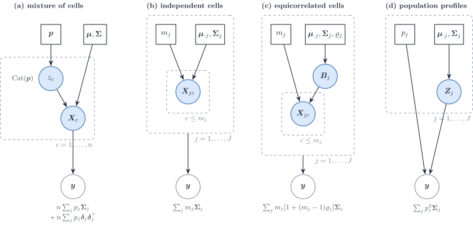

Figure 6: Four generative stories for a bulk profile \boldsymbol{y},
ordered by the dependence between cells. (a) A mixture: each of n cells
draws its type label from \mathrm{Cat}(\boldsymbol{p}). (b) Independent
cells with fixed counts m_j. (c) Equicorrelated cells sharing a
type-level effect \boldsymbol{B}\_j. (d) One population profile per
type, scaled by p_j. The note under each \boldsymbol{y} is its
covariance; \boldsymbol{\delta}\_j=\boldsymbol{\mu}\_{\cdot
j}-\boldsymbol{\mu}\boldsymbol{p}.

**Mixture of cells.** If the type label z_c of each of n cells is drawn
from \mathrm{Cat}(\boldsymbol{p}), one cell follows the Gaussian mixture
\sum_jp_j\mathcal{N}\_G(\boldsymbol{\mu}\_{\cdot
j},\boldsymbol{\Sigma}\_j), with

\mathbb{E}\[\boldsymbol{X}\_c\]=\boldsymbol{\mu}\boldsymbol{p}, \qquad
\operatorname{Cov}(\boldsymbol{X}\_c) =\sum_jp_j\boldsymbol{\Sigma}\_j
+\sum_jp_j(\boldsymbol{\mu}\_{\cdot
j}-\boldsymbol{\mu}\boldsymbol{p})(\boldsymbol{\mu}\_{\cdot
j}-\boldsymbol{\mu}\boldsymbol{p})^{\top} \tag{22}

by the law of total covariance. The sum of n independent such cells has
n times that covariance and is Gaussian only in the central-limit sense.
This is the `RNA-Sieve` likelihood, written gene by gene
([Sec. 5.2.2](#sec-rnasieve)). The second term is the spread of the type
means; it is present because the labels are random, and it disappears
once the counts \boldsymbol{m} are conditioned on.

**Convolution of independent cells.** With the counts given, the sum is
an exact Gaussian with covariance \sum_jm_j\boldsymbol{\Sigma}\_j:
linear weights. This is Strategy 1 ([Sec. 6.1](#sec-cell-counts)) and,
after division by n, the linear layer of Strategy 2.

**Convolution of population profiles.** If each type contributes one
random profile scaled by its weight, the covariance is
\sum_jp_j^{2}\boldsymbol{\Sigma}\_j: quadratic weights. This is released
DeCovarT, the `DECALS` covariance, and the cross-subject layer of
`MuSiC`.

The equicorrelated model sits between the last two.

### Correlated cells inside a type

[Sec. 6.1](#sec-cell-counts) assumed independent cells within a type.
Cells of one type in one tissue share micro-environment, cell cycle
phase and paracrine signals, so a positive within-type correlation is
plausible. The jointly Gaussian equicorrelated model of
[Eq. 20](#eq-equicorrelation) with a type-specific \varrho_j gives

\operatorname{Cov}(\boldsymbol{T}\_{ji})
=m\_{ji}\bigl\[1+(m\_{ji}-1)\varrho_j\bigr\]\boldsymbol{\Sigma}\_{W,j}
=m\_{ji}(1-\varrho_j)\boldsymbol{\Sigma}\_{W,j}+m\_{ji}^{2}\varrho_j\boldsymbol{\Sigma}\_{W,j}.
\tag{23}

The second form shows that equicorrelation is the random-effects model
[Eq. 21](#eq-random-effects) with proportional layers,
\boldsymbol{\Sigma}\_{B,j}=\varrho_j\boldsymbol{\Sigma}\_{W,j} and a
within covariance deflated to (1-\varrho_j)\boldsymbol{\Sigma}\_{W,j}.
The covariance derivative in \varrho_j is
\boldsymbol{\Sigma}\_{\varrho_j}=m\_{ji}(m\_{ji}-1)\boldsymbol{\Sigma}\_{W,j},
so [Theorem 1](#thm-score-general) applies. Identifiability is the
obstacle: with one bulk sample, \varrho_j and m\_{ji} enter only through
the scalar m\_{ji}\[1+(m\_{ji}-1)\varrho_j\] in front of
\boldsymbol{\Sigma}\_{W,j} and cannot be separated. Several samples with
different compositions, or an external estimate of \varrho_j from
spatial neighbourhoods of the same type, are needed. The lower bound
\varrho_j\ge-1/(m\_{ji}-1) is the positive-semidefiniteness constraint
and shrinks to zero for abundant types, so negative within-type
correlation is a rare-type phenomenon only. The claim that a sum of
equicorrelated cells is Gaussian rests on **joint** Gaussianity of the
stacked cells, which is an assumption and not a consequence of Gaussian
marginals.

## One score and Hessian for every formulation

All models below are Gaussian with a parametrised mean and covariance.
Write \boldsymbol{y}\mid\boldsymbol{\vartheta}\sim
\mathcal{N}\_G\bigl(\boldsymbol{\mu}(\boldsymbol{\vartheta}),
\boldsymbol{\Sigma}(\boldsymbol{\vartheta})\bigr),
\boldsymbol{r}=\boldsymbol{y}-\boldsymbol{\mu}(\boldsymbol{\vartheta}),
\boldsymbol{\Omega}=\boldsymbol{\Sigma}^{-1}, and up to a constant

\ell(\boldsymbol{\vartheta})
=\tfrac12\log\det\boldsymbol{\Omega}(\boldsymbol{\vartheta})
-\tfrac12\boldsymbol{r}^{\top}\boldsymbol{\Omega}(\boldsymbol{\vartheta})\boldsymbol{r}.
\tag{24}

The identities of the derivatives vignette ([matrix
calculus](https://bastienchassagnol.github.io/DeCovarT/articles/theory-decovart-generative-model.html#sec-matrix-calculus))
give the following.

**Theorem 1 (Score, Hessian and expected information of a parametrised
Gaussian)** With
\boldsymbol{\mu}\_k=\partial\boldsymbol{\mu}/\partial\vartheta_k,
\boldsymbol{\Sigma}\_k=\partial\boldsymbol{\Sigma}/\partial\vartheta_k,
\boldsymbol{\mu}\_{kl}=\partial^{2}\boldsymbol{\mu}/\partial\vartheta_k\partial\vartheta_l
and
\boldsymbol{\Sigma}\_{kl}=\partial^{2}\boldsymbol{\Sigma}/\partial\vartheta_k\partial\vartheta_l,

\frac{\partial\ell}{\partial\vartheta_k}
=\underbrace{-\tfrac12\\\mathrm{tr}(\boldsymbol{\Omega}\boldsymbol{\Sigma}\_k)}\_{\text{determinant}}
+\underbrace{\boldsymbol{\mu}\_k^{\top}\boldsymbol{\Omega}\boldsymbol{r}}\_{\text{mean
residual}}
+\underbrace{\tfrac12\\\boldsymbol{r}^{\top}\boldsymbol{\Omega}\boldsymbol{\Sigma}\_k\boldsymbol{\Omega}\boldsymbol{r}}\_{\text{covariance
quadratic}}, \tag{25}

\begin{aligned}
\frac{\partial^{2}\ell}{\partial\vartheta_k\partial\vartheta_l}
&=\tfrac12\\\mathrm{tr}(\boldsymbol{\Omega}\boldsymbol{\Sigma}\_k\boldsymbol{\Omega}\boldsymbol{\Sigma}\_l)
-\tfrac12\\\mathrm{tr}(\boldsymbol{\Omega}\boldsymbol{\Sigma}\_{kl})
-\boldsymbol{\mu}\_k^{\top}\boldsymbol{\Omega}\boldsymbol{\mu}\_l
+\boldsymbol{\mu}\_{kl}^{\top}\boldsymbol{\Omega}\boldsymbol{r} \\
&\quad
-\boldsymbol{\mu}\_k^{\top}\boldsymbol{\Omega}\boldsymbol{\Sigma}\_l\boldsymbol{\Omega}\boldsymbol{r}
-\boldsymbol{\mu}\_l^{\top}\boldsymbol{\Omega}\boldsymbol{\Sigma}\_k\boldsymbol{\Omega}\boldsymbol{r}
+\tfrac12\\\boldsymbol{r}^{\top}\boldsymbol{\Omega}\boldsymbol{\Sigma}\_{kl}\boldsymbol{\Omega}\boldsymbol{r}
-\boldsymbol{r}^{\top}\boldsymbol{\Omega}\boldsymbol{\Sigma}\_k\boldsymbol{\Omega}\boldsymbol{\Sigma}\_l\boldsymbol{\Omega}\boldsymbol{r},
\end{aligned} \tag{26}

I(\boldsymbol{\vartheta})\_{kl}
=\mathbb{E}\Bigl\[-\frac{\partial^{2}\ell}{\partial\vartheta_k\partial\vartheta_l}\Bigr\]
=\boldsymbol{\mu}\_k^{\top}\boldsymbol{\Omega}\boldsymbol{\mu}\_l
+\tfrac12\\\mathrm{tr}(\boldsymbol{\Omega}\boldsymbol{\Sigma}\_k\boldsymbol{\Omega}\boldsymbol{\Sigma}\_l).
\tag{27}

*Proof*. The determinant term follows from
\partial\log\det\boldsymbol{\Omega}/\partial\vartheta_k
=-\mathrm{tr}(\boldsymbol{\Omega}\boldsymbol{\Sigma}\_k) and
\partial\boldsymbol{\Omega}/\partial\vartheta_k
=-\boldsymbol{\Omega}\boldsymbol{\Sigma}\_k\boldsymbol{\Omega}.
Differentiating
-\tfrac12\boldsymbol{r}^{\top}\boldsymbol{\Omega}\boldsymbol{r} uses
\partial\boldsymbol{r}/\partial\vartheta_k=-\boldsymbol{\mu}\_k and the
symmetry of \boldsymbol{\Omega}. Differentiating
[Eq. 25](#eq-score-general) once more and using
\boldsymbol{r}^{\top}\boldsymbol{\Omega}\boldsymbol{\Sigma}\_l\boldsymbol{\Omega}\boldsymbol{\Sigma}\_k\boldsymbol{\Omega}\boldsymbol{r}
=\boldsymbol{r}^{\top}\boldsymbol{\Omega}\boldsymbol{\Sigma}\_k\boldsymbol{\Omega}\boldsymbol{\Sigma}\_l\boldsymbol{\Omega}\boldsymbol{r}
(transpose of a scalar) gives [Eq. 26](#eq-hess-general). For
[Eq. 27](#eq-fisher-general) substitute
\mathbb{E}\[\boldsymbol{r}\]=\boldsymbol{0} and
\mathbb{E}\[\boldsymbol{r}\boldsymbol{r}^{\top}\]=\boldsymbol{\Sigma}:
the \boldsymbol{\Sigma}\_{kl} traces cancel and
\mathbb{E}\[\boldsymbol{r}^{\top}\boldsymbol{\Omega}\boldsymbol{\Sigma}\_k\boldsymbol{\Omega}\boldsymbol{\Sigma}\_l\boldsymbol{\Omega}\boldsymbol{r}\]
=\mathrm{tr}(\boldsymbol{\Omega}\boldsymbol{\Sigma}\_k\boldsymbol{\Omega}\boldsymbol{\Sigma}\_l).

> **Tip 3: Check against released DeCovarT**
>
> Take \boldsymbol{\vartheta}=\boldsymbol{p},
> \boldsymbol{\mu}(\boldsymbol{p})=\boldsymbol{\mu}\boldsymbol{p} and
> \boldsymbol{\Sigma}(\boldsymbol{p})=\sum_j
> p_j^{2}\boldsymbol{\Sigma}\_j. Then
> \boldsymbol{\mu}\_{p_k}=\boldsymbol{\mu}\_{\cdot k},
> \boldsymbol{\mu}\_{p_kp_l}=\boldsymbol{0}, the covariance derivative
> is \boldsymbol{\Sigma}\_{p_k}=2p_k\boldsymbol{\Sigma}\_k with
> \boldsymbol{\Sigma}\_k the type covariance,
> \boldsymbol{\Sigma}\_{p_kp_k}=2\boldsymbol{\Sigma}\_k and
> \boldsymbol{\Sigma}\_{p_kp_l}=\boldsymbol{0} for k\neq l. Substituting
> into [Eq. 25](#eq-score-general) to [Eq. 27](#eq-fisher-general)
> recovers the [unconstrained
> gradient](https://bastienchassagnol.github.io/DeCovarT/articles/theory-decovart-generative-model.html#thm-score-unconstrained),
> [Hessian](https://bastienchassagnol.github.io/DeCovarT/articles/theory-decovart-generative-model.html#thm-hess-unconstrained)
> and [expected Fisher
> information](https://bastienchassagnol.github.io/DeCovarT/articles/theory-decovart-generative-model.html#sec-fisher-p)
> of the derivatives vignette term by term, including the factor 2p_kp_l
> in front of the covariance trace.

Every model below is therefore specified by its tuple
(\boldsymbol{\mu}\_k,\boldsymbol{\Sigma}\_k,\boldsymbol{\mu}\_{kl},\boldsymbol{\Sigma}\_{kl}).
When a parameter block lives on the simplex, the ILR chain rule
([constrained score and
Hessian](https://bastienchassagnol.github.io/DeCovarT/articles/theory-decovart-generative-model.html#thm-chain-rule))
is applied to that block only; the Jacobian of the full map is block
diagonal with identity blocks for the scalar parameters a_i, \kappa_i
and \tau\_{gi}^{2}. Positivity of scalars is handled by a log chart
(a_i=e^{\eta_i}), which multiplies the corresponding row of the score by
a_i and adds the score itself to the diagonal of the Hessian.

### Compound parametrisations and nuisance scales

[Theorem 1](#thm-score-general) is the general form of the Fisher
information of a multivariate normal whose mean and covariance depend on
a parameter,
I\_{kl}=\boldsymbol{\mu}\_k^{\top}\boldsymbol{\Sigma}^{-1}\boldsymbol{\mu}\_l
+\tfrac12\operatorname{tr}(\boldsymbol{\Sigma}^{-1}\boldsymbol{\Sigma}\_k\boldsymbol{\Sigma}^{-1}\boldsymbol{\Sigma}\_l)
([Fisher information of the multivariate
normal](https://en.wikipedia.org/wiki/Fisher_information#Multivariate_normal_distribution)).
Every model below is **compound**: \boldsymbol{\vartheta} is itself a
function \boldsymbol{\vartheta}=\boldsymbol{h}(\boldsymbol{\eta}) of the
parameters that are optimised (ILR coordinates, log scales, counts and
sizes). With the Jacobian
\mathbf{J}=\partial\boldsymbol{\vartheta}/\partial\boldsymbol{\eta}^{\top},

\nabla\_{\boldsymbol{\eta}}\ell=\mathbf{J}^{\top}\nabla\_{\boldsymbol{\vartheta}}\ell,
\qquad \frac{\partial^{2}\ell}{\partial\eta_a\partial\eta_b}
=\bigl(\mathbf{J}^{\top}\mathbf{H}\_{\boldsymbol{\vartheta}}\mathbf{J}\bigr)\_{ab}
+\sum_k\frac{\partial\ell}{\partial\vartheta_k}\frac{\partial^{2}\vartheta_k}{\partial\eta_a\partial\eta_b},
\qquad
I(\boldsymbol{\eta})=\mathbf{J}^{\top}I(\boldsymbol{\vartheta})\mathbf{J}.
\tag{28}

The second Hessian term is the score contraction of the map Hessian; it
vanishes in expectation, which is why the information transforms without
it.

Most strategies below carry nuisance scales
\boldsymbol{\eta}=(a_i,\kappa_i,\boldsymbol{\tau}^{2},\ldots) next to
the composition. Partition the information into a \boldsymbol{p} block
and an \boldsymbol{\eta} block, with cross block
I\_{p\eta,kl}=\boldsymbol{\mu}\_{p_k}^{\top}\boldsymbol{\Omega}\boldsymbol{\mu}\_{\eta_l}
+\tfrac12\operatorname{tr}(\boldsymbol{\Omega}\boldsymbol{\Sigma}\_{p_k}\boldsymbol{\Omega}\boldsymbol{\Sigma}\_{\eta_l})
from [Eq. 27](#eq-fisher-general). When \boldsymbol{\eta} is estimated
jointly, the information left for \boldsymbol{p} is the Schur complement

I\_{p\mid\eta}=I\_{pp}-I\_{p\eta}I\_{\eta\eta}^{-1}I\_{\eta p}, \qquad
\operatorname{Var}(\hat{\boldsymbol{p}})\approx
I\_{p\mid\eta}^{-1}\succeq I\_{pp}^{-1}. \tag{29}

The loss I\_{pp}-I\_{p\mid\eta} is zero when the cross block vanishes,
for example when a scale enters the covariance only and its trace term
is orthogonal to those of \boldsymbol{p}.
[Sec. 6.4](#sec-strategy-plugin) uses [Eq. 29](#eq-schur-information) to
compare joint and plug-in estimation of the scales.

## Second-generation deconvolution: univariate versus multivariate

Second-generation methods use a single-cell reference and model, in some
form, the variability of the cell-type profiles. The usual split into
regression and probabilistic engines hides the property that matters for
DeCovarT: whether the bulk model treats **genes as independent** (a
diagonal variance per gene) or keeps a **gene–gene covariance**.
[Figure 7](#fig-method-taxonomy) uses that split.

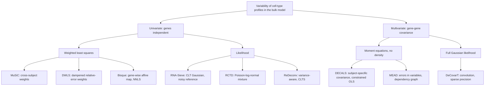

Figure 7: Deconvolution methods that model cell-type variability, split
by their treatment of gene-gene dependence and then by estimator. All
univariate methods assume independent genes; the multivariate ones
differ by whether they commit to a density.

### A common notation

Each paper uses its own indices; several use j for the gene or the
subject. [Table 3](#tbl-notation-map) maps them to this vignette. The
scale columns show how one model is reparametrised into another by
arithmetic alone.

|  | This vignette | `MuSiC` | `RNA-Sieve` | `DWLS` | `Bisque` | `RCTD` | `DECALS` | `MEAD` |
|----|----|----|----|----|----|----|----|----|
| gene, type, sample | g, j, i | g, k, j | g, k, b | i, j, – | j, k, i | j, k, i | j, k, i | g, k, i |
| reference unit | replicate r | subject j | cell i | cell | individual i' | cell | – | individual j |
| target | \boldsymbol{p}\_{\cdot i} | \mathbf{p}\_j | \boldsymbol{\alpha} | \mathbf{x}/\mathbf{1}^{\top}\mathbf{x} | \mathbf{p}\_i | \boldsymbol{\beta}\_i normalised | \boldsymbol{\pi}\_i | \mathbf{p}\_i |
| cell counts | m\_{ji}, n_i | m_j^{k}, m_j | –, n | \mathbf{x} | – | – | – | – |
| per-cell mean | \boldsymbol{\mu}\_{\cdot j}=S_j\boldsymbol{\theta}\_{\cdot j} | S^{k}\boldsymbol{\theta}^{k} | \mathbf{M}\_{\cdot k} | \mathbf{S}\_{\cdot j} | \mathbf{Z}\_{\cdot k}\approx\boldsymbol{\theta}\_{\cdot j} | normalised mean | \mathbf{w}\_k (FPKM) | \mathbf{U}\_{\cdot k} |
| cell size | S_j | S^{k} (mean library size) | \mathbf{1}^{\top}\mathbf{M}\_{\cdot k} | assumed equal | removed by CPM | removed | removed by FPKM | kept in \mathbf{U} |
| sample scale | a_i | C_j^{-1} | n | \mathbf{1}^{\top}\mathbf{x} | – | N_ie^{\alpha_i} | absorbed | \gamma_i |
| gene platform | \boldsymbol{d} | intercept \alpha\_{jg} | none | none | (\beta\_{0g},\beta_g) | estimated d_g | none | \lambda_g=\alpha_g/\alpha^{r}\_g |
| type variability | \boldsymbol{\Sigma}\_{W,j}, \boldsymbol{\Sigma}\_{B,j} | \sigma^{2}\_{gk} (between, diagonal) | s\_{g,k} (within, diagonal) | – | – | – | \boldsymbol{\Sigma}^{(k)} (between, full) | \mathbf{V}\_g (reference noise) |

Table 3: Notation of the reviewed methods mapped to this vignette.
“Removed” means the normalisation divides each cell or column by its
total, so that S_j no longer enters the mean.

Three reparametrisations recur.

- **Counts to fractions.** A model in cell counts,
  \boldsymbol{y}=\boldsymbol{\mu}\boldsymbol{m}, becomes a model in
  fractions by dividing by the expected number of cells,
  \boldsymbol{y}/n=\boldsymbol{\mu}\boldsymbol{p}. `RNA-Sieve` keeps n
  as a parameter; `DWLS` estimates \mathbf{x} (its “cell-type numbers”)
  and normalises at the end.
- **Total molecules to average cell size.** `MuSiC` equation (2) gives
  \sum_gX\_{jg}=m_j\sum_kp^{k}\_jS^{k}. Dividing by the number of cells
  m_j gives the average cell size of the sample, \bar
  S_i=\sum_jp\_{ji}S_j, and `MuSiC`’s normalising constant is its
  inverse: C_i=\bar S_i^{-1}. Library-size normalisation therefore
  returns RNA fractions q\_{ji}=p\_{ji}S_j/\bar S_i, not cell fractions.
- **Scale times composition.** `MEAD` estimates
  \boldsymbol{\beta}\_i=\gamma_i\boldsymbol{p}\_i and recovers
  \boldsymbol{p}\_i=\boldsymbol{\beta}\_i/\\\boldsymbol{\beta}\_i\\\_1;
  `RCTD` estimates w\_{ji}=p\_{ji}e^{\alpha_i} and normalises. Both are
  the unnormalised parametrisation \boldsymbol{w}\_{\cdot
  i}=a_i\boldsymbol{p}\_{\cdot i} of Strategy 1 (1), whose total
  identifies the sample scale.

### Univariate methods: genes independent

#### MuSiC

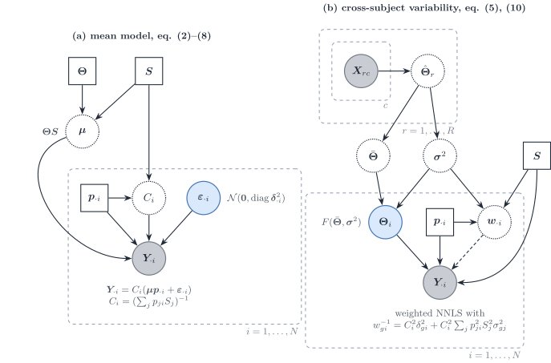

Figure 8: `MuSiC` ([Wang et al. 2019](#ref-wangBulkTissueCell2019)) in
this vignette’s notation. (a) The mean model: bulk relative abundance is
a cell-size-weighted mixture of relative profiles \boldsymbol{\Theta},
rescaled by C_i. (b) The multi-subject reference: subject-level relative
profiles \boldsymbol{\Theta}\_i vary around the cross-subject mean with
variance \boldsymbol{\sigma}^{2}, and the inverse of the resulting gene
variance weights a non-negative least squares fit.

`MuSiC` starts from molecules: the bulk of subject i holds
X\_{gi}=\sum_jm\_{ji}S_j\theta\_{gj}, with S_j the mean total molecules
per cell of type j (equation 2). It works on relative abundance
Y\_{gi}=X\_{gi}/\sum\_{g'}X\_{g'i}, so that, with the reparametrisation
above,

Y\_{gi}=C_i\Bigl(\sum_jp\_{ji}S_j\theta\_{gj}+\varepsilon\_{gi}\Bigr),
\qquad \operatorname{Var}(Y\_{gi}\mid\boldsymbol{p}\_{\cdot i})
=C_i^{2}\delta\_{gi}^{2}+C_i^{2}\sum_jp\_{ji}^{2}S_j^{2}\sigma^{2}\_{gj}
=w\_{gi}^{-1} \tag{30}

(equations 8–10). The second term comes from subject-level relative
profiles \theta\_{gj,i}\sim F(\theta\_{gj},\sigma^{2}\_{gj}) (assumption
A1): it is the **diagonal** of the between-replicate layer
\boldsymbol{S}\_B(\boldsymbol{p}), quadratic in p\_{ji}, and it requires
a multi-subject reference. Cross terms between types are dropped, which
implicitly assumes independence across types. \delta^{2}\_{gi} is the
bulk residual \boldsymbol{D}\_i. The within-type cell scatter
\boldsymbol{\Sigma}\_{W,j} has no term in [Eq. 30](#eq-music-variance);
it is used only to select genes with small within-cluster variance in
the tree-guided recursion. Estimation is weighted non-negative least
squares, with the weights updated from an initial fit because
\delta^{2}\_{gi} is unknown, followed by rescaling to the simplex.

**Scales and identifiability.** S_j is plugged in as the mean library
size of type j in the reference. That substitution returns cell
fractions only under assumption A3', a common capture efficiency \tilde
S_j/S_j across types ([Figure 4](#fig-music-assumptions)); otherwise
`MuSiC` estimates the RNA-weighted product p\_{ji}S_j. Under A1–A3 alone
the paper claims only the trend of proportions across subjects. Absolute
S_j is not needed: it cancels into C_i. A gene- and subject-specific
intercept \alpha\_{gi} absorbs protocol bias. `MuSiC2` keeps the weights
and removes genes that are differentially expressed between the
reference and bulk conditions ([Fan et al.
2022](#ref-fanMusic2CellTypeDeconvolution2022)).

#### RNA-Sieve

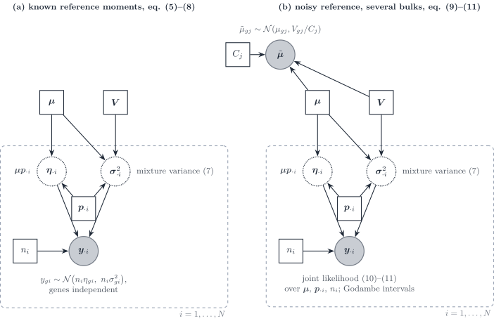

Figure 9: `RNA-Sieve` ([Erdmann-Pham et al.
2021](#ref-erdmann-phamLikelihoodbasedDeconvolutionBulk2021)). (a) With
known reference moments, the bulk is the sum of n_i cells drawn from the
cell mixture, with a central-limit Gaussian per gene whose variance is
the mixture variance. (b) The reference means are themselves noisy
averages of C_j cells; the joint likelihood over bulks and reference
means is maximised, with Godambe sandwich intervals.

`RNA-Sieve` writes the bulk as a sum of n cells, each a draw from the
cell mixture [Eq. 22](#eq-mixture-cell) restricted to one gene. By the
central limit theorem,

y\_{gi}\sim\mathcal{N}\bigl(n_i(\boldsymbol{\mu}\boldsymbol{p}\_{\cdot
i})\_g,\\ n_i\sigma^{2}\_{gi}\bigr), \qquad
\sigma^{2}\_{gi}=\sum_jp\_{ji}\bigl(V\_{gj}+\mu\_{gj}^{2}\bigr)-(\boldsymbol{\mu}\boldsymbol{p}\_{\cdot
i})\_g^{2}, \tag{31}

with genes independent (equations 5–8). The variance is **linear** in
n_i and in \boldsymbol{p}, minus the square of the mixture mean: the
within-type variance \sum_jp\_{ji}V\_{gj} plus the spread of the type
means, the diagonal of [Eq. 22](#eq-mixture-cell). The reference means
are noisy, \tilde\mu\_{gj}\sim\mathcal{N}(\mu\_{gj},V\_{gj}/C_j)
(equation 9), and are estimated jointly with (\boldsymbol{p}\_{\cdot
i},n_i) from all bulks (equations 10–11). Marginalising
\tilde{\boldsymbol{\mu}} instead would add \sum_jp\_{ji}^{2}V\_{gj}/C_j,
a quadratic errors-in-variables term that vanishes as the reference
grows (our remark).

**Scales.** Raw counts keep S_j inside \mathbf{M}, so
\boldsymbol{\alpha} are cell fractions; the optional rescaling of every
cell to the median library size removes S_j and turns them into RNA
fractions. Any global protocol difference is absorbed into n, which then
“loses interpretability” across protocols (Supplementary S1.4).
Intervals come from the observed Fisher information or, by default, from
the Godambe matrix, centred at the Kullback–Leibler projection under
misspecification. The paper notes that gene correlation “may be
incorporated” once it is known, but does not implement it.

#### DWLS

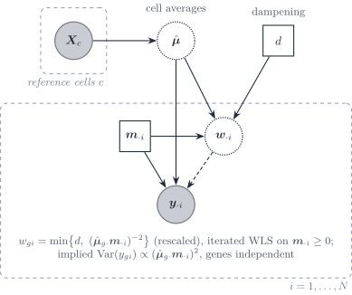

Figure 10: `DWLS` ([Tsoucas et al.
2019](#ref-tsoucasAccurateEstimationCelltype2019)). The signature is the
average of reference cells; the bulk is fitted in cell-type numbers
\boldsymbol{m}\_{\cdot i} by iterated weighted least squares, with
weights equal to the inverse squared fitted mean, capped by a dampening
constant d.

`DWLS` fits the cell-type numbers \mathbf{x}=\boldsymbol{m}\_{\cdot i}
by

\hat{\boldsymbol{m}}\_{\cdot i}
=\arg\min\_{\boldsymbol{m}\ge\boldsymbol{0}}\sum_g\bar
w\_{gi}\bigl(y\_{gi}-\hat{\boldsymbol{\mu}}\_{g\cdot}\boldsymbol{m}\bigr)^{2},
\qquad \bar w\_{gi}=\min\Bigl\\d,\\
\frac{(\hat{\boldsymbol{\mu}}\_{g\cdot}\hat{\boldsymbol{m}}\_{\cdot
i})^{-2}}{\min\_{g'}(\hat{\boldsymbol{\mu}}\_{g'\cdot}\hat{\boldsymbol{m}}\_{\cdot
i})^{-2}}\Bigr\\, \tag{32}

iterated from an ordinary least squares start, with d=2^{q} chosen to
minimise the variance of estimates over random half-gene subsets
(equations 6–15). The weights minimise relative rather than absolute
error. Read as a variance model, they imply
\operatorname{Var}(y\_{gi})\propto(\hat{\boldsymbol{\mu}}\_{g\cdot}\boldsymbol{m}\_{\cdot
i})^{2}, a constant coefficient of variation; the paper motivates the
weights by relative error and does not state a variance model. There is
no \boldsymbol{\Sigma}\_{W,j} term and genes are independent. The paper
states the equal-RNA-per-cell assumption under which \mathbf{x} are cell
numbers; otherwise they are RNA-weighted.

#### Bisque

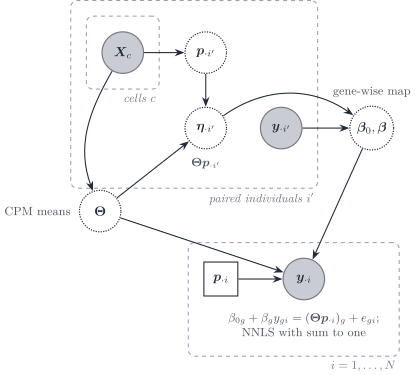

Figure 11: `Bisque` ([Jew et al.
2020](#ref-jewAccurateEstimationCell2020)), paired mode. For individuals
with both assays, the single-cell counts give a CPM signature
\boldsymbol{\Theta} and counted proportions, hence a pseudo-bulk; a
gene-wise linear map from observed bulk to pseudo-bulk is learned on
those pairs and applied to the remaining bulks before non-negative least
squares.

`Bisque` learns the platform shift instead of modelling it. In paired
mode it fits \eta\_{gi'}=\beta\_{0g}+\beta_gy\_{gi'}+\epsilon\_{gi'} per
gene, with \boldsymbol{\eta}\_{\cdot
i'}=\boldsymbol{\Theta}\boldsymbol{p}\_{\cdot i'} the pseudo-bulk of
individual i' (equation 1); in unpaired mode it matches the first two
moments of each gene across samples (equations 2–3). The transformed
bulk is then fitted by non-negative least squares with a sum-to-one
constraint. The fitting step has homoscedastic residuals; the
variability of the reference enters only through the between-sample
moments used in the map. Because \boldsymbol{\Theta} is built from CPM,
cell size is removed from the signature; the gene-wise affine map
absorbs gene and platform factors, not a type-specific S_j. In unpaired
mode the cohort mean composition is assumed equal to the mean
composition of the single-cell individuals.

#### RCTD and ReDeconv

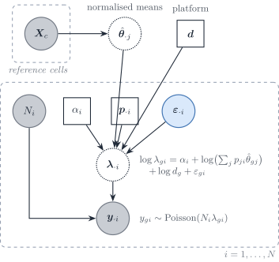

Figure 12: `RCTD` ([Cable et al.
2022](#ref-cableRobustDecompositionCell2022a)) in this vignette’s
notation. The reference is collapsed to fixed normalised means. Sample i
carries an observed depth N_i, a leftover scale \alpha_i, a composition
and a gene-wise overdispersion; the platform \boldsymbol{d} is shared
across samples and is not estimated inside the per-sample fit.

`RCTD` sits one layer below the DeCovarT plate of
[Figure 16](#fig-dag-three-layer). Each UMI is first assigned a type
with probability p\_{ji}, then a gene from that type’s relative profile:
a read-level **mixture**, not a convolution of random population vectors
([Cable et al. 2022](#ref-cableRobustDecompositionCell2022a)).
Conditional on the rate, the gene counts are Poisson; the rate is
log-normal around a linear mixture of the **fixed** means. In DeCovarT
symbols,

y\_{gi}\mid\lambda\_{gi} \sim \mathrm{Poisson}(N_i\lambda\_{gi}), \qquad
\log\lambda\_{gi} = \alpha_i + \log\Bigl(\sum_j p\_{ji}\mu\_{gj}\Bigr) +
\log d_g + \varepsilon\_{gi}, \tag{33}

with \varepsilon\_{gi} independent \mathcal{N}(0,\sigma\_\varepsilon^2)
(heavy-tailed in the implementation). The Poisson mean is therefore

\mathbb{E}\[y\_{gi}\mid\varepsilon\_{gi}\] = \underbrace{N_i
e^{\alpha_i}}\_{a_i} \\ d_g \\ e^{\varepsilon\_{gi}} \sum_j
p\_{ji}\mu\_{gj}. \tag{34}

N_i is observed depth; \alpha_i is a leftover sample scale; d_g is the
gene-wise platform that DeCovarT’s \boldsymbol{d} names. The diagonal
residual \varepsilon\_{gi} is technical plus unmodelled gene-wise
extra-Poisson noise, the count-scale cousin of
\boldsymbol{\Sigma}\_{\mathrm{obs},i}. Genes are independent given
\varepsilon. Because \boldsymbol{\mu}\_{\cdot j} is plugged in,
[Eq. 34](#eq-rctd-mean) is a mixture of rates. DeCovarT’s [the released
convolution](https://bastienchassagnol.github.io/DeCovarT/articles/theory-decovart-statistical-perspectives.html#eq-gaussian-convolution)
is a convolution of **random** type profiles: after averaging to a
continuous expression vector, the bulk is \sum_j
p\_{ji}\boldsymbol{Z}\_{ij} with \boldsymbol{Z}\_{ij} Gaussian, hence
quadratic in \boldsymbol{p}. A mixture is the right generative story at
the UMI; a convolution is the right story at the aligned population
mean.

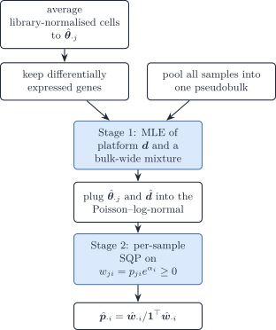

Figure 13: `RCTD` estimation. Stage 1 identifies the gene-wise platform
from a pseudobulk of all samples; stage 2 fits each sample by sequential
quadratic programming on the unnormalised weights
w\_{ji}=p\_{ji}e^{\alpha_i}.

The fit is two-stage for the same identifiability reason as
[Sec. 2.3](#sec-alignment): \boldsymbol{d} cannot be free inside one
sample. That is Strategy 4 in its purest form
([Sec. 6.4](#sec-strategy-plugin)).

**SQP versus second-order descent.** After stage 1, `RCTD` maximises a
non-convex Poisson–log-normal log-likelihood in the unnormalised weights
w\_{ji}=p\_{ji}e^{\alpha_i}, subject to w\ge 0 only (the simplex is
recovered by normalising). The local quadratic Taylor model of that
objective is a **constrained** quadratic programme. The Hessian is often
indefinite, so a plain Newton step is not a descent direction;
sequential quadratic programming keeps the positive-semidefinite part of
the Hessian (eigenvalue clipping) and solves the QP with `quadprog`, a
sequential convex programme in the sense of Duchi, reused from `DWLS`
([Tsoucas et al. 2019](#ref-tsoucasAccurateEstimationCelltype2019)).
Inequality constraints and doublet/triplet cardinality penalties
(active-set zeros) are native to that orthant formulation. DeCovarT
instead maps \boldsymbol{p} to an unconstrained ILR chart and uses an
analytic score and Hessian of a Gaussian convolution, with Marquardt
damping when the Hessian is poorly conditioned. That second-order path
is available because the observation is already an averaged, aligned
intensity and the simplex is handled by the chart rather than by w\ge 0.
It is the wrong local model for [Eq. 33](#eq-rctd-pln): the likelihood
is non-convex in w, the support is the non-negative orthant, and many
samples are expected to sit on a face.

`ReDeconv` uses a per-gene, per-type variance with linear weight
p\_{ji}, the diagonal of [Eq. 10](#eq-linear-within), together with CLTS
so that S_j is not normalised away ([Lu et al.
2025](#ref-luTranscriptomeSizeMatters2025)).

### Multivariate methods: gene–gene covariance

#### DECALS

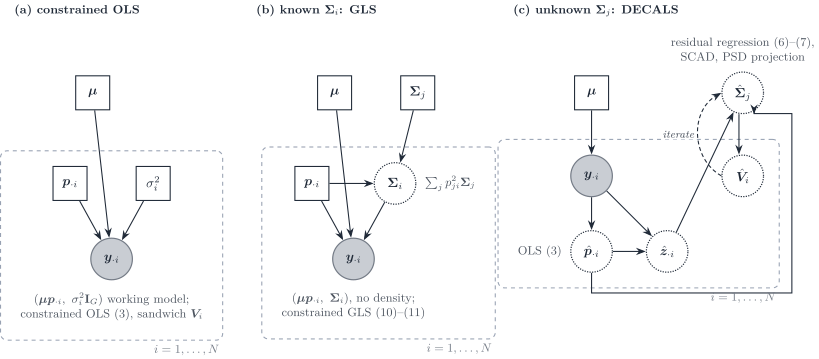

Figure 14: `DECALS` ([Cai et al.
2024](#ref-caiStatisticalInferenceCelltype2024)) as three increasingly
informed working models. (a) Constrained ordinary least squares with an
implicit identity covariance; the subject-specific covariance enters
only the sandwich variance. (b) Constrained generalised least squares
when \boldsymbol{\Sigma}\_i=\sum_jp\_{ji}^{2}\boldsymbol{\Sigma}\_j is
known. (c) `DECALS` proper: the type covariances are unknown and are
estimated from bulk residuals across samples, with a bias correction
iterated with the variance of \hat{\boldsymbol{p}}\_{\cdot i}; the point
estimate stays the OLS one.

`DECALS` makes no distributional assumption on the bulk. Its model
(equations 1–2, 5) is

\boldsymbol{y}\_{\cdot i}=\sum_jp\_{ji}\boldsymbol{x}^{(j)}\_i
=\boldsymbol{\mu}\boldsymbol{p}\_{\cdot i}+\boldsymbol{\epsilon}\_i,
\qquad
\operatorname{Cov}(\boldsymbol{\epsilon}\_i)=\boldsymbol{\Sigma}\_i=\sum_jp\_{ji}^{2}\boldsymbol{\Sigma}^{(j)},
\tag{35}

with subject-level type profiles \boldsymbol{x}^{(j)}\_i independent
across types: exactly the quadratic layer
\boldsymbol{S}\_B(\boldsymbol{p}) and released DeCovarT’s covariance,
without a density. The three panels of [Figure 14](#fig-dag-decals) are
the paper’s three estimators.

1.  **Constrained OLS** (equation 3) is the point estimator. For a large
    number of genes the inequality constraints are inactive and the
    estimator is the equality-constrained projection
    \hat{\boldsymbol{p}}=\mathbf{U}\tilde{\boldsymbol{p}} of the OLS
    solution (Lemma S1). Its asymptotic covariance is the sandwich
    \boldsymbol{V}\_i=\mathbf{U}\mathbf{D}\mathbf{U}^{\top} with
    \mathbf{D}=(\tfrac1G\boldsymbol{\mu}^{\top}\boldsymbol{\mu})^{-1}\tfrac1G\boldsymbol{\mu}^{\top}\boldsymbol{\Sigma}\_i\boldsymbol{\mu}(\tfrac1G\boldsymbol{\mu}^{\top}\boldsymbol{\mu})^{-1}.
2.  **Constrained GLS** with known \boldsymbol{\Sigma}\_i (equations
    10–11) is more efficient. The authors reject it once
    \boldsymbol{\Sigma}\_i is estimated: the per-sample inverse square
    root is too noisy, and the coverage of GLS with an estimated
    covariance falls to about 0.65–0.8 in their simulations.
3.  **Unknown \boldsymbol{\Sigma}^{(j)}.** Because
    \mathbb{E}\[z\_{gi}z\_{hi}\]=\sum_jp\_{ji}^{2}\Sigma^{(j)}\_{gh},
    the residual outer products are regressed on the squared proportions
    across the N samples,
    \hat{\boldsymbol{b}}\_{gh}=(\hat{\mathbf{H}}^{\top}\hat{\mathbf{H}})^{-1}\hat{\mathbf{H}}^{\top}(\hat{\boldsymbol{z}}\_g\circ\hat{\boldsymbol{z}}\_h)
    with \hat{\mathbf{H}}=\[\hat p\_{ji}^{2}\] (equation 6), a
    regression first proposed for known proportions by CSNet. Replacing
    \mathbf{H} by \hat{\mathbf{H}} deflates the estimate; Proposition 1
    gives the bias terms \mathbf{B}\_1,\mathbf{B}\_2 under a Gaussian
    approximation of \hat{\boldsymbol{p}}, and the corrected estimator
    (equation 7) is iterated with \boldsymbol{V}\_i, then thresholded by
    SCAD and projected onto the positive semidefinite cone.

**Asymptotics.** Genes are the statistical units: Theorem 1 gives
\sqrt{G}(\hat{\boldsymbol{p}}\_{\cdot i}-\boldsymbol{p}\_{\cdot
i})\to\mathcal{N}(\boldsymbol{0},\boldsymbol{V}\_i) as G\to\infty for
one sample, under sub-exponential errors, a dependency graph of bounded
degree among genes, and p\_{ji}\>0 for all types. On a face of the
simplex the limit law is not derived. With dense gene correlation the
authors report that coverage collapses to about 0.65: the central limit
theorem over genes fails when dependence is not sparse. The paper gives
no consistency theorem for \hat{\boldsymbol{\Sigma}}^{(j)}.

#### MEAD

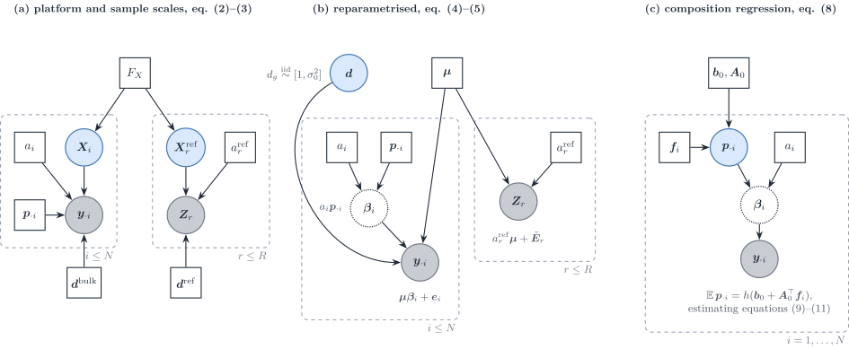

Figure 15: `MEAD` ([Xie et al.
2026](#ref-xieStatisticalInferenceCell2026)) in this vignette’s notation
(a_i=\gamma_i, \boldsymbol{d}=\boldsymbol{\alpha},
\boldsymbol{\mu}=\mathbf{U}, replicate r = reference individual j of the
paper). (a) Bulk and reference share the population law F_X of the type
profiles but have their own sample scales and gene-wise platform
factors. (b) After reparametrisation only the ratio
d_g=\alpha_g/\alpha^{r}\_g remains, treated as random noise around one,
and the bulk mean is \boldsymbol{\mu}\boldsymbol{\beta}\_i with
\boldsymbol{\beta}\_i=a_i\boldsymbol{p}\_{\cdot i}. (c) Across
individuals, the composition is regressed on covariates.

`MEAD` is the multivariate errors-in-variables method. Its successive
models ([Figure 15](#fig-dag-mead)) are:

- **Scales** (equations 2–3). The bulk is
  \boldsymbol{y}\_i=\gamma_i\operatorname{diag}(\boldsymbol{\alpha})\mathbf{X}\_i\boldsymbol{p}\_i+\boldsymbol{\epsilon}\_i
  and each reference individual is
  \mathbf{Z}^{r}\_j=\gamma^{r}\_j\operatorname{diag}(\boldsymbol{\alpha}^{r})\mathbf{X}^{r}\_j+\mathbf{E}^{r}\_j,
  with \mathbf{X}\_i and \mathbf{X}^{r}\_j drawn from one population law
  (assumption 1). \gamma_i captures sequencing depth and tissue size;
  \boldsymbol{\alpha} captures gene length and GC content. The reference
  scale is **one scalar per reference individual**, shared by all its
  cell types; cell efficiencies \gamma^{r}\_{jc} vary around it
  (Supplementary S2.1). The authors deliberately avoid per-cell
  library-size normalisation so as to keep cell size in \mathbf{U}.

- **Reparametrisation** (equations 4–5). Only
  \lambda_g=\alpha_g/\alpha^{r}\_g is identified, and assumption 3
  treats it as random noise,
  \lambda_g\overset{\text{iid}}{\sim}\[1,\sigma_0^{2}\], independent of
  \mathbf{U}. The model becomes
  \boldsymbol{y}\_i=\mathbf{U}\boldsymbol{\beta}\_i+\boldsymbol{e}\_i
  with \boldsymbol{\beta}\_i=\gamma_i\boldsymbol{p}\_i and
  \boldsymbol{e}\_i=(\boldsymbol{\Lambda}-\mathbf{I})\mathbf{U}\boldsymbol{\beta}\_i+\boldsymbol{\epsilon}'\_i.
  The platform ratio is not estimated; it inflates the variance and
  makes the \boldsymbol{e}\_i dependent across samples.

- **One sample.** With \hat\gamma_j=\sum\_{k,g}z^{r}\_{jgk}/(KG) (a
  plug-in from the reference alone, using the scaling constraint of
  assumption 2), \hat{\boldsymbol{\mu}}\_g the average of
  \boldsymbol{z}^{r}\_{jg}/\hat\gamma_j and \hat{\mathbf{V}}\_g its
  covariance across reference individuals, the bias-corrected estimating
  equation

  \hat{\mathbf{U}}^{\top}\mathbf{W}\boldsymbol{y}\_i-\bigl(\hat{\mathbf{U}}^{\top}\mathbf{W}\hat{\mathbf{U}}-\hat{\mathbf{V}}\bigr)\boldsymbol{\beta}\_i=\boldsymbol{0},
  \qquad \hat{\mathbf{V}}=\sum_gw_g\hat{\mathbf{V}}\_g, \tag{36}

  removes the attenuation caused by a noisy design (equation 6).
  Non-negativity is imposed by truncation or constrained optimisation,
  and
  \hat{\boldsymbol{p}}\_i=\hat{\boldsymbol{\beta}}\_i/\\\hat{\boldsymbol{\beta}}\_i\\\_1.

- **Several samples** (section 5). The composition is regressed on
  covariates,
  \mathbb{E}\[\boldsymbol{p}\_i\]=h(\boldsymbol{b}\_0+\mathbf{A}\_0^{\top}\boldsymbol{f}\_i),
  with \hat{\boldsymbol{p}}\_i plugged into the estimating equation
  (11).

- **Gene–gene dependence.** Dependence is **global**, not type specific:
  a dependency graph over genes enters only the sandwich covariance
  \hat{\boldsymbol{\Sigma}}\_i through the set \mathcal{A} of dependent
  gene pairs. \mathcal{A} is estimated from the correlation of the bulk
  samples by a multiple test, because “reference data often lack
  sufficient samples to estimate cell-type-specific gene correlations”;
  cross-validation folds keep correlated genes together.

- **Weights from biological variation.** `MuSiC`’s weights use the
  residual variance of the target bulk, which “can severely bias” the
  estimating equation. `MEAD` uses only the reference:
  s_g^{2}=\mathbf{1}^{\top}\hat{\mathbf{V}}\_g\mathbf{1}, shrunk across
  genes by variance adaptive shrinkage, and w_g=1/\tilde s_g^{2}. The
  weights are independent of the bulk being deconvolved.

**Identifiability** (Theorem 1). With \operatorname{rank}(\mathbf{P})=K,
the proportions are identifiable if and only if \mathbf{U} has full rank
and, for every partition of the genes into t\ge 2 blocks, the ranks of
the blocks of \mathbf{U} add to more than K. **Perfect marker genes**
violate the condition: if each gene is expressed in one type only,
rescaling the gene ratios of the type-k markers by 1/\delta_k, the
proportions to \tilde p\_{ik}=\delta_kp\_{ik}/\sum_l\delta_lp\_{il} and
the scale to \tilde\gamma_i=\gamma_i\sum_l\delta_lp\_{il} leaves the
bulk mean unchanged, for any \delta. A gene-specific platform factor can
then mimic a type-specific size factor, and more bulk samples do not
help. The same rescaling is what a type-specific capture efficiency does
(Supplementary Remark S1), and it is the q versus p ambiguity of
[Sec. 2.3](#sec-alignment). Assumption 3 restores identification in
model (5) because a \lambda_g that depends on the type of its marker is
no longer independent of \mathbf{U} (our reading of the counterexample).

**Asymptotics and slow regimes.** The regime is G\to\infty with the
number of reference individuals fixed. Theorems 2–3 give consistency of
\hat\gamma_j at rate G^{-1/2} and
\sqrt{G}(\hat{\boldsymbol{p}}\_i-\boldsymbol{p}\_i)\to\mathcal{N}\bigl(\boldsymbol{0},\nabla
g\\\boldsymbol{\Omega}^{-1}\boldsymbol{\Sigma}\_i\boldsymbol{\Omega}^{-1}\nabla
g^{\top}\bigr) when every p\_{ik}\>0, under an “almost sparse”
dependency graph (o(\sqrt G) genes may be arbitrarily dependent). Here
\boldsymbol{\Omega}=\lim\tfrac1G\mathbf{U}^{\top}\mathbf{W}\mathbf{U} is
a Gram limit, not a precision matrix. Four regimes are slow or fragile:

1.  the reference-noise term of \boldsymbol{\Sigma}\_i does not shrink
    relative to the bulk term while the number of reference individuals
    stays fixed;
2.  collinear cell types inflate \boldsymbol{\Omega}^{-1};
3.  at the boundary (p\_{ik}=0) the normal limit does not hold, and the
    softplus device that smooths it is inconsistent for finite tuning;
4.  the composition regression carries a bias of order G^{-1/2}, so
    naive inference under-covers unless N=o(G) (or N=o(G^{2}) under the
    global null; Theorem 4 and Remark S3).

`DECALS` reports that `MEAD` underestimates variances because its
sandwich does not consistently estimate the subject-specific covariance.

### DeCovarT and its three-layer extension

Figure 16: DeCovarT. (a) Released model: plug-in type moments and a
quadratic convolution. (b) Three-layer extension: the replicate plate
supplies \boldsymbol{\Sigma}\_{B,j} and \boldsymbol{\Sigma}\_{W,j}; the
bulk plate carries a_i, \kappa_i, \boldsymbol{p}\_{\cdot i} and a
diagonal residual \boldsymbol{D}\_i.

|  | Design error | Bulk law | Weight of type covariance | Scale | Estimator |
|----|----|----|----|----|----|
| `RNA-Sieve` | Yes, gene-wise | Asymptotic normal, genes separate | Variance, not a precision matrix | Relative rescaling | Maximum likelihood, asymptotic regions |
| `MEAD` | Yes, multivariate | Moment conditions, not a full density | Gene–gene correlation retained | a_i and \boldsymbol{d}, with identifiability conditions | Errors-in-variables estimator, delta-method intervals |
| `DECALS` | Through \boldsymbol{\Sigma}\_i(\boldsymbol{p}) | None | Subject-specific \boldsymbol{\Sigma}\_i built from cell-type blocks | Absorbed before regression | Constrained least squares, asymptotic covariance |
| `RCTD` | No, \boldsymbol{\mu} plugged in | Poisson–log-normal **mixture** of reads, genes independent given \varepsilon | None | N_i known, \alpha_i and \boldsymbol{d} | Two-stage MLE; SQP on w\ge 0 |
| `ReDeconv` | No | Univariate parametric, pointwise | Linear in p\_{ji} | CLTS keeps S_j | Variance-aware regression |
| DeCovarT now | No | Sparse multivariate normal, pointwise **convolution** | Quadratic in p\_{ji} | a_i profiled, S_j not in the likelihood | Constrained MLE on the ILR chart |
| DeCovarT in [Eq. 13](#eq-three-layer) | Only via \boldsymbol{\Sigma}\_{W,j}/C\_{jr} | Same normal family | Quadratic \boldsymbol{\Sigma}\_{B,j} plus linear \boldsymbol{\Sigma}\_{W,j} plus diagonal \boldsymbol{\Sigma}\_{\mathrm{obs},i} | a_i outside, S_j in the mean | Constrained maximum likelihood |

`RNA-Sieve` and DeCovarT both obtain a normal bulk from a sum of random
contributions. `RNA-Sieve` sums **cells** (linear variances, central
limit, gene by gene). DeCovarT convolves **population profiles**
(quadratic covariances, exact Gaussian, sparse precision). `MEAD` keeps
the multivariate second-moment structure that `RNA-Sieve` drops, and
adds the platform scales. `DECALS` wants the same subject-specific
covariance but will not commit to a density; the price is a
least-squares point estimate whose efficiency depends on how well
\boldsymbol{\Sigma}\_i is estimated. `ReDeconv` is the univariate,
mixture-weighted cousin of the linear term in [Eq. 13](#eq-three-layer).
`RCTD` is a **read-level mixture** with a Poisson–log-normal margin:
each molecule comes from one type, \boldsymbol{\mu}\_{\cdot j} is fixed,
and extra-Poisson noise is gene-wise rather than a type-level
\boldsymbol{\Sigma}\_j.

The practical fork is the reference design, not a choice of optimiser.

- **R=1.** Fit [Eq. 10](#eq-linear-within). Report
  \boldsymbol{q}\_{\cdot i} unless S_j is known, in which case apply the
  [RNA-to-cell
  correction](https://bastienchassagnol.github.io/DeCovarT/articles/theory-decovart-statistical-perspectives.html#eq-rna-to-cell)
  or insert S_j in [Eq. 14](#eq-music-mean). Do not publish
  \boldsymbol{\Sigma}\_{W,j} as a DeCovarT \boldsymbol{\Sigma}\_j.
  `RCTD`’s plugged-in \boldsymbol{\mu}\_{\cdot j} is this regime’s mean;
  its Poisson–log-normal is an alternative observation law for the same
  R=1 design, not a substitute for \boldsymbol{\Sigma}\_{B,j}.
- **R\ge 2 with a sparse or low-rank between-replicate precision.** Fit
  [Eq. 13](#eq-three-layer). The original quadratic term is then
  \boldsymbol{\Sigma}\_{B,j} and has a sampling interpretation.
  \boldsymbol{\Sigma}\_{\mathrm{obs},i} stays diagonal.

## Four strategies to align a single-cell reference with bulk

[Figure 1](#fig-four-strategies) is the map of the strategies.
Strategies 1–3 differ by the scale on which the bulk is observed, and
estimate every scale jointly with the composition. Strategy 4 keeps one
of those likelihoods but estimates the technical and biological scales
first, from other data, and plugs them in. The reviewed methods sit on
these branches as follows: `RNA-Sieve` and `DWLS` estimate counts or a
cell number (Strategy 1); `DECALS`, `MEAD` and DeCovarT estimate a
composition with a nuisance scale (Strategy 2); `MuSiC`, `Bisque` and
`DECALS` work on library-normalised or FPKM bulk (Strategy 3); and
`MuSiC`’s S_j, `RCTD`’s platform, `Bisque`’s map and `MEAD`’s reference
scale are plug-ins (Strategy 4).

### Strategy 1: cell-count convolution

The first formulation keeps the bulk on an absolute molecule scale and
asks how many cells of each type it contains. It is the cell-level
reading of `MuSiC`’s equation (2), X\_{jg}=\sum_k
m\_{kj}S\_{kj}\theta\_{kjg}, where m\_{kj} is the number of cells of
type k in subject j ([Wang et al. 2019](#ref-wangBulkTissueCell2019)).
With \boldsymbol{\mu}\_{\cdot j}=S_j\boldsymbol{\theta}\_{\cdot j} the
mean below is exactly that identity before `MuSiC` divides by the
library total. The estimand is \boldsymbol{m}\_{\cdot
i}\in\mathbb{N}^{J}, proportions follow by division, and no simplex
constraint is imposed.

#### Layer 1: independent cells, linear covariance

Assume one single-cell replicate (R=1) and, conditional on the counts,
independent cells

\boldsymbol{X}\_{jic}\overset{\text{i.i.d.}}{\sim}
\mathcal{N}\_G(\boldsymbol{\mu}\_{\cdot j},\boldsymbol{\Sigma}\_{W,j}),
\qquad c=1,\ldots,m\_{ji}, \tag{37}

independent across types. The bulk is the physical sum

\boldsymbol{y}\_{\cdot i} =\sum\_{j=1}^{J}\boldsymbol{T}\_{ji}
=\sum\_{j=1}^{J}\sum\_{c=1}^{m\_{ji}}\boldsymbol{X}\_{jic}. \tag{38}

Applying [Eq. 19](#eq-master-identity) with
\boldsymbol{C}\_{rs}=\boldsymbol{0} inside each type and independence
across types,

\boldsymbol{y}\_{\cdot i}\mid\boldsymbol{m}\_{\cdot i}
\sim\mathcal{N}\_G\Bigl( \boldsymbol{\mu}\boldsymbol{m}\_{\cdot i},\\
\boldsymbol{S}\_W(\boldsymbol{m}\_{\cdot i}) \Bigr), \qquad
\boldsymbol{S}\_W(\boldsymbol{m}\_{\cdot i})=\sum_j
m\_{ji}\boldsymbol{\Sigma}\_{W,j}. \tag{39}

Each term has one meaning. \boldsymbol{\mu}\boldsymbol{m}\_{\cdot i} is
the expected molecule count of a tissue made of m\_{ji} average cells of
each type. m\_{ji}\boldsymbol{\Sigma}\_{W,j} is the accumulated
cell-to-cell scatter of type j: independent deviations add, so the
weight is linear. There is no \boldsymbol{\Sigma}\_{B,j} because one
replicate cannot identify it. The law is exact under Gaussian cells.
Under non-Gaussian cells it is the central-limit approximation of
`RNA-Sieve`, applied here to the full vector rather than gene by gene
([Erdmann-Pham et al.
2021](#ref-erdmann-phamLikelihoodbasedDeconvolutionBulk2021)).

Treat \boldsymbol{m}\_{\cdot i} as a point of (0,\infty)^{J} for the
moment. The tuple of [Theorem 1](#thm-score-general) is

\boldsymbol{\mu}\_k=\boldsymbol{\mu}\_{\cdot k}, \qquad
\boldsymbol{\Sigma}\_k=\boldsymbol{\Sigma}\_{W,k}, \qquad
\boldsymbol{\mu}\_{kl}=\boldsymbol{0}, \qquad
\boldsymbol{\Sigma}\_{kl}=\boldsymbol{0}. \tag{40}

**Theorem 2 (Score, Hessian and information for cell counts)** With
\boldsymbol{\Omega}=\boldsymbol{S}\_W(\boldsymbol{m})^{-1} and
\boldsymbol{r}=\boldsymbol{y}-\boldsymbol{\mu}\boldsymbol{m},

\frac{\partial\ell}{\partial m_k}
=-\tfrac12\\\mathrm{tr}(\boldsymbol{\Omega}\boldsymbol{\Sigma}\_{W,k})
+\boldsymbol{\mu}\_{\cdot k}^{\top}\boldsymbol{\Omega}\boldsymbol{r}
+\tfrac12\\\boldsymbol{r}^{\top}\boldsymbol{\Omega}\boldsymbol{\Sigma}\_{W,k}\boldsymbol{\Omega}\boldsymbol{r},
\tag{41}

\frac{\partial^{2}\ell}{\partial m_k\partial m_l}
=\tfrac12\\\mathrm{tr}(\boldsymbol{\Omega}\boldsymbol{\Sigma}\_{W,k}\boldsymbol{\Omega}\boldsymbol{\Sigma}\_{W,l})
-\boldsymbol{\mu}\_{\cdot
k}^{\top}\boldsymbol{\Omega}\boldsymbol{\mu}\_{\cdot l}
-\boldsymbol{\mu}\_{\cdot
k}^{\top}\boldsymbol{\Omega}\boldsymbol{\Sigma}\_{W,l}\boldsymbol{\Omega}\boldsymbol{r}
-\boldsymbol{\mu}\_{\cdot
l}^{\top}\boldsymbol{\Omega}\boldsymbol{\Sigma}\_{W,k}\boldsymbol{\Omega}\boldsymbol{r}
-\boldsymbol{r}^{\top}\boldsymbol{\Omega}\boldsymbol{\Sigma}\_{W,k}\boldsymbol{\Omega}\boldsymbol{\Sigma}\_{W,l}\boldsymbol{\Omega}\boldsymbol{r},
\tag{42}

I(\boldsymbol{m})\_{kl} =\boldsymbol{\mu}\_{\cdot
k}^{\top}\boldsymbol{\Omega}\boldsymbol{\mu}\_{\cdot l}
+\tfrac12\\\mathrm{tr}(\boldsymbol{\Omega}\boldsymbol{\Sigma}\_{W,k}\boldsymbol{\Omega}\boldsymbol{\Sigma}\_{W,l}).
\tag{43}

Compared with released DeCovarT the Hessian loses two terms, because
\boldsymbol{\Sigma}(\boldsymbol{m}) is **linear** in the parameter:
there is no \mathrm{tr}(\boldsymbol{\Omega}\boldsymbol{\Sigma}\_{kl})
and no second residual quadratic. The covariance derivative is a
constant matrix, so one Cholesky factorisation of
\boldsymbol{S}\_W(\boldsymbol{m}) per iteration serves objective, score
and Hessian, as in
[`.sigma_p_factorisation()`](https://bastienchassagnol.github.io/DeCovarT/articles/theory-decovart-generative-model.html#sec-numerical-speedups).

Proportions and their uncertainty follow by the delta method. With \hat
n=\mathbf{1}^{\top}\hat{\boldsymbol{m}} and
\hat{\boldsymbol{p}}=\hat{\boldsymbol{m}}/\hat n,

\frac{\partial\boldsymbol{p}}{\partial\boldsymbol{m}^{\top}}
=\frac{1}{n}\bigl(\mathbf{I}\_J-\boldsymbol{p}\mathbf{1}^{\top}\bigr),
\qquad \operatorname{Var}(\hat{\boldsymbol{p}}) \approx\frac{1}{n^{2}}
\bigl(\mathbf{I}\_J-\boldsymbol{p}\mathbf{1}^{\top}\bigr)
I(\boldsymbol{m})^{-1}
\bigl(\mathbf{I}\_J-\boldsymbol{p}\mathbf{1}^{\top}\bigr)^{\top}.
\tag{44}

That covariance is singular along \mathbf{1}, as it must be for a
composition, without any log-ratio chart. A type with \hat m\_{ji}=0 is
an ordinary point of the parameter space, not a boundary of a logarithm;
the structural-zero machinery of the [derivatives
vignette](https://bastienchassagnol.github.io/DeCovarT/articles/theory-decovart-generative-model.html#sec-structural-zeros)
is not needed here.

> **Important 4: Where the GRN precision goes**
>
> The reproducibility book estimates one sparse precision per type from
> single cells and exports \\\hat{\boldsymbol{\mu}}\_{\cdot
> j},\hat{\boldsymbol{\Sigma}}\_j,\hat{\boldsymbol{\Omega}}\_j\\ on the
> linear count scale ([GGM
> chapter](https://github.com/bastienchassagnol/DeCovarT_reproducibility/blob/main/docs/02-grn-graphical-lasso.qmd)).
> The rows of that Gaussian table are **cells** from one experiment, so
> the estimate is (\boldsymbol{\mu}\_{\cdot
> j},\boldsymbol{\Sigma}\_{W,j},\boldsymbol{\Omega}\_{W,j}), not a
> population-profile covariance. Its slot is the linear term
> m\_{ji}\boldsymbol{\Sigma}\_{W,j} of [Eq. 39](#eq-cc-law), and the
> per-cell average of C_j such cells has covariance
> \boldsymbol{\Sigma}\_{W,j}/C_j and precision
> C_j\boldsymbol{\Omega}\_{W,j}: the zero pattern survives averaging.
> The precision of the **sum** \boldsymbol{S}\_W(\boldsymbol{m}) is
> dense in general even when every \boldsymbol{\Omega}\_{W,j} is sparse.
> The structure-aware backends of the derivatives vignette act on
> \boldsymbol{\Sigma}, not on \boldsymbol{\Omega}, so a dense Cholesky
> is the default here unless the \boldsymbol{\Sigma}\_{W,j} share a
> block or low-rank structure.

#### Layer 2: counts are non-negative integers

m\_{ji}\in\\0,1,2,\ldots\\, so the likelihood is a function on the
lattice \mathbb{N}^{J} and [Eq. 41](#eq-cc-score) is the score of its
continuous relaxation. Three facts make the relaxation usable.

1.  The Gaussian law [Eq. 39](#eq-cc-law) is well defined on the whole
    lattice: \boldsymbol{S}\_W(\boldsymbol{m}) is positive definite as
    soon as one m\_{ji}\>0 and every \boldsymbol{\Sigma}\_{W,j} is
    positive definite. Zero counts cost nothing.
2.  For abundant types the lattice spacing is one cell out of thousands;
    rounding the relaxed maximiser changes \log-likelihood by O(1/n_i)
    relative terms.
3.  For rare types (m\_{ji}\le 5) the covariance changes in visible
    steps, and the relaxed optimum can sit between integers. A local
    lattice search over the 3^{J'} neighbours \\\lfloor\hat
    m\rfloor-1,\lfloor\hat m\rfloor,\lceil\hat m\rceil\\ of the J' small
    coordinates is cheap because each candidate needs one Cholesky.
    Branch-and-bound on the concave relaxation is the exact alternative.

A soft version keeps the Gaussian observation law and adds a count
prior, m\_{ji}\sim\mathrm{Poisson}(n_i\pi\_{ji}) or a multinomial over
types, and maximises the posterior over the lattice. The observation
model stays in the Gaussian regime; only the parameter space becomes
discrete.

#### Layer 3: a sample-wide capture scale

Bulk and reference are measured on different platforms. Let a_i\>0 be
the sample-wide ratio of molecule capture between the bulk library and
the reference cells, shared by all genes. The whole realised signal is
amplified,

\boldsymbol{y}\_{\cdot i}
=a_i\sum_j\sum\_{c=1}^{m\_{ji}}\boldsymbol{X}\_{jic}, \qquad
\boldsymbol{y}\_{\cdot i}\mid\boldsymbol{m}\_{\cdot i},a_i
\sim\mathcal{N}\_G\Bigl( a_i\boldsymbol{\mu}\boldsymbol{m}\_{\cdot i},\\
a_i^{2}\boldsymbol{S}\_W(\boldsymbol{m}\_{\cdot i}) \Bigr). \tag{45}

The two scalings of [Sec. 3](#sec-one-formula) appear side by side:
m\_{ji} enters linearly because m\_{ji} independent cells are convolved;
a_i enters squared because one realised fluctuation is amplified a_i
times. Reparametrise to effective counts \boldsymbol{w}\_{\cdot
i}=a_i\boldsymbol{m}\_{\cdot i}:

\boldsymbol{y}\_{\cdot i}\mid\boldsymbol{w}\_{\cdot i},a_i
\sim\mathcal{N}\_G\Bigl( \boldsymbol{\mu}\boldsymbol{w}\_{\cdot i},\\
a_i\boldsymbol{S}\_W(\boldsymbol{w}\_{\cdot i}) \Bigr). \tag{46}

The mean identifies \boldsymbol{w}\_{\cdot i} alone; the covariance
magnitude then identifies a_i, and \boldsymbol{m}\_{\cdot
i}=\boldsymbol{w}\_{\cdot i}/a_i. That is the route by which `RNA-Sieve`
infers its total cell number n: the variance of a sum of n cells grows
like n while the mean grows like n too, so their ratio pins the count
([Erdmann-Pham et al.
2021](#ref-erdmann-phamLikelihoodbasedDeconvolutionBulk2021)). Its
supplement states the caveat that applies here as well: n is physically
meaningful within one protocol, or when relative amplification factors
are known, and loses that meaning when the cross-protocol scale is
unknown. In [Eq. 46](#eq-cc-w-law) the same caveat reads: a_i is
identified only if \boldsymbol{\Sigma}\_{W,j} is on the molecule scale
of the reference cells, which is where the GRN estimates of
[Note 4](#nte-sparse-precision-slot) live.

In the (\boldsymbol{w},a) chart the tuple is

\boldsymbol{\mu}\_{w_k}=\boldsymbol{\mu}\_{\cdot k},\quad
\boldsymbol{\mu}\_{a}=\boldsymbol{0},\quad
\boldsymbol{\Sigma}\_{w_k}=a\boldsymbol{\Sigma}\_{W,k},\quad
\boldsymbol{\Sigma}\_{a}=\boldsymbol{S}\_W(\boldsymbol{w}),\quad
\boldsymbol{\Sigma}\_{w_ka}=\boldsymbol{\Sigma}\_{W,k},\quad
\boldsymbol{\Sigma}\_{w_kw_l}=\boldsymbol{\Sigma}\_{aa}=\boldsymbol{0},
\tag{47}

and all \boldsymbol{\mu}\_{kl}=\boldsymbol{0}. The scale score is

\frac{\partial\ell}{\partial a}
=-\tfrac12\\\mathrm{tr}\bigl(\boldsymbol{\Omega}\boldsymbol{S}\_W(\boldsymbol{w})\bigr)
+\tfrac12\\\boldsymbol{r}^{\top}\boldsymbol{\Omega}\boldsymbol{S}\_W(\boldsymbol{w})\boldsymbol{\Omega}\boldsymbol{r}
=\frac{1}{2a}\bigl(\boldsymbol{r}^{\top}\boldsymbol{\Omega}\boldsymbol{r}-G\bigr),
\tag{48}

because
\boldsymbol{\Omega}\boldsymbol{S}\_W(\boldsymbol{w})=a^{-1}\mathbf{I}\_G
when \boldsymbol{D}\_i=\boldsymbol{0}. Setting it to zero gives the
closed form \hat
a=\boldsymbol{r}^{\top}\boldsymbol{S}\_W(\boldsymbol{w})^{-1}\boldsymbol{r}/G
at fixed \boldsymbol{w}: the scale is the mean squared Mahalanobis
residual, and it can be profiled out. The Fisher block for a is
I\_{aa}=G/(2a^{2}), the usual variance-parameter information, so the
relative standard error of \hat a is \sqrt{2/G}. With G in the hundreds
that is a few percent, which is the “fairly weak dependence” `RNA-Sieve`
reports for n.

#### Layer 4: diagonal bulk measurement noise

Add technical bulk noise that is independent across genes,

\boldsymbol{y}\_{\cdot i}
=a_i\sum_j\boldsymbol{T}\_{ji}+\boldsymbol{\epsilon}\_i, \qquad
\boldsymbol{\epsilon}\_i\sim\mathcal{N}\_G(\boldsymbol{0},\boldsymbol{D}\_i),
\qquad \boldsymbol{\Sigma}(\boldsymbol{w},a,\boldsymbol{\tau}^{2})
=a\boldsymbol{S}\_W(\boldsymbol{w})+\boldsymbol{D}\_i . \tag{49}

\boldsymbol{D}\_i is diagonal by construction: gene to gene correlation
is already carried by the \boldsymbol{\Sigma}\_{W,j}, and an
off-diagonal residual would count the network twice ([perspectives,
three-layer law](#sec-enough-replicates)). The new derivatives are
\boldsymbol{\Sigma}\_{\tau_g^{2}}=\boldsymbol{e}\_g\boldsymbol{e}\_g^{\top}
and all second derivatives involving \boldsymbol{\tau}^{2} vanish, so

\frac{\partial\ell}{\partial\tau_g^{2}}
=-\tfrac12\\\Omega\_{gg}+\tfrac12\\(\boldsymbol{\Omega}\boldsymbol{r})\_g^{2}.
\tag{50}

The closed form of [Eq. 48](#eq-cc-score-a) no longer holds, because
\boldsymbol{\Omega}\boldsymbol{S}\_W is not a multiple of the identity.
Identifiability now rests on structure rather than on magnitude: a_i
inflates every entry of a_i\boldsymbol{S}\_W(\boldsymbol{w}),
\boldsymbol{D}\_i inflates the diagonal only. The **off-diagonal**
entries of the bulk covariance, which are the gene network, identify
a_i; the diagonal then identifies \boldsymbol{D}\_i. A gene-wise
deconvolution has no off-diagonal entries and cannot separate the two;
`MuSiC` and `RNA-Sieve` accordingly keep a single gene-wise variance.
With one bulk column and G free \tau\_{gi}^{2} the model is
over-parametrised; constrain \boldsymbol{D}\_i=\tau_i^{2}\mathbf{I}\_G,
or \tau\_{gi}^{2}=\tau_i^{2}\\\mu_g(\boldsymbol{w})^{\gamma} with a
mean–variance exponent, or estimate \boldsymbol{D} from technical bulk
replicates.

#### Layer 5: several single-cell replicates

With R\ge 2 biological replicates in the reference, write
\boldsymbol{X}\_{jrc}=\boldsymbol{\mu}\_{\cdot
j}+\boldsymbol{B}\_{jr}+\boldsymbol{\varepsilon}\_{jrc} as in the
perspectives vignette, with
\boldsymbol{B}\_{jr}\sim\mathcal{N}(\boldsymbol{0},\boldsymbol{\Sigma}\_{B,j})
shared by all cells of type j in replicate r. A new bulk donor i draws
its own \boldsymbol{B}\_{ji}, so

\boldsymbol{T}\_{ji} =m\_{ji}(\boldsymbol{\mu}\_{\cdot
j}+\boldsymbol{B}\_{ji})
+\sum\_{c=1}^{m\_{ji}}\boldsymbol{\varepsilon}\_{jic}, \qquad
\operatorname{Cov}(\boldsymbol{T}\_{ji})
=m\_{ji}\boldsymbol{\Sigma}\_{W,j}+m\_{ji}^{2}\boldsymbol{\Sigma}\_{B,j},
\tag{51}

and the full five-layer law is

\boldsymbol{y}\_{\cdot i}\mid\boldsymbol{m}\_{\cdot i},a_i
\sim\mathcal{N}\_G\Bigl( a_i\boldsymbol{\mu}\boldsymbol{m}\_{\cdot i},\\
a_i^{2}\bigl\[\boldsymbol{S}\_W(\boldsymbol{m}\_{\cdot
i})+\boldsymbol{S}\_B(\boldsymbol{m}\_{\cdot i})\bigr\]
+\boldsymbol{D}\_i \Bigr). \tag{52}

The quadratic term is DeCovarT’s original covariance written in cell
counts. In the \boldsymbol{m} chart the new derivatives are

\boldsymbol{\Sigma}\_{m_k}
=a^{2}\bigl(\boldsymbol{\Sigma}\_{W,k}+2m_k\boldsymbol{\Sigma}\_{B,k}\bigr),
\qquad \boldsymbol{\Sigma}\_{m_km_k}=2a^{2}\boldsymbol{\Sigma}\_{B,k},
\qquad \boldsymbol{\Sigma}\_{m_km_l}=\boldsymbol{0}\\ (k\neq l),
\tag{53}

so the two Hessian terms that vanished in [Sec. 6.1.1](#sec-cc-linear)
return, carried by \boldsymbol{\Sigma}\_{B,k} alone. Estimation of
\boldsymbol{\Sigma}\_{B,j} follows the method-of-moments contrast of the
[perspectives vignette](#sec-enough-replicates): the replicate means
have covariance
\boldsymbol{\Sigma}\_{B,j}+\boldsymbol{\Sigma}\_{W,j}/C\_{jr}. A dense
G\times G between-replicate covariance needs many more replicates than a
single-cell study provides; with R around ten, independent donors
justify a **diagonal** \boldsymbol{\Sigma}\_{B,j} whose G marginal
variances are estimable, and the gene network stays inside
\boldsymbol{\Sigma}\_{W,j}.

#### Strategy 1 and the reviewed methods

**`MuSiC`.** Equation (2) of Wang et al.
([2019](#ref-wangBulkTissueCell2019)) is the mean of
[Eq. 39](#eq-cc-law) with \boldsymbol{\mu}\_{\cdot
j}=S_j\boldsymbol{\theta}\_{\cdot j}. `MuSiC` then divides by the
library total, which removes m_j and leaves relative abundances; it
never estimates counts. Its variance, equations (9) and (10),
\operatorname{Var}(Y\_{jg}\mid p_j)=C_j^{2}\delta\_{jg}^{2}
+C_j^{2}\sum_k p\_{jk}^{2}S_k^{2}\sigma\_{gk}^{2}, has a normalising
constant squared and **quadratic** weights p\_{jk}^{2}. The quadratic
weights arise because \theta\_{kjg} is a subject-level random profile
with cross-subject variance \sigma\_{gk}^{2}: that is the
\boldsymbol{\Sigma}\_{B,j} layer of [Eq. 52](#eq-cc-five-layer),
restricted to its diagonal, and \delta\_{jg}^{2} is \boldsymbol{D}\_i.
The within-type cell scatter \boldsymbol{\Sigma}\_{W,j} has no
counterpart in the `MuSiC` variance; it is used only to select
consistent genes.

**`RNA-Sieve`.** The bulk is a sum of n cells and the likelihood,
equation (8) of Erdmann-Pham et al.
([2021](#ref-erdmann-phamLikelihoodbasedDeconvolutionBulk2021)), is
\prod_g\mathcal{N}\bigl(\tilde
b_g;\\n(M\alpha)\_g,\\n\sigma_g^{2}(M,\alpha,S)\bigr) with
\sigma_g^{2}=\sum_k\alpha_k\[s\_{g,k}+m\_{g,k}^{2}\]-b_g^{2}. Two
differences with [Eq. 39](#eq-cc-law) matter. First, the variance is
linear in n, as here, but it is the variance of a **randomly labelled**
cell: the term \sum_k\alpha_k m\_{g,k}^{2}-b_g^{2} is the spread of type
means and comes from drawing each cell’s type at random.
[Eq. 39](#eq-cc-law) conditions on the counts and therefore omits that
term; the multinomial-label version adds n\sum_j
p_j(\boldsymbol{\mu}\_{\cdot
j}-\bar{\boldsymbol{\mu}})(\boldsymbol{\mu}\_{\cdot
j}-\bar{\boldsymbol{\mu}})^{\top}, a rank-(J-1) matrix that the
cell-count model deliberately does not carry. Second, `RNA-Sieve` treats
genes as independent and uses a Godambe sandwich for intervals;
[Eq. 39](#eq-cc-law) keeps the full \boldsymbol{\Sigma}\_{W,j}.
`RNA-Sieve` also models the reference means as noisy, \tilde
M=M+\epsilon_M with variance s\_{g,k}/c_k. The analogue here is an
errors-in-variables term \sum_j
m\_{ji}^{2}\boldsymbol{\Sigma}\_{W,j}/C_j on the bulk covariance,
quadratic in the counts and shrinking with the number of reference
cells, which [Sec. 7](#sec-summary) lists as an alternative.

**`DWLS`.** Tsoucas et al.
([2019](#ref-tsoucasAccurateEstimationCelltype2019)) average cells to a
signature, build an artificial bulk by summing single-cell profiles, and
fit weighted least squares with weights
1/(\boldsymbol{\mu}\hat{\boldsymbol{p}})\_g^{2} plus a dampening
constant. In the present notation that is [Eq. 49](#eq-cc-noise-law)
with \boldsymbol{\Sigma}\_{W,j}=\boldsymbol{0} and
\boldsymbol{D}\_i\propto\operatorname{diag}(\boldsymbol{\mu}\boldsymbol{p})^{2},
a multiplicative noise model without a cell-count scale. The paper
states the equal-total-RNA-per-cell assumption under which its weights
are cell fractions rather than RNA fractions; that is the S_j question
of [Sec. 6.3](#sec-compositional).

### Strategy 2: averaged mixture on the simplex

The second formulation divides both sides by the number of cells and
targets the composition \boldsymbol{p}\_{\cdot i}\in\Delta^{J-1}. The
reference is already a per-cell average ([mean
signature](#sec-mean-signature)). The bulk is not: a library is a sum,
and the number of cells behind it is unknown and usually far from the
number of reference cells. Each layer below adds one way of closing that
gap.

#### Layer 1: the per-cell average and the missing n_i

Divide [Eq. 38](#eq-cc-sum) by n_i:

\bar{\boldsymbol{y}}\_{\cdot i}
=\frac{1}{n_i}\sum_j\sum\_{c=1}^{m\_{ji}}\boldsymbol{X}\_{jic}, \qquad
\bar{\boldsymbol{y}}\_{\cdot i}\mid\boldsymbol{p}\_{\cdot i},n_i
\sim\mathcal{N}\_G\Bigl( \boldsymbol{\mu}\boldsymbol{p}\_{\cdot i},\\
\kappa_i\boldsymbol{S}\_W(\boldsymbol{p}\_{\cdot i}) \Bigr),
\qquad\kappa_i=\frac{1}{n_i}. \tag{54}

The mean is the DeCovarT mean. The covariance is the linear mixture of
the [perspectives vignette](#sec-one-replicate) with the ideal value
\kappa_i=1/n_i: averaging n_i independent cells shrinks the cell-level
covariance by 1/n_i. The quadratic weights also appear algebraically,
\operatorname{Cov}(p\_{ji}\bar{\boldsymbol{X}}\_{ji})
=p\_{ji}^{2}\boldsymbol{\Sigma}\_{W,j}/m\_{ji}=p\_{ji}\boldsymbol{\Sigma}\_{W,j}/n_i,
but the covariance of the type-specific average depends on its own cell
count, which turns the square into a linear weight.

n_i is unobserved. Three ways to supply it:

- **Variance route (`RNA-Sieve`).** Estimate \kappa_i jointly with
  \boldsymbol{p}\_{\cdot i} from the covariance magnitude, as in
  1.  This needs \boldsymbol{\Sigma}\_{W,j} on the molecule scale of the
      bulk.
- **Pairing route (`Bisque`).** Jew et al.
  ([2020](#ref-jewAccurateEstimationCell2020)) form a pseudo-bulk
  \boldsymbol{Y}=\boldsymbol{Z}\boldsymbol{p} from the reference profile
  and the proportions counted in the single-cell data of paired
  individuals, then fit a per-gene linear map
  Y_j=\beta_jX'\_j+\epsilon_j (their equation 1) from observed bulk to
  pseudo-bulk, or match first and second moments gene by gene (their
  equation 3). A multivariate Gaussian version of that step is natural
  here: for a paired sample i' with counted \boldsymbol{m}\_{\cdot i'},
  the pseudo-bulk law is [Eq. 39](#eq-cc-law) and the observed bulk is
  an affine image of it, \boldsymbol{y}\_{\cdot
  i'}\sim\mathcal{N}\_G\bigl(\boldsymbol{c}+\boldsymbol{B}\boldsymbol{\mu}\boldsymbol{m}\_{\cdot
  i'}, \boldsymbol{B}\boldsymbol{S}\_W(\boldsymbol{m}\_{\cdot
  i'})\boldsymbol{B}^{\top}+\boldsymbol{D}\bigr) with diagonal
  \boldsymbol{B}; (\boldsymbol{c},\boldsymbol{B},\boldsymbol{D}) are
  estimated once on the paired cohort and \kappa_i for an unpaired
  sample follows from the fitted mean scale
  ([Sec. 6.4.4](#sec-persp-affine)).
- **External counts.** Nuclei counts, DNA content or tissue mass give
  n_i directly; then \kappa_i is a known offset.

With \boldsymbol{\vartheta}=(\boldsymbol{p},\kappa) the tuple is

\boldsymbol{\mu}\_{p_k}=\boldsymbol{\mu}\_{\cdot k},\quad
\boldsymbol{\Sigma}\_{p_k}=\kappa\boldsymbol{\Sigma}\_{W,k},\quad
\boldsymbol{\Sigma}\_{\kappa}=\boldsymbol{S}\_W(\boldsymbol{p}),\quad
\boldsymbol{\Sigma}\_{p_k\kappa}=\boldsymbol{\Sigma}\_{W,k},\quad
\boldsymbol{\Sigma}\_{p_kp_l}=\boldsymbol{\Sigma}\_{\kappa\kappa}=\boldsymbol{0},
\tag{55}

with all \boldsymbol{\mu}\_{kl}=\boldsymbol{0}. The simplex is imposed
on the \boldsymbol{p} block by the ILR chart,
\boldsymbol{p}=\operatorname{softmax}(\mathbf{V}\boldsymbol{\rho}), with
Jacobian \mathbf{J}\_\psi=\mathbf{S}(\boldsymbol{p})\mathbf{V} and the
score contraction of the map Hessian exactly as in the [chain
rule](https://bastienchassagnol.github.io/DeCovarT/articles/theory-decovart-generative-model.html#sec-chain-rule);
the \kappa row is untouched. In particular the stationarity condition
\mathbf{V}^{\top}\mathbf{S}(\boldsymbol{p})\nabla\_{\boldsymbol{p}}\ell=\boldsymbol{0}
is the same equation with \nabla\_{\boldsymbol{p}}\ell taken from
[Eq. 25](#eq-score-general) and the tuple [Eq. 55](#eq-av-tuple).

#### Layer 2: a global scale, per sample or shared

On an absolute scale the bulk is \boldsymbol{y}\_{\cdot
i}=a_i\bar{\boldsymbol{y}}\_{\cdot i} with the same a_i as in 1, now
absorbing n_i as well as capture:

\boldsymbol{y}\_{\cdot i}\mid\boldsymbol{p}\_{\cdot i},a_i,\kappa_i
\sim\mathcal{N}\_G\Bigl( a_i\boldsymbol{\mu}\boldsymbol{p}\_{\cdot i},\\
a_i^{2}\kappa_i\boldsymbol{S}\_W(\boldsymbol{p}\_{\cdot i}) \Bigr).
\tag{56}

Here the simplex constraint buys identifiability. Because
\mathbf{1}^{\top}\boldsymbol{p}\_{\cdot i}=1, the mean
a_i\boldsymbol{\mu}\boldsymbol{p}\_{\cdot i} pins a_i from first moments
alone, and \kappa_i is then read from the covariance magnitude. In
Strategy 1 the mean fixes only the product a_i\boldsymbol{m}\_{\cdot i}.
The tuple adds

\boldsymbol{\mu}\_{a}=\boldsymbol{\mu}\boldsymbol{p},\quad
\boldsymbol{\mu}\_{p_k}=a\boldsymbol{\mu}\_{\cdot k},\quad
\boldsymbol{\mu}\_{p_ka}=\boldsymbol{\mu}\_{\cdot k},\quad
\boldsymbol{\Sigma}\_{a}=2a\kappa\boldsymbol{S}\_W(\boldsymbol{p}),\quad
\boldsymbol{\Sigma}\_{aa}=2\kappa\boldsymbol{S}\_W(\boldsymbol{p}),\quad
\boldsymbol{\Sigma}\_{p_ka}=2a\kappa\boldsymbol{\Sigma}\_{W,k},\quad
\boldsymbol{\Sigma}\_{a\kappa}=2a\boldsymbol{S}\_W(\boldsymbol{p}),
\tag{57}

and the p and \kappa entries of [Eq. 55](#eq-av-tuple) are multiplied by
a^{2}. When N bulk samples share one protocol, a **shared** scale a
replaces a_i and the pooled log-likelihood
\sum_i\ell_i(\boldsymbol{p}\_{\cdot i},a,\kappa_i) is maximised; its a
score is the sum of the per-sample scores, and the Hessian is block
arrow-shaped with the a row coupling all samples. This pooling is what
`MuSiC` achieves with its sample-level normalising constant C_j and what
`RCTD` achieves with a known depth offset ([probabilistic
engines](#sec-rctd)).

#### Layer 3: a residual bulk term

Adding
\boldsymbol{\epsilon}\_i\sim\mathcal{N}\_G(\boldsymbol{0},\boldsymbol{D}\_i)
gives

\boldsymbol{\Sigma}(\boldsymbol{p},a,\kappa,\boldsymbol{\tau}^{2})
=a^{2}\kappa\boldsymbol{S}\_W(\boldsymbol{p})+\boldsymbol{D}\_i,
\tag{58}

with
\boldsymbol{\Sigma}\_{\tau_g^{2}}=\boldsymbol{e}\_g\boldsymbol{e}\_g^{\top}
as in [Eq. 50](#eq-cc-score-tau). \kappa_i and \boldsymbol{D}\_i both
inflate the variance and are separated by structure, not by magnitude:
the network entries of \boldsymbol{S}\_W(\boldsymbol{p}) identify
\kappa_i, the diagonal excess identifies \boldsymbol{D}\_i. If the
reference network is weak, a free \boldsymbol{D}\_i will absorb
\kappa_i, and n_i becomes unidentifiable; constrain \boldsymbol{D}\_i as
in [Sec. 6.1.4](#sec-cc-noise) or fix \kappa_i externally.

#### Layer 4: within and between covariance from R replicates

With R\ge 2 replicates, divide [Eq. 51](#eq-cc-replicate-type) by n_i:
the between term
m\_{ji}^{2}\boldsymbol{\Sigma}\_{B,j}/n_i^{2}=p\_{ji}^{2}\boldsymbol{\Sigma}\_{B,j}
keeps its quadratic weight, the within term becomes
\kappa_ip\_{ji}\boldsymbol{\Sigma}\_{W,j}. The four-layer law is the
three-layer law of the perspectives vignette with the scale written out,

\boldsymbol{y}\_{\cdot i}\mid\boldsymbol{p}\_{\cdot i},a_i,\kappa_i
\sim\mathcal{N}\_G\Bigl( a_i\boldsymbol{\mu}\boldsymbol{p}\_{\cdot i},\\
a_i^{2}\bigl\[\boldsymbol{S}\_B(\boldsymbol{p}\_{\cdot
i})+\kappa_i\boldsymbol{S}\_W(\boldsymbol{p}\_{\cdot i})\bigr\]
+\boldsymbol{D}\_i \Bigr), \tag{59}

and the covariance derivatives in \boldsymbol{p} are

\boldsymbol{\Sigma}\_{p_k}
=a^{2}\bigl(2p_k\boldsymbol{\Sigma}\_{B,k}+\kappa\boldsymbol{\Sigma}\_{W,k}\bigr),
\qquad \boldsymbol{\Sigma}\_{p_kp_k}=2a^{2}\boldsymbol{\Sigma}\_{B,k},
\qquad \boldsymbol{\Sigma}\_{p_kp_l}=\boldsymbol{0}\\ (k\neq l).
\tag{60}

Setting \kappa_i\to 0 (a bulk of infinitely many cells),
\boldsymbol{D}\_i=\boldsymbol{0} and a_i=1 returns the released DeCovarT
derivatives with \boldsymbol{\Sigma}\_j=\boldsymbol{\Sigma}\_{B,j}.
Released DeCovarT is therefore the large-n_i, noise-free limit of this
formulation, which is why its \boldsymbol{\Sigma}\_j must be a
between-replicate covariance to carry a sampling interpretation. The
diagonal-\boldsymbol{\Sigma}\_{B,j} remark of
[Sec. 6.1.5](#sec-cc-replicates) applies: a diagonal quadratic layer
plus a sparse-precision linear layer has a dense precision, so the
backends of the derivatives vignette see only the structure of
\boldsymbol{\Sigma}.

#### Strategy 2, DECALS and MEAD

`DECALS` is the method closest to released DeCovarT ([Cai et al.
2024](#ref-caiStatisticalInferenceCelltype2024)). Its model (their
equation 2) is y\_{ij}=\sum_k\pi\_{ik}w\_{kj}+\epsilon\_{ij} on FPKM,
fitted by constrained ordinary least squares (their equation 3), and its
subject-specific covariance under independent cell-type profiles is
\boldsymbol{\Sigma}\_i=\operatorname{Cov}(\sum_k\pi\_{ik}\boldsymbol{x}\_i^{(k)})
=\sum_k\pi\_{ik}^{2}\boldsymbol{\Sigma}^{(k)} (their Section 2.3): the
quadratic layer \boldsymbol{S}\_B(\boldsymbol{p}) and nothing else.
Three contrasts with [Eq. 59](#eq-av-four-layer):

- **Where \boldsymbol{\Sigma}^{(k)} comes from.** `DECALS` regresses the
  residual outer products \hat z\_{ij}\hat z\_{ij'} on
  (\hat\pi\_{i1}^{2},\ldots,\hat\pi\_{iK}^{2}) across the n bulk samples
  (their equation 6). The design matrix
  \boldsymbol{H}=\[\hat\pi\_{ik}^{2}\] must have full column rank, so it
  needs N\ge J bulk samples with varying composition. DeCovarT plugs in
  reference estimates and needs no bulk replication for the covariance.
  The two sources are complementary: a residual regression on N bulk
  samples is a route to \boldsymbol{\Sigma}\_{B,j} when R=1 in the
  reference.
- **Estimator.** `DECALS` keeps constrained OLS for the point estimate
  and uses \boldsymbol{\Sigma}\_i only for the asymptotic covariance
  V_i=UDU^{\top} with
  D=(\tfrac1pW^{\top}W)^{-1}\tfrac1pW^{\top}\boldsymbol{\Sigma}\_iW(\tfrac1pW^{\top}W)^{-1}.
  It considers constrained GLS with \boldsymbol{\Sigma}\_i^{-1/2} and
  rejects it because the estimated inverse square root is too noisy per
  sample. DeCovarT maximises the full Gaussian likelihood, whose
  determinant term and covariance-quadratic term are absent from any GLS
  criterion ([GLS
  competitor](https://bastienchassagnol.github.io/DeCovarT/articles/theory-decovart-statistical-perspectives.html#sec-robust-gls)).
- **Finite-sample correction.** The `DECALS` bias correction (their
  equation 7, Proposition 1) targets the moment estimator of
  \boldsymbol{\Sigma}^{(k)}, not the proportion estimator.
  [Sec. 8.1](#sec-persp-firth) sets it beside Firth’s adjustment.

`MEAD` sits on the same branch with a different nuisance parametrisation
([Xie et al. 2026](#ref-xieStatisticalInferenceCell2026)). Its
\boldsymbol{\beta}\_i=\gamma_i\boldsymbol{p}\_i is the
(a_i,\boldsymbol{p}\_{\cdot i}) pair of [Eq. 56](#eq-av-scale-law), and
the simplex is imposed only at the end, by normalising
\hat{\boldsymbol{\beta}}\_i. Its random platform ratio adds
(\boldsymbol{\Lambda}-\mathbf{I})\mathbf{U}\boldsymbol{\beta}\_i to the
error: a diagonal, mean-proportional inflation like \boldsymbol{D}\_i,
but shared by all samples and therefore correlated across them. Its
reference covariance \hat{\mathbf{V}}\_g is the errors-in-variables term
\sum_jp\_{ji}^{2}\boldsymbol{\Sigma}\_{W,j}/C_j of
[Sec. 7](#sec-summary), not a biological layer; neither
\boldsymbol{S}\_W nor \boldsymbol{S}\_B enters its estimating equation,
and gene–gene dependence enters only the sandwich variance
([Sec. 5.3.2](#sec-mead)).

> **Important 5: Strategies 1 and 2 are one model with one redundant
> coordinate**
>
> Start from the five-layer law [Eq. 52](#eq-cc-five-layer) and set
> \boldsymbol{m}\_{\cdot i}=n_i\boldsymbol{p}\_{\cdot i}:
>
> \begin{aligned} a_i\boldsymbol{\mu}\boldsymbol{m}\_{\cdot i}
> &=(a_in_i)\\\boldsymbol{\mu}\boldsymbol{p}\_{\cdot i}, \\
> a_i^{2}\bigl\[\boldsymbol{S}\_W(\boldsymbol{m}\_{\cdot
> i})+\boldsymbol{S}\_B(\boldsymbol{m}\_{\cdot i})\bigr\]
> &=(a_in_i)^{2}\Bigl\[\frac{1}{n_i}\boldsymbol{S}\_W(\boldsymbol{p}\_{\cdot
> i})+\boldsymbol{S}\_B(\boldsymbol{p}\_{\cdot i})\Bigr\]. \end{aligned}
> \tag{61}
>
> Renaming a_in_i\mapsto a_i and 1/n_i\mapsto\kappa_i gives
> [Eq. 59](#eq-av-four-layer) exactly. The map (\boldsymbol{m}\_{\cdot
> i},a_i)\mapsto(\boldsymbol{p}\_{\cdot i},\kappa_i,a_in_i) is a
> bijection from (0,\infty)^{J}\times(0,\infty) onto
> \Delta^{J-1}\times(0,\infty)^{2}, so the two strategies are
> reparametrisations of the same Gaussian family. The cellular ratio
> p\_{ji} is the count m\_{ji} averaged by n_i, and the quadratic
> DeCovarT weight is the between-population layer written per cell:
> m\_{ji}^{2}\boldsymbol{\Sigma}\_{B,j}/n_i^{2}=p\_{ji}^{2}\boldsymbol{\Sigma}\_{B,j}.
>
> What differs is how the redundant degree of freedom is spent. Strategy
> 1 has J+1 free parameters (\boldsymbol{m},a) and the mean identifies
> only a\boldsymbol{m}; the count scale comes from the covariance.
> Strategy 2 has (J-1)+2 free parameters (\boldsymbol{p},\kappa,a); the
> simplex removes one coordinate and lets the mean identify a outright,
> leaving \kappa to the covariance. The integer constraint of
> [Sec. 6.1.2](#sec-cc-integer) exists only in Strategy 1, because
> n_i\boldsymbol{p}\_{\cdot i} is not constrained to the lattice once
> n_i is a continuous nuisance. Choose by the question: counts and a
> scale calibrated to the reference platform (Strategy 1), or a
> composition with n_i as a nuisance (Strategy 2).

### Strategy 3: library-size normalisation gives a composition

The third formulation divides the bulk by its own total rather than by a
cell count, as CPM, TPM, RPKM and FPKM do. Let
\boldsymbol{T}\_i=\sum_j\sum_c\boldsymbol{X}\_{jic} be the unnormalised
vector and

\boldsymbol{Z}\_i=\frac{\boldsymbol{T}\_i}{\mathbf{1}^{\top}\boldsymbol{T}\_i},
\qquad \mathbf{1}^{\top}\boldsymbol{Z}\_i=1 . \tag{62}

\boldsymbol{Z}\_i is a random ratio. Even when \boldsymbol{T}\_i is
exactly Gaussian, \boldsymbol{Z}\_i is not; its support is the
composition hyperplane and a Gaussian description lives on the
(G-1)-dimensional tangent space. With
\boldsymbol{t}\_i=\mathbb{E}\[\boldsymbol{T}\_i\],
\boldsymbol{V}\_i=\operatorname{Cov}(\boldsymbol{T}\_i),
L_i=\mathbf{1}^{\top}\boldsymbol{t}\_i and
\boldsymbol{z}\_i=\boldsymbol{t}\_i/L_i, the delta method gives

\boldsymbol{J}\_i=\frac{1}{L_i}\bigl(\mathbf{I}\_G-\boldsymbol{z}\_i\mathbf{1}^{\top}\bigr),
\qquad
\boldsymbol{Z}\_i\approx\mathcal{N}\bigl(\boldsymbol{z}\_i,\boldsymbol{J}\_i\boldsymbol{V}\_i\boldsymbol{J}\_i^{\top}\bigr),
\qquad \mathbf{1}^{\top}\boldsymbol{J}\_i=\boldsymbol{0}. \tag{63}

The covariance is singular in \mathbb{R}^{G}. Closure also **creates**
correlation. For a diagonal
\boldsymbol{V}\_i=\operatorname{diag}(\boldsymbol{v}),

\bigl(\boldsymbol{J}\_i\boldsymbol{V}\_i\boldsymbol{J}\_i^{\top}\bigr)\_{gg'}
=\frac{1}{L_i^{2}}\Bigl(
v_g\delta\_{gg'}-z_gv\_{g'}-z\_{g'}v_g+z_gz\_{g'}\sum_hv_h \Bigr),
\tag{64}

so independent genes become negatively correlated after normalisation,
and the gene network estimated on raw counts is no longer the network of
the normalised bulk. The target also changes: with
\boldsymbol{\mu}\_{\cdot j}=S_j\boldsymbol{\theta}\_{\cdot j} the
normalised mean is \sum_jq\_{ji}\boldsymbol{\theta}\_{\cdot j} with RNA
fractions q\_{ji}=m\_{ji}S_j/\sum_km\_{ki}S_k, which equal cell
fractions only when S_j is constant ([RNA fraction versus cell
fraction](https://bastienchassagnol.github.io/DeCovarT/articles/theory-decovart-statistical-perspectives.html#sec-uncoupling)).
This vignette does not develop Strategy 3 further: it removes the count
scale that Strategies 1 and 2 estimate, breaks the additive mixture that
the convolution needs ([normalisation that preserves the linear
mixture](#sec-norm-linear)), and is the regime in which `MuSiC` and
`DECALS` operate by choice.

### Strategy 4: plug-in scales before deconvolution

Strategies 1–3 estimate the scales from the bulk sample that is being
deconvolved. Strategy 4 estimates them **before** the deconvolution,
from auxiliary data, and holds them fixed in the regression or
likelihood. It is the strategy that most published methods use in
practice, usually without saying so.

Figure 17: Joint versus plug-in estimation of nuisance scales
\boldsymbol{\eta} (size factors, cell sizes, platform, sample scale).
(a) Strategies 1–3 maximise the bulk likelihood in
\boldsymbol{p}\_{\cdot i} and \boldsymbol{\eta}\_i together. (b)
Strategy 4 estimates \hat{\boldsymbol{\eta}} from auxiliary data, then
fits \boldsymbol{p}\_{\cdot i} with \hat{\boldsymbol{\eta}} held fixed.

#### What is plugged in

| Scale | Plug-in estimator | Source | Methods |
|----|----|----|----|
| Technical size factor s^{\mathrm{tech}}\_c, extrinsic noise \nu^{\mathrm{tech}} | [Eq. 3](#eq-poisson-size-factor) on Poisson genes; spike-ins | reference cells | Fang and Pachter; [Eq. 5](#eq-denoised-within) |
| Cell size S_j | mean UMI total per type; CLTS; RNA-content assay | reference, or external assay | `MuSiC`, `ReDeconv`, `EPIC`, `quanTIseq` |
| Reference scale a^{\mathrm{ref}}\_r | grand mean of the reference matrix | reference alone | `MEAD` (\hat\gamma_j) |
| Gene-wise platform \boldsymbol{d} | regression on paired samples; moment matching; pseudo-bulk MLE | paired cohort, or all bulks | `Bisque`, `RCTD` stage 1 |
| Sample scale a_i | observed library size as an offset | bulk total | `RCTD` (N_i) |
| Type moments \boldsymbol{\mu}\_{\cdot j}, \boldsymbol{\Sigma}\_j | reference averages and covariances | reference | every method except `RNA-Sieve` and `MEAD` |

Table 4: Quantities that the reviewed methods estimate before the
deconvolution and then hold fixed.

With the plug-ins, the bulk law of Strategy 2 becomes

\boldsymbol{y}\_{\cdot i}\mid\boldsymbol{p}\_{\cdot
i};\hat{\boldsymbol{\eta}} \sim\mathcal{N}\_G\Bigl( \hat
a_i\\\hat{\boldsymbol{\mathcal{D}}}\hat{\boldsymbol{\Theta}}\hat{\boldsymbol{S}}\boldsymbol{p}\_{\cdot
i},\\ \hat
a_i^{2}\\\hat{\boldsymbol{\mathcal{D}}}\bigl\[\boldsymbol{S}\_B(\boldsymbol{p}\_{\cdot
i})+\hat\kappa_i\boldsymbol{S}\_W(\boldsymbol{p}\_{\cdot
i})\bigr\]\hat{\boldsymbol{\mathcal{D}}} +\boldsymbol{D}\_i\Bigr),
\tag{65}

with
\hat{\boldsymbol{\mathcal{D}}}=\operatorname{diag}(\hat{\boldsymbol{d}}),
\hat{\boldsymbol{S}}=\operatorname{diag}(\hat S_1,\ldots,\hat S_J) and
\boldsymbol{S}\_W built from [Eq. 5](#eq-denoised-within). The tuple of
[Theorem 1](#thm-score-general) is that of
[Sec. 6.2.4](#sec-av-replicates) with \boldsymbol{\mu}\_{\cdot j}
replaced by \hat
a_i\hat{\boldsymbol{\mathcal{D}}}\hat{\boldsymbol{\mu}}\_{\cdot j} and
every covariance block sandwiched by \hat{\boldsymbol{\mathcal{D}}};
only \boldsymbol{p}\_{\cdot i} (and, if kept free,
\boldsymbol{\tau}^{2}) remains in the score.

#### Why plug in: identifiability

Some scales are not identified from the bulk sample at all, so a plug-in
is not a convenience but the only route.

- **Cell size and composition.** Only p\_{ji}S_j enters the mean
  ([Eq. 14](#eq-music-mean)). Fitting with a wrong \hat S_j makes the
  estimator converge to \tilde p\_{ji}\propto p\_{ji}S_j/\hat S_j: the
  cell fractions are rescaled by the ratio of true to plugged-in sizes.
  That is `MEAD`’s \delta_k rescaling and `MuSiC`’s assumption A3'.
- **Gene-wise platform and composition.** A free \boldsymbol{d} fitted
  on the sample being deconvolved absorbs any residual, and with perfect
  markers it absorbs a type-specific factor (`MEAD`, Theorem 1). `RCTD`
  and `Bisque` estimate it on all bulks or on a paired cohort; `MEAD`
  declines to estimate it and treats it as noise.
- **Technical versus biological size factors.** One cell’s counts
  identify only the product s^{\mathrm{bio}}\_cs^{\mathrm{tech}}\_c;
  spike-ins or ambient RNA separate them ([Fang and Pachter
  2025](#ref-fangExtrinsicBiologicalStochasticity2025)).

#### What plugging in costs: uncertainty

Holding \hat{\boldsymbol{\eta}} fixed treats it as exact. Let
\hat{\boldsymbol{p}} solve the bulk score
\boldsymbol{U}(\boldsymbol{p};\hat{\boldsymbol{\eta}})=\boldsymbol{0},
with \hat{\boldsymbol{\eta}} estimated from independent auxiliary data
with covariance \boldsymbol{V}\_{\eta}. A first-order expansion in both
arguments (the standard two-step M-estimation argument) gives

\operatorname{Var}(\hat{\boldsymbol{p}}) \approx
I\_{pp}^{-1}+I\_{pp}^{-1}I\_{p\eta}\\\boldsymbol{V}\_{\eta}\\I\_{\eta
p}I\_{pp}^{-1}, \tag{66}

with the blocks of [Eq. 29](#eq-schur-information). The naive plug-in
variance I\_{pp}^{-1} omits the second term and under-covers whenever
the cross block I\_{p\eta} is non-zero; `MuSiC` and `DECALS` treat the
reference means as exact in that sense, whereas `RNA-Sieve` and `MEAD`
propagate reference noise. Compare with joint estimation. By the
Woodbury identity,

I\_{p\mid\eta}^{-1}
=I\_{pp}^{-1}+I\_{pp}^{-1}I\_{p\eta}\bigl(I\_{\eta\eta}-I\_{\eta
p}I\_{pp}^{-1}I\_{p\eta}\bigr)^{-1}I\_{\eta p}I\_{pp}^{-1}, \tag{67}

so joint estimation is [Eq. 66](#eq-plugin-variance) with
\boldsymbol{V}\_{\eta} equal to the variance of \hat{\boldsymbol{\eta}}
estimated from the bulk itself. The comparison is therefore explicit: a
plug-in is more precise than joint estimation exactly when the auxiliary
data know the scale better than the bulk does, and it is biased, not
merely noisier, when the auxiliary data measure a different scale
(another protocol, another tissue, another condition).

#### Affine platform maps

1 used one scalar a_i. Capture efficiency in single-cell protocols is
gene dependent and technology dependent, so the alignment between
reference and bulk is in general an affine map. Let
\boldsymbol{c}\in\mathbb{R}^{G} be a background intercept and
\boldsymbol{B}\_j=\operatorname{diag}(\boldsymbol{d}\_j) a gene-wise,
type-wise scale. Affine invariance of the Gaussian family gives exactly

\boldsymbol{y}\_{\cdot i}
=\boldsymbol{c}+\sum_j\boldsymbol{B}\_j\boldsymbol{T}\_{ji}+\boldsymbol{\epsilon}\_i
\sim\mathcal{N}\_G\Bigl(
\boldsymbol{c}+\sum_jm\_{ji}\boldsymbol{B}\_j\boldsymbol{\mu}\_{\cdot
j},\\
\sum_jm\_{ji}\boldsymbol{B}\_j\boldsymbol{\Sigma}\_{W,j}\boldsymbol{B}\_j^{\top}+\boldsymbol{D}\_i
\Bigr), \tag{68}

and the tuple of [Theorem 1](#thm-score-general) follows by replacing
\boldsymbol{\mu}\_{\cdot j} with
\boldsymbol{B}\_j\boldsymbol{\mu}\_{\cdot j} and
\boldsymbol{\Sigma}\_{W,j} with
\boldsymbol{B}\_j\boldsymbol{\Sigma}\_{W,j}\boldsymbol{B}\_j. Three
special cases are already in the literature.
\boldsymbol{B}\_j=a_i\mathbf{I}\_G, \boldsymbol{c}=\boldsymbol{0} is 1.
\boldsymbol{c}=(\alpha\_{jg})\_g with \boldsymbol{B}\_j=\mathbf{I}\_G is
the gene- and subject-specific intercept `MuSiC` adds to its equation
(8) to absorb protocol bias ([Wang et al.
2019](#ref-wangBulkTissueCell2019)).
\boldsymbol{B}\_j=\operatorname{diag}(\boldsymbol{d}) shared across
types, with a per-gene intercept, is the `Bisque` transformation learned
on paired individuals ([Jew et al.
2020](#ref-jewAccurateEstimationCell2020)) and the \boldsymbol{d} of
`MEAD` and `RCTD` ([alignment](#sec-alignment)).

Two warnings carry over. A free \boldsymbol{d} fitted on the sample
being deconvolved is not identified from \boldsymbol{p}\_{\cdot i}; it
must come from a paired cohort, a pseudo-bulk of all samples, or an
external measurement model. A type-wise \boldsymbol{d}\_j is weaker
still and is a candidate only when sorted bulk profiles of type j exist
on the bulk platform. The quantity that an external model could supply
is the gene-specific capture probability of the single-cell protocol.
Sarkar and Stephens separate that protocol from the biological state: an
observation model is a measurement model given the latent abundance,
plus an expression model for the abundance ([Sarkar and Stephens
2021](#ref-sarkarSeparatingMeasurementExpression2021)). `bayNorm` is a
binomial measurement model for the unobserved original count, so the sum
of posterior means over genes is a cell’s inferred transcript total and
the within-type mean of those totals is S_j ([Tang et al.
2020](#ref-tangBayNormBayesianGene2020)). `Sanity` is the
expression-model step: a posterior on transcriptional activity after
Poisson sampling noise, not a molecule count ([Breda et al.
2021](#ref-bredaBayesianInferenceGene2021)). The ratios of those S_j are
what the RNA-to-cell correction needs; one shared mean capture
efficiency cancels. Any such plug-in is protocol specific, so
\boldsymbol{B}\_j and S_j would be stored with the reference, never
re-estimated per bulk sample. The longer statement is in the
[perspectives
vignette](https://bastienchassagnol.github.io/DeCovarT/articles/theory-decovart-statistical-perspectives.html#sec-uncoupling).

## Summary and critical comparison

|  | Strategy 1: cell counts | Strategy 2: averaged mixture | Strategy 3: compositional | Strategy 4: plug-in scales | Released DeCovarT |
|----|----|----|----|----|----|
| Target | \boldsymbol{m}\_{\cdot i}\in\mathbb{N}^{J}, then \boldsymbol{p}=\boldsymbol{m}/n | \boldsymbol{p}\_{\cdot i}\in\Delta^{J-1}, n_i nuisance | RNA fractions \boldsymbol{q}\_{\cdot i} | \boldsymbol{p}\_{\cdot i} given \hat{\boldsymbol{\eta}} | \boldsymbol{p}\_{\cdot i}\in\Delta^{J-1} |
| Covariance weights | linear m\_{ji} in \boldsymbol{\Sigma}\_{W,j}; quadratic m\_{ji}^{2} in \boldsymbol{\Sigma}\_{B,j} | linear \kappa_ip\_{ji}; quadratic p\_{ji}^{2} | delta-method image of either | as Strategy 2, rescaled by \hat{\boldsymbol{d}}, \hat a_i | quadratic p\_{ji}^{2} only |
| Constraint | none; lattice | simplex via ILR | closure, singular | simplex via ILR | simplex via ILR |
| Scale identification | mean fixes a\boldsymbol{m}; covariance fixes a | mean fixes a; covariance fixes \kappa | scale removed | from auxiliary data | a absorbed in \boldsymbol{y} |
| Reviewed methods | `RNA-Sieve`, `DWLS`, `MuSiC` eq. (2) | `DECALS`, `MEAD`, DeCovarT | `MuSiC`, `Bisque`, `DECALS` | `MuSiC` (S_j), `RCTD`, `Bisque`, `MEAD` (\hat\gamma) | – |
| Advantages | counts are the physical quantity; zeros are ordinary points; linear covariance, one Cholesky per iteration | DeCovarT is its noise-free limit; simplex identifies a; direct comparison with `DECALS`, `MEAD` | matches CPM/TPM pipelines; no scale to estimate | breaks non-identifiability of S_j and \boldsymbol{d}; uses external information | implemented; exact Gaussian; sparse \boldsymbol{\Omega}\_j as declared input |
| Drawbacks | a needs \boldsymbol{\Sigma}\_{W,j} on the reference molecule scale; integer search for rare types | \kappa and \boldsymbol{D} separated only through off-diagonal structure | induced correlations; \boldsymbol{q}\neq\boldsymbol{p} unless S_j constant | biased if the auxiliary scale differs; variance needs [Eq. 66](#eq-plugin-variance) | \boldsymbol{\Sigma}\_j must be a between-replicate covariance; silences \boldsymbol{\Sigma}\_{W,j} for rare types |

Table 5: The four formulations and the released model.

[Table 5](#tbl-strategies) points to Strategy 2 with the four layers of
[Sec. 6.2.4](#sec-av-replicates) as the model DeCovarT should fit when a
single-cell reference is used, with S_j and \boldsymbol{d} plugged in as
in Strategy 4 and the within-type covariance cleaned as in
[Eq. 5](#eq-denoised-within). Strategy 1 is its count-scale chart. Four
further alternatives stay inside the multivariate Gaussian regime and
deserve a place in a simulation study before any is implemented.

1.  **Errors in variables for the signature.** The reference mean is
    itself an average of C_j cells, so \hat{\boldsymbol{\mu}}\_{\cdot
    j}\sim\mathcal{N}(\boldsymbol{\mu}\_{\cdot
    j},\boldsymbol{\Sigma}\_{W,j}/C_j). Marginalising it adds
    \sum_jp\_{ji}^{2}\boldsymbol{\Sigma}\_{W,j}/C_j to
    [Eq. 59](#eq-av-four-layer): a quadratic within-type term that is
    Monte Carlo error of the signature, not biology, and that vanishes
    as the reference grows. `RNA-Sieve` and `MEAD` carry it
    ([Erdmann-Pham et al.
    2021](#ref-erdmann-phamLikelihoodbasedDeconvolutionBulk2021); [Xie
    et al. 2026](#ref-xieStatisticalInferenceCell2026)). It is the one
    quadratic term that a one-replicate reference does identify.
2.  **Residual regression for \boldsymbol{\Sigma}\_{B,j}.** When R=1 but
    N\ge J bulk samples share the reference, the `DECALS` moment
    regression of residual outer products on \hat p\_{ji}^{2} estimates
    a between-population covariance without single-cell replicates. A
    diagonal restriction keeps it estimable.
3.  **Multi-sample pooling.** Shared a across samples
    ([Sec. 6.2.2](#sec-av-scale)), shared \boldsymbol{D} across
    technical replicates, or shared \kappa across samples of the same
    tissue mass turn weakly identified per-sample scalars into pooled
    ones.
4.  **Compositional Gaussian on the bulk side.** If a pipeline insists
    on normalised bulk, model \operatorname{clr}(\boldsymbol{Z}\_i) or
    \operatorname{ilr}(\boldsymbol{Z}\_i) as Gaussian (a logistic-normal
    bulk) with mean the log-ratio image of the mixture ([Aitchison
    1982](#ref-aitchisonStatisticalAnalysisCompositional1982);
    [Pawlowsky-Glahn and Buccianti
    2011](#ref-pawlowsky-glahnCompositionalDataAnalysis2011)). The mean
    map is no longer linear in \boldsymbol{p}, so the analytic score of
    [Theorem 1](#thm-score-general) still applies but
    \boldsymbol{\mu}\_{kl}\neq\boldsymbol{0}.

Outside the Gaussian regime, a Poisson–log-normal read-level mixture
(`RCTD`, [Sec. 5.2.5](#sec-rctd)) is the natural competitor.

Strategy 4 is orthogonal to that choice: any of the laws above can be
fitted with plug-in scales. The rule that follows from
[Sec. 6.4](#sec-strategy-plugin) is to plug in what the bulk cannot
identify (S_j, \boldsymbol{d}, s^{\mathrm{tech}}\_c), to estimate
jointly what it identifies well (a_i on the simplex chart), and in both
cases to report [Eq. 66](#eq-plugin-variance) rather than the naive
I\_{pp}^{-1}.

## Perspectives

### Firth penalisation and DECALS-type finite-sample correction

The Firth adjustment of the [perspectives
vignette](https://bastienchassagnol.github.io/DeCovarT/articles/theory-decovart-statistical-perspectives.html#sec-firth)
maximises
\ell\_{\mathrm{F}}(\boldsymbol{\vartheta})=\ell(\boldsymbol{\vartheta})+\tfrac12\log\det
I(\boldsymbol{\vartheta}) ([Firth
1993](#ref-firthBiasReductionMaximum1993)). With
[Eq. 27](#eq-fisher-general) the adjusted score is

\frac{\partial\ell\_{\mathrm{F}}}{\partial\vartheta_q}
=\frac{\partial\ell}{\partial\vartheta_q}
+\tfrac12\\\mathrm{tr}\Bigl(I(\boldsymbol{\vartheta})^{-1}\frac{\partial
I(\boldsymbol{\vartheta})}{\partial\vartheta_q}\Bigr). \tag{69}

For the cell-count model of [Sec. 6.1.1](#sec-cc-linear) the information
depends on \boldsymbol{m} only through \boldsymbol{\Omega}, and
\partial\boldsymbol{\Omega}/\partial
m_q=-\boldsymbol{\Omega}\boldsymbol{\Sigma}\_{W,q}\boldsymbol{\Omega},
so

\frac{\partial I(\boldsymbol{m})\_{kl}}{\partial m_q}
=-\boldsymbol{\mu}\_{\cdot
k}^{\top}\boldsymbol{\Omega}\boldsymbol{\Sigma}\_{W,q}\boldsymbol{\Omega}\boldsymbol{\mu}\_{\cdot
l}
-\mathrm{tr}\bigl(\boldsymbol{\Omega}\boldsymbol{\Sigma}\_{W,k}\boldsymbol{\Omega}\boldsymbol{\Sigma}\_{W,q}\boldsymbol{\Omega}\boldsymbol{\Sigma}\_{W,l}\bigr),
\tag{70}

where the two trace terms of the product rule coincide by transposition
and cyclicity. Both summands are negative semidefinite contributions:
information about counts **decreases** as counts grow, because more
cells inflate \boldsymbol{S}\_W(\boldsymbol{m}) and deflate
\boldsymbol{\Omega}. Jeffreys’ prior \sqrt{\det I} therefore favours
small totals, and the Firth penalty on the cell-count chart pulls \hat
n_i downward. That is a prior statement, not a proven bias reduction:
Firth’s exact removal of the O(N^{-1}) term holds for the canonical
parameter of a full exponential family, whereas a Gaussian whose mean
and covariance both depend on \boldsymbol{\vartheta} is a curved family,
where the Jeffreys penalty is one of several bias-reducing modified
scores and does not cancel the first-order bias exactly. On the simplex
chart of Strategy 2 the same derivative applies to the \boldsymbol{p}
block with \kappa fixed, and the collapse of \det I near faces and under
collinear signatures is the regularising effect already argued in the
perspectives vignette. A simulation under the ADEMP template of the
[synthetic-scenarios
vignette](https://bastienchassagnol.github.io/DeCovarT/articles/theory-synthetic-scenarios-mean-covariance.md)
is the only way to decide whether the pull is a correction or a bias.

`DECALS` corrects a different estimator. Its moment regression estimates
the type-level covariances from residuals computed with
\hat{\boldsymbol{\pi}}\_i instead of \boldsymbol{\pi}\_i, and the
finite-sample gap between \hat{\boldsymbol{H}}=\[\hat\pi\_{ik}^{2}\] and
\boldsymbol{H}=\[\pi\_{ik}^{2}\] deflates the estimated covariance and
the coverage of its intervals. Proposition 1 of Cai et al.
([2024](#ref-caiStatisticalInferenceCelltype2024)) quantifies
\mathbb{E}\[\hat{\boldsymbol{H}}^{\top}\hat{\boldsymbol{H}}-\boldsymbol{H}^{\top}\boldsymbol{H}\]
and \mathbb{E}\[\hat{\boldsymbol{H}}-\boldsymbol{H}\] in terms of the
asymptotic covariance V_i of \hat{\boldsymbol{\pi}}\_i and subtracts
them (their equation 7). The DeCovarT analogue is the plug-in of
estimated covariances. If \hat{\boldsymbol{\Sigma}}\_{W,j} is the sample
covariance of C_j Gaussian cells, \nu_j=C_j-1, then
\mathbb{E}\[\hat{\boldsymbol{\Sigma}}\_{W,j}^{-1}\]=\tfrac{\nu_j}{\nu_j-G-1}\boldsymbol{\Sigma}\_{W,j}^{-1}
for \nu_j\>G+1: the plug-in precision is inflated by a factor that is
far from one for rare types with few cells and many genes. The
first-order correction multiplies \hat{\boldsymbol{\Omega}}\_{W,j} by
(\nu_j-G-1)/\nu_j; the graphical-lasso shrinkage of the reproducibility
book is the regularised alternative when \nu_j\le G+1. The two
corrections are complementary: Firth acts on the likelihood geometry of
the composition, the Wishart or `DECALS` correction acts on the
covariance that the likelihood plugs in. A `DECALS`-style iteration,
alternating between \hat{\boldsymbol{p}}\_{\cdot i} and a bias-corrected
\hat{\boldsymbol{\Sigma}}\_{B,j} regressed on \hat p\_{ji}^{2} across N
bulk samples, is the route to a between-population covariance when the
reference has a single replicate.

## References

Aitchison, J. 1982. ‘The Statistical Analysis of Compositional Data’.
*Journal of the Royal Statistical Society: Series B (Methodological)* 44
(2): 139–60. <https://doi.org/10.1111/j.2517-6161.1982.tb01195.x>.

Breda, Jérémie, Mihaela Zavolan, and Erik van Nimwegen. 2021. ‘Bayesian
Inference of Gene Expression States from Single-Cell RNA-Seq Data’.
*Nature Biotechnology* 39 (8): 1008–16.
<https://doi.org/10.1038/s41587-021-00875-x>.

Cable, Dylan M., Evan Murray, Luli S. Zou, et al. 2022. ‘Robust
Decomposition of Cell Type Mixtures in Spatial Transcriptomics’. *Nature
Biotechnology* 40 (4): 517–26.
<https://doi.org/10.1038/s41587-021-00830-w>.

Cai, Biao, Emma Jingfei Zhang, Hongyu Li, Chang Su, and Hongyu Zhao.
2024. ‘Statistical Inference of Cell-Type Proportions Estimated from
Bulk Expression Data’. *Journal of the American Statistical Association*
119 (548): 2521–32. <https://doi.org/10.1080/01621459.2024.2382435>.

Erdmann-Pham, Dan D., Jonathan Fischer, Justin Hong, and Yun S. Song.
2021. ‘Likelihood-Based Deconvolution of Bulk Gene Expression Data Using
Single-Cell References’. *Genome Research* 31 (10): 1794–806.
<https://doi.org/10.1101/gr.272344.120>.

Fan, Jiaxin, Yafei Lyu, Qihuang Zhang, Xuran Wang, Mingyao Li, and Rui
Xiao. 2022. ‘MuSiC2: Cell-Type Deconvolution for Multi-Condition Bulk
RNA-seq Data’. *Briefings in Bioinformatics* 23 (6).
<https://doi.org/10.1093/bib/bbac430>.

Fang, Meichen, and Lior Pachter. 2025. *Extrinsic Biological
Stochasticity and Technical Noise Normalization of Single-Cell RNA
Sequencing Data*. bioRxiv preprint; bioRxiv.
<https://doi.org/10.1101/2025.05.11.653373>.

Finotello, Francesca, Clemens Mayer, Christina Plattner, et al. 2019.
‘Molecular and Pharmacological Modulators of the Tumor Immune Contexture
Revealed by Deconvolution of RNA-seq Data’. *Genome Medicine* 11.
<https://doi.org/10.1186/s13073-019-0638-6>.

Firth, David. 1993. ‘Bias Reduction of Maximum Likelihood Estimates’.
*Biometrika* 80 (1): 27–38. <https://doi.org/10.1093/biomet/80.1.27>.

Hafemeister, Christoph, and Rahul Satija. 2019. ‘Normalization and
Variance Stabilization of Single-Cell RNA-Seq Data Using Regularized
Negative Binomial Regression’. *Genome Biology* 20 (1): 296.
<https://doi.org/10.1186/s13059-019-1874-1>.

Jew, Brandon, Marcus Alvarez, Elior Rahmani, et al. 2020. ‘Accurate
Estimation of Cell Composition in Bulk Expression Through Robust
Integration of Single-Cell Information’. *Nature Communications* 11.
<https://doi.org/10.1038/s41467-020-15816-6>.

Liebner, David A., Kun Huang, and Jeffrey D. Parvin. 2014. ‘MMAD:
Microarray Microdissection with Analysis of Differences Is a
Computational Tool for Deconvoluting Cell Type-Specific Contributions
from Tissue Samples’. *Bioinformatics (Oxford, England)* 30.
<https://doi.org/10.1093/bioinformatics/btt566>.

Love, Michael I., Wolfgang Huber, and Simon Anders. 2014. ‘Moderated
Estimation of Fold Change and Dispersion for RNA-seq Data with DESeq2’.
*Genome Biology* 15. <https://doi.org/10.1186/s13059-014-0550-8>.

Lu, Songjian, Jiyuan Yang, Lei Yan, et al. 2025. ‘Transcriptome Size
Matters for Single-Cell RNA-seq Normalization and Bulk Deconvolution’.
*Nature Communications* 16 (1).
<https://doi.org/10.1038/s41467-025-56623-1>.

Novershtern, Noa, Aravind Subramanian, Lee N. Lawton, et al. 2011.
‘Densely Interconnected Transcriptional Circuits Control Cell States in
Human Hematopoiesis’. *Cell* 144 (2): 296–309.
<https://doi.org/10.1016/j.cell.2011.01.004>.

Pawlowsky-Glahn, Vera, and Antonella Buccianti, eds. 2011.
*Compositional Data Analysis: Theory and Applications*. Wiley.

Racle, Julien, Kaat de Jonge, Petra Baumgaertner, Daniel E Speiser, and
David Gfeller. 2017. ‘Simultaneous Enumeration of Cancer and Immune Cell
Types from Bulk Tumor Gene Expression Data’. *eLife* 6.
<https://doi.org/10.7554/elife.26476>.

Robinson, Mark D., Davis J. McCarthy, and Gordon K. Smyth. 2010. ‘edgeR:
A Bioconductor Package for Differential Expression Analysis of Digital
Gene Expression Data’. *Bioinformatics* 26.
<https://doi.org/10.1093/bioinformatics/btp616>.

Sarkar, Abhishek, and Matthew Stephens. 2021. ‘Separating Measurement
and Expression Models Clarifies Confusion in Single-Cell RNA Sequencing
Analysis’. *Nature Genetics* 53 (6): 770–77.
<https://doi.org/10.1038/s41588-021-00873-4>.

Squair, Jordan W., Matthieu Gautier, Claudia Kathe, et al. 2021.
‘Confronting False Discoveries in Single-Cell Differential Expression’.
*Nature Communications* 12 (1).
<https://doi.org/10.1038/s41467-021-25960-2>.

Szaniszlo, Peter, Nan Wang, Mala Sinha, et al. 2004. ‘Getting the Right
Cells to the Array: Gene Expression Microarray Analysis of Cell Mixtures
and Sorted Cells’. *Cytometry. Part A* 59 (2): 191–202.
<https://doi.org/10.1002/cyto.a.20055>.

Tang, Wenhao, François Bertaux, Philipp Thomas, et al. 2020. ‘bayNorm:
Bayesian Gene Expression Recovery, Imputation and Normalization for
Single-Cell RNA-Sequencing Data’. *Bioinformatics* 36 (4): 1174–81.
<https://doi.org/10.1093/bioinformatics/btz726>.

Tsoucas, Daphne, Rui Dong, Haide Chen, Qian Zhu, Guoji Guo, and
Guo-Cheng Yuan. 2019. ‘Accurate Estimation of Cell-Type Composition from
Gene Expression Data’. *Nature Communications* 10.
<https://doi.org/10.1038/s41467-019-10802-z>.

Wang, Xuran, Jihwan Park, Katalin Susztak, Nancy R. Zhang, and Mingyao
Li. 2019. ‘Bulk Tissue Cell Type Deconvolution with Multi-Subject
Single-Cell Expression Reference’. *Nature Communications* 10.
<https://doi.org/10.1038/s41467-018-08023-x>.

Xie, Dongyue, Lin Gui, and Jingshu Wang. 2026. ‘Statistical Inference
for Cell Type Deconvolution’. *Journal of the Royal Statistical Society
Series B: Statistical Methodology* 88 (4): 1449–68.
<https://doi.org/10.1093/jrsssb/qkag054>.

Zimmerman, Kip D., Mark A. Espeland, and Carl D. Langefeld. 2021. ‘A
Practical Solution to Pseudoreplication Bias in Single-Cell Studies’.
*Nature Communications* 12 (1): 738.
<https://doi.org/10.1038/s41467-021-21038-1>.
