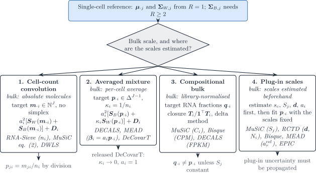
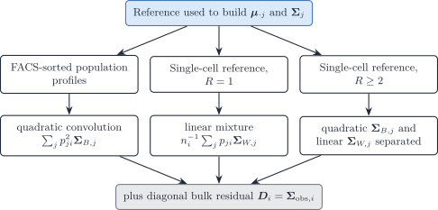
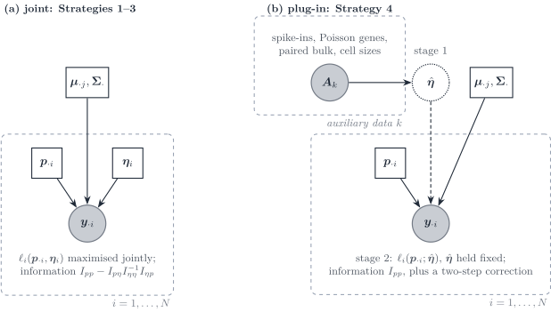

# DeCovarT tailored to single-cell references: reference moments, scales and four alignment strategies

> **Scope**
>
> Released DeCovarT fits the convolution \boldsymbol{y}\_{\cdot
> i}\mid\boldsymbol{p}\_{\cdot i}
> \sim\mathcal{N}\_G(\boldsymbol{\mu}\boldsymbol{p}\_{\cdot i}, \sum_j
> p\_{ji}^{2}\boldsymbol{\Sigma}\_j) of the [derivatives
> vignette](https://bastienchassagnol.github.io/DeCovarT/articles/theory-decovart-generative-model.html#sec-unconstrained).
> That law is exact when each reference column is one random
> **population profile**, as for the FACS-sorted references it was
> designed for. A single-cell reference supplies a different object:
> many cells per type, counted by a UMI protocol, with a within-type
> cell-to-cell covariance, and a bulk sample that is a physical sum of
> cells measured on another platform.
>
> This vignette rebuilds DeCovarT for that reference. The measurement
> and expression models of UMI counts, and the published methods that
> use second-order moments, are reviewed in the [distribution-aware
> deconvolution
> review](https://bastienchassagnol.github.io/DeCovarT/articles/theory-review-distribution-aware-deconvolution.md);
> this vignette uses their conclusions.
>
> 1.  [Sec. 1](#sec-reference) builds the mean and the covariance layers
>     of a reference from cells and replicates.
> 2.  [Sec. 2](#sec-one-formula) shows that mixture, convolution and
>     correlated cells are three cases of one covariance identity.
> 3.  [Sec. 3](#sec-general) gives one score, Hessian and Fisher
>     information for any Gaussian whose mean and covariance depend on
>     parameters.
> 4.  [Sec. 4](#sec-strategies) derives four alignment strategies: cell
>     counts, averaged mixture, compositional bulk, and plug-in scales
>     estimated before the deconvolution.
> 5.  [Sec. 5](#sec-uncoupling) converts RNA fractions into cell
>     fractions after the fit.
>
> The final model for real data, written as a generalised linear model,
> is in the [MLE and inference
> vignette](https://bastienchassagnol.github.io/DeCovarT/articles/theory-DeCovarT-MLE-properties.html#sec-final-choice).
> The simplex charts of the derivatives vignette apply unchanged to the
> proportion block of every formulation. Nothing here is implemented in
> [`fit_decovart()`](https://bastienchassagnol.github.io/DeCovarT/reference/fit_decovart.md);
> the equations are the specification for a later release.

> **Note 1: Notation**
>
> Indices: gene g=1,\ldots,G; cell type j=1,\ldots,J; bulk sample
> i=1,\ldots,N; independent biological replicate (donor) of the
> single-cell reference r=1,\ldots,R; cell c, with C\_{jr} cells of type
> j in replicate r.
>
> | Symbol | Meaning |
> |----|----|
> | x\_{gc}, \boldsymbol{x}\_{\cdot c} | Observed UMI count of gene g in cell c |
> | \boldsymbol{m}\_{\cdot c} | True molecule content of cell c |
> | s_c=s^{\mathrm{bio}}\_cs^{\mathrm{tech}}\_c | Cell size factor: biological (cell volume, cycle) times technical (capture, depth); \mathbb{E}\[s_c\]=1 |
> | \nu=\operatorname{CV}^{2}(s_c) | Extrinsic noise, 1+\nu=(1+\nu^{\mathrm{bio}})(1+\nu^{\mathrm{tech}}) |
> | b_g | Gene-specific capture efficiency of a protocol |
> | \boldsymbol{\lambda}\_{\cdot c}, \boldsymbol{\Sigma}^{\lambda}\_j | Size-free expression of cell c and its covariance inside type j |
> | \boldsymbol{y}\_{\cdot i}\in\mathbb{R}^{G} | Bulk profile of sample i |
> | m\_{ji}\in\mathbb{N}, n_i=\sum_j m\_{ji} | Cells of type j in bulk sample i, total cells (`MuSiC` writes m_j^{k}, `RNA-Sieve` n) |
> | \boldsymbol{p}\_{\cdot i}=\boldsymbol{m}\_{\cdot i}/n_i\in\Delta^{J-1} | Cell-number fractions |
> | \boldsymbol{q}\_{\cdot i}, q\_{ji}=p\_{ji}S_j/\sum_kp\_{ki}S_k | RNA fractions |
> | \kappa_i=1/n_i | Per-cell averaging factor |
> | \boldsymbol{\mu}\_{\cdot j}=S_j\boldsymbol{\theta}\_{\cdot j} | Per-cell mean of type j: cell size times relative abundance, \sum_g\theta\_{gj}=1 |
> | S_j | Mean transcriptome size (RNA content) of one cell of type j |
> | \boldsymbol{\Sigma}\_{W,j} | Within-replicate cell-to-cell covariance of type j |
> | \boldsymbol{\Sigma}\_{B,j} | Between-replicate covariance of the type-j population mean |
> | \boldsymbol{M}\_{jr}, \boldsymbol{B}\_{jr} | Replicate population mean and its deviation \boldsymbol{M}\_{jr}-\boldsymbol{\mu}\_{\cdot j} |
> | a_i\>0 | Sample-wide scale (cell number, depth, capture), shared by all genes |
> | \boldsymbol{d}\in\mathbb{R}^{G}\_{+} | Gene-wise platform ratio between bulk and reference protocols |
> | \boldsymbol{D}\_i=\boldsymbol{\Sigma}\_{\mathrm{obs},i} | Diagonal bulk measurement noise, \operatorname{diag}(\tau\_{1i}^{2},\ldots,\tau\_{Gi}^{2}) |
> | \boldsymbol{T}\_{ji}=\sum\_{c=1}^{m\_{ji}}\boldsymbol{X}\_{jic} | Total expression contributed by type j to sample i |
> | \boldsymbol{S}\_W(\boldsymbol{v})=\sum_jv_j\boldsymbol{\Sigma}\_{W,j}, \boldsymbol{S}\_B(\boldsymbol{v})=\sum_jv_j^{2}\boldsymbol{\Sigma}\_{B,j} | Linear and quadratic covariance mixtures |
> | \varrho_j | Cell-to-cell correlation inside type j; \boldsymbol{\rho} stays the ILR coordinate |
> | \boldsymbol{\vartheta}, \boldsymbol{\eta} | Generic parameter vector; nuisance scales of [Sec. 4.4](#sec-strategy-plugin) |
> | \boldsymbol{\mu}\_k,\boldsymbol{\Sigma}\_k,\boldsymbol{\mu}\_{kl},\boldsymbol{\Sigma}\_{kl} | First and second partial derivatives of the mean and covariance in \vartheta_k,\vartheta_l |
>
> When one bulk sample is fixed, the index i is dropped inside
> derivations and restored in the model statements. The single-cell
> papers use j for the gene (Sarkar and Stephens; Fang and Pachter;
> `DECALS`; `Bisque`) or for the subject (`MuSiC`); [the notation map of
> the
> review](https://bastienchassagnol.github.io/DeCovarT/articles/theory-review-distribution-aware-deconvolution.html#tbl-notation-map)
> translates every reviewed method.
>
> All plate diagrams follow one symbol key: white squares are fixed
> quantities, blue circles latent random variables, grey circles
> observed variables, dotted circles deterministic functions of their
> parents. Text beside a node is an equation, not a variable. When a
> paper builds increasingly complex models, its panels run from left to
> right.

Figure 1: Four strategies to align a single-cell reference with a bulk
sample. Strategies 1–3 differ by the scale on which the bulk is observed
and estimate the scales jointly with the composition; Strategy 4
estimates the technical and biological scales first and plugs them into
the regression or likelihood. Italic lines name the reviewed methods
that already sit on each branch.

## From cells to reference moments

The signature that enters [the released
convolution](https://bastienchassagnol.github.io/DeCovarT/articles/theory-review-distribution-aware-deconvolution.html#eq-gaussian-convolution)
is a **population profile**: one mean vector and one covariance per cell
type. Single-cell counts are not that object. This section states how to
build the mean and how the covariance splits, then how to place the
resulting profiles on the same scale as bulk sample i.

Figure 2: Within-sample cell noise, between-replicate biological
covariance, and residual bulk noise.

Figure 3: MuSiC assumptions for library-size normalisation: same
population, conserved cell-size ratios, conserved library-size ratios,
and the stronger A3-prime hypothesis for absolute cell-type fractions.

[Figure 2](#fig-three-variability) is the target decomposition. Panel A
is a purified population profile (quadratic in p\_{ji}). Panel B is one
single-cell reference (linear in p\_{ji}). Panel C is the hierarchical
model once R independent replicates exist.

### Mean: average cells, then average replicates

For a fixed type j, the per-cell mean does not depend on how many cells
were captured. With raw counts on an additive scale,

\bar{\boldsymbol{X}}\_{jr} =
\frac{1}{C\_{jr}}\sum\_{c=1}^{C\_{jr}}\boldsymbol{X}\_{jrc}, \qquad
\hat{\boldsymbol{\mu}}\_{\cdot j} =
\frac{1}{R}\sum\_{r=1}^{R}\bar{\boldsymbol{X}}\_{jr}. \tag{1}

Divide by the **cell count** C\_{jr}, not by the library size.
Library-size weights w_c=L_c/\sum_d L_d are functions of
\boldsymbol{X}\_c itself. Their probability limit is
\boldsymbol{\mu}+\boldsymbol{\Sigma}\mathbf{1}/(\mathbf{1}^{\top}\boldsymbol{\mu}),
so they target an RNA-weighted cell and destroy the exact Gaussian scale
that leaves the precision graph unchanged. Under i.i.d. cells the
arithmetic mean also has the largest effective sample size among
deterministic convex weights.

Pool cells across replicates only after the within-replicate mean. A
replicate with 10\\000 cells must not outweigh a replicate with 500
cells. `MuSiC` is built on that multi-subject split: cross-subject means
and variances, with genes weighted by cross-subject and cross-cell
consistency ([Wang et al. 2019](#ref-wangBulkTissueCell2019)).

When every cell is scaled to a common total, the product
S_j\boldsymbol{\theta}\_{\cdot j} collapses to the arithmetic mean of
the raw counts. `MuSiC` writes the signature as cell size times relative
abundance and then recovers that same per-cell mean. Keep S_j and
\boldsymbol{\theta}\_{\cdot j} as separate factors
([Sec. 1.3](#sec-alignment)). Do not library-weight the raw vectors and
call the result S_j.

> **Warning 2: Summing cells is the wrong signature, and the right
> pseudobulk**
>
> Summing is the correct total for a physical pool of exactly C\_{jr}
> cells, \boldsymbol{T}\_{jr}=\sum_c\boldsymbol{X}\_{jrc}, with mean
> C\_{jr}\boldsymbol{\mu}\_{\cdot j} and covariance
> C\_{jr}\boldsymbol{\Sigma}\_{W,j}. Using \boldsymbol{T}\_{jr} as a
> DeCovarT column inserts the arbitrary capture count into
> \boldsymbol{p}. A type with ten times more reference cells looks ten
> times more abundant.
>
> The same sum is the right input for a different question. Differential
> expression of one cell type across donors needs one count vector per
> donor, then a bulk count model such as `DESeq2` ([Love et al.
> 2014](#ref-loveModeratedEstimationFold2014a)). There the estimand is a
> relative fold change of averaged counts, and the donor is the
> independent unit. Cells from one donor are subsamples. Treating them
> as replicates inflates false discoveries ([Squair et al.
> 2021](#ref-squairConfrontingFalseDiscoveries2021)). That analysis does
> not estimate \boldsymbol{p}\_{\cdot i}.

### Three reference regimes

Write the cell as a sum of a replicate effect and a cell effect,

\boldsymbol{X}\_{jrc} = \boldsymbol{\mu}\_{\cdot
j}+\boldsymbol{B}\_{jr}+\boldsymbol{\varepsilon}\_{jrc}, \tag{2}

with
\boldsymbol{B}\_{jr}\sim\mathcal{N}(\boldsymbol{0},\boldsymbol{\Sigma}\_{B,j})
and
\boldsymbol{\varepsilon}\_{jrc}\sim\mathcal{N}(\boldsymbol{0},\boldsymbol{\Sigma}\_{W,j}),
independent across j given \boldsymbol{p}\_{\cdot i}. The bulk average
per cell in a tissue of N_i cells is

\boldsymbol{A}\_i = \sum_j p\_{ji}(\boldsymbol{\mu}\_{\cdot
j}+\boldsymbol{B}\_{jr(i)}) + \frac{1}{N_i}\sum_j\sum\_{c=1}^{N_i
p\_{ji}}\boldsymbol{\varepsilon}\_{ijc}. \tag{3}

#### FACS-sorted population profiles

Historically the reference was one bulk profile per purified population:
surface-marker sorting, then a pooled microarray or RNA-seq library. The
random object is the whole population vector
\boldsymbol{Z}\_{ij}\sim\mathcal{N}(\boldsymbol{\mu}\_{\cdot
j},\boldsymbol{\Sigma}\_{B,j}), and the bulk is the convolution

\boldsymbol{y}\_{\cdot i} = \sum_j p\_{ji}\boldsymbol{Z}\_{ij}, \qquad
\operatorname{Cov}(\boldsymbol{y}\_{\cdot i}\mid\boldsymbol{p}\_{\cdot
i}) = \sum_j p\_{ji}^{2}\\\boldsymbol{\Sigma}\_{B,j}. \tag{4}

The square appears because one random profile is multiplied by p\_{ji},
not because p\_{ji} cells were added. This is the covariance in [the
released
convolution](https://bastienchassagnol.github.io/DeCovarT/articles/theory-review-distribution-aware-deconvolution.html#eq-gaussian-convolution).
If several types are sorted from the same donors, cross-type blocks
\boldsymbol{\Sigma}\_{B,jk} add terms p\_{ji}p\_{ki}. Before droplet
scRNA-seq, those population profiles came from FACS- or MACS-purified
bulk libraries. Szaniszlo et al. showed that mixture expression reflects
composition and that a minor subset is recovered only after physical
sorting, while also stressing coexpression among genes inside a purified
type ([Szaniszlo et al. 2004](#ref-szaniszloGettingRightCells)).
Novershtern et al. profiled 38 marker-defined haematopoietic populations
and used coexpression modules plus promoter *cis*-circuits as the
gene–gene structure of each state ([Novershtern et al.
2011](#ref-novershternDenselyInterconnectedTranscriptional2011)). Those
studies are the historical FACS reference that
[Eq. 4](#eq-facs-quadratic) still describes.

#### One single-cell replicate (R=1)

R=1 identifies \boldsymbol{M}\_{j1} and \boldsymbol{\Sigma}\_{W,j}. It
does not identify \boldsymbol{\Sigma}\_{B,j}: extra cells shrink
\boldsymbol{\Sigma}\_{W,j}/C\_{j1} and leave the single draw
\boldsymbol{B}\_{j1} untouched. The coherent bulk covariance is the
**mixture / physical sum**, linear in p\_{ji}:

\operatorname{Cov}(\boldsymbol{A}\_i\mid\boldsymbol{p}\_{\cdot i}) =
\kappa_i\sum_j p\_{ji}\\\boldsymbol{\Sigma}\_{W,j} +
\boldsymbol{\Sigma}\_{\mathrm{obs},i}. \tag{5}

Here \kappa_i is an effective cells-per-bulk scale. The ideal value is
1/N_i. The number of reference cells C\_{j1} is not N_i. A finite-cell
reference mean adds a separate quadratic term \sum_j
p\_{ji}^{2}\boldsymbol{\Sigma}\_{W,j}/C\_{j1}. That term is Monte Carlo
error of \hat{\boldsymbol{\mu}}\_{\cdot j}, not biological between-donor
covariance. Do not drop \boldsymbol{\Sigma}\_{W,j} into the p\_{ji}^{2}
slot of [the released
convolution](https://bastienchassagnol.github.io/DeCovarT/articles/theory-review-distribution-aware-deconvolution.html#eq-gaussian-convolution).

For a rare type, p\_{ji}=0.01 makes p\_{ji}^{2} a hundred times smaller
than p\_{ji}. A within-cell covariance placed in the quadratic slot is
almost silenced.

#### Enough biological replicates

The smallest R that identifies a variance component is R\ge 2. The
replicate means satisfy

\bar{\boldsymbol{X}}\_{jr} \sim \mathcal{N}\\\left(
\boldsymbol{\mu}\_{\cdot j},\\
\boldsymbol{\Sigma}\_{B,j}+\frac{\boldsymbol{\Sigma}\_{W,j}}{C\_{jr}}
\right). \tag{6}

A method-of-moments contrast is then available. Let
\boldsymbol{S}\_{B,j} be the sample covariance of
\\\bar{\boldsymbol{X}}\_{jr}\\\_{r=1}^{R} and \bar{C}\_j a typical cell
count. Then

\mathbb{E}\[\boldsymbol{S}\_{B,j}\] = \boldsymbol{\Sigma}\_{B,j} +
\overline{\boldsymbol{\Sigma}\_{W,j}/C\_{jr}}, \tag{7}

so
\hat{\boldsymbol{\Sigma}}\_{B,j}=\boldsymbol{S}\_{B,j}-\widehat{\boldsymbol{\Sigma}}\_{W,j}/\bar{C}\_j,
projected onto the positive semidefinite cone. An unstructured G\times G
covariance has G(G+1)/2 free entries. Transcriptome-scale G makes that
matrix unestimable for the R of a normal single-cell study. What R\ge 2
buys is the **scalar separation** of the two layers, or a sparse
precision for \boldsymbol{\Sigma}\_{B,j}, not a dense G\times G matrix.
Reference cohorts in current single-cell deconvolution are small; `MEAD`
states this explicitly ([Xie et al.
2026](#ref-xieStatisticalInferenceCell2026)). Cells from one donor share
genetic and environmental background, so they are subsamples rather than
independent biological units. Zimmerman, Espeland and Langefeld document
that dependence across cell types, and they treat donor as the random
effect when contrasting conditions ([Zimmerman et al.
2021](#ref-zimmermanPracticalSolutionPseudoreplication2021)). That
within-versus-between split is the same hierarchy as
\boldsymbol{\Sigma}\_{W,j} versus \boldsymbol{\Sigma}\_{B,j} when a
single-cell reference is aligned with bulk.

With that split, the bulk law DeCovarT should use is

\boldsymbol{y}\_{\cdot i}\mid\boldsymbol{p}\_{\cdot i} \sim
\mathcal{N}\\\Big( a_i\sum_j p\_{ji}\boldsymbol{\mu}\_{\cdot j},\\
\sum_j p\_{ji}^{2}\\\boldsymbol{\Sigma}\_{B,j} + \kappa_i\sum_j
p\_{ji}\\\boldsymbol{\Sigma}\_{W,j} +
\boldsymbol{\Sigma}\_{\mathrm{obs},i} \Big). \tag{8}

\boldsymbol{\Sigma}\_{\mathrm{obs},i} is diagonal. Gene–gene correlation
is already inside \boldsymbol{\Sigma}\_{B,j} and
\boldsymbol{\Sigma}\_{W,j}. Heteroscedastic diagonal entries are
allowed. Off-diagonal residual correlation would double-count the
network.

Figure 4: Which covariance terms the reference design identifies. FACS
profiles supply only the quadratic layer. One single-cell replicate
supplies only the linear layer. R\ge 2 replicates separate both, plus a
diagonal bulk residual.

### Aligning reference profiles with bulk sample i

[Eq. 1](#eq-mean-two-stage) is a per-cell mean. Bulk sample i is a
library. Three scales sit between them. Only two belong inside the
estimator.

**Sample scale a_i.** On an absolute molecule scale,
\boldsymbol{y}\_{\cdot i}=a_i\boldsymbol{\mu}\boldsymbol{p}\_{\cdot i}
plus noise. a_i absorbs cell number, sequencing depth, and capture. It
is one positive number per bulk sample. Profile it out, or estimate it
jointly with \boldsymbol{p}\_{\cdot i}. It is not a biological
composition parameter.

**Cell size S_j.** RNA content differs by cell type, so

\boldsymbol{y}\_{\cdot i} = a_i\sum_j p\_{ji}
S_j\boldsymbol{\theta}\_{\cdot j} + \boldsymbol{\varepsilon}\_i. \tag{9}

`MuSiC` states the same product: cell fraction, average cell size,
relative abundance ([Wang et al. 2019](#ref-wangBulkTissueCell2019)). If
S_j is measured, insert it. Do not re-estimate it. Free S_j and
\boldsymbol{p}\_{\cdot i} are not separately identifiable from
\boldsymbol{y}\_{\cdot i} alone, because only the products p\_{ji}S_j
enter [Eq. 9](#eq-music-mean). The RNA fraction

q\_{ji} = \frac{p\_{ji}S_j}{\sum_k p\_{ki}S_k} \tag{10}

is what a normalised bulk identifies. \boldsymbol{q}\_{\cdot
i}=\boldsymbol{p}\_{\cdot i} when S_j is constant across j. That
constant-efficiency hypothesis is assumption A3' of `MuSiC`: the ratio
of average library size equals the ratio of average cell size,
equivalently a common capture efficiency \gamma_j=L_j/S_j
([Figure 3](#fig-music-assumptions)). Under A3', the arithmetic mean
across cells is the right signature and the fitted weights are cytometry
fractions. If A3' fails, the fitted weights are RNA fractions and a
later division by S_j ([RNA-to-cell
correction](https://bastienchassagnol.github.io/DeCovarT/articles/theory-decovart-single-cell-tailored.html#eq-rna-to-cell))
is required.

`EPIC` and `quanTIseq` apply that division **after** a linear fit, using
an external RNA-content assay, so the optimiser itself returns
transcriptomic ratios ([Racle et al.
2017](#ref-racleSimultaneousEnumerationCancer2017); [Finotello et al.
2019](#ref-finotello_etal19)). `MMAD` estimates the extraction
efficiencies inside a non-linear conjugate-gradient step ([Liebner et
al. 2014](#ref-liebnerMMADMicroarrayMicrodissection2014)). `ReDeconv`
keeps transcriptome size in the reference by Count-based Linearised
Transcriptome Size (CLTS) normalisation, instead of dividing every cell
by its own total ([Lu et al.
2025](#ref-luTranscriptomeSizeMatters2025)).

**Gene-wise scale \boldsymbol{d}.** A platform shift can be
gene-specific, y\_{gi}\approx d_g a_i\sum_j p\_{ji}\mu\_{gj}. `Bisque`
learns such a map from paired bulk and single-cell measurements when
technical variation between the two assays is large ([Jew et al.
2020](#ref-jewAccurateEstimationCell2020)). Fitting \\d_g\\ on the same
bulk sample that is being deconvolved lets the scale absorb any
residual, and \boldsymbol{p}\_{\cdot i} is then unidentified. Estimate
\boldsymbol{d} on an external paired cohort, or do not estimate it.

#### Normalisation that preserves the linear mixture

The moment identities above are for **raw counts on an additive scale**.
They do not survive a logarithm: \log\boldsymbol{y}\_{\cdot i} is not
\sum_j p\_{ji}\log\boldsymbol{\mu}\_{\cdot j}.

The comparison DeCovarT needs is the **same gene on two technologies**,
not two genes inside one sample. Gene length is a property of the assay.
It cancels for a within-gene contrast and should not be divided out of
the reference unless the bulk was length-normalised in the same way.
`ReDeconv` treats length as a bulk-only TPM/RPKM correction and leaves
UMI single-cell counts uncorrected for length ([Lu et al.
2025](#ref-luTranscriptomeSizeMatters2025)).

| Procedure | What it estimates | Use for \boldsymbol{\mu}\_{\cdot j} |
|----|----|----|
| Arithmetic mean of raw counts | Per-cell mean | Default signature |
| CPM / CP10K | Library-size relative profile | Erases S_j |
| TPM / RPKM / FPKM | Length-adjusted composition | Breaks cross-platform per-gene alignment |
| TMM (`edgeR`) or median-of-ratios (`DESeq2`) | Effective library size for differential expression | Donor-level DE, not the signature ([Robinson et al. 2010](#ref-robinsonEdgeRBioconductorPackage2010); [Love et al. 2014](#ref-loveModeratedEstimationFold2014a)) |
| `SCTransform` | Regularised negative-binomial residuals | Clustering and integration, not an additive mixture mean ([Hafemeister and Satija 2019](#ref-hafemeisterNormalizationVarianceStabilization2019)) |
| CLTS (`ReDeconv`) | Counts rescaled by a linearised transcriptome size | Keeps S_j for deconvolution ([Lu et al. 2025](#ref-luTranscriptomeSizeMatters2025)) |

CPM and CP10K divide by the cell total. That is a relative profile
\boldsymbol{\theta}\_{\cdot j} with S_j discarded. TMM and the `DESeq2`
size factor answer a different question: an effective depth for
between-sample differential expression, under a hypothesis that most
genes are stable ([Robinson et al.
2010](#ref-robinsonEdgeRBioconductorPackage2010); [Love et al.
2014](#ref-loveModeratedEstimationFold2014a)). `SCTransform` models
depth inside a negative binomial; the residuals are not an additive
convolution mean ([Hafemeister and Satija
2019](#ref-hafemeisterNormalizationVarianceStabilization2019)).

## Convolution, mixture and correlated cells

Let
\boldsymbol{X}\sim\mathcal{N}\_G(\boldsymbol{\mu},\boldsymbol{\Sigma}).
Two statements look contradictory,

\operatorname{Cov}(a\boldsymbol{X})=a^{2}\boldsymbol{\Sigma}
\qquad\text{versus}\qquad
\operatorname{Cov}\Bigl(\sum\_{r=1}^{a}\boldsymbol{X}\_r\Bigr)=a\boldsymbol{\Sigma},
\tag{11}

and both are correct. The difference lies entirely in the dependence
between the a summands, not in two rules for Gaussian vectors.

### Characteristic-function proof

The characteristic function of \boldsymbol{X} is
\phi\_{\boldsymbol{X}}(\boldsymbol{t})
=\exp(i\boldsymbol{t}^{\top}\boldsymbol{\mu}
-\tfrac12\boldsymbol{t}^{\top}\boldsymbol{\Sigma}\boldsymbol{t}).

**Scaling** substitutes a\boldsymbol{t} for \boldsymbol{t}:

\phi\_{a\boldsymbol{X}}(\boldsymbol{t})
=\phi\_{\boldsymbol{X}}(a\boldsymbol{t})
=\exp\bigl(i\boldsymbol{t}^{\top}(a\boldsymbol{\mu})
-\tfrac12\boldsymbol{t}^{\top}(a^{2}\boldsymbol{\Sigma})\boldsymbol{t}\bigr),
\qquad
a\boldsymbol{X}\sim\mathcal{N}\_G(a\boldsymbol{\mu},a^{2}\boldsymbol{\Sigma}).
\tag{12}

**Independent convolution** multiplies a identical factors:

\phi\_{\boldsymbol{X}\_1+\cdots+\boldsymbol{X}\_a}(\boldsymbol{t})
=\phi\_{\boldsymbol{X}}(\boldsymbol{t})^{a}
=\exp\bigl(i\boldsymbol{t}^{\top}(a\boldsymbol{\mu})
-\tfrac12\boldsymbol{t}^{\top}(a\boldsymbol{\Sigma})\boldsymbol{t}\bigr),
\qquad
\sum\_{r}\boldsymbol{X}\_r\sim\mathcal{N}\_G(a\boldsymbol{\mu},a\boldsymbol{\Sigma}).
\tag{13}

The first route squares the quadratic exponent; the second adds a copies
of it. The density convolution (f\*f)(\boldsymbol{s})=\int
f(\boldsymbol{x})f(\boldsymbol{s}-\boldsymbol{x})\\d\boldsymbol{x} is
the law of \boldsymbol{X}\_1+\boldsymbol{X}\_2 only when the two draws
are independent. Saying “a convolution of Gaussians” therefore already
asserts independent summands.

### The master identity and its two endpoints

For arbitrary random vectors with
\operatorname{Cov}(\boldsymbol{X}\_r)=\boldsymbol{\Sigma} and
cross-covariances
\boldsymbol{C}\_{rs}=\operatorname{Cov}(\boldsymbol{X}\_r,\boldsymbol{X}\_s),

\operatorname{Cov}\Bigl(\sum\_{r=1}^{a}\boldsymbol{X}\_r\Bigr)
=\sum\_{r,s}\operatorname{Cov}(\boldsymbol{X}\_r,\boldsymbol{X}\_s)
=a\boldsymbol{\Sigma}+\sum\_{r\neq s}\boldsymbol{C}\_{rs}. \tag{14}

Under **equicorrelation**,
\boldsymbol{C}\_{rs}=\varrho\boldsymbol{\Sigma} for r\neq s, the a(a-1)
off-diagonal blocks collapse to

\operatorname{Cov}\Bigl(\sum\_{r=1}^{a}\boldsymbol{X}\_r\Bigr)
=a\bigl\[1+(a-1)\varrho\bigr\]\boldsymbol{\Sigma}, \qquad
-\frac{1}{a-1}\le\varrho\le 1 . \tag{15}

Setting \varrho=1 (the same realised vector reused a times) gives
a^{2}\boldsymbol{\Sigma}; setting \varrho=0 (fresh independent draws)
gives a\boldsymbol{\Sigma}. [Table 1](#tbl-dependence-regimes) lists the
cases. A sum of merely *marginally* Gaussian vectors need not be
Gaussian; [Eq. 15](#eq-equicorrelation) is a Gaussian law only when the
stacked vector
(\boldsymbol{X}\_1^{\top},\ldots,\boldsymbol{X}\_a^{\top})^{\top} is
**jointly** Gaussian, which is the assumption made whenever an
intermediate \varrho is used below.

| Construction | Dependence | Mean | Covariance | Law |
|----|----|----|----|----|
| Same \boldsymbol{X} repeated | \varrho=1 | a\boldsymbol{\mu} | a^{2}\boldsymbol{\Sigma} | \mathcal{N}\_G |
| a i.i.d. copies | \varrho=0 | a\boldsymbol{\mu} | a\boldsymbol{\Sigma} | \mathcal{N}\_G |
| Correlated copies | general \boldsymbol{C}\_{rs} | a\boldsymbol{\mu} | a\boldsymbol{\Sigma}+\sum\_{r\neq s}\boldsymbol{C}\_{rs} | Gaussian if jointly Gaussian |
| Equicorrelated copies | \boldsymbol{C}\_{rs}=\varrho\boldsymbol{\Sigma} | a\boldsymbol{\mu} | a\[1+(a-1)\varrho\]\boldsymbol{\Sigma} | Gaussian if jointly Gaussian |

Table 1: Dependence regimes for a sum of a Gaussian vectors with common
marginal covariance. The first two rows are the endpoints \varrho=1 and
\varrho=0 of the last.

The biological reading is the one that matters for a single-cell
reference. If \boldsymbol{\Sigma}\_j is the covariance **between cells**
of type j, summing m_j independent cells yields
m_j\boldsymbol{\Sigma}\_j. If \boldsymbol{\Sigma}\_j is the covariance
of **one latent type-level profile** that is multiplied by a weight, the
contribution is p_j^{2}\boldsymbol{\Sigma}\_j. Released DeCovarT is the
second case. The random-effects decomposition of the [perspectives
vignette](#sec-three-regimes),

\boldsymbol{X}\_{jc}=\boldsymbol{M}\_j+\boldsymbol{\varepsilon}\_{jc},
\qquad
\operatorname{Cov}\Bigl(\sum\_{c=1}^{m_j}\boldsymbol{X}\_{jc}\Bigr)
=m_j\boldsymbol{\Sigma}\_{W,j}+m_j^{2}\boldsymbol{\Sigma}\_{B,j},
\tag{16}

contains both endpoints at once: independent cell fluctuations
accumulate linearly, a shared type-level fluctuation is amplified
quadratically. Equicorrelated cells are the special case
\boldsymbol{\Sigma}\_{B,j}=\varrho_j\boldsymbol{\Sigma}\_j and
\boldsymbol{\Sigma}\_{W,j}=(1-\varrho_j)\boldsymbol{\Sigma}\_j
([Sec. 2.4](#sec-persp-equicorrelation)).

### Mixture of cells versus convolution of populations

The identity [Eq. 14](#eq-master-identity) fixes the covariance once the
dependence between summands is fixed. Deconvolution models differ by a
second choice: whether the cell type of each summand is random or given.
[Figure 5](#fig-dag-dependence) lays out the four cases from no
dependence to full dependence.

Figure 5: Four generative stories for a bulk profile \boldsymbol{y},
ordered by the dependence between cells. (a) A mixture: each of n cells
draws its type label from \mathrm{Cat}(\boldsymbol{p}). (b) Independent
cells with fixed counts m_j. (c) Equicorrelated cells sharing a
type-level effect \boldsymbol{B}\_j. (d) One population profile per
type, scaled by p_j. The note under each \boldsymbol{y} is its
covariance; \boldsymbol{\delta}\_j=\boldsymbol{\mu}\_{\cdot
j}-\boldsymbol{\mu}\boldsymbol{p}.

**Mixture of cells.** If the type label z_c of each of n cells is drawn
from \mathrm{Cat}(\boldsymbol{p}), one cell follows the Gaussian mixture
\sum_jp_j\mathcal{N}\_G(\boldsymbol{\mu}\_{\cdot
j},\boldsymbol{\Sigma}\_j), with

\mathbb{E}\[\boldsymbol{X}\_c\]=\boldsymbol{\mu}\boldsymbol{p}, \qquad
\operatorname{Cov}(\boldsymbol{X}\_c) =\sum_jp_j\boldsymbol{\Sigma}\_j
+\sum_jp_j(\boldsymbol{\mu}\_{\cdot
j}-\boldsymbol{\mu}\boldsymbol{p})(\boldsymbol{\mu}\_{\cdot
j}-\boldsymbol{\mu}\boldsymbol{p})^{\top} \tag{17}

by the law of total covariance. The sum of n independent such cells has
n times that covariance and is Gaussian only in the central-limit sense.
This is the `RNA-Sieve` likelihood, written gene by gene
([`RNA-Sieve`](https://bastienchassagnol.github.io/DeCovarT/articles/theory-review-distribution-aware-deconvolution.html#sec-rnasieve)).
The second term is the spread of the type means; it is present because
the labels are random, and it disappears once the counts \boldsymbol{m}
are conditioned on.

**Convolution of independent cells.** With the counts given, the sum is
an exact Gaussian with covariance \sum_jm_j\boldsymbol{\Sigma}\_j:
linear weights. This is Strategy 1 ([Sec. 4.1](#sec-cell-counts)) and,
after division by n, the linear layer of Strategy 2.

**Convolution of population profiles.** If each type contributes one
random profile scaled by its weight, the covariance is
\sum_jp_j^{2}\boldsymbol{\Sigma}\_j: quadratic weights. This is released
DeCovarT, the `DECALS` covariance, and the cross-subject layer of
`MuSiC`.

The equicorrelated model sits between the last two.

### Correlated cells inside a type

[Sec. 4.1](#sec-cell-counts) assumed independent cells within a type.
Cells of one type in one tissue share micro-environment, cell cycle
phase and paracrine signals, so a positive within-type correlation is
plausible. The jointly Gaussian equicorrelated model of
[Eq. 15](#eq-equicorrelation) with a type-specific \varrho_j gives

\operatorname{Cov}(\boldsymbol{T}\_{ji})
=m\_{ji}\bigl\[1+(m\_{ji}-1)\varrho_j\bigr\]\boldsymbol{\Sigma}\_{W,j}
=m\_{ji}(1-\varrho_j)\boldsymbol{\Sigma}\_{W,j}+m\_{ji}^{2}\varrho_j\boldsymbol{\Sigma}\_{W,j}.
\tag{18}

The second form shows that equicorrelation is the random-effects model
[Eq. 16](#eq-random-effects) with proportional layers,
\boldsymbol{\Sigma}\_{B,j}=\varrho_j\boldsymbol{\Sigma}\_{W,j} and a
within covariance deflated to (1-\varrho_j)\boldsymbol{\Sigma}\_{W,j}.
The covariance derivative in \varrho_j is
\boldsymbol{\Sigma}\_{\varrho_j}=m\_{ji}(m\_{ji}-1)\boldsymbol{\Sigma}\_{W,j},
so [Theorem 1](#thm-score-general) applies. Identifiability is the
obstacle: with one bulk sample, \varrho_j and m\_{ji} enter only through
the scalar m\_{ji}\[1+(m\_{ji}-1)\varrho_j\] in front of
\boldsymbol{\Sigma}\_{W,j} and cannot be separated. Several samples with
different compositions, or an external estimate of \varrho_j from
spatial neighbourhoods of the same type, are needed. The lower bound
\varrho_j\ge-1/(m\_{ji}-1) is the positive-semidefiniteness constraint
and shrinks to zero for abundant types, so negative within-type
correlation is a rare-type phenomenon only. The claim that a sum of
equicorrelated cells is Gaussian rests on **joint** Gaussianity of the
stacked cells, which is an assumption and not a consequence of Gaussian
marginals.

## One score and Hessian for every formulation

All models below are Gaussian with a parametrised mean and covariance.
Write \boldsymbol{y}\mid\boldsymbol{\vartheta}\sim
\mathcal{N}\_G\bigl(\boldsymbol{\mu}(\boldsymbol{\vartheta}),
\boldsymbol{\Sigma}(\boldsymbol{\vartheta})\bigr),
\boldsymbol{r}=\boldsymbol{y}-\boldsymbol{\mu}(\boldsymbol{\vartheta}),
\boldsymbol{\Omega}=\boldsymbol{\Sigma}^{-1}, and up to a constant

\ell(\boldsymbol{\vartheta})
=\tfrac12\log\det\boldsymbol{\Omega}(\boldsymbol{\vartheta})
-\tfrac12\boldsymbol{r}^{\top}\boldsymbol{\Omega}(\boldsymbol{\vartheta})\boldsymbol{r}.
\tag{19}

The identities of the derivatives vignette ([matrix
calculus](https://bastienchassagnol.github.io/DeCovarT/articles/theory-decovart-generative-model.html#sec-matrix-calculus))
give the following.

**Theorem 1 (Score, Hessian and expected information of a parametrised
Gaussian)** With
\boldsymbol{\mu}\_k=\partial\boldsymbol{\mu}/\partial\vartheta_k,
\boldsymbol{\Sigma}\_k=\partial\boldsymbol{\Sigma}/\partial\vartheta_k,
\boldsymbol{\mu}\_{kl}=\partial^{2}\boldsymbol{\mu}/\partial\vartheta_k\partial\vartheta_l
and
\boldsymbol{\Sigma}\_{kl}=\partial^{2}\boldsymbol{\Sigma}/\partial\vartheta_k\partial\vartheta_l,

\frac{\partial\ell}{\partial\vartheta_k}
=\underbrace{-\tfrac12\\\mathrm{tr}(\boldsymbol{\Omega}\boldsymbol{\Sigma}\_k)}\_{\text{determinant}}
+\underbrace{\boldsymbol{\mu}\_k^{\top}\boldsymbol{\Omega}\boldsymbol{r}}\_{\text{mean
residual}}
+\underbrace{\tfrac12\\\boldsymbol{r}^{\top}\boldsymbol{\Omega}\boldsymbol{\Sigma}\_k\boldsymbol{\Omega}\boldsymbol{r}}\_{\text{covariance
quadratic}}, \tag{20}

\begin{aligned}
\frac{\partial^{2}\ell}{\partial\vartheta_k\partial\vartheta_l}
&=\tfrac12\\\mathrm{tr}(\boldsymbol{\Omega}\boldsymbol{\Sigma}\_k\boldsymbol{\Omega}\boldsymbol{\Sigma}\_l)
-\tfrac12\\\mathrm{tr}(\boldsymbol{\Omega}\boldsymbol{\Sigma}\_{kl})
-\boldsymbol{\mu}\_k^{\top}\boldsymbol{\Omega}\boldsymbol{\mu}\_l
+\boldsymbol{\mu}\_{kl}^{\top}\boldsymbol{\Omega}\boldsymbol{r} \\
&\quad
-\boldsymbol{\mu}\_k^{\top}\boldsymbol{\Omega}\boldsymbol{\Sigma}\_l\boldsymbol{\Omega}\boldsymbol{r}
-\boldsymbol{\mu}\_l^{\top}\boldsymbol{\Omega}\boldsymbol{\Sigma}\_k\boldsymbol{\Omega}\boldsymbol{r}
+\tfrac12\\\boldsymbol{r}^{\top}\boldsymbol{\Omega}\boldsymbol{\Sigma}\_{kl}\boldsymbol{\Omega}\boldsymbol{r}
-\boldsymbol{r}^{\top}\boldsymbol{\Omega}\boldsymbol{\Sigma}\_k\boldsymbol{\Omega}\boldsymbol{\Sigma}\_l\boldsymbol{\Omega}\boldsymbol{r},
\end{aligned} \tag{21}

I(\boldsymbol{\vartheta})\_{kl}
=\mathbb{E}\Bigl\[-\frac{\partial^{2}\ell}{\partial\vartheta_k\partial\vartheta_l}\Bigr\]
=\boldsymbol{\mu}\_k^{\top}\boldsymbol{\Omega}\boldsymbol{\mu}\_l
+\tfrac12\\\mathrm{tr}(\boldsymbol{\Omega}\boldsymbol{\Sigma}\_k\boldsymbol{\Omega}\boldsymbol{\Sigma}\_l).
\tag{22}

*Proof*. The determinant term follows from
\partial\log\det\boldsymbol{\Omega}/\partial\vartheta_k
=-\mathrm{tr}(\boldsymbol{\Omega}\boldsymbol{\Sigma}\_k) and
\partial\boldsymbol{\Omega}/\partial\vartheta_k
=-\boldsymbol{\Omega}\boldsymbol{\Sigma}\_k\boldsymbol{\Omega}.
Differentiating
-\tfrac12\boldsymbol{r}^{\top}\boldsymbol{\Omega}\boldsymbol{r} uses
\partial\boldsymbol{r}/\partial\vartheta_k=-\boldsymbol{\mu}\_k and the
symmetry of \boldsymbol{\Omega}. Differentiating
[Eq. 20](#eq-score-general) once more and using
\boldsymbol{r}^{\top}\boldsymbol{\Omega}\boldsymbol{\Sigma}\_l\boldsymbol{\Omega}\boldsymbol{\Sigma}\_k\boldsymbol{\Omega}\boldsymbol{r}
=\boldsymbol{r}^{\top}\boldsymbol{\Omega}\boldsymbol{\Sigma}\_k\boldsymbol{\Omega}\boldsymbol{\Sigma}\_l\boldsymbol{\Omega}\boldsymbol{r}
(transpose of a scalar) gives [Eq. 21](#eq-hess-general). For
[Eq. 22](#eq-fisher-general) substitute
\mathbb{E}\[\boldsymbol{r}\]=\boldsymbol{0} and
\mathbb{E}\[\boldsymbol{r}\boldsymbol{r}^{\top}\]=\boldsymbol{\Sigma}:
the \boldsymbol{\Sigma}\_{kl} traces cancel and
\mathbb{E}\[\boldsymbol{r}^{\top}\boldsymbol{\Omega}\boldsymbol{\Sigma}\_k\boldsymbol{\Omega}\boldsymbol{\Sigma}\_l\boldsymbol{\Omega}\boldsymbol{r}\]
=\mathrm{tr}(\boldsymbol{\Omega}\boldsymbol{\Sigma}\_k\boldsymbol{\Omega}\boldsymbol{\Sigma}\_l).

> **Tip 3: Check against released DeCovarT**
>
> Take \boldsymbol{\vartheta}=\boldsymbol{p},
> \boldsymbol{\mu}(\boldsymbol{p})=\boldsymbol{\mu}\boldsymbol{p} and
> \boldsymbol{\Sigma}(\boldsymbol{p})=\sum_j
> p_j^{2}\boldsymbol{\Sigma}\_j. Then
> \boldsymbol{\mu}\_{p_k}=\boldsymbol{\mu}\_{\cdot k},
> \boldsymbol{\mu}\_{p_kp_l}=\boldsymbol{0}, the covariance derivative
> is \boldsymbol{\Sigma}\_{p_k}=2p_k\boldsymbol{\Sigma}\_k with
> \boldsymbol{\Sigma}\_k the type covariance,
> \boldsymbol{\Sigma}\_{p_kp_k}=2\boldsymbol{\Sigma}\_k and
> \boldsymbol{\Sigma}\_{p_kp_l}=\boldsymbol{0} for k\neq l. Substituting
> into [Eq. 20](#eq-score-general) to [Eq. 22](#eq-fisher-general)
> recovers the [unconstrained
> gradient](https://bastienchassagnol.github.io/DeCovarT/articles/theory-decovart-generative-model.html#thm-score-unconstrained),
> [Hessian](https://bastienchassagnol.github.io/DeCovarT/articles/theory-decovart-generative-model.html#thm-hess-unconstrained)
> and [expected Fisher
> information](https://bastienchassagnol.github.io/DeCovarT/articles/theory-decovart-generative-model.html#sec-fisher-p)
> of the derivatives vignette term by term, including the factor 2p_kp_l
> in front of the covariance trace.

Every model below is therefore specified by its tuple
(\boldsymbol{\mu}\_k,\boldsymbol{\Sigma}\_k,\boldsymbol{\mu}\_{kl},\boldsymbol{\Sigma}\_{kl}).
When a parameter block lives on the simplex, the ILR chain rule
([constrained score and
Hessian](https://bastienchassagnol.github.io/DeCovarT/articles/theory-decovart-generative-model.html#thm-chain-rule))
is applied to that block only; the Jacobian of the full map is block
diagonal with identity blocks for the scalar parameters a_i, \kappa_i
and \tau\_{gi}^{2}. Positivity of scalars is handled by a log chart
(a_i=e^{\eta_i}), which multiplies the corresponding row of the score by
a_i and adds the score itself to the diagonal of the Hessian.

### Compound parametrisations and nuisance scales

[Theorem 1](#thm-score-general) is the general form of the Fisher
information of a multivariate normal whose mean and covariance depend on
a parameter,
I\_{kl}=\boldsymbol{\mu}\_k^{\top}\boldsymbol{\Sigma}^{-1}\boldsymbol{\mu}\_l
+\tfrac12\operatorname{tr}(\boldsymbol{\Sigma}^{-1}\boldsymbol{\Sigma}\_k\boldsymbol{\Sigma}^{-1}\boldsymbol{\Sigma}\_l)
([Fisher information of the multivariate
normal](https://en.wikipedia.org/wiki/Fisher_information#Multivariate_normal_distribution)).
Every model below is **compound**: \boldsymbol{\vartheta} is itself a
function \boldsymbol{\vartheta}=\boldsymbol{h}(\boldsymbol{\eta}) of the
parameters that are optimised (ILR coordinates, log scales, counts and
sizes). With the Jacobian
\mathbf{J}=\partial\boldsymbol{\vartheta}/\partial\boldsymbol{\eta}^{\top},

\nabla\_{\boldsymbol{\eta}}\ell=\mathbf{J}^{\top}\nabla\_{\boldsymbol{\vartheta}}\ell,
\qquad \frac{\partial^{2}\ell}{\partial\eta_a\partial\eta_b}
=\bigl(\mathbf{J}^{\top}\mathbf{H}\_{\boldsymbol{\vartheta}}\mathbf{J}\bigr)\_{ab}
+\sum_k\frac{\partial\ell}{\partial\vartheta_k}\frac{\partial^{2}\vartheta_k}{\partial\eta_a\partial\eta_b},
\qquad
I(\boldsymbol{\eta})=\mathbf{J}^{\top}I(\boldsymbol{\vartheta})\mathbf{J}.
\tag{23}

The second Hessian term is the score contraction of the map Hessian; it
vanishes in expectation, which is why the information transforms without
it.

Most strategies below carry nuisance scales
\boldsymbol{\eta}=(a_i,\kappa_i,\boldsymbol{\tau}^{2},\ldots) next to
the composition. Partition the information into a \boldsymbol{p} block
and an \boldsymbol{\eta} block, with cross block
I\_{p\eta,kl}=\boldsymbol{\mu}\_{p_k}^{\top}\boldsymbol{\Omega}\boldsymbol{\mu}\_{\eta_l}
+\tfrac12\operatorname{tr}(\boldsymbol{\Omega}\boldsymbol{\Sigma}\_{p_k}\boldsymbol{\Omega}\boldsymbol{\Sigma}\_{\eta_l})
from [Eq. 22](#eq-fisher-general). When \boldsymbol{\eta} is estimated
jointly, the information left for \boldsymbol{p} is the Schur complement

I\_{p\mid\eta}=I\_{pp}-I\_{p\eta}I\_{\eta\eta}^{-1}I\_{\eta p}, \qquad
\operatorname{Var}(\hat{\boldsymbol{p}})\approx
I\_{p\mid\eta}^{-1}\succeq I\_{pp}^{-1}. \tag{24}

The loss I\_{pp}-I\_{p\mid\eta} is zero when the cross block vanishes,
for example when a scale enters the covariance only and its trace term
is orthogonal to those of \boldsymbol{p}.
[Sec. 4.4](#sec-strategy-plugin) uses [Eq. 24](#eq-schur-information) to
compare joint and plug-in estimation of the scales.

## Four strategies to align a single-cell reference with bulk

[Figure 1](#fig-four-strategies) is the map of the strategies.
Strategies 1–3 differ by the scale on which the bulk is observed, and
estimate every scale jointly with the composition. Strategy 4 keeps one
of those likelihoods but estimates the technical and biological scales
first, from other data, and plugs them in. The reviewed methods sit on
these branches as follows: `RNA-Sieve` and `DWLS` estimate counts or a
cell number (Strategy 1); `DECALS`, `MEAD` and DeCovarT estimate a
composition with a nuisance scale (Strategy 2); `MuSiC`, `Bisque` and
`DECALS` work on library-normalised or FPKM bulk (Strategy 3); and
`MuSiC`’s S_j, `RCTD`’s platform, `Bisque`’s map and `MEAD`’s reference
scale are plug-ins (Strategy 4).

### Strategy 1: cell-count convolution

The first formulation keeps the bulk on an absolute molecule scale and
asks how many cells of each type it contains. It is the cell-level
reading of `MuSiC`’s equation (2), X\_{jg}=\sum_k
m\_{kj}S\_{kj}\theta\_{kjg}, where m\_{kj} is the number of cells of
type k in subject j ([Wang et al. 2019](#ref-wangBulkTissueCell2019)).
With \boldsymbol{\mu}\_{\cdot j}=S_j\boldsymbol{\theta}\_{\cdot j} the
mean below is exactly that identity before `MuSiC` divides by the
library total. The estimand is \boldsymbol{m}\_{\cdot
i}\in\mathbb{N}^{J}, proportions follow by division, and no simplex
constraint is imposed.

#### Layer 1: independent cells, linear covariance

Assume one single-cell replicate (R=1) and, conditional on the counts,
independent cells

\boldsymbol{X}\_{jic}\overset{\text{i.i.d.}}{\sim}
\mathcal{N}\_G(\boldsymbol{\mu}\_{\cdot j},\boldsymbol{\Sigma}\_{W,j}),
\qquad c=1,\ldots,m\_{ji}, \tag{25}

independent across types. The bulk is the physical sum

\boldsymbol{y}\_{\cdot i} =\sum\_{j=1}^{J}\boldsymbol{T}\_{ji}
=\sum\_{j=1}^{J}\sum\_{c=1}^{m\_{ji}}\boldsymbol{X}\_{jic}. \tag{26}

Applying [Eq. 14](#eq-master-identity) with
\boldsymbol{C}\_{rs}=\boldsymbol{0} inside each type and independence
across types,

\boldsymbol{y}\_{\cdot i}\mid\boldsymbol{m}\_{\cdot i}
\sim\mathcal{N}\_G\Bigl( \boldsymbol{\mu}\boldsymbol{m}\_{\cdot i},\\
\boldsymbol{S}\_W(\boldsymbol{m}\_{\cdot i}) \Bigr), \qquad
\boldsymbol{S}\_W(\boldsymbol{m}\_{\cdot i})=\sum_j
m\_{ji}\boldsymbol{\Sigma}\_{W,j}. \tag{27}

Each term has one meaning. \boldsymbol{\mu}\boldsymbol{m}\_{\cdot i} is
the expected molecule count of a tissue made of m\_{ji} average cells of
each type. m\_{ji}\boldsymbol{\Sigma}\_{W,j} is the accumulated
cell-to-cell scatter of type j: independent deviations add, so the
weight is linear. There is no \boldsymbol{\Sigma}\_{B,j} because one
replicate cannot identify it. The law is exact under Gaussian cells.
Under non-Gaussian cells it is the central-limit approximation of
`RNA-Sieve`, applied here to the full vector rather than gene by gene
([Erdmann-Pham et al.
2021](#ref-erdmann-phamLikelihoodbasedDeconvolutionBulk2021)).

Treat \boldsymbol{m}\_{\cdot i} as a point of (0,\infty)^{J} for the
moment. The tuple of [Theorem 1](#thm-score-general) is

\boldsymbol{\mu}\_k=\boldsymbol{\mu}\_{\cdot k}, \qquad
\boldsymbol{\Sigma}\_k=\boldsymbol{\Sigma}\_{W,k}, \qquad
\boldsymbol{\mu}\_{kl}=\boldsymbol{0}, \qquad
\boldsymbol{\Sigma}\_{kl}=\boldsymbol{0}. \tag{28}

**Theorem 2 (Score, Hessian and information for cell counts)** With
\boldsymbol{\Omega}=\boldsymbol{S}\_W(\boldsymbol{m})^{-1} and
\boldsymbol{r}=\boldsymbol{y}-\boldsymbol{\mu}\boldsymbol{m},

\frac{\partial\ell}{\partial m_k}
=-\tfrac12\\\mathrm{tr}(\boldsymbol{\Omega}\boldsymbol{\Sigma}\_{W,k})
+\boldsymbol{\mu}\_{\cdot k}^{\top}\boldsymbol{\Omega}\boldsymbol{r}
+\tfrac12\\\boldsymbol{r}^{\top}\boldsymbol{\Omega}\boldsymbol{\Sigma}\_{W,k}\boldsymbol{\Omega}\boldsymbol{r},
\tag{29}

\frac{\partial^{2}\ell}{\partial m_k\partial m_l}
=\tfrac12\\\mathrm{tr}(\boldsymbol{\Omega}\boldsymbol{\Sigma}\_{W,k}\boldsymbol{\Omega}\boldsymbol{\Sigma}\_{W,l})
-\boldsymbol{\mu}\_{\cdot
k}^{\top}\boldsymbol{\Omega}\boldsymbol{\mu}\_{\cdot l}
-\boldsymbol{\mu}\_{\cdot
k}^{\top}\boldsymbol{\Omega}\boldsymbol{\Sigma}\_{W,l}\boldsymbol{\Omega}\boldsymbol{r}
-\boldsymbol{\mu}\_{\cdot
l}^{\top}\boldsymbol{\Omega}\boldsymbol{\Sigma}\_{W,k}\boldsymbol{\Omega}\boldsymbol{r}
-\boldsymbol{r}^{\top}\boldsymbol{\Omega}\boldsymbol{\Sigma}\_{W,k}\boldsymbol{\Omega}\boldsymbol{\Sigma}\_{W,l}\boldsymbol{\Omega}\boldsymbol{r},
\tag{30}

I(\boldsymbol{m})\_{kl} =\boldsymbol{\mu}\_{\cdot
k}^{\top}\boldsymbol{\Omega}\boldsymbol{\mu}\_{\cdot l}
+\tfrac12\\\mathrm{tr}(\boldsymbol{\Omega}\boldsymbol{\Sigma}\_{W,k}\boldsymbol{\Omega}\boldsymbol{\Sigma}\_{W,l}).
\tag{31}

Compared with released DeCovarT the Hessian loses two terms, because
\boldsymbol{\Sigma}(\boldsymbol{m}) is **linear** in the parameter:
there is no \mathrm{tr}(\boldsymbol{\Omega}\boldsymbol{\Sigma}\_{kl})
and no second residual quadratic. The covariance derivative is a
constant matrix, so one Cholesky factorisation of
\boldsymbol{S}\_W(\boldsymbol{m}) per iteration serves objective, score
and Hessian, as in
[`.sigma_p_factorisation()`](https://bastienchassagnol.github.io/DeCovarT/articles/theory-decovart-generative-model.html#sec-numerical-speedups).

Proportions and their uncertainty follow by the delta method. With \hat
n=\mathbf{1}^{\top}\hat{\boldsymbol{m}} and
\hat{\boldsymbol{p}}=\hat{\boldsymbol{m}}/\hat n,

\frac{\partial\boldsymbol{p}}{\partial\boldsymbol{m}^{\top}}
=\frac{1}{n}\bigl(\mathbf{I}\_J-\boldsymbol{p}\mathbf{1}^{\top}\bigr),
\qquad \operatorname{Var}(\hat{\boldsymbol{p}}) \approx\frac{1}{n^{2}}
\bigl(\mathbf{I}\_J-\boldsymbol{p}\mathbf{1}^{\top}\bigr)
I(\boldsymbol{m})^{-1}
\bigl(\mathbf{I}\_J-\boldsymbol{p}\mathbf{1}^{\top}\bigr)^{\top}.
\tag{32}

That covariance is singular along \mathbf{1}, as it must be for a
composition, without any log-ratio chart. A type with \hat m\_{ji}=0 is
an ordinary point of the parameter space, not a boundary of a logarithm;
the structural-zero machinery of the [derivatives
vignette](https://bastienchassagnol.github.io/DeCovarT/articles/theory-decovart-generative-model.html#sec-structural-zeros)
is not needed here.

> **Important 4: Where the GRN precision goes**
>
> The reproducibility book estimates one sparse precision per type from
> single cells and exports \\\hat{\boldsymbol{\mu}}\_{\cdot
> j},\hat{\boldsymbol{\Sigma}}\_j,\hat{\boldsymbol{\Omega}}\_j\\ on the
> linear count scale ([GGM
> chapter](https://github.com/bastienchassagnol/DeCovarT_reproducibility/blob/main/docs/02-grn-graphical-lasso.qmd)).
> The rows of that Gaussian table are **cells** from one experiment, so
> the estimate is (\boldsymbol{\mu}\_{\cdot
> j},\boldsymbol{\Sigma}\_{W,j},\boldsymbol{\Omega}\_{W,j}), not a
> population-profile covariance. Its slot is the linear term
> m\_{ji}\boldsymbol{\Sigma}\_{W,j} of [Eq. 27](#eq-cc-law), and the
> per-cell average of C_j such cells has covariance
> \boldsymbol{\Sigma}\_{W,j}/C_j and precision
> C_j\boldsymbol{\Omega}\_{W,j}: the zero pattern survives averaging.
> The precision of the **sum** \boldsymbol{S}\_W(\boldsymbol{m}) is
> dense in general even when every \boldsymbol{\Omega}\_{W,j} is sparse.
> The structure-aware backends of the derivatives vignette act on
> \boldsymbol{\Sigma}, not on \boldsymbol{\Omega}, so a dense Cholesky
> is the default here unless the \boldsymbol{\Sigma}\_{W,j} share a
> block or low-rank structure.

#### Layer 2: counts are non-negative integers

m\_{ji}\in\\0,1,2,\ldots\\, so the likelihood is a function on the
lattice \mathbb{N}^{J} and [Eq. 29](#eq-cc-score) is the score of its
continuous relaxation. Three facts make the relaxation usable.

1.  The Gaussian law [Eq. 27](#eq-cc-law) is well defined on the whole
    lattice: \boldsymbol{S}\_W(\boldsymbol{m}) is positive definite as
    soon as one m\_{ji}\>0 and every \boldsymbol{\Sigma}\_{W,j} is
    positive definite. Zero counts cost nothing.
2.  For abundant types the lattice spacing is one cell out of thousands;
    rounding the relaxed maximiser changes \log-likelihood by O(1/n_i)
    relative terms.
3.  For rare types (m\_{ji}\le 5) the covariance changes in visible
    steps, and the relaxed optimum can sit between integers. A local
    lattice search over the 3^{J'} neighbours \\\lfloor\hat
    m\rfloor-1,\lfloor\hat m\rfloor,\lceil\hat m\rceil\\ of the J' small
    coordinates is cheap because each candidate needs one Cholesky.
    Branch-and-bound on the concave relaxation is the exact alternative.

A soft version keeps the Gaussian observation law and adds a count
prior, m\_{ji}\sim\mathrm{Poisson}(n_i\pi\_{ji}) or a multinomial over
types, and maximises the posterior over the lattice. The observation
model stays in the Gaussian regime; only the parameter space becomes
discrete.

#### Layer 3: a sample-wide capture scale

Bulk and reference are measured on different platforms. Let a_i\>0 be
the sample-wide ratio of molecule capture between the bulk library and
the reference cells, shared by all genes. The whole realised signal is
amplified,

\boldsymbol{y}\_{\cdot i}
=a_i\sum_j\sum\_{c=1}^{m\_{ji}}\boldsymbol{X}\_{jic}, \qquad
\boldsymbol{y}\_{\cdot i}\mid\boldsymbol{m}\_{\cdot i},a_i
\sim\mathcal{N}\_G\Bigl( a_i\boldsymbol{\mu}\boldsymbol{m}\_{\cdot i},\\
a_i^{2}\boldsymbol{S}\_W(\boldsymbol{m}\_{\cdot i}) \Bigr). \tag{33}

The two scalings of [Sec. 2](#sec-one-formula) appear side by side:
m\_{ji} enters linearly because m\_{ji} independent cells are convolved;
a_i enters squared because one realised fluctuation is amplified a_i
times. Reparametrise to effective counts \boldsymbol{w}\_{\cdot
i}=a_i\boldsymbol{m}\_{\cdot i}:

\boldsymbol{y}\_{\cdot i}\mid\boldsymbol{w}\_{\cdot i},a_i
\sim\mathcal{N}\_G\Bigl( \boldsymbol{\mu}\boldsymbol{w}\_{\cdot i},\\
a_i\boldsymbol{S}\_W(\boldsymbol{w}\_{\cdot i}) \Bigr). \tag{34}

The mean identifies \boldsymbol{w}\_{\cdot i} alone; the covariance
magnitude then identifies a_i, and \boldsymbol{m}\_{\cdot
i}=\boldsymbol{w}\_{\cdot i}/a_i. That is the route by which `RNA-Sieve`
infers its total cell number n: the variance of a sum of n cells grows
like n while the mean grows like n too, so their ratio pins the count
([Erdmann-Pham et al.
2021](#ref-erdmann-phamLikelihoodbasedDeconvolutionBulk2021)). Its
supplement states the caveat that applies here as well: n is physically
meaningful within one protocol, or when relative amplification factors
are known, and loses that meaning when the cross-protocol scale is
unknown. In [Eq. 34](#eq-cc-w-law) the same caveat reads: a_i is
identified only if \boldsymbol{\Sigma}\_{W,j} is on the molecule scale
of the reference cells, which is where the GRN estimates of
[Note 4](#nte-sparse-precision-slot) live.

In the (\boldsymbol{w},a) chart the tuple is

\boldsymbol{\mu}\_{w_k}=\boldsymbol{\mu}\_{\cdot k},\quad
\boldsymbol{\mu}\_{a}=\boldsymbol{0},\quad
\boldsymbol{\Sigma}\_{w_k}=a\boldsymbol{\Sigma}\_{W,k},\quad
\boldsymbol{\Sigma}\_{a}=\boldsymbol{S}\_W(\boldsymbol{w}),\quad
\boldsymbol{\Sigma}\_{w_ka}=\boldsymbol{\Sigma}\_{W,k},\quad
\boldsymbol{\Sigma}\_{w_kw_l}=\boldsymbol{\Sigma}\_{aa}=\boldsymbol{0},
\tag{35}

and all \boldsymbol{\mu}\_{kl}=\boldsymbol{0}. The scale score is

\frac{\partial\ell}{\partial a}
=-\tfrac12\\\mathrm{tr}\bigl(\boldsymbol{\Omega}\boldsymbol{S}\_W(\boldsymbol{w})\bigr)
+\tfrac12\\\boldsymbol{r}^{\top}\boldsymbol{\Omega}\boldsymbol{S}\_W(\boldsymbol{w})\boldsymbol{\Omega}\boldsymbol{r}
=\frac{1}{2a}\bigl(\boldsymbol{r}^{\top}\boldsymbol{\Omega}\boldsymbol{r}-G\bigr),
\tag{36}

because
\boldsymbol{\Omega}\boldsymbol{S}\_W(\boldsymbol{w})=a^{-1}\mathbf{I}\_G
when \boldsymbol{D}\_i=\boldsymbol{0}. Setting it to zero gives the
closed form \hat
a=\boldsymbol{r}^{\top}\boldsymbol{S}\_W(\boldsymbol{w})^{-1}\boldsymbol{r}/G
at fixed \boldsymbol{w}: the scale is the mean squared Mahalanobis
residual, and it can be profiled out. The Fisher block for a is
I\_{aa}=G/(2a^{2}), the usual variance-parameter information, so the
relative standard error of \hat a is \sqrt{2/G}. With G in the hundreds
that is a few percent, which is the “fairly weak dependence” `RNA-Sieve`
reports for n.

#### Layer 4: diagonal bulk measurement noise

Add technical bulk noise that is independent across genes,

\boldsymbol{y}\_{\cdot i}
=a_i\sum_j\boldsymbol{T}\_{ji}+\boldsymbol{\epsilon}\_i, \qquad
\boldsymbol{\epsilon}\_i\sim\mathcal{N}\_G(\boldsymbol{0},\boldsymbol{D}\_i),
\qquad \boldsymbol{\Sigma}(\boldsymbol{w},a,\boldsymbol{\tau}^{2})
=a\boldsymbol{S}\_W(\boldsymbol{w})+\boldsymbol{D}\_i . \tag{37}

\boldsymbol{D}\_i is diagonal by construction: gene to gene correlation
is already carried by the \boldsymbol{\Sigma}\_{W,j}, and an
off-diagonal residual would count the network twice ([perspectives,
three-layer law](#sec-enough-replicates)). The new derivatives are
\boldsymbol{\Sigma}\_{\tau_g^{2}}=\boldsymbol{e}\_g\boldsymbol{e}\_g^{\top}
and all second derivatives involving \boldsymbol{\tau}^{2} vanish, so

\frac{\partial\ell}{\partial\tau_g^{2}}
=-\tfrac12\\\Omega\_{gg}+\tfrac12\\(\boldsymbol{\Omega}\boldsymbol{r})\_g^{2}.
\tag{38}

The closed form of [Eq. 36](#eq-cc-score-a) no longer holds, because
\boldsymbol{\Omega}\boldsymbol{S}\_W is not a multiple of the identity.
Identifiability now rests on structure rather than on magnitude: a_i
inflates every entry of a_i\boldsymbol{S}\_W(\boldsymbol{w}),
\boldsymbol{D}\_i inflates the diagonal only. The **off-diagonal**
entries of the bulk covariance, which are the gene network, identify
a_i; the diagonal then identifies \boldsymbol{D}\_i. A gene-wise
deconvolution has no off-diagonal entries and cannot separate the two;
`MuSiC` and `RNA-Sieve` accordingly keep a single gene-wise variance.
With one bulk column and G free \tau\_{gi}^{2} the model is
over-parametrised; constrain \boldsymbol{D}\_i=\tau_i^{2}\mathbf{I}\_G,
or \tau\_{gi}^{2}=\tau_i^{2}\\\mu_g(\boldsymbol{w})^{\gamma} with a
mean–variance exponent, or estimate \boldsymbol{D} from technical bulk
replicates.

#### Layer 5: several single-cell replicates

With R\ge 2 biological replicates in the reference, write
\boldsymbol{X}\_{jrc}=\boldsymbol{\mu}\_{\cdot
j}+\boldsymbol{B}\_{jr}+\boldsymbol{\varepsilon}\_{jrc} as in the
perspectives vignette, with
\boldsymbol{B}\_{jr}\sim\mathcal{N}(\boldsymbol{0},\boldsymbol{\Sigma}\_{B,j})
shared by all cells of type j in replicate r. A new bulk donor i draws
its own \boldsymbol{B}\_{ji}, so

\boldsymbol{T}\_{ji} =m\_{ji}(\boldsymbol{\mu}\_{\cdot
j}+\boldsymbol{B}\_{ji})
+\sum\_{c=1}^{m\_{ji}}\boldsymbol{\varepsilon}\_{jic}, \qquad
\operatorname{Cov}(\boldsymbol{T}\_{ji})
=m\_{ji}\boldsymbol{\Sigma}\_{W,j}+m\_{ji}^{2}\boldsymbol{\Sigma}\_{B,j},
\tag{39}

and the full five-layer law is

\boldsymbol{y}\_{\cdot i}\mid\boldsymbol{m}\_{\cdot i},a_i
\sim\mathcal{N}\_G\Bigl( a_i\boldsymbol{\mu}\boldsymbol{m}\_{\cdot i},\\
a_i^{2}\bigl\[\boldsymbol{S}\_W(\boldsymbol{m}\_{\cdot
i})+\boldsymbol{S}\_B(\boldsymbol{m}\_{\cdot i})\bigr\]
+\boldsymbol{D}\_i \Bigr). \tag{40}

The quadratic term is DeCovarT’s original covariance written in cell
counts. In the \boldsymbol{m} chart the new derivatives are

\boldsymbol{\Sigma}\_{m_k}
=a^{2}\bigl(\boldsymbol{\Sigma}\_{W,k}+2m_k\boldsymbol{\Sigma}\_{B,k}\bigr),
\qquad \boldsymbol{\Sigma}\_{m_km_k}=2a^{2}\boldsymbol{\Sigma}\_{B,k},
\qquad \boldsymbol{\Sigma}\_{m_km_l}=\boldsymbol{0}\\ (k\neq l),
\tag{41}

so the two Hessian terms that vanished in [Sec. 4.1.1](#sec-cc-linear)
return, carried by \boldsymbol{\Sigma}\_{B,k} alone. Estimation of
\boldsymbol{\Sigma}\_{B,j} follows the method-of-moments contrast of the
[perspectives vignette](#sec-enough-replicates): the replicate means
have covariance
\boldsymbol{\Sigma}\_{B,j}+\boldsymbol{\Sigma}\_{W,j}/C\_{jr}. A dense
G\times G between-replicate covariance needs many more replicates than a
single-cell study provides; with R around ten, independent donors
justify a **diagonal** \boldsymbol{\Sigma}\_{B,j} whose G marginal
variances are estimable, and the gene network stays inside
\boldsymbol{\Sigma}\_{W,j}.

#### Strategy 1 and the reviewed methods

**`MuSiC`.** Equation (2) of Wang et al.
([2019](#ref-wangBulkTissueCell2019)) is the mean of
[Eq. 27](#eq-cc-law) with \boldsymbol{\mu}\_{\cdot
j}=S_j\boldsymbol{\theta}\_{\cdot j}. `MuSiC` then divides by the
library total, which removes m_j and leaves relative abundances; it
never estimates counts. Its variance, equations (9) and (10),
\operatorname{Var}(Y\_{jg}\mid p_j)=C_j^{2}\delta\_{jg}^{2}
+C_j^{2}\sum_k p\_{jk}^{2}S_k^{2}\sigma\_{gk}^{2}, has a normalising
constant squared and **quadratic** weights p\_{jk}^{2}. The quadratic
weights arise because \theta\_{kjg} is a subject-level random profile
with cross-subject variance \sigma\_{gk}^{2}: that is the
\boldsymbol{\Sigma}\_{B,j} layer of [Eq. 40](#eq-cc-five-layer),
restricted to its diagonal, and \delta\_{jg}^{2} is \boldsymbol{D}\_i.
The within-type cell scatter \boldsymbol{\Sigma}\_{W,j} has no
counterpart in the `MuSiC` variance; it is used only to select
consistent genes.

**`RNA-Sieve`.** The bulk is a sum of n cells and the likelihood,
equation (8) of Erdmann-Pham et al.
([2021](#ref-erdmann-phamLikelihoodbasedDeconvolutionBulk2021)), is
\prod_g\mathcal{N}\bigl(\tilde
b_g;\\n(M\alpha)\_g,\\n\sigma_g^{2}(M,\alpha,S)\bigr) with
\sigma_g^{2}=\sum_k\alpha_k\[s\_{g,k}+m\_{g,k}^{2}\]-b_g^{2}. Two
differences with [Eq. 27](#eq-cc-law) matter. First, the variance is
linear in n, as here, but it is the variance of a **randomly labelled**
cell: the term \sum_k\alpha_k m\_{g,k}^{2}-b_g^{2} is the spread of type
means and comes from drawing each cell’s type at random.
[Eq. 27](#eq-cc-law) conditions on the counts and therefore omits that
term; the multinomial-label version adds n\sum_j
p_j(\boldsymbol{\mu}\_{\cdot
j}-\bar{\boldsymbol{\mu}})(\boldsymbol{\mu}\_{\cdot
j}-\bar{\boldsymbol{\mu}})^{\top}, a rank-(J-1) matrix that the
cell-count model deliberately does not carry. Second, `RNA-Sieve` treats
genes as independent and uses a Godambe sandwich for intervals;
[Eq. 27](#eq-cc-law) keeps the full \boldsymbol{\Sigma}\_{W,j}.
`RNA-Sieve` also models the reference means as noisy, \tilde
M=M+\epsilon_M with variance s\_{g,k}/c_k. The analogue here is an
errors-in-variables term \sum_j
m\_{ji}^{2}\boldsymbol{\Sigma}\_{W,j}/C_j on the bulk covariance,
quadratic in the counts and shrinking with the number of reference
cells, which [Sec. 6](#sec-summary) lists as an alternative.

**`DWLS`.** Tsoucas et al.
([2019](#ref-tsoucasAccurateEstimationCelltype2019)) average cells to a
signature, build an artificial bulk by summing single-cell profiles, and
fit weighted least squares with weights
1/(\boldsymbol{\mu}\hat{\boldsymbol{p}})\_g^{2} plus a dampening
constant. In the present notation that is [Eq. 37](#eq-cc-noise-law)
with \boldsymbol{\Sigma}\_{W,j}=\boldsymbol{0} and
\boldsymbol{D}\_i\propto\operatorname{diag}(\boldsymbol{\mu}\boldsymbol{p})^{2},
a multiplicative noise model without a cell-count scale. The paper
states the equal-total-RNA-per-cell assumption under which its weights
are cell fractions rather than RNA fractions; that is the S_j question
of [Sec. 4.3](#sec-compositional).

### Strategy 2: averaged mixture on the simplex

The second formulation divides both sides by the number of cells and
targets the composition \boldsymbol{p}\_{\cdot i}\in\Delta^{J-1}. The
reference is already a per-cell average ([mean
signature](#sec-mean-signature)). The bulk is not: a library is a sum,
and the number of cells behind it is unknown and usually far from the
number of reference cells. Each layer below adds one way of closing that
gap.

#### Layer 1: the per-cell average and the missing n_i

Divide [Eq. 26](#eq-cc-sum) by n_i:

\bar{\boldsymbol{y}}\_{\cdot i}
=\frac{1}{n_i}\sum_j\sum\_{c=1}^{m\_{ji}}\boldsymbol{X}\_{jic}, \qquad
\bar{\boldsymbol{y}}\_{\cdot i}\mid\boldsymbol{p}\_{\cdot i},n_i
\sim\mathcal{N}\_G\Bigl( \boldsymbol{\mu}\boldsymbol{p}\_{\cdot i},\\
\kappa_i\boldsymbol{S}\_W(\boldsymbol{p}\_{\cdot i}) \Bigr),
\qquad\kappa_i=\frac{1}{n_i}. \tag{42}

The mean is the DeCovarT mean. The covariance is the linear mixture of
the [perspectives vignette](#sec-one-replicate) with the ideal value
\kappa_i=1/n_i: averaging n_i independent cells shrinks the cell-level
covariance by 1/n_i. The quadratic weights also appear algebraically,
\operatorname{Cov}(p\_{ji}\bar{\boldsymbol{X}}\_{ji})
=p\_{ji}^{2}\boldsymbol{\Sigma}\_{W,j}/m\_{ji}=p\_{ji}\boldsymbol{\Sigma}\_{W,j}/n_i,
but the covariance of the type-specific average depends on its own cell
count, which turns the square into a linear weight.

n_i is unobserved. Three ways to supply it:

- **Variance route (`RNA-Sieve`).** Estimate \kappa_i jointly with
  \boldsymbol{p}\_{\cdot i} from the covariance magnitude, as in
  1.  This needs \boldsymbol{\Sigma}\_{W,j} on the molecule scale of the
      bulk.
- **Pairing route (`Bisque`).** Jew et al.
  ([2020](#ref-jewAccurateEstimationCell2020)) form a pseudo-bulk
  \boldsymbol{Y}=\boldsymbol{Z}\boldsymbol{p} from the reference profile
  and the proportions counted in the single-cell data of paired
  individuals, then fit a per-gene linear map
  Y_j=\beta_jX'\_j+\epsilon_j (their equation 1) from observed bulk to
  pseudo-bulk, or match first and second moments gene by gene (their
  equation 3). A multivariate Gaussian version of that step is natural
  here: for a paired sample i' with counted \boldsymbol{m}\_{\cdot i'},
  the pseudo-bulk law is [Eq. 27](#eq-cc-law) and the observed bulk is
  an affine image of it, \boldsymbol{y}\_{\cdot
  i'}\sim\mathcal{N}\_G\bigl(\boldsymbol{c}+\boldsymbol{B}\boldsymbol{\mu}\boldsymbol{m}\_{\cdot
  i'}, \boldsymbol{B}\boldsymbol{S}\_W(\boldsymbol{m}\_{\cdot
  i'})\boldsymbol{B}^{\top}+\boldsymbol{D}\bigr) with diagonal
  \boldsymbol{B}; (\boldsymbol{c},\boldsymbol{B},\boldsymbol{D}) are
  estimated once on the paired cohort and \kappa_i for an unpaired
  sample follows from the fitted mean scale
  ([Sec. 4.4.4](#sec-persp-affine)).
- **External counts.** Nuclei counts, DNA content or tissue mass give
  n_i directly; then \kappa_i is a known offset.

With \boldsymbol{\vartheta}=(\boldsymbol{p},\kappa) the tuple is

\boldsymbol{\mu}\_{p_k}=\boldsymbol{\mu}\_{\cdot k},\quad
\boldsymbol{\Sigma}\_{p_k}=\kappa\boldsymbol{\Sigma}\_{W,k},\quad
\boldsymbol{\Sigma}\_{\kappa}=\boldsymbol{S}\_W(\boldsymbol{p}),\quad
\boldsymbol{\Sigma}\_{p_k\kappa}=\boldsymbol{\Sigma}\_{W,k},\quad
\boldsymbol{\Sigma}\_{p_kp_l}=\boldsymbol{\Sigma}\_{\kappa\kappa}=\boldsymbol{0},
\tag{43}

with all \boldsymbol{\mu}\_{kl}=\boldsymbol{0}. The simplex is imposed
on the \boldsymbol{p} block by the ILR chart,
\boldsymbol{p}=\operatorname{softmax}(\mathbf{V}\boldsymbol{\rho}), with
Jacobian \mathbf{J}\_\psi=\mathbf{S}(\boldsymbol{p})\mathbf{V} and the
score contraction of the map Hessian exactly as in the [chain
rule](https://bastienchassagnol.github.io/DeCovarT/articles/theory-decovart-generative-model.html#sec-chain-rule);
the \kappa row is untouched. In particular the stationarity condition
\mathbf{V}^{\top}\mathbf{S}(\boldsymbol{p})\nabla\_{\boldsymbol{p}}\ell=\boldsymbol{0}
is the same equation with \nabla\_{\boldsymbol{p}}\ell taken from
[Eq. 20](#eq-score-general) and the tuple [Eq. 43](#eq-av-tuple).

#### Layer 2: a global scale, per sample or shared

On an absolute scale the bulk is \boldsymbol{y}\_{\cdot
i}=a_i\bar{\boldsymbol{y}}\_{\cdot i} with the same a_i as in 1, now
absorbing n_i as well as capture:

\boldsymbol{y}\_{\cdot i}\mid\boldsymbol{p}\_{\cdot i},a_i,\kappa_i
\sim\mathcal{N}\_G\Bigl( a_i\boldsymbol{\mu}\boldsymbol{p}\_{\cdot i},\\
a_i^{2}\kappa_i\boldsymbol{S}\_W(\boldsymbol{p}\_{\cdot i}) \Bigr).
\tag{44}

Here the simplex constraint buys identifiability. Because
\mathbf{1}^{\top}\boldsymbol{p}\_{\cdot i}=1, the mean
a_i\boldsymbol{\mu}\boldsymbol{p}\_{\cdot i} pins a_i from first moments
alone, and \kappa_i is then read from the covariance magnitude. In
Strategy 1 the mean fixes only the product a_i\boldsymbol{m}\_{\cdot i}.
The tuple adds

\boldsymbol{\mu}\_{a}=\boldsymbol{\mu}\boldsymbol{p},\quad
\boldsymbol{\mu}\_{p_k}=a\boldsymbol{\mu}\_{\cdot k},\quad
\boldsymbol{\mu}\_{p_ka}=\boldsymbol{\mu}\_{\cdot k},\quad
\boldsymbol{\Sigma}\_{a}=2a\kappa\boldsymbol{S}\_W(\boldsymbol{p}),\quad
\boldsymbol{\Sigma}\_{aa}=2\kappa\boldsymbol{S}\_W(\boldsymbol{p}),\quad
\boldsymbol{\Sigma}\_{p_ka}=2a\kappa\boldsymbol{\Sigma}\_{W,k},\quad
\boldsymbol{\Sigma}\_{a\kappa}=2a\boldsymbol{S}\_W(\boldsymbol{p}),
\tag{45}

and the p and \kappa entries of [Eq. 43](#eq-av-tuple) are multiplied by
a^{2}. When N bulk samples share one protocol, a **shared** scale a
replaces a_i and the pooled log-likelihood
\sum_i\ell_i(\boldsymbol{p}\_{\cdot i},a,\kappa_i) is maximised; its a
score is the sum of the per-sample scores, and the Hessian is block
arrow-shaped with the a row coupling all samples. This pooling is what
`MuSiC` achieves with its sample-level normalising constant C_j and what
`RCTD` achieves with a known depth offset ([probabilistic
engines](#sec-rctd)).

#### Layer 3: a residual bulk term

Adding
\boldsymbol{\epsilon}\_i\sim\mathcal{N}\_G(\boldsymbol{0},\boldsymbol{D}\_i)
gives

\boldsymbol{\Sigma}(\boldsymbol{p},a,\kappa,\boldsymbol{\tau}^{2})
=a^{2}\kappa\boldsymbol{S}\_W(\boldsymbol{p})+\boldsymbol{D}\_i,
\tag{46}

with
\boldsymbol{\Sigma}\_{\tau_g^{2}}=\boldsymbol{e}\_g\boldsymbol{e}\_g^{\top}
as in [Eq. 38](#eq-cc-score-tau). \kappa_i and \boldsymbol{D}\_i both
inflate the variance and are separated by structure, not by magnitude:
the network entries of \boldsymbol{S}\_W(\boldsymbol{p}) identify
\kappa_i, the diagonal excess identifies \boldsymbol{D}\_i. If the
reference network is weak, a free \boldsymbol{D}\_i will absorb
\kappa_i, and n_i becomes unidentifiable; constrain \boldsymbol{D}\_i as
in [Sec. 4.1.4](#sec-cc-noise) or fix \kappa_i externally.

#### Layer 4: within and between covariance from R replicates

With R\ge 2 replicates, divide [Eq. 39](#eq-cc-replicate-type) by n_i:
the between term
m\_{ji}^{2}\boldsymbol{\Sigma}\_{B,j}/n_i^{2}=p\_{ji}^{2}\boldsymbol{\Sigma}\_{B,j}
keeps its quadratic weight, the within term becomes
\kappa_ip\_{ji}\boldsymbol{\Sigma}\_{W,j}. The four-layer law is the
three-layer law of the perspectives vignette with the scale written out,

\boldsymbol{y}\_{\cdot i}\mid\boldsymbol{p}\_{\cdot i},a_i,\kappa_i
\sim\mathcal{N}\_G\Bigl( a_i\boldsymbol{\mu}\boldsymbol{p}\_{\cdot i},\\
a_i^{2}\bigl\[\boldsymbol{S}\_B(\boldsymbol{p}\_{\cdot
i})+\kappa_i\boldsymbol{S}\_W(\boldsymbol{p}\_{\cdot i})\bigr\]
+\boldsymbol{D}\_i \Bigr), \tag{47}

and the covariance derivatives in \boldsymbol{p} are

\boldsymbol{\Sigma}\_{p_k}
=a^{2}\bigl(2p_k\boldsymbol{\Sigma}\_{B,k}+\kappa\boldsymbol{\Sigma}\_{W,k}\bigr),
\qquad \boldsymbol{\Sigma}\_{p_kp_k}=2a^{2}\boldsymbol{\Sigma}\_{B,k},
\qquad \boldsymbol{\Sigma}\_{p_kp_l}=\boldsymbol{0}\\ (k\neq l).
\tag{48}

Setting \kappa_i\to 0 (a bulk of infinitely many cells),
\boldsymbol{D}\_i=\boldsymbol{0} and a_i=1 returns the released DeCovarT
derivatives with \boldsymbol{\Sigma}\_j=\boldsymbol{\Sigma}\_{B,j}.
Released DeCovarT is therefore the large-n_i, noise-free limit of this
formulation, which is why its \boldsymbol{\Sigma}\_j must be a
between-replicate covariance to carry a sampling interpretation. The
diagonal-\boldsymbol{\Sigma}\_{B,j} remark of
[Sec. 4.1.5](#sec-cc-replicates) applies: a diagonal quadratic layer
plus a sparse-precision linear layer has a dense precision, so the
backends of the derivatives vignette see only the structure of
\boldsymbol{\Sigma}.

#### Strategy 2, DECALS and MEAD

`DECALS` is the method closest to released DeCovarT ([Cai et al.
2024](#ref-caiStatisticalInferenceCelltype2024)). Its model (their
equation 2) is y\_{ij}=\sum_k\pi\_{ik}w\_{kj}+\epsilon\_{ij} on FPKM,
fitted by constrained ordinary least squares (their equation 3), and its
subject-specific covariance under independent cell-type profiles is
\boldsymbol{\Sigma}\_i=\operatorname{Cov}(\sum_k\pi\_{ik}\boldsymbol{x}\_i^{(k)})
=\sum_k\pi\_{ik}^{2}\boldsymbol{\Sigma}^{(k)} (their Section 2.3): the
quadratic layer \boldsymbol{S}\_B(\boldsymbol{p}) and nothing else.
Three contrasts with [Eq. 47](#eq-av-four-layer):

- **Where \boldsymbol{\Sigma}^{(k)} comes from.** `DECALS` regresses the
  residual outer products \hat z\_{ij}\hat z\_{ij'} on
  (\hat\pi\_{i1}^{2},\ldots,\hat\pi\_{iK}^{2}) across the n bulk samples
  (their equation 6). The design matrix
  \boldsymbol{H}=\[\hat\pi\_{ik}^{2}\] must have full column rank, so it
  needs N\ge J bulk samples with varying composition. DeCovarT plugs in
  reference estimates and needs no bulk replication for the covariance.
  The two sources are complementary: a residual regression on N bulk
  samples is a route to \boldsymbol{\Sigma}\_{B,j} when R=1 in the
  reference.
- **Estimator.** `DECALS` keeps constrained OLS for the point estimate
  and uses \boldsymbol{\Sigma}\_i only for the asymptotic covariance
  V_i=UDU^{\top} with
  D=(\tfrac1pW^{\top}W)^{-1}\tfrac1pW^{\top}\boldsymbol{\Sigma}\_iW(\tfrac1pW^{\top}W)^{-1}.
  It considers constrained GLS with \boldsymbol{\Sigma}\_i^{-1/2} and
  rejects it because the estimated inverse square root is too noisy per
  sample. DeCovarT maximises the full Gaussian likelihood, whose
  determinant term and covariance-quadratic term are absent from any GLS
  criterion ([GLS
  competitor](https://bastienchassagnol.github.io/DeCovarT/articles/theory-decovart-extensions-roadmap.html#sec-robust-gls)).
- **Finite-sample correction.** The `DECALS` bias correction (their
  equation 7, Proposition 1) targets the moment estimator of
  \boldsymbol{\Sigma}^{(k)}, not the proportion estimator. [Firth
  penalisation](https://bastienchassagnol.github.io/DeCovarT/articles/theory-DeCovarT-MLE-properties.html#sec-firth)
  sets it beside Firth’s adjustment.

`MEAD` sits on the same branch with a different nuisance parametrisation
([Xie et al. 2026](#ref-xieStatisticalInferenceCell2026)). Its
\boldsymbol{\beta}\_i=\gamma_i\boldsymbol{p}\_i is the
(a_i,\boldsymbol{p}\_{\cdot i}) pair of [Eq. 44](#eq-av-scale-law), and
the simplex is imposed only at the end, by normalising
\hat{\boldsymbol{\beta}}\_i. Its random platform ratio adds
(\boldsymbol{\Lambda}-\mathbf{I})\mathbf{U}\boldsymbol{\beta}\_i to the
error: a diagonal, mean-proportional inflation like \boldsymbol{D}\_i,
but shared by all samples and therefore correlated across them. Its
reference covariance \hat{\mathbf{V}}\_g is the errors-in-variables term
\sum_jp\_{ji}^{2}\boldsymbol{\Sigma}\_{W,j}/C_j of
[Sec. 6](#sec-summary), not a biological layer; neither
\boldsymbol{S}\_W nor \boldsymbol{S}\_B enters its estimating equation,
and gene–gene dependence enters only the sandwich variance
([`MEAD`](https://bastienchassagnol.github.io/DeCovarT/articles/theory-review-distribution-aware-deconvolution.html#sec-mead)).

> **Important 5: Strategies 1 and 2 are one model with one redundant
> coordinate**
>
> Start from the five-layer law [Eq. 40](#eq-cc-five-layer) and set
> \boldsymbol{m}\_{\cdot i}=n_i\boldsymbol{p}\_{\cdot i}:
>
> \begin{aligned} a_i\boldsymbol{\mu}\boldsymbol{m}\_{\cdot i}
> &=(a_in_i)\\\boldsymbol{\mu}\boldsymbol{p}\_{\cdot i}, \\
> a_i^{2}\bigl\[\boldsymbol{S}\_W(\boldsymbol{m}\_{\cdot
> i})+\boldsymbol{S}\_B(\boldsymbol{m}\_{\cdot i})\bigr\]
> &=(a_in_i)^{2}\Bigl\[\frac{1}{n_i}\boldsymbol{S}\_W(\boldsymbol{p}\_{\cdot
> i})+\boldsymbol{S}\_B(\boldsymbol{p}\_{\cdot i})\Bigr\]. \end{aligned}
> \tag{49}
>
> Renaming a_in_i\mapsto a_i and 1/n_i\mapsto\kappa_i gives
> [Eq. 47](#eq-av-four-layer) exactly. The map (\boldsymbol{m}\_{\cdot
> i},a_i)\mapsto(\boldsymbol{p}\_{\cdot i},\kappa_i,a_in_i) is a
> bijection from (0,\infty)^{J}\times(0,\infty) onto
> \Delta^{J-1}\times(0,\infty)^{2}, so the two strategies are
> reparametrisations of the same Gaussian family. The cellular ratio
> p\_{ji} is the count m\_{ji} averaged by n_i, and the quadratic
> DeCovarT weight is the between-population layer written per cell:
> m\_{ji}^{2}\boldsymbol{\Sigma}\_{B,j}/n_i^{2}=p\_{ji}^{2}\boldsymbol{\Sigma}\_{B,j}.
>
> What differs is how the redundant degree of freedom is spent. Strategy
> 1 has J+1 free parameters (\boldsymbol{m},a) and the mean identifies
> only a\boldsymbol{m}; the count scale comes from the covariance.
> Strategy 2 has (J-1)+2 free parameters (\boldsymbol{p},\kappa,a); the
> simplex removes one coordinate and lets the mean identify a outright,
> leaving \kappa to the covariance. The integer constraint of
> [Sec. 4.1.2](#sec-cc-integer) exists only in Strategy 1, because
> n_i\boldsymbol{p}\_{\cdot i} is not constrained to the lattice once
> n_i is a continuous nuisance. Choose by the question: counts and a
> scale calibrated to the reference platform (Strategy 1), or a
> composition with n_i as a nuisance (Strategy 2).

### Strategy 3: library-size normalisation gives a composition

The third formulation divides the bulk by its own total rather than by a
cell count, as CPM, TPM, RPKM and FPKM do. Let
\boldsymbol{T}\_i=\sum_j\sum_c\boldsymbol{X}\_{jic} be the unnormalised
vector and

\boldsymbol{Z}\_i=\frac{\boldsymbol{T}\_i}{\mathbf{1}^{\top}\boldsymbol{T}\_i},
\qquad \mathbf{1}^{\top}\boldsymbol{Z}\_i=1 . \tag{50}

\boldsymbol{Z}\_i is a random ratio. Even when \boldsymbol{T}\_i is
exactly Gaussian, \boldsymbol{Z}\_i is not; its support is the
composition hyperplane and a Gaussian description lives on the
(G-1)-dimensional tangent space. With
\boldsymbol{t}\_i=\mathbb{E}\[\boldsymbol{T}\_i\],
\boldsymbol{V}\_i=\operatorname{Cov}(\boldsymbol{T}\_i),
L_i=\mathbf{1}^{\top}\boldsymbol{t}\_i and
\boldsymbol{z}\_i=\boldsymbol{t}\_i/L_i, the delta method gives

\boldsymbol{J}\_i=\frac{1}{L_i}\bigl(\mathbf{I}\_G-\boldsymbol{z}\_i\mathbf{1}^{\top}\bigr),
\qquad
\boldsymbol{Z}\_i\approx\mathcal{N}\bigl(\boldsymbol{z}\_i,\boldsymbol{J}\_i\boldsymbol{V}\_i\boldsymbol{J}\_i^{\top}\bigr),
\qquad \mathbf{1}^{\top}\boldsymbol{J}\_i=\boldsymbol{0}. \tag{51}

The covariance is singular in \mathbb{R}^{G}. Closure also **creates**
correlation. For a diagonal
\boldsymbol{V}\_i=\operatorname{diag}(\boldsymbol{v}),

\bigl(\boldsymbol{J}\_i\boldsymbol{V}\_i\boldsymbol{J}\_i^{\top}\bigr)\_{gg'}
=\frac{1}{L_i^{2}}\Bigl(
v_g\delta\_{gg'}-z_gv\_{g'}-z\_{g'}v_g+z_gz\_{g'}\sum_hv_h \Bigr),
\tag{52}

so independent genes become negatively correlated after normalisation,
and the gene network estimated on raw counts is no longer the network of
the normalised bulk. The target also changes: with
\boldsymbol{\mu}\_{\cdot j}=S_j\boldsymbol{\theta}\_{\cdot j} the
normalised mean is \sum_jq\_{ji}\boldsymbol{\theta}\_{\cdot j} with RNA
fractions q\_{ji}=m\_{ji}S_j/\sum_km\_{ki}S_k, which equal cell
fractions only when S_j is constant ([RNA fraction versus cell
fraction](https://bastienchassagnol.github.io/DeCovarT/articles/theory-decovart-single-cell-tailored.html#sec-uncoupling)).
This vignette does not develop Strategy 3 further: it removes the count
scale that Strategies 1 and 2 estimate, breaks the additive mixture that
the convolution needs ([normalisation that preserves the linear
mixture](#sec-norm-linear)), and is the regime in which `MuSiC` and
`DECALS` operate by choice.

### Strategy 4: plug-in scales before deconvolution

Strategies 1–3 estimate the scales from the bulk sample that is being
deconvolved. Strategy 4 estimates them **before** the deconvolution,
from auxiliary data, and holds them fixed in the regression or
likelihood. It is the strategy that most published methods use in
practice, usually without saying so.

Figure 6: Joint versus plug-in estimation of nuisance scales
\boldsymbol{\eta} (size factors, cell sizes, platform, sample scale).
(a) Strategies 1–3 maximise the bulk likelihood in
\boldsymbol{p}\_{\cdot i} and \boldsymbol{\eta}\_i together. (b)
Strategy 4 estimates \hat{\boldsymbol{\eta}} from auxiliary data, then
fits \boldsymbol{p}\_{\cdot i} with \hat{\boldsymbol{\eta}} held fixed.

#### What is plugged in

| Scale | Plug-in estimator | Source | Methods |
|----|----|----|----|
| Technical size factor s^{\mathrm{tech}}\_c, extrinsic noise \nu^{\mathrm{tech}} | [the Poisson-gene size factor](https://bastienchassagnol.github.io/DeCovarT/articles/theory-review-distribution-aware-deconvolution.html#eq-poisson-size-factor) on Poisson genes; spike-ins | reference cells | Fang and Pachter; [the denoised within-type covariance](https://bastienchassagnol.github.io/DeCovarT/articles/theory-review-distribution-aware-deconvolution.html#eq-denoised-within) |
| Cell size S_j | mean UMI total per type; CLTS; RNA-content assay | reference, or external assay | `MuSiC`, `ReDeconv`, `EPIC`, `quanTIseq` |
| Reference scale a^{\mathrm{ref}}\_r | grand mean of the reference matrix | reference alone | `MEAD` (\hat\gamma_j) |
| Gene-wise platform \boldsymbol{d} | regression on paired samples; moment matching; pseudo-bulk MLE | paired cohort, or all bulks | `Bisque`, `RCTD` stage 1 |
| Sample scale a_i | observed library size as an offset | bulk total | `RCTD` (N_i) |
| Type moments \boldsymbol{\mu}\_{\cdot j}, \boldsymbol{\Sigma}\_j | reference averages and covariances | reference | every method except `RNA-Sieve` and `MEAD` |

Table 2: Quantities that the reviewed methods estimate before the
deconvolution and then hold fixed.

With the plug-ins, the bulk law of Strategy 2 becomes

\boldsymbol{y}\_{\cdot i}\mid\boldsymbol{p}\_{\cdot
i};\hat{\boldsymbol{\eta}} \sim\mathcal{N}\_G\Bigl( \hat
a_i\\\hat{\boldsymbol{\mathcal{D}}}\hat{\boldsymbol{\Theta}}\hat{\boldsymbol{S}}\boldsymbol{p}\_{\cdot
i},\\ \hat
a_i^{2}\\\hat{\boldsymbol{\mathcal{D}}}\bigl\[\boldsymbol{S}\_B(\boldsymbol{p}\_{\cdot
i})+\hat\kappa_i\boldsymbol{S}\_W(\boldsymbol{p}\_{\cdot
i})\bigr\]\hat{\boldsymbol{\mathcal{D}}} +\boldsymbol{D}\_i\Bigr),
\tag{53}

with
\hat{\boldsymbol{\mathcal{D}}}=\operatorname{diag}(\hat{\boldsymbol{d}}),
\hat{\boldsymbol{S}}=\operatorname{diag}(\hat S_1,\ldots,\hat S_J) and
\boldsymbol{S}\_W built from [the denoised within-type
covariance](https://bastienchassagnol.github.io/DeCovarT/articles/theory-review-distribution-aware-deconvolution.html#eq-denoised-within).
The tuple of [Theorem 1](#thm-score-general) is that of
[Sec. 4.2.4](#sec-av-replicates) with \boldsymbol{\mu}\_{\cdot j}
replaced by \hat
a_i\hat{\boldsymbol{\mathcal{D}}}\hat{\boldsymbol{\mu}}\_{\cdot j} and
every covariance block sandwiched by \hat{\boldsymbol{\mathcal{D}}};
only \boldsymbol{p}\_{\cdot i} (and, if kept free,
\boldsymbol{\tau}^{2}) remains in the score.

#### Why plug in: identifiability

Some scales are not identified from the bulk sample at all, so a plug-in
is not a convenience but the only route.

- **Cell size and composition.** Only p\_{ji}S_j enters the mean
  ([Eq. 9](#eq-music-mean)). Fitting with a wrong \hat S_j makes the
  estimator converge to \tilde p\_{ji}\propto p\_{ji}S_j/\hat S_j: the
  cell fractions are rescaled by the ratio of true to plugged-in sizes.
  That is `MEAD`’s \delta_k rescaling and `MuSiC`’s assumption A3'.
- **Gene-wise platform and composition.** A free \boldsymbol{d} fitted
  on the sample being deconvolved absorbs any residual, and with perfect
  markers it absorbs a type-specific factor (`MEAD`, Theorem 1). `RCTD`
  and `Bisque` estimate it on all bulks or on a paired cohort; `MEAD`
  declines to estimate it and treats it as noise.
- **Technical versus biological size factors.** One cell’s counts
  identify only the product s^{\mathrm{bio}}\_cs^{\mathrm{tech}}\_c;
  spike-ins or ambient RNA separate them ([Fang and Pachter
  2025](#ref-fangExtrinsicBiologicalStochasticity2025)).

#### What plugging in costs: uncertainty

Holding \hat{\boldsymbol{\eta}} fixed treats it as exact. Let
\hat{\boldsymbol{p}} solve the bulk score
\boldsymbol{U}(\boldsymbol{p};\hat{\boldsymbol{\eta}})=\boldsymbol{0},
with \hat{\boldsymbol{\eta}} estimated from independent auxiliary data
with covariance \boldsymbol{V}\_{\eta}. A first-order expansion in both
arguments (the standard two-step M-estimation argument) gives

\operatorname{Var}(\hat{\boldsymbol{p}}) \approx
I\_{pp}^{-1}+I\_{pp}^{-1}I\_{p\eta}\\\boldsymbol{V}\_{\eta}\\I\_{\eta
p}I\_{pp}^{-1}, \tag{54}

with the blocks of [Eq. 24](#eq-schur-information). The naive plug-in
variance I\_{pp}^{-1} omits the second term and under-covers whenever
the cross block I\_{p\eta} is non-zero; `MuSiC` and `DECALS` treat the
reference means as exact in that sense, whereas `RNA-Sieve` and `MEAD`
propagate reference noise. Compare with joint estimation. By the
Woodbury identity,

I\_{p\mid\eta}^{-1}
=I\_{pp}^{-1}+I\_{pp}^{-1}I\_{p\eta}\bigl(I\_{\eta\eta}-I\_{\eta
p}I\_{pp}^{-1}I\_{p\eta}\bigr)^{-1}I\_{\eta p}I\_{pp}^{-1}, \tag{55}

so joint estimation is [Eq. 54](#eq-plugin-variance) with
\boldsymbol{V}\_{\eta} equal to the variance of \hat{\boldsymbol{\eta}}
estimated from the bulk itself. The comparison is therefore explicit: a
plug-in is more precise than joint estimation exactly when the auxiliary
data know the scale better than the bulk does, and it is biased, not
merely noisier, when the auxiliary data measure a different scale
(another protocol, another tissue, another condition).

#### Affine platform maps

1 used one scalar a_i. Capture efficiency in single-cell protocols is
gene dependent and technology dependent, so the alignment between
reference and bulk is in general an affine map. Let
\boldsymbol{c}\in\mathbb{R}^{G} be a background intercept and
\boldsymbol{B}\_j=\operatorname{diag}(\boldsymbol{d}\_j) a gene-wise,
type-wise scale. Affine invariance of the Gaussian family gives exactly

\boldsymbol{y}\_{\cdot i}
=\boldsymbol{c}+\sum_j\boldsymbol{B}\_j\boldsymbol{T}\_{ji}+\boldsymbol{\epsilon}\_i
\sim\mathcal{N}\_G\Bigl(
\boldsymbol{c}+\sum_jm\_{ji}\boldsymbol{B}\_j\boldsymbol{\mu}\_{\cdot
j},\\
\sum_jm\_{ji}\boldsymbol{B}\_j\boldsymbol{\Sigma}\_{W,j}\boldsymbol{B}\_j^{\top}+\boldsymbol{D}\_i
\Bigr), \tag{56}

and the tuple of [Theorem 1](#thm-score-general) follows by replacing
\boldsymbol{\mu}\_{\cdot j} with
\boldsymbol{B}\_j\boldsymbol{\mu}\_{\cdot j} and
\boldsymbol{\Sigma}\_{W,j} with
\boldsymbol{B}\_j\boldsymbol{\Sigma}\_{W,j}\boldsymbol{B}\_j. Three
special cases are already in the literature.
\boldsymbol{B}\_j=a_i\mathbf{I}\_G, \boldsymbol{c}=\boldsymbol{0} is 1.
\boldsymbol{c}=(\alpha\_{jg})\_g with \boldsymbol{B}\_j=\mathbf{I}\_G is
the gene- and subject-specific intercept `MuSiC` adds to its equation
(8) to absorb protocol bias ([Wang et al.
2019](#ref-wangBulkTissueCell2019)).
\boldsymbol{B}\_j=\operatorname{diag}(\boldsymbol{d}) shared across
types, with a per-gene intercept, is the `Bisque` transformation learned
on paired individuals ([Jew et al.
2020](#ref-jewAccurateEstimationCell2020)) and the \boldsymbol{d} of
`MEAD` and `RCTD` ([alignment](#sec-alignment)).

Two warnings carry over. A free \boldsymbol{d} fitted on the sample
being deconvolved is not identified from \boldsymbol{p}\_{\cdot i}; it
must come from a paired cohort, a pseudo-bulk of all samples, or an
external measurement model. A type-wise \boldsymbol{d}\_j is weaker
still and is a candidate only when sorted bulk profiles of type j exist
on the bulk platform. The quantity that an external model could supply
is the gene-specific capture probability of the single-cell protocol.
Sarkar and Stephens separate that protocol from the biological state: an
observation model is a measurement model given the latent abundance,
plus an expression model for the abundance ([Sarkar and Stephens
2021](#ref-sarkarSeparatingMeasurementExpression2021)). `bayNorm` is a
binomial measurement model for the unobserved original count, so the sum
of posterior means over genes is a cell’s inferred transcript total and
the within-type mean of those totals is S_j ([Tang et al.
2020](#ref-tangBayNormBayesianGene2020)). `Sanity` is the
expression-model step: a posterior on transcriptional activity after
Poisson sampling noise, not a molecule count ([Breda et al.
2021](#ref-bredaBayesianInferenceGene2021)). The ratios of those S_j are
what the RNA-to-cell correction needs; one shared mean capture
efficiency cancels. Any such plug-in is protocol specific, so
\boldsymbol{B}\_j and S_j would be stored with the reference, never
re-estimated per bulk sample. The longer statement is in the
[perspectives
vignette](https://bastienchassagnol.github.io/DeCovarT/articles/theory-decovart-single-cell-tailored.html#sec-uncoupling).

## RNA fraction versus cell fraction

DeCovarT, like most linear engines, estimates the **RNA mass fraction**
\boldsymbol{q}\_{\cdot i} of type j, not the cytometric cell fraction
\boldsymbol{p}\_{\cdot i}, unless transcriptome sizes S_j (mean
transcripts per cell; [Note 1](#nte-notation)) are homogeneous. With
\hat q\_{j} the RNA-scale estimate,

\hat p\_{j} =\frac{\hat q\_{j}/S\_{j}}{\sum\_{k=1}^{J}\hat
q\_{k}/S\_{k}}. \tag{57}

**Post-correction** treats S_j as measured (or proxied). `EPIC` and
`quanTIseq` rescale \hat{\boldsymbol{q}} using kit-based mRNA content or
housekeeping-gene / proteasome-subunit surrogates ([Racle et al.
2017](#ref-racleSimultaneousEnumerationCancer2017); [Finotello et al.
2019](#ref-finotello_etal19)). `MuSiC` uses average cell-type library
size as a size proxy and warns that TPM can discard the information
needed to recover cell fractions ([Wang et al.
2019](#ref-wangBulkTissueCell2019)). `ReDeconv` separates global
library-size normalisation from cell-type transcriptome size ([Lu et al.
2025](#ref-luTranscriptomeSizeMatters2025)).

**Joint estimation** treats S_j as unknown. `MMAD` estimates extraction
efficiencies by non-linear conjugate gradients, so the mixture is no
longer linear ([Liebner et al.
2014](#ref-liebnerMMADMicroarrayMicrodissection2014)). A DeCovarT
analogue would introduce S_j inside the mean
\sum\_{j}p\_{ji}S\_{j}\boldsymbol{\theta}\_{\cdot j} (with a
product-simplex constraint on (p\_{j}S\_{j})), rather than assuming S_j
known. If S_j is observed, plug it in. Do not estimate a free gene-wise
platform vector \boldsymbol{d} in the same fit ([alignment
scales](https://bastienchassagnol.github.io/DeCovarT/articles/theory-decovart-single-cell-tailored.html#sec-alignment)).

**Bayesian transcript totals.** With no RNA-content assay and no
cytometry ground truth, S_j has to come from a measurement model on the
single-cell counts. `bayNorm` takes the observed count of gene g in cell
c as a binomial draw from an unobserved original count, with
cell-specific capture efficiency b_c, and a negative binomial prior fit
by empirical Bayes ([Tang et al.
2020](#ref-tangBayNormBayesianGene2020)). The posterior is a shifted
negative binomial for that original count. Summing the posterior means
over genes is that cell’s inferred transcript total. S_j is the mean of
those totals inside type j. A single mean capture efficiency scales
every cell, so it cancels in the ratios of [Eq. 57](#eq-rna-to-cell);
the absolute molecule number still needs an external anchor (the paper
uses smFISH for that check). `Sanity` is the expression-model
counterpart of the split in [measurement and expression
models](https://bastienchassagnol.github.io/DeCovarT/articles/theory-review-distribution-aware-deconvolution.html#sec-measurement):
a Poisson measurement model and a prior on the expression state, with
the posterior reported as a denoised activity and an error bar, not as a
molecule count ([Breda et al.
2021](#ref-bredaBayesianInferenceGene2021)). Use the `bayNorm` total as
S_j. Use `Sanity` when \boldsymbol{\theta}\_{\cdot j} itself must be
corrected for sampling noise before it enters [the `MuSiC`
mean](https://bastienchassagnol.github.io/DeCovarT/articles/theory-decovart-single-cell-tailored.html#eq-music-mean).
The observed library size is a capture total, not this S_j.

## Summary and critical comparison

|  | Strategy 1: cell counts | Strategy 2: averaged mixture | Strategy 3: compositional | Strategy 4: plug-in scales | Released DeCovarT |
|----|----|----|----|----|----|
| Target | \boldsymbol{m}\_{\cdot i}\in\mathbb{N}^{J}, then \boldsymbol{p}=\boldsymbol{m}/n | \boldsymbol{p}\_{\cdot i}\in\Delta^{J-1}, n_i nuisance | RNA fractions \boldsymbol{q}\_{\cdot i} | \boldsymbol{p}\_{\cdot i} given \hat{\boldsymbol{\eta}} | \boldsymbol{p}\_{\cdot i}\in\Delta^{J-1} |
| Covariance weights | linear m\_{ji} in \boldsymbol{\Sigma}\_{W,j}; quadratic m\_{ji}^{2} in \boldsymbol{\Sigma}\_{B,j} | linear \kappa_ip\_{ji}; quadratic p\_{ji}^{2} | delta-method image of either | as Strategy 2, rescaled by \hat{\boldsymbol{d}}, \hat a_i | quadratic p\_{ji}^{2} only |
| Constraint | none; lattice | simplex via ILR | closure, singular | simplex via ILR | simplex via ILR |
| Scale identification | mean fixes a\boldsymbol{m}; covariance fixes a | mean fixes a; covariance fixes \kappa | scale removed | from auxiliary data | a absorbed in \boldsymbol{y} |
| Reviewed methods | `RNA-Sieve`, `DWLS`, `MuSiC` eq. (2) | `DECALS`, `MEAD`, DeCovarT | `MuSiC`, `Bisque`, `DECALS` | `MuSiC` (S_j), `RCTD`, `Bisque`, `MEAD` (\hat\gamma) | – |
| Advantages | counts are the physical quantity; zeros are ordinary points; linear covariance, one Cholesky per iteration | DeCovarT is its noise-free limit; simplex identifies a; direct comparison with `DECALS`, `MEAD` | matches CPM/TPM pipelines; no scale to estimate | breaks non-identifiability of S_j and \boldsymbol{d}; uses external information | implemented; exact Gaussian; sparse \boldsymbol{\Omega}\_j as declared input |
| Drawbacks | a needs \boldsymbol{\Sigma}\_{W,j} on the reference molecule scale; integer search for rare types | \kappa and \boldsymbol{D} separated only through off-diagonal structure | induced correlations; \boldsymbol{q}\neq\boldsymbol{p} unless S_j constant | biased if the auxiliary scale differs; variance needs [Eq. 54](#eq-plugin-variance) | \boldsymbol{\Sigma}\_j must be a between-replicate covariance; silences \boldsymbol{\Sigma}\_{W,j} for rare types |

Table 3: The four formulations and the released model.

[Table 3](#tbl-strategies) points to Strategy 2 with the four layers of
[Sec. 4.2.4](#sec-av-replicates) as the model DeCovarT should fit when a
single-cell reference is used, with S_j and \boldsymbol{d} plugged in as
in Strategy 4 and the within-type covariance cleaned as in [the denoised
within-type
covariance](https://bastienchassagnol.github.io/DeCovarT/articles/theory-review-distribution-aware-deconvolution.html#eq-denoised-within).
Strategy 1 is its count-scale chart. The resulting model for one UMI
donor and few bulk samples, written as a quasi-likelihood GLM with its
inference, is the [final
choice](https://bastienchassagnol.github.io/DeCovarT/articles/theory-DeCovarT-MLE-properties.html#sec-final-choice)
of the inference vignette. Four further alternatives stay inside the
multivariate Gaussian regime and deserve a place in a simulation study
before any is implemented.

1.  **Errors in variables for the signature.** The reference mean is
    itself an average of C_j cells, so \hat{\boldsymbol{\mu}}\_{\cdot
    j}\sim\mathcal{N}(\boldsymbol{\mu}\_{\cdot
    j},\boldsymbol{\Sigma}\_{W,j}/C_j). Marginalising it adds
    \sum_jp\_{ji}^{2}\boldsymbol{\Sigma}\_{W,j}/C_j to
    [Eq. 47](#eq-av-four-layer): a quadratic within-type term that is
    Monte Carlo error of the signature, not biology, and that vanishes
    as the reference grows. `RNA-Sieve` and `MEAD` carry it
    ([Erdmann-Pham et al.
    2021](#ref-erdmann-phamLikelihoodbasedDeconvolutionBulk2021); [Xie
    et al. 2026](#ref-xieStatisticalInferenceCell2026)). It is the one
    quadratic term that a one-replicate reference does identify.
2.  **Residual regression for \boldsymbol{\Sigma}\_{B,j}.** When R=1 but
    N\ge J bulk samples share the reference, the `DECALS` moment
    regression of residual outer products on \hat p\_{ji}^{2} estimates
    a between-population covariance without single-cell replicates. A
    diagonal restriction keeps it estimable.
3.  **Multi-sample pooling.** Shared a across samples
    ([Sec. 4.2.2](#sec-av-scale)), shared \boldsymbol{D} across
    technical replicates, or shared \kappa across samples of the same
    tissue mass turn weakly identified per-sample scalars into pooled
    ones.
4.  **Compositional Gaussian on the bulk side.** If a pipeline insists
    on normalised bulk, model \operatorname{clr}(\boldsymbol{Z}\_i) or
    \operatorname{ilr}(\boldsymbol{Z}\_i) as Gaussian (a logistic-normal
    bulk) with mean the log-ratio image of the mixture ([Aitchison
    1982](#ref-aitchisonStatisticalAnalysisCompositional1982);
    [Pawlowsky-Glahn and Buccianti
    2011](#ref-pawlowsky-glahnCompositionalDataAnalysis2011)). The mean
    map is no longer linear in \boldsymbol{p}, so the analytic score of
    [Theorem 1](#thm-score-general) still applies but
    \boldsymbol{\mu}\_{kl}\neq\boldsymbol{0}.

Outside the Gaussian regime, a Poisson–log-normal read-level mixture
(`RCTD`,
[`RCTD`](https://bastienchassagnol.github.io/DeCovarT/articles/theory-review-distribution-aware-deconvolution.html#sec-rctd))
is the natural competitor.

Strategy 4 is orthogonal to that choice: any of the laws above can be
fitted with plug-in scales. The rule that follows from
[Sec. 4.4](#sec-strategy-plugin) is to plug in what the bulk cannot
identify (S_j, \boldsymbol{d}, s^{\mathrm{tech}}\_c), to estimate
jointly what it identifies well (a_i on the simplex chart), and in both
cases to report [Eq. 54](#eq-plugin-variance) rather than the naive
I\_{pp}^{-1}.

## References

Aitchison, J. 1982. ‘The Statistical Analysis of Compositional Data’.
*Journal of the Royal Statistical Society: Series B (Methodological)* 44
(2): 139–60. <https://doi.org/10.1111/j.2517-6161.1982.tb01195.x>.

Breda, Jérémie, Mihaela Zavolan, and Erik van Nimwegen. 2021. ‘Bayesian
Inference of Gene Expression States from Single-Cell RNA-Seq Data’.
*Nature Biotechnology* 39 (8): 1008–16.
<https://doi.org/10.1038/s41587-021-00875-x>.

Cai, Biao, Emma Jingfei Zhang, Hongyu Li, Chang Su, and Hongyu Zhao.
2024. ‘Statistical Inference of Cell-Type Proportions Estimated from
Bulk Expression Data’. *Journal of the American Statistical Association*
119 (548): 2521–32. <https://doi.org/10.1080/01621459.2024.2382435>.

Erdmann-Pham, Dan D., Jonathan Fischer, Justin Hong, and Yun S. Song.
2021. ‘Likelihood-Based Deconvolution of Bulk Gene Expression Data Using
Single-Cell References’. *Genome Research* 31 (10): 1794–806.
<https://doi.org/10.1101/gr.272344.120>.

Fang, Meichen, and Lior Pachter. 2025. *Extrinsic Biological
Stochasticity and Technical Noise Normalization of Single-Cell RNA
Sequencing Data*. bioRxiv preprint; bioRxiv.
<https://doi.org/10.1101/2025.05.11.653373>.

Finotello, Francesca, Clemens Mayer, Christina Plattner, et al. 2019.
‘Molecular and Pharmacological Modulators of the Tumor Immune Contexture
Revealed by Deconvolution of RNA-seq Data’. *Genome Medicine* 11.
<https://doi.org/10.1186/s13073-019-0638-6>.

Hafemeister, Christoph, and Rahul Satija. 2019. ‘Normalization and
Variance Stabilization of Single-Cell RNA-Seq Data Using Regularized
Negative Binomial Regression’. *Genome Biology* 20 (1): 296.
<https://doi.org/10.1186/s13059-019-1874-1>.

Jew, Brandon, Marcus Alvarez, Elior Rahmani, et al. 2020. ‘Accurate
Estimation of Cell Composition in Bulk Expression Through Robust
Integration of Single-Cell Information’. *Nature Communications* 11.
<https://doi.org/10.1038/s41467-020-15816-6>.

Liebner, David A., Kun Huang, and Jeffrey D. Parvin. 2014. ‘MMAD:
Microarray Microdissection with Analysis of Differences Is a
Computational Tool for Deconvoluting Cell Type-Specific Contributions
from Tissue Samples’. *Bioinformatics (Oxford, England)* 30.
<https://doi.org/10.1093/bioinformatics/btt566>.

Love, Michael I., Wolfgang Huber, and Simon Anders. 2014. ‘Moderated
Estimation of Fold Change and Dispersion for RNA-seq Data with DESeq2’.
*Genome Biology* 15. <https://doi.org/10.1186/s13059-014-0550-8>.

Lu, Songjian, Jiyuan Yang, Lei Yan, et al. 2025. ‘Transcriptome Size
Matters for Single-Cell RNA-seq Normalization and Bulk Deconvolution’.
*Nature Communications* 16 (1).
<https://doi.org/10.1038/s41467-025-56623-1>.

Novershtern, Noa, Aravind Subramanian, Lee N. Lawton, et al. 2011.
‘Densely Interconnected Transcriptional Circuits Control Cell States in
Human Hematopoiesis’. *Cell* 144 (2): 296–309.
<https://doi.org/10.1016/j.cell.2011.01.004>.

Pawlowsky-Glahn, Vera, and Antonella Buccianti, eds. 2011.
*Compositional Data Analysis: Theory and Applications*. Wiley.

Racle, Julien, Kaat de Jonge, Petra Baumgaertner, Daniel E Speiser, and
David Gfeller. 2017. ‘Simultaneous Enumeration of Cancer and Immune Cell
Types from Bulk Tumor Gene Expression Data’. *eLife* 6.
<https://doi.org/10.7554/elife.26476>.

Robinson, Mark D., Davis J. McCarthy, and Gordon K. Smyth. 2010. ‘edgeR:
A Bioconductor Package for Differential Expression Analysis of Digital
Gene Expression Data’. *Bioinformatics* 26.
<https://doi.org/10.1093/bioinformatics/btp616>.

Sarkar, Abhishek, and Matthew Stephens. 2021. ‘Separating Measurement
and Expression Models Clarifies Confusion in Single-Cell RNA Sequencing
Analysis’. *Nature Genetics* 53 (6): 770–77.
<https://doi.org/10.1038/s41588-021-00873-4>.

Squair, Jordan W., Matthieu Gautier, Claudia Kathe, et al. 2021.
‘Confronting False Discoveries in Single-Cell Differential Expression’.
*Nature Communications* 12 (1).
<https://doi.org/10.1038/s41467-021-25960-2>.

Szaniszlo, Peter, Nan Wang, Mala Sinha, et al. 2004. ‘Getting the Right
Cells to the Array: Gene Expression Microarray Analysis of Cell Mixtures
and Sorted Cells’. *Cytometry. Part A* 59 (2): 191–202.
<https://doi.org/10.1002/cyto.a.20055>.

Tang, Wenhao, François Bertaux, Philipp Thomas, et al. 2020. ‘bayNorm:
Bayesian Gene Expression Recovery, Imputation and Normalization for
Single-Cell RNA-Sequencing Data’. *Bioinformatics* 36 (4): 1174–81.
<https://doi.org/10.1093/bioinformatics/btz726>.

Tsoucas, Daphne, Rui Dong, Haide Chen, Qian Zhu, Guoji Guo, and
Guo-Cheng Yuan. 2019. ‘Accurate Estimation of Cell-Type Composition from
Gene Expression Data’. *Nature Communications* 10.
<https://doi.org/10.1038/s41467-019-10802-z>.

Wang, Xuran, Jihwan Park, Katalin Susztak, Nancy R. Zhang, and Mingyao
Li. 2019. ‘Bulk Tissue Cell Type Deconvolution with Multi-Subject
Single-Cell Expression Reference’. *Nature Communications* 10.
<https://doi.org/10.1038/s41467-018-08023-x>.

Xie, Dongyue, Lin Gui, and Jingshu Wang. 2026. ‘Statistical Inference
for Cell Type Deconvolution’. *Journal of the Royal Statistical Society
Series B: Statistical Methodology* 88 (4): 1449–68.
<https://doi.org/10.1093/jrsssb/qkag054>.

Zimmerman, Kip D., Mark A. Espeland, and Carl D. Langefeld. 2021. ‘A
Practical Solution to Pseudoreplication Bias in Single-Cell Studies’.
*Nature Communications* 12 (1): 738.
<https://doi.org/10.1038/s41467-021-21038-1>.
