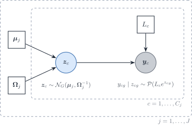

# In silico inference of gene regulatory networks

> **Note 1: Notation (aligned with the DeCovarT manuscript)**
>
> | Symbol | Role |
> |:---|:---|
> | g=1,\ldots,G | genes |
> | j=1,\ldots,J | cell types |
> | i=1,\ldots,N | purified samples / bootstrap replicates |
> | x\_{gji} | latent expression of gene g in cell type j, replicate i |
> | \mathcal{X}=(x\_{gji}) | tensor \mathcal{M}\_{G\times J\times N} of **single-cell** (purified) profiles |
> | \boldsymbol{\mu}=(\mu\_{gj}) | mean signature \mathcal{M}\_{G\times J}; column \boldsymbol{\mu}\_{\cdot j} is the **aggregated** reference for type j |
> | \boldsymbol{\Sigma}\_j | cell-type covariance \mathcal{M}\_{G\times G} |
> | \boldsymbol{\Omega}\_j\equiv\boldsymbol{\Sigma}\_j^{-1} | sparse precision of the type-j GGM (not a generic parameter \theta) |
>
> DeCovarT treats purified draws \boldsymbol{x}\_{\cdot
> j}^{(i)}\sim\mathcal{N}\_G(\boldsymbol{\mu}\_{\cdot j},
> \boldsymbol{\Sigma}\_j) as latent and forms bulk mixtures
> \boldsymbol{y}\_{\cdot i}=\sum_j p_j\\\boldsymbol{x}\_{\cdot j}^{(i)}.
> GRN inference instead targets the **conditional dependence structure**
> among genes within each purified profile—or across a pooled design
> matrix. When \boldsymbol{p} is already known, `CSNet` estimates
> type-level co-expression from the same convolution; the mapping onto
> DeCovarT’s precision \boldsymbol{\Omega}\_j is in the [perspectives
> vignette](https://bastienchassagnol.github.io/DeCovarT/articles/theory-review-distribution-aware-deconvolution.html#sec-csnet)
> ([Su et al. 2024](#ref-suEstimatingCellTypeSpecificGene2024)).

## General reviews

Marginal co-expression is a poor proxy for regulation. Shared upstream
TFs, cell-type programmes, and common stimuli induce correlation without
a direct edge; time lags and nonlinear kinetics can hide true edges.
Conditional graphical models target **direct** dependence via the
precision \boldsymbol{\Omega}, while causal / interventional designs are
needed for direction and mechanism ([Gene regulatory network inference
in the era of single-cell
multi-omics](https://doi.org/10.1038/s41576-023-00618-5); Svinin and
Glaab ([2025](#ref-svininCausalNetworkAnalysis2025)); [Network inference
in systems biology](https://doi.org/10.1016/j.copbio.2019.12.002)).

[Badia-i-Mompel *et al.*
(2023)](https://doi.org/10.1038/s41576-023-00618-5) review single-cell
multi-omics GRN tools and prior databases. Svinin and Glaab
([2025](#ref-svininCausalNetworkAnalysis2025)) place association,
prior-informed, and causal network analyses in one taxonomy. Together
they motivate separating undirected skeletons
([Sec. 2](#sec-grn-undirected)) from DAG / perturbation work
([Sec. 6](#sec-grn-directed)).

## Undirected probabilistic strategies

### General inference

Gaussian graphical models encode conditional independence in
\boldsymbol{\Omega}. The MLE exists only under sample-size / chordality
conditions formalised by [Uhler *et al.*
(2012)](https://doi.org/10.1214/11-AOS957): if n is too small relative
to clique size, the covariance MLE fails. Sparse \ell_1 estimation
(graphical lasso; Friedman et al.
([2008](#ref-friedmanSparseInverseCovariance2008))) is the workhorse
when p\gg n ([Chiquet 2015](#ref-chiquetContributionsSparseMethods2015);
[Menéndez et al. 2010](#ref-menendezGeneRegulatoryNetworks2010)).

Two practical workflows appear repeatedly:

1.  **Seeds then expand** — select a small discriminating gene set
    (e.g. low condition number / high centroid separation, in the spirit
    of Aliee and Theis ([2021](#ref-alieeAutoGeneSAutomaticGene2021))),
    then grow a prior-informed network with tools such as
    [NeKo](https://doi.org/10.1371/journal.pcbi.1013300).
2.  **Structure then parameters** — estimate a sparse skeleton (glasso,
    NeighbourNet, CeSpGRN), then fit continuous weights, possibly under
    hard zeros on \Omega\_{ij} for (i,j)\notin E.

Count-aware extensions replace the Gaussian likelihood by
Poisson–log-normal (PLN) or copula models ([Chiquet et al.
2021](#ref-chiquetPoissonLognormalModelVersatile2021),
[2018](#ref-chiquetVariationalInferenceSparse2018)) and
[CeSpGRN](https://doi.org/10.1093/bioinformatics/btag324), which matters
when DeCovarT moves from Gaussian convolutions to sequencing counts.

### Regularisation and topological constraints

Three standard devices:

\max\_{\boldsymbol{\Omega} \succ 0} \log\det\boldsymbol{\Omega} -
\operatorname{tr}(S\boldsymbol{\Omega}) \quad\text{s.t.}\quad
\boldsymbol{\Omega}\_{ij}=0\\\forall\\(i,j)\notin E \tag{1}

(hard covariance selection);

\max\_{\boldsymbol{\Omega} \succ 0} \log\det\boldsymbol{\Omega} -
\operatorname{tr}(S\boldsymbol{\Omega}) - \sum\_{i\neq
j}\lambda\_{ij}\\\|\boldsymbol{\Omega}\_{ij}\| \tag{2}

(edge-specific / hybrid penalties); and structured group or fused
graphical lasso for hubs, modules, or shared biological constraints
([Chiquet 2015](#ref-chiquetContributionsSparseMethods2015)). Trees and
chordal graphs remain PD-friendly ([Uhler *et al.*
(2012)](https://doi.org/10.1214/11-AOS957)). DeCovarT’s affine spectral
shift of a binary adjacency is a constructive PD completion compatible
with hard zeros off E.

### Algorithm unrolling and deep inference

Algorithm unrolling turns iterative sparse-precision solvers into
trainable layers ([Monga *et al.*
(2021)](https://doi.org/10.1109/MSP.2020.3016905);
[GLAD](https://arxiv.org/abs/1906.00271)). For hierarchical count
ecosystems, [Chaussard *et al.*
(2024)](https://hal.science/hal-04622671v1) introduce **PLN-Tree**: a
tree-structured extension of PLN with backward Markov variational
inference and identifiability results—an attractive route when taxonomy
or gene modules should inform \boldsymbol{\Omega}.

### Prior knowledge and PPI

Priors from TF–target, chromatin, and PPI databases can enter as
\lambda\_{ij} masks or as Bayesian edge probabilities ([Badia-i-Mompel
*et al.* (2023)](https://doi.org/10.1038/s41576-023-00618-5); Svinin and
Glaab ([2025](#ref-svininCausalNetworkAnalysis2025));
[NeKo](https://doi.org/10.1371/journal.pcbi.1013300)). This is the
undirected analogue of pathway contextualisation in
[Sec. 6](#sec-grn-directed): association graphs become biologically
constrained without claiming full causality.

## Per-type precisions from single-cell profiles

The reproducibility book estimates one sparse precision
\boldsymbol{\Omega}\_{j,t} per labelled type j and time t. It uses the
Suppinger gastruloid resource ([Suppinger et al.
2023](#ref-suppingerMultimodalCharacterizationMurine2023)) and a
500-gene panel selected for between-type separation. The resource is a
single technical scRNA-seq experiment. Cells are therefore draws from
one specimen, and the estimate targets the within-type cell-to-cell
covariance: the linear layer of the [one-replicate
regime](https://bastienchassagnol.github.io/DeCovarT/articles/theory-single-cell-generative-optimisation.html#sec-one-replicate),
not a between-specimen covariance.

| Estimator | Input | Sparsity device | Exported object | Main caveat |
|----|----|----|----|----|
| `ppcor` baseline | Gaussian table, n\>p | none; t test, BH | SPD refit on the support | n\>p only |
| `glasso` | correlation of \log(1+y) | \ell_1 off the diagonal; EBIC path | \widehat{\boldsymbol{\Omega}}\_R, rescaled to the data | same detection limit as any \ell_1 fit |
| `SILGGM` `D-S_GL` | nonparanormal scores | glasso, one Newton step, global FDR | SPD refit on the FDR support | debiased matrix is dense |
| `PLNnetwork` | UMI counts, offset \log L_c | \ell_1 on the latent precision | latent Gaussian precision | variational; no edgewise FDR |
| `corpcor` shrinkage | Gaussian table | none; correlations shrunk to 0 | dense \widehat{\boldsymbol{\Sigma}} | no graph |

Table 1: Estimators of the reproducibility pipeline.

Sources for each estimator:

- graphical lasso ([Friedman et al.
  2008](#ref-friedmanSparseInverseCovariance2008)), fitted with `glasso`
  and an unpenalised diagonal (`huge` ([Zhao et al.
  2012](#ref-zhaoHugePackageHighdimensional)) penalises it, see
  [Sec. 5.5](#sec-grn-penalise-diagonal));
- nonparanormal map ([Liu et al.
  2009](#ref-liuNonparanormalSemiparametricEstimation2009));
- de-sparsified graphical lasso ([Jankova and Geer
  2015](#ref-jankovaConfidenceIntervalsHighdimensional2015)) with the
  global FDR rule ([Liu 2013](#ref-liuGaussianGraphicalModel2013);
  [Zhang et al. 2018](#ref-zhangSILGGMExtensivePackage2018));
- Poisson–lognormal network ([Chiquet et al.
  2018](#ref-chiquetVariationalInferenceSparse2018));
- shrinkage covariance ([Schäfer and Strimmer
  2005](#ref-sch%C3%A4ferShrinkageApproachLargescale2005)), judged by
  held-out Gaussian log-likelihood ([Sec. 5.6](#sec-grn-need-sparsity)).

The penalty is chosen by EBIC ([Foygel and Drton
2010](#ref-foygelExtendedBayesianInformation2010)) with a safeguarded
log-interval search between \lambda\_{\max}=\max\_{g\neq g'}\|R\_{gg'}\|
and \lambda\_{\min}\asymp\sqrt{\log p/n}. Three alternatives are
documented:

- StARS ([Liu et al.
  2010](#ref-liuStabilityApproachRegularization2010)), kept as a
  diagnostic because it costs B\times L fits;
- thresholded adaptive validation, when the target is the support
  ([Laszkiewicz et al.
  2021](#ref-laszkiewiczThresholdedAdaptiveValidation2021));
- a graphical horseshoe, in place of a penalty path ([Li et al.
  2019](#ref-liGraphicalHorseshoeEstimator2019)).

## Critical review: near-diagonal precisions

On Suppinger, the `huge` graphical lasso selected by EBIC returns mostly
**diagonal** \widehat{\boldsymbol{\Omega}}\_{j,t}: no conditional
dependence among panel genes. Four explanations compete with “no
regulation”, and the first three are checkable.

### Pipeline behaviour to rule out first

> **Warning 1: Check the reproducibility code before the method**
>
> Reading `scripts/03_01_grn_huge.R`, `R/ebic_regularisation_path.R`,
> and the `huge` 1.5.1 sources (`huge.glasso()` and `src/huge_core.cpp`)
> showed three ways to obtain a diagonal precision that are unrelated to
> biology. All three are now corrected in the reproducibility code; the
> Suppinger networks must be refitted before the diagonal result is
> interpreted.
>
> 1.  **One constant gene emptied the whole type.** If any panel gene
>     was constant across the cells of a type (typically all-zero), the
>     script returned a diagonal covariance for **all** 500 genes of
>     that type. *Fix:* the constant gene is left out of that type’s
>     graph and recorded; pairwise scores use the genes both types keep.
>     The presence filter of the feature-selection chapter (detection
>     and positive variance in every type) prevents the case upstream.
> 2.  **Failed solves fell back to a diagonal.** When a `huge` solve
>     failed at a small penalty, `diagonal_precision_fallback()`
>     replaced it, and EBIC could then select that diagonal. *Fix:* a
>     failed penalty is dropped from the path and reported in
>     `failed_lambda`.
> 3.  **Two scales were mixed.** `huge.glasso()` runs `scale(x)` and
>     fits the correlation matrix R. The script computed the \lambda
>     endpoints and the EBIC log-likelihood from
>     S=\operatorname{cov}(\log(1+y)). The log-likelihood
>     \log\det\widehat{\boldsymbol{\Omega}}\_R-\operatorname{tr}(S\widehat{\boldsymbol{\Omega}}\_R)
>     combined a correlation-scale precision with a covariance-scale S,
>     which biases EBIC. *Fix:* the solver is now
>     `glasso::glasso(R, penalize.diagonal = FALSE)`; endpoints and EBIC
>     use R; the selected fit is exported as
>     D^{-1/2}\widehat{\boldsymbol{\Omega}}\_R D^{-1/2} and
>     D^{1/2}WD^{1/2}, with D=\operatorname{diag}(S).
>
> On a simulated chain of 30 genes with n=300, the corrected path
> recovers all 29 edges, with 20 false positives at the EBIC penalty.
> The exported covariance keeps the sample variances exactly.

### A screening threshold, not an estimated absence

For any \lambda, the graphical lasso on a correlation matrix returns a
diagonal \widehat{\boldsymbol{\Omega}} **exactly** when \max\_{g\neq
g'}\|R\_{gg'}\|\le\lambda. This holds with or without a penalised
diagonal: at the diagonal solution, the stationarity conditions reduce
to \|R\_{gg'}\|\le\lambda off the diagonal ([Mazumder and Hastie
2011](#ref-mazumderGraphicalLassoNew2011)). Chiquet’s review states the
same: “A large enough penalty level produces an empty graph” ([Chiquet
2015, 39](#ref-chiquetContributionsSparseMethods2015)). Our path starts
at that value.

Two orders of magnitude make an empty graph likely on scRNA-seq.

- **Noise level.** Under independence, the largest of the p(p-1)/2
  sample correlations is about \sqrt{4\log p/n}: 0.35 for p=500 and
  n=200. To control false edges, \lambda must sit near that level.
- **EBIC cost per edge.** With \gamma=0.5, EBIC charges \log
  n+4\gamma\log p\approx17.7 per edge at the same p and n. One edge with
  partial correlation \rho raises twice the log-likelihood by about
  -n\log(1-\rho^{2})\approx n\rho^{2}, so only \|\rho\|\gtrsim0.30
  survives. That is the intended effect of \gamma\>0, which corrects
  “the tendency of the usual BIC \[…\] to choose overly dense graphs in
  the high-dimensional setting” ([Chiquet 2015,
  43](#ref-chiquetContributionsSparseMethods2015)).

Neighbourhood selection has the same behaviour. Its finite-sample rule
for \lambda sets every coefficient to zero when all
\|r\_{ab}\|\le\tilde\Phi^{-1}\\\alpha/(2p^{2})\\/\sqrt n. That bound is
about 0.55 for p=1000, n=100 and \alpha=0.05 ([Meinshausen & Bühlmann
2006](https://doi.org/10.1214/009053606000000281), eq. 9). Their
signal-strength assumption states the general point: edges with partial
correlation below order n^{-(1-\xi)/2} are not detected. A diagonal
estimate therefore says that no partial correlation is large **relative
to \sqrt{\log p/n}**. It does not say that the partial correlations are
zero.

### Measurement attenuation on counts

On UMI counts, the observed covariance is the latent covariance plus a
**diagonal** sampling term. Under the Poisson–lognormal model of
[Figure 1](#fig-grn-pln), \operatorname{Var}(y\_{cg}) contains
\mathbb{E}(L\_{c}e^{z\_{cg}}) from Poisson sampling, while covariances
between genes come only from the latent layer. Every correlation is
therefore attenuated, most strongly for lowly expressed genes ([Sarkar
and Stephens 2021](#ref-sarkarSeparatingMeasurementExpression2021);
[Chiquet et al. 2021](#ref-chiquetPoissonLognormalModelVersatile2021)).
Attenuation pushes \max\|R\_{gg'}\| under the screening threshold of
[Sec. 4.2](#sec-grn-screening).



Figure 1: Poisson–lognormal measurement layer for one cell type. The
latent log-expression \boldsymbol{z}\_c carries the precision
\boldsymbol{\Omega}\_j; the observed counts add independent Poisson
noise given \boldsymbol{z}\_c and the library size L_c. Off-diagonal
covariances of \boldsymbol{y}\_c come only from \boldsymbol{z}\_c; the
Poisson term adds to the diagonal only.

A two-gene simulation shows the size of the effect at a typical 10x
depth.

``` r

set.seed(20261015)
n_cells <- 5000
latent_cor <- 0.6
z <- MASS::mvrnorm(
  n_cells,
  mu = rep(log(0.5), 2),
  Sigma = matrix(c(1, latent_cor, latent_cor, 1), 2)
)
y <- matrix(stats::rpois(length(z), exp(z)), ncol = 2)
round(
  c(
    latent = stats::cor(z)[1, 2],
    log1p_counts = stats::cor(log1p(y))[1, 2],
    mean_count = mean(y)
  ),
  2
)
#>       latent log1p_counts   mean_count 
#>         0.59         0.19         0.81
```

The hypothesis that raw-count variance reflects per-gene autoregulation
or feedback has to be read against this simulation. In a Gaussian graph
the precision diagonal is
\omega\_{gg}=1/\operatorname{Var}(x_g\mid\boldsymbol{x}\_{-g}). That is
the variance the other panel genes do not explain. It mixes:

- transcriptional bursting and autoregulation;
- regulators that are not on the panel;
- on counts, Poisson sampling.

S alone cannot separate these terms. At droplet depths, sampling is the
largest share for most genes ([Sarkar and Stephens
2021](#ref-sarkarSeparatingMeasurementExpression2021)). A measurement
layer (`PLNnetwork`, [Table 1](#tbl-grn-estimators)) is therefore the
principled correction, not a change to the penalty.

### A panel built against within-type edges

The panel is selected for a large between-type to within-type ratio. Its
genes therefore have, by construction, small within-type variance
relative to the type shifts. Edges are estimated **within** a type,
where that variance is mostly sampling noise
([Sec. 4.3](#sec-grn-attenuation)). Discriminating genes and network
genes need not coincide. Use one of two designs:

- estimate the network on a within-type variable panel (a union of
  per-type highly variable genes) and project it onto the discriminative
  panel;
- accept that the discriminative genes are close to conditionally
  independent within each type. That result is informative for DeCovarT:
  the covariance then adds little to the mean signature.

## Remedies, critically

### (i) Unpenalised partial correlations first

When n\>p, the precision \widehat{\boldsymbol{\Omega}}=S^{-1} needs no
penalty. `ppcor` returns the partial correlations
\rho\_{gg'\mid\mathrm{rest}}=-\omega\_{gg'}/\sqrt{\omega\_{gg}\omega\_{g'g'}}
and a t test with n-p degrees of freedom ([Kim 2015](#ref-R-ppcor)).
That gives:

- an **edgewise** test with FDR control, which the lasso path lacks;
- no diagonal penalty;
- a direct check of whether the partial correlations are small or the
  penalty is too strict.

Rescaling back to a precision uses the **conditional** variances,
\omega\_{gg}=1/\operatorname{Var}(x_g\mid\boldsymbol{x}\_{-g}), not the
marginal ones. Marginal rescaling understates \omega\_{gg} by the factor
1-R^{2}\_{g\cdot\mathrm{rest}}. After the non-significant partial
correlations are set to zero, refit under those zeros
([Eq. 1](#eq-hard-cov-selection)) to restore positive definiteness.

The limits are sharp:

- With p\ge n, `ppcor` uses a Moore–Penrose inverse and returns no test.
  At 500 genes, only the largest types qualify, unless the panel is cut
  to a few dozen genes per type.
- Even when p\<n, the t test loses power as p/n\to1.
- The shrinkage partial correlation of `GeneNet`/`corpcor` ([Schäfer and
  Strimmer 2005](#ref-sch%C3%A4ferShrinkageApproachLargescale2005)) is
  the unpenalised-graph analogue for p\ge n. It shrinks towards the
  identity, so it attenuates as well.
- Chiquet notes that the MLE needs “n to be larger than p to be able to
  even define this estimator” ([Chiquet 2015,
  38](#ref-chiquetContributionsSparseMethods2015)). That is the regime
  of this baseline, and the reason sparsity or shrinkage is needed below
  it.

### (ii) Neighbourhood selection and SPACE

[Meinshausen & Bühlmann
(2006)](https://doi.org/10.1214/009053606000000281) regress each gene on
all others with a lasso, \theta^{a}\_{b}=-\omega\_{ab}/\omega\_{aa}.
They combine the neighbourhoods by the AND or the OR rule, and prove
consistent graph recovery under four assumptions:

- a sparsity bound on the degree;
- a minimum signal strength;
- a “neighbourhood stability” (irrepresentability) condition, which
  cannot be relaxed;
- \operatorname{Var}(x_a\mid\boldsymbol{x}\_{-a}) bounded away from 0.

Advantages over the graphical lasso:

- a smaller sample size for consistent selection: of order d\log p
  against d^{2}\log p for the graphical lasso, “even if the
  corresponding ‘irrepresentability conditions’ are not strictly
  comparable” ([Chiquet 2015,
  41](#ref-chiquetContributionsSparseMethods2015)). The graphical lasso
  also estimates the precision itself;
- the p lasso fits are independent and parallel, O(np\min(n,p)) each,
  against O(p^{3}) per penalty;
- there is no positive-definiteness constraint, so a node-wise model can
  use a count GLM per gene.

Costs:

- no estimate of the precision itself, only its support;
- an asymmetric \hat\theta;
- “all variables are assumed to share the same variance in this
  formulation” ([Chiquet 2015,
  41](#ref-chiquetContributionsSparseMethods2015)), so standardise the
  genes first;
- the same screening behaviour ([Sec. 4.2](#sec-grn-screening)).

The irrepresentability conditions also differ. [Ravikumar *et al.*
(2011)](https://doi.org/10.1214/11-EJS631) give the graphical lasso’s
version on \boldsymbol{\Sigma}\otimes\boldsymbol{\Sigma}. In Zhang &
Zou’s AR(1) and AR(3) examples it fails for a range of coefficients
where the D-trace condition still holds ([Zhang and Zou
2014](#ref-zhangSparsePrecisionMatrix2014)).

SPACE ([Peng et al. 2009](#ref-pengPartialCorrelationEstimation2009))
makes the regressions joint and symmetric. It penalises
\lambda\sum\_{g\<g'}\|\rho^{gg'}\| directly, with
\beta\_{gg'}=\rho^{gg'}\sqrt{\omega\_{g'g'}/\omega\_{gg}}. The
consequences:

- **No diagonal penalty.** It **re-estimates** the diagonal
  1/\hat\omega\_{gg} from residual variances, alternating with the
  penalised step (usually within three iterations).
- **Better hub recovery.** Penalising globally rather than node by node
  recovers hubs better on power-law graphs. Uniform-degree graphs show
  no gain.
- **Positive definiteness is not guaranteed.**

For TF-hub structures, SPACE is the stronger candidate. Chiquet
describes it as embedding “the computational advantage of neighborhood
selection while estimating the conditional variance as in the
graphical-Lasso” ([Chiquet 2015,
42](#ref-chiquetContributionsSparseMethods2015)).

CLIME is a third regression-type estimator worth a sensitivity run. It
fits one constrained \ell_1 problem per column, so it needs a
symmetrisation step afterwards. Chiquet notes that “no particular
assumption like a irrepresentability condition – which can never be
established in practice – is required” ([Chiquet 2015,
42](#ref-chiquetContributionsSparseMethods2015)).

All three regression methods need the same order of signal as the
graphical lasso. They change the bias, the assumptions and the
computation, not the detection limit.

### (iii) Joint and differential networks across types

Early gastruloid slots contain one dominant population and several types
with few cells. Estimating each \boldsymbol{\Omega}\_{j} alone wastes
the shared structure. The relevant families differ in **what** they
share.

- **Shrunk covariances.** The intertwined lasso fits each type on \tilde
  S^{(j)}=\alpha S^{(j)}+(1-\alpha)\bar S, with \bar S the cell-weighted
  pooled covariance and \alpha chosen by cross-validation ([Chiquet et
  al. 2011](#ref-chiquetInferringMultipleGraphical2011); [Chiquet 2015,
  49–50](#ref-chiquetContributionsSparseMethods2015)). It is the
  simplest way to borrow strength from the dominant population.
- **Shared support, free weights.** The group graphical lasso ([Danaher
  et al. 2012](#ref-danaherJointGraphicalLasso2012)) and the cooperative
  lasso ([Chiquet et al.
  2011](#ref-chiquetInferringMultipleGraphical2011),
  [2012](#ref-chiquetSparsitySigncoherentGroups2012)) share the edges
  across types. The cooperative lasso also assumes **sign coherence**:
  an edge may change magnitude between types but not sign, because “sign
  swaps are very unlikely” ([Chiquet 2015,
  51](#ref-chiquetContributionsSparseMethods2015)). This matches the
  idea of penalising sign changes while leaving weights free.
- **Shared weights.** The fused graphical lasso penalises
  \|\omega^{(j)}\_{gg'}-\omega^{(j')}\_{gg'}\| ([Danaher et al.
  2012](#ref-danaherJointGraphicalLasso2012)). A PLN version also exists
  ([Zhai et al. 2026](#ref-zhaiPLNFGLJointEstimation2026)).
- **Block priors.** SIMoNe places a stochastic block model on the edges
  ([Chiquet *et al.*
  2009](https://doi.org/10.1093/bioinformatics/btn637); [Ambroise *et
  al.* 2009](https://doi.org/10.1214/08-EJS314); Holland et al.
  ([1983](#ref-hollandStochasticBlockmodelsFirst1983))). Edges within a
  module are penalised less than edges between modules, and the modules
  are learnt by variational EM. The rationale: “while sparsity is
  necessary to solve the problem when few observations are available,
  biasing the estimation of the network towards a given topology can
  help us find the correct graph in a more robust way” ([Chiquet 2015,
  44](#ref-chiquetContributionsSparseMethods2015)).
- **The difference itself.** The D-trace loss
  \tfrac12\langle\boldsymbol{\Omega}^{2},S\rangle-\operatorname{tr}\boldsymbol{\Omega}
  ([Zhang and Zou 2014](#ref-zhangSparsePrecisionMatrix2014)) extends to
  \boldsymbol{\Delta}=\boldsymbol{\Omega}\_{1}-\boldsymbol{\Omega}\_{2}
  ([Yuan et al. 2017](#ref-yuanDifferentialNetworkAnalysis2017)). The
  rewiring is estimated without estimating either network, and only
  \boldsymbol{\Delta} needs to be sparse ([Plaksienko et al.
  2025](#ref-plaksienkoMethodsDifferentialNetwork2025)).

Separate fits per type, as in our pipeline, are defensible only with one
penalty per type. A common \lambda “is sensible \[…\] provided that the
C samples have similar sizes and originate from similar distributions,
in particular regarding scaling and sparseness” ([Chiquet 2015,
49](#ref-chiquetContributionsSparseMethods2015)). Our types differ by
orders of magnitude in n_j, hence a per-type EBIC search on the
correlation scale.

**The caveat for DeCovarT.** DeCovarT separates types partly **through**
their covariance differences. Fusion shrinks those differences, and with
a dominant population it pulls the rare types towards the dominant
network. Prefer shared-support or sign-coherent penalties to fused
weights. Use \boldsymbol{\Delta}-estimation when the question is
rewiring, and check that held-out type discrimination does not degrade.

### (iv) When can sparse recovery work?

Keep three thresholds apart; they are often conflated.

1.  **The estimator exists.** With the off-diagonal-only penalty, the
    graphical lasso has a unique solution for any \lambda\>0 once
    S\_{gg}\>0, even when p\>n ([Carter
    2025](#ref-carterExistencePenalisedLikelihood2025)). No sparsity is
    needed. The penalised-diagonal version (`huge`) exists as well.
2.  **The MLE on a fixed graph exists.** Dempster’s refit under the
    zeros of E ([Eq. 1](#eq-hard-cov-selection)) needs n at least the
    maximum-likelihood threshold of the graph. That threshold lies
    between the clique number and the treewidth plus one, and equals the
    clique number for chordal graphs ([Uhler
    2012](https://doi.org/10.1214/11-AOS957); [Bernstein & Outlaw
    2023](https://arxiv.org/abs/2312.03145)).
3.  **The graph is recovered.** This requires n\gtrsim d^{2}\log p for
    maximum degree d, an irrepresentability condition, bounded
    eigenvalues, and a minimum \|\omega\_{gg'}\| ([Ravikumar *et al.*
    2011](https://doi.org/10.1214/11-EJS631)). Chiquet draws the
    practical consequence: “this should prevent blindly applying the
    graphical-Lasso in situations where the sample size n is too small
    compared to p. Similarly, when the presence of hub nodes with high
    degree is suspected, the estimated graph should be interpreted with
    care” ([Chiquet 2015,
    40](#ref-chiquetContributionsSparseMethods2015)).

The third condition decides the matter here. With p=500 and d=10,
d^{2}\log p\approx620 before constants. Any type with fewer cells is
outside the recovery regime, and hubs raise d. Heinävaara et al.
([2016](#ref-hein%C3%A4vaaraInconsistency%E2%84%931penalisedSparse2016))
report that on models derived from gene expression the
irrepresentability conditions **never** held, even for modest networks.
\ell_1 methods also failed when dependencies were nearly linear. These
conditions involve the unknown \boldsymbol{\Sigma}: “we can never verify
them on real data” ([Chiquet 2015,
77](#ref-chiquetContributionsSparseMethods2015)). Even inside the
supported regime, “sparse GGM fail to reconstruct real regulatory
networks at a low false positive rate, when only based upon
transcriptomic data” ([Chiquet 2015,
60](#ref-chiquetContributionsSparseMethods2015)). They can be **probed**
by simulation: draw precisions with
[`simulate_hierarchical_grn_moments()`](https://bastienchassagnol.github.io/DeCovarT/reference/simulate_hierarchical_grn_moments.md)
at the observed n_j, fit, and measure recovery.

### (v) Penalising the diagonal

With a penalised diagonal, the stationarity conditions give
W\_{gg}=S\_{gg}+\lambda for W=\widehat{\boldsymbol{\Omega}}^{-1}
([Friedman et al. 2008](#ref-friedmanSparseInverseCovariance2008);
[Mazumder and Hastie 2011](#ref-mazumderGraphicalLassoNew2011)). `huge`
does this on the correlation scale, so W\_{gg}=1+\lambda, and an
isolated gene gets \hat\omega\_{gg}=1/(1+\lambda).

What the diagonal penalty does:

- It **does not** move the empty-graph threshold
  ([Sec. 4.2](#sec-grn-screening)).
- It adds \lambda to every variance. Compared with the off-diagonal-only
  fit, the implied correlations shrink by about 1/(1+\lambda), so the
  surviving partial correlations and the diagonal of the precision are
  both biased downwards.
- On counts it acts in the same direction as Poisson sampling
  ([Sec. 4.3](#sec-grn-attenuation)).

Its main justifications are numerical (CLIME, the full-norm D-trace) or
a Laplace prior on every entry. For DeCovarT, leave the diagonal free,
or penalise a scale-free quantity. The original `glasso` package
([Friedman et al. 2008](#ref-friedmanSparseInverseCovariance2008))
penalises the diagonal **by default** (`penalize.diagonal = TRUE` in
version 1.11), so the argument must be set to `FALSE`; `huge.glasso()`
offers no such switch. The reproducibility pipeline now uses
`glasso::glasso(R, penalize.diagonal = FALSE)`.

**Iterative schemes that readjust the diagonal.** The partial
correlation graphical lasso, PCGLASSO ([Carter, Rossell & Smith
2024](https://doi.org/10.1111/sjos.12675)), writes
\boldsymbol{\Omega}=\boldsymbol{\theta}^{1/2}\boldsymbol{\Delta}\boldsymbol{\theta}^{1/2},
with \boldsymbol{\theta} diagonal and \boldsymbol{\Delta} of unit
diagonal. It penalises \rho\sum\_{g\neq g'}\|\Delta\_{gg'}\|, the
partial correlations only. The estimate is **scale invariant**, which
the graphical lasso is only after standardisation.

Carter and Molinari
([2025](#ref-carterExistenceOptimisationPartial2025)) prove that it
exists for n\<p when a logarithmic diagonal term has weight c\<1-k/p.
They compute it by **alternating** two convex blocks:

1.  the partial correlations \boldsymbol{\Delta} given the diagonal;
2.  the diagonal given \boldsymbol{\Delta}.

The R package is `PCGLASSO` on GitHub. This is the recent “off-diagonal
first, then readjust the diagonal” scheme. SPACE
([Sec. 5.2](#sec-grn-neighbourhood)) is its regression-based ancestor.
The simplest version of the same idea is a two-stage fit: select the
support with any penalised method, then refit \boldsymbol{\Omega}
without penalty on that support ([Eq. 1](#eq-hard-cov-selection)).

### (vi) Does DeCovarT need a sparse precision?

Sparsity buys four things:

- **Existence** when p\ge n. Any regulariser provides this, including
  ridge and shrinkage, so sparsity is not necessary.
- **Lower variance**, with \|E\|+p free parameters instead of p(p+1)/2.
- **Interpretation**: zeros are conditional independences.
- **The recovery theory** of [Sec. 5.4](#sec-grn-conditions).

DeCovarT uses only the second of these. Its likelihood needs
\boldsymbol{\Sigma}\_{j}, and the bulk covariance
\sum\_{j}p\_{ji}^{2}\boldsymbol{\Sigma}\_{j} of the
[convolution](https://bastienchassagnol.github.io/DeCovarT/articles/theory-review-distribution-aware-deconvolution.html#eq-gaussian-convolution)
has **no** sparse precision, even when every \boldsymbol{\Omega}\_{j} is
sparse. The graph matters for interpretation and for priors
([Sec. 2.4](#sec-grn-priors)), not for the deconvolution likelihood.

**What `cov.output` returns.** `huge(..., cov.output = TRUE)` returns
the dual matrix of the same fit, W=\widehat{\boldsymbol{\Omega}}^{-1}.
It is neither the plain inverse of a separate estimate nor a refit under
the zeros. On the selected edges,
W\_{gg'}=R\_{gg'}+\lambda\\\mathrm{sign}(\hat\omega\_{gg'}); off them,
\|W\_{gg'}-R\_{gg'}\|\le\lambda; and W\_{gg}=1+\lambda. A
**topology-constrained** covariance, which matches S exactly on the
diagonal and on the edges, is Dempster’s refit
([Eq. 1](#eq-hard-cov-selection)). An empty graph discards all
covariance and reduces DeCovarT to an independent-gene model. A dense,
well-conditioned estimate is then the safer plug-in:

- Ledoit–Wolf or Schäfer–Strimmer shrinkage;
- factor-plus-diagonal;
- the PLN latent covariance.

Judge it by held-out Gaussian log-likelihood and by deconvolution
accuracy, not by graph recovery. The reproducibility book implements
this as a fifth strategy: Schäfer–Strimmer shrinkage of the correlations
with the variances kept, \hat\lambda^{\ast} in closed form, and K-fold
held-out log-likelihood against the diagonal, the `glasso` refit and the
PLN covariance ([Schäfer and Strimmer
2005](#ref-sch%C3%A4ferShrinkageApproachLargescale2005)). Chiquet
recommends K-fold cross-validation when prediction, not the true model,
is the target ([Chiquet 2015,
78](#ref-chiquetContributionsSparseMethods2015)).

### What the sparse-GGM review supports

Chiquet ([2015](#ref-chiquetContributionsSparseMethods2015)) reviews
sparse GGM inference in chapter 2 and sparse regularisation in chapter
3. Page numbers below are the printed pages; the PDF page is the printed
page plus 10.

**Naive gene selection before any penalty.** The review does not
recommend a data-driven pre-filter of genes before a GGM. It offers
three related points.

- Screening exists in regression. Marginal-correlation “sure screening”
  aims “to reduce the initial number of predictors p to an order similar
  to n”. Safe rules discard only variables that cannot enter the model,
  whereas “the strong rule is not safe and a relevant variable may be
  discarded” (pp. 74–75).
- For the graphical lasso, the safe rule is exact: the block-diagonal
  decomposition cited on p. 39 ([Mazumder and Hastie
  2011](#ref-mazumderGraphicalLassoNew2011)). A gene with
  \max\_{g'}\|R\_{gg'}\|\le\lambda is isolated at that \lambda. Removing
  it beforehand changes nothing. *Our inference:* this is the only
  lossless naive filter. Filters by variance, marginal correlation or
  differential expression change the conditioning set of every other
  gene. Partial correlations are defined relative to the panel, so they
  change too.
- Chiquet’s own analyses keep p at or below n with knowledge-based gene
  sets: 26 genes for n=133 (p. 48), 91 proteins for n=60 (p. 59). They
  also restrict candidate edges to TF–target pairs when that knowledge
  exists (p. 61). Low-order partial-correlation tests are set aside for
  their cost, or for “strong assumptions \[…\] that correspond to
  regimes never attained in real situations” (p. 38).

For DeCovarT, the discriminative panel of the feature-selection chapter
is a choice made for the deconvolution, not a GGM screen. Keep the
presence filter, report \max\|R\_{gg'}\| per type, and for small types
reduce p towards n_j before reading the graph.

**Approaches worth trying.**

| Approach | What it adds here | Verdict | Pages |
|----|----|----|----|
| Neighbourhood selection with resampling | selection at n\asymp d\log p; “quite competitive, especially when coupled with additional bootstrap or resampling techniques” | second opinion for large types | 40–41 |
| CLIME | no irrepresentability assumption | sensitivity run | 41–42 |
| SPACE and its convex refinement | hubs; conditional variances estimated, not penalised | candidate for TF hubs | 42 |
| SIMoNe, SBM-weighted penalty | modules and prior topology | when modules are expected | 44–48 |
| Intertwined, group and cooperative lasso | borrowing strength across types | rare types at 48 h | 49–51 |
| Adaptive (two-step weighted) lasso | weights from a first fit; “state-of-the-art versions of the Lasso” | cheap upgrade of `glasso` | 77 |
| Bayesian GGMs | priors on \boldsymbol{\Omega}; MCMC limits size | not at p=500 | 38 |
| Poisson neighbourhood GLMs | counts, but “a null partial correlation does not mean conditional dependency in the non-Gaussian case” | prefer PLN | 43 |

Table 2: Approaches from the HDR. Page numbers refer to Chiquet
([2015](#ref-chiquetContributionsSparseMethods2015)).

**Theory on sparsity, degree and dimension.** The review states the
following conditions; [Sec. 5.4](#sec-grn-conditions) adds the more
recent results.

- The MLE needs n\>p (p. 38).
- The graphical lasso is consistent for n of order d^{2}\log p, under
  irrepresentability (p. 40). Neighbourhood selection needs d\log p
  (p. 41).
- Restricted-eigenvalue and compatibility conditions give estimation
  bounds, not selection. Selection further needs a minimum signal (“if
  βmin not too small”), and none of these conditions can be verified on
  real data (pp. 76–77).

How the pipeline choices map to these sources:

| Implementation choice | Justification | Source |
|----|----|----|
| Fit the graphical lasso on R, not S | one \lambda needs a common scale; neighbourhood selection assumes equal variances | Chiquet ([2015](#ref-chiquetContributionsSparseMethods2015)), pp. 41, 49; [Carter, Rossell & Smith 2024](https://doi.org/10.1111/sjos.12675) |
| Unpenalised diagonal | the diagonal penalty biases the variances by \lambda and leaves the empty-graph threshold unchanged | Friedman et al. ([2008](#ref-friedmanSparseInverseCovariance2008)); Mazumder and Hastie ([2011](#ref-mazumderGraphicalLassoNew2011)) |
| Path from \lambda\_{\max}=\max\lvert R\_{gg'}\rvert down to \sqrt{\log p/n} | above \lambda\_{\max} the graph is empty | Chiquet ([2015](#ref-chiquetContributionsSparseMethods2015)), p. 39 |
| One EBIC search per type | a common \lambda only for similar sizes and scales | Chiquet ([2015](#ref-chiquetContributionsSparseMethods2015)), pp. 43, 49; Foygel and Drton ([2010](#ref-foygelExtendedBayesianInformation2010)) |
| Read an empty graph as a detection limit | n\asymp d^{2}\log p; conditions unverifiable | Chiquet ([2015](#ref-chiquetContributionsSparseMethods2015)), pp. 40, 77; Heinävaara et al. ([2016](#ref-hein%C3%A4vaaraInconsistency%E2%84%931penalisedSparse2016)) |
| PLN for counts, nonparanormal for `SILGGM` | Poisson GLM graphs lose the partial-correlation meaning; the nonparanormal costs little | Chiquet ([2015](#ref-chiquetContributionsSparseMethods2015)), p. 43; Chiquet et al. ([2018](#ref-chiquetVariationalInferenceSparse2018)) |
| Dense shrinkage covariance as the DeCovarT plug-in | positive definite for any n, p; judged by cross-validated likelihood | Schäfer and Strimmer ([2005](#ref-sch%C3%A4ferShrinkageApproachLargescale2005)); Chiquet ([2015](#ref-chiquetContributionsSparseMethods2015)), p. 78 |
| Joint estimation for rare types (planned) | coupling helps “especially for small sample sizes” | Chiquet ([2015](#ref-chiquetContributionsSparseMethods2015)), p. 50; Chiquet et al. ([2011](#ref-chiquetInferringMultipleGraphical2011)) |

Table 3: Pipeline choices and the sources that justify them.

### Recommended order

1.  Refit with the corrected pipeline of [Warning 1](#wrn-grn-pipeline)
    (`glasso`, unpenalised diagonal, correlation scale), and with
    \gamma=0 as a sensitivity check.
2.  Report \max\_{g\neq g'}\|R\_{gg'}\| per type next to \sqrt{4\log
    p/n_j}. If the two are close, no penalised method will find edges.
3.  Compare with `PLNnetwork`. Edges that appear only after the Poisson
    layer is modelled were attenuated, not absent.
4.  For large types, run the `ppcor` baseline on a reduced panel, with
    BH edges and an SPD refit.
5.  Leave the diagonal unpenalised, or use PCGLASSO; refit on the
    support.
6.  For rare types, borrow strength with a shared-support or
    sign-coherent joint penalty, and check discrimination on held-out
    cells.
7.  If the goal is only the DeCovarT plug-in, compare against a dense
    shrinkage covariance by held-out likelihood before investing in
    sparse graphs.

## Directed approaches

Gaussian Bayesian networks orient edges under Markov and faithfulness
assumptions; interventions (Perturb-seq and related CRISPR screens)
supply the environments needed for stronger causal claims ([Peters *et
al.* (2016)](https://doi.org/10.1111/rssb.12167); Svinin and Glaab
([2025](#ref-svininCausalNetworkAnalysis2025))). Pathway tools (NPA,
SignalingProfiler, LIONESS/PANDA, NLBayes) contextualise expression on
signed graphs but often stop short of a full weighted GRN MLE—treat them
as priors or downstream scorers rather than drop-in replacements for
\boldsymbol{\Omega}.

> **Note 2: From factorised Gaussian BNs to a joint multivariate
> normal**
>
> Consider a directed acyclic graph on G genes with topological order
> 1,\ldots,G. A **linear Gaussian Bayesian network** specifies, for each
> gene i,
>
> X_i \mid \mathrm{Pa}(i) \sim \mathcal{N}\\\left( \mu_i +
> \sum\_{j\in\mathrm{Pa}(i)} \beta\_{ij} X_j,\\ \sigma_i^{2} \right),
> \tag{3}
>
> where \mathrm{Pa}(i) is the parent set in the DAG and \beta\_{ij}=0
> when j\not\in\mathrm{Pa}(i). Equivalently,
>
> X_i = \mu_i + \sum\_{j=1}^{G} b\_{ij} X_j + \varepsilon_i, \qquad
> \varepsilon_i \sim \mathcal{N}(0,\sigma_i^{2}), \qquad b\_{ij}=0
> \text{ unless } j\in\mathrm{Pa}(i). \tag{4}
>
> Collect coefficients in a strictly upper-triangular matrix B=(b\_{ij})
> (after ordering genes along the DAG) and noise variances
> D=\mathrm{diag}(\sigma_1^{2},\ldots,\sigma_G^{2}). Then
> [Eq. 4](#eq-gbn-structural) is
> \boldsymbol{X}=B\boldsymbol{X}+\boldsymbol{\varepsilon} with
> \boldsymbol{\varepsilon}\sim\mathcal{N}\_G(0,D), hence
>
> (\boldsymbol{I}\_G-B)\boldsymbol{X}=\boldsymbol{\mu}+\boldsymbol{\varepsilon}.
> \tag{5}
>
> When (\boldsymbol{I}\_G-B) is invertible (always true for a DAG with
> consistent ordering),
>
> \boldsymbol{X}\sim\mathcal{N}\_G(\boldsymbol{\mu},\boldsymbol{\Sigma}),
> \qquad \boldsymbol{\Sigma} =(\boldsymbol{I}\_G-B)^{-1} D
> (\boldsymbol{I}\_G-B)^{-\mathsf{T}}. \tag{6}
>
> The joint precision is
>
> \boldsymbol{\Omega}=\boldsymbol{\Sigma}^{-1}
> =(\boldsymbol{I}\_G-B)^{\mathsf{T}} D^{-1}(\boldsymbol{I}\_G-B),
> \tag{7}
>
> which is generally **not** sparse even when the DAG skeleton is
> sparse: moralisation and conditioning introduce fill-in. That is why
> undirected GGMs ([Sec. 2](#sec-grn-undirected)) and directed BNs
> answer different questions: [Eq. 6](#eq-gbn-joint-cov) is the directed
> generative model; [Eq. 1](#eq-hard-cov-selection) targets conditional
> independences in an undirected graph.
>
> In R, `bnlearn::gbn2mvnorm()` ([Scutari 2026](#ref-R-bnlearn)) returns
> (\boldsymbol{\mu}, \boldsymbol{\Sigma}) from a fitted Gaussian BN—the
> directed counterpart of taking
> \boldsymbol{\Sigma}=\boldsymbol{\Omega}^{-1} in an undirected GGM. For
> DeCovarT simulation, the same construction can populate
> cell-type-specific \boldsymbol{\Sigma}\_j when a DAG is the ground
> truth for purified profiles \boldsymbol{x}\_{\cdot j}^{(i)}, before
> bulk convolution with \boldsymbol{p}.

## Benchmarks

Comparative reverse-engineering studies and DREAM-style challenges
remain the default yardsticks for undirected and directed GRN callers
([Penfold & Wild (2011)](https://doi.org/10.1098/rsfs.2011.0053);
[Network inference in systems
biology](https://doi.org/10.1016/j.copbio.2019.12.002); Menéndez et al.
([2010](#ref-menendezGeneRegulatoryNetworks2010))). Emulation tests for
TF–target function complement topological accuracy when gold-standard
DAGs are incomplete. Any DeCovarT-related network estimator should
report against these protocols before biological claims.

## Perspectives

### Multi-omics

Collaborative / multi-layer glasso and tensor-fusion GNNs couple
transcriptomic layers with metabolomic, methylation, or miRNA views.
They generalise the single-precision story to coupled
\boldsymbol{\Omega} blocks—relevant when references cease to be
expression-only.

### Boolean meets Bayesian

Noisy logic models (e.g. NLBayes) combine Boolean pathway structure with
Bayesian TF-activity inference. They are powerful for regulon-level
questions but are not substitutes for a dense weighted precision used
inside DeCovarT’s Gaussian convolution.

### Dynamics

Static snapshots average over regulatory delays. Time-series reviews
([Natalia *et al.*
(2023)](https://doi.org/10.1371/journal.pcbi.1011254)),
[Dictys](https://doi.org/10.1038/s41592-023-01971-3), and related
dynamic biomarker methods target \boldsymbol{\Omega}\_t along
trajectories. Real-time or densely time-stamped assays would further
reduce confounding between co-expression and causation.

### Graph neural networks

OOD-robust GNNs and invariant causal prediction ([Peters *et al.*
(2016)](https://doi.org/10.1111/rssb.12167)) address batch / cell-type
shift when message-passing replaces classical glasso. Unrolling
([Sec. 2.3](#sec-grn-unrolling)) remains preferable when
interpretability of each layer as an optimisation step matters for
statistical GRN recovery.

## Link to DeCovarT simulation

[`simulate_hierarchical_grn_moments()`](https://bastienchassagnol.github.io/DeCovarT/reference/simulate_hierarchical_grn_moments.md)
currently draws a random-graph adjacency and completes it to a PD
precision. The literature above suggests three near-term upgrades, in
increasing ambition:

1.  replace the random skeleton by a prior-informed or glasso skeleton
    on real purified profiles;
2.  use edge-specific \lambda\_{ij} (PPI / TF) instead of a uniform
    `precision_scale`;
3.  move from a shared Gaussian \boldsymbol{\Omega} to PLN / PLN-Tree or
    cell-type-specific copula models when count structure dominates.

## References

Aliee, Hananeh, and Fabian J. Theis. 2021. ‘AutoGeneS: Automatic Gene
Selection Using Multi-Objective Optimization for RNA-seq Deconvolution’.
*Cell Systems* 12. <https://doi.org/10.1016/j.cels.2021.05.006>.

Carter, Jack Storror. 2025. ‘Existence of Penalised Likelihood Estimates
and Posterior Propriety of Separable Prior Distributions for Gaussian
Precision Matrices’. In *arXiv.org*. Https://arxiv.org/abs/2505.20005v2.

Carter, Jack Storror, and Cesare Molinari. 2025. *Existence and
Optimisation of the Partial Correlation Graphical Lasso*.
arXiv:2510.25712. arXiv. <https://doi.org/10.48550/arxiv.2510.25712>.

Chiquet, Julien. 2015. ‘Contributions to Sparse Methods for Complex Data
Analysis’. PhD thesis, Université Paris-Saclay / AgroParisTech.

Chiquet, Julien, Yves Grandvalet, and Christophe Ambroise. 2011.
‘Inferring Multiple Graphical Structures’. *Statistics and Computing* 21
(4): 537. <https://doi.org/10.1007/s11222-010-9191-2>.

Chiquet, Julien, Yves Grandvalet, and Camille Charbonnier. 2012.
‘Sparsity with Sign-Coherent Groups of Variables via the
Cooperative-Lasso’. *The Annals of Applied Statistics* 6.
<https://doi.org/10.1214/11-aoas520>.

Chiquet, Julien, Mahendra Mariadassou, and Stéphane Robin. 2018.
*Variational Inference for Sparse Network Reconstruction from Count
Data*. arXiv. <https://doi.org/10.48550/arxiv.1806.03120>.

Chiquet, Julien, Mahendra Mariadassou, and Stéphane Robin. 2021. ‘The
Poisson-Lognormal Model as a Versatile Framework for the Joint Analysis
of Species Abundances’. *Frontiers in Ecology and Evolution* 9.
<https://doi.org/10.3389/fevo.2021.588292>.

Danaher, Patrick, Pei Wang, and Daniela M. Witten. 2012. *The Joint
Graphical Lasso for Inverse Covariance Estimation Across Multiple
Classes*. arXiv:1111.0324. arXiv.
<https://doi.org/10.48550/arxiv.1111.0324>.

Foygel, Rina, and Mathias Drton. 2010. *Extended Bayesian Information
Criteria for Gaussian Graphical Models*. arXiv:1011.6640. arXiv.
<https://doi.org/10.48550/arxiv.1011.6640>.

Friedman, Jerome, Trevor Hastie, and Robert Tibshirani. 2008. ‘Sparse
Inverse Covariance Estimation with the Graphical Lasso’. *Biostatistics
(Oxford, England)* 9. <https://doi.org/10.1093/biostatistics/kxm045>.

Heinävaara, Otte, Janne Leppä-aho, Jukka Corander, and Antti Honkela.
2016. ‘On the Inconsistency of \ell1-Penalised Sparse Precision Matrix
Estimation’. *BMC Bioinformatics* 17 (Suppl 16): 448.
<https://doi.org/10.1186/s12859-016-1309-x>.

Holland, Paul W., Kathryn Blackmond Laskey, and Samuel Leinhardt. 1983.
‘Stochastic Blockmodels: First Steps’. *Social Networks* 5.
<https://doi.org/10.1016/0378-8733(83)90021-7>.

Jankova, Jana, and Sara van de Geer. 2015. ‘Confidence Intervals for
High-Dimensional Inverse Covariance Estimation’. *Electronic Journal of
Statistics* 9 (1). <https://doi.org/10.1214/15-ejs1031>.

Kim, Seongho. 2015. *Ppcor: Partial and Semi-Partial (Part)
Correlation*. <https://doi.org/10.32614/cran.package.ppcor>.

Laszkiewicz, Mike, Asja Fischer, and Johannes Lederer. 2021.
‘Thresholded Adaptive Validation: Tuning the Graphical Lasso for Graph
Recovery’. *Proceedings of The 24th International Conference on
Artificial Intelligence and Statistics*, 1864–72.

Li, Yunfan, Bruce A. Craig, and Anindya Bhadra. 2019. *The Graphical
Horseshoe Estimator for Inverse Covariance Matrices*. arXiv:1707.06661.
arXiv. <https://doi.org/10.48550/arxiv.1707.06661>.

Liu, Han, John Lafferty, and Larry Wasserman. 2009. ‘The Nonparanormal:
Semiparametric Estimation of High Dimensional Undirected Graphs’.
*Journal of Machine Learning Research* 10 (80): 2295–328.

Liu, Han, Kathryn Roeder, and Larry Wasserman. 2010. ‘Stability Approach
to Regularization Selection (StARS) for High Dimensional Graphical
Models’. *Advances in Neural Information Processing Systems* 24 (2):
1432–40.

Liu, Weidong. 2013. *Gaussian Graphical Model Estimation with False
Discovery Rate Control*. arXiv:1306.0976. arXiv.
<https://doi.org/10.48550/arxiv.1306.0976>.

Mazumder, Rahul, and Trevor Hastie. 2011. ‘The Graphical Lasso: New
Insights and Alternatives’. *Electronic Journal of Statistics* 6.
<https://doi.org/10.1214/12-ejs740>.

Menéndez, Patricia, Yiannis A. I. Kourmpetis, Cajo J. F. ter Braak, and
Fred A. van Eeuwijk. 2010. ‘Gene Regulatory Networks from Multifactorial
Perturbations Using Graphical Lasso: Application to the DREAM4
Challenge’. *PLOS ONE* 5.
<https://doi.org/10.1371/journal.pone.0014147>.

Peng, Jie, Pei Wang, Nengfeng Zhou, and Ji Zhu. 2009. ‘Partial
Correlation Estimation by Joint Sparse Regression Models’. *Journal of
the American Statistical Association* 104 (486): 735–46.
<https://doi.org/10.1198/jasa.2009.0126>.

Plaksienko, Anna, Magne Thoresen, and Vera Djordjilović. 2025. *Methods
for Differential Network Estimation: An Empirical Comparison*.
arXiv:2412.17922. arXiv. <https://doi.org/10.48550/arxiv.2412.17922>.

Sarkar, Abhishek, and Matthew Stephens. 2021. ‘Separating Measurement
and Expression Models Clarifies Confusion in Single-Cell RNA Sequencing
Analysis’. *Nature Genetics* 53 (6): 770–77.
<https://doi.org/10.1038/s41588-021-00873-4>.

Schäfer, Juliane, and Korbinian Strimmer. 2005. ‘A Shrinkage Approach to
Large-Scale Covariance Matrix Estimation and Implications for Functional
Genomics’. *Statistical Applications in Genetics and Molecular Biology*
4: Article32. <https://doi.org/10.2202/1544-6115.1175>.

Scutari, Marco. 2026. *Bnlearn: Bayesian Network Structure Learning,
Parameter Learning and Inference*. <https://www.bnlearn.com/>.

Su, Chang, Jingfei Zhang, and Hongyu Zhao. 2024. ‘Estimating
Cell-Type-Specific Gene Co-Expression Networks from Bulk Gene Expression
Data with an Application to Alzheimer’s Disease’. *Journal of the
American Statistical Association* 119 (546): 811–24.
<https://doi.org/10.1080/01621459.2023.2297467>.

Suppinger, Simon, Marietta Zinner, Nadim Aizarani, et al. 2023.
‘Multimodal Characterization of Murine Gastruloid Development’. *Cell
Stem Cell* 30. <https://doi.org/10.1016/j.stem.2023.04.018>.

Svinin, Gleb, and Enrico Glaab. 2025. ‘Causal Network Analysis of Omics
Data Using Prior Knowledge Databases’. *Briefings in Bioinformatics* 26.
<https://doi.org/10.1093/bib/bbaf654>.

Yuan, Huili, Ruibin Xi, Chong Chen, and Minghua Deng. 2017.
*Differential Network Analysis via the Lasso Penalized D-Trace Loss*.
arXiv:1511.09188. arXiv. <https://doi.org/10.48550/arxiv.1511.09188>.

Zhai, Wenli, Dan Zhou, Zhongshang Yuan, and Jiadong Ji. 2026. ‘PLNFGL:
Joint Estimation of Multi-Condition Gene Networks from Single-Cell
RNA-seq Data’. *Bioinformatics* 42 (7): btag485.
<https://doi.org/10.1093/bioinformatics/btag485>.

Zhang, Rong, Zhao Ren, and Wei Chen. 2018. ‘SILGGM: An Extensive R
Package for Efficient Statistical Inference in Large-Scale Gene
Networks’. *PLOS Computational Biology* 14.
<https://doi.org/10.1371/journal.pcbi.1006369>.

Zhang, Teng, and Hui Zou. 2014. ‘Sparse Precision Matrix Estimation via
Lasso Penalized D-trace Loss’. *Biometrika* 101 (1): 103–20.

Zhao, Tuo, Han Liu, Kathryn Roeder, John Lafferty, and Larry Wasserman.
2012. ‘The Huge Package for High-dimensional Undirected Graph Estimation
in R’. *Journal of Machine Learning Research* 13 (37): 1059–62.
<https://jmlr.org/papers/v13/zhao12a.html>.
