# Deconvolution with reference distributions: a review of methods that use more than the mean

> **Scope**
>
> First-generation deconvolution fits a bulk profile with the **mean**
> expression of each purified population. This review covers the methods
> that also use the **distribution** of the purified profiles: at least
> their variance, and in some cases a covariance between genes or
> between cell types. DeCovarT belongs to that family: it plugs in a
> gene–gene covariance per cell type and maximises a
> Gaussian-convolution likelihood ([derivatives
> vignette](https://bastienchassagnol.github.io/DeCovarT/articles/theory-decovart-generative-model.html#sec-unconstrained)).
>
> Every method is read through the same lens: what its observation law
> implies about the measurement process, most often UMI counts from
> single cells. [Sec. 1](#sec-measurement) states the measurement and
> expression models that lens relies on. The methods follow, grouped by
> what they estimate and what they assume known:
>
> 1.  reference-based estimation of the composition, split by whether
>     genes are treated as independent ([Sec. 2](#sec-methods));
> 2.  cell-type-specific moments when the composition is known
>     ([Sec. 3](#sec-cts-given-p));
> 3.  Bayesian reference-based methods, for profiles or for proportions
>     ([Sec. 4](#sec-bayesian));
> 4.  semi-reference methods that infer one unknown component
>     ([Sec. 5](#sec-semi-reference-methods));
> 5.  reference-free methods that use co-expression structure
>     ([Sec. 6](#sec-reference-free)).
>
> [Sec. 7](#sec-synthesis) compares them and lists their caveats. The
> DeCovarT model rebuilt for single-cell references is in the [tailored
> vignette](https://bastienchassagnol.github.io/DeCovarT/articles/theory-decovart-single-cell-tailored.md).

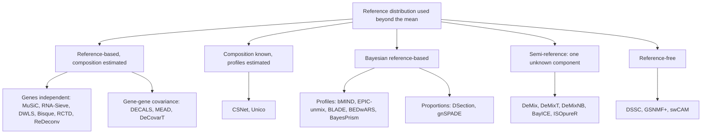

Figure 1: Deconvolution methods that use more than the reference mean,
grouped by what is known and what is estimated. Colours are not used;
the grouping is the one of the sections of this review.

> **Note 1: Notation**
>
> Gene g=1,\ldots,G; cell type j=1,\ldots,J; bulk sample i=1,\ldots,N;
> single-cell replicate (donor) r; cell c.
>
> | Symbol | Meaning |
> |----|----|
> | y\_{gi}, \boldsymbol{y}\_{\cdot i} | Bulk expression |
> | \boldsymbol{p}\_{\cdot i}\in\Delta^{J-1} | Cell-number fractions |
> | \boldsymbol{q}\_{\cdot i} | RNA (transcript) fractions, q\_{ji}\propto p\_{ji}S_j |
> | \boldsymbol{\mu}\_{\cdot j}=S_j\boldsymbol{\theta}\_{\cdot j} | Per-cell mean of type j: cell size times relative abundance |
> | \boldsymbol{\Sigma}\_j | G\times G gene–gene covariance of type j |
> | \boldsymbol{\Omega}\_g | J\times J covariance across cell types for gene g (bMIND, EPIC-unmix) |
> | \boldsymbol{x}\_{\cdot j,i} | Purified profile of type j in sample i |
> | \boldsymbol{\Sigma}\_{W,j}, \boldsymbol{\Sigma}\_{B,j} | Within- and between-replicate covariance of type j |
> | a_i, \boldsymbol{d} | Sample scale and gene-wise platform ratio |
> | x\_{gc}, s_c, b_g, \boldsymbol{\lambda}\_{\cdot c} | UMI count, size factor, capture efficiency, size-free expression of cell c |
>
> The papers use their own indices; [Table 2](#tbl-notation-map)
> translates them. Two kinds of covariance are easy to confuse and are
> kept apart throughout: \boldsymbol{\Sigma}\_j couples **genes** within
> one cell type; \boldsymbol{\Omega}\_g couples **cell types** within
> one gene.

## Measurement and expression models for single-cell counts

A reference profile is a moment of a latent biological quantity, but it
is estimated from counts produced by a sampling protocol. Sarkar and
Stephens separate the two: a **measurement model**
p(\boldsymbol{x}\mid\boldsymbol{\lambda}) describes the protocol given
the true expression, an **expression model** p(\boldsymbol{\lambda})
describes the biology, and the observation model p(\boldsymbol{x}) is
their composition ([Sarkar and Stephens
2021](#ref-sarkarSeparatingMeasurementExpression2021)). Fang and Pachter
add that the cell-level scale factor is itself a product of a biological
and a technical term ([Fang and Pachter
2025](#ref-fangExtrinsicBiologicalStochasticity2025)). Both papers index
genes by j and cells by i; below, gene is g and cell is c, so that j
remains the cell type.

Figure 2: Measurement and expression model of a single-cell reference,
in the notation of this vignette. Inside cell type j, the size-free
expression \boldsymbol{\lambda}\_{\cdot c} follows an expression model
F_j with mean \boldsymbol{\mu}\_{\cdot j} and covariance
\boldsymbol{\Sigma}^{\lambda}\_j; the biological size factor turns it
into a molecule content; the technical size factor and the gene capture
efficiency \boldsymbol{b} act through a Poisson measurement.

### Poisson measurement of UMI counts

If each molecule of cell c is captured independently with a small
probability, the multivariate hypergeometric sampling of molecules is
close to a multinomial and each gene count is Poisson given the true
content (Supplementary Note 1 of ([Sarkar and Stephens
2021](#ref-sarkarSeparatingMeasurementExpression2021))):

x\_{gc}\mid s^{\mathrm{tech}}\_c,m\_{gc}
\sim\mathrm{Poisson}\bigl(s^{\mathrm{tech}}\_c\\b_g\\m\_{gc}\bigr),
\qquad \boldsymbol{m}\_{\cdot
c}=s^{\mathrm{bio}}\_c\\\boldsymbol{\lambda}\_{\cdot c}. \tag{1}

Fang and Pachter write the same law as binomial thinning with capture
rate b_gs^{\mathrm{tech}}\_c, of which the Poisson is the low-capture
limit, and normalise
\mathbb{E}\[s^{\mathrm{bio}}\]=\mathbb{E}\[s^{\mathrm{tech}}\]=1 (their
equations 1–2). Sarkar and Stephens instead take the observed library
size x\_{+c} as the size factor and a relative expression
\lambda\_{gc}=m\_{gc}/m\_{+c}; in that convention s^{\mathrm{bio}}\_c
cancels by construction, which is the removal of biological extrinsic
noise that Fang and Pachter warn about. The two conventions are the two
directions of the same rank-one Poisson fit: the point-mass MLE
\hat\mu_g=\sum_cx\_{gc}/\sum_cx\_{+c} and the size-factor MLE of
[Eq. 3](#eq-poisson-size-factor) below.

Three remarks connect the protocol to deconvolution.

- **UMIs remove most gene-specific distortion.** Unique molecular
  identifiers collapse PCR duplicates, which “substantially reduce
  unwanted variation, including differences in gene lengths and PCR
  amplification efficiencies” ([Sarkar and Stephens
  2021](#ref-sarkarSeparatingMeasurementExpression2021)). What remains
  is a capture efficiency b_g that is constant across cells of one
  protocol. It is not identified separately from \boldsymbol{\lambda},
  and it cancels from every within-protocol contrast, so it is absorbed
  into \boldsymbol{\mu}\_{\cdot j} and \boldsymbol{\Sigma}\_{W,j}. It
  does **not** cancel between a single-cell reference and a bulk
  library: the ratio d_g=b_g^{\mathrm{bulk}}/b_g^{\mathrm{ref}} is the
  gene-wise platform factor of [plug-in scales (Strategy
  4)](https://bastienchassagnol.github.io/DeCovarT/articles/theory-decovart-single-cell-tailored.html#sec-strategy-plugin).
  Read-count protocols without UMIs and hybridisation microarrays carry
  larger gene- and probe-specific factors (amplification, length,
  affinity), which is why earlier deconvolution methods had to model
  gene-wise scales explicitly; with UMI references, the gene-wise factor
  reduces to one cross-platform ratio per gene.
- **Random capture biases make the measurement overdispersed; constant
  ones do not.** If b\_{gc} varied from cell to cell, the measurement
  model would be negative binomial rather than Poisson (Box 1 and
  Supplementary Note 1.2 of Sarkar and Stephens). On spike-in controls
  the measurement dispersion was below 5\times10^{-3}, which adds about
  5% to the variance of a gene with ten observed molecules.
  Overdispersion seen in single-cell data is therefore an **expression**
  property, \boldsymbol{\Sigma}^{\lambda}\_j, plus extrinsic noise, not
  a protocol property.
- **Zero inflation belongs to the expression model, if anywhere.**
  Spike-in controls show no zero-generating measurement component, and a
  point-Gamma expression model beats a Gamma model for only 0.6–8.6% of
  genes across the datasets tested ([Sarkar and Stephens
  2021](#ref-sarkarSeparatingMeasurementExpression2021)). Zeros are
  imperfect measurements of small \lambda\_{gc} at low depth, “with no
  need for special terminology or special treatment”. For DeCovarT,
  which uses only the first two moments of the reference, a
  zero-inflated observation model is unnecessary: the moments of the
  counts already contain the zeros. The argument is made for UMI data;
  the authors note that it may not hold for read counts amplified by PCR
  without UMIs.

### Expression models and the observation models they induce

Integrating the expression model against
[Eq. 1](#eq-poisson-measurement) gives the observation model gene by
gene (Table 1 of ([Sarkar and Stephens
2021](#ref-sarkarSeparatingMeasurementExpression2021))).

| Expression model for \lambda\_{gc} | Observation model for x\_{gc} | Examples |
|----|----|----|
| Point mass \lambda\_{gc}=\mu_g | Poisson | analytic |
| Gamma, mean \mu_g, variance \mu_g^{2}\phi_g | Negative binomial | `edgeR`, `DESeq2`, `SAVER` |
| Point-Gamma | Zero-inflated negative binomial | `ZINB-WaVE` (multigene) |
| Unimodal or fully nonparametric | Flexible | `ashr`, `DESCEND` |
| Low rank, \lambda\_{gc}=\mu\_{gc}u\_{gc}, \mu=h^{-1}(\boldsymbol{L}\boldsymbol{F}^{\top}) | Flexible | GLM-PCA, `scVI` |

Table 1: Expression and observation models for UMI counts, after Sarkar
and Stephens (Tables 1–2). The measurement model is Poisson throughout.

A gene whose expression model is a point mass inside a homogeneous
population is a **Poisson gene**: its count has no variability beyond
sampling and the extrinsic size factor. Overdispersion relative to a
Poisson, the hallmark of the negative binomial, then measures either
biological variability of \lambda\_{gc} or variability of s_c.

### Extrinsic noise, size factors and Poisson genes

Fang and Pachter show that a cell-wide factor explains the baseline
overdispersion of single-cell counts. Under
[Eq. 1](#eq-poisson-measurement) with
s_c=s^{\mathrm{bio}}\_cs^{\mathrm{tech}}\_c independent of
\boldsymbol{\lambda}\_{\cdot c}, \mathbb{E}\[s_c\]=1 and
\nu=\operatorname{CV}^{2}(s_c), their equation (3) reads, in our
notation and inside one cell type,

\frac{\operatorname{Cov}(x\_{gc},x\_{hc})}{\mathbb{E}\[x\_{gc}\]\mathbb{E}\[x\_{hc}\]}
=\nu+(1+\nu)\frac{\Sigma^{\lambda}\_{j,gh}}{\mu\_{gj}\mu\_{hj}}
+\frac{\delta\_{gh}}{\mathbb{E}\[x\_{gc}\]}, \qquad
1+\nu=(1+\nu^{\mathrm{bio}})(1+\nu^{\mathrm{tech}}). \tag{2}

For two genes that are intrinsically uncorrelated, or for one gene that
is intrinsically Poisson, the normalised covariance equals \nu (their
equation 5). That identity gives an estimator of \nu (the mode of the
normalised covariances over gene pairs) and a selection rule for Poisson
genes (those whose normalised variance minus the Poisson term has a
bootstrap interval containing \hat\nu). On those genes \mathcal{P}, the
size factor has the closed-form MLE

\hat
s_c=\frac{\sum\_{g\in\mathcal{P}}x\_{gc}}{\sum\_{g\in\mathcal{P}}\mu_g}.
\tag{3}

Two findings matter here. Normalising each cell by its total removes
s^{\mathrm{bio}}\_c together with s^{\mathrm{tech}}\_c, and with it the
biological extrinsic variability, including cell size ([Fang and Pachter
2025](#ref-fangExtrinsicBiologicalStochasticity2025)). In peripheral
blood, sums over Poisson genes no longer track total UMI counts and
differ between cell types, so the choice of size factor changes
downstream comparisons. Separating s^{\mathrm{tech}}\_c from
s^{\mathrm{bio}}\_c needs external controls (spike-ins, ambient RNA,
pooled RNA); the nascent-mRNA counts did not fit the binomial sampling
model in their pooled-RNA experiment.

### What the measurement model implies for the reference covariance

Write the same identity in matrix form (a direct consequence of
[Eq. 1](#eq-poisson-measurement) and the law of total covariance; the
derivation is ours). With
\boldsymbol{\mathcal{B}}=\operatorname{diag}(\boldsymbol{b}),

\operatorname{Cov}(\boldsymbol{x}\_{\cdot c}\mid c\in j)
=\underbrace{\operatorname{diag}\bigl(\boldsymbol{\mathcal{B}}\boldsymbol{\mu}\_{\cdot
j}\bigr)}\_{\text{Poisson measurement}} +\boldsymbol{\mathcal{B}}\Bigl\[
\underbrace{(1+\nu)\boldsymbol{\Sigma}^{\lambda}\_j}\_{\text{biology}}
+\underbrace{\nu\\\boldsymbol{\mu}\_{\cdot j}\boldsymbol{\mu}\_{\cdot
j}^{\top}}\_{\text{size factor}} \Bigr\]\boldsymbol{\mathcal{B}}.
\tag{4}

The sample covariance of raw UMI counts, which is what a single-cell
reference returns as \hat{\boldsymbol{\Sigma}}\_{W,j}, mixes three
objects. Only part of it belongs in the bulk law.

1.  **The Poisson diagonal is single-cell measurement noise.** It is
    produced at single-cell depth and is not part of the tissue. A bulk
    library has its own sampling noise, on its own depth, which the
    diagonal term \boldsymbol{D}\_i carries. Plugging raw-count
    covariances into \boldsymbol{S}\_W imports the reference sampling
    noise into the bulk covariance; subtracting
    \operatorname{diag}(\bar{\boldsymbol{x}}\_j) first removes it.
2.  **The technical size-factor term is not biology either.** The
    rank-one term \nu^{\mathrm{tech}}\boldsymbol{\mu}\_{\cdot
    j}\boldsymbol{\mu}\_{\cdot j}^{\top} induces a positive correlation
    between all genes. It inflates the apparent network and is a
    protocol artefact.
3.  **The biological size factor is part of the bulk.** Cells of one
    type differ in volume and cycle phase; a tissue sums those cells as
    they are. The term \nu^{\mathrm{bio}}\boldsymbol{\mu}\_{\cdot
    j}\boldsymbol{\mu}\_{\cdot j}^{\top} belongs in
    \boldsymbol{\Sigma}\_{W,j}, and library-size normalisation that
    removes it understates the within-type variance that the bulk
    accumulates.

The corresponding moment estimator, with \hat\nu^{\mathrm{tech}} from
spike-ins or Poisson genes, is

\hat{\boldsymbol{\Sigma}}\_{W,j}
=\hat{\boldsymbol{C}}\_j-\operatorname{diag}(\bar{\boldsymbol{x}}\_j)
-\frac{\hat\nu^{\mathrm{tech}}}{1+\hat\nu^{\mathrm{tech}}}\\
\bigl\[\hat{\boldsymbol{C}}\_j-\operatorname{diag}(\bar{\boldsymbol{x}}\_j)+\bar{\boldsymbol{x}}\_j\bar{\boldsymbol{x}}\_j^{\top}\bigr\],
\tag{5}

where \hat{\boldsymbol{C}}\_j is the sample covariance of the type-j
counts and \bar{\boldsymbol{x}}\_j their mean. It is the
s^{\mathrm{tech}}-free covariance of
\boldsymbol{\mathcal{B}}\boldsymbol{m}\_{\cdot c} obtained by solving
[Eq. 4](#eq-count-covariance) with
1+\nu=(1+\nu^{\mathrm{bio}})(1+\nu^{\mathrm{tech}}) (our derivation, to
be checked by simulation before use). Estimating \nu^{\mathrm{tech}}
before the deconvolution is the first plug-in of Strategy 4 ([plug-in
scales (Strategy
4)](https://bastienchassagnol.github.io/DeCovarT/articles/theory-decovart-single-cell-tailored.html#sec-strategy-plugin)).

### Before single cells: measurement models for sorted population profiles

Before droplet single-cell sequencing, a reference column was a bulk
measurement of a physically sorted population: FACS or magnetic sorting,
then a microarray or a bulk RNA-seq library. The measurement model was
the one of the platform, applied to a pool of many cells.

- **Microarrays.** A probe intensity is a background plus a
  probe-specific affinity times the abundance, with errors that are
  roughly additive at low intensity and multiplicative at high
  intensity. Analyses of differential expression worked on \log_2
  intensities, where the multiplicative error becomes additive.
  Deconvolution could not: mixing is additive in the abundance, so the
  first reference-based methods fitted linear models on **unlogged**
  intensities ([Abbas et al.
  2009](#ref-abbasDeconvolutionBloodMicroarray2009); [Shen-Orr et al.
  2010](#ref-shen-orrCellTypeSpecific2010); [Lähdesmäki et al.
  2005](#ref-lahdesmakiSilicoMicrodissectionMicroarray2005)). The probe
  affinity is a gene-wise factor of the platform. It cancels within one
  platform and does not cancel between platforms, which is the origin of
  the gene-wise scale \boldsymbol{d} of later methods.
- **Bulk RNA-seq of sorted populations.** Reads are counts with a
  library size and a gene-length factor (for full-length protocols).
  Replicate libraries of one sorted population vary by a negative
  binomial dispersion that mixes biological and technical variation.
  Normalised counts on a linear scale (CPM, TPM) became the default
  input, with the same warning against logarithms.
- **What the reference variance meant.** With a handful of sorted
  replicates per population, the only second-order quantity available
  was a between-replicate variance of the population mean. That is the
  quadratic layer \sum_jp_j^{2}\boldsymbol{\Sigma}\_{B,j} of the
  [tailored
  vignette](https://bastienchassagnol.github.io/DeCovarT/articles/theory-decovart-single-cell-tailored.html#sec-facs),
  and the object released DeCovarT was designed for. A within-type,
  cell-to-cell covariance did not exist in that design.

Two biases of sorted references have no single-cell analogue: sorting
selects cells on a few surface markers, so a “pure” population can
contain contaminating types; and the sorting itself can change
expression before lysis. Single-cell references remove the first by
labelling cells after the fact, and replace the platform model by the
Poisson measurement of [Sec. 1.1](#sec-poisson-measurement).

### From measurement models to bulk observation laws

A deconvolution method chooses a law for the bulk. Read with the split
of [Sec. 1](#sec-measurement), that law is a measurement model
(multinomial, Poisson) composed with an expression model for the
purified profiles (Gaussian, log-normal, Gamma).
[Figure 3](#fig-observation-taxonomy) places the methods of this review
by the support of \boldsymbol{y} first.

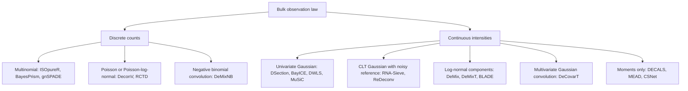

Figure 3: Bulk observation laws of the reviewed methods, split by the
support of the bulk (counts or continuous intensities), then by the law.

#### Discrete counts

A multinomial (or Dirichlet–multinomial) model treats
\boldsymbol{y}\_{\cdot i} as integer reads that sum to a library size.
`ISOpureR` implements a hierarchical multinomial–Dirichlet purification
of mixed tumour profiles ([Anghel et al.
2015](#ref-anghelISOpureRImplementationComputational2015)). `BayesPrism`
places a multinomial likelihood on bulk counts with a patient-derived
scRNA-seq prior and jointly infers \boldsymbol{p}\_{\cdot i} and
sample-level CTS expression ([Chu et al.
2022](#ref-chuCellTypeGeneExpression2022)). `DeconV` instead uses
Poisson aggregation from single-cell to bulk (sums of independent
Poissons remain Poisson) and returns interval estimates of
\boldsymbol{p}\_{\cdot i} ([Gynter et al.
2023](#ref-gynterDeconvProbabilisticCellType2023)). `RCTD` is the
Poisson–log-normal **mixture** of [the `RCTD` Poisson–log-normal
law](https://bastienchassagnol.github.io/DeCovarT/articles/theory-review-distribution-aware-deconvolution.html#eq-rctd-pln):
each UMI picks a type, then a gene, with a gene-wise log-normal
overdispersion and a two-stage platform correction ([Cable et al.
2022](#ref-cableRobustDecompositionCell2022a)); the comparison with
DeCovarT’s convolution is in [the `RCTD`
comparison](https://bastienchassagnol.github.io/DeCovarT/articles/theory-review-distribution-aware-deconvolution.html#sec-rctd).

Over-dispersed, correlated counts are the domain of the multivariate
**Poisson–log-normal (PLN)** family: a latent Gaussian vector induces
dependence, and a Poisson observation layer yields integer reads
([Chiquet et al. 2021](#ref-chiquetPoissonLognormalModelVersatile2021),
[2018](#ref-chiquetVariationalInferenceSparse2018)). **ZIPLN** adds a
Bernoulli zero-inflation layer for dropout ([Batardière et al.
2025](#ref-batardiereZeroInflationMultivariatePoisson2025)). A
DeCovarT-style extension would replace
[Eq. 15](#eq-gaussian-convolution) by a PLN (or ZIPLN) convolution on
the latent log-abundance scale, keeping the ALR map on \boldsymbol{p}. A
multinomial **logit-normal** on the *gene* simplex is a different
discrete model: it is compositional association, not a cell-type
convolution ([two simplices without
convolution](https://bastienchassagnol.github.io/DeCovarT/articles/theory-decovart-extensions-roadmap.html#sec-logit-normal-compositional)).

## Second-generation deconvolution: univariate versus multivariate

Second-generation methods use a single-cell reference and model, in some
form, the variability of the cell-type profiles. The usual split into
regression and probabilistic engines hides the property that matters for
DeCovarT: whether the bulk model treats **genes as independent** (a
diagonal variance per gene) or keeps a **gene–gene covariance**.
[Figure 4](#fig-method-taxonomy) uses that split.

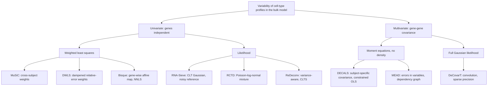

Figure 4: Deconvolution methods that model cell-type variability, split
by their treatment of gene-gene dependence and then by estimator. All
univariate methods assume independent genes; the multivariate ones
differ by whether they commit to a density.

### A common notation

Each paper uses its own indices; several use j for the gene or the
subject. [Table 2](#tbl-notation-map) maps them to this vignette. The
scale columns show how one model is reparametrised into another by
arithmetic alone.

|  | This vignette | `MuSiC` | `RNA-Sieve` | `DWLS` | `Bisque` | `RCTD` | `DECALS` | `MEAD` |
|----|----|----|----|----|----|----|----|----|
| gene, type, sample | g, j, i | g, k, j | g, k, b | i, j, – | j, k, i | j, k, i | j, k, i | g, k, i |
| reference unit | replicate r | subject j | cell i | cell | individual i' | cell | – | individual j |
| target | \boldsymbol{p}\_{\cdot i} | \mathbf{p}\_j | \boldsymbol{\alpha} | \mathbf{x}/\mathbf{1}^{\top}\mathbf{x} | \mathbf{p}\_i | \boldsymbol{\beta}\_i normalised | \boldsymbol{\pi}\_i | \mathbf{p}\_i |
| cell counts | m\_{ji}, n_i | m_j^{k}, m_j | –, n | \mathbf{x} | – | – | – | – |
| per-cell mean | \boldsymbol{\mu}\_{\cdot j}=S_j\boldsymbol{\theta}\_{\cdot j} | S^{k}\boldsymbol{\theta}^{k} | \mathbf{M}\_{\cdot k} | \mathbf{S}\_{\cdot j} | \mathbf{Z}\_{\cdot k}\approx\boldsymbol{\theta}\_{\cdot j} | normalised mean | \mathbf{w}\_k (FPKM) | \mathbf{U}\_{\cdot k} |
| cell size | S_j | S^{k} (mean library size) | \mathbf{1}^{\top}\mathbf{M}\_{\cdot k} | assumed equal | removed by CPM | removed | removed by FPKM | kept in \mathbf{U} |
| sample scale | a_i | C_j^{-1} | n | \mathbf{1}^{\top}\mathbf{x} | – | N_ie^{\alpha_i} | absorbed | \gamma_i |
| gene platform | \boldsymbol{d} | intercept \alpha\_{jg} | none | none | (\beta\_{0g},\beta_g) | estimated d_g | none | \lambda_g=\alpha_g/\alpha^{r}\_g |
| type variability | \boldsymbol{\Sigma}\_{W,j}, \boldsymbol{\Sigma}\_{B,j} | \sigma^{2}\_{gk} (between, diagonal) | s\_{g,k} (within, diagonal) | – | – | – | \boldsymbol{\Sigma}^{(k)} (between, full) | \mathbf{V}\_g (reference noise) |

Table 2: Notation of the reviewed methods mapped to this vignette.
“Removed” means the normalisation divides each cell or column by its
total, so that S_j no longer enters the mean.

Three reparametrisations recur.

- **Counts to fractions.** A model in cell counts,
  \boldsymbol{y}=\boldsymbol{\mu}\boldsymbol{m}, becomes a model in
  fractions by dividing by the expected number of cells,
  \boldsymbol{y}/n=\boldsymbol{\mu}\boldsymbol{p}. `RNA-Sieve` keeps n
  as a parameter; `DWLS` estimates \mathbf{x} (its “cell-type numbers”)
  and normalises at the end.
- **Total molecules to average cell size.** `MuSiC` equation (2) gives
  \sum_gX\_{jg}=m_j\sum_kp^{k}\_jS^{k}. Dividing by the number of cells
  m_j gives the average cell size of the sample, \bar
  S_i=\sum_jp\_{ji}S_j, and `MuSiC`’s normalising constant is its
  inverse: C_i=\bar S_i^{-1}. Library-size normalisation therefore
  returns RNA fractions q\_{ji}=p\_{ji}S_j/\bar S_i, not cell fractions.
- **Scale times composition.** `MEAD` estimates
  \boldsymbol{\beta}\_i=\gamma_i\boldsymbol{p}\_i and recovers
  \boldsymbol{p}\_i=\boldsymbol{\beta}\_i/\\\boldsymbol{\beta}\_i\\\_1;
  `RCTD` estimates w\_{ji}=p\_{ji}e^{\alpha_i} and normalises. Both are
  the unnormalised parametrisation \boldsymbol{w}\_{\cdot
  i}=a_i\boldsymbol{p}\_{\cdot i} of Strategy 1 ([the sample-wide
  capture
  scale](https://bastienchassagnol.github.io/DeCovarT/articles/theory-decovart-single-cell-tailored.html#sec-cc-scale)),
  whose total identifies the sample scale.

### Univariate methods: genes independent

#### MuSiC

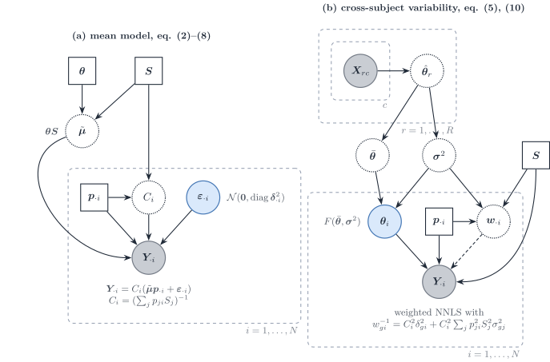

Figure 5: `MuSiC` ([Wang et al. 2019](#ref-wangBulkTissueCell2019)) in
this vignette’s notation. (a) The mean model: bulk relative abundance is
a cell-size-weighted mixture of relative profiles \boldsymbol{\Theta},
rescaled by C_i. (b) The multi-subject reference: subject-level relative
profiles \boldsymbol{\Theta}\_i vary around the cross-subject mean with
variance \boldsymbol{\sigma}^{2}, and the inverse of the resulting gene
variance weights a non-negative least squares fit.

`MuSiC` starts from molecules: the bulk of subject i holds
X\_{gi}=\sum_jm\_{ji}S_j\theta\_{gj}, with S_j the mean total molecules
per cell of type j (equation 2). It works on relative abundance
Y\_{gi}=X\_{gi}/\sum\_{g'}X\_{g'i}, so that, with the reparametrisation
above,

Y\_{gi}=C_i\Bigl(\sum_jp\_{ji}S_j\theta\_{gj}+\varepsilon\_{gi}\Bigr),
\qquad \operatorname{Var}(Y\_{gi}\mid\boldsymbol{p}\_{\cdot i})
=C_i^{2}\delta\_{gi}^{2}+C_i^{2}\sum_jp\_{ji}^{2}S_j^{2}\sigma^{2}\_{gj}
=w\_{gi}^{-1} \tag{6}

(equations 8–10). The second term comes from subject-level relative
profiles \theta\_{gj,i}\sim F(\theta\_{gj},\sigma^{2}\_{gj}) (assumption
A1): it is the **diagonal** of the between-replicate layer
\boldsymbol{S}\_B(\boldsymbol{p}), quadratic in p\_{ji}, and it requires
a multi-subject reference. Cross terms between types are dropped, which
implicitly assumes independence across types. \delta^{2}\_{gi} is the
bulk residual \boldsymbol{D}\_i. The within-type cell scatter
\boldsymbol{\Sigma}\_{W,j} has no term in [Eq. 6](#eq-music-variance);
it is used only to select genes with small within-cluster variance in
the tree-guided recursion. Estimation is weighted non-negative least
squares, with the weights updated from an initial fit because
\delta^{2}\_{gi} is unknown, followed by rescaling to the simplex.

**Scales and identifiability.** S_j is plugged in as the mean library
size of type j in the reference. That substitution returns cell
fractions only under assumption A3', a common capture efficiency \tilde
S_j/S_j across types ([the `MuSiC`
assumptions](https://bastienchassagnol.github.io/DeCovarT/articles/theory-decovart-single-cell-tailored.html#fig-music-assumptions));
otherwise `MuSiC` estimates the RNA-weighted product p\_{ji}S_j. Under
A1–A3 alone the paper claims only the trend of proportions across
subjects. Absolute S_j is not needed: it cancels into C_i. A gene- and
subject-specific intercept \alpha\_{gi} absorbs protocol bias. `MuSiC2`
keeps the weights and removes genes that are differentially expressed
between the reference and bulk conditions ([Fan et al.
2022](#ref-fanMusic2CellTypeDeconvolution2022)).

#### RNA-Sieve

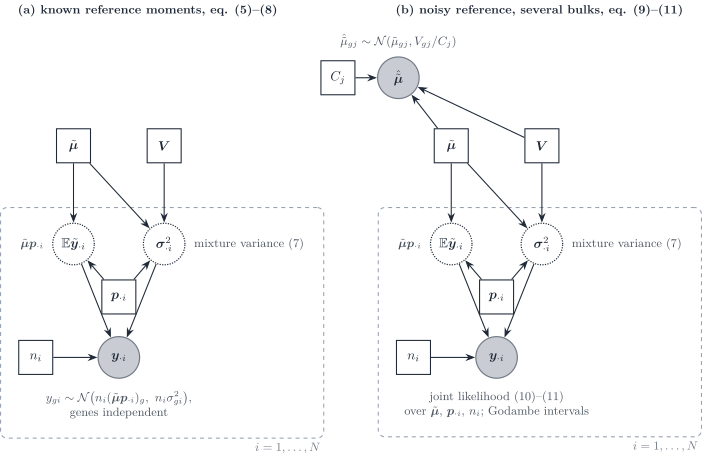

Figure 6: `RNA-Sieve` ([Erdmann-Pham et al.
2021](#ref-erdmann-phamLikelihoodbasedDeconvolutionBulk2021)). (a) With
known reference moments, the bulk is the sum of n_i cells drawn from the
cell mixture, with a central-limit Gaussian per gene whose variance is
the mixture variance. (b) The reference means are themselves noisy
averages of C_j cells; the joint likelihood over bulks and reference
means is maximised, with Godambe sandwich intervals.

`RNA-Sieve` writes the bulk as a sum of n cells, each a draw from the
cell mixture [the mixture-of-cells
covariance](https://bastienchassagnol.github.io/DeCovarT/articles/theory-decovart-single-cell-tailored.html#eq-mixture-cell)
restricted to one gene. By the central limit theorem,

y\_{gi}\sim\mathcal{N}\bigl(n_i(\boldsymbol{\mu}\boldsymbol{p}\_{\cdot
i})\_g,\\ n_i\sigma^{2}\_{gi}\bigr), \qquad
\sigma^{2}\_{gi}=\sum_jp\_{ji}\bigl(V\_{gj}+\mu\_{gj}^{2}\bigr)-(\boldsymbol{\mu}\boldsymbol{p}\_{\cdot
i})\_g^{2}, \tag{7}

with genes independent (equations 5–8). The variance is **linear** in
n_i and in \boldsymbol{p}, minus the square of the mixture mean: the
within-type variance \sum_jp\_{ji}V\_{gj} plus the spread of the type
means, the diagonal of [the mixture-of-cells
covariance](https://bastienchassagnol.github.io/DeCovarT/articles/theory-decovart-single-cell-tailored.html#eq-mixture-cell).
The reference means are noisy,
\tilde\mu\_{gj}\sim\mathcal{N}(\mu\_{gj},V\_{gj}/C_j) (equation 9), and
are estimated jointly with (\boldsymbol{p}\_{\cdot i},n_i) from all
bulks (equations 10–11). Marginalising \tilde{\boldsymbol{\mu}} instead
would add \sum_jp\_{ji}^{2}V\_{gj}/C_j, a quadratic errors-in-variables
term that vanishes as the reference grows (our remark).

**Scales.** Raw counts keep S_j inside \mathbf{M}, so
\boldsymbol{\alpha} are cell fractions; the optional rescaling of every
cell to the median library size removes S_j and turns them into RNA
fractions. Any global protocol difference is absorbed into n, which then
“loses interpretability” across protocols (Supplementary S1.4).
Intervals come from the observed Fisher information or, by default, from
the Godambe matrix, centred at the Kullback–Leibler projection under
misspecification. The paper notes that gene correlation “may be
incorporated” once it is known, but does not implement it.

#### DWLS

Figure 7: `DWLS` ([Tsoucas et al.
2019](#ref-tsoucasAccurateEstimationCelltype2019)). The signature is the
average of reference cells; the bulk is fitted in cell-type numbers
\boldsymbol{m}\_{\cdot i} by iterated weighted least squares, with
weights equal to the inverse squared fitted mean, capped by a dampening
constant d.

`DWLS` fits the cell-type numbers \mathbf{x}=\boldsymbol{m}\_{\cdot i}
by

\hat{\boldsymbol{m}}\_{\cdot i}
=\arg\min\_{\boldsymbol{m}\ge\boldsymbol{0}}\sum_g\bar
w\_{gi}\bigl(y\_{gi}-\hat{\boldsymbol{\mu}}\_{g\cdot}\boldsymbol{m}\bigr)^{2},
\qquad \bar w\_{gi}=\min\Bigl\\d,\\
\frac{(\hat{\boldsymbol{\mu}}\_{g\cdot}\hat{\boldsymbol{m}}\_{\cdot
i})^{-2}}{\min\_{g'}(\hat{\boldsymbol{\mu}}\_{g'\cdot}\hat{\boldsymbol{m}}\_{\cdot
i})^{-2}}\Bigr\\, \tag{8}

iterated from an ordinary least squares start, with d=2^{q} chosen to
minimise the variance of estimates over random half-gene subsets
(equations 6–15). The weights minimise relative rather than absolute
error. Read as a variance model, they imply
\operatorname{Var}(y\_{gi})\propto(\hat{\boldsymbol{\mu}}\_{g\cdot}\boldsymbol{m}\_{\cdot
i})^{2}, a constant coefficient of variation; the paper motivates the
weights by relative error and does not state a variance model. There is
no \boldsymbol{\Sigma}\_{W,j} term and genes are independent. The paper
states the equal-RNA-per-cell assumption under which \mathbf{x} are cell
numbers; otherwise they are RNA-weighted.

#### Bisque

Figure 8: `Bisque` ([Jew et al.
2020](#ref-jewAccurateEstimationCell2020)), paired mode. For individuals
with both assays, the single-cell counts give a CPM signature
\boldsymbol{\Theta} and counted proportions, hence a pseudo-bulk; a
gene-wise linear map from observed bulk to pseudo-bulk is learned on
those pairs and applied to the remaining bulks before non-negative least
squares.

`Bisque` learns the platform shift instead of modelling it. In paired
mode it fits \eta\_{gi'}=\beta\_{0g}+\beta_gy\_{gi'}+\epsilon\_{gi'} per
gene, with \boldsymbol{\eta}\_{\cdot
i'}=\boldsymbol{\Theta}\boldsymbol{p}\_{\cdot i'} the pseudo-bulk of
individual i' (equation 1); in unpaired mode it matches the first two
moments of each gene across samples (equations 2–3). The transformed
bulk is then fitted by non-negative least squares with a sum-to-one
constraint. The fitting step has homoscedastic residuals; the
variability of the reference enters only through the between-sample
moments used in the map. Because \boldsymbol{\Theta} is built from CPM,
cell size is removed from the signature; the gene-wise affine map
absorbs gene and platform factors, not a type-specific S_j. In unpaired
mode the cohort mean composition is assumed equal to the mean
composition of the single-cell individuals.

#### RCTD

Figure 9: `RCTD` ([Cable et al.
2022](#ref-cableRobustDecompositionCell2022a)) in this vignette’s
notation. The reference is collapsed to fixed normalised means. Sample i
carries an observed depth N_i, a leftover scale \alpha_i, a composition
and a gene-wise overdispersion; the platform \boldsymbol{d} is shared
across samples and is not estimated inside the per-sample fit.

`RCTD` sits one layer below the DeCovarT plate of
[Figure 13](#fig-dag-three-layer). Each UMI is first assigned a type
with probability p\_{ji}, then a gene from that type’s relative profile:
a read-level **mixture**, not a convolution of random population vectors
([Cable et al. 2022](#ref-cableRobustDecompositionCell2022a)).
Conditional on the rate, the gene counts are Poisson; the rate is
log-normal around a linear mixture of the **fixed** means. In DeCovarT
symbols,

y\_{gi}\mid\lambda\_{gi} \sim \mathrm{Poisson}(N_i\lambda\_{gi}), \qquad
\log\lambda\_{gi} = \alpha_i + \log\Bigl(\sum_j p\_{ji}\mu\_{gj}\Bigr) +
\log d_g + \varepsilon\_{gi}, \tag{9}

with \varepsilon\_{gi} independent \mathcal{N}(0,\sigma\_\varepsilon^2)
(heavy-tailed in the implementation). The Poisson mean is therefore

\mathbb{E}\[y\_{gi}\mid\varepsilon\_{gi}\] = \underbrace{N_i
e^{\alpha_i}}\_{a_i} \\ d_g \\ e^{\varepsilon\_{gi}} \sum_j
p\_{ji}\mu\_{gj}. \tag{10}

N_i is observed depth; \alpha_i is a leftover sample scale; d_g is the
gene-wise platform that DeCovarT’s \boldsymbol{d} names. The diagonal
residual \varepsilon\_{gi} is technical plus unmodelled gene-wise
extra-Poisson noise, the count-scale cousin of
\boldsymbol{\Sigma}\_{\mathrm{obs},i}. Genes are independent given
\varepsilon. Because \boldsymbol{\mu}\_{\cdot j} is plugged in,
[Eq. 10](#eq-rctd-mean) is a mixture of rates. DeCovarT’s [the released
convolution](https://bastienchassagnol.github.io/DeCovarT/articles/theory-review-distribution-aware-deconvolution.html#eq-gaussian-convolution)
is a convolution of **random** type profiles: after averaging to a
continuous expression vector, the bulk is \sum_j
p\_{ji}\boldsymbol{Z}\_{ij} with \boldsymbol{Z}\_{ij} Gaussian, hence
quadratic in \boldsymbol{p}. A mixture is the right generative story at
the UMI; a convolution is the right story at the aligned population
mean.

Figure 10: `RCTD` estimation. Stage 1 identifies the gene-wise platform
from a pseudobulk of all samples; stage 2 fits each sample by sequential
quadratic programming on the unnormalised weights
w\_{ji}=p\_{ji}e^{\alpha_i}.

The fit is two-stage for the same identifiability reason as [alignment
scales](https://bastienchassagnol.github.io/DeCovarT/articles/theory-decovart-single-cell-tailored.html#sec-alignment):
\boldsymbol{d} cannot be free inside one sample. That is Strategy 4 in
its purest form ([plug-in scales (Strategy
4)](https://bastienchassagnol.github.io/DeCovarT/articles/theory-decovart-single-cell-tailored.html#sec-strategy-plugin)).

**SQP versus second-order descent.** After stage 1, `RCTD` maximises a
non-convex Poisson–log-normal log-likelihood in the unnormalised weights
w\_{ji}=p\_{ji}e^{\alpha_i}, subject to w\ge 0 only (the simplex is
recovered by normalising). The local quadratic Taylor model of that
objective is a **constrained** quadratic programme. The Hessian is often
indefinite, so a plain Newton step is not a descent direction;
sequential quadratic programming keeps the positive-semidefinite part of
the Hessian (eigenvalue clipping) and solves the QP with `quadprog`, a
sequential convex programme in the sense of Duchi, reused from `DWLS`
([Tsoucas et al. 2019](#ref-tsoucasAccurateEstimationCelltype2019)).
Inequality constraints and doublet/triplet cardinality penalties
(active-set zeros) are native to that orthant formulation. DeCovarT
instead maps \boldsymbol{p} to an unconstrained ILR chart and uses an
analytic score and Hessian of a Gaussian convolution, with Marquardt
damping when the Hessian is poorly conditioned. That second-order path
is available because the observation is already an averaged, aligned
intensity and the simplex is handled by the chart rather than by w\ge 0.
It is the wrong local model for [Eq. 9](#eq-rctd-pln): the likelihood is
non-convex in w, the support is the non-negative orthant, and many
samples are expected to sit on a face.

#### ReDeconv

`ReDeconv` names three ways a single-cell reference distorts
deconvolution: rescaling every cell to a common total (CP10K), which
erases transcriptome size; the gene-length mismatch between UMI
single-cell counts and full-length bulk libraries; and ignoring the
within-type variance ([Lu et al.
2025](#ref-luTranscriptomeSizeMatters2025)).

**Model.** The bulk is a sum of k_j independent cells of each type. By
the central limit theorem, and after the rescaling y\_{gi}=c\\g\_{gi}
with f_j=ck_j,

y\_{gi}\sim\mathcal{N}\Bigl(\sum_jf_j\mu\_{gj},\\
c\sum_jf_j\sigma^{2}\_{gj}\Bigr), \tag{11}

with genes independent, and the composition is estimated by maximising
the product of these densities over genes. The variance is **linear** in
the weights: it is the diagonal of the within-type layer
\kappa_i\sum_jp\_{ji}\boldsymbol{\Sigma}\_{W,j} of the [tailored
vignette](https://bastienchassagnol.github.io/DeCovarT/articles/theory-decovart-single-cell-tailored.html#sec-one-replicate),
the same structure as `RNA-Sieve` without the spread of type means (the
labels are given, not drawn). The optimiser, the estimation of c and the
final simplex step are not stated in the paper.

**Transcriptome size.** CLTS (count-based linearised transcriptome size)
normalisation fits, for each single-cell sample i, a line
x\_{ij}=a_ix\_{1j}+b_i between its mean transcriptome sizes per type and
those of a baseline sample, then rescales every count as
u\_{icg}\leftarrow u\_{icg}/a_i+(v\_{\max}-b_i/a_i)/G with
v\_{\max}=\max_ib_i/a_i. Differences of transcriptome size **between
types within a sample** are kept; differences **between samples** are
removed. With one single-cell sample, raw UMI counts are used. In the
notation of [Sec. 1](#sec-measurement), CLTS keeps S_j in
\boldsymbol{\mu}\_{\cdot j}=S_j\boldsymbol{\theta}\_{\cdot j} and
removes the sample-wide part of the size factor, so the fitted weights
are cell fractions rather than RNA fractions.

**Caveats.** Signature genes are chosen by a t-test, a fold change and a
small coefficient of variation \sigma\_{gj}/\mu\_{gj}, about 100 per
type. The synthetic benchmarks draw bulk and reference from the same
single-cell source, which minimises the within-type mismatch the method
targets, as the authors acknowledge.

### Multivariate methods: gene–gene covariance

#### DECALS

Figure 11: `DECALS` ([Cai et al.
2024](#ref-caiStatisticalInferenceCelltype2024)) as three increasingly
informed working models. (a) Constrained ordinary least squares with an
implicit identity covariance; the subject-specific covariance enters
only the sandwich variance. (b) Constrained generalised least squares
when \boldsymbol{\Sigma}\_i=\sum_jp\_{ji}^{2}\boldsymbol{\Sigma}\_j is
known. (c) `DECALS` proper: the type covariances are unknown and are
estimated from bulk residuals across samples, with a bias correction
iterated with the variance of \hat{\boldsymbol{p}}\_{\cdot i}; the point
estimate stays the OLS one.

`DECALS` makes no distributional assumption on the bulk. Its model
(equations 1–2, 5) is

\boldsymbol{y}\_{\cdot i}=\sum_jp\_{ji}\boldsymbol{x}^{(j)}\_i
=\boldsymbol{\mu}\boldsymbol{p}\_{\cdot i}+\boldsymbol{\epsilon}\_i,
\qquad
\operatorname{Cov}(\boldsymbol{\epsilon}\_i)=\boldsymbol{\Sigma}\_i=\sum_jp\_{ji}^{2}\boldsymbol{\Sigma}^{(j)},
\tag{12}

with subject-level type profiles \boldsymbol{x}^{(j)}\_i independent
across types: exactly the quadratic layer
\boldsymbol{S}\_B(\boldsymbol{p}) and released DeCovarT’s covariance,
without a density. The three panels of [Figure 11](#fig-dag-decals) are
the paper’s three estimators.

1.  **Constrained OLS** (equation 3) is the point estimator. For a large
    number of genes the inequality constraints are inactive and the
    estimator is the equality-constrained projection
    \hat{\boldsymbol{p}}=\mathbf{U}\tilde{\boldsymbol{p}} of the OLS
    solution (Lemma S1). Its asymptotic covariance is the sandwich
    \boldsymbol{V}\_i=\mathbf{U}\mathbf{D}\mathbf{U}^{\top} with
    \mathbf{D}=(\tfrac1G\boldsymbol{\mu}^{\top}\boldsymbol{\mu})^{-1}\tfrac1G\boldsymbol{\mu}^{\top}\boldsymbol{\Sigma}\_i\boldsymbol{\mu}(\tfrac1G\boldsymbol{\mu}^{\top}\boldsymbol{\mu})^{-1}.
2.  **Constrained GLS** with known \boldsymbol{\Sigma}\_i (equations
    10–11) is more efficient. The authors reject it once
    \boldsymbol{\Sigma}\_i is estimated: the per-sample inverse square
    root is too noisy, and the coverage of GLS with an estimated
    covariance falls to about 0.65–0.8 in their simulations.
3.  **Unknown \boldsymbol{\Sigma}^{(j)}.** Because
    \mathbb{E}\[z\_{gi}z\_{hi}\]=\sum_jp\_{ji}^{2}\Sigma^{(j)}\_{gh},
    the residual outer products are regressed on the squared proportions
    across the N samples,
    \hat{\boldsymbol{b}}\_{gh}=(\hat{\mathbf{H}}^{\top}\hat{\mathbf{H}})^{-1}\hat{\mathbf{H}}^{\top}(\hat{\boldsymbol{z}}\_g\circ\hat{\boldsymbol{z}}\_h)
    with \hat{\mathbf{H}}=\[\hat p\_{ji}^{2}\] (equation 6), a
    regression first proposed for known proportions by CSNet. Replacing
    \mathbf{H} by \hat{\mathbf{H}} deflates the estimate; Proposition 1
    gives the bias terms \mathbf{B}\_1,\mathbf{B}\_2 under a Gaussian
    approximation of \hat{\boldsymbol{p}}, and the corrected estimator
    (equation 7) is iterated with \boldsymbol{V}\_i, then thresholded by
    SCAD and projected onto the positive semidefinite cone.

**Asymptotics.** Genes are the statistical units: Theorem 1 gives
\sqrt{G}(\hat{\boldsymbol{p}}\_{\cdot i}-\boldsymbol{p}\_{\cdot
i})\to\mathcal{N}(\boldsymbol{0},\boldsymbol{V}\_i) as G\to\infty for
one sample, under sub-exponential errors, a dependency graph of bounded
degree among genes, and p\_{ji}\>0 for all types. On a face of the
simplex the limit law is not derived. With dense gene correlation the
authors report that coverage collapses to about 0.65: the central limit
theorem over genes fails when dependence is not sparse. The paper gives
no consistency theorem for \hat{\boldsymbol{\Sigma}}^{(j)}.

#### MEAD

Figure 12: `MEAD` ([Xie et al.
2026](#ref-xieStatisticalInferenceCell2026)) in this vignette’s notation
(a_i=\gamma_i, \boldsymbol{d}=\boldsymbol{\alpha},
\boldsymbol{\mu}=\mathbf{U}, replicate r = reference individual j of the
paper). (a) Bulk and reference share the population law F_X of the type
profiles but have their own sample scales and gene-wise platform
factors. (b) After reparametrisation only the ratio
d_g=\alpha_g/\alpha^{r}\_g remains, treated as random noise around one,
and the bulk mean is \boldsymbol{\mu}\boldsymbol{\beta}\_i with
\boldsymbol{\beta}\_i=a_i\boldsymbol{p}\_{\cdot i}. (c) Across
individuals, the composition is regressed on covariates.

`MEAD` is the multivariate errors-in-variables method. Its successive
models ([Figure 12](#fig-dag-mead)) are:

- **Scales** (equations 2–3). The bulk is
  \boldsymbol{y}\_i=\gamma_i\operatorname{diag}(\boldsymbol{\alpha})\mathbf{X}\_i\boldsymbol{p}\_i+\boldsymbol{\epsilon}\_i
  and each reference individual is
  \mathbf{Z}^{r}\_j=\gamma^{r}\_j\operatorname{diag}(\boldsymbol{\alpha}^{r})\mathbf{X}^{r}\_j+\mathbf{E}^{r}\_j,
  with \mathbf{X}\_i and \mathbf{X}^{r}\_j drawn from one population law
  (assumption 1). \gamma_i captures sequencing depth and tissue size;
  \boldsymbol{\alpha} captures gene length and GC content. The reference
  scale is **one scalar per reference individual**, shared by all its
  cell types; cell efficiencies \gamma^{r}\_{jc} vary around it
  (Supplementary S2.1). The authors deliberately avoid per-cell
  library-size normalisation so as to keep cell size in \mathbf{U}.

- **Reparametrisation** (equations 4–5). Only
  \lambda_g=\alpha_g/\alpha^{r}\_g is identified, and assumption 3
  treats it as random noise,
  \lambda_g\overset{\text{iid}}{\sim}\[1,\sigma_0^{2}\], independent of
  \mathbf{U}. The model becomes
  \boldsymbol{y}\_i=\mathbf{U}\boldsymbol{\beta}\_i+\boldsymbol{e}\_i
  with \boldsymbol{\beta}\_i=\gamma_i\boldsymbol{p}\_i and
  \boldsymbol{e}\_i=(\boldsymbol{\Lambda}-\mathbf{I})\mathbf{U}\boldsymbol{\beta}\_i+\boldsymbol{\epsilon}'\_i.
  The platform ratio is not estimated; it inflates the variance and
  makes the \boldsymbol{e}\_i dependent across samples.

- **One sample.** With \hat\gamma_j=\sum\_{k,g}z^{r}\_{jgk}/(KG) (a
  plug-in from the reference alone, using the scaling constraint of
  assumption 2), \hat{\boldsymbol{\mu}}\_g the average of
  \boldsymbol{z}^{r}\_{jg}/\hat\gamma_j and \hat{\mathbf{V}}\_g its
  covariance across reference individuals, the bias-corrected estimating
  equation

  \hat{\mathbf{U}}^{\top}\mathbf{W}\boldsymbol{y}\_i-\bigl(\hat{\mathbf{U}}^{\top}\mathbf{W}\hat{\mathbf{U}}-\hat{\mathbf{V}}\bigr)\boldsymbol{\beta}\_i=\boldsymbol{0},
  \qquad \hat{\mathbf{V}}=\sum_gw_g\hat{\mathbf{V}}\_g, \tag{13}

  removes the attenuation caused by a noisy design (equation 6).
  Non-negativity is imposed by truncation or constrained optimisation,
  and
  \hat{\boldsymbol{p}}\_i=\hat{\boldsymbol{\beta}}\_i/\\\hat{\boldsymbol{\beta}}\_i\\\_1.

- **Several samples** (section 5). The composition is regressed on
  covariates,
  \mathbb{E}\[\boldsymbol{p}\_i\]=h(\boldsymbol{b}\_0+\mathbf{A}\_0^{\top}\boldsymbol{f}\_i),
  with \hat{\boldsymbol{p}}\_i plugged into the estimating equation
  (11).

- **Gene–gene dependence.** Dependence is **global**, not type specific:
  a dependency graph over genes enters only the sandwich covariance
  \hat{\boldsymbol{\Sigma}}\_i through the set \mathcal{A} of dependent
  gene pairs. \mathcal{A} is estimated from the correlation of the bulk
  samples by a multiple test, because “reference data often lack
  sufficient samples to estimate cell-type-specific gene correlations”;
  cross-validation folds keep correlated genes together.

- **Weights from biological variation.** `MuSiC`’s weights use the
  residual variance of the target bulk, which “can severely bias” the
  estimating equation. `MEAD` uses only the reference:
  s_g^{2}=\mathbf{1}^{\top}\hat{\mathbf{V}}\_g\mathbf{1}, shrunk across
  genes by variance adaptive shrinkage, and w_g=1/\tilde s_g^{2}. The
  weights are independent of the bulk being deconvolved.

**Identifiability** (Theorem 1). With \operatorname{rank}(\mathbf{P})=K,
the proportions are identifiable if and only if \mathbf{U} has full rank
and, for every partition of the genes into t\ge 2 blocks, the ranks of
the blocks of \mathbf{U} add to more than K. **Perfect marker genes**
violate the condition: if each gene is expressed in one type only,
rescaling the gene ratios of the type-k markers by 1/\delta_k, the
proportions to \tilde p\_{ik}=\delta_kp\_{ik}/\sum_l\delta_lp\_{il} and
the scale to \tilde\gamma_i=\gamma_i\sum_l\delta_lp\_{il} leaves the
bulk mean unchanged, for any \delta. A gene-specific platform factor can
then mimic a type-specific size factor, and more bulk samples do not
help. The same rescaling is what a type-specific capture efficiency does
(Supplementary Remark S1), and it is the q versus p ambiguity of
[alignment
scales](https://bastienchassagnol.github.io/DeCovarT/articles/theory-decovart-single-cell-tailored.html#sec-alignment).
Assumption 3 restores identification in model (5) because a \lambda_g
that depends on the type of its marker is no longer independent of
\mathbf{U} (our reading of the counterexample).

**Asymptotics and slow regimes.** The regime is G\to\infty with the
number of reference individuals fixed. Theorems 2–3 give consistency of
\hat\gamma_j at rate G^{-1/2} and
\sqrt{G}(\hat{\boldsymbol{p}}\_i-\boldsymbol{p}\_i)\to\mathcal{N}\bigl(\boldsymbol{0},\nabla
g\\\boldsymbol{\Omega}^{-1}\boldsymbol{\Sigma}\_i\boldsymbol{\Omega}^{-1}\nabla
g^{\top}\bigr) when every p\_{ik}\>0, under an “almost sparse”
dependency graph (o(\sqrt G) genes may be arbitrarily dependent). Here
\boldsymbol{\Omega}=\lim\tfrac1G\mathbf{U}^{\top}\mathbf{W}\mathbf{U} is
a Gram limit, not a precision matrix. Four regimes are slow or fragile:

1.  the reference-noise term of \boldsymbol{\Sigma}\_i does not shrink
    relative to the bulk term while the number of reference individuals
    stays fixed;
2.  collinear cell types inflate \boldsymbol{\Omega}^{-1};
3.  at the boundary (p\_{ik}=0) the normal limit does not hold, and the
    softplus device that smooths it is inconsistent for finite tuning;
4.  the composition regression carries a bias of order G^{-1/2}, so
    naive inference under-covers unless N=o(G) (or N=o(G^{2}) under the
    global null; Theorem 4 and Remark S3).

`DECALS` reports that `MEAD` underestimates variances because its
sandwich does not consistently estimate the subject-specific covariance.

### DeCovarT and its three-layer extension

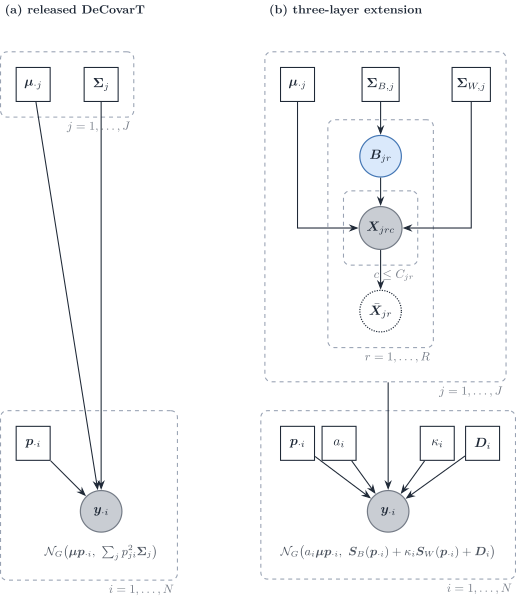

Figure 13: DeCovarT. (a) Released model: plug-in type moments and a
quadratic convolution. (b) Three-layer extension: the replicate plate
supplies \boldsymbol{\Sigma}\_{B,j} and \boldsymbol{\Sigma}\_{W,j}; the
bulk plate carries a_i, \kappa_i, \boldsymbol{p}\_{\cdot i} and a
diagonal residual \boldsymbol{D}\_i.

|  | Design error | Bulk law | Weight of type covariance | Scale | Estimator |
|----|----|----|----|----|----|
| `RNA-Sieve` | Yes, gene-wise | Asymptotic normal, genes separate | Variance, not a precision matrix | Relative rescaling | Maximum likelihood, asymptotic regions |
| `MEAD` | Yes, multivariate | Moment conditions, not a full density | Gene–gene correlation retained | a_i and \boldsymbol{d}, with identifiability conditions | Errors-in-variables estimator, delta-method intervals |
| `DECALS` | Through \boldsymbol{\Sigma}\_i(\boldsymbol{p}) | None | Subject-specific \boldsymbol{\Sigma}\_i built from cell-type blocks | Absorbed before regression | Constrained least squares, asymptotic covariance |
| `RCTD` | No, \boldsymbol{\mu} plugged in | Poisson–log-normal **mixture** of reads, genes independent given \varepsilon | None | N_i known, \alpha_i and \boldsymbol{d} | Two-stage MLE; SQP on w\ge 0 |
| `ReDeconv` | No | Univariate parametric, pointwise | Linear in p\_{ji} | CLTS keeps S_j | Variance-aware regression |
| DeCovarT now | No | Sparse multivariate normal, pointwise **convolution** | Quadratic in p\_{ji} | a_i profiled, S_j not in the likelihood | Constrained MLE on the ILR chart |
| DeCovarT in [the three-layer law](https://bastienchassagnol.github.io/DeCovarT/articles/theory-decovart-single-cell-tailored.html#eq-three-layer) | Only via \boldsymbol{\Sigma}\_{W,j}/C\_{jr} | Same normal family | Quadratic \boldsymbol{\Sigma}\_{B,j} plus linear \boldsymbol{\Sigma}\_{W,j} plus diagonal \boldsymbol{\Sigma}\_{\mathrm{obs},i} | a_i outside, S_j in the mean | Constrained maximum likelihood |

`RNA-Sieve` and DeCovarT both obtain a normal bulk from a sum of random
contributions. `RNA-Sieve` sums **cells** (linear variances, central
limit, gene by gene). DeCovarT convolves **population profiles**
(quadratic covariances, exact Gaussian, sparse precision). `MEAD` keeps
the multivariate second-moment structure that `RNA-Sieve` drops, and
adds the platform scales. `DECALS` wants the same subject-specific
covariance but will not commit to a density; the price is a
least-squares point estimate whose efficiency depends on how well
\boldsymbol{\Sigma}\_i is estimated. `ReDeconv` is the univariate,
mixture-weighted cousin of the linear term in [the three-layer
law](https://bastienchassagnol.github.io/DeCovarT/articles/theory-decovart-single-cell-tailored.html#eq-three-layer).
`RCTD` is a **read-level mixture** with a Poisson–log-normal margin:
each molecule comes from one type, \boldsymbol{\mu}\_{\cdot j} is fixed,
and extra-Poisson noise is gene-wise rather than a type-level
\boldsymbol{\Sigma}\_j.

The practical fork is the reference design, not a choice of optimiser.

- **R=1.** Fit [the linear within-type
  law](https://bastienchassagnol.github.io/DeCovarT/articles/theory-decovart-single-cell-tailored.html#eq-linear-within).
  Report \boldsymbol{q}\_{\cdot i} unless S_j is known, in which case
  apply the [RNA-to-cell
  correction](https://bastienchassagnol.github.io/DeCovarT/articles/theory-decovart-single-cell-tailored.html#eq-rna-to-cell)
  or insert S_j in [the `MuSiC`
  mean](https://bastienchassagnol.github.io/DeCovarT/articles/theory-decovart-single-cell-tailored.html#eq-music-mean).
  Do not publish \boldsymbol{\Sigma}\_{W,j} as a DeCovarT
  \boldsymbol{\Sigma}\_j. `RCTD`’s plugged-in \boldsymbol{\mu}\_{\cdot
  j} is this regime’s mean; its Poisson–log-normal is an alternative
  observation law for the same R=1 design, not a substitute for
  \boldsymbol{\Sigma}\_{B,j}.
- **R\ge 2 with a sparse or low-rank between-replicate precision.** Fit
  [the three-layer
  law](https://bastienchassagnol.github.io/DeCovarT/articles/theory-decovart-single-cell-tailored.html#eq-three-layer).
  The original quadratic term is then \boldsymbol{\Sigma}\_{B,j} and has
  a sampling interpretation. \boldsymbol{\Sigma}\_{\mathrm{obs},i} stays
  diagonal.

## Cell-type-specific moments when the composition is known

The methods of [Sec. 2](#sec-methods) estimate the composition from
known reference moments. The reverse problem takes the composition
\\\boldsymbol{p}\_{\cdot i}\\ as known, from any of those methods, and
estimates what DeCovarT plugs in: type-level means and covariances, or
the purified profile of each type in each sample. Write the convolution
with explicit latent profiles,

\boldsymbol{x}\_{\cdot j,i}\sim(\boldsymbol{\mu}\_{\cdot
j},\boldsymbol{\Sigma}\_j)\\ \text{independent across }j, \qquad
\boldsymbol{y}\_{\cdot i}=\sum_jp\_{ji}\\\boldsymbol{x}\_{\cdot j,i},
\tag{14}

so that

\mathbb{E}\[\boldsymbol{y}\_{\cdot
i}\]=\boldsymbol{\mu}\boldsymbol{p}\_{\cdot i}, \qquad
\operatorname{Cov}(\boldsymbol{y}\_{\cdot
i})=\sum_jp\_{ji}^{2}\boldsymbol{\Sigma}\_j , \tag{15}

which is the released DeCovarT law when the profiles are Gaussian. Three
families use these identities.

- **Type-level gene networks across a cohort.** `CSNet` regresses the
  outer products of bulk residuals on the squared proportions to
  estimate each \boldsymbol{\Sigma}\_j, then thresholds the correlation
  ([Sec. 3.1](#sec-csnet)).
- **Sample-level profiles with a covariance across cell types.** `bMIND`
  ([Wang et al. 2020](#ref-wangBayesianEstimationCelltypespecific2020))
  and `EPIC-unmix` ([Tang et al.
  2025](#ref-tangCellTypespecificInference2025)) place a J\times J
  covariance \boldsymbol{\Omega}\_g across cell types for each gene,
  independent across genes; `Unico` estimates that covariance without
  assuming independent cell types ([Chen et al.
  2025](#ref-chenUnicoUnifiedModelCell2025)). Their covariance is the
  transpose of DeCovarT’s: it couples types within a gene, not genes
  within a type.
- **Sample-level profiles with a gene–gene covariance.** With Gaussian
  profiles and known moments, the posterior mean of each
  \boldsymbol{x}\_{\cdot j,i} is a Wiener filter; it is derived in the
  [Bayesian Wiener-filter
  vignette](https://bastienchassagnol.github.io/DeCovarT/articles/theory-decovart-bayesian-wiener.html#sec-map-blup).

On the measurement side, these methods need the bulk on a linear scale
(FPKM for `CSNet`). When the bulk is normalised by its own library size,
the known weights act as RNA fractions \boldsymbol{q}\_{\cdot i}, not as
cell fractions ([Sec. 1](#sec-measurement)).

### Type-level moments given known proportions

`CSNet` inverts the DeCovarT arrow ([Su et al.
2024](#ref-suEstimatingCellTypeSpecificGene2024)). DeCovarT takes
(\boldsymbol{\mu},\\\boldsymbol{\Sigma}\_j\\) as plug-in and returns
\boldsymbol{p}\_{\cdot i}. `CSNet` takes \\\boldsymbol{p}\_{\cdot
i}\\\_{i=1}^{N} as known (from CIBERSORT, MuSiC, or DeCovarT itself) and
returns type-level means and a **sparse correlation network**. The
generative identities are the same convolution as
[Eq. 14](#eq-latent-convolution) and [Eq. 15](#eq-gaussian-convolution),
written across a cohort rather than one sample:

\mathbb{E}\[\boldsymbol{y}\_{\cdot i}\mid\boldsymbol{p}\_{\cdot i}\] =
\sum_j p\_{ji}\\\boldsymbol{\mu}\_{\cdot j}, \qquad
\operatorname{Cov}(\boldsymbol{y}\_{\cdot i}\mid\boldsymbol{p}\_{\cdot
i}) = \sum_j p\_{ji}^{2}\\\boldsymbol{\Sigma}\_j. \tag{16}

No Gaussian law is required for the moments. Let P\in\mathbb{R}^{N\times
J} have entries P\_{ij}=p\_{ji} and H\in\mathbb{R}^{N\times J} have
entries H\_{ij}=p\_{ji}^{2}. Gene-wise ordinary least squares on the
linear mean recovers

\hat{\boldsymbol{\mu}}\_{g\cdot} =
(P^{\top}P)^{-1}P^{\top}\boldsymbol{y}\_{g\cdot}, \tag{17}

the bulk analogue of a reference average, now identified from
**compositional contrast across samples** rather than from purified
cells. Centred residuals z\_{gi}=y\_{gi}-\sum_j p\_{ji}\hat{\mu}\_{gj}
then satisfy the pairwise identity z\_{gi}z\_{g'i}=\sum_j
p\_{ji}^{2}\Sigma\_{gg',j}+\varepsilon\_{gg'i}. Least squares of the
Hadamard products on H estimates each covariance entry,

\hat{\Sigma}\_{gg',j} =
\bigl\[(H^{\top}H)^{-1}H^{\top}(\boldsymbol{z}\_{g\cdot}\odot\boldsymbol{z}\_{g'\cdot})\bigr\]\_{j}.
\tag{18}

`CSNet` converts \hat{\boldsymbol{\Sigma}}\_j to a correlation
\hat{R}\_j and applies an element-wise SCAD threshold. That is a
**marginal co-expression** graph, not a Gaussian Markov precision. The
Gaussian convolution log-likelihood in \\\boldsymbol{\Sigma}\_j\\, which
is the natural DeCovarT loss for the same parameters, is neither convex
nor biconvex in those matrices; pairwise least squares is how `CSNet`
avoids that optimisation ([Su et al.
2024](#ref-suEstimatingCellTypeSpecificGene2024)).

A DeCovarT-native sequel would keep
[Eq. 17](#eq-csnet-mean)–[Eq. 18](#eq-csnet-cov) as the moment step,
then map \hat{\boldsymbol{\Sigma}}\_j to a sparse precision
\boldsymbol{\Omega}\_j (graphical lasso, or SCAD on the inverse) so that
the purified network is the same object DeCovarT already inserts into
[Eq. 15](#eq-gaussian-convolution). That pipeline is [in silico GRN
inference](https://bastienchassagnol.github.io/DeCovarT/articles/theory-network-inference.md)
run **after** \boldsymbol{p} has been estimated, not in place of it.

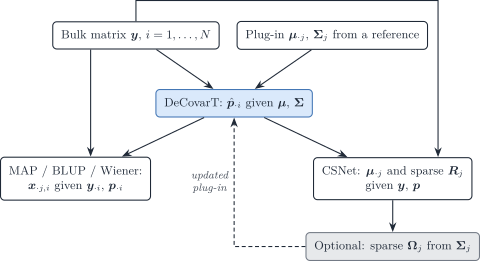

Figure 14: Two inverse problems on the same convolution. DeCovarT
estimates p given mu and Sigma. Given p, the MAP / BLUP recovers
sample-level purified profiles, and CSNet recovers type-level means and
a sparse co-expression network. A precision Omega_j estimated there can
be fed back as the DeCovarT plug-in.

P and H must have full column rank, so \boldsymbol{p}\_{\cdot i} has to
**vary** across the N bulks. One sample identifies \boldsymbol{p} given
(\boldsymbol{\mu},\\\boldsymbol{\Sigma}\_j\\); it does not identify J
covariance matrices. Rare types with almost constant p\_{ji} leave the
corresponding column of H weak, which is why `CSNet` recovers
abundant-type co-expression more easily than microglia-scale weights.
The method is a moment estimator: modest errors in the supplied
\boldsymbol{p} are averaged over N, whereas DeCovarT’s likelihood for a
single column is concentrated in \boldsymbol{p}\_{\cdot i}.

|  | DeCovarT | MAP / BLUP ([the Wiener filter](https://bastienchassagnol.github.io/DeCovarT/articles/theory-decovart-bayesian-wiener.html#eq-map-blup)) | `CSNet` |
|----|----|----|----|
| Known | \boldsymbol{\mu}\_{\cdot j}, \boldsymbol{\Sigma}\_j (reference) | \boldsymbol{\mu}\_{\cdot j}, \boldsymbol{\Sigma}\_j, \boldsymbol{p}\_{\cdot i} | \boldsymbol{p}\_{\cdot i} (external or DeCovarT) |
| Unknown | \boldsymbol{p}\_{\cdot i} | \boldsymbol{x}\_{\cdot j,i} (one sample) | \boldsymbol{\mu}\_{\cdot j}, sparse R_j (cohort) |
| Law | Multivariate Gaussian convolution | Same, posterior of the latents | Moments only; Gaussian optional |
| Second moment | Sparse **precision** \boldsymbol{\Omega}\_j as input | Uses \boldsymbol{\Sigma}\_j, does not re-estimate it | Sparse **correlation** R_j as output |
| Replication | One bulk column is enough | One bulk column | N\gg J bulks with varying \boldsymbol{p} |
| Estimator | Constrained MLE on the ILR chart | Posterior mean / Wiener gain | Gene-wise OLS, then pairwise LS, then SCAD |

The two problems compose. Fit DeCovarT to obtain
\hat{\boldsymbol{p}}\_{\cdot i}; run [the Wiener
filter](https://bastienchassagnol.github.io/DeCovarT/articles/theory-decovart-bayesian-wiener.html#eq-map-blup)
if the scientific target is a purified profile in that sample; run
[Eq. 17](#eq-csnet-mean)–[Eq. 18](#eq-csnet-cov) if the target is a
type-level network; optionally replace the reference
\boldsymbol{\Omega}\_j by that network and refit \boldsymbol{p}. Do not
treat a `CSNet` correlation graph as a DeCovarT precision.

## Bayesian reference-based deconvolution

Bayesian methods put priors on the purified profiles, on the
proportions, or on both, and report posterior summaries. They split by
target: sample-level profiles ([Sec. 4.1](#sec-bayes-cts)) or
proportions ([Sec. 4.2](#sec-bayes-prop)). A latent-profile Bayesian
version of DeCovarT is derived in the [Bayesian Wiener-filter
vignette](https://bastienchassagnol.github.io/DeCovarT/articles/theory-decovart-bayesian-wiener.md).

### Cell-type-specific profiles

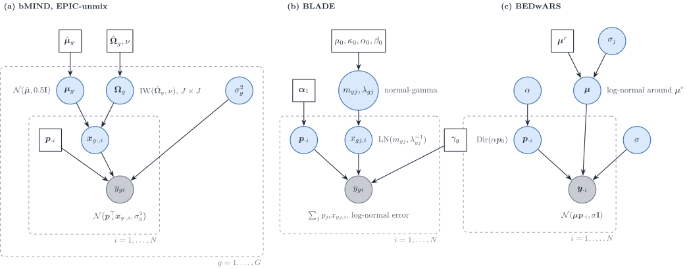

Figure 15: Bayesian models for cell-type-specific profiles, in this
review’s notation. (a) `bMIND` and `EPIC-unmix`: for each gene, the
sample-level profile across cell types is Gaussian with a J\times J
covariance \boldsymbol{\Omega}\_g under an inverse-Wishart prior centred
on single-cell estimates; proportions are fixed. (b) `BLADE`: log-normal
profiles with a normal-gamma prior, Dirichlet proportions, linear
mixing. (c) `BEDwARS`: a cohort-level signature drawn around a noisy
reference, Dirichlet proportions, Gaussian residuals.

**`bMIND`** estimates sample-level profiles for proportions estimated
beforehand (by NNLS or `Bisque`) ([Wang et al.
2020](#ref-wangBayesianEstimationCelltypespecific2020)). For gene g and
subject i,

y\_{gi}=\boldsymbol{p}\_{\cdot
i}^{\top}\boldsymbol{x}\_{g\cdot,i}+e\_{gi}, \qquad
\boldsymbol{x}\_{g\cdot,i}\sim\mathcal{N}\_J(\boldsymbol{\mu}\_{g\cdot},\boldsymbol{\Omega}\_g),
\qquad e\_{gi}\sim\mathcal{N}(0,\sigma_g^{2}), \tag{19}

with
\boldsymbol{\mu}\_{g\cdot}\sim\mathcal{N}(\hat{\boldsymbol{\mu}}\_{g\cdot},0.5\mathbf{I}),
\boldsymbol{\Omega}\_g\sim\mathrm{IW}(\hat{\boldsymbol{\Omega}}\_g,50)
and a non-informative prior on \sigma_g^{2}; the hyperparameters come
from single-cell or single-nucleus summary statistics. Sampling is by
MCMC (`MCMCglmm`), gene by gene. Condition-specific means
\boldsymbol{\mu}\_g^{f} give tests of cell-type-specific differential
expression. The authors note that the uncertainty of the estimated
proportions is not propagated.

**`EPIC-unmix`** ([Tang et al.
2025](#ref-tangCellTypespecificInference2025)) keeps the `bMIND` model
and adds a second, empirical-Bayes step: the prior is re-centred on the
step-one posterior means and on their covariance across the target
samples, with an increased number of degrees of freedom The target
samples are therefore used twice. The bulk enters on the \log_2 scale,
so the linear mixing of [Eq. 19](#eq-bmind) is a mixing of logarithms,
which is not the physical sum of cells
(\log\sum_jp_jx_j\neq\sum_jp_j\log x_j).

**`BLADE`** estimates proportions and sample-level profiles jointly
([Andrade Barbosa et al.
2021](#ref-andrade-barbosaBayesianLogNormalDeconvolution2021)):
y\_{gi}=\sum_jp\_{ji}x\_{gj,i} plus a log-normal error, with
x\_{gj,i}\sim\mathrm{LN}(m\_{gj},\lambda\_{gj}^{-1}), a normal-gamma
prior on (m\_{gj},\lambda\_{gj}) centred on the log-scale mean and
variance of single-cell data, and \boldsymbol{p}\_{\cdot
i}\sim\mathrm{Dir}(\boldsymbol{\alpha}\_1). The mixing is on the linear
scale (TPM). Inference is collapsed variational, with hyperparameters
chosen on a grid by likelihood. The model is diagonal: no covariance
across genes or across types.

**`BEDwARS`** treats the reference itself as noisy ([Ghaffari et al.
2023](#ref-ghaffariBEDwARSRobustBayesian2023)):
y\_{gi}=\sum_j\mu\_{gj}p\_{ji}+E\_{gi},
\log\mu\_{gj}\sim\log\mu^{r}\_{gj}+\mathcal{N}(0,\sigma_j^{2}\log\mu^{r}\_{gj}),
\boldsymbol{p}\_{\cdot i}\sim\mathrm{Dir}(\alpha\boldsymbol{p}\_0), with
half-Cauchy hyperpriors and Metropolis–Hastings chains. The signature is
cohort-level: there is no sample-level profile. As written, the prior
variance \sigma_j^{2}\log\mu^{r}\_{gj} is not positive for reference
values at or below one RPKM (our remark).

**`BayesPrism`** places a multinomial likelihood on bulk counts with a
patient-derived single-cell prior and infers proportions and
sample-level profiles jointly ([Chu et al.
2022](#ref-chuCellTypeGeneExpression2022)). The multinomial is the
Poisson measurement model conditioned on the library size
([Sec. 1.1](#sec-poisson-measurement)), so `BayesPrism` is the
count-scale member of this family.

| Method | Bulk scale | Profile prior | Covariance | Proportions | Inference | Output |
|----|----|----|----|----|----|----|
| `bMIND` | linear (not stated) | \mathcal{N}(\boldsymbol{\mu}\_g,\boldsymbol{\Omega}\_g) | IW on J\times J \boldsymbol{\Omega}\_g | fixed | MCMC | sample-level profiles |
| `EPIC-unmix` | \log_2 | as `bMIND`, re-centred | IW on J\times J, empirical Bayes | fixed | MCMC, two steps | sample-level profiles |
| `BLADE` | linear (TPM) | log-normal, normal-gamma | none | Dirichlet | collapsed VI | proportions, sample-level profiles |
| `BEDwARS` | linear (RPKM) | log-normal around the reference | none | Dirichlet | MH chains | proportions, cohort signature |
| `BayesPrism` | counts | from single cells | none | Dirichlet | Gibbs | proportions, sample-level profiles |

Table 3: Bayesian methods for cell-type-specific profiles. None models a
G\times G gene–gene covariance.

The contrast with DeCovarT is the dimension of the covariance. `bMIND`
and `EPIC-unmix` model how **cell types** covary for one gene across
subjects; DeCovarT models how **genes** covary within one cell type. A
separable covariance
\operatorname{Cov}(\operatorname{vec}\boldsymbol{X}\_i)=\boldsymbol{\Omega}\otimes\boldsymbol{\Sigma}
for the G\times J matrix of purified profiles would contain both as
special cases (our remark); no reviewed method fits it.

### Proportions

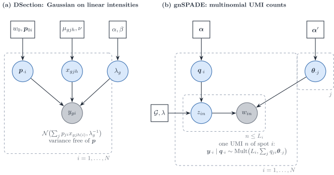

Figure 16: Bayesian estimation of proportions from continuous
intensities or from counts. (a) `DSection`: Gaussian bulk on linear
intensities with condition-specific type profiles, a gene-wise precision
and an informative Dirichlet prior on the proportions. (b) `gnSPADE`:
each UMI of a spot draws a type label and then a gene, so the spot
counts are multinomial with a probability vector that mixes the type
profiles; a gene network enters as a Markov random field on the labels.

**`DSection`** is the continuous, Gaussian route ([Erkkilä et al.
2010](#ref-erkkilaProbabilisticAnalysisGene2010)):
y\_{gi}\sim\mathcal{N}\bigl(\sum_jp\_{ji}x\_{gjc(i)},\lambda_g^{-1}\bigr),
with condition-specific type profiles
x\_{gjc}\sim\mathcal{N}(\mu\_{gjc},\nu),
\lambda_g\sim\mathrm{Gamma}(\alpha,\beta) and \boldsymbol{p}\_{\cdot
i}\sim\mathrm{Dir}(w_0\boldsymbol{p}\_{0i}) centred on a prior guess of
the proportions, which is needed for identifiability. Sampling is Gibbs
for the profiles and the precision and Metropolis–Hastings with
Dirichlet proposals for the proportions. The paper offers no log-normal
option and recommends linear data. The variance depends on the gene but
not on the proportions.

**`gnSPADE`** ([Xie and Cui 2026](#ref-xieGnSPADEIncorporatingGene2026))
is the count route, and it is reference-free. Each UMI of spot i draws a
label z\sim\mathrm{Mult}(\boldsymbol{\theta}\_i) and then a gene from
the profile of that label, so \boldsymbol{y}\_{\cdot
i}\mid\boldsymbol{\theta}\_i\sim\mathrm{Mult}(N_i,\sum_j\theta\_{ij}\boldsymbol{\beta}\_j):
latent Dirichlet allocation with a Markov random field over the labels
built from a protein interaction network. Inference is collapsed Gibbs.

The two differ where the measurement model of [Sec. 1](#sec-measurement)
bites.

- **Variance.** In `gnSPADE` the variance is fixed by the mean (the
  multinomial is a Poisson measurement conditioned on the total). In
  `DSection` it is a free gene-wise constant that does not grow with the
  mean, which a UMI measurement contradicts.
- **What the weights are.** `gnSPADE` shares UMIs, so
  \boldsymbol{\theta}\_i are transcript fractions \boldsymbol{q}\_{\cdot
  i}; converting them to cell fractions needs S_j. `DSection` estimates
  whatever its reference scale encodes.
- **Profile variability.** Neither model has a type-level variability of
  profiles across samples beyond the prior of `DSection`; neither has a
  gene–gene covariance. The gene network of `gnSPADE` acts on labels,
  not on expression.

## Semi-reference deconvolution: one unknown component

Semi-reference methods have references for J-1 types and estimate an
unknown component, usually tumour, together with the proportions. With
one component unknown, the convolution of univariate laws has to be
written explicitly, and its tractability drives the choice of law.

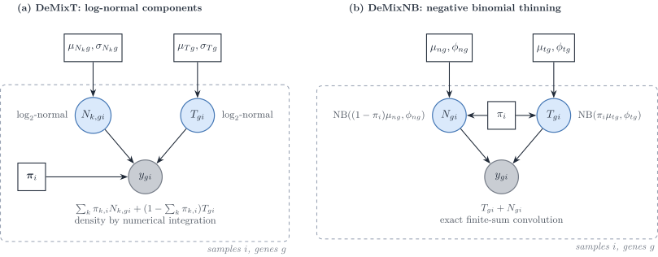

Figure 17: Two semi-reference convolutions of univariate components. (a)
`DeMixT`: log-normal components mixed linearly on the raw scale; the
density of the sum has no closed form and is integrated numerically. (b)
`DeMixNB`: each component is a negative binomial whose mean is already
scaled by its proportion; the density of the sum is an exact finite sum.

**`DeMix` and `DeMixT`.** `DeMix` mixes a tumour and one normal
component; `DeMixT` adds a second normal component ([Ahn et al.
2013](#ref-ahnDeMixDeconvolutionMixed2013); [Wang et al.
2018](#ref-wangTranscriptomeDeconvolutionHeterogeneous2018)):

y\_{gi}=\pi\_{1,i}N\_{1,gi}+\pi\_{2,i}N\_{2,gi}+(1-\pi\_{1,i}-\pi\_{2,i})T\_{gi},
\qquad N\_{k,gi},T\_{gi}\sim\log_2\text{-normal}. \tag{20}

The mixing is linear on the raw scale, and the density of a sum of
log-normals has no closed form, so `DeMixT` integrates numerically (a
double integral for three components). The normal-component parameters
are plugged in from unmatched normal samples; the proportions and the
tumour parameters are maximised by iterated conditional modes, gene and
sample blocks in parallel. When the two normal means are close, the
likelihood is flat in (\pi_1,\pi_2); a gene-set component-merging step
first estimates the tumour proportion on genes where they agree. Genes
are independent.

**`DeMixNB`** replaces the log-normal by a negative binomial for sparse
counts (miRNA, spatial spots) ([Montierth et al.
2025](#ref-montierthDeconvolutionSparsecountRNA2025)):
T\_{gi}\sim\mathrm{NB}(\pi_i\mu\_{tg},\phi\_{tg}),
N\_{gi}\sim\mathrm{NB}((1-\pi_i)\mu\_{ng},\phi\_{ng}) and
y\_{gi}=T\_{gi}+N\_{gi}, whose density is the finite sum
\sum\_{z=0}^{y}f_T(z)f_N(y-z). The proportions scale the means, not the
dispersions. Read with [Sec. 1](#sec-measurement),
\mathrm{NB}(\pi\mu,\phi) is the binomial thinning of
\mathrm{NB}(\mu,\phi): a Poisson measurement of a Gamma-distributed
rate, with the rates mixed linearly (our remark). That makes `DeMixNB`
the semi-reference model closest to a UMI measurement. Its \pi_i is a
transcript fraction. The method is a preprint.

**`BayICE`** models \log(\text{count}+1) as Gaussian with mean
\alpha_g+\sum_kw\_{ik}\beta\_{gk}+w\_{i0}\beta\_{g0}, a convex
combination of type effects plus an unknown-class effect, with
spike-and-slab priors on the type effects (marker selection with a
Bayesian false discovery rate) and a Dirichlet prior on the weights
([Tai et al. 2021](#ref-taiBayiceBayesianHierarchicalModel2021)).
Inference is Gibbs with Metropolis–Hastings steps. The mixing is on the
log scale, so it is a mean regression rather than a convolution, and the
variances are gene-wise, not type-specific.

**`ISOpureR`** places a multinomial on the discretised tumour profile,
with probability vector
\alpha_i\boldsymbol{c}\_i+\sum_r\theta\_{ir}\boldsymbol{b}\_r: the
normal part is a convex combination of individual reference **samples**,
the cancer profile \boldsymbol{c}\_i is shrunk towards a cohort mean by
a Dirichlet prior, and the estimate is a MAP by block coordinate descent
([Anghel et al.
2015](#ref-anghelISOpureRImplementationComputational2015)). Genes are
coupled through the multinomial simplex; there is no overdispersion. Its
\alpha_i is a fraction of transcripts.

|  | `DeMix`, `DeMixT` | `DeMixNB` | `BayICE` | `ISOpureR` |
|----|----|----|----|----|
| Component law | \log_2-normal | negative binomial | Gaussian on \log(y+1) | multinomial, Dirichlet profiles |
| Mixing scale | raw | counts | log | probabilities |
| Convolution | numerical integration | exact finite sum | none (mean regression) | none (closed by thinning) |
| Inference | ICM, plug-in reference | ICM, L-BFGS-B, restarts | Gibbs and MH | MAP, coordinate descent |
| Genes | independent | independent | conditionally independent | coupled by the simplex |
| Proportion | mixing weight on raw scale | transcript fraction | weight on log scale | transcript fraction |

Table 4: Semi-reference methods. The extension of DeCovarT to one
unknown component is outlined in the [extensions
roadmap](https://bastienchassagnol.github.io/DeCovarT/articles/theory-decovart-extensions-roadmap.html#sec-semi-reference).

## Reference-free deconvolution with co-expression structure

Without a reference, deconvolution is a non-negative matrix
factorisation \boldsymbol{Y}\approx\boldsymbol{\mu}\boldsymbol{P} with
the columns of \boldsymbol{P} on the simplex. Three recent methods add
gene–gene structure to that factorisation, in three different ways.

**`DSSC`** ([Wang et al. 2024](#ref-wangDeconvolutionBulkGene2024)) fits
the bulk and, in addition, the Gram matrices of genes and of samples :

\min\_{\boldsymbol{\mu},\boldsymbol{P}\ge 0}
\lVert\boldsymbol{Y}-\boldsymbol{\mu}\boldsymbol{P}\rVert_F^{2}
+\lambda_1\lVert\boldsymbol{K}\_N-\boldsymbol{P}^{\top}\boldsymbol{P}\rVert_F^{2}
+\lambda_2\lVert\boldsymbol{K}\_G-\boldsymbol{\mu}\boldsymbol{\mu}^{\top}\rVert_F^{2}
+\lambda_c\lVert\boldsymbol{\mu}-\rho(\boldsymbol{Y}\_{\mathrm{sc}})\rVert_F^{2},
\tag{21}

where \boldsymbol{K}\_G and \boldsymbol{K}\_N are similarity kernels
1/(1+d) built from Pearson distances of the **same** bulk, and the last
term optionally pulls the signature towards a single-cell reference.
Multiplicative updates are run without the sum-to-one constraint and the
proportions are normalised afterwards. The gene term matches
\boldsymbol{\mu}\boldsymbol{\mu}^{\top} to a data similarity; expanded,
it keeps the affinity part of a graph-Laplacian penalty and replaces its
degree term by a quartic term, so it corresponds to no Gaussian Markov
random field (our remark).

**`GSNMF+`** ([Li et al. 2025](#ref-liAugmentedGSNMFModel2025))
regularises the rows of the signature with a kernel co-expression graph
built on the bulk augmented by single-cell pseudo-bulks, and pulls
marker rows towards the simplex vertices It states identifiability
conditions (separability, or sufficiently scattered factors) and that
the Frobenius loss is the Gaussian maximum-likelihood estimate. With a
Euclidean distance its graph term would be
\operatorname{tr}(\boldsymbol{\mu}^{\top}\boldsymbol{L}\_G\boldsymbol{\mu}),
the log-density of an intrinsic Gaussian Markov random field prior on
the signature; with the cosine distance it uses, the term is quartic.

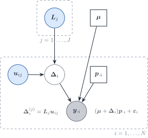

Figure 18: `swCAM` read as a probabilistic model (our reading, not the
paper’s). The nuclear-norm penalty on the sample-specific deviations of
type j is the MAP of a Gaussian factor model with loadings
\boldsymbol{V}\_j and sample scores \boldsymbol{u}\_{ij}, which implies
a low-rank gene–gene covariance within each cell type.

**`swCAM`** estimates sample-specific signatures ([Chen et al.
2022](#ref-chenSwCAMEstimationSubtypespecific2022)). After convex
analysis of mixtures has fixed \boldsymbol{\mu} and \boldsymbol{P}, it
solves

\min\_{\\\boldsymbol{\Delta}\_i\\}
\tfrac12\sum_i\lVert\boldsymbol{y}\_{\cdot
i}-(\boldsymbol{\mu}+\boldsymbol{\Delta}\_i)\boldsymbol{p}\_{\cdot
i}\rVert_2^{2} +\lambda\sum_j\lVert\boldsymbol{T}\_j\rVert\_{\*},
\tag{22}

where \boldsymbol{T}\_j stacks the deviations of type j over samples and
\lVert\cdot\rVert\_\* is the nuclear norm. The problem is convex for
fixed \boldsymbol{\mu} and \boldsymbol{P} and is solved by ADMM. There
is no co-expression graph. Because
\lVert\boldsymbol{T}\rVert\_\*=\min\_{\boldsymbol{U}\boldsymbol{V}^{\top}=\boldsymbol{T}}\tfrac12(\lVert\boldsymbol{U}\rVert_F^{2}+\lVert\boldsymbol{V}\rVert_F^{2}),
the penalty is the MAP of a Gaussian factor model
([Figure 18](#fig-dag-swcam)), which implies a low-rank gene–gene
covariance within each type.

### Three ways gene covariance enters deconvolution

1.  **Graph regularisation of a factorisation.** A co-expression graph
    smooths the signature (`GSNMF+`). Its probabilistic reading is a
    Gaussian Markov random field prior on the signature, exact only for
    a Euclidean, quadratic penalty.
2.  **Similarity matching to the bulk itself.** The Gram matrices of the
    factors are fitted to similarities computed from the same data
    (`DSSC`). The data are used twice, and no likelihood is implied.
3.  **Covariance in a likelihood, a moment equation or a prior.** The
    gene–gene covariance of each type enters the bulk law: as a plug-in
    in DeCovarT, as moment equations in `DECALS` and `MEAD`, as the
    estimand in `CSNet`, and implicitly as a low-rank factor structure
    in `swCAM`. `bMIND` and `EPIC-unmix` belong here with the transposed
    object, a covariance across cell types.

All three reference-free methods use a squared Frobenius loss, that is a
homoscedastic Gaussian likelihood, and therefore ignore the
mean–variance relationship of counts
([Sec. 1.1](#sec-poisson-measurement)).

## Synthesis

| Method | Bulk scale | Bulk variance as a function of \boldsymbol{p} | Gene–gene covariance | Type–type covariance | Reference uncertainty | Estimator |
|----|----|----|----|----|----|----|
| `MuSiC` | relative abundance | quadratic, diagonal | no | no | weights | weighted NNLS |
| `RNA-Sieve` | counts / linear | linear, diagonal | no | no | noisy means | MLE, Godambe |
| `ReDeconv` | linear (CLTS) | linear, diagonal | no | no | no | MLE |
| `DWLS` | linear | implied quadratic in the mean | no | no | no | weighted LS |
| `RCTD` | counts | Poisson–log-normal | no | no | no | two-stage MLE |
| `DECALS` | FPKM | quadratic | yes (moments) | no | no | OLS + sandwich |
| `MEAD` | linear | sandwich over dependent genes | yes (global) | no | yes | estimating equations |
| DeCovarT | linear | quadratic | yes (plug-in, sparse) | no | bootstrap | MLE |
| `CSNet` | FPKM | quadratic | yes (estimand) | no | no | moments + thresholding |
| `bMIND`, `EPIC-unmix` | linear / \log_2 | \boldsymbol{p}^{\top}\boldsymbol{\Omega}\_g\boldsymbol{p}+\sigma_g^{2} | no | yes (J\times J) | prior | MCMC |
| `BLADE` | linear | quadratic, log-normal profiles | no | no | prior | collapsed VI |
| `BEDwARS` | linear | constant | no | no | noisy reference prior | MH |
| `DSection` | linear | constant | no | no | prior | Gibbs–MH |
| `DeMixT` | raw | quadratic, log-normal components | no | no | plug-in | ICM |
| `DeMixNB` | counts | negative binomial | no | no | plug-in | ICM |
| `swCAM` | linear | constant | low rank (implicit) | no | no | ADMM |

Table 5: Where second-order information enters each method. “Quadratic”
and “linear” refer to the weight of a type’s variance in the bulk
variance (p\_{ji}^{2} for a random population profile, p\_{ji} for
independent cells).

### Caveats and defaults

1.  **Scale.** Mixing is additive only on a linear scale. Methods that
    mix logarithms (`BayICE`, `EPIC-unmix`) estimate weights of a
    different, non-physical sum.
2.  **Cell versus RNA fractions.** Count and topic models (`ISOpureR`,
    `gnSPADE`, `DeMixNB`, `BayesPrism`) and any fit on
    library-normalised bulk return transcript fractions; cell fractions
    need the cell sizes S_j ([RNA-to-cell
    conversion](https://bastienchassagnol.github.io/DeCovarT/articles/theory-decovart-single-cell-tailored.html#sec-uncoupling)).
3.  **Mean–variance relationship.** A constant residual variance
    (`DSection`, `BEDwARS`, NMF with a Frobenius loss) contradicts the
    Poisson measurement of UMI counts, whose variance grows with the
    mean. Count likelihoods or explicit variance functions respect it
    ([GLM
    view](https://bastienchassagnol.github.io/DeCovarT/articles/theory-DeCovarT-MLE-properties.html#sec-glm)).
4.  **Linear or quadratic weights.** Independent cells give a variance
    linear in the proportions (`RNA-Sieve`, `ReDeconv`); a random
    population profile gives a quadratic weight (`MuSiC`, `DECALS`,
    `CSNet`, DeCovarT). Single-cell references with one donor identify
    only the first ([tailored
    vignette](https://bastienchassagnol.github.io/DeCovarT/articles/theory-decovart-single-cell-tailored.html#sec-three-regimes)).
5.  **Which covariance.** G\times G within a type (DeCovarT, `DECALS`,
    `CSNet`) and J\times J within a gene (`bMIND`, `EPIC-unmix`,
    `Unico`) answer different questions; neither family fits both.
6.  **Data reuse.** Empirical-Bayes re-centring on the target samples
    (`EPIC-unmix`), similarity graphs built from the bulk being
    factorised (`DSSC`, `GSNMF+`) and priors built from the same
    single-cell source as the benchmark bulk (`BLADE` group mode)
    inflate apparent accuracy.
7.  **Propagated uncertainty.** Few methods propagate the uncertainty of
    the reference (`RNA-Sieve`, `MEAD`, DeCovarT’s reference bootstrap)
    or of the proportions into downstream profiles (`bMIND` does not).
8.  **Identifiability.** Gene-wise scales with perfect markers (`MEAD`),
    collinear reference means (`DeMixT`), and reference-free
    factorisations without separability (`GSNMF+`) all leave the
    proportions unidentified, whatever the sample size.

### Methods to add to this review

Already in the bibliography and worth a section: `BLEND`, probabilistic
deconvolution with automated reference selection ([Huang et al.
2024](#ref-huangBLENDProbabilisticCellular2024)); `DeconV`, a Poisson
model aggregated from single cells ([Gynter et al.
2023](#ref-gynterDeconvProbabilisticCellType2023)); `Unico` for the
covariance across cell types ([Chen et al.
2025](#ref-chenUnicoUnifiedModelCell2025)); `Imply`, personalised
reference profiles ([Meng et al.
2024](#ref-mengImplyImprovingCelltype2024)); and `DecOT`, an optimal
transport loss ([Liu et al.
2022](#ref-liuDecotBulkDeconvolutionOptimal2022)). CIBERSORTx ([Newman
et al. 2019](#ref-newmanDeterminingCellType2019)) extends the signature
approach to high-resolution, sample-level profiles.

## References

Abbas, Alexander R., Kristen Wolslegel, Dhaya Seshasayee, Zora Modrusan,
and Hilary F. Clark. 2009. ‘Deconvolution of Blood Microarray Data
Identifies Cellular Activation Patterns in Systemic Lupus
Erythematosus’. *PloS One* 4.
<https://doi.org/10.1371/journal.pone.0006098>.

Ahn, Jaeil, Ying Yuan, Giovanni Parmigiani, et al. 2013. ‘DeMix:
Deconvolution for Mixed Cancer Transcriptomes Using Raw Measured Data’.
*Bioinformatics (Oxford, England)* 29.
<https://doi.org/10.1093/bioinformatics/btt301>.

Andrade Barbosa, Bárbara, Saskia D. van Asten, Ji Won Oh, et al. 2021.
‘Bayesian Log-Normal Deconvolution for Enhanced in Silico
Microdissection of Bulk Gene Expression Data’. *Nature Communications*
12 (1). <https://doi.org/10.1038/s41467-021-26328-2>.

Anghel, Catalina V, Gerald Quon, Syed Haider, et al. 2015. ‘ISOpureR: An
R Implementation of a Computational Purification Algorithm of Mixed
Tumour Profiles’. *BMC Bioinformatics* 16.
<https://doi.org/10.1186/s12859-015-0597-x>.

Batardière, Bastien, Julien Chiquet, François Gindraud, and Mahendra
Mariadassou. 2025. ‘Zero-Inflation in the Multivariate Poisson Lognormal
Family’. *Statistics and Computing* 35 (6).
<https://doi.org/10.1007/s11222-025-10729-0>.

Cable, Dylan M., Evan Murray, Luli S. Zou, et al. 2022. ‘Robust
Decomposition of Cell Type Mixtures in Spatial Transcriptomics’. *Nature
Biotechnology* 40 (4): 517–26.
<https://doi.org/10.1038/s41587-021-00830-w>.

Cai, Biao, Emma Jingfei Zhang, Hongyu Li, Chang Su, and Hongyu Zhao.
2024. ‘Statistical Inference of Cell-Type Proportions Estimated from
Bulk Expression Data’. *Journal of the American Statistical Association*
119 (548): 2521–32. <https://doi.org/10.1080/01621459.2024.2382435>.

Chen, Lulu, Chiung-Ting Wu, Chia-Hsiang Lin, et al. 2022. ‘swCAM:
Estimation of Subtype-Specific Expressions in Individual Samples with
Unsupervised Sample-Wise Deconvolution’. *Bioinformatics* 38 (5):
1403–10. <https://doi.org/10.1093/bioinformatics/btab839>.

Chen, Zeyuan Johnson, Elior Rahmani, and Eran Halperin. 2025. ‘Unico: A
Unified Model for Cell-Type Resolution Genomics from Heterogeneous Omics
Data’. *Genome Biology* 26 (1).
<https://doi.org/10.1186/s13059-025-03776-3>.

Chiquet, Julien, Mahendra Mariadassou, and Stéphane Robin. 2018.
*Variational Inference for Sparse Network Reconstruction from Count
Data*. arXiv. <https://doi.org/10.48550/arxiv.1806.03120>.

Chiquet, Julien, Mahendra Mariadassou, and Stéphane Robin. 2021. ‘The
Poisson-Lognormal Model as a Versatile Framework for the Joint Analysis
of Species Abundances’. *Frontiers in Ecology and Evolution* 9.
<https://doi.org/10.3389/fevo.2021.588292>.

Chu, Tinyi, Zhong Wang, Dana Pe’er, and Charles G. Danko. 2022. ‘Cell
Type and Gene Expression Deconvolution with BayesPrism Enables Bayesian
Integrative Analysis Across Bulk and Single-Cell RNA Sequencing in
Oncology’. *Nature Cancer* 3 (4): 505–17.
<https://doi.org/10.1038/s43018-022-00356-3>.

Erdmann-Pham, Dan D., Jonathan Fischer, Justin Hong, and Yun S. Song.
2021. ‘Likelihood-Based Deconvolution of Bulk Gene Expression Data Using
Single-Cell References’. *Genome Research* 31 (10): 1794–806.
<https://doi.org/10.1101/gr.272344.120>.

Erkkilä, Timo, Saara Lehmusvaara, Pekka Ruusuvuori, Tapio Visakorpi,
Ilya Shmulevich, and Harri Lähdesmäki. 2010. ‘Probabilistic Analysis of
Gene Expression Measurements from Heterogeneous Tissues’.
*Bioinformatics* 26. <https://doi.org/10.1093/bioinformatics/btq406>.

Fan, Jiaxin, Yafei Lyu, Qihuang Zhang, Xuran Wang, Mingyao Li, and Rui
Xiao. 2022. ‘MuSiC2: Cell-Type Deconvolution for Multi-Condition Bulk
RNA-seq Data’. *Briefings in Bioinformatics* 23 (6).
<https://doi.org/10.1093/bib/bbac430>.

Fang, Meichen, and Lior Pachter. 2025. *Extrinsic Biological
Stochasticity and Technical Noise Normalization of Single-Cell RNA
Sequencing Data*. bioRxiv preprint; bioRxiv.
<https://doi.org/10.1101/2025.05.11.653373>.

Ghaffari, Saba, Kelly J. Bouchonville, Ehsan Saleh, Remington E.
Schmidt, Steven M. Offer, and Saurabh Sinha. 2023. ‘BEDwARS: A Robust
Bayesian Approach to Bulk Gene Expression Deconvolution with Noisy
Reference Signatures’. *Genome Biology* 24 (1): 178.
<https://doi.org/10.1186/s13059-023-03007-7>.

Gynter, Artur, Dimitri Meistermann, Harri Lähdesmäki, and Helena
Kilpinen. 2023. *DeconV: Probabilistic Cell Type Deconvolution from Bulk
RNA-sequencing Data*. bioRxiv.
<https://doi.org/10.1101/2023.12.07.570524>.

Huang, Penghui, Manqi Cai, Chris McKennan, and Jiebiao Wang. 2024.
*BLEND: Probabilistic Cellular Deconvolution with Automated Reference
Selection*. bioRxiv. <https://doi.org/10.1101/2024.08.02.606458>.

Jew, Brandon, Marcus Alvarez, Elior Rahmani, et al. 2020. ‘Accurate
Estimation of Cell Composition in Bulk Expression Through Robust
Integration of Single-Cell Information’. *Nature Communications* 11.
<https://doi.org/10.1038/s41467-020-15816-6>.

Lähdesmäki, Harri, llya Shmulevich, Valerie Dunmire, Olli Yli-Harja, and
Wei Zhang. 2005. ‘In Silico Microdissection of Microarray Data from
Heterogeneous Cell Populations’. *BMC Bioinformatics* 6.
<https://doi.org/10.1186/1471-2105-6-54>.

Li, Shaoyu, Su Xu, Xue Wang, Nilüfer Ertekin-Taner, and Duan Chen. 2025.
‘An Augmented GSNMF Model for Complete Deconvolution of Bulk RNA-Seq
Data’. *Mathematical Biosciences and Engineering : MBE* 22 (4):
988–1018. <https://doi.org/10.3934/mbe.2025036>.

Liu, Gan, Xiuqin Liu, and Liang Ma. 2022. ‘DecOT: Bulk Deconvolution
with Optimal Transport Loss Using a Single-Cell Reference’. *Frontiers
in Genetics* 13. <https://doi.org/10.3389/fgene.2022.825896>.

Lu, Songjian, Jiyuan Yang, Lei Yan, et al. 2025. ‘Transcriptome Size
Matters for Single-Cell RNA-seq Normalization and Bulk Deconvolution’.
*Nature Communications* 16 (1).
<https://doi.org/10.1038/s41467-025-56623-1>.

Meng, Guanqun, Yue Pan, Wen Tang, et al. 2024. ‘Imply: Improving
Cell-Type Deconvolution Accuracy Using Personalized Reference Profiles’.
*Genome Medicine* 16 (1): 65.
<https://doi.org/10.1186/s13073-024-01338-z>.

Montierth, Matthew D., Hao Yan, Liyang Xie, et al. 2025. *Deconvolution
of Sparse-count RNA Sequencing Data for Tumor Cells Using Embedded
Negative Binomial Distributions*. bioRxiv.
<https://doi.org/10.1101/2025.11.21.689822>.

Newman, Aaron M., Chloé B. Steen, Chih Long Liu, et al. 2019.
‘Determining Cell Type Abundance and Expression from Bulk Tissues with
Digital Cytometry’. *Nature Biotechnology* 37.
<https://doi.org/10.1038/s41587-019-0114-2>.

Sarkar, Abhishek, and Matthew Stephens. 2021. ‘Separating Measurement
and Expression Models Clarifies Confusion in Single-Cell RNA Sequencing
Analysis’. *Nature Genetics* 53 (6): 770–77.
<https://doi.org/10.1038/s41588-021-00873-4>.

Shen-Orr, Shai S., Robert Tibshirani, Purvesh Khatri, et al. 2010. ‘Cell
Type–Specific Gene Expression Differences in Complex Tissues’. *Nature
Methods* 7. <https://doi.org/10.1038/nmeth.1439>.

Su, Chang, Jingfei Zhang, and Hongyu Zhao. 2024. ‘Estimating
Cell-Type-Specific Gene Co-Expression Networks from Bulk Gene Expression
Data with an Application to Alzheimer’s Disease’. *Journal of the
American Statistical Association* 119 (546): 811–24.
<https://doi.org/10.1080/01621459.2023.2297467>.

Tai, An-Shun, George C. Tseng, and Wen-Ping Hsieh. 2021. ‘BayICE: A
Bayesian Hierarchical Model for Semireference-Based Deconvolution of
Bulk Transcriptomic Data’. *The Annals of Applied Statistics* 15 (1).
<https://doi.org/10.1214/20-aoas1376>.

Tang, Chenwei, Quan Sun, Xinyue Zeng, et al. 2025. ‘Cell Type-Specific
Inference from Bulk RNA-Sequencing Data by Integrating Single-Cell
Reference Profiles via EPIC-Unmix’. *Genome Biology* 26 (1): 395.
<https://doi.org/10.1186/s13059-025-03847-5>.

Tsoucas, Daphne, Rui Dong, Haide Chen, Qian Zhu, Guoji Guo, and
Guo-Cheng Yuan. 2019. ‘Accurate Estimation of Cell-Type Composition from
Gene Expression Data’. *Nature Communications* 10.
<https://doi.org/10.1038/s41467-019-10802-z>.

Wang, Chenqi, Yifan Lin, Shuchao Li, and Jinting Guan. 2024.
‘Deconvolution from Bulk Gene Expression by Leveraging Sample-Wise and
Gene-Wise Similarities and Single-Cell RNA-Seq Data’. *BMC Genomics* 25
(1): 875. <https://doi.org/10.1186/s12864-024-10728-x>.

Wang, Jiebiao, Kathryn Roeder, and Bernie Devlin. 2020. *Bayesian
Estimation of Cell-Type-Specific Gene Expression Per Bulk Sample with
Prior Derived from Single-Cell Data*. openRxiv; openRxiv.
<https://doi.org/10.1101/2020.08.05.238949>.

Wang, Xuran, Jihwan Park, Katalin Susztak, Nancy R. Zhang, and Mingyao
Li. 2019. ‘Bulk Tissue Cell Type Deconvolution with Multi-Subject
Single-Cell Expression Reference’. *Nature Communications* 10.
<https://doi.org/10.1038/s41467-018-08023-x>.

Wang, Zeya, Shaolong Cao, Jeffrey S. Morris, et al. 2018. ‘Transcriptome
Deconvolution of Heterogeneous Tumor Samples with Immune Infiltration’.
*iScience* 9. <https://doi.org/10.1016/j.isci.2018.10.028>.

Xie, Aoqi, and Yuehua Cui. 2026. ‘gnSPADE: Incorporating Gene Network
Structures Enhances Reference-Free Deconvolution in Spatial
Transcriptomics’. *Advanced Intelligent Systems* 8 (4): e202500639.
<https://doi.org/10.1002/aisy.202500639>.

Xie, Dongyue, Lin Gui, and Jingshu Wang. 2026. ‘Statistical Inference
for Cell Type Deconvolution’. *Journal of the Royal Statistical Society
Series B: Statistical Methodology* 88 (4): 1449–68.
<https://doi.org/10.1093/jrsssb/qkag054>.
