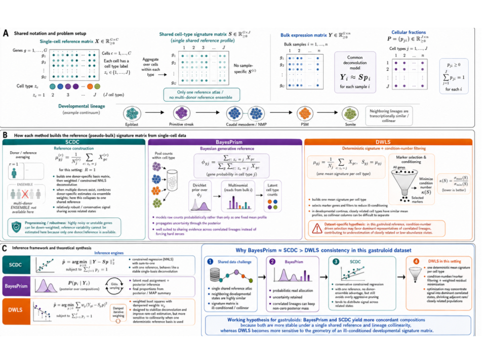

```{r setup, include=FALSE}
knitr::opts_chunk$set(
  collapse = TRUE,
  comment = "#>",
  message = FALSE,
  warning = FALSE,
  echo = FALSE,
  eval = FALSE
)
```



::: callout-note
## Scope

This chapter states which genes should enter a DeCovarT reference built
from single-cell data, and why. It holds the theory: the estimand, the
four tiers of selection, the statistical tests behind them, and a review
of how second-generation deconvolution methods choose their genes
[@gaspard-boulincCelltypeDeconvolutionMethods2025;
@avilacobosComputationalDeconvolutionTranscriptomics2018]. The
application to the Suppinger gastruloids (filters as applied, settings,
rank tables, code) is in the feature-selection chapter of the
reproducibility book. Strategies compared on simulated references are in
[Appendix S6](S6-feature-screening-scenario.html). Marker-based
abundance scores (enrichment modules) are out of scope
[@aranXCellDigitallyPortraying2017].
:::

**Local symbols.** $C=\sum_jC_j$ is the number of reference cells in
one time slot; $j(c)$ is the label of cell $c$.
$\delta_{gj}=C_j^{-1}\sum_{c:j(c)=j}\mathbb{1}(x_{gc}>0)$ is the
detection rate of gene $g$ in type $j$, and $v_{gj}$ is the $g$-th
diagonal entry of $\boldsymbol{V}_j$. In a negative-binomial (NB) model
$\psi_g$ is the dispersion, so that
$\operatorname{Var}(x_{gc})=m_{gc}+m_{gc}^2/\psi_g$ with
$m_{gc}=\operatorname{E}(x_{gc})$; $\mathcal{D}_g(M)$ is the deviance of
model $M$ for gene $g$; $r_{gc}$ is a Pearson residual. A gene panel is
written $\mathcal{G}\subseteq\{1,\ldots,G\}$.

```{.tikz}
%%| label: fig-fs-tiers
%%| fig-cap: "Four tiers of gene selection for a DeCovarT reference. Tiers (i) to (iii) remove genes; tier (iv) keeps the remaining genes and lets the fitted covariance down-weight them. The dashed box is the optional multivariate refinement."
%%| filename: fig-fs-tiers
%%| alt: Flowchart in two rows. UMI counts and labels feed tier one, cell and gene quality control, then a presence gate in every cell type, then tier two, an omnibus test used as a gate followed by an effect-size rank. From there, either directly or through an optional dashed box for multivariate refinement by Fisher information and Pareto search, the genes reach tier three, cross-platform consistency, and finally tier four, a generalised least-squares fit in which the within-type covariance down-weights genes.
\begin{tikzpicture}[every node/.append style={text width=2.7cm}]
\node[keybox] (A) at (0,0) {UMI counts $x_{gc}$ and labels $j(c)$};
\node[box] (B) at (3.4,0) {(i) cell and gene QC};
\node[box] (C) at (6.8,0) {presence gate in every type};
\node[box] (D) at (10.2,0) {(ii) omnibus test as a gate, effect-size rank};
\node[dimbox, densely dashed] (E) at (10.2,-2.4) {multivariate refinement: Fisher information, Pareto};
\node[box] (F) at (6.8,-2.4) {(iii) cross-platform consistency};
\node[keybox] (H) at (3.4,-2.4) {(iv) GLS fit: $\widehat{\boldsymbol{\Sigma}}_{W,j}$ down-weights genes};
\draw[edge] (A) -- (B);
\draw[edge] (B) -- (C);
\draw[edge] (C) -- (D);
\draw[edge] (D) -- (F);
\draw[dashededge] (D) -- (E);
\draw[dashededge] (E) -- (F);
\draw[edge] (F) -- (H);
\end{tikzpicture}
```

# Estimand: what the genes are for {#sec-fs-estimand}

The target is a set of genes that makes the reference moments
$(\boldsymbol{\mu}_{\cdot j},\boldsymbol{\Sigma}_{W,j})$ estimable and
informative about $\boldsymbol{p}$. This is not population-level
differential expression, for three reasons.

- **One specimen.** The Suppinger reference is one technical scRNA-seq
  experiment [@suppingerMultimodalCharacterizationMurine2023]. Its cells
  are draws from one specimen, not biological replicates, so every
  $p$-value below calibrates a *screen inside that specimen*. Treating
  cells as replicates of a population contrast inflates the false
  discoveries [@zimmermanPracticalSolutionPseudoreplication2021;
  @squairConfrontingFalseDiscoveries2021;
  @crowellMuscatDetectsSubpopulationspecific2020]. Only the within-donor
  covariance $\boldsymbol{\Sigma}_{W,j}$ is estimable; the between-donor
  part needs $R\ge2$ donors
  ([2.1](02-1-single-cell-generative-optimisation.html#sec-one-replicate)).
- **Labels are given.** A test of the type effect is valid only if the
  labels were fixed before the statistic is computed. Labels obtained by
  clustering the same matrix make the test anti-conservative
  (post-clustering inference, González-Delgado et al. 2025)
  <!-- TODO-cite: González-Delgado et al. 2025, post-clustering inference; key gonzalezDelgadoPostclusteringInference2025 exists in the book bib only -->.
- **Linear scale.** Transforms (logarithms, Pearson residuals,
  nonparanormal scores) may *rank* genes; the exported moments stay on
  the linear scale on which the convolution holds
  ([2.1](02-1-single-cell-generative-optimisation.html#sec-norm-linear);
  @sturmComprehensiveEvaluationTranscriptomebased2019).

Selection proceeds in four tiers (@fig-fs-tiers): (i) quality control
and a presence gate; (ii) marker-gene consistency, an omnibus test used
as a gate and an effect-size rank; (iii) consistency between the
reference and bulk platforms; (iv) down-weighting by the model instead
of removal. Tiers (i) to (iii) are filters; tier (iv) is part of the
likelihood. Feature selection as a pre-modelling filter has the usual
caveats [@guyonIntroductionVariableFeature2003]: it is a proposal, to be
checked by out-of-sample deconvolution error
([S6](S6-feature-screening-scenario.html#sec-cv-selection)).

# Tier (i): quality control {#sec-fs-qc}

QC removes cells and genes that lie outside the support of any
expression model. The thresholds below are examples from the reviewed
methods (@sec-fs-review), not defaults of DeCovarT.

- **Cells.** Library size more than 3 median absolute deviations (MAD)
  from the median of its type, and cells more than 3 MAD from the median
  pairwise distance within their type (RNA-Sieve, optional;
  @erdmann-phamLikelihoodbasedDeconvolutionBulk2021, supplement p. 3).
  Fewer than 500 UMIs, fewer than 200 detected genes, or more than 50 %
  mitochondrial UMIs (deMixSC; @guoDeMixSCDeconvolutionFramework2023,
  p. 11).
- **Genes.** Ribosomal, mitochondrial and sex-chromosome genes, which
  reflect cell survival and donor sex rather than type
  (BayesPrism; @chuCellTypeGeneExpression2022, supplement pp. 14, 19).
  Genes detected in fewer than 20 % of the cells of every type
  (RNA-Sieve, supplement p. 3).

QC differs from tier (iv): a QC rule removes an observation that no
model in the ladder would fit, whereas down-weighting keeps an
observation the model can explain with a larger variance. For the
Suppinger data the authors' QC and the gene allow-list are reported as
applied in the book; no further cell filter is claimed here.

## Presence gate in every type {#sec-fs-presence}

A gene enters tier (ii) only if

$$
\min_{j}\delta_{gj}\ge\delta_{\min}
\quad\text{and}\quad
\min_{j}v_{gj}>0,
$$ {#eq-fs-presence}

with $\delta_{\min}$ a few per cent (for example $0.05$), fixed before
the ranks are seen. The gate is a design constraint, for three reasons.

- **Covariance.** A gene with $v_{gj}=0$ gives a zero row and column in
  $\boldsymbol{V}_j$. $\boldsymbol{\Sigma}_{W,j}$ is then singular on
  that coordinate, and the precision of type $j$ is undefined.
- **Identifiability.** A gene expressed in one type only is the perfect
  marker of classical signatures
  [@newmanDeterminingCellType2019]. MEAD shows that $\boldsymbol{P}$ is
  not identifiable when all genes are perfect markers and gene-wise
  platform ratios are allowed: rescaling the ratios of the markers of
  type $j$ by $\delta_j$ is absorbed by the proportions
  [@xieStatisticalInferenceCell2026, p. 7]. A gate *in every type*
  excludes these genes.
- **Testing.** With an all-zero type the NB estimate
  $\hat\beta_{gj}\to-\infty$, its standard error grows faster, and the
  Wald statistic shrinks as the effect grows (Hauck–Donner effect)
  [@yeeHauckDonnerEffectWald2022]. Likelihood-ratio and score
  statistics stay finite (@sec-fs-omnibus).

# Tier (ii): marker-gene consistency {#sec-fs-consistency}

MuSiC introduced "marker gene consistency" with two parts:
cross-subject consistency, which guards against the choice of subjects,
and cross-cell consistency, which guards against biased cell capture
[@wangBulkTissueCell2019, p. 2]. Cross-cell consistent genes are those
with low within-cluster variance [@wangBulkTissueCell2019, p. 3]. With
one specimen only cross-cell consistency can be assessed. Its natural
statistic is the split of a gene's variation into between-type and
within-type parts.

## Pearson residuals and the between/within split {#sec-sctransform}

The technical null fits each gene with library size as the only
covariate,

$$
M_{0}:\;
\log m_{gc}=\beta_{0g}+\log s_{c},
\qquad
x_{gc}\sim\mathrm{NB}(m_{gc},\psi_{g}),
$$ {#eq-fs-nb-null}

which is the model of `SCTransform` with `vst.flavor = "v2"`, where the
depth slope is fixed and library size is an offset
[@hafemeisterNormalizationVarianceStabilization2019;
@lauseAnalyticPearsonResiduals2021]. Cell type is deliberately absent:
putting $j$ in the null would remove the signal to be ranked. The
Pearson residuals
$r_{gc}=(x_{gc}-\hat m_{gc})/\sqrt{\hat m_{gc}+\hat m_{gc}^{2}/\hat\psi_{g}}$
split as

$$
\mathrm{SS}_{\mathrm{B},g}
=
\sum_{j=1}^{J}C_{j}\bigl(\bar r_{gj}-\bar r_{g}\bigr)^{2},
\qquad
\mathrm{SS}_{\mathrm{W},g}
=
\sum_{j=1}^{J}\sum_{c:j(c)=j}\bigl(r_{gc}-\bar r_{gj}\bigr)^{2},
$$ {#eq-fs-ss}

with $\bar r_{gj}$ the mean residual in type $j$ and $\bar r_{g}$ the
overall mean ($\approx0$). A lineage marker has a large between-type and
a small within-type part; a stress-response gene can have a large total
residual variance and still a small between-type part.

{#fig-sc-transform}

The sums in @eq-fs-ss weight every cell equally, so the most abundant
type dominates them. The equal-type version gives each type weight
$1/J$:

$$
\mathrm{MS}^{\mathrm{eq}}_{\mathrm{B},g}
=
\frac1J\sum_{j=1}^{J}\Bigl(\bar r_{gj}-\frac1J\sum_{\ell=1}^{J}\bar r_{g\ell}\Bigr)^{2},
\qquad
\mathrm{MS}^{\mathrm{eq}}_{\mathrm{W},g}
=
\frac1J\sum_{j=1}^{J}\operatorname{var}_{c:j(c)=j}(r_{gc}).
$$ {#eq-fs-equal-type}

## Omnibus test: deviance, score and quasi-likelihood $F$ {#sec-fs-omnibus}

Add the type main effect to @eq-fs-nb-null:

$$
M_{1}:\;
\log m_{gc}=\beta_{0g}+\beta_{g,j(c)}+\log s_{c},
\qquad
\beta_{g1}=0,
\qquad
H_{0g}:\beta_{g2}=\cdots=\beta_{gJ}=0 .
$$ {#eq-fs-nb-main}

The joint null has $J-1$ degrees of freedom, and the three classical
tests apply [@agrestiFoundationsLinearGeneralized2015]. One omnibus test
per gene replaces $\binom{J}{2}$ pairwise or $J$ one-versus-rest tests,
and a single Benjamini–Hochberg correction across genes follows.

- **Likelihood ratio (analysis of deviance).**
  $\Lambda_g=\mathcal{D}_g(M_0)-\mathcal{D}_g(M_1)$, referred to
  $\chi^2_{J-1}$ when $\psi_g$ is known.
- **Score (Rao).** It needs only the $M_0$ fit, the one `SCTransform`
  already computes. With the log link the IRLS weight is
  $w_{gc}=\hat m_{gc}^2/V(\hat m_{gc})$, $V(m)=m+m^2/\psi_g$, and the
  score of the type-$j$ indicator is
  $U_{gj}=\sum_{c:j(c)=j}\sqrt{w_{gc}}\,r_{gc}$. With the intercept
  profiled out,

  $$
  T_{g}
  =
  \sum_{j=1}^{J}\frac{U_{gj}^{2}}{\sum_{c:j(c)=j}w_{gc}}
  \;\approx\;
  \sum_{j=1}^{J}C_{j}\,\bar r_{gj}^{2}
  \approx
  \mathrm{SS}_{\mathrm{B},g},
  $$ {#eq-fs-score}

  where the approximation holds when the weights are nearly constant
  within a type. For a Poisson null, $U_{gj}$ is observed minus expected
  counts in type $j$ and $T_g$ is Pearson's $\chi^2$ on the type totals.
  The between-type sum of squares of Pearson residuals is therefore, up
  to weight heterogeneity, the score statistic of the cell-type effect.
- **Wald.** It needs $M_1$ only and fails near the boundary
  (@sec-fs-presence).

**Quasi-likelihood $F$.** Dividing $T_g/(J-1)$ by the within-type
Pearson dispersion $\hat\phi_g=\mathrm{SS}_{\mathrm{W},g}/(C-J)$ gives

$$
F_{g}
=
\frac{\mathrm{SS}_{\mathrm{B},g}/(J-1)}{\mathrm{SS}_{\mathrm{W},g}/(C-J)},
$$ {#eq-fs-qlf}

the one-way ANOVA ratio [@wangSilicoEstimatesTissue2010]. In GLM terms
it is a quasi-likelihood $F$ test: the mean model @eq-fs-nb-main and the
variance function $V$ are kept, and a scalar $\phi_g$ absorbs a variance
larger or smaller than $V$ predicts. The reference
$F_{J-1,C-J}$ accounts for estimating $\phi_g$, as in the edgeR
quasi-likelihood pipeline and in `glmGamPoi::test_de()`
[@lundDetectingDifferentialExpression2012; @glmGamPoi2020]. Three
consequences follow.

- **Keep overdispersed genes.** Within-type overdispersion is the
  within-type scatter that the denominator already penalises, and the
  covariance that DeCovarT models. Removing such genes before the test
  removes that signal.
- **A scalar $\phi_g$ cannot absorb a wrong variance function.** Under a
  Poisson null it cannot absorb the quadratic NB term, whose share grows
  with the type mean; the pooled $\hat\phi_g$ is then wrong for every
  type. Use the NB variance, so that $\phi_g\approx1$ in every type; if
  between-type heteroscedasticity remains, use a Welch-type statistic or
  the equal-type mean squares of @eq-fs-equal-type.
- **Same order within a slot.** $J$ and $C$ are shared by all genes of a
  slot, so $F_g$ is a monotone function of
  $\mathrm{SS}_{\mathrm{B},g}/\mathrm{SS}_{\mathrm{W},g}$; the analytic
  $F$ adds a threshold, not a new ranking.

When the NB variance function itself fails, quasi-likelihood with an
empirical variance function is the fallback
[@agrestiFoundationsLinearGeneralized2015]. When the *shape* differs
between types (types that share a mean but differ in dispersion), a
location–scale model with type-specific $\psi_{gj}$ tests both, on
$2(J-1)$ degrees of freedom; this is the GAMLSS margin used by scDesign3
[@songScDesign3GeneratesRealistic2024], Stasinopoulos & Rigby (2007)
<!-- TODO-cite: Stasinopoulos & Rigby 2007, GAMLSS in R, J. Stat. Softw. 23(7), doi:10.18637/jss.v023.i07 -->.

### Calibration: permutation, Freedman–Lane, bootstrap {#sec-fs-calibration}

The nominal $F_{J-1,C-J}$ tail is optimistic on `SCTransform` output for
three reasons: residuals are clipped at $\pm\sqrt{C/30}$, $\psi_g$ is
regularised across genes and so is misspecified for any one gene, and
residuals at low means are discrete and skewed
[@hafemeisterNormalizationVarianceStabilization2019;
@lauseAnalyticPearsonResiduals2021]. A permutation null keeps $F_g$ and
replaces its reference distribution.

- **Permute labels, not genes.** One permutation of the cell labels is
  applied to all genes at once. Each gene keeps its marginal
  distribution and its dependence on the other genes; only the link with
  the label is broken. Shuffling genes, or shuffling within cells, does
  not produce that null.
- **Nuisance covariates.** With covariates (batch, cell line, cell
  cycle), a global label shuffle creates impossible combinations. The
  Freedman–Lane scheme fits the reduced model without type, permutes its
  residuals with one row permutation shared by all genes, adds them back
  to the reduced fit, refits the full model and recomputes $F_g$
  [@freedmanNonstochasticInterpretation1983].
- **Bootstrap answers another question.** A nonparametric bootstrap of
  cells within type resamples under the observed effects: it measures
  the stability of the ranks and the uncertainty of an effect size, in
  the spirit of stability selection
  [@meinshausenStabilitySelection2010], not a null distribution. A
  parametric bootstrap of $\Lambda_g$ under the fitted $M_0$ checks the
  $\chi^2_{J-1}$ approximation for small types.

## Gate, then rank by effect size {#sec-fs-effect-size}

With thousands of cells nearly every expressed gene rejects $H_{0g}$,
and $p$-values only order genes by $C\times$ effect. The test is
therefore a **gate** (FDR on permutation or quasi-likelihood $p$-values,
after @eq-fs-presence), and genes are ranked by an effect size with
equal type weights:

- the between-type share
  $\eta^2_g=\mathrm{SS}_{\mathrm{B},g}/(\mathrm{SS}_{\mathrm{B},g}+\mathrm{SS}_{\mathrm{W},g})$,
  or its equal-type analogue from @eq-fs-equal-type;
- the deviance explained
  $R^{2}_{\mathcal{D},g}=1-\mathcal{D}_g(M_1)/\mathcal{D}_g(M_0)$;
- the smallest pairwise Hellinger distance between the type-specific
  laws of the gene
  ([4.2](04-2-distances-overlap-metrics.html#sec-hellinger)), which
  also sees types that share a mean and differ in variance.

### Specificity scores for one-versus-rest lists {#sec-gini-entropy}

Long one-versus-rest lists are often compacted with the entropy or the
Gini coefficient of the type shares
$u_{gj}=\mu_{gj}/\sum_{\ell}\mu_{g\ell}$ [@zhang_etal17]:

$$
H_g=-\sum_{j=1}^{J}u_{gj}\log u_{gj},
\qquad
\mathrm{Gini}_g
=
\frac{1}{2J}\sum_{j=1}^{J}\sum_{\ell=1}^{J}\lvert u_{gj}-u_{g\ell}\rvert
=
\frac1J\sum_{k=1}^{J}(2k-J-1)\,u_{g(k)},
$$ {#eq-gini}

with $0\log0=0$ and $u_{g(1)}\le\cdots\le u_{g(J)}$. $H_g/\log J$ and
$J\,\mathrm{Gini}_g/(J-1)$ lie in $[0,1]$; low entropy and high Gini mean
that few types carry the mass. Both scores reward exclusive expression,
which the presence gate (@sec-fs-presence) excludes, and neither sees
redundancy between genes (@sec-kappa-limits).

![Derivation of the Gini coefficient: pairwise absolute differences, scale-free normalisation by the mean, sorted-data formula, finite-sample correction to $[0,1]$.](figures/gini_coefficient_derivation.png){#fig-gini-derivation}

## Leverage is not influence {#sec-fs-leverage}

Residual size, leverage and influence are three different quantities
[@agrestiFoundationsLinearGeneralized2015]. In a gene-wise GLM, leverage
belongs to the *observations* (cells, or pseudo-bulk samples), not to
the gene. For the one-way design of @eq-fs-nb-main the hat value of cell
$c$ is $h_{gc}=w_{gc}/\sum_{c':j(c')=j(c)}w_{gc'}$: every cell of a rare
type, and every cell with a large fitted mean, has high leverage.
Influence combines the two; Cook's distance is

$$
\mathrm{Cook}_{gc}
=
\frac{r_{gc}^{2}\,h_{gc}}{J\,\hat\phi_g\,(1-h_{gc})^{2}} .
$$

A high-expression marker in a small type sits at an extreme fitted mean
and has high leverage, yet it agrees with the type effect: it is
informative, not an outlier. Rules that clip by size alone, such as
residual clipping or SCDC's clipping of variance weights at the 15th and
85th percentiles [@dongSCDCBulkGene2021, p. 10], shrink these
observations with the harmful ones. An observation is a candidate
outlier only when both its leverage and its standardised residual are
large.

## Critiques of current marker rules {#sec-fs-critiques}

The reviewed marker rules (@tbl-fs-review) depart from the model above
in four ways.

- **Hurdle models on droplet counts.** DWLS defines markers with the
  `MAST` hurdle model [@tsoucasAccurateEstimationCelltype2019, p. 7].
  Droplet UMI counts show no zero inflation beyond what the NB predicts
  (Svensson 2020)
  <!-- TODO-cite: Svensson 2020, Droplet scRNA-seq is not zero-inflated, Nat. Biotechnol., doi:10.1038/s41587-019-0379-5 -->,
  and current data do not support zero-inflated *measurement* models
  [@sarkarSeparatingMeasurementExpression2021, p. 5]. The hurdle splits
  one count into a detection and a magnitude test (Finak et al. 2015)
  <!-- TODO-cite: Finak et al. 2015, MAST, Genome Biol., doi:10.1186/s13059-015-0844-5 -->
  where one NB test of @eq-fs-nb-main suffices.
- **Gaussian $t$-tests on counts.** ReDeconv uses a two-sample $t$-test
  between cells [@luTranscriptomeSizeMatters2025, p. 14]; deMixSC uses a
  paired $t$-test of bulk against matched pseudo-bulk
  [@guoDeMixSCDeconvolutionFramework2023, p. 12].
- **Cells as independent replicates.** Every test above that runs on
  cells (DWLS, ReDeconv, BayesPrism's marker option) treats them as
  replicates of a population contrast (@sec-fs-estimand).
- **No multiplicity control.** ReDeconv keeps genes with $p<0.05$ in each
  comparison against every other type, with no FDR correction
  [@luTranscriptomeSizeMatters2025, p. 14].

# Screen versus objective: multivariate selection {#sec-fs-multivariate}

The advanced stage treats $\mathcal{G}$ as a **subset selection**
problem on the full $J$-column signature. It comes **after** GRN
inference (@sec-grn-top4), because the second objective uses
$\boldsymbol{\Sigma}_{j}$. The loss is defined on all types jointly. That
is the right geometry for DeCovarT: the likelihood depends on
$\boldsymbol{\mu}\boldsymbol{p}$ **and** on
$\sum_{j}p_{j}^{2}\boldsymbol{\Sigma}_{j}$.

## The ANOVA ratio is the right screen, not the right objective {#sec-fs-screen-objective}

Take $J=2$, one gene, the population model of DeCovarT
([1.2](01-2-population-inference.html#sec-fisher-p)) and equal
within-type variances $\sigma_g^2$. Then
$y_g\sim\mathcal{N}\bigl(p\mu_{g1}+(1-p)\mu_{g2},\,\sigma_g^2 s(p)\bigr)$
with $s(p)=p^2+(1-p)^2$, and the Fisher information for $p$ is

<!-- chk: V4 -->
$$
I_g(p)
=
\frac{\Delta_g^{2}}{s(p)}
+
\frac12\Bigl(\frac{s'(p)}{s(p)}\Bigr)^{2},
\qquad
\Delta_g=\frac{\mu_{g1}-\mu_{g2}}{\sigma_g}.
$$ {#eq-fs-j2-fisher}

The second term is the same for every gene. Computed on the scale of
the model, the ratio @eq-fs-qlf estimates $\Delta_g^2$: $F_g$ is
non-central $F_{1,C-2}$ with
non-centrality $\tilde C\Delta_g^{2}$, $\tilde C=C_1C_2/C$, so
$\operatorname{E}F_g\approx1+\tilde C\Delta_g^2$. Under these
conditions, ranking genes by $F_g$ ranks them by $I_g(p)$ at every $p$,
and with independent genes the top-$k$ genes by $F_g$ maximise the total
information $\sum_{g\in\mathcal{G}}I_g(p)$. This identity is pending a
symbolic check (ledger V4). The agreement holds only when genes are
independent and homoscedastic across types. The ratio ignores:

- **redundancy and collinearity.** Two genes that separate the same pair
  of types add little information together, and concatenated
  one-versus-rest lists inflate the condition number of
  $\boldsymbol{\mu}_{\mathcal{G}}$ (@sec-kappa-limits);
- **the covariance DeCovarT models.** With
  $\sigma_{g1}\ne\sigma_{g2}$ the information depends on $p$ through
  $p^2\sigma_{g1}^2+(1-p)^2\sigma_{g2}^2$, and with correlated genes it is
  not a sum over genes;
- **the count mean–variance relation**, unless the ratio is computed on
  residuals of a model with the right variance function
  (@sec-fs-omnibus).

The univariate ratio is therefore a screen. The objective for a panel is
the Fisher information for $\boldsymbol{p}$ of the whole panel.

## Fisher information for $\boldsymbol{p}$ as the objective {#sec-optimal-design}

For a panel $\mathcal{G}$, restrict the rows of $\boldsymbol{\mu}$ and
the rows and columns of $\boldsymbol{\Sigma}_j$ to $\mathcal{G}$ and
compute $I_{\mathcal{G}}(\boldsymbol{p})$ from
[1.2, Eq. for $I(\boldsymbol{p})$](01-2-population-inference.html#sec-fisher-p),
mapped to the $J-1$ free coordinates of the simplex. Because
$\boldsymbol{\Sigma}(\boldsymbol{p})$ depends on $\boldsymbol{p}$, a
panel is scored over a composition grid $\mathcal{P}\subset\Delta^{J-1}$
(balanced, rare-type, sparse and near-collinear compositions), and the
classical criteria [@atkinsonOptimumExperimentalDesigns1992;
@pukelsheimOptimalDesignExperiments2006] become

$$
\max_{\mathcal{G}}\min_{\boldsymbol{p}\in\mathcal{P}}
\log\det I_{\mathcal{G}}(\boldsymbol{p})
\ \text{(robust D)},
\qquad
\max_{\mathcal{G}}\min_{\boldsymbol{p}\in\mathcal{P}}
\lambda_{\min}\bigl(I_{\mathcal{G}}(\boldsymbol{p})\bigr)
\ \text{(E)},
\qquad
\min_{\mathcal{G}}\max_{\boldsymbol{p}\in\mathcal{P}}
\operatorname{tr}I_{\mathcal{G}}(\boldsymbol{p})^{-1}
\ \text{(A)}.
$$ {#eq-optimal-design}

D-optimality shrinks the volume of the confidence ellipsoid for
$\boldsymbol{p}$ and can leave one weak contrast; E-optimality protects
the worst contrast; A-optimality minimises the average variance
(@fig-dea-design). If $\boldsymbol{\Sigma}_{\mathcal{G}}(\boldsymbol{p})$
is replaced by the identity, $I_{\mathcal{G}}$ reduces to the Gram
matrix of the contrasted mean columns: D-optimality maximises the Gram
volume and E-optimality is close to minimising the condition number
(@sec-weighted-kappa;
[4.1](04-1-synthetic-scenarios.html#nte-geometric-score)).

{#fig-dea-design}

This objective stays **optional**: it needs
$\widehat{\boldsymbol{\Sigma}}_{W,j}$ on the candidate genes, hence the
covariance estimation of
[3.2](03-2-covariance-network-estimation.html) on a shortlist that tier
(ii) has already produced. The search itself (greedy exchange,
NSGA-II) and its settings are in
[S6](S6-feature-screening-scenario.html#sec-pareto-nsga2).

## Condition number and its limits {#sec-kappa-limits}

The 2-norm condition number of a design matrix,

$$
\kappa_2(\boldsymbol{X})=\frac{\sigma_{\max}(\boldsymbol{X})}{\sigma_{\min}(\boldsymbol{X})},
$$ {#eq-condition-number}

is the classical panel criterion: CIBERSORT and DWLS keep the candidate
signature with the smallest $\kappa_2(\boldsymbol{\mu}_{\mathcal{G}})$
[@newmanRobustEnumerationCell2015;
@tsoucasAccurateEstimationCelltype2019, p. 7;
@gongDeconRNASeqStatisticalFramework2013]. Note that
$\kappa_2(\boldsymbol{X}^{\top}\boldsymbol{X})=\kappa_2(\boldsymbol{X})^2$.
The criterion sees the means only.

In a continuum (gastruloids,
differentiation trajectories) neighbouring types have nearly collinear
means by construction, so $\kappa_2$ is large whatever the panel, and
minimising it keeps a few dominant lineages and drops the genes that
separate neighbours through their covariance (@fig-kappa-gastruloid).
Use $\kappa_2$ as a diagnostic of the mean geometry, next to the
information criteria of @eq-optimal-design. Mean-only pruning then under-represents
adjacent or low-abundance states — exactly the types whose **rewiring**
DeCovarT is meant to exploit.

{#fig-kappa-gastruloid}

### Variance-weighted condition number {#sec-weighted-kappa}

With gene-wise uncertainties $\tau_g^2$ (biological, sampling and
optional reference-to-bulk discrepancy), standardise the rows and
evaluate the conditioning in the $(J-1)$-dimensional contrast space
induced by $\sum_jp_j=1$:

$$
\kappa_2\bigl(\boldsymbol{T}_{\mathcal{G}}^{-1/2}\boldsymbol{\mu}_{\mathcal{G}}\boldsymbol{K}\bigr),
\qquad
\boldsymbol{T}_{\mathcal{G}}=\operatorname{diag}(\tau_g^2)_{g\in\mathcal{G}},
$$ {#eq-weighted-kappa}

where the $J\times(J-1)$ matrix $\boldsymbol{K}$ has orthonormal columns
orthogonal to $\mathbf{1}$. Unweighted $\kappa_2$ can favour quiet but
biased genes. @eq-weighted-kappa is the identity-covariance special case
of the information criteria above: it uses a diagonal covariance, so it
still misses the covariance-only regime in which DeCovarT identifies
types whose means agree
([1.2](01-2-population-inference.html#sec-identifiability)).

## Pareto search over several criteria {#sec-pareto-panel}

`AutoGeneS` searches gene subsets with a multi-objective genetic
algorithm that minimises the correlation between type centroids and
maximises their distance [@alieeAutoGeneSAutomaticGene2021].

For
DeCovarT the objectives are $\kappa_2(\boldsymbol{\mu}_{\mathcal{G}})$
(mean geometry) and the average pairwise overlap $\bar\varpi$ of the
type laws $\mathcal{N}(\boldsymbol{\mu}_{\cdot j},\boldsymbol{\Sigma}_j)$
restricted to $\mathcal{G}$ [@melnykovMixSimPackageSimulating2012]. The
overlap and the other separation measures (Hellinger, Bhattacharyya,
Jeffreys, affine-invariant distance) are defined in
[4.2](04-2-distances-overlap-metrics.html#sec-overlap-tv); unlike the
`AutoGeneS` objectives they use both means and covariances.

The robust
D-criterion of @eq-optimal-design is a third, DeCovarT-specific
objective, best used to choose among non-dominated panels. The two kinds
of criteria need not agree: overlap measures how well the type laws can
be told apart, Fisher information how well $\boldsymbol{p}$ can be
estimated. A Pareto front of non-dominated panels is reported instead of
one weighted score [@R-mco].

::: {#nte-pareto-proposal .callout-note}
## :information_source: A DeCovarT-specific third objective (proposal)

Adding Fisher identifiability of $\boldsymbol{p}$ by maximising the smallest eigenvalue of the mixture
information $I_{\mathcal{G}}(\boldsymbol{p})$, or minimise its condition
number is new in the literature corpus; it is a composition of the Fisher information for $\boldsymbol{p}$ as the objective.


:::


For this repository the planned optimiser is NSGA-II via `mco::nsga2()`
[@R-mco]. Encode genes as a mask in $[0,1]^{|\mathcal{G}_{0}|}$
(thresholded to a target size). Minimise at least

1.  $\kappa_{2}(\boldsymbol{\mu}_{\mathcal{G}})$ (mean geometry);
2.  average pairwise overlap $\overline{\omega}$ of the $J$ Gaussians
    $\mathcal{N}(\boldsymbol{\mu}_{\cdot j},\boldsymbol{\Sigma}_{j})$
    [@melnykovMixSimPackageSimulating2012; @R-MixSim].

## Seeds and Markov boundaries {#sec-markov-seeds}

A panel can also grow from a few seeds (strong markers, genes with a
large contribution to $I_{\mathcal{G}}$) by their neighbours in a fitted
graphical model of one type. A Markov blanket of gene $g$ is any set
that makes $g$ conditionally independent of the other genes; a Markov
boundary is a minimal blanket. For a positive distribution the boundary
is unique and equals the neighbour set of $g$ in the minimal undirected
I-map [@pearlProbabilisticReasoningIntelligent1988;
@kollerProbabilisticGraphicalModels2009]. In a Gaussian graphical model
these are the genes $g'$ with $\omega_{gg'}\ne0$ in $\boldsymbol{\Omega}_j$
[@bolinExplicitLinkGraphical2026], *if* the fitted graph is taken as the
minimal I-map. The construction uses undirected separation; directed
$d$-separation, with its colliders, belongs to DAGs and is a different
operation (@fig-u-vs-dsep). Boundary expansion can reintroduce collinear
means, so the expanded set returns to the Pareto stage.

{#fig-u-vs-dsep}

Genes that change neighbourhood between types (differential networks,
`INDEED`, D-trace, cooperative penalties) are a further source of
candidates. Their theory is in
[3.3, joint and differential networks](03-3-precision-networks.html#sec-grn-joint);
on one specimen their permutation nulls are technical nulls
(@sec-fs-estimand).

## Multivariate tests {#sec-fs-multivariate-tests}

A multivariate test would replace the $G$ gene-wise nulls by one null on
the vector $\boldsymbol{x}_{\cdot c}$. Two routes are often confused.

- **Gene-wise GEE is still gene-wise.** GEE extends the quasi-score to a
  vector of correlated observations, with a working covariance
  (Liang & Zeger 1986)
  <!-- TODO-cite: Liang & Zeger 1986, Longitudinal data analysis using generalized linear models, Biometrika 73:13-22, doi:10.1093/biomet/73.1.13 -->.
  Fitted once per gene, it still returns $G$ $p$-values and still needs
  FDR control: correlation-aware inference does not remove
  multiplicity.
- **A joint test needs $\boldsymbol{\Sigma}_j$.** A Hotelling or MANOVA
  test of equal type means on the panel uses the within-type covariance,
  which is high-dimensional when $C_j$ is not much larger than
  $|\mathcal{G}|$, the regime of several Suppinger types
  ([3.2](03-2-covariance-network-estimation.html)). With a regularised
  $\widehat{\boldsymbol{\Sigma}}_{W,j}$ such a test is possible on a
  shortlist, but its calibration is open; it is a perspective, not part
  of the pipeline.

# Tier (iii): cross-platform consistency {#sec-fs-cross-platform}

A gene can be a perfect cross-cell marker and still be measured
differently by the reference and the bulk protocol. The reviewed methods
handle this in four ways.

- **Range bound (RNA-Sieve).** Per cell, the bulk is a convex
  combination of the type means, so on a common scale

  $$
  \min_{j}\tilde\mu_{gj}\;\le\;\tilde y_{g}\;\le\;\max_{j}\tilde\mu_{gj}
  $$ {#eq-fs-range}

  up to sampling error. RNA-Sieve removes genes whose bulk value falls
  outside this range by more than a sub-Gaussian tail bound allows, and
  genes that are MAD outliers on four summary statistics (largest type
  mean, largest type standard deviation, largest coefficient of
  variation, and a bulk-to-reference ratio)
  [@erdmann-phamLikelihoodbasedDeconvolutionBulk2021, pp. 10–11, Eqs.
  12–13]. The bound holds for any weights on the simplex, so it does not
  depend on whether $\boldsymbol{p}$ or $\boldsymbol{q}$ is the target.
  A gene-wise platform ratio $\tilde b_g$ far from 1 moves the bulk
  outside the range; the filter detects that case.
- **Test against a matched benchmark (deMixSC).** A paired $t$-test of
  real bulk against pseudo-bulk of the same aliquots, with BH at 0.05;
  the discrepant genes are kept and down-weighted by a fixed factor
  $a=1000$ [@guoDeMixSCDeconvolutionFramework2023, p. 12].
- **Gene-wise platform ratios in the model.** MEAD lets the ratios vary
  by gene with mean 1 [@xieStatisticalInferenceCell2026, p. 8]; RCTD
  uses a gene-wise platform random effect, estimated once from a pooled
  pseudo-bulk and then fixed [@cableRobustDecompositionCell2022a,
  pp. 6–8]; MuSiC allows a gene- and subject-specific intercept
  [@wangBulkTissueCell2019, p. 7].
- **Normalisation only.** ReDeconv applies gene-length normalisation to
  the bulk only [@luTranscriptomeSizeMatters2025, p. 2].

**Suppinger.** The single-cell reference matches only the bulk of the
standard Wnt schedule at 48 h. The early-Wnt bulk at 24 h has no
single-cell counterpart, so no bulk–reference comparison is possible
there. A consistency filter (range bound and MAD flags of
@eq-fs-range) can therefore be fitted only at 48 h. Applying the genes
it flags at every time assumes that platform effects are properties of
the gene that do not change with time; this assumption is stated, not
tested. Modelling a gene-wise or module-wise scale $\tilde b_g$ inside
DeCovarT is a perspective of
[5.3](05-3-extensions-roadmap.html).

# Tier (iv): down-weighting by the model {#sec-fs-weighting}

Filters remove genes; a weighted likelihood keeps them and lets their
variance decide their influence. The reviewed methods sit on a ladder of
noise models (@tbl-fs-ladder; full ladder in
[5.1](05-1-review-distribution-aware.html)).

| Rung | Variance of the bulk residual | Methods (anchors) |
|---|---|---|
| Weighted least squares | diagonal, gene-wise weights | MuSiC: bulk noise plus cross-subject variance, Eq. 10, p. 7; DWLS: fitted values, capped by a dampening constant, pp. 2, 7; SCDC: maximal-variance weights, clipped, pp. 5, 10; deMixSC: $\hat y^2$ plus squared residual plus a constant, p. 12; MEAD: reference variance with empirical-Bayes shrinkage, pp. 17–18 |
| Generalised least squares | full gene–gene covariance, depends on $\boldsymbol{p}$ | DeCovarT: $\sum_jp_j^2\boldsymbol{\Sigma}_j$ (population) or $\sum_jp_j\boldsymbol{\Sigma}_{W,j}$ (single cell); DECALS: $\sum_k\pi_{ik}^2\boldsymbol{\Sigma}_k$ for inference, pp. 7, 9 |
| Feasible GLS | covariance estimated, then iterated with $\hat{\boldsymbol{p}}$ | DECALS Algorithm 1, p. 9; DeCovarT plug-in $\widehat{\boldsymbol{\Sigma}}_{W,j}$ |
| Sandwich / GEE | working covariance, robust variance | MEAD: sandwich over a dependence set, pp. 13, 18 |

: Down-weighting classes in the reviewed methods. Page anchors refer to the PDFs extracted for this review. {#tbl-fs-ladder}

Two observations follow.

- DECALS computes its point estimate by constrained *ordinary* least
  squares and uses the covariance only for inference, because a GLS fit
  with an estimated covariance per sample was biased in their
  experiments [@caiStatisticalInferenceCelltype2024, p. 6]. The same risk
  applies to any feasible GLS whose covariance is estimated on few cells;
  shrinkage of $\widehat{\boldsymbol{\Sigma}}_{W,j}$ addresses it
  ([3.2](03-2-covariance-network-estimation.html)).
- MEAD notes that removing genes brings no efficiency gain unless their
  noise levels differ [@xieStatisticalInferenceCell2026, p. 17]. Once the
  covariance is in the model, hard filtering is needed only for genes
  outside the model's support: the presence gate (@sec-fs-presence) and
  cross-platform outliers (@sec-fs-cross-platform).

# Selection effect on the covariance {#sec-fs-selection-effect}

Selecting genes changes the covariance that is then estimated on them.

- **Small within-type variance by construction.** A ratio such as
  @eq-fs-qlf rewards a small within-type part. ReDeconv goes further and
  keeps the genes with the smallest coefficient of variation
  [@luTranscriptomeSizeMatters2025, p. 14]; MuSiC's tree-guided stage
  keeps genes with small intra-cluster variance
  [@wangBulkTissueCell2019, p. 8]. A panel chosen this way removes much
  of the within-type covariance that DeCovarT models, and the estimated
  $\boldsymbol{\Sigma}_{W,j}$ on that panel is close to diagonal for that
  reason, not because genes are conditionally independent
  ([3.2](03-2-covariance-network-estimation.html)).
- **Weak marginal effects hide interactions.** Genes with weak marginal
  effects are dropped by every univariate screen, and gene pairs whose
  signal lies in their covariance, not in their means, are then never
  examined. Covariance-aware criteria (@sec-optimal-design,
  @sec-pareto-panel) can recover them only from a shortlist that still
  contains them.

A practical check is to compare the distribution of $v_{gj}$, and of the
off-diagonal entries of $\boldsymbol{V}_j$, between the selected panel
and the genes that pass the presence gate.

# Review of gene selection in second-generation methods {#sec-fs-review}

@tbl-fs-review summarises, method by method, the facts found in the
papers. Page numbers refer to the PDF pages of the local extractions
(RNA-Sieve: main text; "supp." marks a supplement). A dash means that
the item was not found in the extracted text; it does not mean that the
method has no such step. Each method's likelihood is reviewed in
[5.1](05-1-review-distribution-aware.html#sec-methods).

| Method | Cell QC | Gene filter | Marker rule | Cross-platform | Weighting class | Gene correlation | Perfect markers |
|---|---|---|---|---|---|---|---|
| RNA-Sieve [@erdmann-phamLikelihoodbasedDeconvolutionBulk2021] | optional: library size or pairwise distance ≥ 3 MAD from the type median (supp. p. 3) | non-zero in ≥ 20 % of cells of ≥ 1 type (supp. p. 3) | none | range bound and MAD outliers on four statistics (pp. 10–11) | CLT Gaussian composite likelihood (Eq. 10, p. 10) | genes independent (p. 10) | — |
| DECALS [@caiStatisticalInferenceCelltype2024] | — | CIBERSORTx S-mode candidate genes (p. 13) | ∩ type markers of @mathysSinglecellTranscriptomicAnalysis2019, 159 genes (p. 13) | S-mode batch correction (p. 13) | constrained OLS; GLS rejected for bias (p. 6) | $\sum_k\pi_{ik}^2\boldsymbol{\Sigma}_k$, SCAD-thresholded, for inference (pp. 7, 9) | — |
| MEAD [@xieStatisticalInferenceCell2026] | — | — | none; removing genes gains nothing unless noise differs (p. 17) | gene-wise ratios, mean 1 (p. 8) | WLS from reference variance (pp. 17–18); sandwich (p. 13) | dependence set by multiple testing (pp. 13, 18) | not identifiable if all genes are perfect markers (p. 7) |
| ReDeconv [@luTranscriptomeSizeMatters2025] | — | — | $t$-test $p<0.05$ against every other type, no FDR; fold change ≥ 2; smallest SD/mean, about 100 per type (p. 14) | length normalisation of bulk only (p. 2) | Gaussian likelihood, composition-dependent variance (Eq. 5, p. 14) | genes independent (p. 14) | — |
| MuSiC [@wangBulkTissueCell2019] | — | all shared genes (p. 7) | none; small intra-cluster variance in the tree-guided stage (p. 8) | optional gene- and subject-specific intercept (p. 7) | W-NNLS, weights from cross-subject variance (Eq. 10, p. 7) | diagonal | all genes beat pre-selected markers (p. 7) |
| deMixSC [@guoDeMixSCDeconvolutionFramework2023] | < 500 UMI, < 200 genes, > 50 % mitochondrial (p. 11) | detected in < 5 % of cells removed (p. 11) | none | paired $t$-test bulk vs pseudo-bulk, BH; 5,000 genes down-weighted by $a=1000$ (p. 12) | W-NNLS, iterated weights (p. 12) | diagonal | — |
| BayesPrism [@chuCellTypeGeneExpression2022] | types with < 20 cells excluded in one benchmark (supp. p. 15) | ribosomal, mitochondrial, X and Y genes; ≥ 5 cells (supp. p. 14) | optional scran "all" markers, $t$-tests, up-regulated only (supp. pp. 14–15) | bulk-specific profiles; log-normal fold-change prior (supp. pp. 5–6) | Bayesian multinomial (supp. pp. 3–6) | not modelled | exclusive markers seen as robust (supp. pp. 12–13) |
| DWLS [@tsoucasAccurateEstimationCelltype2019] | — | — | `MAST` hurdle, FDR < 0.01, $\log_2$FC > 0.5; 50–200 per type; smallest $\kappa$ of 151 candidates (p. 7) | none | dampened WLS (pp. 2, 7) | diagonal | marker-only signature (p. 7) |
| SCDC [@dongSCDCBulkGene2021] | first pass removes cells with a low maximal proportion (p. 9) | bulk genes with zero counts (p. 9) | none | ensemble over references (p. 6) | W-NNLS, maximal-variance weights clipped at 15th/85th percentiles (pp. 5, 10) | not modelled | — |
| RCTD [@cableRobustDecompositionCell2022a] | pixels ≥ 100 UMI (p. 9) | mean above 0.0625 counts per 500 (p. 7) | log-fold change ≥ 0.5 against the all-type mean, no test (p. 7) | gene-wise platform random effect (pp. 6–8) | Poisson–lognormal GLMM (p. 6) | genes independent (supp. p. 5) | — |
| CardamomOT (Maugé & Ventre 2026) | paper: —; code: per-cell depth factor, no cell removed, doublets flagged | paper: gene sets of earlier studies (p. 32); code: no mitochondrial, ribosomal or non-coding genes | code: round robin of per-type Wilcoxon tests, NB-basin separability, Steiner closure | not applicable (no bulk) | NB mixture likelihood, $\ell_1$ towards a prior network (Eq. 10, p. 9) | independent given the basin (p. 12) | — ; gene set is "prior information" (p. 27) |
| DeCovarT (this chapter) | authors' QC; MAD rules optional | presence gate in every type (@eq-fs-presence) | omnibus NB / QL test as gate, effect-size rank | range bound at 48 h (@sec-fs-cross-platform) | GLS with $\widehat{\boldsymbol{\Sigma}}_{W,j}$ | modelled | excluded by the gate |

: Gene selection in second-generation deconvolution methods. CardamomOT is a network-inference method, included for its gene selection; its code facts are from the repository at commit `4a6305c` (<https://github.com/eliasventre/CardamomOT>). {#tbl-fs-review}

<!-- TODO-cite: Maugé & Ventre 2026, CardamomOT, PLoS Comput. Biol. 22(10):e1014838, doi:10.1371/journal.pcbi.1014838 -->

Three patterns stand out.

- Only DeCovarT puts gene–gene covariance into the criterion that
  estimates $\boldsymbol{p}$; DECALS and MEAD use it only for the
  variance of their estimators. Every other method treats genes as
  independent, which is the setting in which the univariate screen of
  @sec-fs-screen-objective is also the objective.
- The tests that select genes run on cells, mostly with Gaussian or
  hurdle models. Among the methods that test, only DWLS (markers) and
  deMixSC (platform discrepancy) report a multiplicity correction
  (@sec-fs-critiques).
- MuSiC and MEAD argue against marker pre-selection when the genes are
  weighted, and MEAD shows that perfect markers break identifiability
  under gene-wise platform ratios; DWLS and DECALS still build
  marker-only signatures.

# Perspectives {#sec-perspectives}

## Continuous states {#sec-continua}

Many tissues, gastruloids included, are continua rather than discrete
types. A $J$-column signature is then a piecewise approximation of an
archetype geometry [@hartInferringBiologicalTasks2015] or a potency
axis [@gulatiSinglecellTranscriptionalDiversity2020], and the
condition number of the means is large by construction
(@sec-kappa-limits). Scores along inferred latent axes, and Fisher
information evaluated on continuous components, are open directions;
hierarchical panels (lineage, then subtype) remain the pragmatic choice
[@wangBulkTissueCell2019].

## Mechanistic priors {#sec-mechanistic}

Prior-knowledge networks can annotate a statistically chosen panel or
add soft coverage constraints. `CARNIVAL` contextualises a prior network
from expression footprints by integer programming
[@liuFromExpressionFootprints2019]; `CORNETO` estimates a shared backbone
plus type-specific edges across samples
[@rodriguezMierUnifyingMultisample2025]. Their outputs depend on the
prior network and are hypotheses; they do not replace the criteria of
@sec-fs-multivariate. CardamomOT makes the same point about its own
input: the selected gene set acts as prior information (Maugé & Ventre
2026, p. 27).
