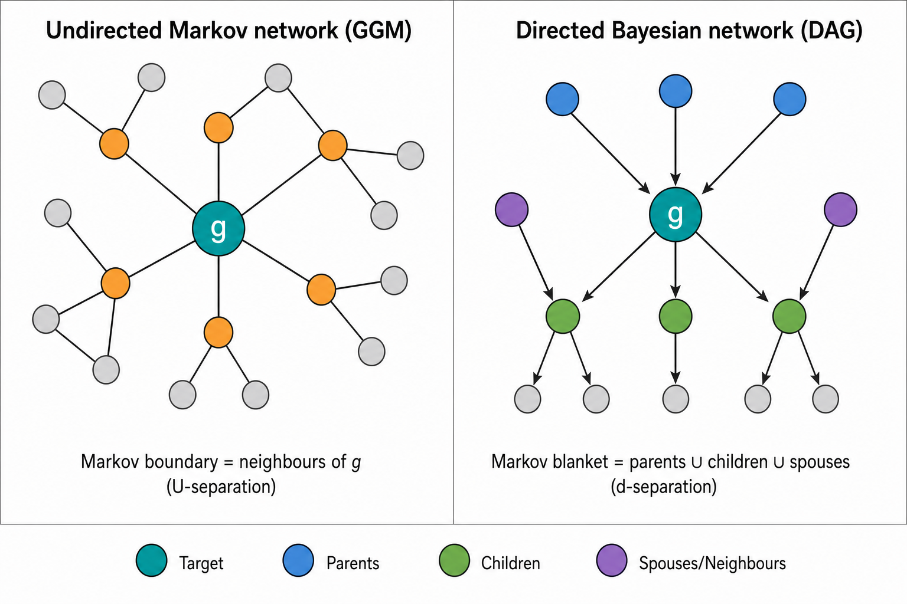

```{r setup, include=FALSE}
knitr::opts_chunk$set(
  collapse = TRUE,
  comment = "#>",
  message = FALSE,
  warning = FALSE,
  echo = FALSE,
  eval = FALSE
)
```

::: {.callout-note collapse="true"}
## Notation used in this vignette

A symbol absent from these groups is defined in this vignette, with one
meaning. The full table is the [notation article](notation.html).
















:::


::: callout-note
## Scope

This chapter states which genes should enter a DeCovarT reference built
from single-cell data, and why. It holds the theory: what the genes are
for, the selection strategies of the literature, four tiers of
selection, and the statistical tests and tail bounds behind them
[@gaspard-boulincCelltypeDeconvolutionMethods2025;
@avilacobosComputationalDeconvolutionTranscriptomics2018]. The
reference considered here is a single-cell experiment on one specimen.
Cross-cell consistency (tier ii, @sec-fs-consistency) uses that
reference alone; cross-platform consistency (tier iii,
@sec-fs-cross-platform) also needs a bulk sample that matches it.
Cross-sample consistency, references from other technologies,
dependent cells and covariance-driven selection are perspectives
(@sec-perspectives). The application to a real reference (filters as
applied, settings, rank tables, code) is in the feature-selection
chapter of the reproducibility book. Strategies compared on simulated
references are in [Appendix S6](S6-feature-screening-scenario.html).
Marker-based abundance scores (enrichment modules) are out of scope
[@aranXCellDigitallyPortraying2017].
:::

**Local symbols.** $C=\sum_jC_j$ is the number of reference cells in
one time slot, and $j(c)$ is the label of cell $c$. $v_{gj}$ is the
$g$-th diagonal entry of $\boldsymbol{V}_j$. A gene panel is written
$\mathcal{G}\subseteq\{1,\ldots,G\}$. In the review, $\mu_{gj}$ is the
mean of gene $g$ in type $j$ on the scale of the method at hand,
$u_{gj}$ its type share and $k$ a rank (@eq-gini). In the count models,
$m_{gc}=\operatorname{E}(x_{gc})$ is the mean of gene $g$ in cell $c$,
$V(m)=m+m^{2}/\psi_g$ the negative-binomial (NB) variance function,
$\mathcal{D}_g(M)$ the deviance of model $M$, $\Lambda_g$ the
likelihood-ratio statistic, $R^{2}_{D,g}$ the deviance explained,
$r_{gc}$ the raw Pearson residual, $r^{\mathrm{SP}}_{gc}$ the
standardised one, $\hat\phi_g$ the Pearson dispersion and $h_{gc}$ the
leverage of cell $c$ (@sec-sctransform, @sec-fs-leverage). For the
bulk filter, $\tilde\mu_{gj}$ is the expected count of gene $g$ in one
cell of type $j$, $\hat{\tilde\mu}_{gj}$ its average over the $C_j$
reference cells, $\sigma^{2}_{gj}=\tilde\mu_{gj}+\tilde\mu_{gj}^{2}/\psi_g$
the per-cell NB variance, $\delta^{\mathrm{R}}_g$ the distance of the
bulk to the range of the reference means, $D_{gi}$ the plug-in
discrepancy, $D^{b}_{gi}$ the discrepancy after dividing the bulk by a
plug-in platform ratio $\hat b_g=\tilde b_ge^{\varepsilon_g}$ with
$v_g=\operatorname{Var}\varepsilon_g$, $L_g$ the mean transcript length,
$h_g$ the leverage of gene $g$ and $\tau_g^{2}$ its
residual variance, $S_M$ the standardised sum over a gene module $M$,
$K_D(u)$ the cumulant generating function of $D$ with argument $u$, and
$\chi_G$ the number of classes of a colouring of a gene graph
(@sec-fs-range-tail). $\eta_1,\dots,\eta_4$ are the parameters of the
sub-exponential properties, and $\gamma,\gamma'$ absolute constants
(@nte-fs-subexp, @nte-fs-bernstein). $B$ is the number of permutations
(@sec-fs-calibration).

```{.tikz}
%%| label: fig-fs-tiers
%%| fig-cap: "Four tiers of gene selection for a DeCovarT reference from one specimen. Tiers (i) to (iii) remove or flag genes; tier (iv) keeps the remaining genes and lets the fitted covariance down-weight them. Tier (iii) needs a bulk sample matched to the reference. Dashed boxes are perspectives: cross-sample consistency needs several specimens, cross-technology references need a second reference, dependent cells need a tissue neighbourhood graph, and covariance-driven selection needs the estimated within-type covariances."
%%| filename: fig-fs-tiers
%%| alt: Flowchart. UMI counts and labels feed tier one, quality control, prior-knowledge markers and a presence gate, then tier two, cross-cell consistency by four tests of the type effect with a false-discovery gate and an effect-size rank, then tier three, cross-platform consistency by Cook's distance and a bulk filter built on five tail statements with a plug-in composition, then tier four, a generalised least-squares fit in which the within-type covariance down-weights genes. Four dashed perspective boxes sit below: cross-sample consistency below tier one, linked from tier two; cross-technology references and dependent cells in a tissue below tiers two and three, linked from tier three; covariance-driven post hoc selection below tier four, linked from tier three and feeding tier four.
\begin{tikzpicture}[every node/.append style={text width=2.7cm}]
\node[keybox] (A) at (0,2.3) {UMI counts $x_{gc}$, labels $j(c)$, matched bulk $y_{gi}$};
\node[box] (B) at (0,0) {(i) cell and gene QC, prior markers, presence gate in every type};
\node[box] (D) at (3.6,0) {(ii) cross-cell consistency: four tests, FDR gate, effect-size rank};
\node[box] (P) at (7.2,0) {(iii) cross-platform consistency: Cook's distance, bulk filter with $\hat{\boldsymbol{p}}$};
\node[keybox] (H) at (10.8,0) {(iv) GLS fit: $\widehat{\boldsymbol{\Sigma}}_{W,j}$ down-weights genes};
\node[dimbox, densely dashed] (F1) at (0,-2.9) {cross-sample consistency (donors)};
\node[dimbox, densely dashed] (F2) at (3.6,-2.9) {cross-technology references};
\node[dimbox, densely dashed] (F3) at (7.2,-2.9) {dependent cells in a tissue};
\node[dimbox, densely dashed] (E) at (10.8,-2.9) {covariance-driven, post hoc: Fisher information, Pareto};
\draw[edge] (A) -- (B);
\draw[edge] (B) -- (D);
\draw[edge] (D) -- (P);
\draw[edge] (P) -- (H);
\draw[dashededge] (D) -- (F1);
\draw[dashededge] (P) -- (F2);
\draw[dashededge] (P) -- (F3);
\draw[dashededge] (P) -- (E);
\draw[dashededge] (E) -- (H);
\end{tikzpicture}
```

::: {#wrn-fs-estimand .callout-warning}
## What the genes are for

The target is a set of genes that makes the reference moments
$(\boldsymbol{\mu}_{\cdot j},\boldsymbol{\Sigma}_{W,j})$ estimable and
informative about $\boldsymbol{p}$. This is not population-level
differential expression, for two reasons.

- **One specimen.** The reference is one technical scRNA-seq
  experiment. Its cells are draws from one specimen, not biological
  replicates, so every $p$-value below calibrates a *screen inside that
  specimen*. Treating cells as replicates of a population contrast
  inflates the false discoveries
  [@zimmermanPracticalSolutionPseudoreplication2021;
  @squairConfrontingFalseDiscoveries2021;
  @crowellMuscatDetectsSubpopulationspecific2020]. Only the within-donor
  covariance $\boldsymbol{\Sigma}_{W,j}$ is estimable; the between-donor
  part needs $R\ge2$ donors
  ([2.1](02-1-single-cell-generative-optimisation.html#sec-one-replicate)).
- **Labels are given.** A test of the type effect is valid only if the
  labels were fixed before the statistic is computed. Labels obtained by
  clustering the same matrix make the test anti-conservative
  (post-clustering inference, González-Delgado et al. 2025)
  [TODO-cite: González-Delgado et al. 2025, post-clustering inference; key gonzalezDelgadoPostclusteringInference2025 exists in the book bib only]{.highlight}.

Selection proceeds in four tiers (@fig-fs-tiers):

1. quality control, prior-knowledge markers and a presence gate
   (@sec-fs-qc);
2. cross-cell consistency: tests of the type effect used as a gate,
   then an effect-size rank (@sec-fs-consistency);
3. cross-platform consistency between the reference and a matched bulk:
   influence diagnostics and a bulk filter (@sec-fs-cross-platform);
4. down-weighting by the model instead of removal (@sec-fs-weighting).

Tiers (i) to (iii) are filters; tier (iv) is part of the likelihood.
Feature selection as a pre-modelling filter has the usual caveats
[@guyonIntroductionVariableFeature2003]: it is a proposal, to be
checked by out-of-sample deconvolution error
([S6](S6-feature-screening-scenario.html#sec-cv-selection)).
:::

# Review of gene-selection strategies used by deconvolution algorithms {#sec-fs-review}

Deconvolution methods choose genes in three ways:

- univariate one-versus-others screens (@sec-fs-univariate):
  differential-expression and fold-change ranks (@sec-fs-de-rank), the
  ANOVA $F$ statistic (@sec-fs-anova-rank) and specificity scores
  (@sec-gini-entropy);
- searches over the whole signature (@sec-fs-all-vs-all);
- no selection, with gene weights doing the work (@sec-fs-weighting).

This section reviews them, states where they depart from the count
model used here (@sec-fs-critiques), and compares second-generation
methods in @tbl-fs-review. Each method's likelihood is reviewed in
[5.1](05-1-review-distribution-aware.html#sec-methods).

## Univariate screens, one versus others {#sec-fs-univariate}

Classical signature pipelines score gene $g$ for type $j$ against the
remaining types, then concatenate the per-type shortlists
[@abbasDeconvolutionBloodMicroarray2009;
@newmanRobustEnumerationCell2015; @finotello_etal19].

### Differential-expression and fold-change ranks {#sec-fs-de-rank}

`limma`–voom, `edgeR` and `DESeq2` are the usual tools for
one-versus-rest contrasts [@ritchieLimmaPowersDifferential2015a;
@robinsonEdgeRBioconductorPackage2010;
@loveModeratedEstimationFold2014a]. CIBERSORT keeps genes with adjusted
$p\le0.3$, orders them by fold change and prunes the panel by its
condition number [@newmanRobustEnumerationCell2015]. Abbas et al. keep
genes whose expression in the target type exceeds that of the second-
and third-ranked types, then choose the panel with the smallest
condition number [@abbasDeconvolutionBloodMicroarray2009].
<!-- Recovered from vignettes/supp-S6-feature-selection.qmd (commit 123b937, identical in d28b91d to b0a4f2b); CIBERSORT and Abbas facts not re-checked against a local PDF. -->
On cells of one specimen these tests treat cells as replicates
(@wrn-fs-estimand); their pseudo-bulk versions need donors
(@sec-fs-cross-sample).

### ANOVA $F$ statistic {#sec-fs-anova-rank}

Wang et al. rank genes by the $F$ statistic of a type factor against an
intercept-only model [@wangSilicoEstimatesTissue2010]. This is one
omnibus test per gene instead of one test per type. Its count-model
versions, and their calibration, are the tests of tier (ii)
(@sec-fs-omnibus).

### Specificity scores {#sec-gini-entropy}

Long one-versus-rest lists are often compacted with the Shannon entropy
or the Gini coefficient of the type shares
$u_{gj}=\mu_{gj}/\sum_{\ell}\mu_{g\ell}$, as in `BioQC`
[@zhang_etal17]:

$$
H_g=-\sum_{j=1}^{J}u_{gj}\log u_{gj},
\qquad
\mathrm{Gini}_g
=
\frac{1}{2J}\sum_{j=1}^{J}\sum_{\ell=1}^{J}\lvert u_{gj}-u_{g\ell}\rvert
=
\frac1J\sum_{j=1}^{J}(2R_{gj}-J-1)\,u_{gj},
$$ {#eq-gini}

<!-- chk: V27a -->
with $0\log0=0$; $R_{gj}=R(u_{gj})$ is the rank of $u_{gj}$ among the $J$
shares of gene $g$, and $u_{g(1)}\le\cdots\le u_{g(J)}$ are its order
statistics, so that $u_{g(R_{gj})}=u_{gj}$ (rank-based notation of
Jaeckel and of Hettmansperger and McKean). $H_g/\log J$ and
$J\,\mathrm{Gini}_g/(J-1)$ lie in $[0,1]$; low entropy and high Gini mean
that few types carry the mass. @fig-gini-derivation derives the Gini
coefficient in five steps, from the mean absolute difference of the
type means to the share form of @eq-gini. The pairwise and sorted forms
agree because, the share of rank $R_{gj}$ is larger than
$R_{gj}-1$ shares and smaller than $J-R_{gj}$ shares, so it enters the
double sum with the net weight $2R_{gj}-J-1$. Both scores reward exclusive expression,
which the presence gate (@sec-fs-presence) excludes, and neither sees
redundancy between genes.

![Gini coefficient of one gene $g$ across $J=8$ cell types, from pairwise differences of the type means to the share form of @eq-gini. Left, boxes A to E: one formula per step; right, the same step for two genes with integer type means, a low-Gini gene $(12,15,9,14,11,13,10,16)$ (blue) and a high-Gini gene $(1,2,1,3,1,2,4,86)$ (orange), both with mean $\bar\mu_g=12.5$ and every $\mu_{gj}\ge1$. (A) Heat maps of $\lvert\mu_{gj}-\mu_{g\ell}\rvert$ (shade on a square-root scale) and their mean, written $\Delta_g$ in this figure only, in counts. (B) Type means relative to the gene mean, with the line at 1; $\mathrm{Gini}_g=\Delta_g/(2\bar\mu_g)$. (C) Order statistics $\mu_{g(1)}\le\cdots\le\mu_{g(J)}$ against the rank $R_{gj}$, with the weights $2R_{gj}-J-1$ on the top axis (dashed line: the sign change at rank $(J+1)/2$); the weighted sum divided by $J^2\bar\mu_g=800$ gives the same value. (D) Raw (open) and corrected (filled) coefficient, with the maximum $(J-1)/J=0.875$ (dashed) reached by a gene expressed in one type only (grey). (E) Type shares $u_{gj}$ with the line $1/J$; @eq-gini gives the same values. Code: `scripts/figures/fig_03_1_gini.R`.](figures/fig_03_1_gini.svg){#fig-gini-derivation fig-alt="Five rows joined by arrows on the left. Each row has a box with a step title, a formula and one sentence, and a chart for two genes on the right: blue for a gene with similar means in all eight types, orange for a gene with most of its counts in type 8. Row A shows two eight-by-eight heat maps of absolute differences between type means; the orange map is dark only in the row and column of type 8. Mean differences are 2.625 and 19.25. Row B shows bar charts of means divided by the gene mean: blue bars stay near 1, one orange bar reaches about 6.9. Gini values are 0.105 and 0.770. Row C plots sorted means against rank with the weights minus 7 to 7 on the top axis; the orange curve stays near 0 then jumps to 86 at rank 8. Row D plots each Gini value with an arrow to its corrected value: 0.105 to 0.120, 0.770 to 0.880, and 0.875 to 1 for a gene expressed in one type only, against a dashed line at 0.875. Row E shows bar charts of type shares with a dashed line at one eighth and repeats the values."}

<!-- chk: V27b -->
For the two genes of @fig-gini-derivation the Gini coefficients are
$21/200=0.105$ and $77/100=0.770$, and the corrected values
$J\,\mathrm{Gini}_g/(J-1)$ are $3/25$ and $22/25$. A gene expressed in
one type only has $u_{g(J)}=1$, so @eq-gini gives $(J-1)/J$, the
maximum.

Concatenation does not control redundancy. Two specific markers of
different types can still be nearly collinear rows of
$\boldsymbol{\mu}$ when the types share a programme (a lineage, an
activation axis), so the union of per-type lists inflates
$|\mathcal{G}|$ while $\kappa_2(\boldsymbol{\mu}_{\mathcal{G}})$ stays
large and NNLS or GLS fits stay unstable
[@newmanRobustEnumerationCell2015;
@avilacobosComputationalDeconvolutionTranscriptomics2018]. A criterion
on the whole signature is then needed.

## Searches over the whole signature {#sec-fs-all-vs-all}

- **Condition number.** CIBERSORT and DWLS keep the candidate signature
  with the smallest $\kappa_2(\boldsymbol{\mu}_{\mathcal{G}})$
  [@newmanRobustEnumerationCell2015;
  @tsoucasAccurateEstimationCelltype2019, p. 7;
  @gongDeconRNASeqStatisticalFramework2013]; its limits are in
  @sec-kappa-limits.
- **Multi-objective genetic search.** `AutoGeneS` searches gene subsets
  with a genetic algorithm that minimises the correlation between type
  centroids and maximises their distance
  [@alieeAutoGeneSAutomaticGene2021]; MOGAMUN applies the same kind of
  search to network modules
  [@novoa-del-toroMultiobjectiveGeneticAlgorithm2021]. The loss is
  defined on the full $J$-column signature, not on one-versus-rest
  lists.

Both criteria see the means only. Criteria that also use the
within-type covariance need $\widehat{\boldsymbol{\Sigma}}_{W,j}$, so
they come after tier (ii) (@sec-fs-multivariate).

## Critiques of current marker rules {#sec-fs-critiques}

The reviewed marker rules (@tbl-fs-review) depart from the count model
of tier (ii) in five ways.

- **Hurdle models on droplet counts.** DWLS defines markers with the
  `MAST` hurdle model [@tsoucasAccurateEstimationCelltype2019, p. 7].
  Droplet UMI counts show no zero inflation beyond what the NB predicts
  (Svensson 2020)
  [TODO-cite: Svensson 2020, Droplet scRNA-seq is not zero-inflated, Nat. Biotechnol., doi:10.1038/s41587-019-0379-5]{.highlight},
  and current data do not support zero-inflated *measurement* models
  [@sarkarSeparatingMeasurementExpression2021, p. 5]. The hurdle splits
  one count into a detection and a magnitude test (Finak et al. 2015)
  [TODO-cite: Finak et al. 2015, MAST, Genome Biol., doi:10.1186/s13059-015-0844-5]{.highlight}
  where one NB test of @eq-fs-nb-main suffices.
- **Gaussian $t$-tests on counts.** ReDeconv uses a two-sample $t$-test
  between cells [@luTranscriptomeSizeMatters2025, p. 14]; deMixSC uses a
  paired $t$-test of bulk against matched pseudo-bulk
  [@guoDeMixSCDeconvolutionFramework2023, p. 12].
- **Cells as independent replicates.** Every test above that runs on
  cells (DWLS, ReDeconv, BayesPrism's marker option) treats them as
  replicates of a population contrast (@wrn-fs-estimand). Pseudo-bulk
  `DESeq2`, `edgeR` or `limma`–voom avoid this only with biological
  replicates at the level of the contrast (@sec-fs-cross-sample).
- **No multiplicity control.** ReDeconv keeps genes with $p<0.05$ in each
  comparison against every other type, with no FDR correction
  [@luTranscriptomeSizeMatters2025, p. 14].
- **Graph-based screens before the graph is estimated.**
  Differential-network screens (`INDEED`, D-trace) and Markov-boundary
  growth of marker seeds need fitted graphs; here they are post hoc
  (@sec-markov-seeds).

## Comparison of second-generation methods {#sec-fs-review-table}

@tbl-fs-review summarises, method by method, the facts found in the
papers, with the columns in the order of the tiers. Page numbers refer
to the PDF pages of the local extractions ("supp." marks a supplement).
A dash means that the item was not found in the extracted text; it does
not mean that the method has no such step. The same facts are in
Appendix C of the CardamomOT comparison note.

| Method | Cell QC (i) | Gene filter (i) | Marker rule (ii) | Cross-platform (iii) | Weighting (iv) |
|---|---|---|---|---|---|
| RNA-Sieve [@erdmann-phamLikelihoodbasedDeconvolutionBulk2021] | optional: library size or pairwise distance ≥ 3 MAD from the type median (supp. p. 3) | non-zero in ≥ 20 % of the cells of ≥ 1 type (supp. p. 3) | none | range bound and MAD outliers on four statistics (Eqs 12–13, p. 11) | Gaussian composite likelihood from the CLT (Eq. 10, p. 10) |
| DECALS [@caiStatisticalInferenceCelltype2024] | — | CIBERSORTx S-mode candidate genes (p. 13) | ∩ markers of @mathysSinglecellTranscriptomicAnalysis2019 (Fisher's exact test, FDR): 159 genes (p. 13; supp. pp. 18–19) | S-mode batch correction (p. 13) | constrained OLS; GLS biased in practice (pp. 6, 9) |
| MEAD [@xieStatisticalInferenceCell2026] | — | — | none; removing genes gains nothing unless noise differs (p. 17) | gene-wise ratios with mean 1 (pp. 5, 8) | WLS from the reference variance (pp. 17–18); sandwich (p. 13) |
| ReDeconv [@luTranscriptomeSizeMatters2025] | — | — | $t$-test $p<0.05$ against every other type, no FDR; fold change ≥ 2; smallest SD/mean, about 100 per type (p. 14) | length normalisation of the bulk only (p. 2) | Gaussian, composition-dependent variance (Eq. 5, p. 14) |
| MuSiC [@wangBulkTissueCell2019] | — | all shared genes (p. 7) | none; small within-cluster variance in the tree-guided stage (pp. 3, 8) | optional gene- and subject-specific intercept (p. 7) | W-NNLS, weights from cross-subject variance (Eq. 10, p. 7) |
| deMixSC [@guoDeMixSCDeconvolutionFramework2023] | < 500 UMI, < 200 genes, > 50 % mitochondrial (p. 11) | detected in < 5 % of cells removed (p. 11) | none | paired $t$-test bulk vs pseudo-bulk, BH; 5,000 genes down-weighted by a factor of 1,000 (p. 12) | W-NNLS, iterated weights (p. 12) |
| BayesPrism [@chuCellTypeGeneExpression2022] | types with < 20 cells excluded in one benchmark (supp. p. 15) | ribosomal, mitochondrial, X and Y genes (supp. pp. 14, 19) | optional scran markers, $t$-tests, up-regulated only (supp. pp. 14–15) | bulk-specific profiles; log-normal fold-change prior (supp. pp. 5–6) | Bayesian multinomial (supp. pp. 3–6) |
| DWLS [@tsoucasAccurateEstimationCelltype2019] | — | — | `MAST` hurdle, FDR < 0.01, $\log_2$FC > 0.5; 50–200 per type; smallest $\kappa$ (p. 7) | none | dampened WLS (pp. 2, 7) |
| SCDC [@dongSCDCBulkGene2021] | cells with a questionable type or low quality removed (p. 9) | genes with zero counts in every sample (p. 9) | none | ENSEMBLE over references (p. 3) | W-NNLS, maximal-variance weights clipped at the 15th/85th percentiles (p. 10) |
| RCTD [@cableRobustDecompositionCell2022a] | spots ≥ 100 UMI (p. 9) | mean above 0.0625 counts per 500 (p. 7) | log-fold change ≥ 0.5 against the other types, no test (p. 7) | gene-wise platform random effect (pp. 3, 6) | Poisson–lognormal GLMM (p. 6) |
| CardamomOT 2.0.0 (Maugé & Ventre 2026) | paper: —; code: per-cell depth factor, no cell removed | paper: gene sets of earlier studies (p. 32); code: no mitochondrial, ribosomal or non-coding genes | code: $W_1$ and entropy terminals, round robin of per-type Wilcoxon tests, NB separability, Steiner closure | not applicable (no bulk) | NB-mixture likelihood, $\ell_1$ towards a prior network (Eq. 10, p. 9) |

: Gene selection in second-generation deconvolution methods, by tier. CardamomOT is a network-inference method, included for its gene selection; its code facts are from release 2.0.0 (<https://github.com/eliasventre/CardamomOT>). {#tbl-fs-review}

[TODO-cite: Maugé & Ventre 2026, CardamomOT, PLoS Comput. Biol. 22(10):e1014838, doi:10.1371/journal.pcbi.1014838]{.highlight}

DeCovarT builds on these methods in three ways.

- **Covariance in the criterion.** Only DeCovarT puts gene–gene
  covariance into the criterion that estimates $\boldsymbol{p}$; DECALS
  and MEAD use it only for the variance of their estimators. The other
  methods treat genes as independent, the setting in which a univariate
  screen is also the objective (@sec-fs-screen-objective). DeCovarT
  keeps the univariate screen as a gate (tier ii) and leaves the
  weighting to the covariance (tier iv).
- **One count test per gene.** The tests that select genes run on cells,
  mostly with Gaussian or hurdle models, and only DWLS (markers) and
  deMixSC (platform discrepancy) report a multiplicity correction.
  DeCovarT uses one test of the type effect per gene, chosen among four
  with known assumptions, and a Benjamini–Hochberg gate
  (@sec-fs-omnibus).
- **No perfect markers.** MuSiC and MEAD argue against marker
  pre-selection when the genes are weighted, and MEAD shows that perfect
  markers break identifiability under gene-wise platform ratios
  (@sec-fs-cross-platform); DWLS and DECALS still build marker-only
  signatures. DeCovarT removes perfect markers with the presence gate
  and weights the remaining genes.




# Tier (i): quality control and prior knowledge {#sec-fs-qc}

QC removes cells and genes that lie outside the support of any
expression model. The thresholds below are examples from the reviewed
methods (@tbl-fs-review), not defaults of DeCovarT.

- **Cells.** Library size more than 3 median absolute deviations (MAD)
  from the median of its type, and cells more than 3 MAD from the median
  pairwise distance within their type (RNA-Sieve, optional;
  @erdmann-phamLikelihoodbasedDeconvolutionBulk2021, supplement p. 3).
  Fewer than 500 UMIs, fewer than 200 detected genes, or more than 50 %
  mitochondrial UMIs (deMixSC; @guoDeMixSCDeconvolutionFramework2023,
  p. 11).
- **Genes.** Ribosomal, mitochondrial and sex-chromosome genes, which
  reflect cell survival and donor sex rather than type
  (BayesPrism; @chuCellTypeGeneExpression2022, supplement pp. 14, 19).
  Genes detected in fewer than 20 % of the cells of every type
  (RNA-Sieve, supplement p. 3).

## Prior-knowledge markers {#sec-fs-prior-markers}

A short curated list of markers (lineage or signalling genes named by
the biology of the tissue) enters as hard prior knowledge. These genes
are kept whatever their rank in tier (ii), provided they pass the
presence gate, and they are reported as a separate group. Two rules
keep the list honest. It is fixed before the data-driven ranks are
seen. It is never used to score the data-driven panel, since a panel
judged by its overlap with the markers that were forced into it is
judged by construction. The overlap between the curated list and the
genes that the data-driven tiers keep can be reported as a description,
for example with a hypergeometric tail, as the reproducibility book
does.

## Presence gate in every type {#sec-fs-presence}

::: callout-note
## Necessary, not sufficient

A gene enters tier (ii) only if

$$
\min_{j}\delta_{gj}\ge\delta_{\min}
\quad\text{and}\quad
\min_{j}v_{gj}>0,
$$ {#eq-fs-presence}

with $\delta_{\min}$ a few per cent (for example $0.05$), fixed before
the ranks are seen. [These are necessary conditions for a non-singular
within-type covariance and for an identifiable $\boldsymbol{p}$; they
are not sufficient.]{.mark} Two cases show what the gate excludes.

<!-- chk: V17a, V17b -->
- **Zero in every cell of type $j$.** Then $v_{gj}=0$ and the whole row
  and column $g$ of $\boldsymbol{V}_j$ are zero: $\boldsymbol{V}_j$ is
  singular ($\det\boldsymbol{V}_j=0$), the correlation
  $v_{gh}/\sqrt{v_{gg}v_{hh}}$ is $0/0$ and so undefined, and the fitted
  type-$j$ Gaussian is degenerate, a point mass in coordinate $g$. Its
  likelihood is unbounded, so no maximum-likelihood estimate exists.
- **Detected in a single cell $c$.** With count $a$ in that cell, the
  centred counts of $g$ are $a(\boldsymbol{e}_c-\mathbf{1}/C_j)$, and
  its correlation with any gene $h$ is
  $r_{gh}=\tilde h_c/(\sqrt{1-1/C_j}\,\lVert\tilde{\boldsymbol h}\rVert)$,
  $\tilde{\boldsymbol h}$ the centred counts of $h$: one cell sets it.
  Two genes detected only in cell $c$ have $r=1$ whatever their counts,
  a perfect and degenerate correlation, and $\boldsymbol{V}_j$ is again
  singular.

<!-- chk: V17c, V10a, V10c -->
With $\delta_{\min}C_j\ge2$ the gate keeps only genes with at least two
non-zero cells in every type, which excludes both cases. It does not
make $\boldsymbol{V}_j$ invertible: $\operatorname{rank}\boldsymbol{V}_j\le
\min(C_j-1,G)$, so $\boldsymbol{V}_j$ is singular whenever $G\ge C_j$ or
genes satisfy an exact linear relation, and shrinkage is still needed
([3.2](03-2-covariance-network-estimation.html)). Nor does it make
$\boldsymbol{p}$ identifiable, which requires a non-singular Fisher
information for $\boldsymbol{p}$
([1.2](01-2-population-inference.html#sec-identifiability)). The gate
also removes perfect markers, whose effect under gene-wise platform
ratios is in @sec-fs-cross-platform.
:::




# Tier (ii): cross-cell consistency {#sec-fs-consistency}

MuSiC introduced "marker gene consistency" with two parts
[@wangBulkTissueCell2019, p. 2].
[Cross-cell consistency asks whether a gene is stable across the cells
of one type]{.mark}, so that biased cell capture does not drive its
selection; cross-cell consistent genes have a low within-cluster
variance [@wangBulkTissueCell2019, p. 3].
[Cross-sample consistency asks whether a gene's type mean is stable
across specimens]{.mark} (MuSiC's cross-subject consistency), and needs
at least two of them. With a reference from one specimen only cross-cell
consistency can be assessed from the reference alone; cross-sample
consistency is a perspective (@sec-fs-cross-sample), and consistency
with a matched bulk is tier (iii) (@sec-fs-cross-platform). The natural
statistic for cross-cell consistency splits a gene's variation into
between-type and within-type parts.

## Count null model and Pearson residuals {#sec-sctransform}

The technical null fits each gene with library size as the only
covariate,

$$
M_{0}:\;
\log m_{gc}=\beta_{0g}+\log s_{c},
\qquad
x_{gc}\sim\mathrm{NB}(m_{gc},\psi_{g}),
\qquad
\operatorname{Var}(x_{gc})=V(m_{gc})=m_{gc}+\frac{m_{gc}^{2}}{\psi_g}.
$$ {#eq-fs-nb-null}

$M_0$ is fitted gene by gene with our own NB
GLM, with $\psi_g$ estimated per gene by maximum likelihood (for
example with `glmGamPoi` [@glmGamPoi2020] or `MASS::glm.nb()`), and its
residuals are not clipped^[`SCTransform` with `vst.flavor = "v2"` fits
the same model, with the depth slope fixed and library size as an
offset, but it regularises $\psi_g$ across genes and clips the residuals
at $\pm\sqrt{C/30}$ [@hafemeisterNormalizationVarianceStabilization2019;
@lauseAnalyticPearsonResiduals2021]. Clipping is harmful
for gene selection: it shrinks exactly the cells with large residuals
and large fitted means, which include the informative high-leverage
cells of a rare type and of highly expressed genes, such as
haemoglobins or master regulators (@sec-fs-leverage).]

The raw Pearson residual is

$$
r_{gc}=\frac{x_{gc}-\hat m_{gc}}{\sqrt{V(\hat m_{gc})}},
\qquad
r^{\mathrm{SP}}_{gc}=\frac{r_{gc}}{\sqrt{\hat\phi_g\,(1-h_{gc})}},
$$ {#eq-fs-pearson}

and $r^{\mathrm{SP}}_{gc}$ is the standardised Pearson residual
[@agrestiFoundationsLinearGeneralized2015]. $\hat\phi_g$ is the Pearson
dispersion (the sum of squared $r_{gc}$ divided by the residual degrees
of freedom), and $h_{gc}$ the leverage of cell $c$ in the weighted hat
matrix of the final IRLS step. The factor $1-h_{gc}$ corrects for a
fitted value that a high-leverage cell partly sets itself.
`SCTransform` residuals are raw residuals: they carry neither
$\hat\phi_g$ nor $1-h_{gc}$, and they are clipped. Standardised does
not mean Gaussian: at low means Pearson residuals stay discrete and
skewed, and randomised quantile residuals (Dunn & Smyth 1996)
[TODO-cite: Dunn & Smyth 1996, Randomized quantile residuals, J. Comput. Graph. Stat. 5(3):236-244, doi:10.1080/10618600.1996.10474708]{.highlight}
are the residuals to compare with a normal reference.

The raw residuals of $M_0$ split as

$$
\mathrm{SS}_{\mathrm{B},g}
=
\sum_{j=1}^{J}C_{j}\bigl(\bar r_{gj}-\bar r_{g}\bigr)^{2},
\qquad
\mathrm{SS}_{\mathrm{W},g}
=
\sum_{j=1}^{J}\sum_{c:j(c)=j}\bigl(r_{gc}-\bar r_{gj}\bigr)^{2},
$$ {#eq-fs-ss}

with $\bar r_{gj}$ the mean residual in type $j$ and $\bar r_{g}$ the
overall mean ($\approx0$). A lineage marker has a large between-type and
a small within-type part; a stress-response gene can have a large total
residual variance and still a small between-type part. The sums weight
every cell equally, so the abundant types dominate them; tests that
allow a different variance per type are in @sec-fs-calibration.
@fig-sc-transform shows the steps of the null model on simulated
counts.

![Count null model $M_0$ on simulated counts (2,000 genes, 2,000 cells of two types, seed 20261101), drawn with the `SCTransform` (v2) workflow. (a) Gene variance against gene mean: NB variance with the smoothed dispersion (solid) and the Poisson line (dashed). (b) Counts of one marker gene against the size factor, with the fitted mean of $M_0$ (library size as offset, no cell type). (c) Per-gene dispersion estimates against the gene mean, which $M_0$ uses here, and their smooth across genes, the empirical-Bayes regularisation that `SCTransform` uses instead. (d) Raw Pearson residuals of the same gene: no trend with depth, the type difference kept. Code: `scripts/figures/fig_03_1_sctransform.R`.](figures/fig_03_1_sctransform.svg){#fig-sc-transform fig-alt="Four scatter panels joined by arrows and labelled with formulas. Panel a: gene variance against gene mean on log scales, points above the Poisson line and close to the negative-binomial curve. Panel b: counts of one gene against the size factor for two cell types, with the fitted mean rising in proportion to the size factor. Panel c: per-gene dispersion estimates against the mean, scattered around an increasing smooth curve. Panel d: Pearson residuals of the same gene against the size factor, centred on zero with no depth trend, the two cell types at different levels."}

## Four tests of the type effect {#sec-fs-omnibus}

Add the type main effect to @eq-fs-nb-null:

$$
M_{1}:\;
\log m_{gc}=\beta_{0g}+\beta_{g,j(c)}+\log s_{c},
\qquad
\beta_{g1}=0,
\qquad
H_{0g}:\beta_{g2}=\cdots=\beta_{gJ}=0 .
$$ {#eq-fs-nb-main}

The joint null has $J-1$ degrees of freedom
[@agrestiFoundationsLinearGeneralized2015]. One omnibus test per gene
replaces $\binom{J}{2}$ pairwise or $J$ one-versus-rest tests, and a
single Benjamini–Hochberg correction across genes follows. Four tests
of $H_{0g}$ are compared (@tbl-fs-tests). The presence gate removes the
all-zero types near which the Wald test fails (Hauck–Donner effect;
@yeeHauckDonnerEffectWald2022), so the Wald test is not used.

- **Likelihood ratio (analysis of deviance).**
  $\Lambda_g=\mathcal{D}_g(M_0)-\mathcal{D}_g(M_1)$, with both models
  fitted at the $\hat\psi_g$ of $M_1$, referred to $\chi^2_{J-1}$. It
  needs one $M_1$ fit per gene, a one-way GLM with $J$ coefficients.
- **One-way ANOVA $F$ on variance-stabilised counts.** The shifted
  logarithm $\log(x_{gc}/s_c+y_0)$, with $y_0=\psi_0/4$ for a typical
  dispersion $\psi_0$, stabilises the NB variance and performs as well
  as more elaborate transformations in a published benchmark
  (Ahlmann-Eltze & Huber 2023)
  [TODO-cite: Ahlmann-Eltze & Huber 2023, Comparison of transformations for single-cell RNA-seq data, Nat. Methods 20, doi:10.1038/s41592-023-01814-1]{.highlight}.
  The $F$ statistic of the type factor on these values is referred to
  $F_{J-1,C-J}$ [@wangSilicoEstimatesTissue2010]. When the variance on
  the transformed scale still differs between types, Welch's
  heteroscedastic one-way test (Welch 1951)
  [TODO-cite: Welch 1951, On the comparison of several mean values: an alternative approach, Biometrika 38:330-336]{.highlight}
  is the fallback.
- **Quasi-likelihood $F$.** Defined below (@eq-fs-qlf).
- **Permutation calibration.** Welch's statistic on the residuals of
  $M_0$, referred to a permutation distribution (@sec-fs-calibration).

**Quasi-likelihood $F$.** Dividing $\Lambda_g/(J-1)$ by the Pearson
dispersion of $M_1$ gives

$$
F_{g}
=
\frac{\Lambda_g/(J-1)}{\hat\phi_g},
\qquad
\hat\phi_g=\frac{1}{C-J}\sum_{c}\frac{(x_{gc}-\hat m^{(1)}_{gc})^{2}}{V(\hat m^{(1)}_{gc})},
$$ {#eq-fs-qlf}

with $\hat m^{(1)}_{gc}$ the fitted means of $M_1$, referred to
$F_{J-1,C-J}$. The mean model @eq-fs-nb-main and the variance function
$V(m)=m+m^2/\psi_g$ are kept, and a scalar $\phi_g$ absorbs a variance
larger or smaller than $V$ predicts. This is the quasi-likelihood $F$
test of the edgeR pipeline and of `glmGamPoi::test_de()`, which use the
deviance in the numerator and also shrink $\hat\phi_g$ across genes
[@lundDetectingDifferentialExpression2012; @glmGamPoi2020]. Three
consequences follow.

- **Keep overdispersed genes.** Within-type overdispersion is the
  within-type scatter that the denominator already penalises, and the
  covariance that DeCovarT models. Removing such genes before the test
  removes that signal.
- **A scalar $\phi_g$ cannot absorb a wrong variance function.** Under a
  Poisson null it cannot absorb the quadratic NB term, whose share grows
  with the type mean; the pooled $\hat\phi_g$ is then wrong for every
  type. Use the NB variance, so that $\phi_g\approx1$ in every type. If
  the dispersion still differs between types, $\hat\phi_g$ is an average
  dominated by the large types, and a statistic with one variance per
  type, Welch's $G$ referred to permutations, is needed
  (@sec-fs-calibration).
- **Gate, then rank by effect size.** $F_g$ grows with the counts of a
  gene as well as with its effect, so it serves as a gate, not as a
  rank. Genes that pass the FDR gate are ranked by an effect size, the
  deviance explained $R^{2}_{D,g}=1-\mathcal{D}_g(M_1)/\mathcal{D}_g(M_0)$
  or the ratio $\mathrm{SS}_{\mathrm{B},g}/\mathrm{SS}_{\mathrm{W},g}$
  of @eq-fs-ss, not by $p$-value.

| Test | Statistic | Reference law | Assumptions | R function |
|---|---|---|---|---|
| Analysis of deviance (LR) | $\Lambda_g=\mathcal{D}_g(M_0)-\mathcal{D}_g(M_1)$ | $\chi^2_{J-1}$ | NB mean and variance correct; $\psi_g$ treated as known; enough counts per type | `MASS::glm.nb()` for both models, `stats::pchisq()` |
| One-way ANOVA $F$ on the shifted logarithm | between/within mean squares of $\log(x_{gc}/s_c+y_0)$ | $F_{J-1,C-J}$ | equal variance across types on the transformed scale; approximately normal type means | `stats::oneway.test(var.equal = TRUE)`; Welch: `var.equal = FALSE` |
| Quasi-likelihood $F$ | @eq-fs-qlf | $F_{J-1,C-J}$ | NB mean model and variance function up to one scalar $\phi_g$ for all types | `glmGamPoi::test_de()`, `edgeR::glmQLFTest()` |
| Permuted Welch $G$ | Welch's $G$ on the Pearson residuals of $M_0$ | permutation distribution, $B$ label permutations shared by all genes | labels fixed in advance; residuals of $M_0$ exchangeable across cells under $H_{0g}$; type-specific variances allowed | `permuco::aovperm()` (Freedman–Lane, linear models, permutes $F$); `flipscores::flipscores()` (GLMs) |

: Four tests of the type effect for one gene. $C$ is the number of cells and $J$ the number of types. {#tbl-fs-tests}

When the NB variance function itself fails, quasi-likelihood with an
empirical variance function is the fallback
[@agrestiFoundationsLinearGeneralized2015]. When the *shape* differs
between types (types that share a mean but differ in dispersion), a
location–scale model with type-specific $\psi_{gj}$ tests both, on
$2(J-1)$ degrees of freedom; this is the GAMLSS margin used by scDesign3
[@songScDesign3GeneratesRealistic2024], Stasinopoulos & Rigby (2007)
[TODO-cite: Stasinopoulos & Rigby 2007, GAMLSS in R, J. Stat. Softw. 23(7), doi:10.18637/jss.v023.i07]{.highlight}.
Whether a dispersion difference should count as a type effect depends
on the use: for a gate on mean effects it is a false discovery, while
for DeCovarT, which models the within-type covariance, such a gene can
still carry information.

### Permutation calibration {#sec-fs-calibration}

A permutation null keeps a statistic and replaces its reference
distribution by the distribution under random relabelling of the
cells.

- **Freedman–Lane.** With nuisance covariates (batch, cell line, cell
  cycle), a global label shuffle creates impossible combinations. The
  Freedman–Lane scheme fits the reduced model without type, permutes its
  residuals, adds them back to the reduced fit, refits the full model
  and recomputes the statistic
  [@freedmanNonstochasticInterpretation1983]. In a comparison of
  permutation strategies for the general linear model, Winkler et al.
  (2014) write "we recommend the Freedman–Lane and the Smith methods"
  (p. 393)
  [TODO-cite: Winkler, Ridgway, Webster, Smith & Nichols 2014, Permutation inference for the general linear model, NeuroImage 92:381-397, doi:10.1016/j.neuroimage.2014.01.060]{.highlight}.
  Here the nuisance part of $M_0$ is an intercept and the depth
  offset, so the reduced residuals are the label-free Pearson residuals
  of $M_0$, and Freedman–Lane reduces to permuting the labels against
  them.
- **Welch's $G$, not $F$.** Welch's statistic weights each type mean by
  $C_j$ over its own within-type variance and corrects the denominator
  for the estimated variances (Winkler et al. 2014, Eqs 6–7). With one
  variance group $G=F$. Under heteroscedasticity $F$ is not pivotal
  (p. 386): its null distribution then depends on the unknown
  type-specific variances, and a label permutation does not reproduce
  them. $G$ stays approximately pivotal, so its permutation $p$-value
  remains close to its nominal level.
- **One permutation for all genes.** The same $B$ permutations of the
  cell labels are applied to every gene. Each gene keeps its marginal
  distribution and its dependence on the other genes; only the link with
  the label is broken. Shuffling genes, or shuffling within cells, does
  not produce that null.
- **Smallest $p$-value.** With
  $p_g=(1+\#\{G^{*}_g\ge G_g\})/(B+1)$, the smallest attainable value
  is $1/(B+1)$. For smaller $p$-values, a generalised Pareto fit to the
  upper tail of the permutation distribution gives an approximation
  (Knijnenburg et al. 2009; Winkler et al. 2016)
  [TODO-cite: Knijnenburg, Wessels, Reinders & Shmulevich 2009, Fewer permutations, more accurate P-values, Bioinformatics 25(12):i161-i168, doi:10.1093/bioinformatics/btp211]{.highlight}
  [TODO-cite: Winkler, Ridgway, Douaud, Nichols & Smith 2016, Faster permutation inference in brain imaging, NeuroImage 141:502-516, doi:10.1016/j.neuroimage.2016.05.068]{.highlight}.

`permuco` implements Freedman–Lane for linear models and ANOVA
(Frossard & Renaud 2021)
[TODO-cite: Frossard & Renaud 2021, Permutation tests for regression, ANOVA, and comparison of signals: the permuco package, J. Stat. Softw. 99(15), doi:10.18637/jss.v099.i15]{.highlight}.
For GLMs, `flipscores` flips the signs of the score contributions
instead of permuting, and stays valid when the variance is
misspecified (Hemerik, Goeman & Finos 2020; De Santis et al. 2025)
[TODO-cite: Hemerik, Goeman & Finos 2020, Robust testing in generalized linear models by sign flipping score contributions, J. R. Stat. Soc. B 82(3), doi:10.1111/rssb.12369]{.highlight}
[TODO-cite: De Santis et al. 2025, J. Am. Stat. Assoc., doi:10.1080/01621459.2025.2491775]{.highlight}.
Neither package computes Welch's $G$; the figure script below permutes
it directly. PERMANOVA is the multivariate sum-of-squares version of the
same permutation test (Anderson 2001; `vegan::adonis2()`)
[TODO-cite: Anderson 2001, A new method for non-parametric multivariate analysis of variance, Austral Ecol. 26(1):32-46, doi:10.1111/j.1442-9993.2001.01070.pp.x]{.highlight};
a module-level version is a perspective (@sec-fs-multivariate-tests).

### The four tests on simulated counts {#sec-fs-tests-simulation}

The tests rank genes by the same type effect, so their gene orders
should agree; @fig-fs-type-tests measures how far they do. The
simulation has $J=4$ types of 2,000, 300, 60 and 25 cells and 1,000
genes: 600 nulls with one dispersion per gene, 300 nulls with the same
mean in every type but $\psi_{gj}=20$ in the two large types and $1$ in
the two small ones, and 100 genes with a type effect.

- **Gene order.** Over all genes, Kendall's $\tau_b$ is 0.98 between the
  LR and QL $F$ rankings, 0.67 between LR and ANOVA, and 0.73 between LR
  and the permuted Welch $G$. Among the 100 alternatives, LR and ANOVA
  agree more (0.90) and the permuted $G$ less (0.53 to 0.58).
- **Type I error.** Under the homoscedastic null all tests reject at
  most 4.8 % of the genes at 0.05. Under type-specific dispersion, LR,
  QL $F$ and ANOVA reject 15 % to 19 % of the nulls, and the permuted
  $F$ on the same residuals 18 %; the permuted $G$ rejects 6 %. QL $F$
  behaves like LR because the median $\hat\phi_g$ is 0.999 in both
  nulls: the pooled dispersion is set by the 2,300 cells of the large
  types.
- **Power.** The permuted $G$ pays for its calibration. With
  Benjamini–Hochberg at 0.05 it makes 43 discoveries, with an empirical
  FDR of 0.05 and a power of 0.41; LR makes 105, with an FDR of 0.19 and
  a power of 0.85. 35 of the 100 alternatives reach the permutation
  floor $1/(B+1)$ with $B=2{,}000$, where the generalised Pareto tail
  would separate them. Welch's $G$ referred to its analytic
  $F$ approximation instead of permutations (not drawn) rejects 11 % of
  the homoscedastic nulls; the skewness of the residuals of the
  25-cell type is a likely cause (not checked).

![Four tests of the cell-type effect on simulated counts ($J=4$ types of 2,000, 300, 60 and 25 cells; 1,000 genes; log-normal size factors with standard deviation 0.5; seed 20261101). Counts are negative binomial with the size factor as offset. In 600 null genes one dispersion $\psi_g$ holds in every type (homoscedastic null). In 300 null genes the mean is the same in every type, but $\psi_{gj}=20$ in the two large types and $1$ in the two small ones (heteroscedastic null). The remaining 100 genes have a log fold change of 0.5 to 1.5 in absolute value in one or two types. Tests: the likelihood ratio of @eq-fs-nb-main against @eq-fs-nb-null at the $\hat\psi_g$ of $M_1$ (LR, blue solid); the quasi-likelihood $F$ of @eq-fs-qlf (QL F, blue dashed; it overlaps LR); the one-way ANOVA $F$ on $\log(x_{gc}/s_c+5)$, the shifted logarithm for $\psi_0=20$ (orange); Welch's $G$ on the Pearson residuals of $M_0$, referred to $B=2{,}000$ permutations of the cell labels shared by all genes (near-black solid); and the plain $F$ on the same residuals and permutations (near-black dashed). (a) Observed against expected $-\log_{10}p$ for the null genes. The grey line is the identity and the grey band the pointwise 95 % interval of uniform order statistics; a curve above the band is anti-conservative. (b) Kendall's $\tau_b$ between the $p$-value rankings of the four tests, over all genes and over the 100 alternatives. (c) Benjamini–Hochberg at 0.05 over the 1,000 genes: discoveries (dotted line, the 100 true alternatives), empirical false discovery rate (dotted line, 0.05) and power. Code: `scripts/figures/fig_03_1_type_tests.R`.](figures/fig_03_1_type_tests.svg){#fig-fs-type-tests fig-alt="Three panels. Panel a: two quantile-quantile plots of null p-values on a minus log10 scale. For the homoscedastic null all five curves follow the diagonal inside the grey band. For the heteroscedastic null the likelihood-ratio, quasi-likelihood F, shifted-log ANOVA and permuted F curves rise above the band, to observed values between 3 and 7 at an expected value of 2.8, while the permuted Welch curve stays close to the band. Panel b: two four-by-four tile grids of Kendall's tau; the likelihood-ratio and quasi-likelihood F rankings agree almost perfectly (0.98 and 0.99) and the other pairs agree less (0.53 to 0.90). Panel c: three dot plots; the likelihood-ratio, quasi-likelihood F, ANOVA and permuted F tests give 91 to 107 discoveries with an empirical false discovery rate of 0.16 to 0.21 and a power of 0.76 to 0.85, and the permuted Welch test gives 43 discoveries, a false discovery rate of 0.05 and a power of 0.41."}

The trade-off is between a gate that is calibrated when dispersion
differs between types (permuted $G$) and a gate with more power when
the NB variance function holds (LR, QL $F$). Under type-specific
dispersion the GAMLSS test above answers a different question, a change
in the count law rather than in its mean.




# Tier (iii): cross-platform consistency {#sec-fs-cross-platform}

A gene can be a perfect cross-cell marker and still be measured
differently by the reference and the bulk protocol. Cross-platform
consistency compares the bulk with the single-cell reference, and
needs a bulk sample that matches the reference (same tissue, ideally
the same specimen). The reviewed methods handle it in four ways.

- **Range bound (RNA-Sieve).** Per cell, the expected bulk is a convex
  combination of the type means, so on a common scale

  $$
  \min_{j}\tilde\mu_{gj}\;\le\;\operatorname{E}\tilde y_{g}\;\le\;\max_{j}\tilde\mu_{gj}.
  $$ {#eq-fs-range}

  RNA-Sieve removes genes whose bulk value falls outside this range by
  more than a sub-Gaussian tail allows (@sec-fs-range-tail), and genes
  that are MAD outliers on four summary statistics (largest type mean,
  largest type standard deviation, largest coefficient of variation,
  and a bulk-to-reference ratio)
  [@erdmann-phamLikelihoodbasedDeconvolutionBulk2021, p. 11, Eqs.
  12–13]. The bound holds for any weights on the simplex, so it does not
  depend on whether $\boldsymbol{p}$ or $\boldsymbol{q}$ is the target.
  A gene-wise platform ratio $\tilde b_g$ far from 1 moves the bulk
  outside the range; the filter detects that case.
- **Test against a matched benchmark (deMixSC).** A paired $t$-test of
  real bulk against pseudo-bulk of the same aliquots, with BH at 0.05;
  the discrepant genes are kept and down-weighted by a fixed factor of
  1,000 [@guoDeMixSCDeconvolutionFramework2023, p. 12].
- **Gene-wise platform ratios in the model.** MEAD lets the ratios vary
  by gene with mean 1 [@xieStatisticalInferenceCell2026, pp. 5, 8]; RCTD
  uses a gene-wise platform random effect, estimated once from a pooled
  pseudo-bulk and then fixed [@cableRobustDecompositionCell2022a,
  pp. 3, 6–7]; MuSiC allows a gene- and subject-specific intercept
  [@wangBulkTissueCell2019, p. 7].
- **Normalisation only.** ReDeconv applies gene-length normalisation to
  the bulk only [@luTranscriptomeSizeMatters2025, p. 2].

Gene-wise ratios have a price. MEAD shows that the proportions are not
identifiable when all genes are perfect markers and gene-wise ratios
are allowed: rescaling the ratios of the markers of type $j$ by a
common factor is absorbed by the proportions
[@xieStatisticalInferenceCell2026, p. 7]. The presence gate
(@sec-fs-presence) excludes these genes. Modelling a gene-wise or
module-wise scale $\tilde b_g$ inside DeCovarT is a perspective of
[5.3](05-3-extensions-roadmap.html).

DeCovarT's tier (iii) has two parts: influence diagnostics for cells
and genes (@sec-fs-leverage), and a bulk filter whose thresholds come
from tail statements for a discrepancy between the bulk and the
reference (@sec-fs-range-tail).

## Outlier cells and genes: leverage and influence {#sec-fs-leverage}

Residual size, leverage and influence are three different quantities
[@agrestiFoundationsLinearGeneralized2015]. Leverage measures how
unusual an observation is in the design, the residual how badly the
model predicts its response, and influence how much the fit changes
when the observation is removed. Influence needs both.

| | Large standardised residual | Small standardised residual |
|---|---|---|
| **High leverage** | potentially influential: inspect | extreme design point, often benign |
| **Low leverage** | response outlier, limited influence | ordinary observation |

: Leverage and residual size combine into influence. {#tbl-fs-leverage-residual}

**Cells.** In the gene-wise GLM $M_1$ of @eq-fs-nb-main, leverage
belongs to the cells, not to the gene. For a one-way design with a log
link the hat value of cell $c$ is

$$
h_{gc}=\frac{w_{gc}}{\sum_{c':\,j(c')=j(c)}w_{gc'}},
\qquad
w_{gc}=\frac{\hat m_{gc}^{2}}{V(\hat m_{gc})},
\qquad
\mathrm{Cook}_{gc}
=
\frac{(r^{\mathrm{SP}}_{gc})^{2}}{J}\,\frac{h_{gc}}{1-h_{gc}}
=
\frac{r_{gc}^{2}\,h_{gc}}{J\,\hat\phi_g\,(1-h_{gc})^{2}},
$$ {#eq-fs-cook-cells}

<!-- chk: V28a, V28b -->
with $w_{gc}$ the IRLS weight. The hat values of each type sum to 1,
so a cell of a type with $C_j$ cells has $h_{gc}\approx1/C_j$, and
within a type $h_{gc}$ grows with the fitted mean. Every cell of a rare
type, and every cell with a large fitted mean, has high leverage.
@fig-fs-influence-cells shows the consequence. The 25 cells of the rare
high-expression type have leverage near 0.04; the 23 consistent ones
have small residuals and a Cook's distance of at most 0.025. Two
doublet-like cells of that type combine that leverage with a residual
near 6 and have the largest Cook's distances, 0.36 and 0.34. Three
outliers of the 2,000-cell type have larger residuals, 6.1 to 7.3, but
a leverage below $10^{-3}$, and their Cook's distances stay below 0.01.
No cell passes the conventional cut of 0.5, and the cut $4/C$ flags 12
of the 23 consistent rare-type cells on leverage alone.

![Leverage and influence of cells in the one-way negative-binomial GLM $M_1$ of @eq-fs-nb-main, simulated for one gene ($J=4$ types of 2,000, 300, 60 and 25 cells; log-normal size factors, standard deviation 0.5 on the log scale; $\psi_g=5$; type means per unit depth 1, 2, 0.5 and 30; seed 20261101). Colours: type 1 grey, type 2 green, type 3 blue, type 4 (rare, high-expression marker) orange. Triangles D1 and D2: doublet-like type-4 cells with counts four times their fitted mean; squares O1–O3: type-1 cells with counts eight times theirs. (a) Randomised quantile residual (Dunn & Smyth 1996) against the fitted mean $\hat m_{gc}$ (log scale); dotted lines at $\pm3$. (b) Normal QQ plot of the randomised quantile residuals, with the line $y=x$. (c) Standardised Pearson residual against the leverage $h_{gc}$ (log scale), with the Cook's-distance contours $r^{\mathrm{SP}}=\pm\sqrt{0.5\,J(1-h)/h}$ (dashed) and $\pm\sqrt{J(1-h)/h}$ (solid). (d) Cook's distance against $h/(1-h)$, both on log scales; dotted lines of equal $|r^{\mathrm{SP}}|$ (1, 2, 3, 6); dashed line at $4/C$; values below $10^{-6}$ are drawn on the lower edge. Cook's distance uses $\phi=1$, as `cooks.distance()` does for a `MASS::glm.nb` fit; the Pearson estimate $\hat\phi=1.007$ changes it by under 1 %. Code: `scripts/figures/fig_03_1_influence.R`.](figures/fig_03_1_influence_cells.svg){#fig-fs-influence-cells fig-alt="Four scatter panels of 2,385 simulated cells coloured by four cell types. Panel a: randomised quantile residuals against the fitted mean on a log scale; the rare orange type sits at fitted means near 30 to 100, the other types near 1; five labelled injected cells lie above 3. Panel b: a normal QQ plot on which the points follow the identity line except the five injected cells at the top. Panel c: standardised Pearson residual against leverage on a log scale; each type forms its own band, from leverage near 0.0005 for the largest type to near 0.04 for the rare type; the two rare-type doublets sit at high leverage with residuals near 6, just inside the dashed Cook 0.5 contour, while three large-type outliers have residuals of 6 to 7 at leverage below 0.001, far from the contours. Panel d: Cook's distance against leverage ratio on log-log axes with dotted lines of equal residual; the doublets and the large-type outliers lie near the same residual line of 6, and the doublets have a Cook's distance 40 to 80 times larger."}

**Genes.** At the level of the bulk, the observations are genes:
regress the bulk per cell $\tilde y_{gi}$ on the reference signature,
the row $\hat{\tilde{\boldsymbol\mu}}_{g\cdot}$, by weighted least
squares with weights $1/\tau_g^{2}$, $\tau_g^{2}$ the variance of the
bulk residual of gene $g$. With $\boldsymbol{X}$ the $G\times J$ matrix
of reference means and $\boldsymbol{W}=\operatorname{diag}(1/\tau_g^{2})$,

$$
h_g=\frac{\hat{\tilde{\boldsymbol\mu}}_{g\cdot}^{\top}\bigl(\boldsymbol{X}^{\top}\boldsymbol{W}\boldsymbol{X}\bigr)^{-1}\hat{\tilde{\boldsymbol\mu}}_{g\cdot}}{\tau_g^{2}},
\qquad
\mathrm{Cook}_g=\frac{r_g^{2}}{J}\,\frac{h_g}{1-h_g},
$$ {#eq-fs-hat-genes}

<!-- chk: V28c -->
with $r_g$ the standardised residual of gene $g$. $h_g$ depends on the
scaled row $\hat{\tilde{\boldsymbol\mu}}_{g\cdot}/\tau_g$. When
$\tau_g$ grows in proportion to the level of the gene, the level
cancels and the leverage follows the direction of the gene's profile
across types, not its level. In @fig-fs-influence-genes the markers of
the rarest type and a high-mean gene with a rare-type profile have the
highest leverage, 0.024 to 0.044. A gene with a mean 50 times the
median and an ordinary profile has a leverage of 0.017, against 0.70 in
an unweighted fit. All of these genes have small residuals and a Cook's
distance below 0.021. The ten platform-discordant genes
($\tilde b_g=4$) have residuals of 2.9 to 10.3; the largest Cook's
distances, 0.48 and 0.33, combine a residual near 10 with a leverage
near 0.02. The discordant genes also inflate the residual variance of
the fit, from 0.96 to 3.35, which shrinks every standardised residual.

![Leverage and influence of genes in the weighted least-squares regression of a bulk profile on the reference signature ($G=500$ genes, $J=4$ types, log-normal signature means with standard deviation 1.2 on the log scale, composition $\boldsymbol p=(0.5,0.3,0.15,0.05)$; seed 20261101). The bulk per cell is $\tilde b_g\sum_jp_j\tilde\mu_{gj}$ plus Gaussian noise of variance $\tau_g^2$, which is 100 times the variance of the mean of a negative-binomial cell mixture over $n=10^4$ cells plus the sampling variance of reference means from $C_j=2000,300,60,25$ cells. The fit uses weights $1/\tau_g^2$, no intercept and no constraint; $\hat{\boldsymbol p}$ is interior, so non-negative least squares gives the same fit. Orange triangles d1–d10: platform-discordant genes with $\tilde b_g=4$. Blue squares: two consistent genes whose mean over types is 50 times the median, E1 with an ordinary profile and E2 with a type-4 profile. Green: consistent genes with at least 80 % of their signature in type 4. Grey: other genes. (a) Standardised residual against the fitted bulk value (log scale); dotted lines at $\pm3$. (b) Normal QQ plot of the standardised residuals, with the quartile line (solid) and $y=x$ (dotted); the discordant genes raise the residual variance to 3.35, so the other genes follow a line of slope below 1. (c) Standardised residual against the leverage $h_g$ (log scale), with Cook's-distance contours 0.5 (dashed) and 1 (solid). (d) Cook's distance against $h/(1-h)$, both on log scales; dotted lines of equal $|r|$ (1, 2, 3, 6); dashed line at $4/G$; values below $10^{-7}$ are drawn on the lower edge. Code: `scripts/figures/fig_03_1_influence.R`.](figures/fig_03_1_influence_genes.svg){#fig-fs-influence-genes fig-alt="Four scatter panels of 500 simulated genes. Panel a: standardised residuals against the fitted bulk value on a log scale; most genes sit in a band around zero, ten orange discordant genes lie between 3 and 10, and two blue high-mean genes sit at the far right with small negative residuals. Panel b: a normal QQ plot in which the bulk of genes follows a solid quartile line flatter than the dotted identity line, and the ten discordant genes rise far above both at the top right. Panel c: standardised residual against leverage on a log scale; green rare-type markers and the blue rare-type gene E2 have the highest leverage, near 0.03 to 0.04, with residuals near zero; the discordant genes span leverages from 0.0015 to 0.018, and d9, with the largest residual, sits just inside the dashed Cook 0.5 contour. Panel d: Cook's distance against leverage ratio on log-log axes with dotted lines of equal residual; the discordant genes lie above the 4/G line except one, the high-leverage consistent genes lie below it."}

Two rules follow from @tbl-fs-leverage-residual and the two figures.
[A cell or a gene is flagged only when both its leverage and its
standardised residual are large]{.mark}; neither a fixed Cook cut (0.5
or 1 flags nothing in either figure) nor $4/C$ or $4/G$ alone separates
the injected outliers from consistent high-leverage observations. Rules
that shrink by size alone, such as residual clipping or SCDC's clipping
of variance weights at the 15th and 85th percentiles
[@dongSCDCBulkGene2021, p. 10], shrink the informative high-leverage
observations together with the harmful ones.

## Bulk consistency filter {#sec-fs-range-tail}

Two statistics compare one bulk sample $i$ with the reference. The
first does not need the composition. RNA-Sieve writes its range filter
as a probability [@erdmann-phamLikelihoodbasedDeconvolutionBulk2021,
Eq. 12, PDF p. 11, Genome Res. p. 1804]:

$$
\mathbb{P}\bigl(\delta^{\mathrm{R}}_g\ge t\bigr),
\qquad
\delta^{\mathrm{R}}_g
=\inf\Bigl\{\lvert\tilde y_{gi}-a\rvert:\ \min_{j}\hat{\tilde\mu}_{gj}\le a\le\max_{j}\hat{\tilde\mu}_{gj}\Bigr\},
$$ {#eq-fs-rnasieve-12}

the distance of the bulk per cell to the range of the reference means.
The paper states only that this probability "decays in $t$ with
sub-Gaussian tails", with constants that depend on the type variances,
and that computing "the precise tail bounds" requires the true
composition; it prints no constant. The second statistic uses a
composition $\hat{\boldsymbol p}_{\cdot i}$ and the scale $a_i$:

$$
D_{gi}=\frac{\tilde y_{gi}}{a_i}-\sum_{j=1}^{J}\hat p_{ji}\,\hat{\tilde\mu}_{gj},
\qquad
S_M=\sum_{g\in M}\frac{D_{gi}}{\operatorname{sd}D_{gi}},
$$ {#eq-fs-discrepancy}

with $S_M$ its standardised sum over a gene module $M$. Under a
consistent platform $D_{gi}$ is centred at 0; a gene-wise ratio
$\tilde b_g\neq1$ shifts it by $(\tilde b_g-1)\sum_jp_{ji}\tilde\mu_{gj}$;
@sec-fs-platform-ratio divides a plug-in ratio out of the bulk before
$D_{gi}$ is formed.
A gene is flagged when $\lvert D_{gi}\rvert$ exceeds a threshold
$t_{\alpha}$ that a consistent gene exceeds with probability at most
$\alpha$. The thresholds come from concentration inequalities, recalled
without proof in three notes, and from five tail statements
(@sec-fs-five-bounds).

::: {#nte-fs-subexp .callout-note}
## Sub-exponential variables

Vershynin's Proposition 2.8.1 (2nd ed., p. 44) states that, for a
random variable $X$, the following properties are equivalent, with
parameters $\eta_i>0$ that differ by at most an absolute constant
factor
[TODO-cite: Vershynin, High-Dimensional Probability, 2nd ed., Cambridge University Press]{.highlight}:

- **(i) Tails.** $\mathbb{P}\{\lvert X\rvert\ge t\}\le2\exp(-t/\eta_1)$
  for all $t\ge0$.
- **(ii) Moments.**
  $(\operatorname{E}\lvert X\rvert^{\nu})^{1/\nu}\le\eta_2\,\nu$ for
  every moment order $\nu\ge1$.
- **(iii) MGF of $\lvert X\rvert$.**
  $\operatorname{E}\exp(\lvert X\rvert/\eta_3)\le2$.
- **(iv) MGF.** If $\operatorname{E}X=0$, (i)–(iii) are also equivalent
  to $\operatorname{E}\exp(uX)\le\exp(\eta_4^{2}u^{2})$ for all
  $\lvert u\rvert\le1/\eta_4$.

<!-- chk: V20b -->
Property $i$ implies property $j$ with $\eta_j\le\gamma'\eta_i$ for an
absolute constant $\gamma'$ (footnote 7). The sub-exponential norm is
the smallest $\eta_3$ in (iii) (Definition 2.8.4, Eq. 2.25, p. 45):

$$
\lVert X\rVert_{\psi_1}=\inf\bigl\{\eta>0:\ \operatorname{E}\exp(\lvert X\rvert/\eta)\le2\bigr\}.
$$ {#eq-fs-psi1}

Centring costs an absolute constant,
$\lVert X-\operatorname{E}X\rVert_{\psi_1}\le\gamma'\lVert X\rVert_{\psi_1}$
(Eq. 2.26, p. 46). Bounded variables are sub-Gaussian, and sub-Gaussian
variables are sub-exponential (Remark 2.8.8, p. 46). A product of two
sub-Gaussian variables is sub-exponential (Lemma 2.8.6), so sample
variances and covariances, the inputs of
[3.2](03-2-covariance-network-estimation.html), concentrate as
Bernstein's inequality describes, not Hoeffding's (our remark).

**NB counts.** Let $X$ follow an NB law with mean $m$ and size $\psi$,
$\mathbb{P}(X=x)=\binom{x+\psi-1}{x}\pi^{x}(1-\pi)^{\psi}$ for
$x\in\{0,1,\dots\}$, $\pi=m/(m+\psi)$ and variance $m+m^{2}/\psi$ (the
law of @eq-fs-nb-null with $m=m_{gc}$, $\psi=\psi_g$). Its moment
generating function is (our derivation)

$$
M(u)
=\operatorname{E}e^{uX}
=\Bigl(\frac{1-\pi}{1-\pi e^{u}}\Bigr)^{\psi},
\qquad
u<-\log\pi ,
$$ {#eq-fs-nb-mgf}

<!-- chk: V20a -->
and it is infinite for $u\ge-\log\pi$. Finite in an open interval
around 0, it gives property (iii) for the centred NB, which is
therefore sub-exponential (our derivation). It is not sub-Gaussian: a
sub-Gaussian variable has a finite moment generating function at every
$u$, and @eq-fs-nb-mgf diverges at $-\log\pi$. On the log scale the
tail $\mathbb{P}(X\ge x)$ is linear in $x$, not quadratic. Vershynin's
list of sub-exponential laws contains the Poisson and the geometric but
not the NB (Example 2.8.7, p. 46). For an integer $\psi$ the NB is a sum
of $\psi$ geometric variables; @eq-fs-nb-mgf covers every $\psi>0$.
:::

::: {#nte-fs-hoeffding .callout-note}
## Hoeffding's inequality

Let $X_1,\dots,X_n$ be independent, and let $X_\nu$ take its values in
an interval of length $A_\nu$. Then, for every $t>0$,
$\mathbb{P}\{\sum_{\nu}(X_\nu-\operatorname{E}X_\nu)\ge t\}\le\exp(-2t^{2}/\sum_{\nu}A_\nu^{2})$,
and the same bound holds for the lower tail (Vershynin, Theorem 2.2.6,
p. 30; Mohri, Rostamizadeh & Talwalkar 2012, Theorem D.1, p. 370)
[TODO-cite: Mohri, Rostamizadeh & Talwalkar 2012, Foundations of Machine Learning, MIT Press, Appendix D (book pp. 369-378)]{.highlight}.
The variables must be bounded and independent. The bound uses the
ranges, not the variances.
:::

RNA-Sieve's likelihood rests on "the classical CLT ... as long as
$\operatorname{Var}(\nu_{g,k})<\infty$, which is true because gene
expression profiles are necessarily bounded" (PDF p. 10, Genome Res.
p. 1803). A central limit theorem gives no tail bound at finite sample
size; the sub-Gaussian claim follows from boundedness. With the
expression of gene $g$ in one cell in $[0,A_g]$, Hoeffding's inequality
for the means of the $n_i$ bulk cells and of the $C_j$ reference cells,
and a union bound, give (our derivation)

$$
\mathbb{P}\bigl(\delta^{\mathrm{R}}_g\ge t\bigr)
\;\le\;
2\exp\Bigl(-\frac{n_i\,t^2}{2A_g^2}\Bigr)
+2\sum_{j=1}^{J}\exp\Bigl(-\frac{C_j\,t^2}{2A_g^2}\Bigr),
$$ {#eq-fs-range-tail}

<!-- chk: V19a, V19b, V19c -->
because the expected bulk lies in the range of the expected type means
(@eq-fs-range), so $\delta^{\mathrm{R}}_g\ge t$ requires a deviation of
at least $t/2$ of the bulk mean or of one reference mean. Like the
paper's model, the bound treats the bulk as $n_i$ independent cells; it
is conservative. Counts have no bound $A_g$.

::: {#nte-fs-bernstein .callout-note}
## Bernstein's inequality

**Sub-exponential form** (Vershynin, Theorem 2.9.1, p. 47). Let
$X_1,\dots,X_n$ be independent, mean-zero, sub-exponential. Then, for
every $t\ge0$,

$$
\mathbb{P}\Bigl\{\Bigl\lvert\sum_{\nu=1}^{n}X_\nu\Bigr\rvert\ge t\Bigr\}
\le
2\exp\Bigl[-\gamma\min\Bigl(\frac{t^{2}}{\sum_{\nu}\lVert X_\nu\rVert_{\psi_1}^{2}},\ \frac{t}{\max_\nu\lVert X_\nu\rVert_{\psi_1}}\Bigr)\Bigr],
$$ {#eq-fs-bernstein}

where $\gamma>0$ is an absolute constant that the theorem does not
give. The bound "has *two tails* – gaussian and exponential"
(Remark 2.9.3, p. 48): Gaussian for small deviations and exponential
for large ones, where a single dominant term drives the tail
(Remark 2.9.4, p. 48).

**Bounded form, explicit constants** (Vershynin, Theorem 2.9.5, p. 49).
If moreover $\lvert X_\nu\rvert\le A$ for all $\nu$, then
$\mathbb{P}\{\lvert\sum_\nu X_\nu\rvert\ge t\}\le2\exp\bigl(-\tfrac{t^{2}/2}{\operatorname{Var}(\sum_\nu X_\nu)+At/3}\bigr)$.
Mohri et al. state the one-sided version for the mean, with
$X_\nu\le A$ from above only (Exercise D.4, Eq. D.25, p. 378); with
$t$ equal to $n$ times the deviation of the mean, it is the same
bound. Unlike Hoeffding's, this bound uses the variance.
:::

Apply @eq-fs-bernstein to the centred cell counts. Let $L_0$ be the
$\psi_1$ norm of the centred count of gene $g$ in one bulk cell, and
$L_j$ that of one reference cell of type $j$. The union bound behind
@eq-fs-range-tail then gives (our derivation)

$$
\mathbb{P}\bigl(\delta^{\mathrm{R}}_g\ge t\bigr)
\le
2\exp\Bigl[-\gamma\,n_i\min\Bigl(\frac{t^{2}}{4L_0^{2}},\frac{t}{2L_0}\Bigr)\Bigr]
+2\sum_{j=1}^{J}\exp\Bigl[-\gamma\,C_j\min\Bigl(\frac{t^{2}}{4L_j^{2}},\frac{t}{2L_j}\Bigr)\Bigr].
$$ {#eq-fs-range-subexp}

<!-- chk: V20c -->
For $t\le2L$ each term is a Gaussian tail, the shape of
@eq-fs-range-tail with the range $A_g$ replaced by the $\psi_1$ norm
and an unknown constant; for $t\ge2L$ it is an exponential tail, linear
in $t$. Under NB counts the tail of @eq-fs-rnasieve-12 is therefore
sub-exponential in $t$, and the sub-Gaussian decay that RNA-Sieve
states holds only for small $t$ (our remark). A bulk cell is a mixture
of types; its uncentred $\psi_1$ norm is at most the largest norm of
the types, so $L_0$ is finite for NB types whatever the composition
(our remark).

**An explicit bound for NB cells.** The constant $\gamma$ is unknown,
so @eq-fs-range-subexp gives the shape of the tail but no threshold.
For the mean $\bar X$ of $n$ independent NB cells with mean $m$ and
size $\psi$, Markov's inequality applied to $e^{un\bar X}$ and the exact
@eq-fs-nb-mgf give the Cramér–Chernoff bounds (our derivation)

$$
\mathbb{P}(\bar X-m\ge t)\le e^{-nK^{\ast}(m+t)},
\qquad
\mathbb{P}(\bar X-m\le-t)\le e^{-nK^{\ast}(m-t)},
\qquad
K^{\ast}(\bar x)=\sup_{u<-\log\pi}\bigl[u\bar x-\log M(u)\bigr],
$$ {#eq-fs-nb-chernoff}

<!-- chk: V20c -->
for $t>0$. The supremum is attained at
$e^{u^{\ast}}=\bar x(m+\psi)/\{m(\bar x+\psi)\}$ and has the closed form
(our derivation)

$$
K^{\ast}(\bar x)=\bar x\log\frac{\bar x(m+\psi)}{m(\bar x+\psi)}+\psi\log\frac{m+\psi}{\bar x+\psi},
\qquad \bar x\ge0,
$$ {#eq-fs-nb-rate}

<!-- chk: V20c -->
with $0\log0=0$ and $K^{\ast}(\bar x)=+\infty$ for $\bar x<0$.
$K^{\ast}$ is convex, with $K^{\ast}(m)=0$ and
$K^{\ast}(0)=\psi\log(1+m/\psi)=-\log\mathbb{P}(X=0)$. As
$\psi\to\infty$, $K^{\ast}(\bar x)\to\bar x\log(\bar x/m)-\bar x+m$, the
Poisson rate. The union bound applied to $\delta^{\mathrm{R}}_g$ then
gives, with $K^{\ast}_j$ the rate of type $j$ and $K^{\ast}_0$ that of
a bulk cell,

$$
\mathbb{P}\bigl(\delta^{\mathrm{R}}_g\ge t\bigr)
\le
\sum_{\pm}e^{-n_iK^{\ast}_0(\operatorname{E}\tilde y_{g}\pm t/2)}
+\sum_{j=1}^{J}\sum_{\pm}e^{-C_jK^{\ast}_j(\tilde\mu_{gj}\pm t/2)}.
$$ {#eq-fs-range-chernoff}

<!-- chk: V20c -->
For the bulk mixture, $K^{\ast}_0$ has no closed form and is a
one-dimensional numerical maximisation. Like the precise tail bounds
RNA-Sieve mentions, @eq-fs-range-chernoff needs the true parameters
(composition, means and sizes).

### Five tail statements for the discrepancy {#sec-fs-five-bounds}

The range distance @eq-fs-rnasieve-12 does not use the composition and
loses power through the union bound. The discrepancy
@eq-fs-discrepancy uses it, and its law has an exact cumulant
generating function under NB counts. The five statements below are
exactly those implemented in `scripts/figures/fig_03_1_tail_bounds.R`;
they are ordered by increasing complexity and labelled T1 to T5 as in
the figures. They hold under four assumptions, for one gene $g$ and one
bulk sample $i$ (index $i$ dropped, $D=D_{gi}$).

- **(A1) Cells.** Counts of different cells are independent. A cell of
  type $j$ has an NB count with mean $\tilde\mu_{gj}$ and size
  $\psi_g$, $\pi_{gj}=\tilde\mu_{gj}/(\tilde\mu_{gj}+\psi_g)$
  (@eq-fs-nb-mgf).
- **(A2) Composition.** The bulk contains exactly $m_{j}=p_jn$ cells of
  type $j$ (fixed integers).
- **(A3) Platforms.** Bulk and reference cells of type $j$ have the same
  law: $a_i=1$, no gene-wise platform ratio, no extra overdispersion.
  Bulk and reference are independent.
- **(A4) Known parameters.** $\boldsymbol p$, $\tilde\mu_{g\cdot}$ and
  $\psi_g$ are known, so $\hat p_j=p_j$ in @eq-fs-discrepancy. No
  statement below accounts for estimated parameters (@sec-fs-plugin).

Under (A1)–(A4), $D=\tilde y_{g}-\sum_jp_j\hat{\tilde\mu}_{gj}$ is a sum
of $n$ independent bulk terms and $C_j$ independent reference terms per
type, with

$$
\operatorname{E}D=0,
\qquad
\operatorname{Var}D=\sum_{j=1}^{J}\frac{p_j\sigma_{gj}^2}{n}+\sum_{j=1}^{J}\frac{p_j^2\sigma_{gj}^2}{C_j},
$$ {#eq-fs-var-d}

<!-- chk: V31a -->
and cumulant generating function

$$
K_D(u)=\log\operatorname{E}e^{uD}
=\sum_{j=1}^{J}m_{j}K_{gj}\Bigl(\frac{u}{n}\Bigr)
+\sum_{j=1}^{J}C_jK_{gj}\Bigl(-\frac{u\,p_j}{C_j}\Bigr),
\qquad
K_{gj}(u)=-\psi_g\log\Bigl(1-\frac{\tilde\mu_{gj}}{\psi_g}\bigl(e^{u}-1\bigr)\Bigr),
$$ {#eq-fs-cgf-d}

<!-- chk: V29a -->
$K_{gj}$ the per-cell cumulant generating function of type $j$
(@eq-fs-nb-mgf), defined for $u_-<u<u_+$ with
$u_+=n\min_j(-\log\pi_{gj})$ and $u_-=\max_jC_j\log\pi_{gj}/p_j<0$.
$K_D$ is convex with $K_D(0)=K_D'(0)=0$. Its Legendre transforms

$$
K_D^{+}(t)=\sup_{0<u<u_+}\bigl[ut-K_D(u)\bigr],
\qquad
K_D^{-}(t)=\sup_{u_-<u<0}\bigl[-ut-K_D(u)\bigr],
\qquad t>0,
$$ {#eq-fs-legendre}

<!-- chk: V29b -->
are computed at the root of $K_D'(u)=\pm t$. The threshold $t_{0.01}$
of a statement is the smallest $t$ at which its tail probability, or
its bound, equals $\alpha/2=0.01$; for a Chernoff bound this means
$K_D^{\pm}(t_{0.01})=\log100$. The reference means are averages over
few cells, so the reference term dominates the third cumulant of $D$
and $D$ is left-skewed in the simulation (skewness $-0.08$ and $-0.06$):
its lower tail is the heavier one.

**Modules.** For a module $M$ of $\lvert M\rvert$ genes, two further
assumptions describe the dependence between genes. Let
$\mathcal{H}=(M,\mathcal{E})$ be a gene graph with maximal degree
$d_{\max}$ and mean degree $\bar d=2\lvert\mathcal{E}\rvert/\lvert M\rvert$.

- **(A5) Within-cell correlation.** In one cell of any type, the counts
  of genes $g$ and $h$ have correlation $\varrho$ when
  $(g,h)\in\mathcal{E}$ and 0 otherwise; different cells are
  independent.
- **(A6) Dependency graph.** Sets of genes with no edge between them
  have independent counts in every cell. Genes of an independent set of
  $\mathcal{H}$ are then mutually independent.

With $c_{ghj}=\varrho\,\sigma_{gj}\sigma_{hj}$ on an edge, and since bulk
and reference are independent,

$$
\operatorname{Cov}(D_g,D_h)=\sum_{j=1}^{J}\frac{p_j\,c_{ghj}}{n}+\sum_{j=1}^{J}\frac{p_j^2\,c_{ghj}}{C_j},
\qquad
\operatorname{Var}S_M=\lvert M\rvert+2\sum_{(g,h)\in\mathcal{E}}\operatorname{Corr}(D_g,D_h),
$$ {#eq-fs-module-var}

<!-- chk: V31b -->
with $S_M=\sum_{g\in M}Z_g$, $Z_g=D_g/\operatorname{sd}D_g$ and
$\operatorname{Corr}(D_g,D_h)\le\varrho$ by Cauchy–Schwarz. In the
simulation ($\lvert M\rvert=20$ genes, 30 edges, $d_{\max}=6$,
$\bar d=3$, $\varrho=0.3$), $\operatorname{Var}S_M=37.2$ against 20
for independent genes. The statements below were written for graphs
with $d_{\max}\le10$ and $\bar d\le3$.

::: {#thm-fs-clt}
## T1, Lindeberg–Feller Gaussian approximation

Under (A1)–(A4), $D$ is a sum of independent terms that are identically
distributed within each of $2J$ groups, with finite variances, and a
term of type $j$ carries at most a fraction $1/m_j$ (bulk) or $1/C_j$
(reference) of $\operatorname{Var}D$. As every $m_j$ and every $C_j$
grow with $\boldsymbol p$ fixed, Lindeberg's condition holds and
$D/\operatorname{sd}D$ converges in law to $\mathcal{N}(0,1)$. The
approximation used is

$$
\mathbb{P}(D\ge t)\approx1-\Phi\Bigl(\frac{t}{\operatorname{sd}D}\Bigr),
\qquad
\mathbb{P}(D\le-t)\approx\Phi\Bigl(-\frac{t}{\operatorname{sd}D}\Bigr),
\qquad
t_{0.01}=z_{0.99}\operatorname{sd}D,
$$ {#eq-fs-clt}

with $z_{0.99}=2.326$ and $\operatorname{sd}D$ from @eq-fs-var-d. It is
an approximation, not a bound: no error term is evaluated, and it is
symmetric in the two tails.
:::

RNA-Sieve's likelihood rests on this Gaussian approximation
[@erdmann-phamLikelihoodbasedDeconvolutionBulk2021, Eqs 5, 7, 9]. The
Lindeberg argument above is ours and is not machine-checked.

::: {#cor-fs-clt-log}
## T1-log, log-normal approximation of the ratio

Let $R=\tilde y_{g}\big/\sum_jp_j\hat{\tilde\mu}_{gj}$ and
$\bar\mu_g=\sum_jp_j\tilde\mu_{gj}$, with $\tilde y_g>0$. To first
order (delta method), $\log R\approx D/\bar\mu_g$ and
$\operatorname{Var}\log R\approx\operatorname{Var}D/\bar\mu_g^{2}$.
Taking $\log R$ Gaussian and centred at 0, and replacing the random
denominator by $\bar\mu_g$, gives the thresholds

$$
t_{0.01}^{+}=\bar\mu_g\bigl(e^{z_{0.99}\operatorname{sd}D/\bar\mu_g}-1\bigr),
\qquad
t_{0.01}^{-}=\bar\mu_g\bigl(1-e^{-z_{0.99}\operatorname{sd}D/\bar\mu_g}\bigr).
$$ {#eq-fs-clt-log}

It is an approximation in three steps (delta method, normality of
$\log R$ without the $-\operatorname{Var}\log R/2$ shift, fixed
denominator), not a bound.
:::

The log-ratio form matches RNA-Sieve's bulk-to-reference ratio, one of
its four MAD statistics; RNA-Sieve itself prints no log-scale central
limit theorem. Gibrat's law does not apply: it gives a log-normal limit
for a *product* of many independent factors, and a bulk is a *sum* of
cells. The log-normal shape here comes only from the delta method. In
the simulation the variance step is accurate (Monte Carlo
$\operatorname{sd}\log R=0.0601$ against $0.0600$ from the formula for
the low-expression gene), but the shape is not: the approximation
implies a right-skewed ratio, whereas $D$ is left-skewed, so T1-log
errs on the anti-conservative side in the lower tail.

::: {#thm-fs-dep-clt}
## T2, Gaussian approximation on a dependency graph

Under (A1)–(A6), $\mathcal{H}$ is a dependency graph for
$(Z_g)_{g\in M}$, and the approximation used is

$$
\mathbb{P}(S_M\ge t)\approx1-\Phi\Bigl(\frac{t}{\sigma_S}\Bigr),
\qquad
\mathbb{P}(S_M\le-t)\approx\Phi\Bigl(-\frac{t}{\sigma_S}\Bigr),
$$ {#eq-fs-dep-clt}

with $\sigma_S^2=\operatorname{Var}S_M$ of @eq-fs-module-var.

Baldi & Rinott (1989) and Chen & Shao (2004, Theorem 2.7) bound the
error of this normal approximation in terms of the maximal degree and
of moments above the second. That error bound is not evaluated here.
:::

[TODO-cite: Baldi & Rinott 1989, On normal approximations of distributions in terms of dependency graphs, Ann. Probab. 17(4)]{.highlight}
[TODO-cite: Chen & Shao 2004, Normal approximation under local dependence, Ann. Probab. 32(3A):1985-2028, doi:10.1214/009117904000000450]{.highlight}
The Gaussian approximation with $\operatorname{Var}S_M=\lvert M\rvert$,
which ignores the edges, is T1 for the module. The bound of Chen & Shao
is the result that MEAD uses for its central limit theorem across genes
(@sec-fs-appendix).

::: {#thm-fs-poisson}
## T3, Chernoff bound with Poisson cumulant generating functions

Replace each $K_{gj}$ in @eq-fs-cgf-d by the Poisson cumulant
generating function $\tilde\mu_{gj}(e^{u}-1)$:

$$
K^{\mathrm{Pois}}_D(u)=\sum_{j=1}^{J}m_{j}\tilde\mu_{gj}\bigl(e^{u/n}-1\bigr)
+\sum_{j=1}^{J}C_j\tilde\mu_{gj}\bigl(e^{-up_j/C_j}-1\bigr),
\qquad u\in\mathbb{R}.
$$ {#eq-fs-cgf-pois}

<!-- chk: V29c -->
If the counts are Poisson ($\psi_g=\infty$) and (A1)–(A4) hold, then
for $t>0$, with the transforms @eq-fs-legendre of $K^{\mathrm{Pois}}_D$,
$\mathbb{P}(D\ge t)\le\exp\{-K^{\mathrm{Pois},+}_D(t)\}$ and
$\mathbb{P}(D\le-t)\le\exp\{-K^{\mathrm{Pois},-}_D(t)\}$. For a single
sum of $n$ cells with mean $m$ (no reference term), the rate has the
closed form $n\{\bar x\log(\bar x/m)-\bar x+m\}$ at $\bar x=m\pm t$.
Under NB counts the statement is not a bound: the Poisson model
understates the per-cell variance by the factor
$1+\tilde\mu_{gj}/\psi_g$.
:::

<!-- chk: V29d -->
For the module, T3 adds the transforms over genes as if they were
independent, with the NB standard deviations in $Z_g$; it is then
misspecified twice (Poisson margins, independence).

::: {#thm-fs-nb}
## T4, Chernoff bound with the exact NB cumulant generating function

Under (A1)–(A4), for every $t>0$ and every $n$, $C_j$,

$$
\mathbb{P}(D\ge t)\le\exp\bigl\{-K_D^{+}(t)\bigr\},
\qquad
\mathbb{P}(D\le-t)\le\exp\bigl\{-K_D^{-}(t)\bigr\},
$$ {#eq-fs-nb-bound}

with $K_D^{\pm}$ the transforms @eq-fs-legendre of the exact
@eq-fs-cgf-d. The bound follows from Markov's inequality applied to
$e^{uD}$; its prefactor is 1 and it has no unknown constant, unlike
@eq-fs-bernstein and @eq-fs-range-subexp.
:::

With $J=1$ and no reference noise ($C_1=\infty$), T4 reduces to
@eq-fs-nb-chernoff with $n$ bulk cells. For the module, T4 sums the
cumulant generating functions $K_{D_g}(u/\operatorname{sd}D_g)$ over
genes: it is a finite-sample bound if the genes are independent, and it
is not under (A5) with $\varrho>0$.

::: {#thm-fs-nb-dep}
## T5, NB Chernoff bound after a proper colouring, after Janson

Under (A1)–(A4) for every gene and (A6), let
$\mathcal{M}_1,\dots,\mathcal{M}_{\chi_G}$ be a proper colouring of
$\mathcal{H}$, that is a partition of $M$ into $\chi_G$ classes with no
edge inside a class. One exists with

$$
\chi_G\le\bar\chi_G=\min\Bigl(d_{\max}+1,\ \frac{1+\sqrt{8\lvert\mathcal{E}\rvert+1}}{2}\Bigr).
$$ {#eq-fs-colouring}

<!-- chk: V30b -->
By convexity of the exponential and independence within each class,
for every $u$ in the domain,

$$
\operatorname{E}e^{uS_M}
\le\frac{1}{\chi_G}\sum_{c=1}^{\chi_G}\prod_{g\in\mathcal{M}_c}\operatorname{E}e^{\chi_GuZ_g}
=\exp\bar K_S(u),
\qquad
\bar K_S(u)=\log\Bigl(\frac{1}{\chi_G}\sum_{c=1}^{\chi_G}\exp\sum_{g\in\mathcal{M}_c}K_{D_g}\Bigl(\frac{\chi_Gu}{\operatorname{sd}D_g}\Bigr)\Bigr),
$$ {#eq-fs-janson}

<!-- chk: V30a -->
and therefore, for $t>0$,

$$
\mathbb{P}(S_M\ge t)\le\inf_{u>0}\exp\{-ut+\bar K_S(u)\},
\qquad
\mathbb{P}(S_M\le-t)\le\inf_{u<0}\exp\{ut+\bar K_S(u)\},
$$ {#eq-fs-nb-dep}

with $\chi_Gu/\operatorname{sd}D_g$ inside the domain of every
$K_{D_g}$. The bound holds for any dependence between colour classes,
does not use $\varrho$, and has no unknown constant.
:::

[TODO-cite: Janson 2004, Large deviations for sums of partly dependent random variables, Random Struct. Algorithms 24(3), doi:10.1002/rsa.20008]{.highlight}
Both degree conditions enter through $\chi_G$: the maximal degree through
$d_{\max}+1$, the number of edges, hence the mean degree, through the
second term of @eq-fs-colouring. The greedy colouring with vertices in
decreasing degree order (Welsh & Powell 1967)
[TODO-cite: Welsh & Powell 1967, An upper bound for the chromatic number of a graph, Comput. J. 10(1)]{.highlight}
attains both bounds (our remark); in the simulation it uses
$\chi_G=3$ classes of 8, 7 and 5 genes, against $\bar\chi_G=7$. The price of
the colouring is the factor $\chi_G$ inside the argument: near $u=0$,
$\bar K_S(u)\approx \chi_G\lvert M\rvert u^{2}/2$, an effective variance
of 60 against $\operatorname{Var}S_M=37.2$. Janson (2004) states the
bound for fractional covers by independent sets with weights; the
equal-weight proper colouring is the special case used here (this
remark is not checked against the paper). The dependent Bernstein
inequality of Zhang & Li, used by DECALS, has a constant equal to
$\bar\chi_G$ and an unknown absolute constant in the exponent
(@eq-fs-bernstein-dep, @sec-fs-appendix).

### Comparing the statements {#sec-fs-bounds-compare}

@fig-fs-bounds-gene and @fig-fs-bounds-module compare the statements
with Monte Carlo tails for a bulk of $n=10^4$ cells with
$\boldsymbol p=(0.6,0.3,0.1)$, a reference with $C_j=2000,300,30$
cells and NB counts with $\psi_g=2$, all parameters known.
@tbl-fs-thresholds reads the thresholds at the common level
$\alpha/2=0.01$ per side.

![Tail probabilities of the discrepancy $D_{gi}$ of @eq-fs-discrepancy for one gene, under (A1)–(A4): $n_i=10^4$ bulk cells of fixed composition $\boldsymbol p=(0.6,0.3,0.1)$, reference with $C_j=2000,300,30$ cells, NB counts with size $\psi_g=2$. Rows: low expression, $\tilde\mu_{g\cdot}=(0.2,0.6,0.1)$, and high expression, $(20,60,10)$; the $t$ axes differ between rows. Columns: lower tail $\mathbb P(D\le-t)$ and upper tail $\mathbb P(D\ge t)$, log scale. Grey band: Monte Carlo with exact NB sums ($4\times10^6$ replicates). T1, Gaussian approximation (@thm-fs-clt, dark blue); T1-log, log-normal approximation of the ratio (@cor-fs-clt-log, light blue, dashed); T3, Poisson Chernoff (@thm-fs-poisson, orange); T4, NB Chernoff (@thm-fs-nb, green). Dotted line: $\alpha/2=0.01$; dots mark each statement's threshold $t_{0.01}$, the diamond the Monte Carlo threshold. Code: `scripts/figures/fig_03_1_tail_bounds.R`.](figures/fig_03_1_tail_bounds_gene.svg){#fig-fs-bounds-gene fig-alt="Four panels of tail probability on a log scale, from 1 down to 10 to the minus 5, against the deviation t. Top row: low-expression gene, t from 0 to about 0.09. Bottom row: high-expression gene, t from 0 to about 4. Left column: lower tail; right column: upper tail. A thick grey Monte Carlo curve falls from 0.5. The dark blue Gaussian curve and the dashed light blue log-normal curve run close to it; in the lower-tail panels both lie slightly to the left of the grey curve, in the upper-tail panels to its right. The green negative-binomial Chernoff curve starts at 1 and stays to the right of the grey curve in all panels. The orange Poisson Chernoff curve lies between the grey and green curves for the low-expression gene, approaching the grey one in the far upper tail, and drops steeply far to the left of all others for the high-expression gene. A dotted horizontal line at 0.01 carries one dot per curve at its threshold and a black diamond at the Monte Carlo threshold."}

![Tail probabilities of the module sum $S_M$ of @eq-fs-discrepancy for $\lvert M\rvert=20$ genes, with the setting of @fig-fs-bounds-gene. Type means are log-normal around the two genes of @fig-fs-bounds-gene (ten genes each, log-scale standard deviation 0.5). Counts of two genes in one cell have correlation $\varrho=0.3$ when the genes share an edge of a random gene graph (30 edges, maximal degree 6, mean degree 3), and zero otherwise. Left: lower tail; right: upper tail, log scale. Grey band: Monte Carlo ($5\times10^5$ replicates) with a Gaussian copula on the NB totals of each type, drawn independently for the bulk and the reference; the margins are exact, but the copula on the totals only approximates the joint law of the sums. Dashed curves assume independent genes: T1, Gaussian with $\operatorname{Var}S_M=20$ (blue); T3, Poisson Chernoff (orange); T4, NB Chernoff (green). Solid curves account for the dependence: T2, Gaussian with $\operatorname{Var}S_M=37.2$ of @eq-fs-module-var (@thm-fs-dep-clt, blue; Monte Carlo variance 37.2); T5, NB Chernoff bound after a colouring into $\chi_G=3$ classes (@thm-fs-nb-dep, green). Dotted line: 0.01; dots: thresholds $t_{0.01}$; diamond: Monte Carlo threshold. Code: `scripts/figures/fig_03_1_tail_bounds.R`.](figures/fig_03_1_tail_bounds_module.svg){#fig-fs-bounds-module fig-alt="Two panels of tail probability on a log scale, from 1 down to 10 to the minus 4, against the deviation t of the module sum, from 0 to about 35. Left: lower tail; right: upper tail; the two panels look almost the same. A thick grey Monte Carlo curve falls from 0.5 and is overlaid by the solid blue dependent Gaussian curve. Below 0.01 the three dashed curves for independent genes lie to the left of the grey curve: blue Gaussian, orange Poisson Chernoff, and green negative-binomial Chernoff, which starts at 1 and crosses the grey curve just above 0.01. The solid green colouring bound lies far to the right of all other curves. A dotted horizontal line at 0.01 carries one dot per curve at its threshold and a black diamond at the Monte Carlo threshold, at t about 14."}

| Unit, tail | T1 | T1-log | T2 | T3 | T4 | T5 | Monte Carlo [95 % interval] |
|---|---|---|---|---|---|---|---|
| low gene, lower | 0.0433 (0.98) | 0.0404 (0.91) | — | 0.0525 (1.19) | 0.0588 (1.33) | — | 0.0443 [0.0442, 0.0444] |
| low gene, upper | 0.0433 (1.03) | 0.0465 (1.10) | — | 0.0492 (1.17) | 0.0543 (1.29) | — | 0.0422 [0.0421, 0.0422] |
| high gene, lower | 1.928 (0.98) | 1.870 (0.95) | — | 0.510 (0.26) | 2.595 (1.32) | — | 1.964 [1.961, 1.967] |
| high gene, upper | 1.928 (1.02) | 1.990 (1.05) | — | 0.507 (0.27) | 2.440 (1.29) | — | 1.892 [1.889, 1.894] |
| module, lower | 10.40 (0.73) | — | 14.19 (0.99) | 8.84 (0.62) | 13.68 (0.96) | 24.54 (1.72) | 14.30 [14.24, 14.37] |
| module, upper | 10.40 (0.74) | — | 14.19 (1.01) | 8.67 (0.62) | 13.47 (0.96) | 23.92 (1.70) | 14.04 [13.99, 14.11] |

: Thresholds $t_{0.01}$ of the tail statements, with the ratio to the Monte Carlo threshold in brackets. Low gene: $\operatorname{sd}D=0.0186$; high gene: $\operatorname{sd}D=0.829$. The Monte Carlo interval is the 95 % order-statistic interval of the empirical quantile. A dash means that the statement does not apply to that unit. Seed 20261101. {#tbl-fs-thresholds}

Read from @tbl-fs-thresholds:

- **Most conservative.** Per gene, T4 has the largest threshold in all
  four panels, 1.29 to 1.33 times the Monte Carlo one. Per module, T5
  has the largest, 1.70 to 1.72 times.
- **Least conservative.** T3 has the smallest threshold for the
  high-expression gene (a quarter of the Monte Carlo one) and for the
  module. For the low-expression gene, whose variance factor
  $1+\tilde\mu_{gj}/\psi_g$ is at most 1.3, T3 is the second most
  conservative statement.
- **Under-coverage.** A threshold below the Monte Carlo interval
  rejects more than 1 % of consistent genes in that tail. This happens
  for T1 and T1-log in the lower tail of both genes, for T3 in both
  tails of the high-expression gene, for T1, T3 and T4 in both tails of
  the module, and for T2 in the lower tail of the module (0.8 % below
  Monte Carlo). Only the two finite-sample bounds whose assumptions hold,
  T4 for one gene and T5 for a module, never under-cover.
- **Far tail.** In a separate run with the same seed, the T4 to Monte
  Carlo ratio falls from 1.29–1.33 at $0.01$ to 1.11–1.14 at $10^{-5}$,
  and the lower-tail T1 ratio from 0.98 to 0.94–0.95: the Gaussian
  under-coverage grows further out.

**Multiplicity.** The level $\alpha/2=0.01$ per side is per gene. Over
about 3,000 genes a correctly calibrated filter flags about 60
consistent genes at this level. A Bonferroni or Benjamini–Hochberg
correction moves the threshold into the far tail, where the Gaussian
statements under-cover more and the Chernoff bounds come closer to the
truth.

::: {#nte-fs-quantile-regression .callout-note}
## Link with non-parametric quantile regression

Each statement bounds or approximates the $(1-\alpha/2)$ quantile of
$\lvert D_g\rvert$ under a count model, gene by gene. Quantile
regression (Koenker & Bassett 1978)
[TODO-cite: Koenker & Bassett 1978, Regression quantiles, Econometrica 46(1):33-50, doi:10.2307/1913643]{.highlight}
estimates the conditional quantile $Q_{1-\alpha/2}(\tilde y_{gi}\mid\hat y_{gi})$
of the bulk given the fitted bulk
$\hat y_{gi}=\sum_j\hat p_{ji}\hat{\tilde\mu}_{gj}$, pooled across genes
and without a count model. Conformalised quantile regression (Romano,
Patterson & Candès 2019)
[TODO-cite: Romano, Patterson & Candès 2019, Conformalized quantile regression, Advances in Neural Information Processing Systems 32, arXiv:1905.03222]{.highlight}
adds a finite-sample coverage guarantee under exchangeability of the
genes. Genes differ in mean and are correlated, so that guarantee is
marginal over genes, not per gene. The two approaches answer the same
question with different assumptions: the bounds need a correct model
and known parameters, the band needs exchangeable genes. The
reproducibility book compares the flags of all five statements with
such a band on the Suppinger data.
:::

### Plug-in parameters {#sec-fs-plugin}

Assumption (A4) never holds in practice. The application plugs in the
following estimates.

- **Composition.** $\hat{\boldsymbol p}_{\cdot i}$ comes from
  deMixSC-style iterated weighted NNLS of $\tilde y_{gi}$ on the
  reference means, with weights
  $w_{gi}^{-1}=\hat y_{gi}^{2}+(\tilde y_{gi}-\hat y_{gi})^{2}+c_w$,
  $c_w=2$ [@guoDeMixSCDeconvolutionFramework2023, Eq. 4, PDF p. 12].
  deMixSC also splits the genes into a low-discrepancy set and a
  high-discrepancy set $\mathcal{G}_2$ whose residuals are
  down-weighted. $\mathcal{G}_2$ is empty here: deMixSC builds it from a
  benchmark of bulk and single-nucleus data from the same aliquots (PDF
  p. 11), which a one-specimen reference lacks.
- **Scale.** $a_i$ is the sum of the NNLS coefficients, which estimate
  $a_ip_{ji}$; $\hat{\boldsymbol p}_{\cdot i}$ is the normalised
  coefficient vector.
- **Dispersion.** $\psi_g$ comes from the reference fit of tier (ii),
  and the extra overdispersion between platforms is fixed at 1 (none).
- **Platform ratio.** $\tilde b_g=1$ for every gene (assumption A3).
  @sec-fs-platform-ratio replaces it by a plug-in estimate.

With these plug-ins every statement is approximate, including T4 and
T5: they are exact only at the true parameters. Because
$\hat{\boldsymbol p}_{\cdot i}$ is fitted to the same bulk, the fitted
discrepancies are expected to be smaller than under the true
composition, so the plug-in thresholds should err on the conservative
side for genes that do not drive the fit (our remark, not checked by
simulation).

### Plug-in gene-wise platform ratio {#sec-fs-platform-ratio}

Every statement above tests $D_{gi}$ against the spread allowed by A3:
the same per-cell mean on both platforms. A full-length bulk library
yields reads in proportion to the number of molecules times the
transcript length, whereas a 3′ UMI library counts molecules
[TODO-cite: Oshlack & Wakefield 2009, Transcript length bias in RNA-seq data confounds systems biology, Biology Direct 4:14, doi:10.1186/1745-6150-4-14]{.highlight}.
Full-length single-cell protocols show the same length bias as bulk
RNA-seq, and UMI protocols do not
[TODO-cite: Phipson, Zappia & Oshlack 2017, Gene length and detection bias in single cell RNA sequencing protocols, F1000Research 6:595, doi:10.12688/f1000research.11290.1]{.highlight}.
Between such a bulk and a 3′ reference, A3 therefore fails gene by
gene, and so do the tail statements. The relaxed mean is

$$
\operatorname{E}\Bigl(\frac{\tilde y_{gi}}{a_i}\Bigr)
=\tilde b_g\sum_{j=1}^{J}p_{ji}\tilde\mu_{gj},
$$ {#eq-fs-platform-mean}

with one ratio $\tilde b_g$ per gene (notation of
[2.1, alignment](02-1-single-cell-generative-optimisation.html#sec-alignment)).
Length predicts $\log_2\tilde b_g=\log_2L_g+\text{const}$, with $L_g$
the mean transcript length: a slope of 1. With a plug-in $\hat b_g$
the discrepancy and the range statistic become

$$
D^{b}_{gi}=\frac{\tilde y_{gi}}{a_i\hat b_g}-\sum_{j=1}^{J}\hat p_{ji}\hat{\tilde\mu}_{gj},
\qquad
\delta^{\mathrm{R},b}_g
=\inf\Bigl\{\bigl\lvert\tilde y_{gi}/\hat b_g-a\bigr\rvert:\ \min_{j}\hat{\tilde\mu}_{gj}\le a\le\max_{j}\hat{\tilde\mu}_{gj}\Bigr\},
$$ {#eq-fs-discrepancy-b}

and $(a_i,\hat{\boldsymbol p}_{\cdot i})$ are fitted on
$\tilde y_{gi}/\hat b_g$.

<!-- chk: V36a -->
**Ratio known.** If $\hat b_g=\tilde b_g$, then
$\tilde y_{gi}/\tilde b_g$ is a sum of $a_i$ cells of the reference
law, so $D^{b}_{gi}$ has the cumulant generating function
@eq-fs-cgf-d with $n=a_i$. The thresholds of T1 to T5 are unchanged.

<!-- chk: V36b -->
**Ratio estimated.** Write $\hat b_g=\tilde b_ge^{\varepsilon_g}$ with
$\operatorname{E}\varepsilon_g=0$ and
$\operatorname{Var}\varepsilon_g=v_g$, and let $\varepsilon_g$ be
independent of the bulk sample under test. Then, to first order in
$v_g$,

$$
\operatorname{Var}D^{b}_{gi}
\approx\operatorname{Var}D_{gi}
+\Bigl(\sum_{j=1}^{J}p_{ji}\tilde\mu_{gj}\Bigr)^{2}v_g .
$$ {#eq-fs-var-b}

The expansion also has a term $2v_g\operatorname{Var}D_{gi}$, small
relative to $\operatorname{Var}D_{gi}$ when $v_g$ is small, and a bias
$v_g\sum_jp_{ji}\tilde\mu_{gj}/2$. Both are dropped. The extra term of
@eq-fs-var-b enters the standardised discrepancy and the Gaussian
statement T1. The Chernoff statements T3 to T5 are then conditional on
$\hat b_g$: they treat it as known.

<!-- chk: V36c -->
**Identifiability.** The plug-in is defined only under four
conditions.

- **Diagonal.** One scale per gene, $\tilde{\mathbf B}=\operatorname{diag}(\tilde{\boldsymbol b})$:
  length and capture act on each gene separately. The competition
  between genes for reads within a library is a common factor, which
  $a_i$ absorbs.
- **Up to a common factor.** Multiplying every $\tilde b_g$ by $c$ and
  $a_i$ by $1/c$ leaves @eq-fs-platform-mean unchanged, so a
  normalisation is needed, for example
  $\operatorname{median}_g\log\hat b_g=0$.
- **Not from the sample under test.** With one sample and free
  $\tilde{\boldsymbol b}$, any composition $\boldsymbol p'$ fits every
  mean with
  $\tilde b'_g=\tilde b_g\sum_jp_{ji}\tilde\mu_{gj}/\sum_jp'_j\tilde\mu_{gj}$:
  the ratio absorbs the residual
  ([2.1, identifiability](02-1-single-cell-generative-optimisation.html#sec-plugin-identifiability);
  MEAD, Theorem 1).
- **From samples whose compositions differ.** $\tilde b_g$ cancels from
  the ratio of the means of one gene in two samples, so a pool of bulk
  samples of different compositions carries the information on
  $\boldsymbol p$. Cross-fitting uses this: the ratio applied to one
  sample is estimated on the other samples only. This also makes
  $\varepsilon_g$ independent of that sample, as @eq-fs-var-b requires.

A ratio that depends on both the gene and the type, $\tilde b_{gj}$, is
confounded with $\tilde\mu_{gj}$ and is not identified without paired
measurements of each type on both platforms.

**Estimators.** Three routes give $\hat b_g$ under these conditions.

- **Moment ratio on a pool.** Alternate the deMixSC plug-in on
  $\tilde y_{gi}/\hat b_g$ with
  $\log\hat b_g=\operatorname{median}_i\log\{(\tilde y_{gi}/a_i)/\sum_j\hat p_{ji}\hat{\tilde\mu}_{gj}\}$
  over the pooled samples. This is the
  first stage of `RCTD`, which fits a gene-wise platform effect on a
  pseudo-bulk of all spots and then holds it fixed
  [@cableRobustDecompositionCell2022a, pp. 3, 6–7]. $v_g$ is the
  variance of the log ratios over the pooled samples, divided by their
  number.
- **Length model.** $\log\hat b_g=f(\log_2L_g)$, with $f$ a smooth
  function fitted on the pool. It has few parameters, so it is
  identified from fewer samples, but it leaves every effect other than
  length in the residual.
- **Transport between pseudo-bulk and bulk.** With paired pseudo-bulk
  and bulk samples, a gene-wise affine map is the `Bisque` estimator
  [@jewAccurateEstimationCell2020]. Its multivariate version is a
  Gaussian transport map
  ([2.1, pairing route](02-1-single-cell-generative-optimisation.html#sec-av-linear);
  [5.1, two-scale transport](05-1-review-distribution-aware.html#sec-bisque-ot)).
  Restricted to a diagonal, the map reduces to one scale per gene, the
  moment ratio above. It needs several pairs per gene.

The filter applies only if the residual discrepancy remains after
dividing by a cross-fitted $\hat b_g$: a gene whose ratio is stable
across samples is a platform effect to model, not a defect. The
reproducibility book compares, on the Suppinger data, no ratio, a length
model and a gene-wise ratio, all cross-fitted over three matched times.




# Tier (iv): down-weighting by the model {#sec-fs-weighting}

Filters remove genes; a weighted likelihood keeps them and lets their
variance decide their influence. The reviewed methods sit on a ladder of
noise models (@tbl-fs-ladder; full ladder in
[5.1](05-1-review-distribution-aware.html)).

| Rung | Variance of the bulk residual | Methods (anchors) |
|---|---|---|
| Weighted least squares | diagonal, gene-wise weights | MuSiC: bulk noise plus cross-subject variance, Eq. 10, p. 7; DWLS: fitted values, capped by a dampening constant, pp. 2, 7; SCDC: maximal-variance weights, clipped, pp. 5, 10; deMixSC: $\hat y^2$ plus squared residual plus a constant, p. 12; MEAD: reference variance with empirical-Bayes shrinkage, pp. 17–18 |
| Generalised least squares | full gene–gene covariance, depends on $\boldsymbol{p}$ | DeCovarT: $\sum_jp_j^2\boldsymbol{\Sigma}_j$ (population) or $\sum_jp_j\boldsymbol{\Sigma}_{W,j}$ (single cell); DECALS: $\sum_jp_{ji}^2\boldsymbol{\Sigma}_j$ for inference, pp. 7, 9 |
| Feasible GLS | covariance estimated, then iterated with $\hat{\boldsymbol{p}}$ | DECALS Algorithm 1, p. 9; DeCovarT plug-in $\widehat{\boldsymbol{\Sigma}}_{W,j}$ |
| Sandwich / GEE | working covariance, robust variance | MEAD: sandwich over a dependence set, pp. 13, 18 |

: Down-weighting classes in the reviewed methods. Page anchors refer to the PDFs extracted for this review. {#tbl-fs-ladder}

Two observations follow.

- DECALS computes its point estimate by constrained *ordinary* least
  squares and uses the covariance only for inference, because a GLS fit
  with an estimated covariance per sample was biased in their
  experiments [@caiStatisticalInferenceCelltype2024, p. 6]. The same risk
  applies to any feasible GLS whose covariance is estimated on few cells;
  shrinkage of $\widehat{\boldsymbol{\Sigma}}_{W,j}$ addresses it
  ([3.2](03-2-covariance-network-estimation.html)).
- MEAD notes that removing genes brings no efficiency gain unless their
  noise levels differ [@xieStatisticalInferenceCell2026, p. 17]. Once the
  covariance is in the model, hard filtering is needed only for genes
  outside the model's support: the presence gate (@sec-fs-presence)
  and, when a matched bulk exists, the cross-platform outliers of tier
  (iii) (@sec-fs-cross-platform).




# Selection effect on the covariance {#sec-fs-selection-effect}

Selecting genes changes the covariance that is then estimated on them.

- **Small within-type variance by construction.** A ratio such as
  $\mathrm{SS}_{\mathrm{B},g}/\mathrm{SS}_{\mathrm{W},g}$ of @eq-fs-ss
  rewards a small within-type part. ReDeconv goes further and keeps the
  genes with the smallest coefficient of variation
  [@luTranscriptomeSizeMatters2025, p. 14]; MuSiC's tree-guided stage
  keeps genes with small intra-cluster variance
  [@wangBulkTissueCell2019, p. 8]. A panel chosen this way removes much
  of the within-type covariance that DeCovarT models, and the estimated
  $\boldsymbol{\Sigma}_{W,j}$ on that panel is close to diagonal for that
  reason, not because genes are conditionally independent
  ([3.2](03-2-covariance-network-estimation.html)).
- **Weak marginal effects hide interactions.** Genes with weak marginal
  effects are dropped by every univariate screen, and gene pairs whose
  signal lies in their covariance, not in their means, are then never
  examined. Covariance-aware criteria (@sec-optimal-design,
  @sec-pareto-panel) can recover them only from a shortlist that still
  contains them.

Screening on marginal effects first is the practice that the design of
experiments justifies with three principles (Wu & Hamada 2021, §4.6)
[TODO-cite: Wu & Hamada 2021, Experiments: Planning, Analysis, and Optimization, 3rd ed., Wiley, Section 4.6 (no DOI)]{.highlight}.
Effect sparsity says that few effects are active (Box & Meyer 1986)
[TODO-cite: Box & Meyer 1986, An analysis for unreplicated fractional factorials, Technometrics 28(1), doi:10.1080/00401706.1986.10488093]{.highlight}.
Effect hierarchy says that main effects are more likely to be active
than two-factor interactions, and these more than higher-order ones.
Effect heredity says that an interaction is active only if one (weak
heredity) or both (strong heredity) of its parent main effects are
active; it guides the analysis of designs with complex aliasing
(Hamada & Wu 1992) and the priors of Bayesian variable selection with
related predictors (Chipman 1996)
[TODO-cite: Hamada & Wu 1992, Analysis of designed experiments with complex aliasing, J. Qual. Technol. 24(3), doi:10.1080/00224065.1992.11979383]{.highlight}
[TODO-cite: Chipman 1996, Bayesian variable selection with related predictors, Can. J. Stat. 24(1), doi:10.2307/3315687]{.highlight}.
The marginality principle of linear models, that a model with an
interaction should contain the main effects it involves, is the
model-building counterpart (Nelder 1977)
[TODO-cite: Nelder 1977, A reformulation of linear models, J. R. Stat. Soc. A 140(1), doi:10.2307/2344517]{.highlight}.

- **Empirical support.** The principles were checked on published
  experiments: a meta-analysis of 113 factorial data sets (Li,
  Sudarsanam & Frey 2006) and a meta-analysis of response-surface
  experiments (Ockuly et al. 2017)
  [TODO-cite: Li, Sudarsanam & Frey 2006, Regularities in data from factorial experiments, Complexity 11(5), doi:10.1002/cplx.20123]{.highlight}
  [TODO-cite: Ockuly et al. 2017, Response surface experiments: a meta-analysis, Chemometr. Intell. Lab. Syst. 164, doi:10.1016/j.chemolab.2017.03.009]{.highlight}.
  Their estimated frequencies are not quoted here; they are to be read
  from the papers.
- **Methods built on heredity.** The lasso for hierarchical
  interactions enforces heredity as a constraint (Bien, Taylor &
  Tibshirani 2013), and interaction screening for ultrahigh-dimensional
  data searches interactions among the variables kept by a marginal
  screen (Hao & Zhang 2014)
  [TODO-cite: Bien, Taylor & Tibshirani 2013, A lasso for hierarchical interactions, Ann. Stat. 41(3), doi:10.1214/13-AOS1096]{.highlight}
  [TODO-cite: Hao & Zhang 2014, Interaction screening for ultrahigh-dimensional data, J. Am. Stat. Assoc. 109, doi:10.1080/01621459.2014.881741]{.highlight}.
- **Counter-examples.** Sure independence screening misses variables
  that are marginally uncorrelated with the response but jointly
  important, which motivated its iterated version (Fan & Lv 2008).
  Genetic models can show epistasis with no main effect at all
  (Culverhouse et al. 2002). Differential networking describes genes
  whose connections change between conditions while their expression
  level does not (de la Fuente 2010)
  [TODO-cite: Fan & Lv 2008, Sure independence screening for ultrahigh dimensional feature space, J. R. Stat. Soc. B 70(5), doi:10.1111/j.1467-9868.2008.00674.x]{.highlight}
  [TODO-cite: Culverhouse, Suarez, Lin & Reich 2002, A perspective on epistasis: limits of models displaying no main effect, Am. J. Hum. Genet. 70(2), doi:10.1086/338759]{.highlight}
  [TODO-cite: de la Fuente 2010, From 'differential expression' to 'differential networking', Trends Genet. 26(7), doi:10.1016/j.tig.2010.05.001]{.highlight}.

[Heredity is an empirical regularity, a default assumption rather than
a theorem, and it fails precisely for covariance-only
signal.]{.mark} A gene pair whose types differ only in their
correlation has no parent main effect, so a marginal screen followed by
a heredity-constrained search cannot find it.

A practical check is to compare the distribution of $v_{gj}$, and of the
off-diagonal entries of $\boldsymbol{V}_j$, between the selected panel
and the genes that pass the presence gate.




# Perspectives {#sec-perspectives}

## Cross-sample consistency {#sec-fs-cross-sample}

Cross-sample consistency compares a gene across specimens, the subjects
or donors of the reference. It needs at least two specimens, so a
one-specimen reference cannot assess it.

- **Cross-subject variance (MuSiC).** MuSiC's cross-subject consistency
  guards against the choice of subjects [@wangBulkTissueCell2019, p. 2].
  Its weights down-weight genes with a large cross-subject variance
  (Eq. 10, p. 7), and an optional gene- and subject-specific intercept
  absorbs subject effects (p. 7). With $R\ge2$ donors this variance is
  the between-donor covariance $\boldsymbol{\Sigma}_{B,j}$ of
  [2.1](02-1-single-cell-generative-optimisation.html#sec-one-replicate).
- **Pseudo-bulk differential expression.** `DESeq2`, `edgeR` or
  `limma`–voom on donor-level pseudo-bulks test a population contrast
  with donors as replicates [@loveModeratedEstimationFold2014a;
  @crowellMuscatDetectsSubpopulationspecific2020]. Appendix S6 uses them
  only for multi-donor references
  ([S6](S6-feature-screening-scenario.html#sec-four-scores)).

Two cell lines profiled in one experiment are the closest available
analogue of two specimens; the reproducibility book has a sensitivity
analysis on the two cell lines at 48 h.

## Cross-technology references {#sec-fs-cross-technology}

Two single-cell references of the same tissue from different
technologies (droplet against plate-based, single-cell against
single-nucleus) measure the same types with different gene-wise capture
efficiencies $b_g$. Their comparison needs no composition: the type
means can be compared type by type, so the range and discrepancy
statistics of @sec-fs-range-tail reduce to differences
$\hat{\tilde\mu}^{(1)}_{gj}-\hat{\tilde\mu}^{(2)}_{gj}$, with both
sides estimated from cells. Genes whose ratio
$\hat{\tilde\mu}^{(1)}_{gj}/\hat{\tilde\mu}^{(2)}_{gj}$ varies across
types are inconsistent between technologies whatever the scale; a ratio
constant across types is a gene-wise capture ratio, which MEAD's model
absorbs. This needs a common annotation of the types in both references.

## Dependent cells in a tissue {#sec-fs-dependent-cells}

Assumption (A1) treats the cells of one bulk as independent. In a
tissue, neighbouring cells share a microenvironment, so the counts of a
gene in two neighbouring cells can be correlated. A neighbourhood graph
on the cells of a bulk, gene by gene, would then play the role of the
gene graph $\mathcal{H}$ of @sec-fs-five-bounds. The colouring argument
of @thm-fs-nb-dep applies unchanged to the sum over cells: with the
cells coloured into $\chi_G$ classes of mutually independent cells, the
moment generating function of the bulk total is bounded by the average
over classes of products of per-cell terms evaluated at $\chi_Gu$. The
dependency-graph central limit theorem of @thm-fs-dep-clt applies in
the same way. Spatial transcriptomics would supply the graph; its
maximal degree sets $\chi_G$.

## Covariance-driven (post hoc) feature selection {#sec-fs-multivariate}

The gate of tier (ii) runs before any covariance is estimated, gene by
gene, and uses no per-type characteristic beyond the labels. The
criteria below treat the panel $\mathcal{G}$ as a subset-selection
problem on the full $J$-column signature and use the within-type
covariance or precision matrices, so they can run only after
$\widehat{\boldsymbol{\Sigma}}_{W,j}$ (or $\widehat{\boldsymbol{\Omega}}_j$)
has been estimated on a shortlist
([3.2](03-2-covariance-network-estimation.html),
[3.3](03-3-precision-networks.html)). The likelihood of DeCovarT
depends on $\boldsymbol{\mu}\boldsymbol{p}$ and on the covariance
mixture, so this is the geometry of the model; it is also why the stage
is post hoc.

::: {#wrn-fs-circularity .callout-warning}
## Circularity

[A panel optimised for DeCovarT's own information makes DeCovarT's later
performance on that panel uninterpretable: a gain can come from the
panel or from the model.]{.mark} A comparison with other methods must
use a panel chosen without the model, such as the tier (ii) gate, or
report both panels, and every covariance-driven step must be repeated
inside the training folds
([S6](S6-feature-screening-scenario.html#sec-cv-selection)).
:::

### The ANOVA ratio is a screen, not the objective {#sec-fs-screen-objective}

Take $J=2$, one gene, the population model of DeCovarT
([1.2](01-2-population-inference.html#sec-fisher-p)) and equal
within-type variances $\sigma_g^2$. Then
$y_g\sim\mathcal{N}\bigl(p\mu_{g1}+(1-p)\mu_{g2},\,\sigma_g^2 s(p)\bigr)$
with $s(p)=p^2+(1-p)^2$, and the Fisher information for $p$ is

$$
I_g(p)
=
\frac{\Delta_g^{2}}{s(p)}
+
\frac12\Bigl(\frac{s'(p)}{s(p)}\Bigr)^{2},
\qquad
\Delta_g=\frac{\mu_{g1}-\mu_{g2}}{\sigma_g}.
$$ {#eq-fs-j2-fisher}

<!-- chk: V4b, V4e, V4f -->
The second term is the same for every gene, so $I_g(p)$ is affine in
$\Delta_g^2$ with a positive slope. Computed on the scale of the model,
the one-way ANOVA ratio
$F_g=\{\mathrm{SS}_{\mathrm{B},g}/(J-1)\}/\{\mathrm{SS}_{\mathrm{W},g}/(C-J)\}$
estimates $\Delta_g^2$: $F_g$ is non-central $F_{1,C-2}$ with
non-centrality $\tilde C\Delta_g^{2}$, $\tilde C=C_1C_2/C$, so
$\operatorname{E}F_g\approx1+\tilde C\Delta_g^2$ (exactly, a factor
$\nu/(\nu-2)$ with $\nu=C-2$ multiplies this). Ranking genes by $F_g$
therefore ranks them by $I_g(p)$ at every $p$, and with independent
genes, whose informations add, the top-ranked genes by $F_g$ maximise
the total information $\sum_{g\in\mathcal{G}}I_g(p)$. [The univariate
ratio is a screen; the objective for a panel is the Fisher information
for $\boldsymbol{p}$ of the whole panel.]{.mark} The ratio ignores:

- **redundancy and collinearity.** Two genes that separate the same pair
  of types add little information together, and concatenated
  one-versus-rest lists inflate the condition number of
  $\boldsymbol{\mu}_{\mathcal{G}}$ (@sec-kappa-limits);
- **the covariance DeCovarT models.** With
  $\sigma_{g1}\ne\sigma_{g2}$ the information depends on $p$ through
  $p^2\sigma_{g1}^2+(1-p)^2\sigma_{g2}^2$, and with correlated genes the
  informations add only at isolated values of the correlation;
- **the count mean–variance relation**, unless the ratio is computed on
  residuals of a model with the right variance function
  (@sec-fs-omnibus).

### Multivariate tests {#sec-fs-multivariate-tests}

A multivariate test would replace the $G$ gene-wise nulls by one null on
the vector $\boldsymbol{x}_{\cdot c}$. Two routes are often confused.

- **Gene-wise GEE is still gene-wise.** GEE extends the quasi-score to a
  vector of correlated observations, with a working covariance
  (Liang & Zeger 1986)
  [TODO-cite: Liang & Zeger 1986, Longitudinal data analysis using generalized linear models, Biometrika 73:13-22, doi:10.1093/biomet/73.1.13]{.highlight}.
  Fitted once per gene, it still returns $G$ $p$-values and still needs
  FDR control: correlation-aware inference does not remove
  multiplicity.
- **A joint test needs $\boldsymbol{\Sigma}_j$.** A Hotelling or MANOVA
  test of equal type means on the panel uses the within-type covariance,
  which is high-dimensional when $C_j$ is not much larger than
  $|\mathcal{G}|$, as for rare types
  ([3.2](03-2-covariance-network-estimation.html)). With a regularised
  $\widehat{\boldsymbol{\Sigma}}_{W,j}$ such a test is possible on a
  shortlist, but its calibration is open. PERMANOVA (@sec-fs-calibration)
  avoids the inverse covariance by permuting a sum of squared distances,
  and a module-level version of the label permutation is a candidate.

#### Variance-weighted condition number {#sec-weighted-kappa}

With gene-wise uncertainties $\tau_g^2$ (biological, sampling and
optional reference-to-bulk discrepancy), standardise the rows and
evaluate the conditioning in the $(J-1)$-dimensional contrast space
induced by $\sum_jp_j=1$:

$$
\kappa_2\bigl(\boldsymbol{T}_{\mathcal{G}}^{-1/2}\boldsymbol{\mu}_{\mathcal{G}}\boldsymbol{K}\bigr),
\qquad
\boldsymbol{T}_{\mathcal{G}}=\operatorname{diag}(\tau_g^2)_{g\in\mathcal{G}},
$$ {#eq-weighted-kappa}

where the $J\times(J-1)$ matrix $\boldsymbol{K}$ has orthonormal columns
orthogonal to $\mathbf{1}$. Unweighted $\kappa_2$ can favour quiet but
biased genes. @eq-weighted-kappa is the square root of the condition
number of the information of @sec-optimal-design with a diagonal
covariance, so it still misses the covariance-only regime in which
DeCovarT identifies types whose means agree
([1.2](01-2-population-inference.html#sec-identifiability)).

### Spectral entropy of a covariance (Unico) {#sec-fs-vn-entropy}

Unico quantifies "the amount of signal coming from the covariance
structure of a given gene" by the von Neumann entropy of the normalised
$J\times J$ matrix of correlations between cell types of that gene
[@chenUnicoUnifiedModelCell2025, pp. 19–20; review in
[5.1](05-1-review-distribution-aware.html#sec-unico)]. The covariance
is taken across samples of the cell-type-specific levels of the gene.
The paper prints no formula. Let $\boldsymbol{R}_g$ be that correlation
matrix, with eigenvalues $\lambda_1,\dots,\lambda_J$. A von Neumann
entropy needs a matrix of unit trace, and
$\operatorname{tr}\boldsymbol{R}_g=J$, so we read the definition as
(our reading)

$$
H^{\mathrm{vN}}_g
=-\sum_{h=1}^{J}\tilde\lambda_h\log\tilde\lambda_h
=\log J-\frac1J\sum_{h=1}^{J}\lambda_h\log\lambda_h,
\qquad
\tilde\lambda_h=\frac{\lambda_h}{\operatorname{tr}\boldsymbol{R}_g}=\frac{\lambda_h}{J},
$$ {#eq-fs-vn-entropy}

<!-- chk: V21b -->
with $0\log0=0$. The superscript separates it from the specificity
entropy $H_g$ of @eq-gini. The $\tilde\lambda_h$ form a probability
vector, so $0\le H^{\mathrm{vN}}_g\le\log J$. The maximum $\log J$ is
reached if and only if every $\lambda_h=1$, that is
$\boldsymbol{R}_g=\boldsymbol{I}$. The minimum 0 is reached if and only
if $\boldsymbol{R}_g$ has rank one, that is all cross-type correlations
equal $\pm1$. The paper scales the values "to the range [0,1]" because
the entropy is bounded by a number that depends on the number of cell
types (p. 20); dividing by $\log J$ does this.

Unico states that "High entropy corresponds to cases where no
substantial cell-type covariance structure exists, and low entropy
indicates strong positive or negative correlations between cell types"
(p. 20). A bound makes this precise (our remark). The Shannon entropy
is at least the Rényi entropy of order 2,
$-\log\sum_h\tilde\lambda_h^{2}$, and
$\sum_h\tilde\lambda_h^{2}=\operatorname{tr}(\boldsymbol{R}_g^{2})/J^{2}$.
With $\overline{\rho^{2}}_g$ the mean squared off-diagonal correlation,

$$
H^{\mathrm{vN}}_g\;\ge\;\log\frac{J}{1+(J-1)\,\overline{\rho^{2}}_g}.
$$ {#eq-fs-vn-renyi}

<!-- chk: V21b -->
Small correlations force a high entropy. A low entropy therefore
requires large correlations on average.

**How Unico uses it.** The entropy stratifies genes for evaluation; it
does not filter them. "Throughout our evaluation of the deconvolution
results, we grouped genes into high- and low-entropy groups", with the
split at the median (p. 20). Fig. 1b shows the normalised entropy over
"the top 10,000 most highly expressed genes in scRNA-seq from PBMC"
(p. 2). On PBMC pseudo-bulks "the improvement of Unico is more pronounced in
genes that exhibit strong cell-type covariance structure (low-entropy
genes; average correlation improvement of 20.0%) compared to
high-entropy genes (average improvement of 14.9%)" (p. 6). Unico keeps
every gene; its benchmark gene sets are random or chosen by variance
(pp. 5, 7, 19). Reading the entropy as a gene filter would go beyond
the paper.

**The analogue for DeCovarT.** DeCovarT treats the cells of different
types as independent, so the $J\times J$ cross-type correlation of a
gene is $\boldsymbol{I}$. Its entropy is the maximum $\log J$ for every
gene, and the criterion carries no information there. Unico's
cross-type covariance is a between-sample quantity: it is closest to
the between-donor covariance $\boldsymbol{\Sigma}_{B,j}$ of
[2.1](02-1-single-cell-generative-optimisation.html#sec-one-replicate),
extended across types (our remark). The covariance DeCovarT does model
is the within-type covariance across genes. The analogue is then the
entropy @eq-fs-vn-entropy of the $|\mathcal{G}|\times|\mathcal{G}|$
within-type correlation $\boldsymbol{R}_j$ of
$\widehat{\boldsymbol{\Sigma}}_{W,j}$ restricted to the panel, with $J$
replaced by $|\mathcal{G}|$ (our remark). Its exponential
$\exp H^{\mathrm{vN}}(\boldsymbol{R}_j)$ is the effective rank of
$\boldsymbol{R}_j$
[TODO-cite: Roy & Vetterli 2007, The effective rank: a measure of effective dimensionality, EUSIPCO 2007; no key in the bibs]{.highlight}:
it equals $|\mathcal{G}|$ for independent genes and 1 for a single
module of perfectly correlated genes. A low entropy means a few strong
shared modules, hence few effective directions in type $j$.

- **Against $\kappa_2$.** The condition number of @sec-kappa-limits
  uses the two extreme singular values of the mean matrix. The entropy
  uses the whole spectrum of a correlation matrix. Applied to
  $\boldsymbol{R}_j$, $\kappa_2$ flags one near-null direction, and the
  entropy measures how evenly the variance spreads over all directions
  (our remark).
- **Against D-optimality.** $\log\det\boldsymbol{R}_j=\sum_h\log\lambda_h$
  is also a function of the whole spectrum. With the trace fixed at
  $|\mathcal{G}|$, both $\log\det$ and the entropy are largest at
  $\boldsymbol{R}_j=\boldsymbol{I}$ and decrease as the spectrum
  spreads (our remark). This does not make a low entropy bad for
  DeCovarT. The criteria of @sec-optimal-design score the information
  for $\boldsymbol{p}$, not $\boldsymbol{R}_j$, and in the example of
  @fig-dea-design a correlation of $0.8$ raises $\det I$. What separates
  types is the difference between $\boldsymbol{R}_j$ and
  $\boldsymbol{R}_\ell$, which the overlap $\bar\varpi$ of
  @sec-pareto-panel measures; a low entropy in each type is not enough.

The entropy uses no deconvolution fit, so the circularity of
@wrn-fs-circularity does not apply to it (our remark). It still needs
$\widehat{\boldsymbol{\Sigma}}_{W,j}$ on a shortlist, so it is post hoc
like the other criteria of this section.

### Fisher information for $\boldsymbol{p}$: D-, E- and A-optimality {#sec-optimal-design}

For a panel $\mathcal{G}$, restrict the rows of $\boldsymbol{\mu}$ and
the rows and columns of $\boldsymbol{\Sigma}_j$ to $\mathcal{G}$ and
compute $I_{\mathcal{G}}(\boldsymbol{p})$ from
[1.2, Eq. for $I(\boldsymbol{p})$](01-2-population-inference.html#sec-fisher-p),
in $J-1$ free coordinates $\boldsymbol\theta$ with
$\boldsymbol{p}=\boldsymbol{p}_0+\boldsymbol{K}\boldsymbol\theta$.

<!-- chk: V4d -->
For $J=2$ the information is a scalar. Under the single-cell model with
a common within-type covariance it is
$n_i\boldsymbol\Delta^{\top}\boldsymbol{\Sigma}_W^{-1}\boldsymbol\Delta$,
$\boldsymbol\Delta=\boldsymbol\mu_{\cdot1}-\boldsymbol\mu_{\cdot2}$, the
squared Mahalanobis distance between the two type means, as in the
CardamomOT comparison note (section "DeCovarT"); every criterion below
then ranks panels by that distance. From $J=3$ on,
$I_{\mathcal{G}}$ is a matrix and the criteria differ. Because
$\boldsymbol{\Sigma}(\boldsymbol{p})$ depends on $\boldsymbol{p}$, a
panel is scored over a composition grid $\mathcal{P}\subset\Delta^{J-1}$
(balanced, rare-type, sparse and near-collinear compositions), and the
classical criteria [@atkinsonOptimumExperimentalDesigns1992;
@pukelsheimOptimalDesignExperiments2006] become

$$
\max_{\mathcal{G}}\min_{\boldsymbol{p}\in\mathcal{P}}
\log\det I_{\mathcal{G}}(\boldsymbol{p})
\ \text{(robust D)},
\qquad
\max_{\mathcal{G}}\min_{\boldsymbol{p}\in\mathcal{P}}
\lambda_{\min}\bigl(I_{\mathcal{G}}(\boldsymbol{p})\bigr)
\ \text{(E)},
\qquad
\min_{\mathcal{G}}\max_{\boldsymbol{p}\in\mathcal{P}}
\operatorname{tr}I_{\mathcal{G}}(\boldsymbol{p})^{-1}
\ \text{(A)}.
$$ {#eq-optimal-design}

D-optimality shrinks the volume of the confidence ellipsoid for
$\hat{\boldsymbol{p}}$ and can leave one weak contrast; E-optimality
shortens its longest axis, the worst contrast; A-optimality minimises
the average variance.

<!-- chk: V18c -->
The D-ranking does not depend on the basis $\boldsymbol{K}$, since
$\det I_{\boldsymbol{K}\boldsymbol{B}}=(\det\boldsymbol{B})^2\det I_{\boldsymbol{K}}$.
The E- and A-rankings do: they are basis-free only when computed on
$\operatorname{Cov}\hat{\boldsymbol{p}}=\boldsymbol{K}I_{\boldsymbol{K}}^{-1}\boldsymbol{K}^{\top}$,
which amounts to an orthonormal $\boldsymbol{K}$. In the raw
coordinates $(p_1,p_2)$, which drop the last type, the E-ranking of two
panels can reverse.

**Common covariance.** With $\boldsymbol{\Sigma}_{W,j}=\boldsymbol{\Sigma}_W$
for every type, the covariance mixture
$\sum_jp_j\boldsymbol{\Sigma}_{W,j}=\boldsymbol{\Sigma}_W$ does not
depend on $\boldsymbol{p}$ and

$$
I_{\mathcal{G}}
=
n_i\,\boldsymbol{K}^{\top}\boldsymbol{M}_{\mathcal{G}}^{\top}\boldsymbol{\Sigma}_W^{-1}\boldsymbol{M}_{\mathcal{G}}\boldsymbol{K},
$$ {#eq-fs-info-common}

<!-- chk: V18a, V18b -->
with $\boldsymbol{M}_{\mathcal{G}}$ the $|\mathcal{G}|\times J$ matrix
of type means. If $\boldsymbol{\Sigma}_W=\boldsymbol{I}$,
$I_{\mathcal{G}}=n_i\boldsymbol{A}^{\top}\boldsymbol{A}$ with
$\boldsymbol{A}=\boldsymbol{M}_{\mathcal{G}}\boldsymbol{K}$:
D-optimality maximises the squared Gram volume of the contrasted mean
columns, and $\kappa_2(I_{\mathcal{G}})=\kappa_2(\boldsymbol{A})^2$, the
criterion of @sec-weighted-kappa.

<!-- chk: V18d -->
**Example.** Take $J=3$ types and two candidate panels of three genes
with unit variances (@fig-dea-design). In panel A the three genes have
type means $(4,2,2)$, $(4,2,0)$ and $(2,1,4)$; in panel B, $(2,4,2)$,
$(0,2,4)$ and $(0,2,3)$. With independent genes, panel A wins on the
three criteria ($n_i=1$, orthonormal $\boldsymbol{K}$:
$\det I=116/3$ against $104/3$, $\lambda_{\min}=3.18$ against $2.76$,
$\operatorname{tr}I^{-1}=23/58$ against $23/52$). A correlation of $0.8$
between genes 1 and 3 of panel A raises $\det I$ to $60$, so D still
prefers A, but lowers $\lambda_{\min}$ to $2.05$ and raises
$\operatorname{tr}I^{-1}$ to $47/90$, so E and A prefer B. The
correlation sharpens one contrast and blurs the other: the ellipse
shrinks in area and lengthens. A univariate screen sees neither change,
since the marginal law of each gene is the same in both cases.

![D-, E- and A-optimal choice between two gene panels ($J=3$ types, three genes each, unit variances, $n_i=25$). (a) 95 % confidence ellipses of $\hat{\boldsymbol{p}}$ on the simplex plane at $\boldsymbol{p}=(1/3,1/3,1/3)$ with independent genes: panel A (blue) against panel B (orange). (b) Correlation $0.8$ between genes 1 and 3 of panel A: its ellipse (blue) is smaller in area but longer; dashed grey, panel A with independent genes. (c) Log advantage of panel A over panel B for each criterion (positive favours A). Numbers: ledger V18d; code: `scripts/figures/fig_03_1_dea_design.R`.](figures/fig_03_1_dea_design.svg){#fig-dea-design fig-alt="Three panels under a formula box. Panels a and b show a triangle for the three-type simplex with two confidence ellipses at its centre. In panel a the blue ellipse of panel A lies inside the orange ellipse of panel B. In panel b the blue ellipse of correlated panel A is thinner but longer than the orange one. Panel c is a dot plot: with independent genes the three criteria D, E and A all favour panel A; with correlated genes D favours A while E and A favour B."}

This objective needs $\widehat{\boldsymbol{\Sigma}}_{W,j}$ on the
candidate genes, hence the covariance estimation of
[3.2](03-2-covariance-network-estimation.html) on a shortlist that tier
(ii) has already produced. The search itself (greedy exchange,
NSGA-II) and its settings are in
[S6](S6-feature-screening-scenario.html#sec-pareto-nsga2).

### Pareto search {#sec-pareto-panel}

`AutoGeneS` optimises two mean-only objectives with a genetic algorithm
(@sec-fs-all-vs-all). For DeCovarT the objectives are
$\kappa_2(\boldsymbol{\mu}_{\mathcal{G}})$ (mean geometry) and the
average pairwise overlap $\bar\varpi$ of the type laws
$\mathcal{N}(\boldsymbol{\mu}_{\cdot j},\boldsymbol{\Sigma}_j)$
restricted to $\mathcal{G}$ [@melnykovMixSimPackageSimulating2012;
@R-MixSim]. The overlap and the other separation measures (Hellinger,
Bhattacharyya, Jeffreys, affine-invariant distance) are defined in
[4.2](04-2-distances-overlap-metrics.html#sec-overlap-tv); unlike the
`AutoGeneS` objectives they use both means and covariances. A Pareto
front of non-dominated panels is reported instead of one weighted score
[@R-mco]; the planned optimiser is NSGA-II via `mco::nsga2()`, with
genes encoded as a mask in $[0,1]^{|\mathcal{G}_0|}$ and thresholded to
a target size.

::: {#nte-pareto-proposal .callout-note}
## A third objective specific to DeCovarT (proposal)

The robust D- or E-criterion of @eq-optimal-design is a third objective,
best used to choose among non-dominated panels. The two kinds of
criteria need not agree: overlap measures how well the type laws can be
told apart, Fisher information how well $\boldsymbol{p}$ can be
estimated. None of the reviewed methods uses the information for
$\boldsymbol{p}$ to choose genes (@tbl-fs-review).
:::

### Seeds and Markov boundaries {#sec-markov-seeds}

A panel can also grow from a few seeds (strong markers, genes with a
large contribution to $I_{\mathcal{G}}$) by their neighbours in a fitted
graphical model of one type. A Markov blanket of gene $g$ is any set
that makes $g$ conditionally independent of the other genes; a Markov
boundary is a minimal blanket. For a positive distribution the boundary
is unique and equals the neighbour set of $g$ in the minimal undirected
I-map [@pearlProbabilisticReasoningIntelligent1988;
@kollerProbabilisticGraphicalModels2009]. In a Gaussian graphical model
these are the genes $g'$ with $\omega_{gg'}\ne0$ in $\boldsymbol{\Omega}_j$
[@bolinExplicitLinkGraphical2026], *if* the fitted graph is taken as the
minimal I-map. The construction uses undirected separation; directed
$d$-separation, with its colliders, belongs to DAGs and is a different
operation (@fig-u-vs-dsep). Boundary expansion can reintroduce collinear
means, so the expanded set returns to the Pareto stage.

{#fig-u-vs-dsep}

Genes that change neighbourhood between types (differential networks,
`INDEED`, D-trace, cooperative penalties) are a further source of
candidates. Their theory is in
[3.3, joint and differential networks](03-3-precision-networks.html#sec-grn-joint);
on one specimen their permutation nulls are technical nulls
(@wrn-fs-estimand).

## Continuous states {#sec-continua}

Many tissues, gastruloids included, are continua rather than discrete
types. A $J$-column signature is then a piecewise approximation of an
archetype geometry [@hartInferringBiologicalTasks2015] or a potency
axis [@gulatiSinglecellTranscriptionalDiversity2020], and the
condition number of the means is large by construction
(@sec-kappa-limits). Scores along inferred latent axes, and Fisher
information evaluated on continuous components, are open directions;
hierarchical panels (lineage, then subtype) remain the pragmatic choice
[@wangBulkTissueCell2019].

## Mechanistic priors {#sec-mechanistic}

Prior-knowledge networks can annotate a statistically chosen panel or
add soft coverage constraints. `CARNIVAL` contextualises a prior network
from expression footprints by integer programming
[@liuFromExpressionFootprints2019]; `CORNETO` estimates a shared backbone
plus type-specific edges across samples
[@rodriguezMierUnifyingMultisample2025]. Their outputs depend on the
prior network and are hypotheses; they do not replace the criteria of
@sec-fs-multivariate. CardamomOT makes the same point about its own
input: the selected gene set acts as prior information (Maugé & Ventre
2026, p. 27).




# Appendix: concentration results in MEAD and DECALS {#sec-fs-appendix .appendix}

**MEAD.** MEAD's asymptotics are of another kind than those of
@sec-fs-five-bounds. Its central limit theorem runs across genes
($G\to\infty$), not across cells, under local dependence: the noise of
most genes forms a dependency graph of bounded degree (Assumption 4,
PDF p. 11) [@xieStatisticalInferenceCell2026]. The normal approximation
is "Theorem 2.7 of Chen and Shao" (Lemma S4, supplement pp. S16–S17,
PDF pp. 46–47) (Chen & Shao 2004)
[TODO-cite: Chen & Shao 2004, Normal approximation under local dependence, Ann. Probab. 32(3A):1985-2028; no key in the bibs]{.highlight}.

::: {#lem-fs-chen-shao}
## Normal approximation under local dependence

For $W=\sum_{g\in M}Z_g$ with $\operatorname{E}W^2=1$,
$\operatorname{E}Z_g=0$, $\operatorname{E}\lvert Z_g\rvert^{\nu}\le\vartheta^{\nu}$
and maximal degree $d_{\max}$, MEAD prints
$\sum_z\lVert\mathbb{P}(W\le z)-\Phi(z)\rVert\le75\,d_{\max}^{5(\nu-1)}\lvert M\rvert\,\vartheta^{\nu}$.
As printed, the range of $\nu$ is not stated, and a supremum over $z$
is presumably meant.
:::

Assumption 5b (PDF p. 11) asks for uniformly
bounded moments of order above 4 of the bulk data, the reference data
and the platform ratios. Fourth moments are more than a central limit
theorem for a mean needs: MEAD's estimator and its sandwich variance
contain products of noise terms, and the proof bounds their covariances
(PDF p. 40), which takes fourth moments. RNA-Sieve, by contrast, needs a
finite per-cell variance for its central limit theorem across cells,
and boundedness for its tail.

**DECALS.** Theorem 1 of DECALS assumes that the noise terms
of the bulk "are sub-exponential random variables" and states that
this "includes the negative binomial distribution that is often used to
model read counts from RNA-seq data" [@caiStatisticalInferenceCelltype2024,
supplement p. 22]. The paper gives no derivation; @eq-fs-nb-mgf supplies
one. Its Lemma S3 (supplement p. 23) is property (ii) of
@nte-fs-subexp: the moments of a mean-zero sub-exponential variable
satisfy $(\operatorname{E}\lvert X\rvert^{\nu})^{1/\nu}\le\eta_2\nu$
for all $\nu\ge1$. Eq. S15 (supplement p. 26) applies Lemma S3 to the
scaled noise $Z_{gj}=\tilde\mu_{gj}\xi_{gi}/\sqrt{\lvert\mathcal{G}\rvert}$,
with $\xi_{gi}$ the noise of gene $g$ in bulk $i$ and
$\lvert\mathcal{G}\rvert$ the number of signature genes:
$\operatorname{E}\lvert Z_{gj}\rvert^{\nu}\le\bigl(\eta_2\tilde\mu_{gj}\,\nu/\sqrt{\lvert\mathcal{G}\rvert}\bigr)^{\nu}$
for every $\nu\ge2$. This moment bound feeds their central limit
theorem across genes, Lemma S4, the same result as
@lem-fs-chen-shao. DECALS's norm in Lemma S2 is the moment form
$\sup_{\nu\ge1}\nu^{-1}(\operatorname{E}\lvert X\rvert^{\nu})^{1/\nu}$,
the smallest $\eta_2$ of property (ii). It equals @eq-fs-psi1 up to an
absolute factor. DECALS cites the equivalences as "Proposition 2.7.1 in
Vershynin (2018)", the first edition; the numbering in @nte-fs-subexp
follows the second edition.

**Dependent genes (Zhang & Li).** DECALS's Lemma S2 (supplement p. 23)
is Theorem 1 of Zhang & Li, cited as a 2022 preprint
[TODO-cite: Zhang & Li, Bernstein inequality for dependent sub-exponential variables on a dependency network, J. Comput. Graph. Stat., doi:10.1080/10618600.2024.2421246 (cited by DECALS as the 2022 preprint arXiv:2205.10672); the theorem number in the published version is still to be checked]{.highlight}.

::: {#thm-fs-zhang-li}
## Bernstein inequality on a dependency graph

For $\lvert M\rvert$ dependent mean-zero sub-exponential $Y_g$ with
dependency graph $\mathcal{H}=(M,\mathcal{E})$, an edge joining two
dependent variables, maximal degree $d_{\max}$ and $\bar\chi_G$ of
@eq-fs-colouring,

$$
\mathbb{P}\Bigl(\sum_{g\in M}Y_g\ge t\Bigr)
\le
\bar\chi_G\exp\Bigl[-\gamma\min\Bigl\{\frac{t^{2}}{\bar\chi_G^{2}\sum_{g}\lVert Y_g\rVert_{\psi_1}^{2}},\ \frac{t}{\bar\chi_G\max_g\lVert Y_g\rVert_{\psi_1}}\Bigr\}\Bigr].
$$ {#eq-fs-bernstein-dep}

With no edge, $d_{\max}=0$, $\lvert\mathcal{E}\rvert=0$ and
$\bar\chi_G=1$: the one-sided form of @eq-fs-bernstein (our remark). A
gene network of bounded degree, as DECALS assumes in its Theorem 1,
costs a constant factor in the prefactor and in the exponent. In the
module of @sec-fs-five-bounds, $\bar\chi_G=\min(7,8.26)=7$. Unlike
@thm-fs-nb-dep, this bound keeps the unknown absolute constant
$\gamma$, so it gives the shape of the module tail but no threshold.
:::
