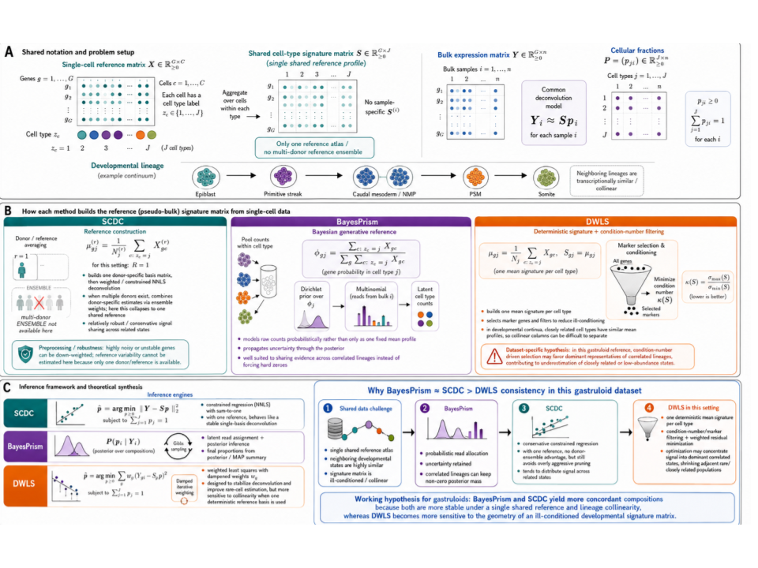

```{r setup, include=FALSE}
knitr::opts_chunk$set(
  collapse = TRUE,
  comment = "#>",
  message = FALSE,
  warning = FALSE,
  echo = FALSE,
  eval = FALSE
)
```



::: callout-note
## Scope

This chapter states which genes should enter a DeCovarT reference built
from single-cell data, and why. It holds the theory: what the genes are
for, the selection strategies of the literature, three tiers of
selection, and the statistical tests behind them
[@gaspard-boulincCelltypeDeconvolutionMethods2025;
@avilacobosComputationalDeconvolutionTranscriptomics2018]. The
reference considered here is a single-cell experiment on one specimen,
so only cross-cell consistency can be assessed (@sec-fs-consistency);
cross-sample consistency and covariance-driven selection are
perspectives (@sec-perspectives). The application to a real reference
(filters as applied, settings, rank tables, code) is in the
feature-selection chapter of the reproducibility book. Strategies
compared on simulated references are in
[Appendix S6](S6-feature-screening-scenario.html). Marker-based
abundance scores (enrichment modules) are out of scope
[@aranXCellDigitallyPortraying2017].
:::

**Local symbols.** $C=\sum_jC_j$ is the number of reference cells in
one time slot; $j(c)$ is the label of cell $c$.
$\delta_{gj}=C_j^{-1}\sum_{c:j(c)=j}\mathbb{1}(x_{gc}>0)$ is the
detection rate of gene $g$ in type $j$, and $v_{gj}$ is the $g$-th
diagonal entry of $\boldsymbol{V}_j$. In a negative-binomial (NB) model
$\psi_g$ is the dispersion, so that
$\operatorname{Var}(x_{gc})=m_{gc}+m_{gc}^2/\psi_g$ with
$m_{gc}=\operatorname{E}(x_{gc})$; $\mathcal{D}_g(M)$ is the deviance of
model $M$ for gene $g$; $r_{gc}$ is a Pearson residual. A gene panel is
written $\mathcal{G}\subseteq\{1,\ldots,G\}$.

```{.tikz}
%%| label: fig-fs-tiers
%%| fig-cap: "Three tiers of gene selection for a DeCovarT reference from one specimen. Tiers (i) and (ii) remove genes; tier (iii) keeps the remaining genes and lets the fitted covariance down-weight them. Dashed boxes are perspectives: cross-sample consistency needs several specimens or a matched bulk, and covariance-driven selection needs the estimated within-type covariances."
%%| filename: fig-fs-tiers
%%| alt: Flowchart. UMI counts and labels feed tier one, quality control and a presence gate in every cell type, then tier two, cross-cell consistency by an omnibus test used as a gate followed by an effect-size rank, then tier three, a generalised least-squares fit in which the within-type covariance down-weights genes. Two dashed boxes below tier two are perspectives: cross-sample and cross-platform consistency, which needs donors or a matched bulk, and covariance-driven post hoc selection by Fisher information and Pareto search, which feeds tier three.
\begin{tikzpicture}[every node/.append style={text width=2.8cm}]
\node[keybox] (A) at (0,0) {UMI counts $x_{gc}$ and labels $j(c)$};
\node[box] (B) at (3.5,0) {(i) cell and gene QC, presence gate in every type};
\node[box] (D) at (7.0,0) {(ii) cross-cell consistency: omnibus gate, effect-size rank};
\node[keybox] (H) at (10.5,0) {(iii) GLS fit: $\widehat{\boldsymbol{\Sigma}}_{W,j}$ down-weights genes};
\node[dimbox, densely dashed] (F) at (5.25,-2.5) {cross-sample and cross-platform consistency (donors, matched bulk)};
\node[dimbox, densely dashed] (E) at (8.75,-2.5) {covariance-driven, post hoc: Fisher information, Pareto};
\draw[edge] (A) -- (B);
\draw[edge] (B) -- (D);
\draw[edge] (D) -- (H);
\draw[dashededge] (D) -- (F);
\draw[dashededge] (D) -- (E);
\draw[dashededge] (E) -- (H);
\end{tikzpicture}
```

::: {#wrn-fs-estimand .callout-warning}
## What the genes are for

The target is a set of genes that makes the reference moments
$(\boldsymbol{\mu}_{\cdot j},\boldsymbol{\Sigma}_{W,j})$ estimable and
informative about $\boldsymbol{p}$. This is not population-level
differential expression, for two reasons.

- **One specimen.** The reference is one technical scRNA-seq
  experiment. Its cells are draws from one specimen, not biological
  replicates, so every $p$-value below calibrates a *screen inside that
  specimen*. Treating cells as replicates of a population contrast
  inflates the false discoveries
  [@zimmermanPracticalSolutionPseudoreplication2021;
  @squairConfrontingFalseDiscoveries2021;
  @crowellMuscatDetectsSubpopulationspecific2020]. Only the within-donor
  covariance $\boldsymbol{\Sigma}_{W,j}$ is estimable; the between-donor
  part needs $R\ge2$ donors
  ([2.1](02-1-single-cell-generative-optimisation.html#sec-one-replicate)).
- **Labels are given.** A test of the type effect is valid only if the
  labels were fixed before the statistic is computed. Labels obtained by
  clustering the same matrix make the test anti-conservative
  (post-clustering inference, González-Delgado et al. 2025)
  <!-- TODO-cite: González-Delgado et al. 2025, post-clustering inference; key gonzalezDelgadoPostclusteringInference2025 exists in the book bib only -->.

Selection proceeds in three tiers (@fig-fs-tiers): (i) quality control
and a presence gate; (ii) cross-cell consistency, an omnibus test used
as a gate and an effect-size rank; (iii) down-weighting by the model
instead of removal. Tiers (i) and (ii) are filters; tier (iii) is part
of the likelihood. Feature selection as a pre-modelling filter has the
usual caveats [@guyonIntroductionVariableFeature2003]: it is a proposal,
to be checked by out-of-sample deconvolution error
([S6](S6-feature-screening-scenario.html#sec-cv-selection)).
:::

# Gene-selection strategies in the literature {#sec-fs-review}

Deconvolution methods choose genes in three ways: univariate
one-versus-others screens, searches over the whole signature, or no
selection at all, with gene weights doing the work. This section reviews
them, states where they depart from the count model used here, and
compares second-generation methods in @tbl-fs-review. Each method's
likelihood is reviewed in
[5.1](05-1-review-distribution-aware.html#sec-methods).

## Univariate screens, one versus others {#sec-fs-univariate}

Classical signature pipelines score gene $g$ for type $j$ against the
remaining types, then concatenate the per-type shortlists
[@abbasDeconvolutionBloodMicroarray2009;
@newmanRobustEnumerationCell2015; @finotello_etal19].

- **Differential expression and fold-change ranks.** `limma`–voom,
  `edgeR` and `DESeq2` are the usual tools for one-versus-rest contrasts
  [@ritchieLimmaPowersDifferential2015a;
  @robinsonEdgeRBioconductorPackage2010;
  @loveModeratedEstimationFold2014a]. CIBERSORT keeps genes with adjusted
  $p\le0.3$, orders them by fold change and prunes the panel by its
  condition number [@newmanRobustEnumerationCell2015]; Abbas et al. keep
  genes whose expression in the target type exceeds that of the second-
  and third-ranked types, then choose the panel with the smallest
  condition number [@abbasDeconvolutionBloodMicroarray2009].
  <!-- Recovered from vignettes/supp-S6-feature-selection.qmd (commit 123b937, identical in d28b91d to b0a4f2b); CIBERSORT and Abbas facts not re-checked against a local PDF. -->
  On cells of one specimen these tests treat cells as replicates
  (@wrn-fs-estimand); their pseudo-bulk versions need donors
  (@sec-fs-cross-sample).
- **ANOVA $F$ test.** Wang et al. rank genes by the $F$ statistic of a
  type factor against an intercept-only model
  [@wangSilicoEstimatesTissue2010]. Its count-model version, with its
  calibration, is the omnibus test of tier (ii) (@sec-fs-omnibus).

### Specificity scores {#sec-gini-entropy}

Long one-versus-rest lists are often compacted with the entropy or the
Gini coefficient of the type shares
$u_{gj}=\mu_{gj}/\sum_{\ell}\mu_{g\ell}$, as in `BioQC`
[@zhang_etal17]:

$$
H_g=-\sum_{j=1}^{J}u_{gj}\log u_{gj},
\qquad
\mathrm{Gini}_g
=
\frac{1}{2J}\sum_{j=1}^{J}\sum_{\ell=1}^{J}\lvert u_{gj}-u_{g\ell}\rvert
=
\frac1J\sum_{k=1}^{J}(2k-J-1)\,u_{g(k)},
$$ {#eq-gini}

with $0\log0=0$ and $u_{g(1)}\le\cdots\le u_{g(J)}$. $H_g/\log J$ and
$J\,\mathrm{Gini}_g/(J-1)$ lie in $[0,1]$; low entropy and high Gini mean
that few types carry the mass. Both scores reward exclusive expression,
which the presence gate (@sec-fs-presence) excludes, and neither sees
redundancy between genes.

![Derivation of the Gini coefficient: pairwise absolute differences, scale-free normalisation by the mean, sorted-data formula, finite-sample correction to $[0,1]$.](figures/gini_coefficient_derivation.png){#fig-gini-derivation}

Concatenation does not control that redundancy. Two specific markers of
different types can still be nearly collinear rows of
$\boldsymbol{\mu}$ when the types share a programme (a lineage, an
activation axis), so the union of per-type lists inflates
$|\mathcal{G}|$ while $\kappa_2(\boldsymbol{\mu}_{\mathcal{G}})$ stays
large and NNLS or GLS fits stay unstable
[@newmanRobustEnumerationCell2015;
@avilacobosComputationalDeconvolutionTranscriptomics2018]. A criterion
on the whole signature is then needed.

## Searches over the whole signature {#sec-fs-all-vs-all}

- **Condition number.** CIBERSORT and DWLS keep the candidate signature
  with the smallest $\kappa_2(\boldsymbol{\mu}_{\mathcal{G}})$
  [@newmanRobustEnumerationCell2015;
  @tsoucasAccurateEstimationCelltype2019, p. 7;
  @gongDeconRNASeqStatisticalFramework2013]; its limits are in
  @sec-kappa-limits.
- **Multi-objective genetic search.** `AutoGeneS` searches gene subsets
  with a genetic algorithm that minimises the correlation between type
  centroids and maximises their distance
  [@alieeAutoGeneSAutomaticGene2021]; MOGAMUN applies the same kind of
  search to network modules
  [@novoa-del-toroMultiobjectiveGeneticAlgorithm2021]. The loss is
  defined on the full $J$-column signature, not on one-versus-rest
  lists.

Both criteria see the means only. Criteria that also use the
within-type covariance need $\widehat{\boldsymbol{\Sigma}}_{W,j}$, so
they come after the omnibus gate (@sec-fs-multivariate).

## Critiques of current marker rules {#sec-fs-critiques}

The reviewed marker rules (@tbl-fs-review) depart from the count model
of tier (ii) in five ways.

- **Hurdle models on droplet counts.** DWLS defines markers with the
  `MAST` hurdle model [@tsoucasAccurateEstimationCelltype2019, p. 7].
  Droplet UMI counts show no zero inflation beyond what the NB predicts
  (Svensson 2020)
  <!-- TODO-cite: Svensson 2020, Droplet scRNA-seq is not zero-inflated, Nat. Biotechnol., doi:10.1038/s41587-019-0379-5 -->,
  and current data do not support zero-inflated *measurement* models
  [@sarkarSeparatingMeasurementExpression2021, p. 5]. The hurdle splits
  one count into a detection and a magnitude test (Finak et al. 2015)
  <!-- TODO-cite: Finak et al. 2015, MAST, Genome Biol., doi:10.1186/s13059-015-0844-5 -->
  where one NB test of @eq-fs-nb-main suffices.
- **Gaussian $t$-tests on counts.** ReDeconv uses a two-sample $t$-test
  between cells [@luTranscriptomeSizeMatters2025, p. 14]; deMixSC uses a
  paired $t$-test of bulk against matched pseudo-bulk
  [@guoDeMixSCDeconvolutionFramework2023, p. 12].
- **Cells as independent replicates.** Every test above that runs on
  cells (DWLS, ReDeconv, BayesPrism's marker option) treats them as
  replicates of a population contrast (@wrn-fs-estimand). Pseudo-bulk
  `DESeq2`, `edgeR` or `limma`–voom avoid this only with biological
  replicates at the level of the contrast (@sec-fs-cross-sample).
- **No multiplicity control.** ReDeconv keeps genes with $p<0.05$ in each
  comparison against every other type, with no FDR correction
  [@luTranscriptomeSizeMatters2025, p. 14].
- **Graph-based screens before the graph is estimated.**
  Differential-network screens (`INDEED`, D-trace) and Markov-boundary
  growth of marker seeds need fitted graphs; here they are post hoc
  (@sec-markov-seeds).

## Comparison of second-generation methods {#sec-fs-review-table}

@tbl-fs-review summarises, method by method, the facts found in the
papers, in the order of the tiers. Page numbers refer to the PDF pages
of the local extractions ("supp." marks a supplement). A dash means
that the item was not found in the extracted text; it does not mean
that the method has no such step. The same table, with the same facts,
is Appendix C of the CardamomOT comparison note.

| Method | Cell QC (tier i) | Gene filter (tier i) | Marker rule (tier ii) | Weighting (tier iii) | Cross-platform (perspective) |
|---|---|---|---|---|---|
| RNA-Sieve [@erdmann-phamLikelihoodbasedDeconvolutionBulk2021] | optional: library size or pairwise distance ≥ 3 MAD from the type median (supp. p. 3) | non-zero in ≥ 20 % of the cells of ≥ 1 type (supp. p. 3) | none | Gaussian composite likelihood from the CLT (Eq. 10, p. 10) | range bound and MAD outliers on four statistics (Eqs 12–13, p. 11) |
| DECALS [@caiStatisticalInferenceCelltype2024] | — | CIBERSORTx S-mode candidate genes (p. 13) | ∩ markers of @mathysSinglecellTranscriptomicAnalysis2019 (Fisher's exact test, FDR): 159 genes (p. 13; supp. pp. 18–19) | constrained OLS; GLS biased in practice (pp. 6, 9) | S-mode batch correction (p. 13) |
| MEAD [@xieStatisticalInferenceCell2026] | — | — | none; removing genes gains nothing unless noise differs (p. 17) | WLS from the reference variance (pp. 17–18); sandwich (p. 13) | gene-wise ratios with mean 1 (pp. 5, 8) |
| ReDeconv [@luTranscriptomeSizeMatters2025] | — | — | $t$-test $p<0.05$ against every other type, no FDR; fold change ≥ 2; smallest SD/mean, about 100 per type (p. 14) | Gaussian, composition-dependent variance (Eq. 5, p. 14) | length normalisation of the bulk only (p. 2) |
| MuSiC [@wangBulkTissueCell2019] | — | all shared genes (p. 7) | none; small within-cluster variance in the tree-guided stage (pp. 3, 8) | W-NNLS, weights from cross-subject variance (Eq. 10, p. 7) | optional gene- and subject-specific intercept (p. 7) |
| deMixSC [@guoDeMixSCDeconvolutionFramework2023] | < 500 UMI, < 200 genes, > 50 % mitochondrial (p. 11) | detected in < 5 % of cells removed (p. 11) | none | W-NNLS, iterated weights (p. 12) | paired $t$-test bulk vs pseudo-bulk, BH; 5,000 genes down-weighted by $a=1000$ (p. 12) |
| BayesPrism [@chuCellTypeGeneExpression2022] | types with < 20 cells excluded in one benchmark (supp. p. 15) | ribosomal, mitochondrial, X and Y genes (supp. pp. 14, 19) | optional scran markers, $t$-tests, up-regulated only (supp. pp. 14–15) | Bayesian multinomial (supp. pp. 3–6) | bulk-specific profiles; log-normal fold-change prior (supp. pp. 5–6) |
| DWLS [@tsoucasAccurateEstimationCelltype2019] | — | — | `MAST` hurdle, FDR < 0.01, $\log_2$FC > 0.5; 50–200 per type; smallest $\kappa$ (p. 7) | dampened WLS (pp. 2, 7) | none |
| SCDC [@dongSCDCBulkGene2021] | cells with a questionable type or low quality removed (p. 9) | genes with zero counts in every sample (p. 9) | none | W-NNLS, maximal-variance weights clipped at the 15th/85th percentiles (p. 10) | ENSEMBLE over references (p. 3) |
| RCTD [@cableRobustDecompositionCell2022a] | spots ≥ 100 UMI (p. 9) | mean above 0.0625 counts per 500 (p. 7) | log-fold change ≥ 0.5 against the other types, no test (p. 7) | Poisson–lognormal GLMM (p. 6) | gene-wise platform random effect (pp. 3, 6) |
| CardamomOT 2.0.0 (Maugé & Ventre 2026) | paper: —; code: per-cell depth factor, no cell removed | paper: gene sets of earlier studies (p. 32); code: no mitochondrial, ribosomal or non-coding genes | code: $W_1$ and entropy terminals, round robin of per-type Wilcoxon tests, NB separability, Steiner closure | NB-mixture likelihood, $\ell_1$ towards a prior network (Eq. 10, p. 9) | not applicable (no bulk) |
| DeCovarT (this chapter) | authors' QC; MAD rules optional | presence gate in every type (@eq-fs-presence) | omnibus NB / QL $F$ test as an FDR gate, effect-size rank | GLS with $\widehat{\boldsymbol{\Sigma}}_{W,j}$ | none: one reference specimen (@sec-fs-cross-platform) |

: Gene selection in second-generation deconvolution methods, by tier. CardamomOT is a network-inference method, included for its gene selection; its code facts are from release 2.0.0 (<https://github.com/eliasventre/CardamomOT>). {#tbl-fs-review}

<!-- TODO-cite: Maugé & Ventre 2026, CardamomOT, PLoS Comput. Biol. 22(10):e1014838, doi:10.1371/journal.pcbi.1014838 -->

DeCovarT builds on these methods in three ways.

- **Covariance in the criterion.** Only DeCovarT puts gene–gene
  covariance into the criterion that estimates $\boldsymbol{p}$; DECALS
  and MEAD use it only for the variance of their estimators. The other
  methods treat genes as independent, the setting in which a univariate
  screen is also the objective (@sec-fs-screen-objective). DeCovarT
  keeps the univariate screen as a gate (tier ii) and leaves the
  weighting to the covariance (tier iii).
- **One count test per gene.** The tests that select genes run on cells,
  mostly with Gaussian or hurdle models, and only DWLS (markers) and
  deMixSC (platform discrepancy) report a multiplicity correction.
  DeCovarT uses one NB omnibus test per gene, a Benjamini–Hochberg gate
  and a permutation calibration (@sec-fs-omnibus).
- **No perfect markers.** MuSiC and MEAD argue against marker
  pre-selection when the genes are weighted, and MEAD shows that perfect
  markers break identifiability under gene-wise platform ratios
  (@sec-fs-cross-platform); DWLS and DECALS still build marker-only
  signatures. DeCovarT removes perfect markers with the presence gate
  and weights the remaining genes.

# Tier (i): quality control {#sec-fs-qc}

QC removes cells and genes that lie outside the support of any
expression model. The thresholds below are examples from the reviewed
methods (@tbl-fs-review), not defaults of DeCovarT.

- **Cells.** Library size more than 3 median absolute deviations (MAD)
  from the median of its type, and cells more than 3 MAD from the median
  pairwise distance within their type (RNA-Sieve, optional;
  @erdmann-phamLikelihoodbasedDeconvolutionBulk2021, supplement p. 3).
  Fewer than 500 UMIs, fewer than 200 detected genes, or more than 50 %
  mitochondrial UMIs (deMixSC; @guoDeMixSCDeconvolutionFramework2023,
  p. 11).
- **Genes.** Ribosomal, mitochondrial and sex-chromosome genes, which
  reflect cell survival and donor sex rather than type
  (BayesPrism; @chuCellTypeGeneExpression2022, supplement pp. 14, 19).
  Genes detected in fewer than 20 % of the cells of every type
  (RNA-Sieve, supplement p. 3).

## Presence gate in every type {#sec-fs-presence}

::: callout-note
## Necessary, not sufficient

A gene enters tier (ii) only if

$$
\min_{j}\delta_{gj}\ge\delta_{\min}
\quad\text{and}\quad
\min_{j}v_{gj}>0,
$$ {#eq-fs-presence}

with $\delta_{\min}$ a few per cent (for example $0.05$), fixed before
the ranks are seen. [These are necessary conditions for a non-singular
within-type covariance and for an identifiable $\boldsymbol{p}$; they
are not sufficient.]{.mark} Two cases show what the gate excludes.

<!-- chk: V17a, V17b -->
- **Zero in every cell of type $j$.** Then $v_{gj}=0$ and the whole row
  and column $g$ of $\boldsymbol{V}_j$ are zero: $\boldsymbol{V}_j$ is
  singular ($\det\boldsymbol{V}_j=0$), the correlation
  $v_{gh}/\sqrt{v_{gg}v_{hh}}$ is $0/0$ and so undefined, and the fitted
  type-$j$ Gaussian is degenerate, a point mass in coordinate $g$. Its
  likelihood is unbounded, so no maximum-likelihood estimate exists.
- **Detected in a single cell $c$.** With count $a$ in that cell, the
  centred counts of $g$ are $a(\boldsymbol{e}_c-\mathbf{1}/C_j)$, and
  its correlation with any gene $h$ is
  $r_{gh}=\tilde h_c/(\sqrt{1-1/C_j}\,\lVert\tilde{\boldsymbol h}\rVert)$,
  $\tilde{\boldsymbol h}$ the centred counts of $h$: one cell sets it.
  Two genes detected only in cell $c$ have $r=1$ whatever their counts,
  a perfect and degenerate correlation, and $\boldsymbol{V}_j$ is again
  singular.

<!-- chk: V17c, V10a, V10c -->
With $\delta_{\min}C_j\ge2$ the gate keeps only genes with at least two
non-zero cells in every type, which excludes both cases. It does not
make $\boldsymbol{V}_j$ invertible: $\operatorname{rank}\boldsymbol{V}_j\le
\min(C_j-1,G)$, so $\boldsymbol{V}_j$ is singular whenever $G\ge C_j$ or
genes satisfy an exact linear relation, and shrinkage is still needed
([3.2](03-2-covariance-network-estimation.html)). Nor does it make
$\boldsymbol{p}$ identifiable, which requires a non-singular Fisher
information for $\boldsymbol{p}$
([1.2](01-2-population-inference.html#sec-identifiability)). The gate
also removes perfect markers, whose effect under gene-wise platform
ratios is in @sec-fs-cross-platform.
:::

# Tier (ii): cross-cell consistency {#sec-fs-consistency}

MuSiC introduced "marker gene consistency" with two parts
[@wangBulkTissueCell2019, p. 2].
[Cross-cell consistency asks whether a gene is stable across the cells
of one type]{.mark}, so that biased cell capture does not drive its
selection; cross-cell consistent genes have a low within-cluster
variance [@wangBulkTissueCell2019, p. 3].
[Cross-sample consistency asks whether a gene's type mean is stable
across specimens]{.mark} (MuSiC's cross-subject consistency), and needs
at least two of them. With a reference from one specimen only cross-cell
consistency can be assessed; cross-sample consistency is a perspective
(@sec-fs-cross-sample). The natural statistic for cross-cell
consistency is the split of a gene's variation into between-type and
within-type parts.

## Pearson residuals and the between/within split {#sec-sctransform}

The technical null fits each gene with library size as the only
covariate,

$$
M_{0}:\;
\log m_{gc}=\beta_{0g}+\log s_{c},
\qquad
x_{gc}\sim\mathrm{NB}(m_{gc},\psi_{g}),
$$ {#eq-fs-nb-null}

which is the model of `SCTransform` with `vst.flavor = "v2"`, where the
depth slope is fixed and library size is an offset
[@hafemeisterNormalizationVarianceStabilization2019;
@lauseAnalyticPearsonResiduals2021]. Cell type is deliberately absent:
putting $j$ in the null would remove the signal to be ranked. The
Pearson residuals
$r_{gc}=(x_{gc}-\hat m_{gc})/\sqrt{\hat m_{gc}+\hat m_{gc}^{2}/\hat\psi_{g}}$
split as

$$
\mathrm{SS}_{\mathrm{B},g}
=
\sum_{j=1}^{J}C_{j}\bigl(\bar r_{gj}-\bar r_{g}\bigr)^{2},
\qquad
\mathrm{SS}_{\mathrm{W},g}
=
\sum_{j=1}^{J}\sum_{c:j(c)=j}\bigl(r_{gc}-\bar r_{gj}\bigr)^{2},
$$ {#eq-fs-ss}

with $\bar r_{gj}$ the mean residual in type $j$ and $\bar r_{g}$ the
overall mean ($\approx0$). A lineage marker has a large between-type and
a small within-type part; a stress-response gene can have a large total
residual variance and still a small between-type part. @fig-sc-transform
shows the four steps on simulated counts.

![`SCTransform` (v2) workflow on simulated counts (2,000 genes, 2,000 cells of two types, seed 20261101). (a) Gene variance against gene mean: NB variance with the smoothed dispersion (solid) and the Poisson line (dashed). (b) Counts of one marker gene against the size factor, with the fitted mean of $M_0$ (library size as offset, no cell type). (c) Per-gene dispersion estimates against the gene mean, and their smooth across genes, the empirical-Bayes regularisation. (d) Pearson residuals of the same gene: no trend with depth, the type difference kept. Code: `scripts/figures/fig_03_1_sctransform.R`.](figures/fig_03_1_sctransform.svg){#fig-sc-transform fig-alt="Four scatter panels joined by arrows and labelled with formulas. Panel a: gene variance against gene mean on log scales, points above the Poisson line and close to the negative-binomial curve. Panel b: counts of one gene against the size factor for two cell types, with the fitted mean rising in proportion to the size factor. Panel c: per-gene dispersion estimates against the mean, scattered around an increasing smooth curve. Panel d: Pearson residuals of the same gene against the size factor, centred on zero with no depth trend, the two cell types at different levels."}

The sums in @eq-fs-ss weight every cell equally, so the most abundant
type dominates them. The equal-type version gives each type weight
$1/J$:

$$
\mathrm{MS}^{\mathrm{eq}}_{\mathrm{B},g}
=
\frac1J\sum_{j=1}^{J}\Bigl(\bar r_{gj}-\frac1J\sum_{\ell=1}^{J}\bar r_{g\ell}\Bigr)^{2},
\qquad
\mathrm{MS}^{\mathrm{eq}}_{\mathrm{W},g}
=
\frac1J\sum_{j=1}^{J}\operatorname{var}_{c:j(c)=j}(r_{gc}).
$$ {#eq-fs-equal-type}

## Omnibus test: deviance and quasi-likelihood $F$ {#sec-fs-omnibus}

Add the type main effect to @eq-fs-nb-null:

$$
M_{1}:\;
\log m_{gc}=\beta_{0g}+\beta_{g,j(c)}+\log s_{c},
\qquad
\beta_{g1}=0,
\qquad
H_{0g}:\beta_{g2}=\cdots=\beta_{gJ}=0 .
$$ {#eq-fs-nb-main}

The joint null has $J-1$ degrees of freedom
[@agrestiFoundationsLinearGeneralized2015]. One omnibus test per gene
replaces $\binom{J}{2}$ pairwise or $J$ one-versus-rest tests, and a
single Benjamini–Hochberg correction across genes follows.

- **Likelihood ratio (analysis of deviance).**
  $\Lambda_g=\mathcal{D}_g(M_0)-\mathcal{D}_g(M_1)$, referred to
  $\chi^2_{J-1}$ when $\psi_g$ is known. It needs one $M_1$ fit per gene,
  a one-way GLM with $J$ coefficients.
- **Wald.** It needs $M_1$ only and fails near the boundary: with an
  all-zero type the NB estimate $\hat\beta_{gj}\to-\infty$, its standard
  error grows faster, and the statistic shrinks as the effect grows
  (Hauck–Donner effect) [@yeeHauckDonnerEffectWald2022]. The presence
  gate removes that case.

The score (Rao) test needs only the $M_0$ fit that `SCTransform` already
computes. Up to the variation of the IRLS weights within a type, its
statistic for the type effect is the between-type sum of squares of the
Pearson residuals,

$$
T_g\approx\sum_{j=1}^{J}C_j\,\bar r_{gj}^{2}\approx\mathrm{SS}_{\mathrm{B},g},
$$ {#eq-fs-score}

exactly Pearson's $\chi^2$ on the type totals under a Poisson null. This
identity is what makes the ratio below a test computed from
`SCTransform` output without refitting. As a separate test the score
adds nothing here: the boundary case, where it and the likelihood ratio
stay finite while the Wald test fails, is removed by the presence gate,
and the $M_1$ fit it saves is a small one-way GLM.

**Quasi-likelihood $F$.** Dividing $T_g/(J-1)$ by the within-type
Pearson dispersion $\hat\phi_g=\mathrm{SS}_{\mathrm{W},g}/(C-J)$ gives

$$
F_{g}
=
\frac{\mathrm{SS}_{\mathrm{B},g}/(J-1)}{\mathrm{SS}_{\mathrm{W},g}/(C-J)},
$$ {#eq-fs-qlf}

the one-way ANOVA ratio [@wangSilicoEstimatesTissue2010]. In GLM terms
it is a quasi-likelihood $F$ test: the mean model @eq-fs-nb-main and the
variance function $V(m)=m+m^2/\psi_g$ are kept, and a scalar $\phi_g$
absorbs a variance larger or smaller than $V$ predicts. The reference
$F_{J-1,C-J}$ accounts for estimating $\phi_g$, as in the edgeR
quasi-likelihood pipeline and in `glmGamPoi::test_de()`, which use the
deviance in the numerator [@lundDetectingDifferentialExpression2012;
@glmGamPoi2020]. Three consequences follow.

- **Keep overdispersed genes.** Within-type overdispersion is the
  within-type scatter that the denominator already penalises, and the
  covariance that DeCovarT models. Removing such genes before the test
  removes that signal.
- **A scalar $\phi_g$ cannot absorb a wrong variance function.** Under a
  Poisson null it cannot absorb the quadratic NB term, whose share grows
  with the type mean; the pooled $\hat\phi_g$ is then wrong for every
  type. Use the NB variance, so that $\phi_g\approx1$ in every type; if
  between-type heteroscedasticity remains, use a Welch-type statistic or
  the equal-type mean squares of @eq-fs-equal-type.
- **Gate, then rank by effect size.** $J$ and $C$ are shared by all
  genes of a slot, so $F_g$ is a monotone function of
  $\mathrm{SS}_{\mathrm{B},g}/\mathrm{SS}_{\mathrm{W},g}$; the analytic
  $F$ adds a threshold, not a new ranking. Genes that pass the FDR gate
  are ranked by that ratio, or by its equal-type version, not by
  $p$-value.

When the NB variance function itself fails, quasi-likelihood with an
empirical variance function is the fallback
[@agrestiFoundationsLinearGeneralized2015]. When the *shape* differs
between types (types that share a mean but differ in dispersion), a
location–scale model with type-specific $\psi_{gj}$ tests both, on
$2(J-1)$ degrees of freedom; this is the GAMLSS margin used by scDesign3
[@songScDesign3GeneratesRealistic2024], Stasinopoulos & Rigby (2007)
<!-- TODO-cite: Stasinopoulos & Rigby 2007, GAMLSS in R, J. Stat. Softw. 23(7), doi:10.18637/jss.v023.i07 -->.

### Calibration: permutation, Freedman–Lane, bootstrap {#sec-fs-calibration}

The nominal $F_{J-1,C-J}$ tail is optimistic on `SCTransform` output for
three reasons: residuals are clipped at $\pm\sqrt{C/30}$, $\psi_g$ is
regularised across genes and so is misspecified for any one gene, and
residuals at low means are discrete and skewed
[@hafemeisterNormalizationVarianceStabilization2019;
@lauseAnalyticPearsonResiduals2021]. A permutation null keeps $F_g$ and
replaces its reference distribution.

- **Permute labels, not genes.** One permutation of the cell labels is
  applied to all genes at once. Each gene keeps its marginal
  distribution and its dependence on the other genes; only the link with
  the label is broken. Shuffling genes, or shuffling within cells, does
  not produce that null.
- **Nuisance covariates.** With covariates (batch, cell line, cell
  cycle), a global label shuffle creates impossible combinations. The
  Freedman–Lane scheme fits the reduced model without type, permutes its
  residuals with one row permutation shared by all genes, adds them back
  to the reduced fit, refits the full model and recomputes $F_g$
  [@freedmanNonstochasticInterpretation1983].

## Leverage is not influence {#sec-fs-leverage}

Residual size, leverage and influence are three different quantities
[@agrestiFoundationsLinearGeneralized2015]. In a gene-wise GLM, leverage
belongs to the *observations* (cells, or pseudo-bulk samples), not to
the gene. For the one-way design of @eq-fs-nb-main the hat value of cell
$c$ is $h_{gc}=w_{gc}/\sum_{c':j(c')=j(c)}w_{gc'}$, with IRLS weight
$w_{gc}=\hat m_{gc}^2/V(\hat m_{gc})$: every cell of a rare type, and
every cell with a large fitted mean, has high leverage. Influence
combines the two; Cook's distance is

$$
\mathrm{Cook}_{gc}
=
\frac{r_{gc}^{2}\,h_{gc}}{J\,\hat\phi_g\,(1-h_{gc})^{2}} .
$$

A high-expression marker in a small type sits at an extreme fitted mean
and has high leverage, yet it agrees with the type effect: it is
informative, not an outlier. Rules that clip by size alone, such as
residual clipping or SCDC's clipping of variance weights at the 15th and
85th percentiles [@dongSCDCBulkGene2021, p. 10], shrink these
observations with the harmful ones. An observation is a candidate
outlier only when both its leverage and its standardised residual are
large.

# Tier (iii): down-weighting by the model {#sec-fs-weighting}

Filters remove genes; a weighted likelihood keeps them and lets their
variance decide their influence. The reviewed methods sit on a ladder of
noise models (@tbl-fs-ladder; full ladder in
[5.1](05-1-review-distribution-aware.html)).

| Rung | Variance of the bulk residual | Methods (anchors) |
|---|---|---|
| Weighted least squares | diagonal, gene-wise weights | MuSiC: bulk noise plus cross-subject variance, Eq. 10, p. 7; DWLS: fitted values, capped by a dampening constant, pp. 2, 7; SCDC: maximal-variance weights, clipped, pp. 5, 10; deMixSC: $\hat y^2$ plus squared residual plus a constant, p. 12; MEAD: reference variance with empirical-Bayes shrinkage, pp. 17–18 |
| Generalised least squares | full gene–gene covariance, depends on $\boldsymbol{p}$ | DeCovarT: $\sum_jp_j^2\boldsymbol{\Sigma}_j$ (population) or $\sum_jp_j\boldsymbol{\Sigma}_{W,j}$ (single cell); DECALS: $\sum_k\pi_{ik}^2\boldsymbol{\Sigma}_k$ for inference, pp. 7, 9 |
| Feasible GLS | covariance estimated, then iterated with $\hat{\boldsymbol{p}}$ | DECALS Algorithm 1, p. 9; DeCovarT plug-in $\widehat{\boldsymbol{\Sigma}}_{W,j}$ |
| Sandwich / GEE | working covariance, robust variance | MEAD: sandwich over a dependence set, pp. 13, 18 |

: Down-weighting classes in the reviewed methods. Page anchors refer to the PDFs extracted for this review. {#tbl-fs-ladder}

Two observations follow.

- DECALS computes its point estimate by constrained *ordinary* least
  squares and uses the covariance only for inference, because a GLS fit
  with an estimated covariance per sample was biased in their
  experiments [@caiStatisticalInferenceCelltype2024, p. 6]. The same risk
  applies to any feasible GLS whose covariance is estimated on few cells;
  shrinkage of $\widehat{\boldsymbol{\Sigma}}_{W,j}$ addresses it
  ([3.2](03-2-covariance-network-estimation.html)).
- MEAD notes that removing genes brings no efficiency gain unless their
  noise levels differ [@xieStatisticalInferenceCell2026, p. 17]. Once the
  covariance is in the model, hard filtering is needed only for genes
  outside the model's support: the presence gate (@sec-fs-presence)
  and, when a matched bulk exists, cross-platform outliers
  (@sec-fs-cross-platform).

# Selection effect on the covariance {#sec-fs-selection-effect}

Selecting genes changes the covariance that is then estimated on them.

- **Small within-type variance by construction.** A ratio such as
  @eq-fs-qlf rewards a small within-type part. ReDeconv goes further and
  keeps the genes with the smallest coefficient of variation
  [@luTranscriptomeSizeMatters2025, p. 14]; MuSiC's tree-guided stage
  keeps genes with small intra-cluster variance
  [@wangBulkTissueCell2019, p. 8]. A panel chosen this way removes much
  of the within-type covariance that DeCovarT models, and the estimated
  $\boldsymbol{\Sigma}_{W,j}$ on that panel is close to diagonal for that
  reason, not because genes are conditionally independent
  ([3.2](03-2-covariance-network-estimation.html)).
- **Weak marginal effects hide interactions.** Genes with weak marginal
  effects are dropped by every univariate screen, and gene pairs whose
  signal lies in their covariance, not in their means, are then never
  examined. Covariance-aware criteria (@sec-optimal-design,
  @sec-pareto-panel) can recover them only from a shortlist that still
  contains them.

A practical check is to compare the distribution of $v_{gj}$, and of the
off-diagonal entries of $\boldsymbol{V}_j$, between the selected panel
and the genes that pass the presence gate.

# Perspectives {#sec-perspectives}

## Cross-sample consistency {#sec-fs-cross-sample}

Cross-sample consistency compares a gene across specimens: subjects or
donors of the reference, or the reference and the bulk. It needs at
least two specimens, or a reference and a matched bulk, so a
one-specimen reference cannot assess it.

- **Cross-subject variance (MuSiC).** MuSiC's cross-subject consistency
  guards against the choice of subjects [@wangBulkTissueCell2019, p. 2].
  Its weights down-weight genes with a large cross-subject variance
  (Eq. 10, p. 7), and an optional gene- and subject-specific intercept
  absorbs subject effects (p. 7). With $R\ge2$ donors this variance is
  the between-donor covariance $\boldsymbol{\Sigma}_{B,j}$ of
  [2.1](02-1-single-cell-generative-optimisation.html#sec-one-replicate).
- **Pseudo-bulk differential expression.** `DESeq2`, `edgeR` or
  `limma`–voom on donor-level pseudo-bulks test a population contrast
  with donors as replicates [@loveModeratedEstimationFold2014a;
  @crowellMuscatDetectsSubpopulationspecific2020]. Appendix S6 uses them
  only for multi-donor references
  ([S6](S6-feature-screening-scenario.html#sec-four-scores)).

### Cross-platform consistency {#sec-fs-cross-platform}

A gene can be a perfect cross-cell marker and still be measured
differently by the reference and the bulk protocol. Cross-platform
consistency is cross-sample consistency between the reference and the
bulk, and needs a bulk that matches the reference. The reviewed methods
handle it in four ways.

- **Range bound (RNA-Sieve).** Per cell, the bulk is a convex
  combination of the type means, so on a common scale

  $$
  \min_{j}\tilde\mu_{gj}\;\le\;\tilde y_{g}\;\le\;\max_{j}\tilde\mu_{gj}
  $$ {#eq-fs-range}

  up to sampling error. RNA-Sieve removes genes whose bulk value falls
  outside this range by more than a sub-Gaussian tail allows
  (@sec-fs-range-tail), and genes that are MAD outliers on four summary
  statistics (largest type mean, largest type standard deviation,
  largest coefficient of variation, and a bulk-to-reference ratio)
  [@erdmann-phamLikelihoodbasedDeconvolutionBulk2021, p. 11, Eqs.
  12–13]. The bound holds for any weights on the simplex, so it does not
  depend on whether $\boldsymbol{p}$ or $\boldsymbol{q}$ is the target.
  A gene-wise platform ratio $\tilde b_g$ far from 1 moves the bulk
  outside the range; the filter detects that case.
- **Test against a matched benchmark (deMixSC).** A paired $t$-test of
  real bulk against pseudo-bulk of the same aliquots, with BH at 0.05;
  the discrepant genes are kept and down-weighted by a fixed factor
  $a=1000$ [@guoDeMixSCDeconvolutionFramework2023, p. 12].
- **Gene-wise platform ratios in the model.** MEAD lets the ratios vary
  by gene with mean 1 [@xieStatisticalInferenceCell2026, pp. 5, 8]; RCTD
  uses a gene-wise platform random effect, estimated once from a pooled
  pseudo-bulk and then fixed [@cableRobustDecompositionCell2022a,
  pp. 3, 6–7]; MuSiC allows a gene- and subject-specific intercept
  [@wangBulkTissueCell2019, p. 7].
- **Normalisation only.** ReDeconv applies gene-length normalisation to
  the bulk only [@luTranscriptomeSizeMatters2025, p. 2].

Gene-wise ratios have a price. MEAD shows that $\boldsymbol{P}$ is not
identifiable when all genes are perfect markers and gene-wise ratios are
allowed: rescaling the ratios of the markers of type $j$ by $\delta_j$
is absorbed by the proportions [@xieStatisticalInferenceCell2026, p. 7].
The presence gate (@sec-fs-presence) excludes these genes. Modelling a
gene-wise or module-wise scale $\tilde b_g$ inside DeCovarT is a
perspective of [5.3](05-3-extensions-roadmap.html).

#### The tail bound behind the range filter {#sec-fs-range-tail}

RNA-Sieve writes its range filter as a probability (their Eq. 12, PDF
p. 11, Genome Res. p. 1804), in their notation ($K$ types, proportions
$\boldsymbol\alpha$, $\hat b_g$ the bulk expression of gene $g$ per
cell, $\tilde m_{g,k}$ the mean of the $c_k$ reference cells of type
$k$):

$$
\mathbb{P}^{\boldsymbol\alpha,n,c}_{M,S}\Bigl[\delta\Bigl(\hat b_g,\Bigl[\min_{k\in[K]}\tilde m_{g,k},\,\max_{k\in[K]}\tilde m_{g,k}\Bigr]\Bigr)\ge t\Bigr],
\qquad
\delta(p,A)=\inf_{a\in A}\lvert p-a\rvert .
$$ {#eq-fs-rnasieve-12}

The paper states only that this probability "decays in $t$ with
sub-Gaussian tails (with constants depending on
$\{\sigma_{g,k}\}_{k\in[K]}$)", and that computing "the precise tail
bounds" requires the true $\boldsymbol\alpha$; it prints no constant.
Its likelihood rests on "the classical CLT ... as long as
$\operatorname{Var}(\nu_{g,k})<\infty$, which is true because gene
expression profiles are necessarily bounded" (PDF p. 10, Genome Res.
p. 1803). A central limit theorem gives no tail bound at finite $n$; the
sub-Gaussian claim follows from the boundedness. With the expression of
gene $g$ in $[0,B_g]$, Hoeffding's inequality and a union bound give
(our derivation, not the paper's)

$$
\mathbb{P}(\delta\ge t)
\;\le\;
2\exp\Bigl(-\frac{n\,t^2}{2B_g^2}\Bigr)
+2\sum_{k=1}^{K}\exp\Bigl(-\frac{c_k\,t^2}{2B_g^2}\Bigr),
$$ {#eq-fs-range-tail}

<!-- chk: V19a, V19b, V19c -->
because $b_g=\sum_k\alpha_km_{g,k}$ lies in $[\min_km_{g,k},\max_km_{g,k}]$,
so $\delta\ge t$ requires $\lvert\hat b_g-b_g\rvert\ge t/2$ or
$\lvert\tilde m_{g,k}-m_{g,k}\rvert\ge t/2$ for some $k$. Like the
paper's model, the bound treats the bulk as $n$ independent cells; it is
conservative.

MEAD's asymptotics are of another kind. Its central limit theorem runs
across genes ($G\to\infty$), not across cells, under local dependence:
the noise of most genes forms a dependency graph of bounded degree
(Assumption 4, PDF p. 11). The normal approximation is "Theorem 2.7 of
Chen and Shao" (Lemma S4, supplement pp. S16–S17, PDF pp. 46–47),
printed as
$\sum_z\lVert\mathbb{P}(W\le z)-\Phi(z)\rVert\le75D^{5(p-1)}\lvert V\rvert\theta^p$
for $W=\sum_{i\in V}X_i$ with $\operatorname{E}W^2=1$,
$\operatorname{E}X_i=0$, $\operatorname{E}\lvert X_i\rvert^p\le\theta^p$
and $D$ the maximal degree. As printed, the range of $p$ is not stated,
and a supremum over $z$ is presumably meant (Chen & Shao 2004)
<!-- TODO-cite: Chen & Shao 2004, Normal approximation under local dependence, Ann. Probab. 32(3A):1985-2028; no key in the bibs -->.
Assumption 5b (PDF p. 11) asks for uniformly bounded moments of order
$4+\delta$ of the bulk data, the reference data and the platform ratios.
Fourth moments are more than a central limit theorem for a mean needs:
MEAD's estimator and its sandwich variance contain products of noise
terms, and the proof bounds their covariances (PDF p. 40), which takes
fourth moments. Bounded fourth moments control the variance of the
quadratic terms, not only their mean. RNA-Sieve, by contrast, needs a
finite per-cell variance for its CLT across cells, and boundedness for
its tail.

##### Unbounded counts: sub-exponential tails and Bernstein's inequality {#sec-fs-subexp}

Hoeffding's inequality in @eq-fs-range-tail needs a bound $B_g$ on the
expression of gene $g$ in one cell. Counts under the negative binomial
(NB) model of @eq-fs-nb-null have no such bound. Write
$X\sim\mathrm{NB}(r,\pi)$ for the number of failures before the $r$-th
success,
$\mathbb{P}(X=x)=\binom{x+r-1}{x}\pi^{x}(1-\pi)^{r}$ for
$x\in\{0,1,\dots\}$, with size $r>0$ and $\pi\in(0,1)$. Its mean is
$\mu=r\pi/(1-\pi)$ and its variance $\mu+\mu^{2}/r$. In the
mean–dispersion form of @eq-fs-nb-null, $\mu=m_{gc}$, $r=\psi_g$ and
$\pi=\mu/(\mu+r)$. The moment generating function is (our derivation)

$$
M(\lambda)
=\operatorname{E}e^{\lambda X}
=\Bigl(\frac{1-\pi}{1-\pi e^{\lambda}}\Bigr)^{r},
\qquad
\lambda<-\log\pi ,
$$ {#eq-fs-nb-mgf}

<!-- chk: V20a -->
and it is infinite for $\lambda\ge-\log\pi$. The domain contains an
open interval around 0. Hence
$\operatorname{E}\exp(\lvert X-\mu\rvert/K)\le
e^{-\mu/K}M(1/K)+e^{\mu/K}M(-1/K)$ is finite for every
$K>1/(-\log\pi)$. By dominated convergence it decreases to 1 as
$K\to\infty$, so it drops below 2 at some finite $K$. The centred NB
therefore satisfies property (iii) below and is sub-exponential (our
derivation). It is not sub-Gaussian: a sub-Gaussian variable has a
finite moment generating function at every $\lambda$, and
@eq-fs-nb-mgf diverges at $-\log\pi$. Equivalently, the tail
$\mathbb{P}(X\ge x)$ decays like $\pi^{x}$ up to a polynomial factor,
which is linear in $x$ on the log scale, not quadratic. Vershynin's
list of sub-exponential laws contains the Poisson and the geometric
but not the NB (Example 2.8.7, p. 46)
<!-- TODO-cite: Vershynin, High-Dimensional Probability, 2nd ed., Cambridge University Press -->.
For an integer $r$ the NB is a sum of $r$ geometric variables;
@eq-fs-nb-mgf covers every $r>0$.

**Sub-exponential properties.** Vershynin's Proposition 2.8.1 (2nd
ed., p. 44) reads: "Let $X$ be a random variable. The following
properties are equivalent, with the parameters $K_i>0$ differing by at
most an absolute constant factor." ($K_1,\dots,K_4$ are his constants,
not numbers of types; $p$ is a moment order.)

- **(i) Tails.** $\mathbb{P}\{\lvert X\rvert\ge t\}\le2\exp(-t/K_1)$
  for all $t\ge0$.
- **(ii) Moments.**
  $\lVert X\rVert_{L^p}=(\operatorname{E}\lvert X\rvert^{p})^{1/p}\le K_2\,p$
  for all $p\ge1$.
- **(iii) MGF of $\lvert X\rvert$.**
  $\operatorname{E}\exp(\lvert X\rvert/K_3)\le2$.
- **(iv) MGF.** "Moreover, if $\operatorname{E}X=0$ then properties
  (i)–(iii) are equivalent to the following one":
  $\operatorname{E}\exp(\lambda X)\le\exp(K_4^{2}\lambda^{2})$ for all
  $\lambda$ such that $\lvert\lambda\rvert\le1/K_4$.

<!-- chk: V20b -->
His footnote 7 states the precise meaning: "There exists an absolute
constant $C$ such that property $i$ implies property $j$ with parameter
$K_j\le CK_i$". DECALS cites the same result as "Proposition 2.7.1 in
Vershynin (2018)", the first edition. The numbering here follows the
second edition. The printed proof (pp. 44–45) leaves the equivalence
of (i)–(iii) to Exercise 2.41 and proves two implications:

- **(iii)⇒(iv).** With $K_3=1$ and $\lvert\lambda\rvert\le1/2$, the
  inequality $e^{x}\le1+x+\frac{x^{2}}{2}e^{\lvert x\rvert}$ (Taylor's
  theorem with the Lagrange remainder) and $\operatorname{E}X=0$ give
  $\operatorname{E}e^{\lambda X}\le1+\frac{\lambda^{2}}{2}\operatorname{E}X^{2}e^{\lvert\lambda X\rvert}
  \le1+2\lambda^{2}\operatorname{E}e^{\lvert X\rvert}\le1+4\lambda^{2}\le e^{4\lambda^{2}}$,
  using $x^{2}\le4e^{\lvert x\rvert/2}$ and
  $e^{\lvert\lambda x\rvert}\le e^{\lvert x\rvert/2}$. "This yields
  property (iv) with $K_4=2$."
- **(iv)⇒(i).** With $K_4=1$, Markov's inequality at $\lambda=1$ gives
  $\mathbb{P}\{X\ge t\}\le e^{-t}\operatorname{E}e^{X}\le e^{1-t}$, and
  the same for $-X$. The union bound gives
  $\mathbb{P}\{\lvert X\rvert\ge t\}\le2e^{1-t}\le2e^{-t/3}$ for
  $t\ge3/2$; for $t<3/2$ the right-hand side exceeds 1. This
  "establishes property (i) with $K_1=3$."

The sub-exponential norm is "the smallest $K_3$ in property (iii)"
(Definition 2.8.4, Eq. 2.25, p. 45):

$$
\lVert X\rVert_{\psi_1}=\inf\bigl\{K>0:\ \operatorname{E}\exp(\lvert X\rvert/K)\le2\bigr\}.
$$ {#eq-fs-psi1}

Two further facts are used below. Lemma 2.8.5 (p. 45): "$X$ is
subgaussian if and only if $X^{2}$ is subexponential, and
$\lVert X^{2}\rVert_{\psi_1}=\lVert X\rVert_{\psi_2}^{2}$"; more
generally
$\lVert XY\rVert_{\psi_1}\le\lVert X\rVert_{\psi_2}\lVert Y\rVert_{\psi_2}$
(Lemma 2.8.6). Centring costs an absolute constant,
$\lVert X-\operatorname{E}X\rVert_{\psi_1}\le C\lVert X\rVert_{\psi_1}$
(Eq. 2.26, p. 46). Remark 2.8.8 (p. 46) orders the classes: "$X$ is
bounded a.s. $\Rightarrow$ $X$ is subgaussian $\Rightarrow$ $X$ is
subexponential". The bounded expression assumed by RNA-Sieve and by
@eq-fs-range-tail is therefore a special case. Sample variances and
covariances, the inputs of
[3.2](03-2-covariance-network-estimation.html), are averages of
products of centred variables. By Lemmas 2.8.5–2.8.6 these products are
sub-exponential even when the variables are sub-Gaussian, so their
concentration is a matter for Bernstein's inequality, not Hoeffding's
(our remark).

**DECALS.** Theorem 1 of DECALS assumes that the noise terms
"$\epsilon_{ij}$'s are sub-exponential random variables" and states that
this "includes the negative binomial distribution that is often used to
model read counts from RNA-seq data" [@caiStatisticalInferenceCelltype2024,
supplement p. 22]. The paper gives no derivation; @eq-fs-nb-mgf supplies
one. Its Lemma S3 (supplement p. 23) is property (ii): "For a mean zero
sub-exponential random variable $X$, its moments satisfy
$(\mathbb{E}\lvert X\rvert^{p})^{1/p}\le c_1p$, for all $p\ge1$ and some
positive constant $c_1$." In their notation $p$ is also the number of
signature genes, and $w_{kj}$ the reference mean of gene $j$ in type
$k$. Eq. S15 (supplement p. 26) applies Lemma S3 to
$Z_{kj}=w_{kj}\epsilon_{ij}/\sqrt{p}$:
$\mathbb{E}\lvert Z_{kj}\rvert^{2+\sigma}\le\bigl(c_1w_{kj}(2+\sigma)/\sqrt{p}\bigr)^{2+\sigma}$
for any $\sigma\ge0$. This moment bound feeds their central limit
theorem across genes, Lemma S4, the same theorem of Chen & Shao as
MEAD's Lemma S4 above. DECALS's norm in Lemma S2 is the moment form
$\lVert X\rVert_{\psi_1}=\sup_{p\ge1}p^{-1}(\mathbb{E}\lvert X\rvert^{p})^{1/p}$,
the smallest $K_2$ of property (ii). It equals @eq-fs-psi1 up to an
absolute factor.

**Bernstein's inequality.** Theorem 2.9.1 (p. 47): "Let
$X_1,\dots,X_N$ be independent, mean-zero, subexponential random
variables. Then, for every $t\ge0$, we have"

$$
\mathbb{P}\Bigl\{\Bigl\lvert\sum_{i=1}^{N}X_i\Bigr\rvert\ge t\Bigr\}
\le
2\exp\Bigl[-c\min\Bigl(\frac{t^{2}}{\sum_{i=1}^{N}\lVert X_i\rVert_{\psi_1}^{2}},\ \frac{t}{\max_i\lVert X_i\rVert_{\psi_1}}\Bigr)\Bigr],
$$ {#eq-fs-bernstein}

"where $c>0$ is an absolute constant". Unlike Hoeffding's inequality,
it "has *two tails* – gaussian and exponential" (Remark 2.9.3, p. 48).
Apply it to $X_i-\mu$ for the mean $\bar X$ of $N=n$ i.i.d. cells, with
$L=\lVert X-\mu\rVert_{\psi_1}$:
$\mathbb{P}(\lvert\bar X-\mu\rvert\ge u)\le2\exp[-c\,n\min(u^{2}/L^{2},\,u/L)]$.
Let $L_0$ be the $\psi_1$ norm of the centred expression of gene $g$ in
one bulk cell, and $L_k$ that of one reference cell of type $k$. The
union bound and the argument with $u=t/2$ behind @eq-fs-range-tail then
give (our derivation)

$$
\mathbb{P}(\delta\ge t)
\le
2\exp\Bigl[-c\,n\min\Bigl(\frac{t^{2}}{4L_0^{2}},\frac{t}{2L_0}\Bigr)\Bigr]
+2\sum_{k=1}^{K}\exp\Bigl[-c\,c_k\min\Bigl(\frac{t^{2}}{4L_k^{2}},\frac{t}{2L_k}\Bigr)\Bigr].
$$ {#eq-fs-range-subexp}

<!-- chk: V20c -->
The bound has two regimes; $L$ stands for $L_0$ or $L_k$ and $n$ for
$n$ or $c_k$. For $t\le2L$ the quadratic term is the
minimum, and each term is a Gaussian tail
$\exp(-c\,n\,t^{2}/(4L^{2}))$: the shape of @eq-fs-range-tail, with
the range $B_g$ replaced by the $\psi_1$ norm and an unknown constant.
For $t\ge2L$ each term is an exponential tail $\exp(-c\,n\,t/(2L))$,
linear in $t$. In this large-deviation range the tail is "driven by a
single dominant term" (Remark 2.9.4, p. 48), here one cell with a
large count. Both exponents still grow linearly in $n$ and $c_k$. Under
NB counts the tail of @eq-fs-rnasieve-12 is therefore sub-exponential
in $t$, and the sub-Gaussian decay that RNA-Sieve states holds only in
the small-$t$ range (our remark).

The bulk cell is a mixture: with probability $\alpha_k$ it is a cell of
type $k$. With uncentred norms $\tilde L_k=\lVert X^{(k)}\rVert_{\psi_1}$
and $\tilde L=\max_k\tilde L_k$,
$\operatorname{E}\exp(\lvert X\rvert/\tilde L)=\sum_k\alpha_k\operatorname{E}\exp(\lvert X^{(k)}\rvert/\tilde L)\le2$,
so $\lVert X\rVert_{\psi_1}\le\max_k\tilde L_k$ exactly. Centring
(Eq. 2.26) then gives $L_0\le C\max_k\tilde L_k$, finite for NB types
whatever $\boldsymbol\alpha$ (our remark).

**An explicit bound for NB cells.** The constant $c$ is unspecified, so
@eq-fs-range-subexp gives the shape of the tail but no threshold. For
NB cells the exact moment generating function @eq-fs-nb-mgf gives a
bound without unknown constants. Markov's inequality applied to
$e^{\lambda n\bar X}$ gives the Cramér–Chernoff bounds (our derivation)

$$
\begin{aligned}
\mathbb{P}(\bar X-\mu\ge u)
&\le\exp\Bigl\{-n\sup_{0<\lambda<-\log\pi}\Bigl[\lambda(\mu+u)-r\log\frac{1-\pi}{1-\pi e^{\lambda}}\Bigr]\Bigr\}
=e^{-nI(\mu+u)},\\
\mathbb{P}(\bar X-\mu\le-u)
&\le\exp\Bigl\{-n\sup_{\lambda<0}\Bigl[\lambda(\mu-u)-r\log\frac{1-\pi}{1-\pi e^{\lambda}}\Bigr]\Bigr\}
=e^{-nI(\mu-u)},
\end{aligned}
$$ {#eq-fs-nb-chernoff}

<!-- chk: V20c -->
for $u>0$. The supremum is attained at
$e^{\lambda^{*}}=a(\mu+r)/\{\mu(a+r)\}$ and has the closed form (our
derivation)

$$
I(a)=a\log\frac{a(\mu+r)}{\mu(a+r)}+r\log\frac{\mu+r}{a+r},
\qquad a\ge0,
$$ {#eq-fs-nb-rate}

<!-- chk: V20c -->
with $0\log0=0$ and $I(a)=+\infty$ for $a<0$. $I$ is convex, with
$I(\mu)=0$ and $I(0)=r\log(1+\mu/r)=-\log\mathbb{P}(X=0)$. As
$r\to\infty$, $I(a)\to a\log(a/\mu)-a+\mu$, the Poisson rate function.
The same union bound gives

$$
\mathbb{P}(\delta\ge t)
\le
e^{-nI_0(b_g+t/2)}+e^{-nI_0(b_g-t/2)}
+\sum_{k=1}^{K}\Bigl[e^{-c_kI_k(m_{g,k}+t/2)}+e^{-c_kI_k(m_{g,k}-t/2)}\Bigr],
$$ {#eq-fs-range-chernoff}

<!-- chk: V20c -->
where $I_k$ is @eq-fs-nb-rate with the parameters of type $k$. For the
bulk mixture, $I_0(a)=\sup_\lambda\{\lambda a-\log\sum_k\alpha_kM_k(\lambda)\}$,
with $\lambda<\min_k(-\log\pi_k)$. It has no closed form and is a
one-dimensional numerical maximisation (our derivation). Like the
precise tail bounds RNA-Sieve mentions, @eq-fs-range-chernoff needs the
true parameters ($\boldsymbol\alpha$, means and sizes). With estimates
plugged in it is approximate.

**Dependent genes.** The bounds above are per gene. A statistic summed
over the genes of a panel, such as the score in DECALS's central limit
theorem, needs a form for dependent terms. DECALS's Lemma S2
(supplement p. 23) is Theorem 1 of Zhang and Li (2022)
<!-- TODO-cite: Zhang & Li (2022), Theorem 1 (Bernstein inequality for dependent sub-exponential variables on a dependency network), as cited in Cai et al. 2024 supplement Lemma S2; the full reference is not printed in the DECALS main text or supplement available here -->:
for $N$ dependent mean-zero sub-exponential $Y_j$ with dependency
network $G(V,E)$, $E=\{(j,k):Y_j\not\perp Y_k\}$, maximal degree
$d_{\max}$ and
$c_G=\min\bigl(d_{\max}+1,\,(1+\sqrt{8\lvert E\rvert+1})/2\bigr)$,

$$
\mathbb{P}\Bigl(\sum_{j=1}^{N}Y_j\ge t\Bigr)
\le
c_G\exp\Bigl[-c\min\Bigl\{\frac{t^{2}}{c_G^{2}\sum_{j=1}^{N}\lVert Y_j\rVert_{\psi_1}^{2}},\ \frac{t}{c_G\max_j\lVert Y_j\rVert_{\psi_1}}\Bigr\}\Bigr].
$$ {#eq-fs-bernstein-dep}

With no edge, $d_{\max}=0$, $\lvert E\rvert=0$ and $c_G=1$: the
one-sided form of @eq-fs-bernstein (our remark). A gene network of
bounded degree, as DECALS assumes ($\lVert\boldsymbol G_i\rVert_{1,0}<c$
in their Theorem 1), costs a constant factor in the prefactor and in the
exponent.

## Covariance-driven (post hoc) feature selection {#sec-fs-multivariate}

The omnibus gate of tier (ii) runs before any covariance is estimated,
gene by gene, and uses no per-type characteristic beyond the labels.
The criteria below treat the panel $\mathcal{G}$ as a subset-selection
problem on the full $J$-column signature and use the within-type
covariance or precision matrices, so they can run only after
$\widehat{\boldsymbol{\Sigma}}_{W,j}$ (or $\widehat{\boldsymbol{\Omega}}_j$)
has been estimated on a shortlist
([3.2](03-2-covariance-network-estimation.html),
[3.3](03-3-precision-networks.html)). The likelihood of DeCovarT
depends on $\boldsymbol{\mu}\boldsymbol{p}$ and on the covariance
mixture, so this is the geometry of the model; it is also why the stage
is post hoc.

::: {#wrn-fs-circularity .callout-warning}
## Circularity

[A panel optimised for DeCovarT's own information makes DeCovarT's later
performance on that panel uninterpretable: a gain can come from the
panel or from the model.]{.mark} A comparison with other methods must
use a panel chosen without the model, such as the tier (ii) gate, or
report both panels, and every covariance-driven step must be repeated
inside the training folds
([S6](S6-feature-screening-scenario.html#sec-cv-selection)).
:::

### The ANOVA ratio is a screen, not the objective {#sec-fs-screen-objective}

Take $J=2$, one gene, the population model of DeCovarT
([1.2](01-2-population-inference.html#sec-fisher-p)) and equal
within-type variances $\sigma_g^2$. Then
$y_g\sim\mathcal{N}\bigl(p\mu_{g1}+(1-p)\mu_{g2},\,\sigma_g^2 s(p)\bigr)$
with $s(p)=p^2+(1-p)^2$, and the Fisher information for $p$ is

$$
I_g(p)
=
\frac{\Delta_g^{2}}{s(p)}
+
\frac12\Bigl(\frac{s'(p)}{s(p)}\Bigr)^{2},
\qquad
\Delta_g=\frac{\mu_{g1}-\mu_{g2}}{\sigma_g}.
$$ {#eq-fs-j2-fisher}

<!-- chk: V4b, V4e, V4f -->
The second term is the same for every gene, so $I_g(p)$ is affine in
$\Delta_g^2$ with a positive slope. Computed on the scale of the model,
the ratio @eq-fs-qlf estimates $\Delta_g^2$: $F_g$ is non-central
$F_{1,C-2}$ with non-centrality $\tilde C\Delta_g^{2}$,
$\tilde C=C_1C_2/C$, so
$\operatorname{E}F_g\approx1+\tilde C\Delta_g^2$ (exactly, a factor
$\nu/(\nu-2)$ with $\nu=C-2$ multiplies this). Ranking genes by $F_g$
therefore ranks them by $I_g(p)$ at every $p$, and with independent
genes, whose informations add, the top-$k$ genes by $F_g$ maximise the
total information $\sum_{g\in\mathcal{G}}I_g(p)$. [The univariate ratio
is a screen; the objective for a panel is the Fisher information for
$\boldsymbol{p}$ of the whole panel.]{.mark} The ratio ignores:

- **redundancy and collinearity.** Two genes that separate the same pair
  of types add little information together, and concatenated
  one-versus-rest lists inflate the condition number of
  $\boldsymbol{\mu}_{\mathcal{G}}$ (@sec-kappa-limits);
- **the covariance DeCovarT models.** With
  $\sigma_{g1}\ne\sigma_{g2}$ the information depends on $p$ through
  $p^2\sigma_{g1}^2+(1-p)^2\sigma_{g2}^2$, and with correlated genes the
  informations add only at isolated values of the correlation;
- **the count mean–variance relation**, unless the ratio is computed on
  residuals of a model with the right variance function
  (@sec-fs-omnibus).

### Multivariate tests {#sec-fs-multivariate-tests}

A multivariate test would replace the $G$ gene-wise nulls by one null on
the vector $\boldsymbol{x}_{\cdot c}$. Two routes are often confused.

- **Gene-wise GEE is still gene-wise.** GEE extends the quasi-score to a
  vector of correlated observations, with a working covariance
  (Liang & Zeger 1986)
  <!-- TODO-cite: Liang & Zeger 1986, Longitudinal data analysis using generalized linear models, Biometrika 73:13-22, doi:10.1093/biomet/73.1.13 -->.
  Fitted once per gene, it still returns $G$ $p$-values and still needs
  FDR control: correlation-aware inference does not remove
  multiplicity.
- **A joint test needs $\boldsymbol{\Sigma}_j$.** A Hotelling or MANOVA
  test of equal type means on the panel uses the within-type covariance,
  which is high-dimensional when $C_j$ is not much larger than
  $|\mathcal{G}|$, as for rare types
  ([3.2](03-2-covariance-network-estimation.html)). With a regularised
  $\widehat{\boldsymbol{\Sigma}}_{W,j}$ such a test is possible on a
  shortlist, but its calibration is open.

### Condition number and its limits {#sec-kappa-limits}

The 2-norm condition number of a design matrix,

$$
\kappa_2(\boldsymbol{X})=\frac{\sigma_{\max}(\boldsymbol{X})}{\sigma_{\min}(\boldsymbol{X})},
$$ {#eq-condition-number}

is the classical panel criterion (@sec-fs-all-vs-all). Note that
$\kappa_2(\boldsymbol{X}^{\top}\boldsymbol{X})=\kappa_2(\boldsymbol{X})^2$.
The criterion sees the means only.

In a continuum (gastruloids, differentiation trajectories) neighbouring
types have nearly collinear means by construction, so $\kappa_2$ is
large whatever the panel, and minimising it keeps a few dominant
lineages and drops the genes that separate neighbours through their
covariance (@fig-kappa-gastruloid). Use $\kappa_2$ as a diagnostic of
the mean geometry, next to the information criteria of
@sec-optimal-design. Mean-only pruning under-represents adjacent or
low-abundance states, which are the types whose rewiring DeCovarT is
meant to exploit.

{#fig-kappa-gastruloid}

#### Variance-weighted condition number {#sec-weighted-kappa}

With gene-wise uncertainties $\tau_g^2$ (biological, sampling and
optional reference-to-bulk discrepancy), standardise the rows and
evaluate the conditioning in the $(J-1)$-dimensional contrast space
induced by $\sum_jp_j=1$:

$$
\kappa_2\bigl(\boldsymbol{T}_{\mathcal{G}}^{-1/2}\boldsymbol{\mu}_{\mathcal{G}}\boldsymbol{K}\bigr),
\qquad
\boldsymbol{T}_{\mathcal{G}}=\operatorname{diag}(\tau_g^2)_{g\in\mathcal{G}},
$$ {#eq-weighted-kappa}

where the $J\times(J-1)$ matrix $\boldsymbol{K}$ has orthonormal columns
orthogonal to $\mathbf{1}$. Unweighted $\kappa_2$ can favour quiet but
biased genes. @eq-weighted-kappa is the square root of the condition
number of the information of @sec-optimal-design with a diagonal
covariance, so it still misses the covariance-only regime in which
DeCovarT identifies types whose means agree
([1.2](01-2-population-inference.html#sec-identifiability)).

### Spectral entropy of a covariance (Unico) {#sec-fs-vn-entropy}

Unico quantifies "the amount of signal coming from the covariance
structure of a given gene" by the von Neumann entropy of "the
normalized cell-type covariance matrix of the gene (i.e., a $k\times k$
matrix of correlations between cell types)"
[@chenUnicoUnifiedModelCell2025, pp. 19–20; review in
[5.1](05-1-review-distribution-aware.html#sec-unico)]. Here $k=J$, and
the covariance is taken across samples of the cell-type-specific levels
of the gene. The paper prints no formula. Let $\boldsymbol{R}_g$ be
that correlation matrix, with eigenvalues $\lambda_1,\dots,\lambda_k$.
A von Neumann entropy needs a matrix of unit trace, and
$\operatorname{tr}\boldsymbol{R}_g=k$, so we read the definition as
(our reading)

$$
H^{\mathrm{vN}}_g
=-\sum_{h=1}^{k}\tilde\lambda_h\log\tilde\lambda_h
=\log k-\frac1k\sum_{h=1}^{k}\lambda_h\log\lambda_h,
\qquad
\tilde\lambda_h=\frac{\lambda_h}{\operatorname{tr}\boldsymbol{R}_g}=\frac{\lambda_h}{k},
$$ {#eq-fs-vn-entropy}

<!-- chk: V21b -->
with $0\log0=0$. The superscript separates it from the specificity
entropy $H_g$ of @eq-gini. The $\tilde\lambda_h$ form a probability
vector, so $0\le H^{\mathrm{vN}}_g\le\log k$. The maximum $\log k$ is
reached if and only if every $\lambda_h=1$, that is
$\boldsymbol{R}_g=\boldsymbol{I}$. The minimum 0 is reached if and only
if $\boldsymbol{R}_g$ has rank one, that is all cross-type correlations
equal $\pm1$. The paper scales the values "to the range [0,1]" because
the entropy "is bounded by a number that depends on the number of cell
types $k$" (p. 20); dividing by $\log k$ does this.

Unico states that "High entropy corresponds to cases where no
substantial cell-type covariance structure exists, and low entropy
indicates strong positive or negative correlations between cell types"
(p. 20). A bound makes this precise (our remark). The Shannon entropy
is at least the Rényi entropy of order 2,
$-\log\sum_h\tilde\lambda_h^{2}$, and
$\sum_h\tilde\lambda_h^{2}=\operatorname{tr}(\boldsymbol{R}_g^{2})/k^{2}$.
With $\overline{\rho^{2}}_g$ the mean squared off-diagonal correlation,

$$
H^{\mathrm{vN}}_g\;\ge\;\log\frac{k}{1+(k-1)\,\overline{\rho^{2}}_g}.
$$ {#eq-fs-vn-renyi}

<!-- chk: V21b -->
Small correlations force a high entropy. A low entropy therefore
requires large correlations on average.

**How Unico uses it.** The entropy stratifies genes for evaluation; it
does not filter them. "Throughout our evaluation of the deconvolution
results, we grouped genes into high- and low-entropy groups", with the
split at the median (p. 20). Fig. 1b shows the normalised entropy over
"the top 10,000 most highly expressed genes in scRNA-seq from PBMC"
(p. 2). On PBMC pseudo-bulks "the improvement of Unico is more pronounced in
genes that exhibit strong cell-type covariance structure (low-entropy
genes; average correlation improvement of 20.0%) compared to
high-entropy genes (average improvement of 14.9%)" (p. 6). Unico keeps
every gene; its benchmark gene sets are random or chosen by variance
(pp. 5, 7, 19). Reading the entropy as a gene filter would go beyond
the paper.

**The analogue for DeCovarT.** DeCovarT treats the cells of different
types as independent, so the $J\times J$ cross-type correlation of a
gene is $\boldsymbol{I}$. Its entropy is the maximum $\log J$ for every
gene, and the criterion carries no information there. Unico's
cross-type covariance is a between-sample quantity: it is closest to
the between-donor covariance $\boldsymbol{\Sigma}_{B,j}$ of
[2.1](02-1-single-cell-generative-optimisation.html#sec-one-replicate),
extended across types (our remark). The covariance DeCovarT does model
is the within-type covariance across genes. The analogue is then the
entropy @eq-fs-vn-entropy of the $|\mathcal{G}|\times|\mathcal{G}|$
within-type correlation $\boldsymbol{R}_j$ of
$\widehat{\boldsymbol{\Sigma}}_{W,j}$ restricted to the panel, with $k$
replaced by $|\mathcal{G}|$ (our remark). Its exponential
$\exp H^{\mathrm{vN}}(\boldsymbol{R}_j)$ is the effective rank of
$\boldsymbol{R}_j$
<!-- TODO-cite: Roy & Vetterli 2007, The effective rank: a measure of effective dimensionality, EUSIPCO 2007; no key in the bibs -->:
it equals $|\mathcal{G}|$ for independent genes and 1 for a single
module of perfectly correlated genes. A low entropy means a few strong
shared modules, hence few effective directions in type $j$.

- **Against $\kappa_2$.** The condition number of @sec-kappa-limits
  uses the two extreme singular values of the mean matrix. The entropy
  uses the whole spectrum of a correlation matrix. Applied to
  $\boldsymbol{R}_j$, $\kappa_2$ flags one near-null direction, and the
  entropy measures how evenly the variance spreads over all directions
  (our remark).
- **Against D-optimality.** $\log\det\boldsymbol{R}_j=\sum_h\log\lambda_h$
  is also a function of the whole spectrum. With the trace fixed at
  $|\mathcal{G}|$, both $\log\det$ and the entropy are largest at
  $\boldsymbol{R}_j=\boldsymbol{I}$ and decrease as the spectrum
  spreads (our remark). This does not make a low entropy bad for
  DeCovarT. The criteria of @sec-optimal-design score the information
  for $\boldsymbol{p}$, not $\boldsymbol{R}_j$, and in the example of
  @fig-dea-design a correlation of $0.8$ raises $\det I$. What separates
  types is the difference between $\boldsymbol{R}_j$ and
  $\boldsymbol{R}_\ell$, which the overlap $\bar\varpi$ of
  @sec-pareto-panel measures; a low entropy in each type is not enough.

The entropy uses no deconvolution fit, so the circularity of
@wrn-fs-circularity does not apply to it (our remark). It still needs
$\widehat{\boldsymbol{\Sigma}}_{W,j}$ on a shortlist, so it is post hoc
like the other criteria of this section.

### Fisher information for $\boldsymbol{p}$: D-, E- and A-optimality {#sec-optimal-design}

For a panel $\mathcal{G}$, restrict the rows of $\boldsymbol{\mu}$ and
the rows and columns of $\boldsymbol{\Sigma}_j$ to $\mathcal{G}$ and
compute $I_{\mathcal{G}}(\boldsymbol{p})$ from
[1.2, Eq. for $I(\boldsymbol{p})$](01-2-population-inference.html#sec-fisher-p),
in $J-1$ free coordinates $\boldsymbol\theta$ with
$\boldsymbol{p}=\boldsymbol{p}_0+\boldsymbol{K}\boldsymbol\theta$.

<!-- chk: V4d -->
For $J=2$ the information is a scalar. Under the single-cell model with
a common within-type covariance it is
$n_i\boldsymbol\Delta^{\top}\boldsymbol{\Sigma}_W^{-1}\boldsymbol\Delta$,
$\boldsymbol\Delta=\boldsymbol\mu_{\cdot1}-\boldsymbol\mu_{\cdot2}$, the
squared Mahalanobis distance between the two type means, as in the
CardamomOT comparison note (section "DeCovarT"); every criterion below
then ranks panels by that distance. From $J=3$ on,
$I_{\mathcal{G}}$ is a matrix and the criteria differ. Because
$\boldsymbol{\Sigma}(\boldsymbol{p})$ depends on $\boldsymbol{p}$, a
panel is scored over a composition grid $\mathcal{P}\subset\Delta^{J-1}$
(balanced, rare-type, sparse and near-collinear compositions), and the
classical criteria [@atkinsonOptimumExperimentalDesigns1992;
@pukelsheimOptimalDesignExperiments2006] become

$$
\max_{\mathcal{G}}\min_{\boldsymbol{p}\in\mathcal{P}}
\log\det I_{\mathcal{G}}(\boldsymbol{p})
\ \text{(robust D)},
\qquad
\max_{\mathcal{G}}\min_{\boldsymbol{p}\in\mathcal{P}}
\lambda_{\min}\bigl(I_{\mathcal{G}}(\boldsymbol{p})\bigr)
\ \text{(E)},
\qquad
\min_{\mathcal{G}}\max_{\boldsymbol{p}\in\mathcal{P}}
\operatorname{tr}I_{\mathcal{G}}(\boldsymbol{p})^{-1}
\ \text{(A)}.
$$ {#eq-optimal-design}

D-optimality shrinks the volume of the confidence ellipsoid for
$\hat{\boldsymbol{p}}$ and can leave one weak contrast; E-optimality
shortens its longest axis, the worst contrast; A-optimality minimises
the average variance.

<!-- chk: V18c -->
The D-ranking does not depend on the basis $\boldsymbol{K}$, since
$\det I_{\boldsymbol{K}\boldsymbol{B}}=(\det\boldsymbol{B})^2\det I_{\boldsymbol{K}}$.
The E- and A-rankings do: they are basis-free only when computed on
$\operatorname{Cov}\hat{\boldsymbol{p}}=\boldsymbol{K}I_{\boldsymbol{K}}^{-1}\boldsymbol{K}^{\top}$,
which amounts to an orthonormal $\boldsymbol{K}$. In the raw
coordinates $(p_1,p_2)$, which drop the last type, the E-ranking of two
panels can reverse.

**Common covariance.** With $\boldsymbol{\Sigma}_{W,j}=\boldsymbol{\Sigma}_W$
for every type, the covariance mixture
$\sum_jp_j\boldsymbol{\Sigma}_{W,j}=\boldsymbol{\Sigma}_W$ does not
depend on $\boldsymbol{p}$ and

$$
I_{\mathcal{G}}
=
n_i\,\boldsymbol{K}^{\top}\boldsymbol{M}_{\mathcal{G}}^{\top}\boldsymbol{\Sigma}_W^{-1}\boldsymbol{M}_{\mathcal{G}}\boldsymbol{K},
$$ {#eq-fs-info-common}

<!-- chk: V18a, V18b -->
with $\boldsymbol{M}_{\mathcal{G}}$ the $|\mathcal{G}|\times J$ matrix
of type means. If $\boldsymbol{\Sigma}_W=\boldsymbol{I}$,
$I_{\mathcal{G}}=n_i\boldsymbol{A}^{\top}\boldsymbol{A}$ with
$\boldsymbol{A}=\boldsymbol{M}_{\mathcal{G}}\boldsymbol{K}$:
D-optimality maximises the squared Gram volume of the contrasted mean
columns, and $\kappa_2(I_{\mathcal{G}})=\kappa_2(\boldsymbol{A})^2$, the
criterion of @sec-weighted-kappa.

<!-- chk: V18d -->
**Example.** Take $J=3$ types and two candidate panels of three genes
with unit variances (@fig-dea-design). In panel A the three genes have
type means $(4,2,2)$, $(4,2,0)$ and $(2,1,4)$; in panel B, $(2,4,2)$,
$(0,2,4)$ and $(0,2,3)$. With independent genes, panel A wins on the
three criteria ($n_i=1$, orthonormal $\boldsymbol{K}$:
$\det I=116/3$ against $104/3$, $\lambda_{\min}=3.18$ against $2.76$,
$\operatorname{tr}I^{-1}=23/58$ against $23/52$). A correlation of $0.8$
between genes 1 and 3 of panel A raises $\det I$ to $60$, so D still
prefers A, but lowers $\lambda_{\min}$ to $2.05$ and raises
$\operatorname{tr}I^{-1}$ to $47/90$, so E and A prefer B. The
correlation sharpens one contrast and blurs the other: the ellipse
shrinks in area and lengthens. A univariate screen sees neither change,
since the marginal law of each gene is the same in both cases.

![D-, E- and A-optimal choice between two gene panels ($J=3$ types, three genes each, unit variances, $n_i=25$). (a) 95 % confidence ellipses of $\hat{\boldsymbol{p}}$ on the simplex plane at $\boldsymbol{p}=(1/3,1/3,1/3)$ with independent genes: panel A (blue) against panel B (orange). (b) Correlation $0.8$ between genes 1 and 3 of panel A: its ellipse (blue) is smaller in area but longer; dashed grey, panel A with independent genes. (c) Log advantage of panel A over panel B for each criterion (positive favours A). Numbers: ledger V18d; code: `scripts/figures/fig_03_1_dea_design.R`.](figures/fig_03_1_dea_design.svg){#fig-dea-design fig-alt="Three panels under a formula box. Panels a and b show a triangle for the three-type simplex with two confidence ellipses at its centre. In panel a the blue ellipse of panel A lies inside the orange ellipse of panel B. In panel b the blue ellipse of correlated panel A is thinner but longer than the orange one. Panel c is a dot plot: with independent genes the three criteria D, E and A all favour panel A; with correlated genes D favours A while E and A favour B."}

This objective needs $\widehat{\boldsymbol{\Sigma}}_{W,j}$ on the
candidate genes, hence the covariance estimation of
[3.2](03-2-covariance-network-estimation.html) on a shortlist that tier
(ii) has already produced. The search itself (greedy exchange,
NSGA-II) and its settings are in
[S6](S6-feature-screening-scenario.html#sec-pareto-nsga2).

### Pareto search {#sec-pareto-panel}

`AutoGeneS` optimises two mean-only objectives with a genetic algorithm
(@sec-fs-all-vs-all). For DeCovarT the objectives are
$\kappa_2(\boldsymbol{\mu}_{\mathcal{G}})$ (mean geometry) and the
average pairwise overlap $\bar\varpi$ of the type laws
$\mathcal{N}(\boldsymbol{\mu}_{\cdot j},\boldsymbol{\Sigma}_j)$
restricted to $\mathcal{G}$ [@melnykovMixSimPackageSimulating2012;
@R-MixSim]. The overlap and the other separation measures (Hellinger,
Bhattacharyya, Jeffreys, affine-invariant distance) are defined in
[4.2](04-2-distances-overlap-metrics.html#sec-overlap-tv); unlike the
`AutoGeneS` objectives they use both means and covariances. A Pareto
front of non-dominated panels is reported instead of one weighted score
[@R-mco]; the planned optimiser is NSGA-II via `mco::nsga2()`, with
genes encoded as a mask in $[0,1]^{|\mathcal{G}_0|}$ and thresholded to
a target size.

::: {#nte-pareto-proposal .callout-note}
## A third objective specific to DeCovarT (proposal)

The robust D- or E-criterion of @eq-optimal-design is a third objective,
best used to choose among non-dominated panels. The two kinds of
criteria need not agree: overlap measures how well the type laws can be
told apart, Fisher information how well $\boldsymbol{p}$ can be
estimated. None of the reviewed methods uses the information for
$\boldsymbol{p}$ to choose genes (@tbl-fs-review).
:::

### Seeds and Markov boundaries {#sec-markov-seeds}

A panel can also grow from a few seeds (strong markers, genes with a
large contribution to $I_{\mathcal{G}}$) by their neighbours in a fitted
graphical model of one type. A Markov blanket of gene $g$ is any set
that makes $g$ conditionally independent of the other genes; a Markov
boundary is a minimal blanket. For a positive distribution the boundary
is unique and equals the neighbour set of $g$ in the minimal undirected
I-map [@pearlProbabilisticReasoningIntelligent1988;
@kollerProbabilisticGraphicalModels2009]. In a Gaussian graphical model
these are the genes $g'$ with $\omega_{gg'}\ne0$ in $\boldsymbol{\Omega}_j$
[@bolinExplicitLinkGraphical2026], *if* the fitted graph is taken as the
minimal I-map. The construction uses undirected separation; directed
$d$-separation, with its colliders, belongs to DAGs and is a different
operation (@fig-u-vs-dsep). Boundary expansion can reintroduce collinear
means, so the expanded set returns to the Pareto stage.

{#fig-u-vs-dsep}

Genes that change neighbourhood between types (differential networks,
`INDEED`, D-trace, cooperative penalties) are a further source of
candidates. Their theory is in
[3.3, joint and differential networks](03-3-precision-networks.html#sec-grn-joint);
on one specimen their permutation nulls are technical nulls
(@wrn-fs-estimand).

## Continuous states {#sec-continua}

Many tissues, gastruloids included, are continua rather than discrete
types. A $J$-column signature is then a piecewise approximation of an
archetype geometry [@hartInferringBiologicalTasks2015] or a potency
axis [@gulatiSinglecellTranscriptionalDiversity2020], and the
condition number of the means is large by construction
(@sec-kappa-limits). Scores along inferred latent axes, and Fisher
information evaluated on continuous components, are open directions;
hierarchical panels (lineage, then subtype) remain the pragmatic choice
[@wangBulkTissueCell2019].

## Mechanistic priors {#sec-mechanistic}

Prior-knowledge networks can annotate a statistically chosen panel or
add soft coverage constraints. `CARNIVAL` contextualises a prior network
from expression footprints by integer programming
[@liuFromExpressionFootprints2019]; `CORNETO` estimates a shared backbone
plus type-specific edges across samples
[@rodriguezMierUnifyingMultisample2025]. Their outputs depend on the
prior network and are hypotheses; they do not replace the criteria of
@sec-fs-multivariate. CardamomOT makes the same point about its own
input: the selected gene set acts as prior information (Maugé & Ventre
2026, p. 27).
