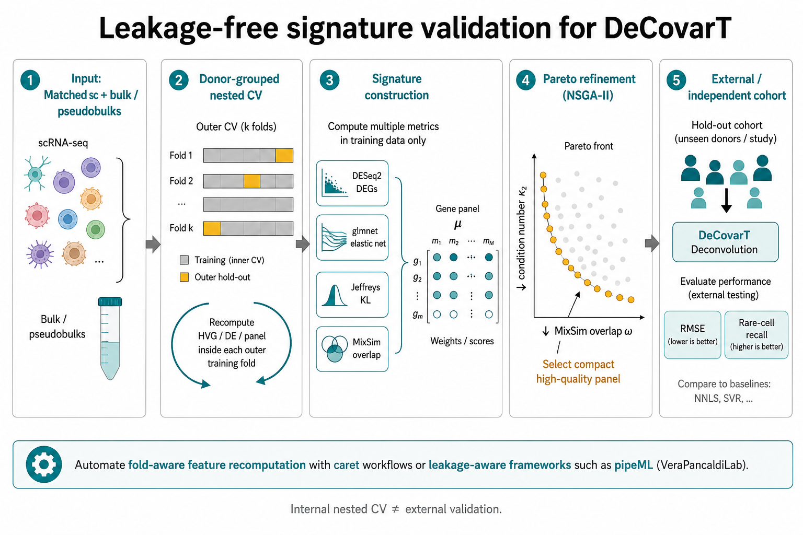



::: callout-note
## Scope

This appendix describes a simulation that compares gene-screening
strategies on references where the informative genes are known. The
theory behind each strategy (tests, effect sizes, Fisher information,
condition number, selection effect) is in
[3.1 Gene selection for the reference](03-1-feature-selection.html).
Separation measures (overlap, Hellinger, Jeffreys) are defined in
[4.2](04-2-distances-overlap-metrics.html). No chunk is executed and no
result is reported here: the page is a design, with code sketches.
:::

# Aim {#sec-s6-aim}

The simulation answers three questions.

1. Does the omnibus gate with an effect-size rank
   ([3.1](03-1-feature-selection.html#sec-fs-effect-size)) recover the
   genes that carry information about $\boldsymbol{p}$ better than a
   top-$k$ ratio or a concatenation of one-versus-rest markers?
2. When two types differ in covariance only, does a covariance-aware
   objective (Fisher information, overlap) keep the genes that a
   univariate screen drops
   ([3.1](03-1-feature-selection.html#sec-fs-selection-effect))?
3. How much does selection change the deconvolution error of DeCovarT,
   compared with keeping every gene that passes the presence gate and
   letting the covariance weight them
   ([3.1](03-1-feature-selection.html#sec-fs-weighting))?

# Data-generating mechanism {#sec-s6-dgm}

References are simulated from the mean and covariance scenarios of
[4.1](04-1-synthetic-scenarios.html), with NB counts per cell and size
factors $s_c$. Genes belong to five known classes:

| Class | Generated as | Expected behaviour |
|---|---|---|
| mean marker | type means differ, $\boldsymbol{\Sigma}_{W,j}$ shared | kept by every screen |
| covariance-only gene | equal means, type-specific correlations | dropped by univariate screens |
| perfect marker | expressed in one type only | removed by the presence gate |
| platform-discordant gene | gene-wise ratio $\tilde b_g\neq1$ in the bulk only | flagged by the range bound |
| noise gene | no type effect | removed by the gate |

: Gene classes of the synthetic reference. {#tbl-s6-classes}

Bulk samples follow the DeCovarT convolution over a composition grid
$\mathcal{P}\subset\Delta^{J-1}$ with balanced, rare-type, sparse and
near-collinear compositions. The factors varied are the cell numbers
$C_j$ (including types with $C_j<G$), the separation regime (mean-driven
or covariance-only) and the share of platform-discordant genes. Their
values, the number of replications and the random-number streams are
fixed before any run, following the ADEMP structure of
[4.1](04-1-synthetic-scenarios.html#sec-ademp).

# Strategies compared {#sec-s6-strategies}

| ID | Strategy | Theory |
|---|---|---|
| A | top-$k$ genes by the between/within ratio of Pearson residuals, equal-cell or equal-type weights | [3.1](03-1-feature-selection.html#sec-sctransform) |
| B | presence gate, omnibus quasi-likelihood $F$ as an FDR gate, rank by effect size | [3.1](03-1-feature-selection.html#sec-fs-omnibus) |
| C | one-versus-rest markers per type, concatenated, then the candidate with the smallest $\kappa_2$ (CIBERSORT, DWLS) | [3.1](03-1-feature-selection.html#sec-kappa-limits) |
| D | union of four scores (@sec-four-scores) | this page |
| E | shortlist of B, then NSGA-II on $\kappa_2$ and overlap (@sec-pareto-nsga2) | [3.1](03-1-feature-selection.html#sec-pareto-panel) |
| F | shortlist of B, then greedy robust D-optimal search (@sec-s6-dopt) | [3.1](03-1-feature-selection.html#sec-optimal-design) |
| G | no selection: every gene that passes the presence gate | [3.1](03-1-feature-selection.html#sec-fs-weighting) |

: Screening strategies compared. {#tbl-s6-strategies}

## Four-score shortlist {#sec-four-scores}

Strategy D unites four screens, two label-aware and two
distributional:

1. `DESeq2` contrasts on donor-level pseudo-bulks
   [@loveModeratedEstimationFold2014a]. They need biological
   replicates, so D applies only to multi-donor references
   ([3.1](03-1-feature-selection.html#sec-fs-estimand)).
2. A multinomial elastic net on the type labels
   (@sec-sparse-classifiers).
3. The Jeffreys divergence between type laws.
4. The MixSim overlap $\varpi$ between type laws
   [@melnykovMixSimPackageSimulating2012; @R-MixSim].

The top-ranked genes of each screen form the working universe
$\mathcal{G}_0$.

## Sparse classifiers as candidate generators {#sec-sparse-classifiers}

Multiclass models with the type as response propose genes; they are not
deconvolution solvers. Embed them in stability selection: resample at
the donor level, tune inside each resample, and keep genes selected in a
large fraction of resamples [@meinshausenStabilitySelection2010].

| Method | Role | Caveat |
|---|---|---|
| Multinomial elastic net [@zouRegularizationVariableSelection2005; @R-glmnet] | joint classification; $\ell_1$ sparsity with $\ell_2$ grouping of correlated genes | may keep collinear markers unless $\ell_2$ is strong |
| Penalised discriminant analysis [@wittenPenalizedClassificationUsing2011] | between/within variance ratio with sparse loadings | needs more observations than logistic paths |
| Group or tree-guided lasso [@yuanModelSelectionEstimation2006] | selects or drops pathways or lineages as blocks | needs predefined groups or a taxonomy |

: Sparse multiclass methods as panel candidate generators. {#tbl-classifier-candidates}

### Bootstrap-enhanced regularisation {#sec-berm}

The lasso keeps one gene of a correlated block and drops the others
[@zouRegularizationVariableSelection2005]. BERM fits an elastic net on
bootstrap resamples, excludes a gene when its percentile interval covers
zero, and refits a weighted elastic net on the remaining genes
[@dongBootstrapenhancedRegularizationAddressing2026]. It can replace
plain stability selection in D when gene blocks are near-collinear.

## Pareto refinement with NSGA-II {#sec-pareto-nsga2}

Strategy E searches a gene mask on the shortlist of strategy B, $\mathcal{G}_0$.
The fitness returns $\kappa_2(\boldsymbol{\mu}_{\mathcal{G}})$ and the
average MixSim overlap $\bar\varpi$ of the type laws restricted to
$\mathcal{G}$; `mco::nsga2()` returns an approximation of the Pareto set
[@R-mco]. The mask is encoded in $[0,1]^{|\mathcal{G}_0|}$ and
thresholded. Several non-dominated panels are passed to the validation
step (@sec-cv-selection), not one knee point. Weighted scalar objectives
in `GA` or `GenSA` remain an auditable alternative
[@R-GA; @R-GenSA].

```{r}
#| label: ex-mco-nsga2-panel
# Fitness of a soft gene mask: condition number of the mean signature
# and average MixSim overlap of the type laws on the selected genes.
# mu: G0 x J means; Sigma: list of J covariance matrices (G0 x G0).
panel_fitness <- function(mask, mu, Sigma, threshold = 0.5) {
  g <- which(mask > threshold)
  if (length(g) < ncol(mu)) {
    return(c(Inf, Inf))
  }
  kappa_g <- kappa(mu[g, , drop = FALSE], exact = TRUE)
  ov <- MixSim::overlap(
    Pi = rep(1 / ncol(mu), ncol(mu)),
    Mu = t(mu[g, , drop = FALSE]),
    S = simplify2array(lapply(Sigma, function(A) A[g, g, drop = FALSE]))
  )
  c(kappa_g, ov$BarOmega)
}

pareto <- mco::nsga2(
  fn = panel_fitness,
  idim = nrow(mu),
  odim = 2,
  mu = mu,
  Sigma = Sigma,
  lower.bounds = rep(0, nrow(mu)),
  upper.bounds = rep(1, nrow(mu)),
  popsize = 100,
  generations = 50
)
# pareto$value: objectives; pareto$par: masks; pareto$pareto.optimal
```

## Information-optimal search {#sec-s6-dopt}

Strategy F maximises the robust D-criterion of
[3.1](03-1-feature-selection.html#sec-optimal-design) over the
composition grid. Standard design packages work on a factor grid:
`skpr` (D, A, E, G, I criteria) and `AlgDesign::optFederov()` (Fedorov
exchange) [@R-AlgDesign]. Neither implements the
composition-dependent information of DeCovarT, so F uses a custom
objective with a greedy or exchange search. The two package calls below
illustrate standard D-optimal designs only.

```{r}
#| label: ex-skpr-d-optimal
candidates <- expand.grid(
  x1 = seq(-1, 1, length.out = 11),
  x2 = seq(-1, 1, length.out = 11)
)
design <- skpr::gen_design(
  candidateset = candidates,
  model = ~ x1 + x2 + I(x1^2) + I(x2^2) + x1:x2,
  trials = 20,
  optimality = "D",
  repeats = 100
)
skpr::get_optimality(design, "D")
```

```{r}
#| label: ex-algdesign-federov
result <- AlgDesign::optFederov(
  formula = ~ x1 + x2 + I(x1^2) + I(x2^2) + x1:x2,
  data = candidates,
  nTrials = 20,
  criterion = "D",
  nRepeats = 100
)
result$D
```

```{r}
#| label: ex-robust-d-panel
# Robust D-score of a gene panel over composition scenarios.
# information_by_gene[[s]] is a list over genes of the (J-1) x (J-1)
# contributions to I_G(p_s); summing them assumes a diagonal covariance.
# With a full covariance, recompute I_G(p_s) on the panel instead.
d_objective <- function(selected, information_by_gene, ridge = 1e-8) {
  scores <- vapply(information_by_gene, function(info_s) {
    info <- Reduce(`+`, info_s[selected])
    info <- info + diag(ridge, nrow(info))
    as.numeric(determinant(info, logarithm = TRUE)$modulus)
  }, numeric(1))
  min(scores)
}

greedy_d <- function(candidates, information_by_gene, size) {
  selected <- integer(0)
  for (step in seq_len(size)) {
    pool <- setdiff(candidates, selected)
    gain <- vapply(pool, function(g) {
      d_objective(c(selected, g), information_by_gene)
    }, numeric(1))
    selected <- c(selected, pool[which.max(gain)])
  }
  selected
}
```

# Performance measures and validation {#sec-caveats}

Two estimands are reported for each strategy and scenario:

- recovery of the gene classes of @tbl-s6-classes (share of mean
  markers and covariance-only genes kept; share of perfect markers,
  platform-discordant genes and noise genes removed);
- the error of $\hat{\boldsymbol{p}}$ from DeCovarT fitted on the
  selected panel, with the metrics and Monte Carlo standard errors of
  [4.1](04-1-synthetic-scenarios.html#sec-performance-metrics).

Three limitations of screening pipelines are built into the design.

1. **Gaussian separation measures.** Overlap and Jeffreys are computed
   under Gaussian type laws. Count data with heavy tails bias them, so
   they rank genes; they are not calibrated probabilities.
2. **Leakage.** Ranking genes and choosing the panel size on the cells
   that also estimate $\boldsymbol{\mu}$ and $\boldsymbol{\Sigma}_j$
   gives an optimistic error. Every data-dependent step is repeated
   inside the training folds (@sec-cv-selection).
3. **Internal validation.** Nested cross-validation on one study, or one
   simulated reference, is internal. Transport to another cohort,
   laboratory or platform needs an external hold-out
   [@sturmComprehensiveEvaluationTranscriptomebased2019;
   @jinBenchmarkRNAseqDeconvolution2021].

## Nested cross-validation on matched bulks {#sec-cv-selection}

When matched single-cell and bulk aliquots exist
[@zaitsevPreciseReconstructionTME2022], or in the simulation where the
bulk is generated from the reference, candidate panels are scored by the
out-of-sample error of the intended estimator. Folds are grouped by
donor (or by simulated reference). In each outer training fold,
normalisation, screening, Pareto refinement and tuning are re-run; the
panel and its size are chosen in the inner loop (overall error,
worst-type error, rare-type recall, one-standard-error rule for smaller
panels), and the outer fold is scored once. Fold-aware feature
construction can be automated with `caret`-based pipelines such as
`pipeML` [@R-pipeML].

{#fig-leakage-free-validation}

## A pipeline for multi-donor references {#sec-recommended}

With several donors per type, strategies D and E combine into the
pipeline of @fig-recommended-pipeline. With one specimen, as for the
Suppinger reference, the `DESeq2` step does not apply and strategy B replaces
the shortlist ([3.1](03-1-feature-selection.html#sec-fs-estimand)).

```{.tikz}
%%| label: fig-recommended-pipeline
%%| fig-cap: Recommended reference-based feature-selection pipeline from donor pseudobulks to validated, mechanistically annotated panels.
%%| filename: fig-recommended-pipeline
%%| alt: Ten-step pipeline drawn as two rows: donor split and pseudobulk; SCTransform highly variable genes; reliability and dropout filter; four-score shortlist with DESeq2, glmnet, Jeffreys and MixSim; stability selection; NSGA-II or greedy Pareto minimising the condition number kappa 2 and overlap; nested cross-validated panel selection with held-out donors; optional D-, E- or A-optimal design; CARNIVAL or CORNETO annotation; external cohort check.
\begin{tikzpicture}[every node/.append style={text width=2.55cm}]
\node[keybox] (A) at (0,0) {Donor split and pseudobulk};
\node[box] (B) at (3.2,0) {\texttt{SCTransform} HVGs\\ (no cell-type regression)};
\node[box] (C) at (6.4,0) {Reliability and dropout filter};
\node[box] (D) at (9.6,0) {Four-score shortlist: \texttt{DESeq2}, \texttt{glmnet}, Jeffreys, MixSim};
\node[box] (E) at (12.8,0) {Stability selection};
\node[box] (F) at (12.8,-2.4) {NSGA-II or greedy Pareto:\\ $\min\kappa_2$ and overlap};
\node[box] (G) at (9.6,-2.4) {Nested CV panel selection, held-out donor assessment};
\node[dimbox] (H) at (6.4,-2.4) {Optional $D$-, $E$-, $A$-optimal design (perspective)};
\node[box] (I) at (3.2,-2.4) {\texttt{CARNIVAL} / \texttt{CORNETO} annotation};
\node[keybox] (J) at (0,-2.4) {External cohort check (see caveats)};
\draw[edge] (A) -- (B); \draw[edge] (B) -- (C); \draw[edge] (C) -- (D); \draw[edge] (D) -- (E);
\draw[edge] (E) -- (F); \draw[edge] (F) -- (G); \draw[edge] (G) -- (H); \draw[edge] (H) -- (I); \draw[edge] (I) -- (J);
\end{tikzpicture}
```

::: {.callout-tip}
## Software {#sec-software}

- Pearson residuals: `sctransform` / `Seurat::SCTransform`
  [@hafemeisterNormalizationVarianceStabilization2019]; NB GLM and
  quasi-likelihood $F$: `glmGamPoi` [@glmGamPoi2020].
- Sparse multiclass candidates: `glmnet` [@R-glmnet]; stability
  selection [@meinshausenStabilitySelection2010]; BERM
  [@dongBootstrapenhancedRegularizationAddressing2026].
- Separation: `MixSim::overlap()` [@R-MixSim]; definitions in
  [4.2](04-2-distances-overlap-metrics.html).
- Multi-objective search: `mco::nsga2()` [@R-mco]; scalar refinement with
  `GA` / `GenSA` [@R-GA; @R-GenSA].
- Standard D-optimal designs: `skpr::gen_design()`,
  `AlgDesign::optFederov()` [@R-AlgDesign].
- Leakage-aware cross-validation: `caret` workflows, `pipeML`
  [@R-pipeML].
- Annotation: `CARNIVAL` / `CORNETO` [@liuFromExpressionFootprints2019;
  @rodriguezMierUnifyingMultisample2025].
:::
