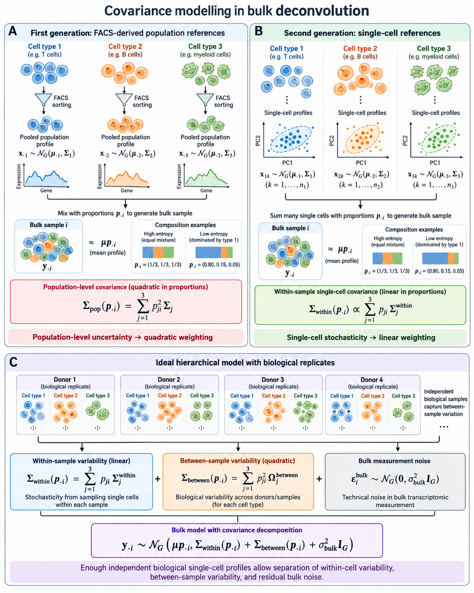
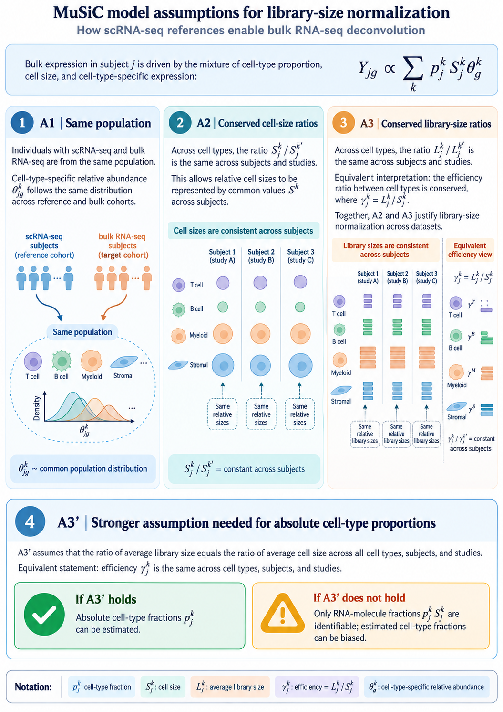

::: callout-note
## Scope

Released DeCovarT fits the convolution
$\boldsymbol{y}_{\cdot i}\mid\boldsymbol{p}_{\cdot i}
\sim\mathcal{N}_G(\boldsymbol{\mu}\boldsymbol{p}_{\cdot i},
\sum_j p_{ji}^{2}\boldsymbol{\Sigma}_j)$
of the [derivatives vignette](theory-decovart-generative-model.html#sec-unconstrained).
That law is exact when each reference column is one random
**population profile**. A single-cell reference supplies a different
object: many cells per type, measured with a count protocol, with a
within-type cell-to-cell covariance, and a bulk sample that is a
physical sum of cells measured on another platform.

The vignette proceeds in six steps.

1. @sec-measurement states the measurement and expression models of
   single-cell counts and what they imply for the reference moments.
2. @sec-reference builds the mean and the covariance layers of a
   reference from cells and replicates.
3. @sec-one-formula shows that mixture, convolution and correlated
   cells are three cases of one covariance identity.
4. @sec-general gives one score, Hessian and Fisher information for
   any Gaussian whose mean and covariance depend on parameters.
5. @sec-methods places `MuSiC`, `RNA-Sieve`, `DWLS`, `Bisque`,
   `RCTD`, `DECALS`, `MEAD` and DeCovarT on one notation, split by
   whether genes are treated as independent.
6. @sec-strategies derives four alignment strategies and relates each
   to those methods: cell counts, averaged mixture, compositional bulk,
   and plug-in scales estimated before the deconvolution.

The simplex charts of the derivatives vignette (ILR, or ALR in its
appendix) apply unchanged to the proportion block of every
formulation, so they are stated once and not repeated. Nothing here is
implemented in `fit_decovart()`; the equations are the specification
for a later release.
:::

::: {#nte-notation .callout-note collapse="true"}
## Notation

Indices: gene $g=1,\ldots,G$; cell type $j=1,\ldots,J$; bulk sample
$i=1,\ldots,N$; independent biological replicate (donor) of the
single-cell reference $r=1,\ldots,R$; cell $c$, with $C_{jr}$ cells of
type $j$ in replicate $r$.

| Symbol | Meaning |
|---|---|
| $x_{gc}$, $\boldsymbol{x}_{\cdot c}$ | Observed UMI count of gene $g$ in cell $c$ |
| $\boldsymbol{m}_{\cdot c}$ | True molecule content of cell $c$ |
| $s_c=s^{\mathrm{bio}}_cs^{\mathrm{tech}}_c$ | Cell size factor: biological (cell volume, cycle) times technical (capture, depth); $\mathbb{E}[s_c]=1$ |
| $\nu=\operatorname{CV}^{2}(s_c)$ | Extrinsic noise, $1+\nu=(1+\nu^{\mathrm{bio}})(1+\nu^{\mathrm{tech}})$ |
| $b_g$ | Gene-specific capture efficiency of a protocol |
| $\boldsymbol{\lambda}_{\cdot c}$, $\boldsymbol{\Sigma}^{\lambda}_j$ | Size-free expression of cell $c$ and its covariance inside type $j$ |
| $\boldsymbol{y}_{\cdot i}\in\mathbb{R}^{G}$ | Bulk profile of sample $i$ |
| $m_{ji}\in\mathbb{N}$, $n_i=\sum_j m_{ji}$ | Cells of type $j$ in bulk sample $i$, total cells (`MuSiC` writes $m_j^{k}$, `RNA-Sieve` $n$) |
| $\boldsymbol{p}_{\cdot i}=\boldsymbol{m}_{\cdot i}/n_i\in\Delta^{J-1}$ | Cell-number fractions |
| $\boldsymbol{q}_{\cdot i}$, $q_{ji}=p_{ji}S_j/\sum_kp_{ki}S_k$ | RNA fractions |
| $\kappa_i=1/n_i$ | Per-cell averaging factor |
| $\boldsymbol{\mu}_{\cdot j}=S_j\boldsymbol{\theta}_{\cdot j}$ | Per-cell mean of type $j$: cell size times relative abundance, $\sum_g\theta_{gj}=1$ |
| $S_j$ | Mean transcriptome size (RNA content) of one cell of type $j$ |
| $\boldsymbol{\Sigma}_{W,j}$ | Within-replicate cell-to-cell covariance of type $j$ |
| $\boldsymbol{\Sigma}_{B,j}$ | Between-replicate covariance of the type-$j$ population mean |
| $\boldsymbol{M}_{jr}$, $\boldsymbol{B}_{jr}$ | Replicate population mean and its deviation $\boldsymbol{M}_{jr}-\boldsymbol{\mu}_{\cdot j}$ |
| $a_i>0$ | Sample-wide scale (cell number, depth, capture), shared by all genes |
| $\boldsymbol{d}\in\mathbb{R}^{G}_{+}$ | Gene-wise platform ratio between bulk and reference protocols |
| $\boldsymbol{D}_i=\boldsymbol{\Sigma}_{\mathrm{obs},i}$ | Diagonal bulk measurement noise, $\operatorname{diag}(\tau_{1i}^{2},\ldots,\tau_{Gi}^{2})$ |
| $\boldsymbol{T}_{ji}=\sum_{c=1}^{m_{ji}}\boldsymbol{X}_{jic}$ | Total expression contributed by type $j$ to sample $i$ |
| $\boldsymbol{S}_W(\boldsymbol{v})=\sum_jv_j\boldsymbol{\Sigma}_{W,j}$, $\boldsymbol{S}_B(\boldsymbol{v})=\sum_jv_j^{2}\boldsymbol{\Sigma}_{B,j}$ | Linear and quadratic covariance mixtures |
| $\varrho_j$ | Cell-to-cell correlation inside type $j$; $\boldsymbol{\rho}$ stays the ILR coordinate |
| $\boldsymbol{\vartheta}$, $\boldsymbol{\eta}$ | Generic parameter vector; nuisance scales of @sec-strategy-plugin |
| $\boldsymbol{\mu}_k,\boldsymbol{\Sigma}_k,\boldsymbol{\mu}_{kl},\boldsymbol{\Sigma}_{kl}$ | First and second partial derivatives of the mean and covariance in $\vartheta_k,\vartheta_l$ |

When one bulk sample is fixed, the index $i$ is dropped inside
derivations and restored in the model statements. The single-cell
papers use $j$ for the gene (Sarkar and Stephens; Fang and Pachter;
`DECALS`; `Bisque`) or for the subject (`MuSiC`); @tbl-notation-map
translates every reviewed method.

All plate diagrams follow one symbol key: white squares are fixed
quantities, blue circles latent random variables, grey circles
observed variables, dotted circles deterministic functions of their
parents. Text beside a node is an equation, not a variable. When a
paper builds increasingly complex models, its panels run from left to
right.
:::

```{.tikz}
%%| label: fig-four-strategies
%%| fig-cap: Four strategies to align a single-cell reference with a bulk sample. Strategies 1--3 differ by the scale on which the bulk is observed and estimate the scales jointly with the composition; Strategy 4 estimates the technical and biological scales first and plugs them into the regression or likelihood. Italic lines name the reviewed methods that already sit on each branch.
%%| filename: fig-four-strategies
%%| alt: Flowchart. A single-cell reference leads to a question about the bulk scale and where scales are estimated. Four boxes follow: cell-count convolution targeting integer counts; averaged mixture targeting proportions on the simplex with an averaging factor kappa; compositional bulk targeting RNA fractions; plug-in scales estimated beforehand. Each box lists its covariance and the methods that use it, and ends in a note: proportions by division; released DeCovarT as a limit; RNA fractions differ from cell fractions unless cell sizes are equal; plug-in uncertainty must be propagated.
\begin{tikzpicture}[every node/.append style={}]
\node[keybox, text width=9cm] (ref) at (0,0) {Single-cell reference: $\boldsymbol{\mu}_{\cdot j}$ and $\boldsymbol{\Sigma}_{W,j}$ from $R=1$;\ $\boldsymbol{\Sigma}_{B,j}$ needs $R\ge 2$};
\node[choice] (q) at (0,-1.8) {Bulk scale, and where\\ are the scales estimated?};
\node[box, anchor=north, text width=3.6cm] (s1) at (-6.3,-3.4) {\textbf{1. Cell-count convolution}\\ \textit{bulk: absolute molecules}\\[2pt] target $\boldsymbol{m}_{\cdot i}\in\mathbb{N}^{J}$, no simplex\\[2pt] $a_i^{2}[\boldsymbol{S}_W(\boldsymbol{m}_{\cdot i})+\boldsymbol{S}_B(\boldsymbol{m}_{\cdot i})]+\boldsymbol{D}_i$\\[3pt] \textit{RNA-Sieve ($n_i$), MuSiC eq. (2), DWLS}};
\node[box, anchor=north, text width=3.6cm] (s2) at (-2.1,-3.4) {\textbf{2. Averaged mixture}\\ \textit{bulk: per-cell average}\\[2pt] target $\boldsymbol{p}_{\cdot i}\in\Delta^{J-1}$, $\kappa_i=1/n_i$\\[2pt] $a_i^{2}[\boldsymbol{S}_B(\boldsymbol{p}_{\cdot i})+\kappa_i\boldsymbol{S}_W(\boldsymbol{p}_{\cdot i})]+\boldsymbol{D}_i$\\[3pt] \textit{DECALS, MEAD ($\boldsymbol{\beta}_i=a_i\boldsymbol{p}_{\cdot i}$), DeCovarT}};
\node[box, anchor=north, text width=3.6cm] (s3) at (2.1,-3.4) {\textbf{3. Compositional bulk}\\ \textit{bulk: library-normalised}\\[2pt] target RNA fractions $\boldsymbol{q}_{\cdot i}$\\[2pt] closure $\boldsymbol{T}_i/\mathbf{1}^{\top}\boldsymbol{T}_i$, delta method\\[3pt] \textit{MuSiC ($C_i$), Bisque (CPM), DECALS (FPKM)}};
\node[box, anchor=north, text width=3.6cm] (s4) at (6.3,-3.4) {\textbf{4. Plug-in scales}\\ \textit{bulk: scales estimated beforehand}\\[2pt] estimate $s_c$, $S_j$, $\boldsymbol{d}$, $a_i$ first, then fit $\boldsymbol{p}_{\cdot i}$ with the scales fixed\\[3pt] \textit{MuSiC ($S_j$), RCTD ($\boldsymbol{d}$, $N_i$), Bisque, MEAD ($a^{\mathrm{ref}}_r$), EPIC}};
\node[note, text width=3.6cm, align=flush center] (o1) at ([yshift=-7mm]s1.south) {$p_{ji}=m_{ji}/n_i$ by division};
\node[note, text width=3.6cm, align=flush center] (o2) at ([yshift=-7mm]s2.south) {released DeCovarT: $\kappa_i\to 0$, $a_i=1$};
\node[note, text width=3.6cm, align=flush center] (o3) at ([yshift=-7mm]s3.south) {$\boldsymbol{q}_{\cdot i}\neq\boldsymbol{p}_{\cdot i}$ unless $S_j$ constant};
\node[note, text width=3.6cm, align=flush center] (o4) at ([yshift=-7mm]s4.south) {plug-in uncertainty must be propagated};
\draw[edge] (ref) -- (q);
\draw[edge] (q.south) -- (s1.north);
\draw[edge] (q.south) -- (s2.north);
\draw[edge] (q.south) -- (s3.north);
\draw[edge] (q.south) -- (s4.north);
\foreach \k in {1,2,3,4} \draw[edge] (s\k.south) -- (o\k.north);
\end{tikzpicture}
```

# Measurement and expression models for single-cell counts {#sec-measurement}

A reference profile is a moment of a latent biological quantity, but
it is estimated from counts produced by a sampling protocol. Sarkar and
Stephens separate the two: a **measurement model** $p(\boldsymbol{x}\mid\boldsymbol{\lambda})$
describes the protocol given the true expression, an **expression
model** $p(\boldsymbol{\lambda})$ describes the biology, and the
observation model $p(\boldsymbol{x})$ is their composition
[@sarkarSeparatingMeasurementExpression2021]. Fang and Pachter add that
the cell-level scale factor is itself a product of a biological and a
technical term [@fangExtrinsicBiologicalStochasticity2025]. Both papers
index genes by $j$ and cells by $i$; below, gene is $g$ and cell is
$c$, so that $j$ remains the cell type.

```{.tikz}
%%| label: fig-dag-measurement
%%| fig-cap: Measurement and expression model of a single-cell reference, in the notation of this vignette. Inside cell type $j$, the size-free expression $\boldsymbol{\lambda}_{\cdot c}$ follows an expression model $F_j$ with mean $\boldsymbol{\mu}_{\cdot j}$ and covariance $\boldsymbol{\Sigma}^{\lambda}_j$; the biological size factor turns it into a molecule content; the technical size factor and the gene capture efficiency $\boldsymbol{b}$ act through a Poisson measurement.
%%| filename: fig-dag-measurement
%%| alt: Plate diagram. Inside a plate over cell types j, fixed mu_j and Sigma lambda_j generate the latent expression lambda_c. Inside a nested plate over cells, the latent biological size factor s bio multiplies lambda_c to give the deterministic molecule content m_c, and the latent technical size factor s tech together with the fixed gene capture vector b outside the plates generate the observed counts x_c through a Poisson law.
\begin{tikzpicture}[node distance=10mm and 12mm]
\node[stoch] (lam) {$\boldsymbol{\lambda}_{\cdot c}$};
\node[stoch, left=of lam] (sbio) {$s^{\mathrm{bio}}_c$};
\node[det, below=of lam] (m) {$\boldsymbol{m}_{\cdot c}$};
\node[stoch, left=of m] (stech) {$s^{\mathrm{tech}}_c$};
\node[obs, below=of m] (x) {$\boldsymbol{x}_{\cdot c}$};
\node[const, above=10mm of lam] (mu) {$\boldsymbol{\mu}_{\cdot j}$};
\node[const, right=8mm of mu] (Sig) {$\boldsymbol{\Sigma}^{\lambda}_{j}$};
\node[note, right=2mm of lam] (nl) {$\sim F_j(\boldsymbol{\mu}_{\cdot j},\boldsymbol{\Sigma}^{\lambda}_j)$};
\node[note, right=2mm of m] (nm) {$=s^{\mathrm{bio}}_c\boldsymbol{\lambda}_{\cdot c}$};
\node[note, below=2mm of x] (nx) {$x_{gc}\sim\mathrm{Poisson}(s^{\mathrm{tech}}_c b_g m_{gc})$};
\node[note, left=1mm of sbio] {cell size};
\node[note, left=1mm of stech] {depth};
\draw[edge] (mu) -- (lam); \draw[edge] (Sig) -- (lam);
\draw[edge] (lam) -- (m); \draw[edge] (sbio) -- (m);
\draw[edge] (m) -- (x); \draw[edge] (stech) -- (x);
\plate{cells}{(sbio)(stech)(lam)(m)(x)(nl)(nm)(nx)}{cells $c\in\mathcal{C}_j$}
\plate{types}{(mu)(Sig)(cells)(cells-lab)}{$j=1,\ldots,J$}
\node[const] (b) at ([xshift=12mm]types.east |- x) {$\boldsymbol{b}$};
\node[note, above=1mm of b] {gene capture};
\draw[edge] (b) -- (x);
\end{tikzpicture}
```

## Poisson measurement of UMI counts {#sec-poisson-measurement}

If each molecule of cell $c$ is captured independently with a small
probability, the multivariate hypergeometric sampling of molecules is
close to a multinomial and each gene count is Poisson given the true
content (Supplementary Note 1 of
[@sarkarSeparatingMeasurementExpression2021]):

$$
x_{gc}\mid s^{\mathrm{tech}}_c,m_{gc}
\sim\mathrm{Poisson}\bigl(s^{\mathrm{tech}}_c\,b_g\,m_{gc}\bigr),
\qquad
\boldsymbol{m}_{\cdot c}=s^{\mathrm{bio}}_c\,\boldsymbol{\lambda}_{\cdot c}.
$$ {#eq-poisson-measurement}

Fang and Pachter write the same law as binomial thinning with capture
rate $b_gs^{\mathrm{tech}}_c$, of which the Poisson is the low-capture
limit, and normalise $\mathbb{E}[s^{\mathrm{bio}}]=\mathbb{E}[s^{\mathrm{tech}}]=1$
(their equations 1--2). Sarkar and Stephens instead take the observed
library size $x_{+c}$ as the size factor and a relative expression
$\lambda_{gc}=m_{gc}/m_{+c}$; in that convention $s^{\mathrm{bio}}_c$
cancels by construction, which is the removal of biological extrinsic
noise that Fang and Pachter warn about. The two conventions are the two
directions of the same rank-one Poisson fit: the point-mass MLE
$\hat\mu_g=\sum_cx_{gc}/\sum_cx_{+c}$ and the size-factor MLE of
@eq-poisson-size-factor below.

Three remarks connect the protocol to deconvolution.

- **UMIs remove most gene-specific distortion.** Unique molecular
  identifiers collapse PCR duplicates, which "substantially reduce
  unwanted variation, including differences in gene lengths and PCR
  amplification efficiencies" [@sarkarSeparatingMeasurementExpression2021].
  What remains is a capture efficiency $b_g$ that is constant across
  cells of one protocol. It is not identified separately from
  $\boldsymbol{\lambda}$, and it cancels from every within-protocol
  contrast, so it is absorbed into $\boldsymbol{\mu}_{\cdot j}$ and
  $\boldsymbol{\Sigma}_{W,j}$. It does **not** cancel between a
  single-cell reference and a bulk library: the ratio
  $d_g=b_g^{\mathrm{bulk}}/b_g^{\mathrm{ref}}$ is the gene-wise platform
  factor of @sec-strategy-plugin. Read-count protocols without UMIs and
  hybridisation microarrays carry larger gene- and probe-specific
  factors (amplification, length, affinity), which is why earlier
  deconvolution methods had to model gene-wise scales explicitly; with
  UMI references, the gene-wise factor reduces to one cross-platform
  ratio per gene.
- **Random capture biases make the measurement overdispersed;
  constant ones do not.** If $b_{gc}$ varied from cell to cell, the
  measurement model would be negative binomial rather than Poisson
  (Box 1 and Supplementary Note 1.2 of Sarkar and Stephens). On spike-in
  controls the measurement dispersion was below $5\times10^{-3}$, which
  adds about 5% to the variance of a gene with ten observed molecules.
  Overdispersion seen in single-cell data is therefore an
  **expression** property, $\boldsymbol{\Sigma}^{\lambda}_j$, plus extrinsic
  noise, not a protocol property.
- **Zero inflation belongs to the expression model, if anywhere.**
  Spike-in controls show no zero-generating measurement component, and
  a point-Gamma expression model beats a Gamma model for only 0.6--8.6%
  of genes across the datasets tested
  [@sarkarSeparatingMeasurementExpression2021]. Zeros are imperfect
  measurements of small $\lambda_{gc}$ at low depth, "with no need for
  special terminology or special treatment". For DeCovarT, which uses
  only the first two moments of the reference, a zero-inflated
  observation model is unnecessary: the moments of the counts already
  contain the zeros. The argument is made for UMI data; the authors note
  that it may not hold for read counts amplified by PCR without UMIs.

## Expression models and the observation models they induce {#sec-expression-models}

Integrating the expression model against @eq-poisson-measurement gives
the observation model gene by gene (Table 1 of
[@sarkarSeparatingMeasurementExpression2021]).

| Expression model for $\lambda_{gc}$ | Observation model for $x_{gc}$ | Examples |
|---|---|---|
| Point mass $\lambda_{gc}=\mu_g$ | Poisson | analytic |
| Gamma, mean $\mu_g$, variance $\mu_g^{2}\phi_g$ | Negative binomial | `edgeR`, `DESeq2`, `SAVER` |
| Point-Gamma | Zero-inflated negative binomial | `ZINB-WaVE` (multigene) |
| Unimodal or fully nonparametric | Flexible | `ashr`, `DESCEND` |
| Low rank, $\lambda_{gc}=\mu_{gc}u_{gc}$, $\mu=h^{-1}(\boldsymbol{L}\boldsymbol{F}^{\top})$ | Flexible | GLM-PCA, `scVI` |

: Expression and observation models for UMI counts, after Sarkar and Stephens (Tables 1--2). The measurement model is Poisson throughout. {#tbl-expression-models}

A gene whose expression model is a point mass inside a homogeneous
population is a **Poisson gene**: its count has no variability beyond
sampling and the extrinsic size factor. Overdispersion relative to a
Poisson, the hallmark of the negative binomial, then measures either
biological variability of $\lambda_{gc}$ or variability of $s_c$.

## Extrinsic noise, size factors and Poisson genes {#sec-extrinsic-noise}

Fang and Pachter show that a cell-wide factor explains the baseline
overdispersion of single-cell counts. Under @eq-poisson-measurement with
$s_c=s^{\mathrm{bio}}_cs^{\mathrm{tech}}_c$ independent of
$\boldsymbol{\lambda}_{\cdot c}$, $\mathbb{E}[s_c]=1$ and
$\nu=\operatorname{CV}^{2}(s_c)$, their equation (3) reads, in our
notation and inside one cell type,

$$
\frac{\operatorname{Cov}(x_{gc},x_{hc})}{\mathbb{E}[x_{gc}]\mathbb{E}[x_{hc}]}
=\nu+(1+\nu)\frac{\Sigma^{\lambda}_{j,gh}}{\mu_{gj}\mu_{hj}}
+\frac{\delta_{gh}}{\mathbb{E}[x_{gc}]},
\qquad
1+\nu=(1+\nu^{\mathrm{bio}})(1+\nu^{\mathrm{tech}}).
$$ {#eq-extrinsic-noise}

For two genes that are intrinsically uncorrelated, or for one gene that
is intrinsically Poisson, the normalised covariance equals $\nu$
(their equation 5). That identity gives an estimator of $\nu$ (the mode
of the normalised covariances over gene pairs) and a selection rule for
Poisson genes (those whose normalised variance minus the Poisson term
has a bootstrap interval containing $\hat\nu$). On those genes
$\mathcal{P}$, the size factor has the closed-form MLE

$$
\hat s_c=\frac{\sum_{g\in\mathcal{P}}x_{gc}}{\sum_{g\in\mathcal{P}}\mu_g}.
$$ {#eq-poisson-size-factor}

Two findings matter here. Normalising each cell by its total removes
$s^{\mathrm{bio}}_c$ together with $s^{\mathrm{tech}}_c$, and with it
the biological extrinsic variability, including cell size
[@fangExtrinsicBiologicalStochasticity2025]. In peripheral blood, sums
over Poisson genes no longer track total UMI counts and differ between
cell types, so the choice of size factor changes downstream
comparisons. Separating $s^{\mathrm{tech}}_c$ from $s^{\mathrm{bio}}_c$
needs external controls (spike-ins, ambient RNA, pooled RNA); the
nascent-mRNA counts did not fit the binomial sampling model in their
pooled-RNA experiment.

## What the measurement model implies for the reference covariance {#sec-measurement-implications}

Write the same identity in matrix form (a direct consequence of
@eq-poisson-measurement and the law of total covariance; the
derivation is ours). With $\boldsymbol{\mathcal{B}}=\operatorname{diag}(\boldsymbol{b})$,

$$
\operatorname{Cov}(\boldsymbol{x}_{\cdot c}\mid c\in j)
=\underbrace{\operatorname{diag}\bigl(\boldsymbol{\mathcal{B}}\boldsymbol{\mu}_{\cdot j}\bigr)}_{\text{Poisson measurement}}
+\boldsymbol{\mathcal{B}}\Bigl[
\underbrace{(1+\nu)\boldsymbol{\Sigma}^{\lambda}_j}_{\text{biology}}
+\underbrace{\nu\,\boldsymbol{\mu}_{\cdot j}\boldsymbol{\mu}_{\cdot j}^{\top}}_{\text{size factor}}
\Bigr]\boldsymbol{\mathcal{B}}.
$$ {#eq-count-covariance}

The sample covariance of raw UMI counts, which is what a single-cell
reference returns as $\hat{\boldsymbol{\Sigma}}_{W,j}$, mixes three
objects. Only part of it belongs in the bulk law.

1. **The Poisson diagonal is single-cell measurement noise.** It is
   produced at single-cell depth and is not part of the tissue. A bulk
   library has its own sampling noise, on its own depth, which the
   diagonal term $\boldsymbol{D}_i$ carries. Plugging raw-count
   covariances into $\boldsymbol{S}_W$ imports the reference sampling
   noise into the bulk covariance; subtracting $\operatorname{diag}(\bar{\boldsymbol{x}}_j)$
   first removes it.
2. **The technical size-factor term is not biology either.** The
   rank-one term $\nu^{\mathrm{tech}}\boldsymbol{\mu}_{\cdot j}\boldsymbol{\mu}_{\cdot j}^{\top}$
   induces a positive correlation between all genes. It inflates the
   apparent network and is a protocol artefact.
3. **The biological size factor is part of the bulk.** Cells of one
   type differ in volume and cycle phase; a tissue sums those cells as
   they are. The term $\nu^{\mathrm{bio}}\boldsymbol{\mu}_{\cdot j}\boldsymbol{\mu}_{\cdot j}^{\top}$
   belongs in $\boldsymbol{\Sigma}_{W,j}$, and library-size normalisation
   that removes it understates the within-type variance that the bulk
   accumulates.

The corresponding moment estimator, with $\hat\nu^{\mathrm{tech}}$ from
spike-ins or Poisson genes, is

$$
\hat{\boldsymbol{\Sigma}}_{W,j}
=\hat{\boldsymbol{C}}_j-\operatorname{diag}(\bar{\boldsymbol{x}}_j)
-\frac{\hat\nu^{\mathrm{tech}}}{1+\hat\nu^{\mathrm{tech}}}\,
\bigl[\hat{\boldsymbol{C}}_j-\operatorname{diag}(\bar{\boldsymbol{x}}_j)+\bar{\boldsymbol{x}}_j\bar{\boldsymbol{x}}_j^{\top}\bigr],
$$ {#eq-denoised-within}

where $\hat{\boldsymbol{C}}_j$ is the sample covariance of the type-$j$
counts and $\bar{\boldsymbol{x}}_j$ their mean. It is the
$s^{\mathrm{tech}}$-free covariance of
$\boldsymbol{\mathcal{B}}\boldsymbol{m}_{\cdot c}$ obtained by solving
@eq-count-covariance with $1+\nu=(1+\nu^{\mathrm{bio}})(1+\nu^{\mathrm{tech}})$
(our derivation, to be checked by simulation before use). Estimating
$\nu^{\mathrm{tech}}$ before the deconvolution is the first plug-in of
Strategy 4 (@sec-strategy-plugin).

# From cells to reference moments {#sec-reference}

The signature that enters [the released convolution](theory-decovart-statistical-perspectives.html#eq-gaussian-convolution) is a **population profile**: one mean vector and one covariance per cell type. Single-cell counts are not that object. This section states how to build the mean and how the covariance splits, then how to place the resulting profiles on the same scale as bulk sample $i$.

{#fig-three-variability fig-alt="Schematic of three covariance layers: linear within-cell variability, quadratic between-sample variability, and diagonal bulk measurement noise."}

{#fig-music-assumptions fig-alt="MuSiC model assumptions A1 same population, A2 conserved cell-size ratios, A3 conserved library-size ratios, and A3-prime for absolute cell-type proportions."}

@fig-three-variability is the target decomposition. Panel A is a purified population profile (quadratic in $p_{ji}$). Panel B is one single-cell reference (linear in $p_{ji}$). Panel C is the hierarchical model once $R$ independent replicates exist.

## Mean: average cells, then average replicates {#sec-mean-signature}

For a fixed type $j$, the per-cell mean does not depend on how many cells were captured. With raw counts on an additive scale,

$$
\bar{\boldsymbol{X}}_{jr}
=
\frac{1}{C_{jr}}\sum_{c=1}^{C_{jr}}\boldsymbol{X}_{jrc},
\qquad
\hat{\boldsymbol{\mu}}_{\cdot j}
=
\frac{1}{R}\sum_{r=1}^{R}\bar{\boldsymbol{X}}_{jr}.
$$ {#eq-mean-two-stage}

Divide by the **cell count** $C_{jr}$, not by the library size. Library-size weights $w_c=L_c/\sum_d L_d$ are functions of $\boldsymbol{X}_c$ itself. Their probability limit is $\boldsymbol{\mu}+\boldsymbol{\Sigma}\mathbf{1}/(\mathbf{1}^{\top}\boldsymbol{\mu})$, so they target an RNA-weighted cell and destroy the exact Gaussian scale that leaves the precision graph unchanged. Under i.i.d. cells the arithmetic mean also has the largest effective sample size among deterministic convex weights.

Pool cells across replicates only after the within-replicate mean. A replicate with $10\,000$ cells must not outweigh a replicate with $500$ cells. `MuSiC` is built on that multi-subject split: cross-subject means and variances, with genes weighted by cross-subject and cross-cell consistency [@wangBulkTissueCell2019].

When every cell is scaled to a common total, the product $S_j\boldsymbol{\theta}_{\cdot j}$ collapses to the arithmetic mean of the raw counts. `MuSiC` writes the signature as cell size times relative abundance and then recovers that same per-cell mean. Keep $S_j$ and $\boldsymbol{\theta}_{\cdot j}$ as separate factors (@sec-alignment). Do not library-weight the raw vectors and call the result $S_j$.

::: {#nte-sum-versus-mean .callout-warning}
## Summing cells is the wrong signature, and the right pseudobulk

Summing is the correct total for a physical pool of exactly $C_{jr}$ cells, $\boldsymbol{T}_{jr}=\sum_c\boldsymbol{X}_{jrc}$, with mean $C_{jr}\boldsymbol{\mu}_{\cdot j}$ and covariance $C_{jr}\boldsymbol{\Sigma}_{W,j}$. Using $\boldsymbol{T}_{jr}$ as a DeCovarT column inserts the arbitrary capture count into $\boldsymbol{p}$. A type with ten times more reference cells looks ten times more abundant.

The same sum is the right input for a different question. Differential expression of one cell type across donors needs one count vector per donor, then a bulk count model such as `DESeq2` [@loveModeratedEstimationFold2014a]. There the estimand is a relative fold change of averaged counts, and the donor is the independent unit. Cells from one donor are subsamples. Treating them as replicates inflates false discoveries [@squairConfrontingFalseDiscoveries2021]. That analysis does not estimate $\boldsymbol{p}_{\cdot i}$.
:::

## Three reference regimes {#sec-three-regimes}

Write the cell as a sum of a replicate effect and a cell effect,

$$
\boldsymbol{X}_{jrc}
=
\boldsymbol{\mu}_{\cdot j}+\boldsymbol{B}_{jr}+\boldsymbol{\varepsilon}_{jrc},
$$ {#eq-cell-hierarchy}

with $\boldsymbol{B}_{jr}\sim\mathcal{N}(\boldsymbol{0},\boldsymbol{\Sigma}_{B,j})$ and $\boldsymbol{\varepsilon}_{jrc}\sim\mathcal{N}(\boldsymbol{0},\boldsymbol{\Sigma}_{W,j})$, independent across $j$ given $\boldsymbol{p}_{\cdot i}$. The bulk average per cell in a tissue of $N_i$ cells is

$$
\boldsymbol{A}_i
=
\sum_j p_{ji}(\boldsymbol{\mu}_{\cdot j}+\boldsymbol{B}_{jr(i)})
+
\frac{1}{N_i}\sum_j\sum_{c=1}^{N_i p_{ji}}\boldsymbol{\varepsilon}_{ijc}.
$$ {#eq-bulk-average}

### FACS-sorted population profiles {#sec-facs}

Historically the reference was one bulk profile per purified population: surface-marker sorting, then a pooled microarray or RNA-seq library. The random object is the whole population vector $\boldsymbol{Z}_{ij}\sim\mathcal{N}(\boldsymbol{\mu}_{\cdot j},\boldsymbol{\Sigma}_{B,j})$, and the bulk is the convolution

$$
\boldsymbol{y}_{\cdot i}
=
\sum_j p_{ji}\boldsymbol{Z}_{ij},
\qquad
\operatorname{Cov}(\boldsymbol{y}_{\cdot i}\mid\boldsymbol{p}_{\cdot i})
=
\sum_j p_{ji}^{2}\,\boldsymbol{\Sigma}_{B,j}.
$$ {#eq-facs-quadratic}

The square appears because one random profile is multiplied by $p_{ji}$, not because $p_{ji}$ cells were added. This is the covariance in [the released convolution](theory-decovart-statistical-perspectives.html#eq-gaussian-convolution). If several types are sorted from the same donors, cross-type blocks $\boldsymbol{\Sigma}_{B,jk}$ add terms $p_{ji}p_{ki}$. Before droplet scRNA-seq, those population profiles came from FACS- or MACS-purified bulk libraries. Szaniszlo et al. showed that mixture expression reflects composition and that a minor subset is recovered only after physical sorting, while also stressing coexpression among genes inside a purified type [@szaniszloGettingRightCells]. Novershtern et al. profiled 38 marker-defined haematopoietic populations and used coexpression modules plus promoter *cis*-circuits as the gene–gene structure of each state [@novershternDenselyInterconnectedTranscriptional2011]. Those studies are the historical FACS reference that @eq-facs-quadratic still describes.

### One single-cell replicate ($R=1$) {#sec-one-replicate}

$R=1$ identifies $\boldsymbol{M}_{j1}$ and $\boldsymbol{\Sigma}_{W,j}$. It does not identify $\boldsymbol{\Sigma}_{B,j}$: extra cells shrink $\boldsymbol{\Sigma}_{W,j}/C_{j1}$ and leave the single draw $\boldsymbol{B}_{j1}$ untouched. The coherent bulk covariance is the **mixture / physical sum**, linear in $p_{ji}$:

$$
\operatorname{Cov}(\boldsymbol{A}_i\mid\boldsymbol{p}_{\cdot i})
=
\kappa_i\sum_j p_{ji}\,\boldsymbol{\Sigma}_{W,j}
+
\boldsymbol{\Sigma}_{\mathrm{obs},i}.
$$ {#eq-linear-within}

Here $\kappa_i$ is an effective cells-per-bulk scale. The ideal value is $1/N_i$. The number of reference cells $C_{j1}$ is not $N_i$. A finite-cell reference mean adds a separate quadratic term $\sum_j p_{ji}^{2}\boldsymbol{\Sigma}_{W,j}/C_{j1}$. That term is Monte Carlo error of $\hat{\boldsymbol{\mu}}_{\cdot j}$, not biological between-donor covariance. Do not drop $\boldsymbol{\Sigma}_{W,j}$ into the $p_{ji}^{2}$ slot of [the released convolution](theory-decovart-statistical-perspectives.html#eq-gaussian-convolution).

For a rare type, $p_{ji}=0.01$ makes $p_{ji}^{2}$ a hundred times smaller than $p_{ji}$. A within-cell covariance placed in the quadratic slot is almost silenced.

### Enough biological replicates {#sec-enough-replicates}

The smallest $R$ that identifies a variance component is $R\ge 2$. The replicate means satisfy

$$
\bar{\boldsymbol{X}}_{jr}
\sim
\mathcal{N}\!\left(
\boldsymbol{\mu}_{\cdot j},\;
\boldsymbol{\Sigma}_{B,j}+\frac{\boldsymbol{\Sigma}_{W,j}}{C_{jr}}
\right).
$$ {#eq-replicate-mean-law}

A method-of-moments contrast is then available. Let $\boldsymbol{S}_{B,j}$ be the sample covariance of $\{\bar{\boldsymbol{X}}_{jr}\}_{r=1}^{R}$ and $\bar{C}_j$ a typical cell count. Then

$$
\mathbb{E}[\boldsymbol{S}_{B,j}]
=
\boldsymbol{\Sigma}_{B,j}
+
\overline{\boldsymbol{\Sigma}_{W,j}/C_{jr}},
$$ {#eq-mom-between}

so $\hat{\boldsymbol{\Sigma}}_{B,j}=\boldsymbol{S}_{B,j}-\widehat{\boldsymbol{\Sigma}}_{W,j}/\bar{C}_j$, projected onto the positive semidefinite cone. An unstructured $G\times G$ covariance has $G(G+1)/2$ free entries. Transcriptome-scale $G$ makes that matrix unestimable for the $R$ of a normal single-cell study. What $R\ge 2$ buys is the **scalar separation** of the two layers, or a sparse precision for $\boldsymbol{\Sigma}_{B,j}$, not a dense $G\times G$ matrix. Reference cohorts in current single-cell deconvolution are small; `MEAD` states this explicitly [@xieStatisticalInferenceCell2026]. Cells from one donor share genetic and environmental background, so they are subsamples rather than independent biological units. Zimmerman, Espeland and Langefeld document that dependence across cell types, and they treat donor as the random effect when contrasting conditions [@zimmermanPracticalSolutionPseudoreplication2021]. That within-versus-between split is the same hierarchy as $\boldsymbol{\Sigma}_{W,j}$ versus $\boldsymbol{\Sigma}_{B,j}$ when a single-cell reference is aligned with bulk.

With that split, the bulk law DeCovarT should use is

$$
\boldsymbol{y}_{\cdot i}\mid\boldsymbol{p}_{\cdot i}
\sim
\mathcal{N}\!\Big(
a_i\sum_j p_{ji}\boldsymbol{\mu}_{\cdot j},\;
\sum_j p_{ji}^{2}\,\boldsymbol{\Sigma}_{B,j}
+
\kappa_i\sum_j p_{ji}\,\boldsymbol{\Sigma}_{W,j}
+
\boldsymbol{\Sigma}_{\mathrm{obs},i}
\Big).
$$ {#eq-three-layer}

$\boldsymbol{\Sigma}_{\mathrm{obs},i}$ is diagonal. Gene–gene correlation is already inside $\boldsymbol{\Sigma}_{B,j}$ and $\boldsymbol{\Sigma}_{W,j}$. Heteroscedastic diagonal entries are allowed. Off-diagonal residual correlation would double-count the network.

```{.tikz}
%%| label: fig-three-regimes
%%| fig-cap: Which covariance terms the reference design identifies. FACS profiles supply only the quadratic layer. One single-cell replicate supplies only the linear layer. $R\ge 2$ replicates separate both, plus a diagonal bulk residual.
%%| filename: fig-three-regimes
%%| alt: Flowchart. The reference used to build mu_j and Sigma_j splits into FACS-sorted population profiles, a single-cell reference with one replicate, and a single-cell reference with at least two replicates. They lead respectively to a quadratic convolution in p squared Sigma B, a linear mixture kappa times p Sigma W, and both layers separated. All three add a diagonal bulk residual D_i.
\begin{tikzpicture}
\node[keybox] (ref) at (0,0) {Reference used to build $\boldsymbol{\mu}_{\cdot j}$ and $\boldsymbol{\Sigma}_j$};
\node[box, text width=3.6cm] (facs) at (-4.4,-1.8) {FACS-sorted population profiles};
\node[box, text width=3.6cm] (r1) at (0,-1.8) {Single-cell reference, $R=1$};
\node[box, text width=3.6cm] (rR) at (4.4,-1.8) {Single-cell reference, $R\ge 2$};
\node[box, text width=3.6cm] (q) at (-4.4,-3.6) {quadratic convolution\\ $\sum_j p_{ji}^{2}\boldsymbol{\Sigma}_{B,j}$};
\node[box, text width=3.6cm] (lin) at (0,-3.6) {linear mixture\\ $\kappa_i\sum_j p_{ji}\boldsymbol{\Sigma}_{W,j}$};
\node[box, text width=3.6cm] (both) at (4.4,-3.6) {quadratic $\boldsymbol{\Sigma}_{B,j}$ and linear $\boldsymbol{\Sigma}_{W,j}$ separated};
\node[dimbox] (noise) at (0,-5.4) {plus diagonal bulk residual $\boldsymbol{D}_i=\boldsymbol{\Sigma}_{\mathrm{obs},i}$};
\draw[edge] (ref) -- (facs); \draw[edge] (ref) -- (r1); \draw[edge] (ref) -- (rR);
\draw[edge] (facs) -- (q); \draw[edge] (r1) -- (lin); \draw[edge] (rR) -- (both);
\draw[edge] (q) -- (noise); \draw[edge] (lin) -- (noise); \draw[edge] (both) -- (noise);
\end{tikzpicture}
```

## Aligning reference profiles with bulk sample $i$ {#sec-alignment}

@eq-mean-two-stage is a per-cell mean. Bulk sample $i$ is a library. Three scales sit between them. Only two belong inside the estimator.

**Sample scale $a_i$.** On an absolute molecule scale, $\boldsymbol{y}_{\cdot i}=a_i\boldsymbol{\mu}\boldsymbol{p}_{\cdot i}$ plus noise. $a_i$ absorbs cell number, sequencing depth, and capture. It is one positive number per bulk sample. Profile it out, or estimate it jointly with $\boldsymbol{p}_{\cdot i}$. It is not a biological composition parameter.

**Cell size $S_j$.** RNA content differs by cell type, so

$$
\boldsymbol{y}_{\cdot i}
=
a_i\sum_j p_{ji} S_j\boldsymbol{\theta}_{\cdot j}
+
\boldsymbol{\varepsilon}_i.
$$ {#eq-music-mean}

`MuSiC` states the same product: cell fraction, average cell size, relative abundance [@wangBulkTissueCell2019]. If $S_j$ is measured, insert it. Do not re-estimate it. Free $S_j$ and $\boldsymbol{p}_{\cdot i}$ are not separately identifiable from $\boldsymbol{y}_{\cdot i}$ alone, because only the products $p_{ji}S_j$ enter @eq-music-mean. The RNA fraction

$$
q_{ji}
=
\frac{p_{ji}S_j}{\sum_k p_{ki}S_k}
$$ {#eq-rna-fraction}

is what a normalised bulk identifies. $\boldsymbol{q}_{\cdot i}=\boldsymbol{p}_{\cdot i}$ when $S_j$ is constant across $j$. That constant-efficiency hypothesis is assumption A3$'$ of `MuSiC`: the ratio of average library size equals the ratio of average cell size, equivalently a common capture efficiency $\gamma_j=L_j/S_j$ (@fig-music-assumptions). Under A3$'$, the arithmetic mean across cells is the right signature and the fitted weights are cytometry fractions. If A3$'$ fails, the fitted weights are RNA fractions and a later division by $S_j$ ([RNA-to-cell correction](theory-decovart-statistical-perspectives.html#eq-rna-to-cell)) is required.

`EPIC` and `quanTIseq` apply that division **after** a linear fit, using an external RNA-content assay, so the optimiser itself returns transcriptomic ratios [@racleSimultaneousEnumerationCancer2017; @finotello_etal19]. `MMAD` estimates the extraction efficiencies inside a non-linear conjugate-gradient step [@liebnerMMADMicroarrayMicrodissection2014]. `ReDeconv` keeps transcriptome size in the reference by Count-based Linearised Transcriptome Size (CLTS) normalisation, instead of dividing every cell by its own total [@luTranscriptomeSizeMatters2025].

**Gene-wise scale $\boldsymbol{d}$.** A platform shift can be gene-specific, $y_{gi}\approx d_g a_i\sum_j p_{ji}\mu_{gj}$. `Bisque` learns such a map from paired bulk and single-cell measurements when technical variation between the two assays is large [@jewAccurateEstimationCell2020]. Fitting $\{d_g\}$ on the same bulk sample that is being deconvolved lets the scale absorb any residual, and $\boldsymbol{p}_{\cdot i}$ is then unidentified. Estimate $\boldsymbol{d}$ on an external paired cohort, or do not estimate it.

### Normalisation that preserves the linear mixture {#sec-norm-linear}

The moment identities above are for **raw counts on an additive scale**. They do not survive a logarithm: $\log\boldsymbol{y}_{\cdot i}$ is not $\sum_j p_{ji}\log\boldsymbol{\mu}_{\cdot j}$.

The comparison DeCovarT needs is the **same gene on two technologies**, not two genes inside one sample. Gene length is a property of the assay. It cancels for a within-gene contrast and should not be divided out of the reference unless the bulk was length-normalised in the same way. `ReDeconv` treats length as a bulk-only TPM/RPKM correction and leaves UMI single-cell counts uncorrected for length [@luTranscriptomeSizeMatters2025].

| Procedure | What it estimates | Use for $\boldsymbol{\mu}_{\cdot j}$ |
|---|---|---|
| Arithmetic mean of raw counts | Per-cell mean | Default signature |
| CPM / CP10K | Library-size relative profile | Erases $S_j$ |
| TPM / RPKM / FPKM | Length-adjusted composition | Breaks cross-platform per-gene alignment |
| TMM (`edgeR`) or median-of-ratios (`DESeq2`) | Effective library size for differential expression | Donor-level DE, not the signature [@robinsonEdgeRBioconductorPackage2010; @loveModeratedEstimationFold2014a] |
| `SCTransform` | Regularised negative-binomial residuals | Clustering and integration, not an additive mixture mean [@hafemeisterNormalizationVarianceStabilization2019] |
| CLTS (`ReDeconv`) | Counts rescaled by a linearised transcriptome size | Keeps $S_j$ for deconvolution [@luTranscriptomeSizeMatters2025] |

CPM and CP10K divide by the cell total. That is a relative profile $\boldsymbol{\theta}_{\cdot j}$ with $S_j$ discarded. TMM and the `DESeq2` size factor answer a different question: an effective depth for between-sample differential expression, under a hypothesis that most genes are stable [@robinsonEdgeRBioconductorPackage2010; @loveModeratedEstimationFold2014a]. `SCTransform` models depth inside a negative binomial; the residuals are not an additive convolution mean [@hafemeisterNormalizationVarianceStabilization2019].

# Convolution, mixture and correlated cells {#sec-one-formula}

Let $\boldsymbol{X}\sim\mathcal{N}_G(\boldsymbol{\mu},\boldsymbol{\Sigma})$.
Two statements look contradictory,

$$
\operatorname{Cov}(a\boldsymbol{X})=a^{2}\boldsymbol{\Sigma}
\qquad\text{versus}\qquad
\operatorname{Cov}\Bigl(\sum_{r=1}^{a}\boldsymbol{X}_r\Bigr)=a\boldsymbol{\Sigma},
$$ {#eq-two-faces}

and both are correct. The difference lies entirely in the dependence
between the $a$ summands, not in two rules for Gaussian vectors.

## Characteristic-function proof {#sec-cf-proof}

The characteristic function of $\boldsymbol{X}$ is
$\phi_{\boldsymbol{X}}(\boldsymbol{t})
=\exp(i\boldsymbol{t}^{\top}\boldsymbol{\mu}
-\tfrac12\boldsymbol{t}^{\top}\boldsymbol{\Sigma}\boldsymbol{t})$.

**Scaling** substitutes $a\boldsymbol{t}$ for $\boldsymbol{t}$:

$$
\phi_{a\boldsymbol{X}}(\boldsymbol{t})
=\phi_{\boldsymbol{X}}(a\boldsymbol{t})
=\exp\bigl(i\boldsymbol{t}^{\top}(a\boldsymbol{\mu})
-\tfrac12\boldsymbol{t}^{\top}(a^{2}\boldsymbol{\Sigma})\boldsymbol{t}\bigr),
\qquad
a\boldsymbol{X}\sim\mathcal{N}_G(a\boldsymbol{\mu},a^{2}\boldsymbol{\Sigma}).
$$ {#eq-cf-scaling}

**Independent convolution** multiplies $a$ identical factors:

$$
\phi_{\boldsymbol{X}_1+\cdots+\boldsymbol{X}_a}(\boldsymbol{t})
=\phi_{\boldsymbol{X}}(\boldsymbol{t})^{a}
=\exp\bigl(i\boldsymbol{t}^{\top}(a\boldsymbol{\mu})
-\tfrac12\boldsymbol{t}^{\top}(a\boldsymbol{\Sigma})\boldsymbol{t}\bigr),
\qquad
\sum_{r}\boldsymbol{X}_r\sim\mathcal{N}_G(a\boldsymbol{\mu},a\boldsymbol{\Sigma}).
$$ {#eq-cf-convolution}

The first route squares the quadratic exponent; the second adds $a$
copies of it. The density convolution
$(f*f)(\boldsymbol{s})=\int f(\boldsymbol{x})f(\boldsymbol{s}-\boldsymbol{x})\,d\boldsymbol{x}$
is the law of $\boldsymbol{X}_1+\boldsymbol{X}_2$ only when the two
draws are independent. Saying "a convolution of Gaussians" therefore
already asserts independent summands.

## The master identity and its two endpoints {#sec-master-identity}

For arbitrary random vectors with
$\operatorname{Cov}(\boldsymbol{X}_r)=\boldsymbol{\Sigma}$ and
cross-covariances
$\boldsymbol{C}_{rs}=\operatorname{Cov}(\boldsymbol{X}_r,\boldsymbol{X}_s)$,

$$
\operatorname{Cov}\Bigl(\sum_{r=1}^{a}\boldsymbol{X}_r\Bigr)
=\sum_{r,s}\operatorname{Cov}(\boldsymbol{X}_r,\boldsymbol{X}_s)
=a\boldsymbol{\Sigma}+\sum_{r\neq s}\boldsymbol{C}_{rs}.
$$ {#eq-master-identity}

Under **equicorrelation**, $\boldsymbol{C}_{rs}=\varrho\boldsymbol{\Sigma}$
for $r\neq s$, the $a(a-1)$ off-diagonal blocks collapse to

$$
\operatorname{Cov}\Bigl(\sum_{r=1}^{a}\boldsymbol{X}_r\Bigr)
=a\bigl[1+(a-1)\varrho\bigr]\boldsymbol{\Sigma},
\qquad
-\frac{1}{a-1}\le\varrho\le 1 .
$$ {#eq-equicorrelation}

Setting $\varrho=1$ (the same realised vector reused $a$ times) gives
$a^{2}\boldsymbol{\Sigma}$; setting $\varrho=0$ (fresh independent
draws) gives $a\boldsymbol{\Sigma}$. @tbl-dependence-regimes lists the
cases. A sum of merely *marginally* Gaussian vectors need not be
Gaussian; @eq-equicorrelation is a Gaussian law only when the stacked
vector $(\boldsymbol{X}_1^{\top},\ldots,\boldsymbol{X}_a^{\top})^{\top}$
is **jointly** Gaussian, which is the assumption made whenever an
intermediate $\varrho$ is used below.

| Construction | Dependence | Mean | Covariance | Law |
|---|---|---|---|---|
| Same $\boldsymbol{X}$ repeated | $\varrho=1$ | $a\boldsymbol{\mu}$ | $a^{2}\boldsymbol{\Sigma}$ | $\mathcal{N}_G$ |
| $a$ i.i.d. copies | $\varrho=0$ | $a\boldsymbol{\mu}$ | $a\boldsymbol{\Sigma}$ | $\mathcal{N}_G$ |
| Correlated copies | general $\boldsymbol{C}_{rs}$ | $a\boldsymbol{\mu}$ | $a\boldsymbol{\Sigma}+\sum_{r\neq s}\boldsymbol{C}_{rs}$ | Gaussian if jointly Gaussian |
| Equicorrelated copies | $\boldsymbol{C}_{rs}=\varrho\boldsymbol{\Sigma}$ | $a\boldsymbol{\mu}$ | $a[1+(a-1)\varrho]\boldsymbol{\Sigma}$ | Gaussian if jointly Gaussian |

: Dependence regimes for a sum of $a$ Gaussian vectors with common marginal covariance. The first two rows are the endpoints $\varrho=1$ and $\varrho=0$ of the last. {#tbl-dependence-regimes}

The biological reading is the one that matters for a single-cell
reference. If $\boldsymbol{\Sigma}_j$ is the covariance **between
cells** of type $j$, summing $m_j$ independent cells yields
$m_j\boldsymbol{\Sigma}_j$. If $\boldsymbol{\Sigma}_j$ is the covariance
of **one latent type-level profile** that is multiplied by a weight,
the contribution is $p_j^{2}\boldsymbol{\Sigma}_j$. Released DeCovarT is
the second case. The random-effects decomposition of the
[perspectives vignette](#sec-three-regimes),

$$
\boldsymbol{X}_{jc}=\boldsymbol{M}_j+\boldsymbol{\varepsilon}_{jc},
\qquad
\operatorname{Cov}\Bigl(\sum_{c=1}^{m_j}\boldsymbol{X}_{jc}\Bigr)
=m_j\boldsymbol{\Sigma}_{W,j}+m_j^{2}\boldsymbol{\Sigma}_{B,j},
$$ {#eq-random-effects}

contains both endpoints at once: independent cell fluctuations
accumulate linearly, a shared type-level fluctuation is amplified
quadratically. Equicorrelated cells are the special case
$\boldsymbol{\Sigma}_{B,j}=\varrho_j\boldsymbol{\Sigma}_j$ and
$\boldsymbol{\Sigma}_{W,j}=(1-\varrho_j)\boldsymbol{\Sigma}_j$
(@sec-persp-equicorrelation).

## Mixture of cells versus convolution of populations {#sec-mixture-convolution}

The identity @eq-master-identity fixes the covariance once the
dependence between summands is fixed. Deconvolution models differ by a
second choice: whether the cell type of each summand is random or
given. @fig-dag-dependence lays out the four cases from no dependence
to full dependence.

```{.tikz}
%%| label: fig-dag-dependence
%%| fig-cap: Four generative stories for a bulk profile $\boldsymbol{y}$, ordered by the dependence between cells. (a) A mixture: each of $n$ cells draws its type label from $\mathrm{Cat}(\boldsymbol{p})$. (b) Independent cells with fixed counts $m_j$. (c) Equicorrelated cells sharing a type-level effect $\boldsymbol{B}_j$. (d) One population profile per type, scaled by $p_j$. The note under each $\boldsymbol{y}$ is its covariance; $\boldsymbol{\delta}_j=\boldsymbol{\mu}_{\cdot j}-\boldsymbol{\mu}\boldsymbol{p}$.
%%| filename: fig-dag-dependence
%%| alt: Four panels from left to right. Panel a: fixed p generates a latent label z_c, which with fixed means and covariances generates a latent cell X_c inside a plate over n cells; the bulk y is their sum, with covariance n times the sum of p_j Sigma_j plus n times the spread of the type means. Panel b: within a plate over types, fixed counts m_j and moments generate independent cells; covariance sum of m_j Sigma_j. Panel c: a latent type effect B_j is shared by the cells of type j; covariance sum of m_j times 1 plus m_j minus 1 times rho_j, times Sigma_j. Panel d: one latent profile Z_j per type, scaled by p_j; covariance sum of p_j squared Sigma_j.
\begin{tikzpicture}
\tikzset{ptitle/.style={font=\bfseries\small, anchor=south west, align=left}}
% (a) mixture: random labels
\begin{scope}
\node[const] (p) at (0,0) {$\boldsymbol{p}$};
\node[const] (th) at (2.0,0) {$\boldsymbol{\mu},\boldsymbol{\Sigma}_{\cdot}$};
\node[stoch] (z) at (0,-2.0) {$z_c$};
\node[stoch] (x) at (1.0,-3.8) {$\boldsymbol{X}_c$};
\node[note, left=1mm of z] (nz) {$\mathrm{Cat}(\boldsymbol{p})$};
\plate{c}{(z)(x)(nz)}{$c=1,\ldots,n$}
\node[det] (y) at (1.0,-6.9) {$\boldsymbol{y}$};
\node[note, below=1mm of y, align=center] (ny) {$n\sum_j p_j\boldsymbol{\Sigma}_j$\\ $+\,n\sum_j p_j\boldsymbol{\delta}_j\boldsymbol{\delta}_j^{\top}$};
\draw[edge] (p) -- (z); \draw[edge] (z) -- (x); \draw[edge] (th) -- (x); \draw[edge] (x) -- (y);
\node[ptitle] at (-1.8,1.0) {(a) mixture of cells};
\end{scope}
% (b) convolution of independent cells, counts fixed
\begin{scope}[xshift=52mm]
\node[const] (m) at (0,0) {$m_j$};
\node[const] (th) at (2.0,0) {$\boldsymbol{\mu}_{\cdot j},\boldsymbol{\Sigma}_{j}$};
\node[stoch] (x) at (1.0,-2.6) {$\boldsymbol{X}_{jc}$};
\plate{c}{(x)}{$c\le m_j$}
\plate{j}{(m)(th)(c)(c-lab)}{$j=1,\ldots,J$}
\node[det] (y) at (1.0,-6.9) {$\boldsymbol{y}$};
\node[note, below=1mm of y] (ny) {$\sum_j m_j\boldsymbol{\Sigma}_j$};
\draw[edge] (m) -- (x); \draw[edge] (th) -- (x); \draw[edge] (j.south -| y) -- (y);
\node[ptitle] at (-1.0,1.0) {(b) independent cells};
\end{scope}
% (c) equicorrelated cells: shared type effect
\begin{scope}[xshift=104mm]
\node[const] (m) at (0,0) {$m_j$};
\node[const] (th) at (2.0,0) {$\boldsymbol{\mu}_{\cdot j},\boldsymbol{\Sigma}_{j},\varrho_j$};
\node[stoch] (Bj) at (2.0,-1.9) {$\boldsymbol{B}_{j}$};
\node[stoch] (x) at (1.0,-3.6) {$\boldsymbol{X}_{jc}$};
\plate{c}{(x)}{$c\le m_j$}
\plate{j}{(m)(th)(Bj)(c)(c-lab)}{$j=1,\ldots,J$}
\node[det] (y) at (1.0,-6.9) {$\boldsymbol{y}$};
\node[note, below=1mm of y] (ny) {$\sum_j m_j[1+(m_j-1)\varrho_j]\boldsymbol{\Sigma}_j$};
\draw[edge] (th) -- (Bj); \draw[edge] (Bj) -- (x); \draw[edge] (m) -- (x); \draw[edge] (j.south -| y) -- (y);
\node[ptitle] at (-1.0,1.0) {(c) equicorrelated cells};
\end{scope}
% (d) convolution of population profiles
\begin{scope}[xshift=160mm]
\node[const] (p) at (0,0) {$p_j$};
\node[const] (th) at (2.0,0) {$\boldsymbol{\mu}_{\cdot j},\boldsymbol{\Sigma}_{j}$};
\node[stoch] (Z) at (2.0,-2.6) {$\boldsymbol{Z}_{j}$};
\plate{j}{(p)(th)(Z)}{$j=1,\ldots,J$}
\node[det] (y) at (1.0,-6.9) {$\boldsymbol{y}$};
\node[note, below=1mm of y] (ny) {$\sum_j p_j^{2}\boldsymbol{\Sigma}_j$};
\draw[edge] (th) -- (Z); \draw[edge] (Z) -- (y); \draw[edge] (p) -- (y);
\node[ptitle] at (-1.0,1.0) {(d) population profiles};
\end{scope}
\end{tikzpicture}
```

**Mixture of cells.** If the type label $z_c$ of each of $n$ cells is
drawn from $\mathrm{Cat}(\boldsymbol{p})$, one cell follows the Gaussian
mixture $\sum_jp_j\mathcal{N}_G(\boldsymbol{\mu}_{\cdot j},\boldsymbol{\Sigma}_j)$,
with

$$
\mathbb{E}[\boldsymbol{X}_c]=\boldsymbol{\mu}\boldsymbol{p},
\qquad
\operatorname{Cov}(\boldsymbol{X}_c)
=\sum_jp_j\boldsymbol{\Sigma}_j
+\sum_jp_j(\boldsymbol{\mu}_{\cdot j}-\boldsymbol{\mu}\boldsymbol{p})(\boldsymbol{\mu}_{\cdot j}-\boldsymbol{\mu}\boldsymbol{p})^{\top}
$$ {#eq-mixture-cell}

by the law of total covariance. The sum of $n$ independent such cells
has $n$ times that covariance and is Gaussian only in the central-limit
sense. This is the `RNA-Sieve` likelihood, written gene by gene
(@sec-rnasieve). The second term is the spread of the type means; it is
present because the labels are random, and it disappears once the
counts $\boldsymbol{m}$ are conditioned on.

**Convolution of independent cells.** With the counts given, the sum is
an exact Gaussian with covariance $\sum_jm_j\boldsymbol{\Sigma}_j$: linear
weights. This is Strategy 1 (@sec-cell-counts) and, after division by
$n$, the linear layer of Strategy 2.

**Convolution of population profiles.** If each type contributes one
random profile scaled by its weight, the covariance is
$\sum_jp_j^{2}\boldsymbol{\Sigma}_j$: quadratic weights. This is released
DeCovarT, the `DECALS` covariance, and the cross-subject layer of
`MuSiC`.

The equicorrelated model sits between the last two.

## Correlated cells inside a type {#sec-persp-equicorrelation}

@sec-cell-counts assumed independent cells within a type. Cells of
one type in one tissue share micro-environment, cell cycle phase and
paracrine signals, so a positive within-type correlation is
plausible. The jointly Gaussian equicorrelated model of
@eq-equicorrelation with a type-specific $\varrho_j$ gives

$$
\operatorname{Cov}(\boldsymbol{T}_{ji})
=m_{ji}\bigl[1+(m_{ji}-1)\varrho_j\bigr]\boldsymbol{\Sigma}_{W,j}
=m_{ji}(1-\varrho_j)\boldsymbol{\Sigma}_{W,j}+m_{ji}^{2}\varrho_j\boldsymbol{\Sigma}_{W,j}.
$$ {#eq-persp-equicorr}

The second form shows that equicorrelation is the random-effects
model @eq-random-effects with proportional layers,
$\boldsymbol{\Sigma}_{B,j}=\varrho_j\boldsymbol{\Sigma}_{W,j}$ and a within
covariance deflated to $(1-\varrho_j)\boldsymbol{\Sigma}_{W,j}$. The
covariance derivative in $\varrho_j$ is
$\boldsymbol{\Sigma}_{\varrho_j}=m_{ji}(m_{ji}-1)\boldsymbol{\Sigma}_{W,j}$, so
@thm-score-general applies. Identifiability is the obstacle: with one
bulk sample, $\varrho_j$ and $m_{ji}$ enter only through the scalar
$m_{ji}[1+(m_{ji}-1)\varrho_j]$ in front of $\boldsymbol{\Sigma}_{W,j}$ and
cannot be separated. Several samples with different compositions, or
an external estimate of $\varrho_j$ from spatial neighbourhoods of the
same type, are needed. The lower bound $\varrho_j\ge-1/(m_{ji}-1)$ is
the positive-semidefiniteness constraint and shrinks to zero for
abundant types, so negative within-type correlation is a rare-type
phenomenon only. The claim that a sum of equicorrelated cells is
Gaussian rests on **joint** Gaussianity of the stacked cells, which
is an assumption and not a consequence of Gaussian marginals.

# One score and Hessian for every formulation {#sec-general}

All models below are Gaussian with a parametrised mean and
covariance. Write
$\boldsymbol{y}\mid\boldsymbol{\vartheta}\sim
\mathcal{N}_G\bigl(\boldsymbol{\mu}(\boldsymbol{\vartheta}),
\boldsymbol{\Sigma}(\boldsymbol{\vartheta})\bigr)$,
$\boldsymbol{r}=\boldsymbol{y}-\boldsymbol{\mu}(\boldsymbol{\vartheta})$,
$\boldsymbol{\Omega}=\boldsymbol{\Sigma}^{-1}$, and up to a constant

$$
\ell(\boldsymbol{\vartheta})
=\tfrac12\log\det\boldsymbol{\Omega}(\boldsymbol{\vartheta})
-\tfrac12\boldsymbol{r}^{\top}\boldsymbol{\Omega}(\boldsymbol{\vartheta})\boldsymbol{r}.
$$ {#eq-loglik-general}

The identities of the derivatives vignette
([matrix calculus](theory-decovart-generative-model.html#sec-matrix-calculus))
give the following.

::: {#thm-score-general}
## Score, Hessian and expected information of a parametrised Gaussian

With $\boldsymbol{\mu}_k=\partial\boldsymbol{\mu}/\partial\vartheta_k$,
$\boldsymbol{\Sigma}_k=\partial\boldsymbol{\Sigma}/\partial\vartheta_k$,
$\boldsymbol{\mu}_{kl}=\partial^{2}\boldsymbol{\mu}/\partial\vartheta_k\partial\vartheta_l$
and
$\boldsymbol{\Sigma}_{kl}=\partial^{2}\boldsymbol{\Sigma}/\partial\vartheta_k\partial\vartheta_l$,

$$
\frac{\partial\ell}{\partial\vartheta_k}
=\underbrace{-\tfrac12\,\mathrm{tr}(\boldsymbol{\Omega}\boldsymbol{\Sigma}_k)}_{\text{determinant}}
+\underbrace{\boldsymbol{\mu}_k^{\top}\boldsymbol{\Omega}\boldsymbol{r}}_{\text{mean residual}}
+\underbrace{\tfrac12\,\boldsymbol{r}^{\top}\boldsymbol{\Omega}\boldsymbol{\Sigma}_k\boldsymbol{\Omega}\boldsymbol{r}}_{\text{covariance quadratic}},
$$ {#eq-score-general}

$$
\begin{aligned}
\frac{\partial^{2}\ell}{\partial\vartheta_k\partial\vartheta_l}
&=\tfrac12\,\mathrm{tr}(\boldsymbol{\Omega}\boldsymbol{\Sigma}_k\boldsymbol{\Omega}\boldsymbol{\Sigma}_l)
-\tfrac12\,\mathrm{tr}(\boldsymbol{\Omega}\boldsymbol{\Sigma}_{kl})
-\boldsymbol{\mu}_k^{\top}\boldsymbol{\Omega}\boldsymbol{\mu}_l
+\boldsymbol{\mu}_{kl}^{\top}\boldsymbol{\Omega}\boldsymbol{r}
\\
&\quad
-\boldsymbol{\mu}_k^{\top}\boldsymbol{\Omega}\boldsymbol{\Sigma}_l\boldsymbol{\Omega}\boldsymbol{r}
-\boldsymbol{\mu}_l^{\top}\boldsymbol{\Omega}\boldsymbol{\Sigma}_k\boldsymbol{\Omega}\boldsymbol{r}
+\tfrac12\,\boldsymbol{r}^{\top}\boldsymbol{\Omega}\boldsymbol{\Sigma}_{kl}\boldsymbol{\Omega}\boldsymbol{r}
-\boldsymbol{r}^{\top}\boldsymbol{\Omega}\boldsymbol{\Sigma}_k\boldsymbol{\Omega}\boldsymbol{\Sigma}_l\boldsymbol{\Omega}\boldsymbol{r},
\end{aligned}
$$ {#eq-hess-general}

$$
I(\boldsymbol{\vartheta})_{kl}
=\mathbb{E}\Bigl[-\frac{\partial^{2}\ell}{\partial\vartheta_k\partial\vartheta_l}\Bigr]
=\boldsymbol{\mu}_k^{\top}\boldsymbol{\Omega}\boldsymbol{\mu}_l
+\tfrac12\,\mathrm{tr}(\boldsymbol{\Omega}\boldsymbol{\Sigma}_k\boldsymbol{\Omega}\boldsymbol{\Sigma}_l).
$$ {#eq-fisher-general}
:::

::: {.proof}
The determinant term follows from
$\partial\log\det\boldsymbol{\Omega}/\partial\vartheta_k
=-\mathrm{tr}(\boldsymbol{\Omega}\boldsymbol{\Sigma}_k)$ and
$\partial\boldsymbol{\Omega}/\partial\vartheta_k
=-\boldsymbol{\Omega}\boldsymbol{\Sigma}_k\boldsymbol{\Omega}$. Differentiating
$-\tfrac12\boldsymbol{r}^{\top}\boldsymbol{\Omega}\boldsymbol{r}$ uses
$\partial\boldsymbol{r}/\partial\vartheta_k=-\boldsymbol{\mu}_k$ and the
symmetry of $\boldsymbol{\Omega}$. Differentiating @eq-score-general
once more and using
$\boldsymbol{r}^{\top}\boldsymbol{\Omega}\boldsymbol{\Sigma}_l\boldsymbol{\Omega}\boldsymbol{\Sigma}_k\boldsymbol{\Omega}\boldsymbol{r}
=\boldsymbol{r}^{\top}\boldsymbol{\Omega}\boldsymbol{\Sigma}_k\boldsymbol{\Omega}\boldsymbol{\Sigma}_l\boldsymbol{\Omega}\boldsymbol{r}$
(transpose of a scalar) gives @eq-hess-general. For
@eq-fisher-general substitute $\mathbb{E}[\boldsymbol{r}]=\boldsymbol{0}$ and
$\mathbb{E}[\boldsymbol{r}\boldsymbol{r}^{\top}]=\boldsymbol{\Sigma}$: the
$\boldsymbol{\Sigma}_{kl}$ traces cancel and
$\mathbb{E}[\boldsymbol{r}^{\top}\boldsymbol{\Omega}\boldsymbol{\Sigma}_k\boldsymbol{\Omega}\boldsymbol{\Sigma}_l\boldsymbol{\Omega}\boldsymbol{r}]
=\mathrm{tr}(\boldsymbol{\Omega}\boldsymbol{\Sigma}_k\boldsymbol{\Omega}\boldsymbol{\Sigma}_l)$.
:::

::: {#nte-check-decovart .callout-tip}
## Check against released DeCovarT

Take $\boldsymbol{\vartheta}=\boldsymbol{p}$,
$\boldsymbol{\mu}(\boldsymbol{p})=\boldsymbol{\mu}\boldsymbol{p}$ and
$\boldsymbol{\Sigma}(\boldsymbol{p})=\sum_j p_j^{2}\boldsymbol{\Sigma}_j$.
Then $\boldsymbol{\mu}_{p_k}=\boldsymbol{\mu}_{\cdot k}$,
$\boldsymbol{\mu}_{p_kp_l}=\boldsymbol{0}$, the covariance derivative is
$\boldsymbol{\Sigma}_{p_k}=2p_k\boldsymbol{\Sigma}_k$ with $\boldsymbol{\Sigma}_k$ the
type covariance, $\boldsymbol{\Sigma}_{p_kp_k}=2\boldsymbol{\Sigma}_k$ and
$\boldsymbol{\Sigma}_{p_kp_l}=\boldsymbol{0}$ for $k\neq l$. Substituting into
@eq-score-general to
@eq-fisher-general recovers the
[unconstrained gradient](theory-decovart-generative-model.html#thm-score-unconstrained),
[Hessian](theory-decovart-generative-model.html#thm-hess-unconstrained)
and
[expected Fisher information](theory-decovart-generative-model.html#sec-fisher-p)
of the derivatives vignette term by term, including the factor
$2p_kp_l$ in front of the covariance trace.
:::

Every model below is therefore specified by its tuple
$(\boldsymbol{\mu}_k,\boldsymbol{\Sigma}_k,\boldsymbol{\mu}_{kl},\boldsymbol{\Sigma}_{kl})$.
When a parameter block lives on the simplex, the ILR chain rule
([constrained score and Hessian](theory-decovart-generative-model.html#thm-chain-rule))
is applied to that block only; the Jacobian of the full map is block
diagonal with identity blocks for the scalar parameters $a_i$,
$\kappa_i$ and $\tau_{gi}^{2}$. Positivity of scalars is handled by a
log chart ($a_i=e^{\eta_i}$), which multiplies the corresponding row
of the score by $a_i$ and adds the score itself to the diagonal of
the Hessian.

## Compound parametrisations and nuisance scales {#sec-compound}

@thm-score-general is the general form of the Fisher information of a
multivariate normal whose mean and covariance depend on a parameter,
$I_{kl}=\boldsymbol{\mu}_k^{\top}\boldsymbol{\Sigma}^{-1}\boldsymbol{\mu}_l
+\tfrac12\operatorname{tr}(\boldsymbol{\Sigma}^{-1}\boldsymbol{\Sigma}_k\boldsymbol{\Sigma}^{-1}\boldsymbol{\Sigma}_l)$
([Fisher information of the multivariate normal](https://en.wikipedia.org/wiki/Fisher_information#Multivariate_normal_distribution)).
Every model below is **compound**: $\boldsymbol{\vartheta}$ is itself a
function $\boldsymbol{\vartheta}=\boldsymbol{h}(\boldsymbol{\eta})$ of the
parameters that are optimised (ILR coordinates, log scales, counts and
sizes). With the Jacobian $\mathbf{J}=\partial\boldsymbol{\vartheta}/\partial\boldsymbol{\eta}^{\top}$,

$$
\nabla_{\boldsymbol{\eta}}\ell=\mathbf{J}^{\top}\nabla_{\boldsymbol{\vartheta}}\ell,
\qquad
\frac{\partial^{2}\ell}{\partial\eta_a\partial\eta_b}
=\bigl(\mathbf{J}^{\top}\mathbf{H}_{\boldsymbol{\vartheta}}\mathbf{J}\bigr)_{ab}
+\sum_k\frac{\partial\ell}{\partial\vartheta_k}\frac{\partial^{2}\vartheta_k}{\partial\eta_a\partial\eta_b},
\qquad
I(\boldsymbol{\eta})=\mathbf{J}^{\top}I(\boldsymbol{\vartheta})\mathbf{J}.
$$ {#eq-compound-chain}

The second Hessian term is the score contraction of the map Hessian; it
vanishes in expectation, which is why the information transforms
without it.

Most strategies below carry nuisance scales
$\boldsymbol{\eta}=(a_i,\kappa_i,\boldsymbol{\tau}^{2},\ldots)$ next to the
composition. Partition the information into a $\boldsymbol{p}$ block and
an $\boldsymbol{\eta}$ block, with cross block
$I_{p\eta,kl}=\boldsymbol{\mu}_{p_k}^{\top}\boldsymbol{\Omega}\boldsymbol{\mu}_{\eta_l}
+\tfrac12\operatorname{tr}(\boldsymbol{\Omega}\boldsymbol{\Sigma}_{p_k}\boldsymbol{\Omega}\boldsymbol{\Sigma}_{\eta_l})$
from @eq-fisher-general. When $\boldsymbol{\eta}$ is estimated jointly,
the information left for $\boldsymbol{p}$ is the Schur complement

$$
I_{p\mid\eta}=I_{pp}-I_{p\eta}I_{\eta\eta}^{-1}I_{\eta p},
\qquad
\operatorname{Var}(\hat{\boldsymbol{p}})\approx I_{p\mid\eta}^{-1}\succeq I_{pp}^{-1}.
$$ {#eq-schur-information}

The loss $I_{pp}-I_{p\mid\eta}$ is zero when the cross block vanishes,
for example when a scale enters the covariance only and its trace term
is orthogonal to those of $\boldsymbol{p}$. @sec-strategy-plugin uses
@eq-schur-information to compare joint and plug-in estimation of the
scales.

# Second-generation deconvolution: univariate versus multivariate {#sec-methods}

Second-generation methods use a single-cell reference and model, in
some form, the variability of the cell-type profiles. The usual split
into regression and probabilistic engines hides the property that
matters for DeCovarT: whether the bulk model treats **genes as
independent** (a diagonal variance per gene) or keeps a **gene--gene
covariance**. @fig-method-taxonomy uses that split.

```{mermaid}
%%| label: fig-method-taxonomy
%%| fig-cap: "Deconvolution methods that model cell-type variability, split by their treatment of gene-gene dependence and then by estimator. All univariate methods assume independent genes; the multivariate ones differ by whether they commit to a density."
%%{init: {"theme": "sandstone", "flowchart": {"curve": "basis"}}}%%
flowchart TD
  root["Variability of cell-type profiles in the bulk model"]
  root --> uni["Univariate: genes independent"]
  root --> multi["Multivariate: gene-gene covariance"]
  uni --> ureg["Weighted least squares"]
  uni --> ulik["Likelihood"]
  ureg --> music["MuSiC: cross-subject weights"]
  ureg --> dwls["DWLS: dampened relative-error weights"]
  ureg --> bisque["Bisque: gene-wise affine map, NNLS"]
  ulik --> sieve["RNA-Sieve: CLT Gaussian, noisy reference"]
  ulik --> rctd["RCTD: Poisson-log-normal mixture"]
  ulik --> redeconv["ReDeconv: variance-aware, CLTS"]
  multi --> mmom["Moment equations, no density"]
  multi --> mlik["Full Gaussian likelihood"]
  mmom --> decals["DECALS: subject-specific covariance, constrained OLS"]
  mmom --> mead["MEAD: errors in variables, dependency graph"]
  mlik --> deco["DeCovarT: convolution, sparse precision"]
```

## A common notation {#sec-notation-map}

Each paper uses its own indices; several use $j$ for the gene or the
subject. @tbl-notation-map maps them to this vignette. The scale
columns show how one model is reparametrised into another by
arithmetic alone.

| | This vignette | `MuSiC` | `RNA-Sieve` | `DWLS` | `Bisque` | `RCTD` | `DECALS` | `MEAD` |
|---|---|---|---|---|---|---|---|---|
| gene, type, sample | $g$, $j$, $i$ | $g$, $k$, $j$ | $g$, $k$, $b$ | $i$, $j$, -- | $j$, $k$, $i$ | $j$, $k$, $i$ | $j$, $k$, $i$ | $g$, $k$, $i$ |
| reference unit | replicate $r$ | subject $j$ | cell $i$ | cell | individual $i'$ | cell | -- | individual $j$ |
| target | $\boldsymbol{p}_{\cdot i}$ | $\mathbf{p}_j$ | $\boldsymbol{\alpha}$ | $\mathbf{x}/\mathbf{1}^{\top}\mathbf{x}$ | $\mathbf{p}_i$ | $\boldsymbol{\beta}_i$ normalised | $\boldsymbol{\pi}_i$ | $\mathbf{p}_i$ |
| cell counts | $m_{ji}$, $n_i$ | $m_j^{k}$, $m_j$ | --, $n$ | $\mathbf{x}$ | -- | -- | -- | -- |
| per-cell mean | $\boldsymbol{\mu}_{\cdot j}=S_j\boldsymbol{\theta}_{\cdot j}$ | $S^{k}\boldsymbol{\theta}^{k}$ | $\mathbf{M}_{\cdot k}$ | $\mathbf{S}_{\cdot j}$ | $\mathbf{Z}_{\cdot k}\approx\boldsymbol{\theta}_{\cdot j}$ | normalised mean | $\mathbf{w}_k$ (FPKM) | $\mathbf{U}_{\cdot k}$ |
| cell size | $S_j$ | $S^{k}$ (mean library size) | $\mathbf{1}^{\top}\mathbf{M}_{\cdot k}$ | assumed equal | removed by CPM | removed | removed by FPKM | kept in $\mathbf{U}$ |
| sample scale | $a_i$ | $C_j^{-1}$ | $n$ | $\mathbf{1}^{\top}\mathbf{x}$ | -- | $N_ie^{\alpha_i}$ | absorbed | $\gamma_i$ |
| gene platform | $\boldsymbol{d}$ | intercept $\alpha_{jg}$ | none | none | $(\beta_{0g},\beta_g)$ | estimated $d_g$ | none | $\lambda_g=\alpha_g/\alpha^{r}_g$ |
| type variability | $\boldsymbol{\Sigma}_{W,j}$, $\boldsymbol{\Sigma}_{B,j}$ | $\sigma^{2}_{gk}$ (between, diagonal) | $s_{g,k}$ (within, diagonal) | -- | -- | -- | $\boldsymbol{\Sigma}^{(k)}$ (between, full) | $\mathbf{V}_g$ (reference noise) |

: Notation of the reviewed methods mapped to this vignette. "Removed" means the normalisation divides each cell or column by its total, so that $S_j$ no longer enters the mean. {#tbl-notation-map}

Three reparametrisations recur.

- **Counts to fractions.** A model in cell counts, $\boldsymbol{y}=\boldsymbol{\mu}\boldsymbol{m}$,
  becomes a model in fractions by dividing by the expected number of
  cells, $\boldsymbol{y}/n=\boldsymbol{\mu}\boldsymbol{p}$. `RNA-Sieve`
  keeps $n$ as a parameter; `DWLS` estimates $\mathbf{x}$ (its "cell-type
  numbers") and normalises at the end.
- **Total molecules to average cell size.** `MuSiC` equation (2) gives
  $\sum_gX_{jg}=m_j\sum_kp^{k}_jS^{k}$. Dividing by the number of cells
  $m_j$ gives the average cell size of the sample,
  $\bar S_i=\sum_jp_{ji}S_j$, and `MuSiC`'s normalising constant is its
  inverse: $C_i=\bar S_i^{-1}$. Library-size normalisation therefore
  returns RNA fractions $q_{ji}=p_{ji}S_j/\bar S_i$, not cell fractions.
- **Scale times composition.** `MEAD` estimates
  $\boldsymbol{\beta}_i=\gamma_i\boldsymbol{p}_i$ and recovers
  $\boldsymbol{p}_i=\boldsymbol{\beta}_i/\|\boldsymbol{\beta}_i\|_1$;
  `RCTD` estimates $w_{ji}=p_{ji}e^{\alpha_i}$ and normalises. Both are
  the unnormalised parametrisation $\boldsymbol{w}_{\cdot i}=a_i\boldsymbol{p}_{\cdot i}$
  of Strategy 1 (@sec-cc-scale), whose total identifies the sample scale.

## Univariate methods: genes independent {#sec-univariate}

### MuSiC {#sec-music}

```{.tikz}
%%| label: fig-dag-music
%%| fig-cap: `MuSiC` [@wangBulkTissueCell2019] in this vignette's notation. (a) The mean model: bulk relative abundance is a cell-size-weighted mixture of relative profiles $\boldsymbol{\Theta}$, rescaled by $C_i$. (b) The multi-subject reference: subject-level relative profiles $\boldsymbol{\Theta}_i$ vary around the cross-subject mean with variance $\boldsymbol{\sigma}^{2}$, and the inverse of the resulting gene variance weights a non-negative least squares fit.
%%| filename: fig-dag-music
%%| alt: Two panels. Panel a: fixed Theta and S give the deterministic mean mu; inside a bulk plate, fixed p_i and S give the deterministic constant C_i; with a latent Gaussian error epsilon_i they generate the observed relative abundance Y_i. Panel b: observed reference cells inside a replicate plate give deterministic subject profiles, which give the cross-subject mean and variance; inside the bulk plate these generate a latent subject profile Theta_i, which with p_i and S generates Y_i; a deterministic weight w_i, computed from sigma squared, S and p_i, enters the fit through a dashed arrow.
\begin{tikzpicture}
\tikzset{ptitle/.style={font=\bfseries\small, anchor=south west, align=left}}
% (a) mean model
\begin{scope}
\node[const] (T) at (0,0) {$\boldsymbol{\Theta}$};
\node[const] (S) at (2.2,0) {$\boldsymbol{S}$};
\node[det] (mu) at (0,-2.0) {$\boldsymbol{\mu}$};
\node[note, left=1mm of mu] {$\boldsymbol{\Theta}\boldsymbol{S}$};
\node[const] (p) at (0.4,-4.2) {$\boldsymbol{p}_{\cdot i}$};
\node[det] (C) at (2.2,-4.2) {$C_i$};
\node[stoch] (e) at (4.0,-4.2) {$\boldsymbol{\varepsilon}_{\cdot i}$};
\node[obs] (Y) at (2.2,-6.2) {$\boldsymbol{Y}_{\cdot i}$};
\node[note, right=1mm of e] (ne) {$\mathcal{N}(\boldsymbol{0},\operatorname{diag}\boldsymbol{\delta}^{2}_{\cdot i})$};
\node[note, below=2mm of Y, align=center] (nY) {$\boldsymbol{Y}_{\cdot i}=C_i(\boldsymbol{\mu}\boldsymbol{p}_{\cdot i}+\boldsymbol{\varepsilon}_{\cdot i})$\\ $C_i=(\sum_j p_{ji}S_j)^{-1}$};
\draw[edge] (T) -- (mu); \draw[edge] (S) -- (mu); \draw[edge] (S) -- (C);
\draw[edge] (p) -- (C); \draw[edge] (p) -- (Y); \draw[edge] (C) -- (Y); \draw[edge] (e) -- (Y);
\draw[edge] (mu) to[out=200, in=180, looseness=1.3] (Y);
\plate{i}{(p)(C)(e)(Y)(ne)(nY)}{$i=1,\ldots,N$}
\node[ptitle] at ([yshift=4mm]T.north west) {(a) mean model, eq. (2)--(8)};
\end{scope}
% (b) multi-subject reference and weights
\begin{scope}[xshift=92mm]
\node[obs] (X) at (0,0) {$\boldsymbol{X}_{rc}$};
\node[det] (Th) at (2.2,0) {$\hat{\boldsymbol{\Theta}}_{r}$};
\plate{cells}{(X)}{$c$}
\plate{r}{(X)(cells)(cells-lab)(Th)}{$r=1,\ldots,R$}
\node[det] (Tb) at (0.4,-2.8) {$\bar{\boldsymbol{\Theta}}$};
\node[det] (sg) at (2.6,-2.8) {$\boldsymbol{\sigma}^{2}$};
\node[const] (S) at (5.8,-2.8) {$\boldsymbol{S}$};
\node[stoch] (Ti) at (0.8,-5.0) {$\boldsymbol{\Theta}_{i}$};
\node[const] (p) at (2.6,-5.0) {$\boldsymbol{p}_{\cdot i}$};
\node[det] (w) at (4.4,-5.0) {$\boldsymbol{w}_{\cdot i}$};
\node[obs] (Y) at (2.6,-7.0) {$\boldsymbol{Y}_{\cdot i}$};
\node[note, left=1mm of Ti] (nT) {$F(\bar{\boldsymbol{\Theta}},\boldsymbol{\sigma}^{2})$};
\node[note, below=2mm of Y, align=center] (nY) {weighted NNLS with\\ $w_{gi}^{-1}=C_i^{2}\delta_{gi}^{2}+C_i^{2}\sum_j p_{ji}^{2}S_j^{2}\sigma^{2}_{gj}$};
\draw[edge] (X) -- (Th); \draw[edge] (Th) -- (Tb); \draw[edge] (Th) -- (sg);
\draw[edge] (Tb) -- (Ti); \draw[edge] (sg) -- (Ti); \draw[edge] (Ti) -- (Y); \draw[edge] (p) -- (Y);
\draw[edge] (sg) -- (w); \draw[edge] (S) -- (w); \draw[edge] (p) -- (w); \draw[dashededge] (w) -- (Y);
\draw[edge] (S) to[out=-90, in=0, looseness=1.1] (Y);
\plate{i}{(nT)(Ti)(p)(w)(Y)(nY)}{$i=1,\ldots,N$}
\node[ptitle] at ([yshift=4mm]r.north west) {(b) cross-subject variability, eq. (5), (10)};
\end{scope}
\end{tikzpicture}
```

`MuSiC` starts from molecules: the bulk of subject $i$ holds
$X_{gi}=\sum_jm_{ji}S_j\theta_{gj}$, with $S_j$ the mean total
molecules per cell of type $j$ (equation 2). It works on relative
abundance $Y_{gi}=X_{gi}/\sum_{g'}X_{g'i}$, so that, with the
reparametrisation above,

$$
Y_{gi}=C_i\Bigl(\sum_jp_{ji}S_j\theta_{gj}+\varepsilon_{gi}\Bigr),
\qquad
\operatorname{Var}(Y_{gi}\mid\boldsymbol{p}_{\cdot i})
=C_i^{2}\delta_{gi}^{2}+C_i^{2}\sum_jp_{ji}^{2}S_j^{2}\sigma^{2}_{gj}
=w_{gi}^{-1}
$$ {#eq-music-variance}

(equations 8--10). The second term comes from subject-level relative
profiles $\theta_{gj,i}\sim F(\theta_{gj},\sigma^{2}_{gj})$ (assumption
A1): it is the **diagonal** of the between-replicate layer
$\boldsymbol{S}_B(\boldsymbol{p})$, quadratic in $p_{ji}$, and it requires a
multi-subject reference. Cross terms between types are dropped, which
implicitly assumes independence across types. $\delta^{2}_{gi}$ is the
bulk residual $\boldsymbol{D}_i$. The within-type cell scatter
$\boldsymbol{\Sigma}_{W,j}$ has no term in @eq-music-variance; it is
used only to select genes with small within-cluster variance in the
tree-guided recursion. Estimation is weighted non-negative least
squares, with the weights updated from an initial fit because
$\delta^{2}_{gi}$ is unknown, followed by rescaling to the simplex.

**Scales and identifiability.** $S_j$ is plugged in as the mean library
size of type $j$ in the reference. That substitution returns cell
fractions only under assumption A3$'$, a common capture efficiency
$\tilde S_j/S_j$ across types (@fig-music-assumptions); otherwise
`MuSiC` estimates the RNA-weighted product $p_{ji}S_j$. Under A1--A3
alone the paper claims only the trend of proportions across subjects.
Absolute $S_j$ is not needed: it cancels into $C_i$. A gene- and
subject-specific intercept $\alpha_{gi}$ absorbs protocol bias.
`MuSiC2` keeps the weights and removes genes that are differentially
expressed between the reference and bulk conditions
[@fanMusic2CellTypeDeconvolution2022].

### RNA-Sieve {#sec-rnasieve}

```{.tikz}
%%| label: fig-dag-rnasieve
%%| fig-cap: `RNA-Sieve` [@erdmann-phamLikelihoodbasedDeconvolutionBulk2021]. (a) With known reference moments, the bulk is the sum of $n_i$ cells drawn from the cell mixture, with a central-limit Gaussian per gene whose variance is the mixture variance. (b) The reference means are themselves noisy averages of $C_j$ cells; the joint likelihood over bulks and reference means is maximised, with Godambe sandwich intervals.
%%| filename: fig-dag-rnasieve
%%| alt: Two panels. Panel a: fixed mu and V outside a bulk plate; inside, fixed p_i gives the deterministic per-cell mean eta_i = mu p_i and the deterministic mixture variance sigma squared; with the fixed cell number n_i they generate the observed bulk y_i. Panel b: the same, plus an observed noisy reference mean mu tilde generated by mu, V and the fixed number of reference cells C_j.
\begin{tikzpicture}
\tikzset{ptitle/.style={font=\bfseries\small, anchor=south west}}
\foreach \panel/\xs in {a/0, b/100} {
\begin{scope}[xshift=\xs mm]
\node[const] (M\panel) at (0,0) {$\boldsymbol{\mu}$};
\node[const] (V\panel) at (2.4,0) {$\boldsymbol{V}$};
\node[det] (eta\panel) at (0,-2.6) {$\boldsymbol{\eta}_{\cdot i}$};
\node[det] (s\panel) at (2.4,-2.6) {$\boldsymbol{\sigma}^{2}_{\cdot i}$};
\node[const] (p\panel) at (1.2,-4.0) {$\boldsymbol{p}_{\cdot i}$};
\node[const] (n\panel) at (-1.0,-5.6) {$n_i$};
\node[obs] (y\panel) at (1.2,-5.6) {$\boldsymbol{y}_{\cdot i}$};
\node[note, left=1mm of eta\panel] (ne\panel) {$\boldsymbol{\mu}\boldsymbol{p}_{\cdot i}$};
\node[note, right=1mm of s\panel] (ns\panel) {mixture variance (7)};
\draw[edge] (M\panel) -- (eta\panel); \draw[edge] (V\panel) -- (s\panel); \draw[edge] (M\panel) -- (s\panel);
\draw[edge] (p\panel) -- (eta\panel); \draw[edge] (p\panel) -- (s\panel);
\draw[edge] (eta\panel) -- (y\panel); \draw[edge] (s\panel) -- (y\panel); \draw[edge] (n\panel) -- (y\panel);
\end{scope}}
\node[note, below=2mm of ya, align=center] (nya) {$y_{gi}\sim\mathcal{N}\bigl(n_i\eta_{gi},\ n_i\sigma^{2}_{gi}\bigr)$,\\ genes independent};
\plate{ia}{(etaa)(sa)(pa)(na)(ya)(nya)(nea)(nsa)}{$i=1,\ldots,N$}
\node[ptitle] at (-1.6,3.3) {(a) known reference moments, eq. (5)--(8)};
\node[obs] (Mt) at ([xshift=-14mm, yshift=18mm]Mb) {$\tilde{\boldsymbol{\mu}}$};
\node[const] (cj) at ([xshift=-16mm]Mt) {$C_j$};
\node[note, above=1mm of Mt] (nMt) {$\tilde\mu_{gj}\sim\mathcal{N}(\mu_{gj},V_{gj}/C_j)$};
\draw[edge] (Mb) -- (Mt); \draw[edge] (Vb) -- (Mt); \draw[edge] (cj) -- (Mt);
\node[note, below=2mm of yb, align=center] (nyb) {joint likelihood (10)--(11)\\ over $\boldsymbol{\mu}$, $\boldsymbol{p}_{\cdot i}$, $n_i$; Godambe intervals};
\plate{ib}{(etab)(sb)(pb)(nb)(yb)(nyb)(neb)(nsb)}{$i=1,\ldots,N$}
\node[ptitle] at (8.4,3.3) {(b) noisy reference, several bulks, eq. (9)--(11)};
\end{tikzpicture}
```

`RNA-Sieve` writes the bulk as a sum of $n$ cells, each a draw from the
cell mixture @eq-mixture-cell restricted to one gene. By the central
limit theorem,

$$
y_{gi}\sim\mathcal{N}\bigl(n_i(\boldsymbol{\mu}\boldsymbol{p}_{\cdot i})_g,\ n_i\sigma^{2}_{gi}\bigr),
\qquad
\sigma^{2}_{gi}=\sum_jp_{ji}\bigl(V_{gj}+\mu_{gj}^{2}\bigr)-(\boldsymbol{\mu}\boldsymbol{p}_{\cdot i})_g^{2},
$$ {#eq-rnasieve-likelihood}

with genes independent (equations 5--8). The variance is **linear** in
$n_i$ and in $\boldsymbol{p}$, minus the square of the mixture mean: the
within-type variance $\sum_jp_{ji}V_{gj}$ plus the spread of the type
means, the diagonal of @eq-mixture-cell. The reference means are noisy,
$\tilde\mu_{gj}\sim\mathcal{N}(\mu_{gj},V_{gj}/C_j)$ (equation 9), and are
estimated jointly with $(\boldsymbol{p}_{\cdot i},n_i)$ from all bulks
(equations 10--11). Marginalising $\tilde{\boldsymbol{\mu}}$ instead would
add $\sum_jp_{ji}^{2}V_{gj}/C_j$, a quadratic errors-in-variables term
that vanishes as the reference grows (our remark).

**Scales.** Raw counts keep $S_j$ inside $\mathbf{M}$, so $\boldsymbol{\alpha}$
are cell fractions; the optional rescaling of every cell to the median
library size removes $S_j$ and turns them into RNA fractions. Any
global protocol difference is absorbed into $n$, which then "loses
interpretability" across protocols (Supplementary S1.4). Intervals come
from the observed Fisher information or, by default, from the Godambe
matrix, centred at the Kullback--Leibler projection under
misspecification. The paper notes that gene correlation "may be
incorporated" once it is known, but does not implement it.

### DWLS {#sec-dwls}

```{.tikz}
%%| label: fig-dag-dwls
%%| fig-cap: `DWLS` [@tsoucasAccurateEstimationCelltype2019]. The signature is the average of reference cells; the bulk is fitted in cell-type numbers $\boldsymbol{m}_{\cdot i}$ by iterated weighted least squares, with weights equal to the inverse squared fitted mean, capped by a dampening constant $d$.
%%| filename: fig-dag-dwls
%%| alt: Observed reference cells inside a plate give the deterministic signature mu hat. Inside a bulk plate, fixed cell numbers m_i and mu hat generate the observed bulk y_i; a deterministic weight w_i, computed from mu hat, m_i and the fixed dampening constant d, enters the fit through a dashed arrow.
\begin{tikzpicture}
\node[obs] (X) at (0,0) {$\boldsymbol{X}_{c}$};
\plate{cells}{(X)}{reference cells $c$}
\node[det] (mu) at (3.0,0) {$\hat{\boldsymbol{\mu}}$};
\node[note, above=1mm of mu] {cell averages};
\node[const] (d) at (6.0,0) {$d$};
\node[note, above=1mm of d] {dampening};
\node[const] (m) at (1.8,-2.8) {$\boldsymbol{m}_{\cdot i}$};
\node[det] (w) at (4.4,-2.8) {$\boldsymbol{w}_{\cdot i}$};
\node[obs] (y) at (3.0,-4.8) {$\boldsymbol{y}_{\cdot i}$};
\node[note, below=2mm of y, align=center] (ny) {$w_{gi}=\min\bigl\{d,\ (\hat{\boldsymbol{\mu}}_{g\cdot}\boldsymbol{m}_{\cdot i})^{-2}\bigr\}$ (rescaled), iterated WLS on $\boldsymbol{m}_{\cdot i}\ge 0$;\\ implied $\operatorname{Var}(y_{gi})\propto(\hat{\boldsymbol{\mu}}_{g\cdot}\boldsymbol{m}_{\cdot i})^{2}$, genes independent};
\draw[edge] (X) -- (mu); \draw[edge] (mu) -- (y); \draw[edge] (m) -- (y); \draw[edge] (mu) -- (w); \draw[edge] (m) -- (w); \draw[edge] (d) -- (w); \draw[dashededge] (w) -- (y);
\plate{i}{(m)(w)(y)(ny)}{$i=1,\ldots,N$}
\end{tikzpicture}
```

`DWLS` fits the cell-type numbers $\mathbf{x}=\boldsymbol{m}_{\cdot i}$ by

$$
\hat{\boldsymbol{m}}_{\cdot i}
=\arg\min_{\boldsymbol{m}\ge\boldsymbol{0}}\sum_g\bar w_{gi}\bigl(y_{gi}-\hat{\boldsymbol{\mu}}_{g\cdot}\boldsymbol{m}\bigr)^{2},
\qquad
\bar w_{gi}=\min\Bigl\{d,\ \frac{(\hat{\boldsymbol{\mu}}_{g\cdot}\hat{\boldsymbol{m}}_{\cdot i})^{-2}}{\min_{g'}(\hat{\boldsymbol{\mu}}_{g'\cdot}\hat{\boldsymbol{m}}_{\cdot i})^{-2}}\Bigr\},
$$ {#eq-dwls}

iterated from an ordinary least squares start, with $d=2^{q}$ chosen to
minimise the variance of estimates over random half-gene subsets
(equations 6--15). The weights minimise relative rather than absolute
error. Read as a variance model, they imply
$\operatorname{Var}(y_{gi})\propto(\hat{\boldsymbol{\mu}}_{g\cdot}\boldsymbol{m}_{\cdot i})^{2}$,
a constant coefficient of variation; the paper motivates the weights by
relative error and does not state a variance model. There is no
$\boldsymbol{\Sigma}_{W,j}$ term and genes are independent. The paper states
the equal-RNA-per-cell assumption under which $\mathbf{x}$ are cell
numbers; otherwise they are RNA-weighted.

### Bisque {#sec-bisque}

```{.tikz}
%%| label: fig-dag-bisque
%%| fig-cap: `Bisque` [@jewAccurateEstimationCell2020], paired mode. For individuals with both assays, the single-cell counts give a CPM signature $\boldsymbol{\Theta}$ and counted proportions, hence a pseudo-bulk; a gene-wise linear map from observed bulk to pseudo-bulk is learned on those pairs and applied to the remaining bulks before non-negative least squares.
%%| filename: fig-dag-bisque
%%| alt: A plate over paired individuals contains observed cells, the deterministic counted proportions p_i' and the deterministic pseudo-bulk eta_i' = Theta p_i', and the observed paired bulk. The deterministic CPM signature Theta is computed from the cells. A deterministic gene-wise map beta_0, beta is learned from pseudo-bulk and paired bulk. Inside a bulk plate, the map, Theta and the fixed proportions p_i generate the observed bulk y_i.
\begin{tikzpicture}
\node[obs] (Xc) at (0,0) {$\boldsymbol{X}_{c}$};
\plate{cells}{(Xc)}{cells $c$}
\node[det] (pp) at (2.2,0) {$\boldsymbol{p}_{\cdot i'}$};
\node[det] (eta) at (2.2,-2.0) {$\boldsymbol{\eta}_{\cdot i'}$};
\node[obs] (yp) at (4.2,-2.0) {$\boldsymbol{y}_{\cdot i'}$};
\node[note, below=1mm of eta] (neta) {$\boldsymbol{\Theta}\boldsymbol{p}_{\cdot i'}$};
\plate{ip}{(cells)(cells-lab)(pp)(eta)(yp)(neta)}{paired individuals $i'$}
\node[det] (Z) at (-0.6,-4.2) {$\boldsymbol{\Theta}$};
\node[note, left=1mm of Z] {CPM means};
\node[det] (beta) at (6.6,-2.0) {$\boldsymbol{\beta}_0,\boldsymbol{\beta}$};
\node[note, above=1mm of beta] {gene-wise map};
\node[const] (p) at (2.6,-6.0) {$\boldsymbol{p}_{\cdot i}$};
\node[obs] (y) at (4.8,-6.0) {$\boldsymbol{y}_{\cdot i}$};
\node[note, below=2mm of y, align=center] (ny) {$\beta_{0g}+\beta_g y_{gi}=(\boldsymbol{\Theta}\boldsymbol{p}_{\cdot i})_g+e_{gi}$;\\ NNLS with sum to one};
\draw[edge] (Xc) -- (pp); \draw[edge] (Xc) to[out=-120, in=110] (Z); \draw[edge] (Z) -- (eta); \draw[edge] (pp) -- (eta);
\draw[edge] (eta) to[bend left=35] (beta); \draw[edge] (yp) -- (beta);
\draw[edge] (beta) -- (y); \draw[edge] (p) -- (y); \draw[edge] (Z) -- (y);
\plate{i}{(p)(y)(ny)}{$i=1,\ldots,N$}
\end{tikzpicture}
```

`Bisque` learns the platform shift instead of modelling it. In paired
mode it fits $\eta_{gi'}=\beta_{0g}+\beta_gy_{gi'}+\epsilon_{gi'}$ per
gene, with $\boldsymbol{\eta}_{\cdot i'}=\boldsymbol{\Theta}\boldsymbol{p}_{\cdot i'}$
the pseudo-bulk of individual $i'$ (equation 1); in unpaired mode it
matches the first two moments of each gene across samples (equations
2--3). The transformed bulk is then fitted by non-negative least squares
with a sum-to-one constraint. The fitting step has homoscedastic
residuals; the variability of the reference enters only through the
between-sample moments used in the map. Because $\boldsymbol{\Theta}$ is
built from CPM, cell size is removed from the signature; the gene-wise
affine map absorbs gene and platform factors, not a type-specific
$S_j$. In unpaired mode the cohort mean composition is assumed equal to
the mean composition of the single-cell individuals.

### RCTD and ReDeconv {#sec-rctd}

```{.tikz}
%%| label: fig-dag-rctd
%%| fig-cap: `RCTD` [@cableRobustDecompositionCell2022a] in this vignette's notation. The reference is collapsed to fixed normalised means. Sample $i$ carries an observed depth $N_i$, a leftover scale $\alpha_i$, a composition and a gene-wise overdispersion; the platform $\boldsymbol{d}$ is shared across samples and is not estimated inside the per-sample fit.
%%| filename: fig-dag-rctd
%%| alt: Observed reference cells give the deterministic normalised means theta hat. A fixed platform vector d sits outside the sample plate. Inside the plate, the observed depth N_i, the fixed scale alpha_i, the fixed composition p_i and the latent overdispersion epsilon_i combine with theta hat and d into the deterministic rate lambda_i, which with N_i generates the observed counts y_i through a Poisson law.
\begin{tikzpicture}
\node[obs] (Xc) at (0,0) {$\boldsymbol{X}_{c}$};
\plate{cells}{(Xc)}{reference cells}
\node[det] (mu) at (2.8,0) {$\hat{\boldsymbol{\theta}}_{\cdot j}$};
\node[note, above=1mm of mu] {normalised means};
\node[const] (d) at (5.0,0) {$\boldsymbol{d}$};
\node[note, above=1mm of d] {platform};
\node[obs] (N) at (-0.4,-2.6) {$N_i$};
\node[const] (al) at (1.2,-2.6) {$\alpha_i$};
\node[const] (p) at (2.8,-2.6) {$\boldsymbol{p}_{\cdot i}$};
\node[stoch] (e) at (4.6,-2.6) {$\boldsymbol{\varepsilon}_{\cdot i}$};
\node[det] (lam) at (2.4,-4.4) {$\boldsymbol{\lambda}_{\cdot i}$};
\node[obs] (y) at (2.4,-6.2) {$\boldsymbol{y}_{\cdot i}$};
\node[note, right=2mm of lam, align=left] (nl) {$\log\lambda_{gi}=\alpha_i+\log\bigl(\sum_j p_{ji}\hat\theta_{gj}\bigr)$\\ $\quad+\log d_g+\varepsilon_{gi}$};
\node[note, right=2mm of y] (ny) {$y_{gi}\sim\mathrm{Poisson}(N_i\lambda_{gi})$};
\draw[edge] (Xc) -- (mu); \draw[edge] (mu) -- (lam); \draw[edge] (d) -- (lam);
\draw[edge] (al) -- (lam); \draw[edge] (p) -- (lam); \draw[edge] (e) -- (lam);
\draw[edge] (lam) -- (y); \draw[edge] (N) |- (y);
\plate{i}{(N)(al)(p)(e)(lam)(y)(nl)(ny)}{$i=1,\ldots,N$}
\end{tikzpicture}
```

`RCTD` sits one layer below the DeCovarT plate of @fig-dag-three-layer. Each UMI is first assigned a type with probability $p_{ji}$, then a gene from that type's relative profile: a read-level **mixture**, not a convolution of random population vectors [@cableRobustDecompositionCell2022a]. Conditional on the rate, the gene counts are Poisson; the rate is log-normal around a linear mixture of the **fixed** means. In DeCovarT symbols,

$$
y_{gi}\mid\lambda_{gi}
\sim
\mathrm{Poisson}(N_i\lambda_{gi}),
\qquad
\log\lambda_{gi}
=
\alpha_i
+
\log\Bigl(\sum_j p_{ji}\mu_{gj}\Bigr)
+
\log d_g
+
\varepsilon_{gi},
$$ {#eq-rctd-pln}

with $\varepsilon_{gi}$ independent $\mathcal{N}(0,\sigma_\varepsilon^2)$ (heavy-tailed in the implementation). The Poisson mean is therefore

$$
\mathbb{E}[y_{gi}\mid\varepsilon_{gi}]
=
\underbrace{N_i e^{\alpha_i}}_{a_i}
\,
d_g
\,
e^{\varepsilon_{gi}}
\sum_j p_{ji}\mu_{gj}.
$$ {#eq-rctd-mean}

$N_i$ is observed depth; $\alpha_i$ is a leftover sample scale; $d_g$ is the gene-wise platform that DeCovarT's $\boldsymbol{d}$ names. The diagonal residual $\varepsilon_{gi}$ is technical plus unmodelled gene-wise extra-Poisson noise, the count-scale cousin of $\boldsymbol{\Sigma}_{\mathrm{obs},i}$. Genes are independent given $\varepsilon$. Because $\boldsymbol{\mu}_{\cdot j}$ is plugged in, @eq-rctd-mean is a mixture of rates. DeCovarT's [the released convolution](theory-decovart-statistical-perspectives.html#eq-gaussian-convolution) is a convolution of **random** type profiles: after averaging to a continuous expression vector, the bulk is $\sum_j p_{ji}\boldsymbol{Z}_{ij}$ with $\boldsymbol{Z}_{ij}$ Gaussian, hence quadratic in $\boldsymbol{p}$. A mixture is the right generative story at the UMI; a convolution is the right story at the aligned population mean.

```{.tikz}
%%| label: fig-rctd-two-stage
%%| fig-cap: `RCTD` estimation. Stage 1 identifies the gene-wise platform from a pseudobulk of all samples; stage 2 fits each sample by sequential quadratic programming on the unnormalised weights $w_{ji}=p_{ji}e^{\alpha_i}$.
%%| filename: fig-rctd-two-stage
%%| alt: Flowchart. Library-normalised cells are averaged to theta hat; differentially expressed genes are kept; together with a pseudobulk of all samples they enter stage 1, a maximum-likelihood fit of the platform d and a bulk-wide mixture. The estimates are plugged into the Poisson-log-normal model; stage 2 runs a per-sample SQP on non-negative weights, which are normalised to give p hat.
\begin{tikzpicture}[every node/.append style={text width=3.4cm}]
\node[box] (avg) at (0,0) {average library-normalised cells to $\hat{\boldsymbol{\theta}}_{\cdot j}$};
\node[box] (filt) at (0,-1.7) {keep differentially expressed genes};
\node[box] (pool) at (4.4,-1.7) {pool all samples into one pseudobulk};
\node[keybox] (s1) at (2.2,-3.6) {Stage 1: MLE of platform $\boldsymbol{d}$ and a bulk-wide mixture};
\node[box] (plug) at (2.2,-5.3) {plug $\hat{\boldsymbol{\theta}}_{\cdot j}$ and $\hat{\boldsymbol{d}}$ into the Poisson--log-normal};
\node[keybox] (s2) at (2.2,-7.0) {Stage 2: per-sample SQP on $w_{ji}=p_{ji}e^{\alpha_i}\ge 0$};
\node[box] (rec) at (2.2,-8.7) {$\hat{\boldsymbol{p}}_{\cdot i}=\hat{\boldsymbol{w}}_{\cdot i}/\mathbf{1}^{\top}\hat{\boldsymbol{w}}_{\cdot i}$};
\draw[edge] (avg) -- (filt); \draw[edge] (filt) -- (s1); \draw[edge] (pool) -- (s1);
\draw[edge] (s1) -- (plug); \draw[edge] (plug) -- (s2); \draw[edge] (s2) -- (rec);
\end{tikzpicture}
```

The fit is two-stage for the same identifiability reason as
@sec-alignment: $\boldsymbol{d}$ cannot be free inside one sample. That is
Strategy 4 in its purest form (@sec-strategy-plugin).

**SQP versus second-order descent.** After stage 1, `RCTD` maximises a non-convex Poisson–log-normal log-likelihood in the unnormalised weights $w_{ji}=p_{ji}e^{\alpha_i}$, subject to $w\ge 0$ only (the simplex is recovered by normalising). The local quadratic Taylor model of that objective is a **constrained** quadratic programme. The Hessian is often indefinite, so a plain Newton step is not a descent direction; sequential quadratic programming keeps the positive-semidefinite part of the Hessian (eigenvalue clipping) and solves the QP with `quadprog`, a sequential convex programme in the sense of Duchi, reused from `DWLS` [@tsoucasAccurateEstimationCelltype2019]. Inequality constraints and doublet/triplet cardinality penalties (active-set zeros) are native to that orthant formulation. DeCovarT instead maps $\boldsymbol{p}$ to an unconstrained ILR chart and uses an analytic score and Hessian of a Gaussian convolution, with Marquardt damping when the Hessian is poorly conditioned. That second-order path is available because the observation is already an averaged, aligned intensity and the simplex is handled by the chart rather than by $w\ge 0$. It is the wrong local model for @eq-rctd-pln: the likelihood is non-convex in $w$, the support is the non-negative orthant, and many samples are expected to sit on a face.

`ReDeconv` uses a per-gene, per-type variance with linear weight
$p_{ji}$, the diagonal of @eq-linear-within, together with CLTS so that
$S_j$ is not normalised away [@luTranscriptomeSizeMatters2025].

## Multivariate methods: gene--gene covariance {#sec-multivariate}

### DECALS {#sec-decals}

```{.tikz}
%%| label: fig-dag-decals
%%| fig-cap: `DECALS` [@caiStatisticalInferenceCelltype2024] as three increasingly informed working models. (a) Constrained ordinary least squares with an implicit identity covariance; the subject-specific covariance enters only the sandwich variance. (b) Constrained generalised least squares when $\boldsymbol{\Sigma}_i=\sum_jp_{ji}^{2}\boldsymbol{\Sigma}_j$ is known. (c) `DECALS` proper: the type covariances are unknown and are estimated from bulk residuals across samples, with a bias correction iterated with the variance of $\hat{\boldsymbol{p}}_{\cdot i}$; the point estimate stays the OLS one.
%%| filename: fig-dag-decals
%%| alt: Three panels. Panel a: fixed mu outside a bulk plate; inside, fixed p_i and sigma_i squared generate the observed y_i. Panel b: fixed mu and type covariances Sigma_j; inside the plate, p_i and Sigma_j give the deterministic Sigma_i = sum of p squared Sigma_j, which with mu and p_i generates y_i. Panel c: inside the plate, observed y_i and fixed mu give the deterministic OLS estimate p hat and the residual z hat; outside the plate, the deterministic estimate Sigma hat_j is computed from residuals and estimates of all samples, and feeds the deterministic variance V hat_i inside the plate, which feeds back to Sigma hat_j through a dashed iterate arrow.
\begin{tikzpicture}
\tikzset{ptitle/.style={font=\bfseries\small, anchor=south west}}
% (a) constrained OLS working model
\begin{scope}
\node[const] (W) at (0,0) {$\boldsymbol{\mu}$};
\node[const] (p) at (-0.6,-2.4) {$\boldsymbol{p}_{\cdot i}$};
\node[const] (s) at (1.6,-2.4) {$\sigma_i^{2}$};
\node[obs] (y) at (0.5,-4.4) {$\boldsymbol{y}_{\cdot i}$};
\node[note, below=2mm of y, align=center] (ny) {$(\boldsymbol{\mu}\boldsymbol{p}_{\cdot i},\ \sigma_i^{2}\mathbf{I}_G)$ working model;\\ constrained OLS (3), sandwich $\boldsymbol{V}_i$};
\draw[edge] (W) -- (y); \draw[edge] (p) -- (y); \draw[edge] (s) -- (y);
\plate{ia}{(p)(s)(y)(ny)}{$i=1,\ldots,N$}
\node[ptitle] at (-2.2,1.9) {(a) constrained OLS};
\end{scope}
% (b) GLS with known Sigma_i
\begin{scope}[xshift=64mm]
\node[const] (W) at (0,0) {$\boldsymbol{\mu}$};
\node[const] (Sk) at (2.2,0) {$\boldsymbol{\Sigma}_{j}$};
\node[const] (p) at (-0.6,-2.4) {$\boldsymbol{p}_{\cdot i}$};
\node[det] (Si) at (1.6,-2.4) {$\boldsymbol{\Sigma}_i$};
\node[obs] (y) at (0.5,-4.4) {$\boldsymbol{y}_{\cdot i}$};
\node[note, right=1mm of Si] (nSi) {$\sum_j p_{ji}^{2}\boldsymbol{\Sigma}_j$};
\node[note, below=2mm of y, align=center] (ny) {$(\boldsymbol{\mu}\boldsymbol{p}_{\cdot i},\ \boldsymbol{\Sigma}_i)$, no density;\\ constrained GLS (10)--(11)};
\draw[edge] (W) -- (y); \draw[edge] (p) -- (y); \draw[edge] (Si) -- (y); \draw[edge] (Sk) -- (Si); \draw[edge] (p) -- (Si);
\plate{ib}{(p)(Si)(y)(ny)(nSi)}{$i=1,\ldots,N$}
\node[ptitle] at (-2.2,1.9) {(b) known $\boldsymbol{\Sigma}_i$: GLS};
\end{scope}
% (c) estimated Sigma_j from bulk residuals
\begin{scope}[xshift=132mm]
\node[const] (W) at (0,0) {$\boldsymbol{\mu}$};
\node[det] (Sk) at (4.0,0) {$\hat{\boldsymbol{\Sigma}}_{j}$};
\node[note, above=1mm of Sk, align=center] (nSk) {residual regression (6)--(7),\\ SCAD, PSD projection};
\node[obs] (y) at (0,-2.2) {$\boldsymbol{y}_{\cdot i}$};
\node[det] (ph) at (0,-4.2) {$\hat{\boldsymbol{p}}_{\cdot i}$};
\node[det] (z) at (2.0,-4.2) {$\hat{\boldsymbol{z}}_{\cdot i}$};
\node[det] (Vi) at (4.0,-2.2) {$\hat{\boldsymbol{V}}_{i}$};
\node[note, left=1mm of ph] (nph) {OLS (3)};
\draw[edge] (W) -- (y); \draw[edge] (y) -- (ph);
\draw[edge] (ph) -- (z); \draw[edge] (y) -- (z);
\draw[edge] (z) -- (Sk);
\draw[edge] (ph.south) |- (5.3,-5.3) -- (5.3,-0.55) -| ([xshift=3mm]Sk.south);
\draw[edge] ([xshift=-1mm]Sk.south) -- ([xshift=-1mm]Vi.north);
\draw[dashededge] (Vi.west) to[out=150, in=-150, looseness=1.1] node[elabel, left=0.5mm] {iterate} (Sk.west);
\plate{ic}{(y)(ph)(z)(Vi)(nph)}{$i=1,\ldots,N$}
\node[ptitle] at (-2.2,1.9) {(c) unknown $\boldsymbol{\Sigma}_j$: DECALS};
\end{scope}
\end{tikzpicture}
```

`DECALS` makes no distributional assumption on the bulk. Its model
(equations 1--2, 5) is

$$
\boldsymbol{y}_{\cdot i}=\sum_jp_{ji}\boldsymbol{x}^{(j)}_i
=\boldsymbol{\mu}\boldsymbol{p}_{\cdot i}+\boldsymbol{\epsilon}_i,
\qquad
\operatorname{Cov}(\boldsymbol{\epsilon}_i)=\boldsymbol{\Sigma}_i=\sum_jp_{ji}^{2}\boldsymbol{\Sigma}^{(j)},
$$ {#eq-decals-model}

with subject-level type profiles $\boldsymbol{x}^{(j)}_i$ independent
across types: exactly the quadratic layer $\boldsymbol{S}_B(\boldsymbol{p})$
and released DeCovarT's covariance, without a density. The three panels
of @fig-dag-decals are the paper's three estimators.

1. **Constrained OLS** (equation 3) is the point estimator. For a large
   number of genes the inequality constraints are inactive and the
   estimator is the equality-constrained projection
   $\hat{\boldsymbol{p}}=\mathbf{U}\tilde{\boldsymbol{p}}$ of the OLS solution
   (Lemma S1). Its asymptotic covariance is the sandwich
   $\boldsymbol{V}_i=\mathbf{U}\mathbf{D}\mathbf{U}^{\top}$ with
   $\mathbf{D}=(\tfrac1G\boldsymbol{\mu}^{\top}\boldsymbol{\mu})^{-1}\tfrac1G\boldsymbol{\mu}^{\top}\boldsymbol{\Sigma}_i\boldsymbol{\mu}(\tfrac1G\boldsymbol{\mu}^{\top}\boldsymbol{\mu})^{-1}$.
2. **Constrained GLS** with known $\boldsymbol{\Sigma}_i$ (equations 10--11)
   is more efficient. The authors reject it once $\boldsymbol{\Sigma}_i$ is
   estimated: the per-sample inverse square root is too noisy, and the
   coverage of GLS with an estimated covariance falls to about 0.65--0.8
   in their simulations.
3. **Unknown $\boldsymbol{\Sigma}^{(j)}$.** Because
   $\mathbb{E}[z_{gi}z_{hi}]=\sum_jp_{ji}^{2}\Sigma^{(j)}_{gh}$, the
   residual outer products are regressed on the squared proportions
   across the $N$ samples, $\hat{\boldsymbol{b}}_{gh}=(\hat{\mathbf{H}}^{\top}\hat{\mathbf{H}})^{-1}\hat{\mathbf{H}}^{\top}(\hat{\boldsymbol{z}}_g\circ\hat{\boldsymbol{z}}_h)$
   with $\hat{\mathbf{H}}=[\hat p_{ji}^{2}]$ (equation 6), a regression
   first proposed for known proportions by CSNet. Replacing
   $\mathbf{H}$ by $\hat{\mathbf{H}}$ deflates the estimate; Proposition 1
   gives the bias terms $\mathbf{B}_1,\mathbf{B}_2$ under a Gaussian
   approximation of $\hat{\boldsymbol{p}}$, and the corrected estimator
   (equation 7) is iterated with $\boldsymbol{V}_i$, then thresholded by
   SCAD and projected onto the positive semidefinite cone.

**Asymptotics.** Genes are the statistical units: Theorem 1 gives
$\sqrt{G}(\hat{\boldsymbol{p}}_{\cdot i}-\boldsymbol{p}_{\cdot i})\to\mathcal{N}(\boldsymbol{0},\boldsymbol{V}_i)$
as $G\to\infty$ for one sample, under sub-exponential errors, a
dependency graph of bounded degree among genes, and
$p_{ji}>0$ for all types. On a face of the simplex the limit law is not
derived. With dense gene correlation the authors report that coverage
collapses to about 0.65: the central limit theorem over genes fails
when dependence is not sparse. The paper gives no consistency theorem
for $\hat{\boldsymbol{\Sigma}}^{(j)}$.

### MEAD {#sec-mead}

```{.tikz}
%%| label: fig-dag-mead
%%| fig-cap: `MEAD` [@xieStatisticalInferenceCell2026] in this vignette's notation ($a_i=\gamma_i$, $\boldsymbol{d}=\boldsymbol{\alpha}$, $\boldsymbol{\mu}=\mathbf{U}$, replicate $r$ = reference individual $j$ of the paper). (a) Bulk and reference share the population law $F_X$ of the type profiles but have their own sample scales and gene-wise platform factors. (b) After reparametrisation only the ratio $d_g=\alpha_g/\alpha^{r}_g$ remains, treated as random noise around one, and the bulk mean is $\boldsymbol{\mu}\boldsymbol{\beta}_i$ with $\boldsymbol{\beta}_i=a_i\boldsymbol{p}_{\cdot i}$. (c) Across individuals, the composition is regressed on covariates.
%%| filename: fig-dag-mead
%%| alt: Three panels. Panel a: a fixed population law F_X generates latent bulk profiles X_i inside a bulk plate and latent reference profiles inside a reference plate; observed bulk y_i depends on X_i, a_i, p_i and a bulk gene factor; observed reference averages Z_r depend on the reference profile, a reference scale and a reference gene factor. Panel b: fixed mu and a latent gene ratio d with mean one; inside the bulk plate a_i and p_i give the deterministic beta_i, which with mu and d generates y_i; inside the reference plate, mu and the reference scale generate Z_r. Panel c: fixed b_0, A_0 and covariates f_i generate a latent composition p_i, which with a_i gives beta_i and then y_i.
\begin{tikzpicture}
\tikzset{ptitle/.style={font=\bfseries\small, anchor=south west}}
% (a) platform and individual scales
\begin{scope}
\node[const] (F) at (1.5,0) {$F_X$};
\node[stoch] (Xi) at (0,-2.2) {$\boldsymbol{X}_i$};
\node[const] (ai) at (-1.6,-2.2) {$a_i$};
\node[const] (p) at (-1.6,-4.2) {$\boldsymbol{p}_{\cdot i}$};
\node[obs] (y) at (0,-4.2) {$\boldsymbol{y}_{\cdot i}$};
\node[stoch] (Xr) at (3.0,-2.2) {$\boldsymbol{X}^{\mathrm{ref}}_r$};
\node[const] (ar) at (4.6,-2.2) {$a^{\mathrm{ref}}_r$};
\node[obs] (Z) at (3.0,-4.2) {$\boldsymbol{Z}_r$};
\node[const] (al) at (0,-6.2) {$\boldsymbol{d}^{\mathrm{bulk}}$};
\node[const] (alr) at (3.0,-6.2) {$\boldsymbol{d}^{\mathrm{ref}}$};
\draw[edge] (F) -- (Xi); \draw[edge] (F) -- (Xr);
\draw[edge] (Xi) -- (y); \draw[edge] (ai) -- (y); \draw[edge] (p) -- (y); \draw[edge] (al) -- (y);
\draw[edge] (Xr) -- (Z); \draw[edge] (ar) -- (Z); \draw[edge] (alr) -- (Z);
\plate{ia}{(Xi)(ai)(p)(y)}{$i\le N$}
\plate{ra}{(Xr)(ar)(Z)}{$r\le R$}
\node[ptitle] at (-2.2,1.6) {(a) platform and sample scales, eq. (2)--(3)};
\end{scope}
% (b) reparametrised model (5)
\begin{scope}[xshift=92mm]
\node[const] (U) at (1.5,0) {$\boldsymbol{\mu}$};
\node[stoch] (d) at (-1.4,0) {$\boldsymbol{d}$};
\node[note, left=1mm of d] (nd) {$d_g\overset{\mathrm{iid}}{\sim}[1,\sigma_0^{2}]$};
\node[const] (ai) at (-1.6,-2.2) {$a_i$};
\node[const] (p) at (0,-2.2) {$\boldsymbol{p}_{\cdot i}$};
\node[det] (b) at (-0.8,-4.0) {$\boldsymbol{\beta}_{i}$};
\node[obs] (y) at (0.7,-5.6) {$\boldsymbol{y}_{\cdot i}$};
\node[note, left=1mm of b] (nb) {$a_i\boldsymbol{p}_{\cdot i}$};
\node[note, below=2mm of y, align=center] (ny) {$\boldsymbol{\mu}\boldsymbol{\beta}_i+\boldsymbol{e}_i$};
\node[const] (ar) at (5.0,-2.2) {$a^{\mathrm{ref}}_r$};
\node[obs] (Z) at (3.6,-3.8) {$\boldsymbol{Z}_r$};
\node[note, below=2mm of Z] (nZ) {$a^{\mathrm{ref}}_r\boldsymbol{\mu}+\tilde{\boldsymbol{E}}_r$};
\draw[edge] (ai) -- (b); \draw[edge] (p) -- (b); \draw[edge] (b) -- (y); \draw[edge] (U) -- (y); \draw[edge] (d) to[out=-150, in=180, looseness=1.2] (y);
\draw[edge] (U) -- (Z); \draw[edge] (ar) -- (Z);
\plate{ib}{(ai)(p)(b)(y)(nb)(ny)}{$i\le N$}
\plate{rb}{(ar)(Z)(nZ)}{$r\le R$}
\node[ptitle] at (-2.6,1.6) {(b) reparametrised, eq. (4)--(5)};
\end{scope}
% (c) several individuals with covariates
\begin{scope}[xshift=190mm]
\node[const] (A) at (0,0) {$\boldsymbol{b}_0,\boldsymbol{A}_0$};
\node[const] (f) at (-1.6,-2.2) {$\boldsymbol{f}_i$};
\node[stoch] (p) at (0,-2.2) {$\boldsymbol{p}_{\cdot i}$};
\node[const] (ai) at (1.8,-2.2) {$a_i$};
\node[det] (b) at (0.9,-3.9) {$\boldsymbol{\beta}_{i}$};
\node[obs] (y) at (0.9,-5.5) {$\boldsymbol{y}_{\cdot i}$};
\node[note, below=2mm of y, align=center] (ny) {$\mathbb{E}\,\boldsymbol{p}_{\cdot i}=h(\boldsymbol{b}_0+\boldsymbol{A}_0^{\top}\boldsymbol{f}_i)$,\\ estimating equations (9)--(11)};
\draw[edge] (A) -- (p); \draw[edge] (f) -- (p); \draw[edge] (p) -- (b); \draw[edge] (ai) -- (b); \draw[edge] (b) -- (y);
\plate{ic}{(f)(p)(ai)(b)(y)(ny)}{$i=1,\ldots,N$}
\node[ptitle] at (-2.6,1.6) {(c) composition regression, eq. (8)};
\end{scope}
\end{tikzpicture}
```

`MEAD` is the multivariate errors-in-variables method. Its successive
models (@fig-dag-mead) are:

- **Scales** (equations 2--3). The bulk is
  $\boldsymbol{y}_i=\gamma_i\operatorname{diag}(\boldsymbol{\alpha})\mathbf{X}_i\boldsymbol{p}_i+\boldsymbol{\epsilon}_i$
  and each reference individual is
  $\mathbf{Z}^{r}_j=\gamma^{r}_j\operatorname{diag}(\boldsymbol{\alpha}^{r})\mathbf{X}^{r}_j+\mathbf{E}^{r}_j$,
  with $\mathbf{X}_i$ and $\mathbf{X}^{r}_j$ drawn from one population law
  (assumption 1). $\gamma_i$ captures sequencing depth and tissue size;
  $\boldsymbol{\alpha}$ captures gene length and GC content. The
  reference scale is **one scalar per reference individual**, shared by
  all its cell types; cell efficiencies $\gamma^{r}_{jc}$ vary around
  it (Supplementary S2.1). The authors deliberately avoid per-cell
  library-size normalisation so as to keep cell size in $\mathbf{U}$.
- **Reparametrisation** (equations 4--5). Only
  $\lambda_g=\alpha_g/\alpha^{r}_g$ is identified, and assumption 3
  treats it as random noise, $\lambda_g\overset{\text{iid}}{\sim}[1,\sigma_0^{2}]$,
  independent of $\mathbf{U}$. The model becomes
  $\boldsymbol{y}_i=\mathbf{U}\boldsymbol{\beta}_i+\boldsymbol{e}_i$ with
  $\boldsymbol{\beta}_i=\gamma_i\boldsymbol{p}_i$ and
  $\boldsymbol{e}_i=(\boldsymbol{\Lambda}-\mathbf{I})\mathbf{U}\boldsymbol{\beta}_i+\boldsymbol{\epsilon}'_i$.
  The platform ratio is not estimated; it inflates the variance and
  makes the $\boldsymbol{e}_i$ dependent across samples.
- **One sample.** With
  $\hat\gamma_j=\sum_{k,g}z^{r}_{jgk}/(KG)$ (a plug-in from the
  reference alone, using the scaling constraint of assumption 2),
  $\hat{\boldsymbol{\mu}}_g$ the average of $\boldsymbol{z}^{r}_{jg}/\hat\gamma_j$
  and $\hat{\mathbf{V}}_g$ its covariance across reference individuals,
  the bias-corrected estimating equation

  $$
  \hat{\mathbf{U}}^{\top}\mathbf{W}\boldsymbol{y}_i-\bigl(\hat{\mathbf{U}}^{\top}\mathbf{W}\hat{\mathbf{U}}-\hat{\mathbf{V}}\bigr)\boldsymbol{\beta}_i=\boldsymbol{0},
  \qquad
  \hat{\mathbf{V}}=\sum_gw_g\hat{\mathbf{V}}_g,
  $$ {#eq-mead-estimating}

  removes the attenuation caused by a noisy design (equation 6).
  Non-negativity is imposed by truncation or constrained optimisation,
  and $\hat{\boldsymbol{p}}_i=\hat{\boldsymbol{\beta}}_i/\|\hat{\boldsymbol{\beta}}_i\|_1$.
- **Several samples** (section 5). The composition is regressed on
  covariates, $\mathbb{E}[\boldsymbol{p}_i]=h(\boldsymbol{b}_0+\mathbf{A}_0^{\top}\boldsymbol{f}_i)$,
  with $\hat{\boldsymbol{p}}_i$ plugged into the estimating equation
  (11).
- **Gene--gene dependence.** Dependence is **global**, not type
  specific: a dependency graph over genes enters only the sandwich
  covariance $\hat{\boldsymbol{\Sigma}}_i$ through the set $\mathcal{A}$ of
  dependent gene pairs. $\mathcal{A}$ is estimated from the correlation of
  the bulk samples by a multiple test, because "reference data often
  lack sufficient samples to estimate cell-type-specific gene
  correlations"; cross-validation folds keep correlated genes together.
- **Weights from biological variation.** `MuSiC`'s weights use the
  residual variance of the target bulk, which "can severely bias" the
  estimating equation. `MEAD` uses only the reference:
  $s_g^{2}=\mathbf{1}^{\top}\hat{\mathbf{V}}_g\mathbf{1}$, shrunk across
  genes by variance adaptive shrinkage, and $w_g=1/\tilde s_g^{2}$. The
  weights are independent of the bulk being deconvolved.

**Identifiability** (Theorem 1). With $\operatorname{rank}(\mathbf{P})=K$,
the proportions are identifiable if and only if $\mathbf{U}$ has full
rank and, for every partition of the genes into $t\ge 2$ blocks, the
ranks of the blocks of $\mathbf{U}$ add to more than $K$. **Perfect
marker genes** violate the condition: if each gene is expressed in one
type only, rescaling the gene ratios of the type-$k$ markers by
$1/\delta_k$, the proportions to
$\tilde p_{ik}=\delta_kp_{ik}/\sum_l\delta_lp_{il}$ and the scale to
$\tilde\gamma_i=\gamma_i\sum_l\delta_lp_{il}$ leaves the bulk mean
unchanged, for any $\delta$. A gene-specific platform factor can then
mimic a type-specific size factor, and more bulk samples do not help.
The same rescaling is what a type-specific capture efficiency does
(Supplementary Remark S1), and it is the $q$ versus $p$ ambiguity of
@sec-alignment. Assumption 3 restores identification in model (5)
because a $\lambda_g$ that depends on the type of its marker is no
longer independent of $\mathbf{U}$ (our reading of the counterexample).

**Asymptotics and slow regimes.** The regime is $G\to\infty$ with the
number of reference individuals fixed. Theorems 2--3 give
consistency of $\hat\gamma_j$ at rate $G^{-1/2}$ and
$\sqrt{G}(\hat{\boldsymbol{p}}_i-\boldsymbol{p}_i)\to\mathcal{N}\bigl(\boldsymbol{0},\nabla g\,\boldsymbol{\Omega}^{-1}\boldsymbol{\Sigma}_i\boldsymbol{\Omega}^{-1}\nabla g^{\top}\bigr)$
when every $p_{ik}>0$, under an "almost sparse" dependency graph
($o(\sqrt G)$ genes may be arbitrarily dependent). Here
$\boldsymbol{\Omega}=\lim\tfrac1G\mathbf{U}^{\top}\mathbf{W}\mathbf{U}$ is a
Gram limit, not a precision matrix. Four regimes are slow or fragile:

1. the reference-noise term of $\boldsymbol{\Sigma}_i$ does not shrink
   relative to the bulk term while the number of reference individuals
   stays fixed;
2. collinear cell types inflate $\boldsymbol{\Omega}^{-1}$;
3. at the boundary ($p_{ik}=0$) the normal limit does not hold, and the
   softplus device that smooths it is inconsistent for finite tuning;
4. the composition regression carries a bias of order $G^{-1/2}$, so
   naive inference under-covers unless $N=o(G)$ (or $N=o(G^{2})$ under
   the global null; Theorem 4 and Remark S3).

`DECALS` reports that `MEAD` underestimates variances because its
sandwich does not consistently estimate the subject-specific
covariance.

## DeCovarT and its three-layer extension {#sec-decovart-dag}

```{.tikz}
%%| label: fig-dag-three-layer
%%| fig-cap: DeCovarT. (a) Released model: plug-in type moments and a quadratic convolution. (b) Three-layer extension: the replicate plate supplies $\boldsymbol{\Sigma}_{B,j}$ and $\boldsymbol{\Sigma}_{W,j}$; the bulk plate carries $a_i$, $\kappa_i$, $\boldsymbol{p}_{\cdot i}$ and a diagonal residual $\boldsymbol{D}_i$.
%%| filename: fig-dag-three-layer
%%| alt: Two panels. Panel a: fixed type means and covariances inside a type plate; inside a bulk plate, fixed p_i and the type moments generate the observed bulk y_i with a quadratic covariance. Panel b: inside a type plate, fixed mu_j, Sigma B_j and Sigma W_j; a nested replicate plate holds the latent replicate effect B_jr and, inside a cell plate, the observed cells X_jrc, averaged into the deterministic replicate mean. The type moments, with fixed p_i, a_i, kappa_i and D_i inside a bulk plate, generate the observed bulk y_i.
\begin{tikzpicture}
% (a) released DeCovarT
\begin{scope}
\node[const] (amu) at (0,0) {$\boldsymbol{\mu}_{\cdot j}$};
\node[const] (aS) at (1.8,0) {$\boldsymbol{\Sigma}_{j}$};
\plate{aj}{(amu)(aS)}{$j=1,\ldots,J$}
\node[const] (ap) at (0,-9.5) {$\boldsymbol{p}_{\cdot i}$};
\node[obs] (ay) at (1.8,-11.3) {$\boldsymbol{y}_{\cdot i}$};
\node[note, below=2mm of ay] (any) {$\mathcal{N}_G\bigl(\boldsymbol{\mu}\boldsymbol{p}_{\cdot i},\ \sum_j p_{ji}^{2}\boldsymbol{\Sigma}_j\bigr)$};
\draw[edge] (amu) -- (ay); \draw[edge] (aS) -- (ay); \draw[edge] (ap) -- (ay);
\plate{ai}{(ap)(ay)(any)}{$i=1,\ldots,N$}
\node[font=\bfseries\small, anchor=south west] at ([yshift=8mm]aj.north west) {(a) released DeCovarT};
\end{scope}
% (b) three-layer extension
\begin{scope}[xshift=70mm]
\node[const] (mu) at (0,0) {$\boldsymbol{\mu}_{\cdot j}$};
\node[const] (SB) at (2.2,0) {$\boldsymbol{\Sigma}_{B,j}$};
\node[const] (SW) at (4.6,0) {$\boldsymbol{\Sigma}_{W,j}$};
\node[stoch] (B) at (2.2,-1.9) {$\boldsymbol{B}_{jr}$};
\node[obs] (X) at (2.2,-3.8) {$\boldsymbol{X}_{jrc}$};
\node[det] (Xb) at (2.2,-6.0) {$\bar{\boldsymbol{X}}_{jr}$};
\draw[edge] (SB) -- (B); \draw[edge] (B) -- (X); \draw[edge] (mu) |- (X); \draw[edge] (SW) |- (X); \draw[edge] (X) -- (Xb);
\plate{c}{(X)}{$c\le C_{jr}$}
\plate{r}{(B)(c)(c-lab)(Xb)}{$r=1,\ldots,R$}
\plate{j}{(mu)(SB)(SW)(r)(r-lab)}{$j=1,\ldots,J$}
\node[const] (p) at (0,-9.5) {$\boldsymbol{p}_{\cdot i}$};
\node[const] (a) at (1.1,-9.5) {$a_i$};
\node[const] (k) at (3.7,-9.5) {$\kappa_i$};
\node[const] (D) at (4.9,-9.5) {$\boldsymbol{D}_i$};
\node[obs] (y) at (2.4,-11.3) {$\boldsymbol{y}_{\cdot i}$};
\node[note, below=2mm of y] (ny) {$\mathcal{N}_G\bigl(a_i\boldsymbol{\mu}\boldsymbol{p}_{\cdot i},\ \boldsymbol{S}_B(\boldsymbol{p}_{\cdot i})+\kappa_i\boldsymbol{S}_W(\boldsymbol{p}_{\cdot i})+\boldsymbol{D}_i\bigr)$};
\draw[edge] (p) -- (y); \draw[edge] (a) -- (y); \draw[edge] (k) -- (y); \draw[edge] (D) -- (y);
\draw[edge] (j.south -| y) -- (y.north);
\plate{i}{(p)(a)(k)(D)(y)(ny)}{$i=1,\ldots,N$}
\node[font=\bfseries\small, anchor=south west] at ([yshift=8mm]j.north west) {(b) three-layer extension};
\end{scope}
\end{tikzpicture}
```

| | Design error | Bulk law | Weight of type covariance | Scale | Estimator |
|---|---|---|---|---|---|
| `RNA-Sieve` | Yes, gene-wise | Asymptotic normal, genes separate | Variance, not a precision matrix | Relative rescaling | Maximum likelihood, asymptotic regions |
| `MEAD` | Yes, multivariate | Moment conditions, not a full density | Gene–gene correlation retained | $a_i$ and $\boldsymbol{d}$, with identifiability conditions | Errors-in-variables estimator, delta-method intervals |
| `DECALS` | Through $\boldsymbol{\Sigma}_i(\boldsymbol{p})$ | None | Subject-specific $\boldsymbol{\Sigma}_i$ built from cell-type blocks | Absorbed before regression | Constrained least squares, asymptotic covariance |
| `RCTD` | No, $\boldsymbol{\mu}$ plugged in | Poisson–log-normal **mixture** of reads, genes independent given $\varepsilon$ | None | $N_i$ known, $\alpha_i$ and $\boldsymbol{d}$ | Two-stage MLE; SQP on $w\ge 0$ |
| `ReDeconv` | No | Univariate parametric, pointwise | Linear in $p_{ji}$ | CLTS keeps $S_j$ | Variance-aware regression |
| DeCovarT now | No | Sparse multivariate normal, pointwise **convolution** | Quadratic in $p_{ji}$ | $a_i$ profiled, $S_j$ not in the likelihood | Constrained MLE on the ILR chart |
| DeCovarT in @eq-three-layer | Only via $\boldsymbol{\Sigma}_{W,j}/C_{jr}$ | Same normal family | Quadratic $\boldsymbol{\Sigma}_{B,j}$ plus linear $\boldsymbol{\Sigma}_{W,j}$ plus diagonal $\boldsymbol{\Sigma}_{\mathrm{obs},i}$ | $a_i$ outside, $S_j$ in the mean | Constrained maximum likelihood |

`RNA-Sieve` and DeCovarT both obtain a normal bulk from a sum of random contributions. `RNA-Sieve` sums **cells** (linear variances, central limit, gene by gene). DeCovarT convolves **population profiles** (quadratic covariances, exact Gaussian, sparse precision). `MEAD` keeps the multivariate second-moment structure that `RNA-Sieve` drops, and adds the platform scales. `DECALS` wants the same subject-specific covariance but will not commit to a density; the price is a least-squares point estimate whose efficiency depends on how well $\boldsymbol{\Sigma}_i$ is estimated. `ReDeconv` is the univariate, mixture-weighted cousin of the linear term in @eq-three-layer. `RCTD` is a **read-level mixture** with a Poisson–log-normal margin: each molecule comes from one type, $\boldsymbol{\mu}_{\cdot j}$ is fixed, and extra-Poisson noise is gene-wise rather than a type-level $\boldsymbol{\Sigma}_j$.

The practical fork is the reference design, not a choice of optimiser.

- **$R=1$.** Fit @eq-linear-within. Report $\boldsymbol{q}_{\cdot i}$ unless $S_j$ is known, in which case apply the [RNA-to-cell correction](theory-decovart-statistical-perspectives.html#eq-rna-to-cell) or insert $S_j$ in @eq-music-mean. Do not publish $\boldsymbol{\Sigma}_{W,j}$ as a DeCovarT $\boldsymbol{\Sigma}_j$. `RCTD`'s plugged-in $\boldsymbol{\mu}_{\cdot j}$ is this regime's mean; its Poisson–log-normal is an alternative observation law for the same $R=1$ design, not a substitute for $\boldsymbol{\Sigma}_{B,j}$.
- **$R\ge 2$ with a sparse or low-rank between-replicate precision.** Fit @eq-three-layer. The original quadratic term is then $\boldsymbol{\Sigma}_{B,j}$ and has a sampling interpretation. $\boldsymbol{\Sigma}_{\mathrm{obs},i}$ stays diagonal.

# Four strategies to align a single-cell reference with bulk {#sec-strategies}

@fig-four-strategies is the map of the strategies. Strategies 1--3
differ by the scale on which the bulk is observed, and estimate every
scale jointly with the composition. Strategy 4 keeps one of those
likelihoods but estimates the technical and biological scales first,
from other data, and plugs them in. The reviewed methods sit on these
branches as follows: `RNA-Sieve` and `DWLS` estimate counts or a cell
number (Strategy 1); `DECALS`, `MEAD` and DeCovarT estimate a
composition with a nuisance scale (Strategy 2); `MuSiC`, `Bisque` and
`DECALS` work on library-normalised or FPKM bulk (Strategy 3); and
`MuSiC`'s $S_j$, `RCTD`'s platform, `Bisque`'s map and `MEAD`'s reference
scale are plug-ins (Strategy 4).

## Strategy 1: cell-count convolution {#sec-cell-counts}

The first formulation keeps the bulk on an absolute molecule scale
and asks how many cells of each type it contains. It is the
cell-level reading of `MuSiC`'s equation (2),
$X_{jg}=\sum_k m_{kj}S_{kj}\theta_{kjg}$, where $m_{kj}$ is the number
of cells of type $k$ in subject $j$ [@wangBulkTissueCell2019]. With
$\boldsymbol{\mu}_{\cdot j}=S_j\boldsymbol{\theta}_{\cdot j}$ the mean
below is exactly that identity before `MuSiC` divides by the library
total. The estimand is $\boldsymbol{m}_{\cdot i}\in\mathbb{N}^{J}$,
proportions follow by division, and no simplex constraint is
imposed.

### Layer 1: independent cells, linear covariance {#sec-cc-linear}

Assume one single-cell replicate ($R=1$) and, conditional on the
counts, independent cells

$$
\boldsymbol{X}_{jic}\overset{\text{i.i.d.}}{\sim}
\mathcal{N}_G(\boldsymbol{\mu}_{\cdot j},\boldsymbol{\Sigma}_{W,j}),
\qquad c=1,\ldots,m_{ji},
$$ {#eq-cc-cells}

independent across types. The bulk is the physical sum

$$
\boldsymbol{y}_{\cdot i}
=\sum_{j=1}^{J}\boldsymbol{T}_{ji}
=\sum_{j=1}^{J}\sum_{c=1}^{m_{ji}}\boldsymbol{X}_{jic}.
$$ {#eq-cc-sum}

Applying @eq-master-identity with $\boldsymbol{C}_{rs}=\boldsymbol{0}$
inside each type and independence across types,

$$
\boldsymbol{y}_{\cdot i}\mid\boldsymbol{m}_{\cdot i}
\sim\mathcal{N}_G\Bigl(
\boldsymbol{\mu}\boldsymbol{m}_{\cdot i},\;
\boldsymbol{S}_W(\boldsymbol{m}_{\cdot i})
\Bigr),
\qquad
\boldsymbol{S}_W(\boldsymbol{m}_{\cdot i})=\sum_j m_{ji}\boldsymbol{\Sigma}_{W,j}.
$$ {#eq-cc-law}

Each term has one meaning. $\boldsymbol{\mu}\boldsymbol{m}_{\cdot i}$ is
the expected molecule count of a tissue made of $m_{ji}$ average
cells of each type. $m_{ji}\boldsymbol{\Sigma}_{W,j}$ is the accumulated
cell-to-cell scatter of type $j$: independent deviations add, so the
weight is linear. There is no $\boldsymbol{\Sigma}_{B,j}$ because one
replicate cannot identify it. The law is exact under Gaussian cells.
Under non-Gaussian cells it is the central-limit approximation of
`RNA-Sieve`, applied here to the full vector rather than gene by
gene [@erdmann-phamLikelihoodbasedDeconvolutionBulk2021].

Treat $\boldsymbol{m}_{\cdot i}$ as a point of $(0,\infty)^{J}$ for the
moment. The tuple of @thm-score-general is

$$
\boldsymbol{\mu}_k=\boldsymbol{\mu}_{\cdot k},
\qquad
\boldsymbol{\Sigma}_k=\boldsymbol{\Sigma}_{W,k},
\qquad
\boldsymbol{\mu}_{kl}=\boldsymbol{0},
\qquad
\boldsymbol{\Sigma}_{kl}=\boldsymbol{0}.
$$ {#eq-cc-tuple}

::: {#thm-cc-derivatives}
### Score, Hessian and information for cell counts

With $\boldsymbol{\Omega}=\boldsymbol{S}_W(\boldsymbol{m})^{-1}$ and
$\boldsymbol{r}=\boldsymbol{y}-\boldsymbol{\mu}\boldsymbol{m}$,

$$
\frac{\partial\ell}{\partial m_k}
=-\tfrac12\,\mathrm{tr}(\boldsymbol{\Omega}\boldsymbol{\Sigma}_{W,k})
+\boldsymbol{\mu}_{\cdot k}^{\top}\boldsymbol{\Omega}\boldsymbol{r}
+\tfrac12\,\boldsymbol{r}^{\top}\boldsymbol{\Omega}\boldsymbol{\Sigma}_{W,k}\boldsymbol{\Omega}\boldsymbol{r},
$$ {#eq-cc-score}

$$
\frac{\partial^{2}\ell}{\partial m_k\partial m_l}
=\tfrac12\,\mathrm{tr}(\boldsymbol{\Omega}\boldsymbol{\Sigma}_{W,k}\boldsymbol{\Omega}\boldsymbol{\Sigma}_{W,l})
-\boldsymbol{\mu}_{\cdot k}^{\top}\boldsymbol{\Omega}\boldsymbol{\mu}_{\cdot l}
-\boldsymbol{\mu}_{\cdot k}^{\top}\boldsymbol{\Omega}\boldsymbol{\Sigma}_{W,l}\boldsymbol{\Omega}\boldsymbol{r}
-\boldsymbol{\mu}_{\cdot l}^{\top}\boldsymbol{\Omega}\boldsymbol{\Sigma}_{W,k}\boldsymbol{\Omega}\boldsymbol{r}
-\boldsymbol{r}^{\top}\boldsymbol{\Omega}\boldsymbol{\Sigma}_{W,k}\boldsymbol{\Omega}\boldsymbol{\Sigma}_{W,l}\boldsymbol{\Omega}\boldsymbol{r},
$$ {#eq-cc-hess}

$$
I(\boldsymbol{m})_{kl}
=\boldsymbol{\mu}_{\cdot k}^{\top}\boldsymbol{\Omega}\boldsymbol{\mu}_{\cdot l}
+\tfrac12\,\mathrm{tr}(\boldsymbol{\Omega}\boldsymbol{\Sigma}_{W,k}\boldsymbol{\Omega}\boldsymbol{\Sigma}_{W,l}).
$$ {#eq-cc-fisher}
:::

Compared with released DeCovarT the Hessian loses two terms, because
$\boldsymbol{\Sigma}(\boldsymbol{m})$ is **linear** in the parameter:
there is no $\mathrm{tr}(\boldsymbol{\Omega}\boldsymbol{\Sigma}_{kl})$ and no
second residual quadratic. The covariance derivative is a constant
matrix, so one Cholesky factorisation of $\boldsymbol{S}_W(\boldsymbol{m})$
per iteration serves objective, score and Hessian, as in
[`.sigma_p_factorisation()`](theory-decovart-generative-model.html#sec-numerical-speedups).

Proportions and their uncertainty follow by the delta method. With
$\hat n=\mathbf{1}^{\top}\hat{\boldsymbol{m}}$ and
$\hat{\boldsymbol{p}}=\hat{\boldsymbol{m}}/\hat n$,

$$
\frac{\partial\boldsymbol{p}}{\partial\boldsymbol{m}^{\top}}
=\frac{1}{n}\bigl(\mathbf{I}_J-\boldsymbol{p}\mathbf{1}^{\top}\bigr),
\qquad
\operatorname{Var}(\hat{\boldsymbol{p}})
\approx\frac{1}{n^{2}}
\bigl(\mathbf{I}_J-\boldsymbol{p}\mathbf{1}^{\top}\bigr)
I(\boldsymbol{m})^{-1}
\bigl(\mathbf{I}_J-\boldsymbol{p}\mathbf{1}^{\top}\bigr)^{\top}.
$$ {#eq-cc-delta}

That covariance is singular along $\mathbf{1}$, as it must be for a
composition, without any log-ratio chart. A type with $\hat m_{ji}=0$
is an ordinary point of the parameter space, not a boundary of a
logarithm; the structural-zero machinery of the
[derivatives vignette](theory-decovart-generative-model.html#sec-structural-zeros)
is not needed here.

::: {#nte-sparse-precision-slot .callout-important}
### Where the GRN precision goes

The reproducibility book estimates one sparse precision per type from
single cells and exports
$\{\hat{\boldsymbol{\mu}}_{\cdot j},\hat{\boldsymbol{\Sigma}}_j,\hat{\boldsymbol{\Omega}}_j\}$
on the linear count scale
([GGM chapter](https://github.com/bastienchassagnol/DeCovarT_reproducibility/blob/main/docs/02-grn-graphical-lasso.qmd)).
The rows of that Gaussian table are **cells** from one experiment, so
the estimate is $(\boldsymbol{\mu}_{\cdot j},\boldsymbol{\Sigma}_{W,j},\boldsymbol{\Omega}_{W,j})$,
not a population-profile covariance. Its slot is the linear term
$m_{ji}\boldsymbol{\Sigma}_{W,j}$ of @eq-cc-law, and the per-cell average
of $C_j$ such cells has covariance $\boldsymbol{\Sigma}_{W,j}/C_j$ and
precision $C_j\boldsymbol{\Omega}_{W,j}$: the zero pattern survives
averaging. The precision of the **sum** $\boldsymbol{S}_W(\boldsymbol{m})$ is
dense in general even when every $\boldsymbol{\Omega}_{W,j}$ is sparse.
The structure-aware backends of the derivatives vignette act on
$\boldsymbol{\Sigma}$, not on $\boldsymbol{\Omega}$, so a dense Cholesky is
the default here unless the $\boldsymbol{\Sigma}_{W,j}$ share a block or
low-rank structure.
:::

### Layer 2: counts are non-negative integers {#sec-cc-integer}

$m_{ji}\in\{0,1,2,\ldots\}$, so the likelihood is a function on the
lattice $\mathbb{N}^{J}$ and @eq-cc-score is the score of its
continuous relaxation. Three facts make the relaxation usable.

1. The Gaussian law @eq-cc-law is well defined on the whole lattice:
   $\boldsymbol{S}_W(\boldsymbol{m})$ is positive definite as soon as one
   $m_{ji}>0$ and every $\boldsymbol{\Sigma}_{W,j}$ is positive definite.
   Zero counts cost nothing.
2. For abundant types the lattice spacing is one cell out of
   thousands; rounding the relaxed maximiser changes
   $\log$-likelihood by $O(1/n_i)$ relative terms.
3. For rare types ($m_{ji}\le 5$) the covariance changes in visible
   steps, and the relaxed optimum can sit between integers. A local
   lattice search over the $3^{J'}$ neighbours
   $\{\lfloor\hat m\rfloor-1,\lfloor\hat m\rfloor,\lceil\hat m\rceil\}$ of
   the $J'$ small coordinates is cheap because each candidate needs one
   Cholesky. Branch-and-bound on the concave relaxation is the exact
   alternative.

A soft version keeps the Gaussian observation law and adds a count
prior, $m_{ji}\sim\mathrm{Poisson}(n_i\pi_{ji})$ or a multinomial over
types, and maximises the posterior over the lattice. The observation
model stays in the Gaussian regime; only the parameter space becomes
discrete.

### Layer 3: a sample-wide capture scale {#sec-cc-scale}

Bulk and reference are measured on different platforms. Let $a_i>0$
be the sample-wide ratio of molecule capture between the bulk
library and the reference cells, shared by all genes. The whole
realised signal is amplified,

$$
\boldsymbol{y}_{\cdot i}
=a_i\sum_j\sum_{c=1}^{m_{ji}}\boldsymbol{X}_{jic},
\qquad
\boldsymbol{y}_{\cdot i}\mid\boldsymbol{m}_{\cdot i},a_i
\sim\mathcal{N}_G\Bigl(
a_i\boldsymbol{\mu}\boldsymbol{m}_{\cdot i},\;
a_i^{2}\boldsymbol{S}_W(\boldsymbol{m}_{\cdot i})
\Bigr).
$$ {#eq-cc-scale-law}

The two scalings of @sec-one-formula appear side by side: $m_{ji}$
enters linearly because $m_{ji}$ independent cells are convolved;
$a_i$ enters squared because one realised fluctuation is amplified
$a_i$ times. Reparametrise to effective counts
$\boldsymbol{w}_{\cdot i}=a_i\boldsymbol{m}_{\cdot i}$:

$$
\boldsymbol{y}_{\cdot i}\mid\boldsymbol{w}_{\cdot i},a_i
\sim\mathcal{N}_G\Bigl(
\boldsymbol{\mu}\boldsymbol{w}_{\cdot i},\;
a_i\boldsymbol{S}_W(\boldsymbol{w}_{\cdot i})
\Bigr).
$$ {#eq-cc-w-law}

The mean identifies $\boldsymbol{w}_{\cdot i}$ alone; the covariance
magnitude then identifies $a_i$, and
$\boldsymbol{m}_{\cdot i}=\boldsymbol{w}_{\cdot i}/a_i$. That is the route by
which `RNA-Sieve` infers its total cell number $n$: the variance of a
sum of $n$ cells grows like $n$ while the mean grows like $n$ too, so
their ratio pins the count [@erdmann-phamLikelihoodbasedDeconvolutionBulk2021].
Its supplement states the caveat that applies here as well: $n$ is
physically meaningful within one protocol, or when relative
amplification factors are known, and loses that meaning when the
cross-protocol scale is unknown. In @eq-cc-w-law the same caveat
reads: $a_i$ is identified only if $\boldsymbol{\Sigma}_{W,j}$ is on the
molecule scale of the reference cells, which is where the GRN
estimates of @nte-sparse-precision-slot live.

In the $(\boldsymbol{w},a)$ chart the tuple is

$$
\boldsymbol{\mu}_{w_k}=\boldsymbol{\mu}_{\cdot k},\quad
\boldsymbol{\mu}_{a}=\boldsymbol{0},\quad
\boldsymbol{\Sigma}_{w_k}=a\boldsymbol{\Sigma}_{W,k},\quad
\boldsymbol{\Sigma}_{a}=\boldsymbol{S}_W(\boldsymbol{w}),\quad
\boldsymbol{\Sigma}_{w_ka}=\boldsymbol{\Sigma}_{W,k},\quad
\boldsymbol{\Sigma}_{w_kw_l}=\boldsymbol{\Sigma}_{aa}=\boldsymbol{0},
$$ {#eq-cc-w-tuple}

and all $\boldsymbol{\mu}_{kl}=\boldsymbol{0}$. The scale score is

$$
\frac{\partial\ell}{\partial a}
=-\tfrac12\,\mathrm{tr}\bigl(\boldsymbol{\Omega}\boldsymbol{S}_W(\boldsymbol{w})\bigr)
+\tfrac12\,\boldsymbol{r}^{\top}\boldsymbol{\Omega}\boldsymbol{S}_W(\boldsymbol{w})\boldsymbol{\Omega}\boldsymbol{r}
=\frac{1}{2a}\bigl(\boldsymbol{r}^{\top}\boldsymbol{\Omega}\boldsymbol{r}-G\bigr),
$$ {#eq-cc-score-a}

because $\boldsymbol{\Omega}\boldsymbol{S}_W(\boldsymbol{w})=a^{-1}\mathbf{I}_G$
when $\boldsymbol{D}_i=\boldsymbol{0}$. Setting it to zero gives the closed
form $\hat a=\boldsymbol{r}^{\top}\boldsymbol{S}_W(\boldsymbol{w})^{-1}\boldsymbol{r}/G$
at fixed $\boldsymbol{w}$: the scale is the mean squared Mahalanobis
residual, and it can be profiled out. The Fisher block for $a$ is
$I_{aa}=G/(2a^{2})$, the usual variance-parameter information, so the
relative standard error of $\hat a$ is $\sqrt{2/G}$. With $G$ in the
hundreds that is a few percent, which is the "fairly weak dependence"
`RNA-Sieve` reports for $n$.

### Layer 4: diagonal bulk measurement noise {#sec-cc-noise}

Add technical bulk noise that is independent across genes,

$$
\boldsymbol{y}_{\cdot i}
=a_i\sum_j\boldsymbol{T}_{ji}+\boldsymbol{\epsilon}_i,
\qquad
\boldsymbol{\epsilon}_i\sim\mathcal{N}_G(\boldsymbol{0},\boldsymbol{D}_i),
\qquad
\boldsymbol{\Sigma}(\boldsymbol{w},a,\boldsymbol{\tau}^{2})
=a\boldsymbol{S}_W(\boldsymbol{w})+\boldsymbol{D}_i .
$$ {#eq-cc-noise-law}

$\boldsymbol{D}_i$ is diagonal by construction: gene to gene correlation
is already carried by the $\boldsymbol{\Sigma}_{W,j}$, and an off-diagonal
residual would count the network twice
([perspectives, three-layer law](#sec-enough-replicates)).
The new derivatives are
$\boldsymbol{\Sigma}_{\tau_g^{2}}=\boldsymbol{e}_g\boldsymbol{e}_g^{\top}$ and
all second derivatives involving $\boldsymbol{\tau}^{2}$ vanish, so

$$
\frac{\partial\ell}{\partial\tau_g^{2}}
=-\tfrac12\,\Omega_{gg}+\tfrac12\,(\boldsymbol{\Omega}\boldsymbol{r})_g^{2}.
$$ {#eq-cc-score-tau}

The closed form of @eq-cc-score-a no longer holds, because
$\boldsymbol{\Omega}\boldsymbol{S}_W$ is not a multiple of the identity.
Identifiability now rests on structure rather than on magnitude:
$a_i$ inflates every entry of $a_i\boldsymbol{S}_W(\boldsymbol{w})$,
$\boldsymbol{D}_i$ inflates the diagonal only. The **off-diagonal**
entries of the bulk covariance, which are the gene network, identify
$a_i$; the diagonal then identifies $\boldsymbol{D}_i$. A gene-wise
deconvolution has no off-diagonal entries and cannot separate the
two; `MuSiC` and `RNA-Sieve` accordingly keep a single gene-wise
variance. With one bulk column and $G$ free $\tau_{gi}^{2}$ the model
is over-parametrised; constrain $\boldsymbol{D}_i=\tau_i^{2}\mathbf{I}_G$,
or $\tau_{gi}^{2}=\tau_i^{2}\,\mu_g(\boldsymbol{w})^{\gamma}$ with a
mean–variance exponent, or estimate $\boldsymbol{D}$ from technical bulk
replicates.

### Layer 5: several single-cell replicates {#sec-cc-replicates}

With $R\ge 2$ biological replicates in the reference, write
$\boldsymbol{X}_{jrc}=\boldsymbol{\mu}_{\cdot j}+\boldsymbol{B}_{jr}+\boldsymbol{\varepsilon}_{jrc}$
as in the perspectives vignette, with
$\boldsymbol{B}_{jr}\sim\mathcal{N}(\boldsymbol{0},\boldsymbol{\Sigma}_{B,j})$ shared
by all cells of type $j$ in replicate $r$. A new bulk donor $i$ draws
its own $\boldsymbol{B}_{ji}$, so

$$
\boldsymbol{T}_{ji}
=m_{ji}(\boldsymbol{\mu}_{\cdot j}+\boldsymbol{B}_{ji})
+\sum_{c=1}^{m_{ji}}\boldsymbol{\varepsilon}_{jic},
\qquad
\operatorname{Cov}(\boldsymbol{T}_{ji})
=m_{ji}\boldsymbol{\Sigma}_{W,j}+m_{ji}^{2}\boldsymbol{\Sigma}_{B,j},
$$ {#eq-cc-replicate-type}

and the full five-layer law is

$$
\boldsymbol{y}_{\cdot i}\mid\boldsymbol{m}_{\cdot i},a_i
\sim\mathcal{N}_G\Bigl(
a_i\boldsymbol{\mu}\boldsymbol{m}_{\cdot i},\;
a_i^{2}\bigl[\boldsymbol{S}_W(\boldsymbol{m}_{\cdot i})+\boldsymbol{S}_B(\boldsymbol{m}_{\cdot i})\bigr]
+\boldsymbol{D}_i
\Bigr).
$$ {#eq-cc-five-layer}

The quadratic term is DeCovarT's original covariance written in cell
counts. In the $\boldsymbol{m}$ chart the new derivatives are

$$
\boldsymbol{\Sigma}_{m_k}
=a^{2}\bigl(\boldsymbol{\Sigma}_{W,k}+2m_k\boldsymbol{\Sigma}_{B,k}\bigr),
\qquad
\boldsymbol{\Sigma}_{m_km_k}=2a^{2}\boldsymbol{\Sigma}_{B,k},
\qquad
\boldsymbol{\Sigma}_{m_km_l}=\boldsymbol{0}\ (k\neq l),
$$ {#eq-cc-five-tuple}

so the two Hessian terms that vanished in @sec-cc-linear return,
carried by $\boldsymbol{\Sigma}_{B,k}$ alone. Estimation of
$\boldsymbol{\Sigma}_{B,j}$ follows the method-of-moments contrast of the
[perspectives vignette](#sec-enough-replicates):
the replicate means have covariance
$\boldsymbol{\Sigma}_{B,j}+\boldsymbol{\Sigma}_{W,j}/C_{jr}$. A dense
$G\times G$ between-replicate covariance needs many more replicates
than a single-cell study provides; with $R$ around ten, independent
donors justify a **diagonal** $\boldsymbol{\Sigma}_{B,j}$ whose $G$
marginal variances are estimable, and the gene network stays inside
$\boldsymbol{\Sigma}_{W,j}$.

### Strategy 1 and the reviewed methods {#sec-cc-compare}

**`MuSiC`.** Equation (2) of @wangBulkTissueCell2019 is the mean of
@eq-cc-law with $\boldsymbol{\mu}_{\cdot j}=S_j\boldsymbol{\theta}_{\cdot j}$.
`MuSiC` then divides by the library total, which removes $m_j$ and
leaves relative abundances; it never estimates counts. Its variance,
equations (9) and (10),
$\operatorname{Var}(Y_{jg}\mid p_j)=C_j^{2}\delta_{jg}^{2}
+C_j^{2}\sum_k p_{jk}^{2}S_k^{2}\sigma_{gk}^{2}$, has a normalising
constant squared and **quadratic** weights $p_{jk}^{2}$. The quadratic
weights arise because $\theta_{kjg}$ is a subject-level random
profile with cross-subject variance $\sigma_{gk}^{2}$: that is the
$\boldsymbol{\Sigma}_{B,j}$ layer of @eq-cc-five-layer, restricted to its
diagonal, and $\delta_{jg}^{2}$ is $\boldsymbol{D}_i$. The within-type cell
scatter $\boldsymbol{\Sigma}_{W,j}$ has no counterpart in the `MuSiC`
variance; it is used only to select consistent genes.

**`RNA-Sieve`.** The bulk is a sum of $n$ cells and the likelihood,
equation (8) of @erdmann-phamLikelihoodbasedDeconvolutionBulk2021, is
$\prod_g\mathcal{N}\bigl(\tilde b_g;\,n(M\alpha)_g,\,n\sigma_g^{2}(M,\alpha,S)\bigr)$
with
$\sigma_g^{2}=\sum_k\alpha_k[s_{g,k}+m_{g,k}^{2}]-b_g^{2}$. Two
differences with @eq-cc-law matter. First, the variance is linear in
$n$, as here, but it is the variance of a **randomly labelled** cell:
the term $\sum_k\alpha_k m_{g,k}^{2}-b_g^{2}$ is the spread of type
means and comes from drawing each cell's type at random. @eq-cc-law
conditions on the counts and therefore omits that term; the
multinomial-label version adds
$n\sum_j p_j(\boldsymbol{\mu}_{\cdot j}-\bar{\boldsymbol{\mu}})(\boldsymbol{\mu}_{\cdot j}-\bar{\boldsymbol{\mu}})^{\top}$,
a rank-$(J-1)$ matrix that the cell-count model deliberately does
not carry. Second, `RNA-Sieve` treats genes as independent and uses
a Godambe sandwich for intervals; @eq-cc-law keeps the full
$\boldsymbol{\Sigma}_{W,j}$. `RNA-Sieve` also models the reference means
as noisy, $\tilde M=M+\epsilon_M$ with variance $s_{g,k}/c_k$. The
analogue here is an errors-in-variables term
$\sum_j m_{ji}^{2}\boldsymbol{\Sigma}_{W,j}/C_j$ on the bulk covariance,
quadratic in the counts and shrinking with the number of reference
cells, which @sec-summary lists as an alternative.

**`DWLS`.** @tsoucasAccurateEstimationCelltype2019 average cells to a
signature, build an artificial bulk by summing single-cell profiles,
and fit weighted least squares with weights $1/(\boldsymbol{\mu}\hat{\boldsymbol{p}})_g^{2}$
plus a dampening constant. In the present notation that is
@eq-cc-noise-law with $\boldsymbol{\Sigma}_{W,j}=\boldsymbol{0}$ and
$\boldsymbol{D}_i\propto\operatorname{diag}(\boldsymbol{\mu}\boldsymbol{p})^{2}$,
a multiplicative noise model without a cell-count scale. The paper
states the equal-total-RNA-per-cell assumption under which its
weights are cell fractions rather than RNA fractions; that is the
$S_j$ question of @sec-compositional.

## Strategy 2: averaged mixture on the simplex {#sec-averaged}

The second formulation divides both sides by the number of cells and
targets the composition $\boldsymbol{p}_{\cdot i}\in\Delta^{J-1}$. The
reference is already a per-cell average
([mean signature](#sec-mean-signature)).
The bulk is not: a library is a sum, and the number of cells behind
it is unknown and usually far from the number of reference cells.
Each layer below adds one way of closing that gap.

### Layer 1: the per-cell average and the missing $n_i$ {#sec-av-linear}

Divide @eq-cc-sum by $n_i$:

$$
\bar{\boldsymbol{y}}_{\cdot i}
=\frac{1}{n_i}\sum_j\sum_{c=1}^{m_{ji}}\boldsymbol{X}_{jic},
\qquad
\bar{\boldsymbol{y}}_{\cdot i}\mid\boldsymbol{p}_{\cdot i},n_i
\sim\mathcal{N}_G\Bigl(
\boldsymbol{\mu}\boldsymbol{p}_{\cdot i},\;
\kappa_i\boldsymbol{S}_W(\boldsymbol{p}_{\cdot i})
\Bigr),
\qquad\kappa_i=\frac{1}{n_i}.
$$ {#eq-av-law}

The mean is the DeCovarT mean. The covariance is the linear mixture
of the [perspectives vignette](#sec-one-replicate)
with the ideal value $\kappa_i=1/n_i$: averaging $n_i$ independent
cells shrinks the cell-level covariance by $1/n_i$. The quadratic
weights also appear algebraically,
$\operatorname{Cov}(p_{ji}\bar{\boldsymbol{X}}_{ji})
=p_{ji}^{2}\boldsymbol{\Sigma}_{W,j}/m_{ji}=p_{ji}\boldsymbol{\Sigma}_{W,j}/n_i$,
but the covariance of the type-specific average depends on its own
cell count, which turns the square into a linear weight.

$n_i$ is unobserved. Three ways to supply it:

- **Variance route (`RNA-Sieve`).** Estimate $\kappa_i$ jointly with
  $\boldsymbol{p}_{\cdot i}$ from the covariance magnitude, as in
  @sec-cc-scale. This needs $\boldsymbol{\Sigma}_{W,j}$ on the molecule
  scale of the bulk.
- **Pairing route (`Bisque`).** @jewAccurateEstimationCell2020 form a
  pseudo-bulk $\boldsymbol{Y}=\boldsymbol{Z}\boldsymbol{p}$ from the reference
  profile and the proportions counted in the single-cell data of
  paired individuals, then fit a per-gene linear map
  $Y_j=\beta_jX'_j+\epsilon_j$ (their equation 1) from observed bulk to
  pseudo-bulk, or match first and second moments gene by gene (their
  equation 3). A multivariate Gaussian version of that step is
  natural here: for a paired sample $i'$ with counted
  $\boldsymbol{m}_{\cdot i'}$, the pseudo-bulk law is @eq-cc-law and the
  observed bulk is an affine image of it,
  $\boldsymbol{y}_{\cdot i'}\sim\mathcal{N}_G\bigl(\boldsymbol{c}+\boldsymbol{B}\boldsymbol{\mu}\boldsymbol{m}_{\cdot i'},
  \boldsymbol{B}\boldsymbol{S}_W(\boldsymbol{m}_{\cdot i'})\boldsymbol{B}^{\top}+\boldsymbol{D}\bigr)$
  with diagonal $\boldsymbol{B}$; $(\boldsymbol{c},\boldsymbol{B},\boldsymbol{D})$ are
  estimated once on the paired cohort and $\kappa_i$ for an unpaired
  sample follows from the fitted mean scale (@sec-persp-affine).
- **External counts.** Nuclei counts, DNA content or tissue mass give
  $n_i$ directly; then $\kappa_i$ is a known offset.

With $\boldsymbol{\vartheta}=(\boldsymbol{p},\kappa)$ the tuple is

$$
\boldsymbol{\mu}_{p_k}=\boldsymbol{\mu}_{\cdot k},\quad
\boldsymbol{\Sigma}_{p_k}=\kappa\boldsymbol{\Sigma}_{W,k},\quad
\boldsymbol{\Sigma}_{\kappa}=\boldsymbol{S}_W(\boldsymbol{p}),\quad
\boldsymbol{\Sigma}_{p_k\kappa}=\boldsymbol{\Sigma}_{W,k},\quad
\boldsymbol{\Sigma}_{p_kp_l}=\boldsymbol{\Sigma}_{\kappa\kappa}=\boldsymbol{0},
$$ {#eq-av-tuple}

with all $\boldsymbol{\mu}_{kl}=\boldsymbol{0}$. The simplex is imposed on the
$\boldsymbol{p}$ block by the ILR chart,
$\boldsymbol{p}=\operatorname{softmax}(\mathbf{V}\boldsymbol{\rho})$, with
Jacobian $\mathbf{J}_\psi=\mathbf{S}(\boldsymbol{p})\mathbf{V}$ and the
score contraction of the map Hessian exactly as in the
[chain rule](theory-decovart-generative-model.html#sec-chain-rule); the
$\kappa$ row is untouched. In particular the stationarity condition
$\mathbf{V}^{\top}\mathbf{S}(\boldsymbol{p})\nabla_{\boldsymbol{p}}\ell=\boldsymbol{0}$
is the same equation with $\nabla_{\boldsymbol{p}}\ell$ taken from
@eq-score-general and the tuple @eq-av-tuple.

### Layer 2: a global scale, per sample or shared {#sec-av-scale}

On an absolute scale the bulk is
$\boldsymbol{y}_{\cdot i}=a_i\bar{\boldsymbol{y}}_{\cdot i}$ with the same
$a_i$ as in @sec-cc-scale, now absorbing $n_i$ as well as capture:

$$
\boldsymbol{y}_{\cdot i}\mid\boldsymbol{p}_{\cdot i},a_i,\kappa_i
\sim\mathcal{N}_G\Bigl(
a_i\boldsymbol{\mu}\boldsymbol{p}_{\cdot i},\;
a_i^{2}\kappa_i\boldsymbol{S}_W(\boldsymbol{p}_{\cdot i})
\Bigr).
$$ {#eq-av-scale-law}

Here the simplex constraint buys identifiability. Because
$\mathbf{1}^{\top}\boldsymbol{p}_{\cdot i}=1$, the mean
$a_i\boldsymbol{\mu}\boldsymbol{p}_{\cdot i}$ pins $a_i$ from first moments
alone, and $\kappa_i$ is then read from the covariance magnitude. In
Strategy 1 the mean fixes only the product $a_i\boldsymbol{m}_{\cdot i}$.
The tuple adds

$$
\boldsymbol{\mu}_{a}=\boldsymbol{\mu}\boldsymbol{p},\quad
\boldsymbol{\mu}_{p_k}=a\boldsymbol{\mu}_{\cdot k},\quad
\boldsymbol{\mu}_{p_ka}=\boldsymbol{\mu}_{\cdot k},\quad
\boldsymbol{\Sigma}_{a}=2a\kappa\boldsymbol{S}_W(\boldsymbol{p}),\quad
\boldsymbol{\Sigma}_{aa}=2\kappa\boldsymbol{S}_W(\boldsymbol{p}),\quad
\boldsymbol{\Sigma}_{p_ka}=2a\kappa\boldsymbol{\Sigma}_{W,k},\quad
\boldsymbol{\Sigma}_{a\kappa}=2a\boldsymbol{S}_W(\boldsymbol{p}),
$$ {#eq-av-scale-tuple}

and the $p$ and $\kappa$ entries of @eq-av-tuple are multiplied by
$a^{2}$. When $N$ bulk samples share one protocol, a **shared** scale
$a$ replaces $a_i$ and the pooled log-likelihood
$\sum_i\ell_i(\boldsymbol{p}_{\cdot i},a,\kappa_i)$ is maximised; its
$a$ score is the sum of the per-sample scores, and the Hessian is
block arrow-shaped with the $a$ row coupling all samples. This
pooling is what `MuSiC` achieves with its sample-level normalising
constant $C_j$ and what `RCTD` achieves with a known depth offset
([probabilistic engines](#sec-rctd)).

### Layer 3: a residual bulk term {#sec-av-noise}

Adding $\boldsymbol{\epsilon}_i\sim\mathcal{N}_G(\boldsymbol{0},\boldsymbol{D}_i)$ gives

$$
\boldsymbol{\Sigma}(\boldsymbol{p},a,\kappa,\boldsymbol{\tau}^{2})
=a^{2}\kappa\boldsymbol{S}_W(\boldsymbol{p})+\boldsymbol{D}_i,
$$ {#eq-av-noise-law}

with $\boldsymbol{\Sigma}_{\tau_g^{2}}=\boldsymbol{e}_g\boldsymbol{e}_g^{\top}$ as in
@eq-cc-score-tau. $\kappa_i$ and $\boldsymbol{D}_i$ both inflate the
variance and are separated by structure, not by magnitude: the
network entries of $\boldsymbol{S}_W(\boldsymbol{p})$ identify $\kappa_i$,
the diagonal excess identifies $\boldsymbol{D}_i$. If the reference
network is weak, a free $\boldsymbol{D}_i$ will absorb $\kappa_i$, and
$n_i$ becomes unidentifiable; constrain $\boldsymbol{D}_i$ as in
@sec-cc-noise or fix $\kappa_i$ externally.

### Layer 4: within and between covariance from $R$ replicates {#sec-av-replicates}

With $R\ge 2$ replicates, divide @eq-cc-replicate-type by $n_i$:
the between term $m_{ji}^{2}\boldsymbol{\Sigma}_{B,j}/n_i^{2}=p_{ji}^{2}\boldsymbol{\Sigma}_{B,j}$
keeps its quadratic weight, the within term becomes
$\kappa_ip_{ji}\boldsymbol{\Sigma}_{W,j}$. The four-layer law is the
three-layer law of the perspectives vignette with the scale written
out,

$$
\boldsymbol{y}_{\cdot i}\mid\boldsymbol{p}_{\cdot i},a_i,\kappa_i
\sim\mathcal{N}_G\Bigl(
a_i\boldsymbol{\mu}\boldsymbol{p}_{\cdot i},\;
a_i^{2}\bigl[\boldsymbol{S}_B(\boldsymbol{p}_{\cdot i})+\kappa_i\boldsymbol{S}_W(\boldsymbol{p}_{\cdot i})\bigr]
+\boldsymbol{D}_i
\Bigr),
$$ {#eq-av-four-layer}

and the covariance derivatives in $\boldsymbol{p}$ are

$$
\boldsymbol{\Sigma}_{p_k}
=a^{2}\bigl(2p_k\boldsymbol{\Sigma}_{B,k}+\kappa\boldsymbol{\Sigma}_{W,k}\bigr),
\qquad
\boldsymbol{\Sigma}_{p_kp_k}=2a^{2}\boldsymbol{\Sigma}_{B,k},
\qquad
\boldsymbol{\Sigma}_{p_kp_l}=\boldsymbol{0}\ (k\neq l).
$$ {#eq-av-four-tuple}

Setting $\kappa_i\to 0$ (a bulk of infinitely many cells),
$\boldsymbol{D}_i=\boldsymbol{0}$ and $a_i=1$ returns the released DeCovarT
derivatives with $\boldsymbol{\Sigma}_j=\boldsymbol{\Sigma}_{B,j}$. Released
DeCovarT is therefore the large-$n_i$, noise-free limit of this
formulation, which is why its $\boldsymbol{\Sigma}_j$ must be a
between-replicate covariance to carry a sampling interpretation. The
diagonal-$\boldsymbol{\Sigma}_{B,j}$ remark of @sec-cc-replicates applies: a
diagonal quadratic layer plus a sparse-precision linear layer has a
dense precision, so the backends of the derivatives vignette see
only the structure of $\boldsymbol{\Sigma}$.

### Strategy 2, DECALS and MEAD {#sec-av-decals}

`DECALS` is the method closest to released DeCovarT
[@caiStatisticalInferenceCelltype2024]. Its model (their equation 2)
is $y_{ij}=\sum_k\pi_{ik}w_{kj}+\epsilon_{ij}$ on FPKM, fitted by
constrained ordinary least squares (their equation 3), and its
subject-specific covariance under independent cell-type profiles is
$\boldsymbol{\Sigma}_i=\operatorname{Cov}(\sum_k\pi_{ik}\boldsymbol{x}_i^{(k)})
=\sum_k\pi_{ik}^{2}\boldsymbol{\Sigma}^{(k)}$ (their Section 2.3): the
quadratic layer $\boldsymbol{S}_B(\boldsymbol{p})$ and nothing else. Three
contrasts with @eq-av-four-layer:

- **Where $\boldsymbol{\Sigma}^{(k)}$ comes from.** `DECALS` regresses the
  residual outer products $\hat z_{ij}\hat z_{ij'}$ on
  $(\hat\pi_{i1}^{2},\ldots,\hat\pi_{iK}^{2})$ across the $n$ bulk
  samples (their equation 6). The design matrix
  $\boldsymbol{H}=[\hat\pi_{ik}^{2}]$ must have full column rank, so it
  needs $N\ge J$ bulk samples with varying composition. DeCovarT
  plugs in reference estimates and needs no bulk replication for the
  covariance. The two sources are complementary: a residual
  regression on $N$ bulk samples is a route to $\boldsymbol{\Sigma}_{B,j}$
  when $R=1$ in the reference.
- **Estimator.** `DECALS` keeps constrained OLS for the point estimate
  and uses $\boldsymbol{\Sigma}_i$ only for the asymptotic covariance
  $V_i=UDU^{\top}$ with
  $D=(\tfrac1pW^{\top}W)^{-1}\tfrac1pW^{\top}\boldsymbol{\Sigma}_iW(\tfrac1pW^{\top}W)^{-1}$.
  It considers constrained GLS with $\boldsymbol{\Sigma}_i^{-1/2}$ and
  rejects it because the estimated inverse square root is too noisy
  per sample. DeCovarT maximises the full Gaussian likelihood, whose
  determinant term and covariance-quadratic term are absent from any
  GLS criterion
  ([GLS competitor](theory-decovart-statistical-perspectives.html#sec-robust-gls)).
- **Finite-sample correction.** The `DECALS` bias correction (their
  equation 7, Proposition 1) targets the moment estimator of
  $\boldsymbol{\Sigma}^{(k)}$, not the proportion estimator. @sec-persp-firth
  sets it beside Firth's adjustment.

`MEAD` sits on the same branch with a different nuisance
parametrisation [@xieStatisticalInferenceCell2026]. Its
$\boldsymbol{\beta}_i=\gamma_i\boldsymbol{p}_i$ is the $(a_i,\boldsymbol{p}_{\cdot i})$
pair of @eq-av-scale-law, and the simplex is imposed only at the end,
by normalising $\hat{\boldsymbol{\beta}}_i$. Its random platform ratio
adds $(\boldsymbol{\Lambda}-\mathbf{I})\mathbf{U}\boldsymbol{\beta}_i$ to the
error: a diagonal, mean-proportional inflation like $\boldsymbol{D}_i$,
but shared by all samples and therefore correlated across them. Its
reference covariance $\hat{\mathbf{V}}_g$ is the errors-in-variables
term $\sum_jp_{ji}^{2}\boldsymbol{\Sigma}_{W,j}/C_j$ of @sec-summary,
not a biological layer; neither $\boldsymbol{S}_W$ nor $\boldsymbol{S}_B$
enters its estimating equation, and gene--gene dependence enters only
the sandwich variance (@sec-mead).

::: {#nte-strategies-equivalent .callout-important}
### Strategies 1 and 2 are one model with one redundant coordinate

Start from the five-layer law @eq-cc-five-layer and set
$\boldsymbol{m}_{\cdot i}=n_i\boldsymbol{p}_{\cdot i}$:

$$
\begin{aligned}
a_i\boldsymbol{\mu}\boldsymbol{m}_{\cdot i}
&=(a_in_i)\,\boldsymbol{\mu}\boldsymbol{p}_{\cdot i},
\\
a_i^{2}\bigl[\boldsymbol{S}_W(\boldsymbol{m}_{\cdot i})+\boldsymbol{S}_B(\boldsymbol{m}_{\cdot i})\bigr]
&=(a_in_i)^{2}\Bigl[\frac{1}{n_i}\boldsymbol{S}_W(\boldsymbol{p}_{\cdot i})+\boldsymbol{S}_B(\boldsymbol{p}_{\cdot i})\Bigr].
\end{aligned}
$$ {#eq-equivalence}

Renaming $a_in_i\mapsto a_i$ and $1/n_i\mapsto\kappa_i$ gives
@eq-av-four-layer exactly. The map
$(\boldsymbol{m}_{\cdot i},a_i)\mapsto(\boldsymbol{p}_{\cdot i},\kappa_i,a_in_i)$
is a bijection from $(0,\infty)^{J}\times(0,\infty)$ onto
$\Delta^{J-1}\times(0,\infty)^{2}$, so the two strategies are
reparametrisations of the same Gaussian family. The cellular ratio
$p_{ji}$ is the count $m_{ji}$ averaged by $n_i$, and the quadratic
DeCovarT weight is the between-population layer written per cell:
$m_{ji}^{2}\boldsymbol{\Sigma}_{B,j}/n_i^{2}=p_{ji}^{2}\boldsymbol{\Sigma}_{B,j}$.

What differs is how the redundant degree of freedom is spent.
Strategy 1 has $J+1$ free parameters $(\boldsymbol{m},a)$ and the mean
identifies only $a\boldsymbol{m}$; the count scale comes from the
covariance. Strategy 2 has $(J-1)+2$ free parameters $(\boldsymbol{p},\kappa,a)$;
the simplex removes one coordinate and lets the mean identify $a$
outright, leaving $\kappa$ to the covariance. The integer constraint
of @sec-cc-integer exists only in Strategy 1, because $n_i\boldsymbol{p}_{\cdot i}$
is not constrained to the lattice once $n_i$ is a continuous nuisance.
Choose by the question: counts and a scale calibrated to the reference
platform (Strategy 1), or a composition with $n_i$ as a nuisance
(Strategy 2).
:::

## Strategy 3: library-size normalisation gives a composition {#sec-compositional}

The third formulation divides the bulk by its own total rather than
by a cell count, as CPM, TPM, RPKM and FPKM do. Let
$\boldsymbol{T}_i=\sum_j\sum_c\boldsymbol{X}_{jic}$ be the unnormalised vector
and

$$
\boldsymbol{Z}_i=\frac{\boldsymbol{T}_i}{\mathbf{1}^{\top}\boldsymbol{T}_i},
\qquad
\mathbf{1}^{\top}\boldsymbol{Z}_i=1 .
$$ {#eq-comp-closure}

$\boldsymbol{Z}_i$ is a random ratio. Even when $\boldsymbol{T}_i$ is exactly
Gaussian, $\boldsymbol{Z}_i$ is not; its support is the composition
hyperplane and a Gaussian description lives on the $(G-1)$-dimensional
tangent space. With $\boldsymbol{t}_i=\mathbb{E}[\boldsymbol{T}_i]$,
$\boldsymbol{V}_i=\operatorname{Cov}(\boldsymbol{T}_i)$, $L_i=\mathbf{1}^{\top}\boldsymbol{t}_i$
and $\boldsymbol{z}_i=\boldsymbol{t}_i/L_i$, the delta method gives

$$
\boldsymbol{J}_i=\frac{1}{L_i}\bigl(\mathbf{I}_G-\boldsymbol{z}_i\mathbf{1}^{\top}\bigr),
\qquad
\boldsymbol{Z}_i\approx\mathcal{N}\bigl(\boldsymbol{z}_i,\boldsymbol{J}_i\boldsymbol{V}_i\boldsymbol{J}_i^{\top}\bigr),
\qquad
\mathbf{1}^{\top}\boldsymbol{J}_i=\boldsymbol{0}.
$$ {#eq-comp-delta}

The covariance is singular in $\mathbb{R}^{G}$. Closure also
**creates** correlation. For a diagonal $\boldsymbol{V}_i=\operatorname{diag}(\boldsymbol{v})$,

$$
\bigl(\boldsymbol{J}_i\boldsymbol{V}_i\boldsymbol{J}_i^{\top}\bigr)_{gg'}
=\frac{1}{L_i^{2}}\Bigl(
v_g\delta_{gg'}-z_gv_{g'}-z_{g'}v_g+z_gz_{g'}\sum_hv_h
\Bigr),
$$ {#eq-comp-induced}

so independent genes become negatively correlated after
normalisation, and the gene network estimated on raw counts is no
longer the network of the normalised bulk. The target also changes:
with $\boldsymbol{\mu}_{\cdot j}=S_j\boldsymbol{\theta}_{\cdot j}$ the normalised
mean is $\sum_jq_{ji}\boldsymbol{\theta}_{\cdot j}$ with RNA fractions
$q_{ji}=m_{ji}S_j/\sum_km_{ki}S_k$, which equal cell fractions only
when $S_j$ is constant
([RNA fraction versus cell fraction](theory-decovart-statistical-perspectives.html#sec-uncoupling)).
This vignette does not develop Strategy 3 further: it removes the
count scale that Strategies 1 and 2 estimate, breaks the additive
mixture that the convolution needs
([normalisation that preserves the linear mixture](#sec-norm-linear)),
and is the regime in which `MuSiC` and `DECALS` operate by choice.

## Strategy 4: plug-in scales before deconvolution {#sec-strategy-plugin}

Strategies 1--3 estimate the scales from the bulk sample that is being
deconvolved. Strategy 4 estimates them **before** the deconvolution,
from auxiliary data, and holds them fixed in the regression or
likelihood. It is the strategy that most published methods use in
practice, usually without saying so.

```{.tikz}
%%| label: fig-dag-plugin
%%| fig-cap: Joint versus plug-in estimation of nuisance scales $\boldsymbol{\eta}$ (size factors, cell sizes, platform, sample scale). (a) Strategies 1--3 maximise the bulk likelihood in $\boldsymbol{p}_{\cdot i}$ and $\boldsymbol{\eta}_i$ together. (b) Strategy 4 estimates $\hat{\boldsymbol{\eta}}$ from auxiliary data, then fits $\boldsymbol{p}_{\cdot i}$ with $\hat{\boldsymbol{\eta}}$ held fixed.
%%| filename: fig-dag-plugin
%%| alt: Two panels. Panel a: fixed type moments outside a bulk plate; inside, fixed p_i and nuisance eta_i generate the observed y_i, maximised jointly. Panel b: observed auxiliary data inside their own plate give the deterministic estimate eta hat in stage 1; inside the bulk plate, fixed p_i, the type moments and eta hat, through a dashed plug-in arrow, generate y_i in stage 2.
\begin{tikzpicture}
\tikzset{ptitle/.style={font=\bfseries\small, anchor=south west}}
% (a) joint
\begin{scope}
\node[const] (mu) at (0,0) {$\boldsymbol{\mu}_{\cdot j},\boldsymbol{\Sigma}_{\cdot}$};
\node[const] (p) at (-1.2,-2.4) {$\boldsymbol{p}_{\cdot i}$};
\node[const] (eta) at (1.2,-2.4) {$\boldsymbol{\eta}_i$};
\node[obs] (y) at (0,-4.2) {$\boldsymbol{y}_{\cdot i}$};
\node[note, below=2mm of y, align=center] (ny) {$\ell_i(\boldsymbol{p}_{\cdot i},\boldsymbol{\eta}_i)$ maximised jointly;\\ information $I_{pp}-I_{p\eta}I_{\eta\eta}^{-1}I_{\eta p}$};
\draw[edge] (mu) -- (y); \draw[edge] (p) -- (y); \draw[edge] (eta) -- (y);
\plate{ia}{(p)(eta)(y)(ny)}{$i=1,\ldots,N$}
\node[ptitle] at (-2.6,1.9) {(a) joint: Strategies 1--3};
\end{scope}
% (b) plug-in
\begin{scope}[xshift=82mm]
\node[obs] (aux) at (-1.0,0) {$\boldsymbol{A}_k$};
\node[note, above=1mm of aux, align=center] (naux) {spike-ins, Poisson genes,\\ paired bulk, cell sizes};
\plate{k}{(aux)(naux)}{auxiliary data $k$}
\node[det] (eh) at (2.0,0) {$\hat{\boldsymbol{\eta}}$};
\node[note, above=1mm of eh] {stage 1};
\node[const] (mu) at (3.8,0) {$\boldsymbol{\mu}_{\cdot j},\boldsymbol{\Sigma}_{\cdot}$};
\node[const] (p) at (0.8,-2.4) {$\boldsymbol{p}_{\cdot i}$};
\node[obs] (y) at (2.0,-4.2) {$\boldsymbol{y}_{\cdot i}$};
\node[note, below=2mm of y, align=center] (ny) {stage 2: $\ell_i(\boldsymbol{p}_{\cdot i};\hat{\boldsymbol{\eta}})$, $\hat{\boldsymbol{\eta}}$ held fixed;\\ information $I_{pp}$, plus a two-step correction};
\draw[edge] (aux) -- (eh); \draw[dashededge] (eh) -- (y); \draw[edge] (mu) -- (y); \draw[edge] (p) -- (y);
\plate{ib}{(p)(y)(ny)}{$i=1,\ldots,N$}
\node[ptitle] at (-3.0,1.9) {(b) plug-in: Strategy 4};
\end{scope}
\end{tikzpicture}
```

### What is plugged in {#sec-plugin-targets}

| Scale | Plug-in estimator | Source | Methods |
|---|---|---|---|
| Technical size factor $s^{\mathrm{tech}}_c$, extrinsic noise $\nu^{\mathrm{tech}}$ | @eq-poisson-size-factor on Poisson genes; spike-ins | reference cells | Fang and Pachter; @eq-denoised-within |
| Cell size $S_j$ | mean UMI total per type; CLTS; RNA-content assay | reference, or external assay | `MuSiC`, `ReDeconv`, `EPIC`, `quanTIseq` |
| Reference scale $a^{\mathrm{ref}}_r$ | grand mean of the reference matrix | reference alone | `MEAD` ($\hat\gamma_j$) |
| Gene-wise platform $\boldsymbol{d}$ | regression on paired samples; moment matching; pseudo-bulk MLE | paired cohort, or all bulks | `Bisque`, `RCTD` stage 1 |
| Sample scale $a_i$ | observed library size as an offset | bulk total | `RCTD` ($N_i$) |
| Type moments $\boldsymbol{\mu}_{\cdot j}$, $\boldsymbol{\Sigma}_j$ | reference averages and covariances | reference | every method except `RNA-Sieve` and `MEAD` |

: Quantities that the reviewed methods estimate before the deconvolution and then hold fixed. {#tbl-plugin-targets}

With the plug-ins, the bulk law of Strategy 2 becomes

$$
\boldsymbol{y}_{\cdot i}\mid\boldsymbol{p}_{\cdot i};\hat{\boldsymbol{\eta}}
\sim\mathcal{N}_G\Bigl(
\hat a_i\,\hat{\boldsymbol{\mathcal{D}}}\hat{\boldsymbol{\Theta}}\hat{\boldsymbol{S}}\boldsymbol{p}_{\cdot i},\;
\hat a_i^{2}\,\hat{\boldsymbol{\mathcal{D}}}\bigl[\boldsymbol{S}_B(\boldsymbol{p}_{\cdot i})+\hat\kappa_i\boldsymbol{S}_W(\boldsymbol{p}_{\cdot i})\bigr]\hat{\boldsymbol{\mathcal{D}}}
+\boldsymbol{D}_i\Bigr),
$$ {#eq-plugin-law}

with $\hat{\boldsymbol{\mathcal{D}}}=\operatorname{diag}(\hat{\boldsymbol{d}})$,
$\hat{\boldsymbol{S}}=\operatorname{diag}(\hat S_1,\ldots,\hat S_J)$ and
$\boldsymbol{S}_W$ built from @eq-denoised-within. The tuple of
@thm-score-general is that of @sec-av-replicates with
$\boldsymbol{\mu}_{\cdot j}$ replaced by $\hat a_i\hat{\boldsymbol{\mathcal{D}}}\hat{\boldsymbol{\mu}}_{\cdot j}$
and every covariance block sandwiched by $\hat{\boldsymbol{\mathcal{D}}}$;
only $\boldsymbol{p}_{\cdot i}$ (and, if kept free, $\boldsymbol{\tau}^{2}$)
remains in the score.

### Why plug in: identifiability {#sec-plugin-identifiability}

Some scales are not identified from the bulk sample at all, so a
plug-in is not a convenience but the only route.

- **Cell size and composition.** Only $p_{ji}S_j$ enters the mean
  (@eq-music-mean). Fitting with a wrong $\hat S_j$ makes the estimator
  converge to $\tilde p_{ji}\propto p_{ji}S_j/\hat S_j$: the cell
  fractions are rescaled by the ratio of true to plugged-in sizes. That
  is `MEAD`'s $\delta_k$ rescaling and `MuSiC`'s assumption A3$'$.
- **Gene-wise platform and composition.** A free $\boldsymbol{d}$ fitted on
  the sample being deconvolved absorbs any residual, and with perfect
  markers it absorbs a type-specific factor (`MEAD`, Theorem 1). `RCTD`
  and `Bisque` estimate it on all bulks or on a paired cohort; `MEAD`
  declines to estimate it and treats it as noise.
- **Technical versus biological size factors.** One cell's counts
  identify only the product $s^{\mathrm{bio}}_cs^{\mathrm{tech}}_c$;
  spike-ins or ambient RNA separate them
  [@fangExtrinsicBiologicalStochasticity2025].

### What plugging in costs: uncertainty {#sec-plugin-uncertainty}

Holding $\hat{\boldsymbol{\eta}}$ fixed treats it as exact. Let
$\hat{\boldsymbol{p}}$ solve the bulk score
$\boldsymbol{U}(\boldsymbol{p};\hat{\boldsymbol{\eta}})=\boldsymbol{0}$, with
$\hat{\boldsymbol{\eta}}$ estimated from independent auxiliary data with
covariance $\boldsymbol{V}_{\eta}$. A first-order expansion in both
arguments (the standard two-step M-estimation argument) gives

$$
\operatorname{Var}(\hat{\boldsymbol{p}})
\approx I_{pp}^{-1}+I_{pp}^{-1}I_{p\eta}\,\boldsymbol{V}_{\eta}\,I_{\eta p}I_{pp}^{-1},
$$ {#eq-plugin-variance}

with the blocks of @eq-schur-information. The naive plug-in variance
$I_{pp}^{-1}$ omits the second term and under-covers whenever the cross
block $I_{p\eta}$ is non-zero; `MuSiC` and `DECALS` treat the reference
means as exact in that sense, whereas `RNA-Sieve` and `MEAD` propagate
reference noise. Compare with joint estimation. By the Woodbury
identity,

$$
I_{p\mid\eta}^{-1}
=I_{pp}^{-1}+I_{pp}^{-1}I_{p\eta}\bigl(I_{\eta\eta}-I_{\eta p}I_{pp}^{-1}I_{p\eta}\bigr)^{-1}I_{\eta p}I_{pp}^{-1},
$$ {#eq-joint-woodbury}

so joint estimation is @eq-plugin-variance with
$\boldsymbol{V}_{\eta}$ equal to the variance of $\hat{\boldsymbol{\eta}}$
estimated from the bulk itself. The comparison is therefore explicit:
a plug-in is more precise than joint estimation exactly when the
auxiliary data know the scale better than the bulk does, and it is
biased, not merely noisier, when the auxiliary data measure a
different scale (another protocol, another tissue, another
condition).

### Affine platform maps {#sec-persp-affine}

@sec-cc-scale used one scalar $a_i$. Capture efficiency in
single-cell protocols is gene dependent and technology dependent, so
the alignment between reference and bulk is in general an affine
map. Let $\boldsymbol{c}\in\mathbb{R}^{G}$ be a background intercept and
$\boldsymbol{B}_j=\operatorname{diag}(\boldsymbol{d}_j)$ a gene-wise, type-wise
scale. Affine invariance of the Gaussian family gives exactly

$$
\boldsymbol{y}_{\cdot i}
=\boldsymbol{c}+\sum_j\boldsymbol{B}_j\boldsymbol{T}_{ji}+\boldsymbol{\epsilon}_i
\sim\mathcal{N}_G\Bigl(
\boldsymbol{c}+\sum_jm_{ji}\boldsymbol{B}_j\boldsymbol{\mu}_{\cdot j},\;
\sum_jm_{ji}\boldsymbol{B}_j\boldsymbol{\Sigma}_{W,j}\boldsymbol{B}_j^{\top}+\boldsymbol{D}_i
\Bigr),
$$ {#eq-persp-affine}

and the tuple of @thm-score-general follows by replacing
$\boldsymbol{\mu}_{\cdot j}$ with $\boldsymbol{B}_j\boldsymbol{\mu}_{\cdot j}$ and
$\boldsymbol{\Sigma}_{W,j}$ with $\boldsymbol{B}_j\boldsymbol{\Sigma}_{W,j}\boldsymbol{B}_j$.
Three special cases are already in the literature. $\boldsymbol{B}_j=a_i\mathbf{I}_G$,
$\boldsymbol{c}=\boldsymbol{0}$ is @sec-cc-scale. $\boldsymbol{c}=(\alpha_{jg})_g$
with $\boldsymbol{B}_j=\mathbf{I}_G$ is the gene- and subject-specific
intercept `MuSiC` adds to its equation (8) to absorb protocol bias
[@wangBulkTissueCell2019]. $\boldsymbol{B}_j=\operatorname{diag}(\boldsymbol{d})$
shared across types, with a per-gene intercept, is the `Bisque`
transformation learned on paired individuals [@jewAccurateEstimationCell2020]
and the $\boldsymbol{d}$ of `MEAD` and `RCTD`
([alignment](#sec-alignment)).

Two warnings carry over. A free $\boldsymbol{d}$ fitted on the sample
being deconvolved is not identified from $\boldsymbol{p}_{\cdot i}$; it
must come from a paired cohort, a pseudo-bulk of all samples, or an
external measurement model. A type-wise $\boldsymbol{d}_j$ is weaker still
and is a candidate only when sorted bulk profiles of type $j$ exist
on the bulk platform. The quantity that an external model could
supply is the gene-specific capture probability of the single-cell
protocol. Sarkar and Stephens separate that protocol from the
biological state: an observation model is a measurement model given
the latent abundance, plus an expression model for the abundance
[@sarkarSeparatingMeasurementExpression2021]. `bayNorm` is a binomial
measurement model for the unobserved original count, so the sum of
posterior means over genes is a cell's inferred transcript total and
the within-type mean of those totals is $S_j$
[@tangBayNormBayesianGene2020]. `Sanity` is the expression-model step:
a posterior on transcriptional activity after Poisson sampling noise,
not a molecule count [@bredaBayesianInferenceGene2021]. The ratios of
those $S_j$ are what the RNA-to-cell correction needs; one shared mean capture
efficiency cancels. Any such plug-in is protocol specific, so
$\boldsymbol{B}_j$ and $S_j$ would be stored with the reference, never
re-estimated per bulk sample. The longer statement is in the
[perspectives vignette](theory-decovart-statistical-perspectives.html#sec-uncoupling).

# Summary and critical comparison {#sec-summary}

| | Strategy 1: cell counts | Strategy 2: averaged mixture | Strategy 3: compositional | Strategy 4: plug-in scales | Released DeCovarT |
|---|---|---|---|---|---|
| Target | $\boldsymbol{m}_{\cdot i}\in\mathbb{N}^{J}$, then $\boldsymbol{p}=\boldsymbol{m}/n$ | $\boldsymbol{p}_{\cdot i}\in\Delta^{J-1}$, $n_i$ nuisance | RNA fractions $\boldsymbol{q}_{\cdot i}$ | $\boldsymbol{p}_{\cdot i}$ given $\hat{\boldsymbol{\eta}}$ | $\boldsymbol{p}_{\cdot i}\in\Delta^{J-1}$ |
| Covariance weights | linear $m_{ji}$ in $\boldsymbol{\Sigma}_{W,j}$; quadratic $m_{ji}^{2}$ in $\boldsymbol{\Sigma}_{B,j}$ | linear $\kappa_ip_{ji}$; quadratic $p_{ji}^{2}$ | delta-method image of either | as Strategy 2, rescaled by $\hat{\boldsymbol{d}}$, $\hat a_i$ | quadratic $p_{ji}^{2}$ only |
| Constraint | none; lattice | simplex via ILR | closure, singular | simplex via ILR | simplex via ILR |
| Scale identification | mean fixes $a\boldsymbol{m}$; covariance fixes $a$ | mean fixes $a$; covariance fixes $\kappa$ | scale removed | from auxiliary data | $a$ absorbed in $\boldsymbol{y}$ |
| Reviewed methods | `RNA-Sieve`, `DWLS`, `MuSiC` eq. (2) | `DECALS`, `MEAD`, DeCovarT | `MuSiC`, `Bisque`, `DECALS` | `MuSiC` ($S_j$), `RCTD`, `Bisque`, `MEAD` ($\hat\gamma$) | -- |
| Advantages | counts are the physical quantity; zeros are ordinary points; linear covariance, one Cholesky per iteration | DeCovarT is its noise-free limit; simplex identifies $a$; direct comparison with `DECALS`, `MEAD` | matches CPM/TPM pipelines; no scale to estimate | breaks non-identifiability of $S_j$ and $\boldsymbol{d}$; uses external information | implemented; exact Gaussian; sparse $\boldsymbol{\Omega}_j$ as declared input |
| Drawbacks | $a$ needs $\boldsymbol{\Sigma}_{W,j}$ on the reference molecule scale; integer search for rare types | $\kappa$ and $\boldsymbol{D}$ separated only through off-diagonal structure | induced correlations; $\boldsymbol{q}\neq\boldsymbol{p}$ unless $S_j$ constant | biased if the auxiliary scale differs; variance needs @eq-plugin-variance | $\boldsymbol{\Sigma}_j$ must be a between-replicate covariance; silences $\boldsymbol{\Sigma}_{W,j}$ for rare types |

: The four formulations and the released model. {#tbl-strategies}

@tbl-strategies points to Strategy 2 with the four layers of
@sec-av-replicates as the model DeCovarT should fit when a single-cell
reference is used, with $S_j$ and $\boldsymbol{d}$ plugged in as in
Strategy 4 and the within-type covariance cleaned as in
@eq-denoised-within. Strategy 1 is its count-scale chart. Four further alternatives stay inside the
multivariate Gaussian regime and deserve a place in a simulation
study before any is implemented.

1. **Errors in variables for the signature.** The reference mean is
   itself an average of $C_j$ cells, so
   $\hat{\boldsymbol{\mu}}_{\cdot j}\sim\mathcal{N}(\boldsymbol{\mu}_{\cdot j},\boldsymbol{\Sigma}_{W,j}/C_j)$.
   Marginalising it adds $\sum_jp_{ji}^{2}\boldsymbol{\Sigma}_{W,j}/C_j$ to
   @eq-av-four-layer: a quadratic within-type term that is Monte Carlo
   error of the signature, not biology, and that vanishes as the
   reference grows. `RNA-Sieve` and `MEAD` carry it
   [@erdmann-phamLikelihoodbasedDeconvolutionBulk2021; @xieStatisticalInferenceCell2026].
   It is the one quadratic term that a one-replicate reference does
   identify.
2. **Residual regression for $\boldsymbol{\Sigma}_{B,j}$.** When $R=1$ but
   $N\ge J$ bulk samples share the reference, the `DECALS` moment
   regression of residual outer products on $\hat p_{ji}^{2}$
   estimates a between-population covariance without single-cell
   replicates. A diagonal restriction keeps it estimable.
3. **Multi-sample pooling.** Shared $a$ across samples
   (@sec-av-scale), shared $\boldsymbol{D}$ across technical replicates, or
   shared $\kappa$ across samples of the same tissue mass turn weakly
   identified per-sample scalars into pooled ones.
4. **Compositional Gaussian on the bulk side.** If a pipeline insists
   on normalised bulk, model $\operatorname{clr}(\boldsymbol{Z}_i)$ or
   $\operatorname{ilr}(\boldsymbol{Z}_i)$ as Gaussian (a logistic-normal
   bulk) with mean the log-ratio image of the mixture
   [@aitchisonStatisticalAnalysisCompositional1982;
   @pawlowsky-glahnCompositionalDataAnalysis2011]. The mean map is no
   longer linear in $\boldsymbol{p}$, so the analytic score of
   @thm-score-general still applies but $\boldsymbol{\mu}_{kl}\neq\boldsymbol{0}$.

Outside the Gaussian regime, a Poisson–log-normal read-level mixture
(`RCTD`, @sec-rctd) is the natural competitor.

Strategy 4 is orthogonal to that choice: any of the laws above can be
fitted with plug-in scales. The rule that follows from
@sec-strategy-plugin is to plug in what the bulk cannot identify
($S_j$, $\boldsymbol{d}$, $s^{\mathrm{tech}}_c$), to estimate jointly what
it identifies well ($a_i$ on the simplex chart), and in both cases to
report @eq-plugin-variance rather than the naive $I_{pp}^{-1}$.

# Perspectives {#sec-perspectives}

## Firth penalisation and DECALS-type finite-sample correction {#sec-persp-firth}

The Firth adjustment of the
[perspectives vignette](theory-decovart-statistical-perspectives.html#sec-firth)
maximises
$\ell_{\mathrm{F}}(\boldsymbol{\vartheta})=\ell(\boldsymbol{\vartheta})+\tfrac12\log\det I(\boldsymbol{\vartheta})$
[@firthBiasReductionMaximum1993]. With @eq-fisher-general the
adjusted score is

$$
\frac{\partial\ell_{\mathrm{F}}}{\partial\vartheta_q}
=\frac{\partial\ell}{\partial\vartheta_q}
+\tfrac12\,\mathrm{tr}\Bigl(I(\boldsymbol{\vartheta})^{-1}\frac{\partial I(\boldsymbol{\vartheta})}{\partial\vartheta_q}\Bigr).
$$ {#eq-persp-firth-score}

For the cell-count model of @sec-cc-linear the information depends on
$\boldsymbol{m}$ only through $\boldsymbol{\Omega}$, and
$\partial\boldsymbol{\Omega}/\partial m_q=-\boldsymbol{\Omega}\boldsymbol{\Sigma}_{W,q}\boldsymbol{\Omega}$,
so

$$
\frac{\partial I(\boldsymbol{m})_{kl}}{\partial m_q}
=-\boldsymbol{\mu}_{\cdot k}^{\top}\boldsymbol{\Omega}\boldsymbol{\Sigma}_{W,q}\boldsymbol{\Omega}\boldsymbol{\mu}_{\cdot l}
-\mathrm{tr}\bigl(\boldsymbol{\Omega}\boldsymbol{\Sigma}_{W,k}\boldsymbol{\Omega}\boldsymbol{\Sigma}_{W,q}\boldsymbol{\Omega}\boldsymbol{\Sigma}_{W,l}\bigr),
$$ {#eq-persp-firth-dI}

where the two trace terms of the product rule coincide by
transposition and cyclicity. Both summands are negative semidefinite
contributions: information about counts **decreases** as counts grow,
because more cells inflate $\boldsymbol{S}_W(\boldsymbol{m})$ and deflate
$\boldsymbol{\Omega}$. Jeffreys' prior $\sqrt{\det I}$ therefore favours
small totals, and the Firth penalty on the cell-count chart pulls
$\hat n_i$ downward. That is a prior statement, not a proven bias
reduction: Firth's exact removal of the $O(N^{-1})$ term holds for the
canonical parameter of a full exponential family, whereas a Gaussian
whose mean and covariance both depend on $\boldsymbol{\vartheta}$ is a
curved family, where the Jeffreys penalty is one of several
bias-reducing modified scores and does not cancel the first-order
bias exactly. On the simplex chart of Strategy 2 the same
derivative applies to the $\boldsymbol{p}$ block with $\kappa$ fixed, and
the collapse of $\det I$ near faces and under collinear signatures is
the regularising effect already argued in the perspectives vignette.
A simulation under the ADEMP template of the
[synthetic-scenarios vignette](theory-synthetic-scenarios-mean-covariance.html)
is the only way to decide whether the pull is a correction or a bias.

`DECALS` corrects a different estimator. Its moment regression
estimates the type-level covariances from residuals computed with
$\hat{\boldsymbol{\pi}}_i$ instead of $\boldsymbol{\pi}_i$, and the finite-sample
gap between $\hat{\boldsymbol{H}}=[\hat\pi_{ik}^{2}]$ and
$\boldsymbol{H}=[\pi_{ik}^{2}]$ deflates the estimated covariance and the
coverage of its intervals. Proposition 1 of @caiStatisticalInferenceCelltype2024
quantifies $\mathbb{E}[\hat{\boldsymbol{H}}^{\top}\hat{\boldsymbol{H}}-\boldsymbol{H}^{\top}\boldsymbol{H}]$
and $\mathbb{E}[\hat{\boldsymbol{H}}-\boldsymbol{H}]$ in terms of the asymptotic
covariance $V_i$ of $\hat{\boldsymbol{\pi}}_i$ and subtracts them (their
equation 7). The DeCovarT analogue is the plug-in of estimated
covariances. If $\hat{\boldsymbol{\Sigma}}_{W,j}$ is the sample covariance of
$C_j$ Gaussian cells, $\nu_j=C_j-1$, then
$\mathbb{E}[\hat{\boldsymbol{\Sigma}}_{W,j}^{-1}]=\tfrac{\nu_j}{\nu_j-G-1}\boldsymbol{\Sigma}_{W,j}^{-1}$
for $\nu_j>G+1$: the plug-in precision is inflated by a factor that
is far from one for rare types with few cells and many genes. The
first-order correction multiplies $\hat{\boldsymbol{\Omega}}_{W,j}$ by
$(\nu_j-G-1)/\nu_j$; the graphical-lasso shrinkage of the
reproducibility book is the regularised alternative when
$\nu_j\le G+1$. The two corrections are complementary: Firth acts on
the likelihood geometry of the composition, the Wishart or `DECALS`
correction acts on the covariance that the likelihood plugs in. A
`DECALS`-style iteration, alternating between $\hat{\boldsymbol{p}}_{\cdot i}$
and a bias-corrected $\hat{\boldsymbol{\Sigma}}_{B,j}$ regressed on
$\hat p_{ji}^{2}$ across $N$ bulk samples, is the route to a
between-population covariance when the reference has a single
replicate.

# References
